<!-- source: DeepWiki mcp.deepwiki.com · repo HKUDS/Vibe-Trading · page 15.1 IM Channel Runtime (16 Adapters) · fetched 2026-11-09 -->

# IM Channel Runtime (16 Adapters)

Relevant source files

The following files were used as context for generating this wiki page:

- [agent/src/api/channels_config_routes.py](agent/src/api/channels_config_routes.py)
- [agent/src/channels/attempt_progress.py](agent/src/channels/attempt_progress.py)
- [agent/src/channels/base.py](agent/src/channels/base.py)
- [agent/src/channels/config_meta.py](agent/src/channels/config_meta.py)
- [agent/src/channels/dingtalk.py](agent/src/channels/dingtalk.py)
- [agent/src/channels/dingtalk_media.py](agent/src/channels/dingtalk_media.py)
- [agent/src/channels/dingtalk_probe.py](agent/src/channels/dingtalk_probe.py)
- [agent/src/channels/discord.py](agent/src/channels/discord.py)
- [agent/src/channels/discord_probe.py](agent/src/channels/discord_probe.py)
- [agent/src/channels/feishu.py](agent/src/channels/feishu.py)
- [agent/src/channels/manager.py](agent/src/channels/manager.py)
- [agent/src/channels/matrix.py](agent/src/channels/matrix.py)
- [agent/src/channels/napcat.py](agent/src/channels/napcat.py)
- [agent/src/channels/pairing/store.py](agent/src/channels/pairing/store.py)
- [agent/src/channels/qq.py](agent/src/channels/qq.py)
- [agent/src/channels/qq_probe.py](agent/src/channels/qq_probe.py)
- [agent/src/channels/registry.py](agent/src/channels/registry.py)
- [agent/src/channels/runtime.py](agent/src/channels/runtime.py)
- [agent/src/channels/signal.py](agent/src/channels/signal.py)
- [agent/src/channels/slack.py](agent/src/channels/slack.py)
- [agent/src/channels/slack_probe.py](agent/src/channels/slack_probe.py)
- [agent/src/channels/token_probe.py](agent/src/channels/token_probe.py)
- [agent/src/channels/utils.py](agent/src/channels/utils.py)
- [agent/src/channels/websocket.py](agent/src/channels/websocket.py)
- [agent/src/channels/weixin.py](agent/src/channels/weixin.py)
- [agent/src/channels/whatsapp.py](agent/src/channels/whatsapp.py)
- [agent/src/channelsui/gateway_services.py](agent/src/channelsui/gateway_services.py)
- [agent/src/config/writer.py](agent/src/config/writer.py)
- [agent/src/providers/claude_cli.py](agent/src/providers/claude_cli.py)
- [agent/tests/slack_stubs.py](agent/tests/slack_stubs.py)
- [agent/tests/test_channel_config_meta.py](agent/tests/test_channel_config_meta.py)
- [agent/tests/test_channel_manager_health.py](agent/tests/test_channel_manager_health.py)
- [agent/tests/test_channel_manager_reload.py](agent/tests/test_channel_manager_reload.py)
- [agent/tests/test_channel_noop_refresh.py](agent/tests/test_channel_noop_refresh.py)
- [agent/tests/test_channel_registry_logging.py](agent/tests/test_channel_registry_logging.py)
- [agent/tests/test_channel_reset_notice.py](agent/tests/test_channel_reset_notice.py)
- [agent/tests/test_channel_stdlib_logging.py](agent/tests/test_channel_stdlib_logging.py)
- [agent/tests/test_channels_api.py](agent/tests/test_channels_api.py)
- [agent/tests/test_channels_attempt_progress.py](agent/tests/test_channels_attempt_progress.py)
- [agent/tests/test_channels_config_api.py](agent/tests/test_channels_config_api.py)
- [agent/tests/test_channels_runtime.py](agent/tests/test_channels_runtime.py)
- [agent/tests/test_claude_cli_provider.py](agent/tests/test_claude_cli_provider.py)
- [agent/tests/test_config_writer.py](agent/tests/test_config_writer.py)
- [agent/tests/test_dingtalk_connection_test.py](agent/tests/test_dingtalk_connection_test.py)
- [agent/tests/test_dingtalk_file_download.py](agent/tests/test_dingtalk_file_download.py)
- [agent/tests/test_dingtalk_message_flow.py](agent/tests/test_dingtalk_message_flow.py)
- [agent/tests/test_discord_allowed_mentions.py](agent/tests/test_discord_allowed_mentions.py)
- [agent/tests/test_discord_connection_test.py](agent/tests/test_discord_connection_test.py)
- [agent/tests/test_feishu_parse_md_table_edge_columns.py](agent/tests/test_feishu_parse_md_table_edge_columns.py)
- [agent/tests/test_qq_connection_test.py](agent/tests/test_qq_connection_test.py)
- [agent/tests/test_scheduled_research_confirmation.py](agent/tests/test_scheduled_research_confirmation.py)
- [agent/tests/test_signal_mention_utf16.py](agent/tests/test_signal_mention_utf16.py)
- [agent/tests/test_signal_table_edge_columns.py](agent/tests/test_signal_table_edge_columns.py)
- [agent/tests/test_slack_connection_test.py](agent/tests/test_slack_connection_test.py)
- [agent/tests/test_slack_dm_pairing.py](agent/tests/test_slack_dm_pairing.py)
- [agent/tests/test_slack_table_edge_columns.py](agent/tests/test_slack_table_edge_columns.py)
- [agent/tests/test_split_message_nonpositive.py](agent/tests/test_split_message_nonpositive.py)
- [agent/tests/test_url_target_security.py](agent/tests/test_url_target_security.py)
- [agent/tests/test_websocket_channel_start.py](agent/tests/test_websocket_channel_start.py)

The IM Channel Runtime is a multi-adapter messaging subsystem that enables the Vibe-Trading agent to interact with users across 16 different instant messaging platforms. It provides a unified interface for inbound message processing, media handling, and outbound delivery, allowing the agent to function as a private financial assistant accessible via mobile and desktop IM clients.

## Architecture and Data Flow

The runtime is built on a decoupled architecture using a central `MessageBus` to bridge external platform events with the internal `SessionService`.

### Core Components

*   **BaseChannel**: The abstract base class (`agent/src/channels/base.py`) that all adapters implement. It defines the lifecycle (`start`, `stop`) and provides message publishing helpers.
*   **MessageBus**: An asynchronous queue system (`agent/src/channels/bus/queue.py`) that manages `InboundMessage` and `OutboundMessage` events.
*   **ChannelManager**: Orchestrates the instantiation and lifecycle of configured adapters based on configuration settings `src.channels.manager.ChannelManager` [agent/src/channels/manager.py:63-70](). It also handles concurrency control, deduplication via reply fingerprints, and hot-reloading [agent/src/channels/manager.py:85-89]().
*   **ChannelRuntime**: The central coordinator (`src.channels.runtime.ChannelRuntime`) that consumes messages from the `MessageBus`, maps them to session identifiers, invokes the `SessionService`, and routes responses back [agent/src/channels/runtime.py:35-49]().

### Diagram: IM Runtime Execution Flow

```mermaid
graph TD
    subgraph "External IM Platforms"
        TG["Telegram"]
        SK["Slack"]
        QQ["NapCat/QQ"]
        MX["Matrix"]
        WS["WebSocket"]
        DT["DingTalk"]
        FS["Feishu"]
        SG["Signal"]
        WA["WhatsApp"]
        WC["WeCom"]
        WX["WeChat"]
        EM["Email"]
        MT["MS Teams"]
        MC["MoChat"]
    end

    subgraph "Code Entity Space: agent/src/channels/"
        Registry["src.channels.registry"]
        Manager["src.channels.manager.ChannelManager"]
        Bus["src.channels.bus.queue.MessageBus"]
        Runtime["src.channels.runtime.ChannelRuntime"]
    end

    subgraph "Code Entity Space: agent/src/session/"
        Svc["src.session.service.SessionService"]
        Store["src.session.service.SessionStore"]
    end

    TG & SK & QQ & MX & WS & DT & FS & SG & WA & WC & WX & EM & MT & MC -- "Webhooks / WS / API" --> Manager
    Manager -- "publish_inbound()" --> Bus
    Bus -- "consume_inbound()" --> Runtime
    Runtime -- "send_message()" --> Svc
    Svc -- "AgentLoop Execution" --> Store
    Svc -- "Assistant Reply" --> Runtime
    Runtime -- "publish_outbound()" --> Bus
    Bus -- "consume_outbound()" --> Manager
    Manager -- "Adapter.send()" --> TG & SK & QQ & MX & WS & DT & FS & SG & WA & WC & WX & EM & MT & MC
```

**Sources:** [agent/src/channels/runtime.py:115-121](), [agent/src/channels/manager.py:63-70](), [agent/src/channels/bus/queue.py:10-15]()

---

## The 16 Adapters Catalog

Vibe-Trading supports 16 built-in adapters discovered dynamically via `src.channels.registry` [agent/src/channels/registry.py:122-130](), each gated by optional dependencies to maintain a lightweight core installation.

| Adapter | Module | Technology | Dependency Hint |
| :--- | :--- | :--- | :--- |
| **WebSocket** | `websocket.py` | FastAPI / WebSocket | `vibe-trading-ai[channels]` |
| **Telegram** | `telegram.py` | python-telegram-bot | `vibe-trading-ai[telegram]` |
| **Slack** | `slack.py` | slack-sdk | `vibe-trading-ai[slack]` |
| **Discord** | `discord.py` | discord.py | `vibe-trading-ai[discord]` |
| **Matrix** | `matrix.py` | matrix-nio | `vibe-trading-ai[matrix]` |
| **WhatsApp** | `whatsapp.py` | neonize | `vibe-trading-ai[whatsapp]` |
| **Signal** | `signal.py` | signal-cli-rest-api | (External REST API) |
| **QQ (NapCat)** | `napcat.py` | OneBot v11 WS | `vibe-trading-ai[napcat]` |
| **QQ (Native)** | `qq.py` | botpy SDK | `vibe-trading-ai[qq]` |
| **WeCom** | `wecom.py` | WeChat Work API | `vibe-trading-ai[wecom]` |
| **WeChat** | `weixin.py` | Official Account API | (None) |
| **Feishu** | `feishu.py` | Lark SDK | `vibe-trading-ai[feishu]` |
| **DingTalk** | `dingtalk.py` | DingTalk Stream | `vibe-trading-ai[dingtalk]` |
| **Email** | `email.py` | SMTP / IMAP | (None) |
| **MS Teams** | `msteams.py` | Bot Framework | `vibe-trading-ai[msteams]` |
| **MoChat** | `mochat.py` | MoChat Protocol | `vibe-trading-ai[mochat]` |

**Sources:** [agent/src/channels/registry.py:60-77](), [agent/tests/test_channels_runtime.py:155-173]()

---

## Session Pairing and Security

To prevent unauthorized access, the runtime includes a pairing store (`src.channels.pairing`) [agent/src/channels/runtime.py:19-20](). When an unauthenticated user sends a direct message, the agent manages pairing codes and verifies approval status via `src.channels.pairing.is_approved` [agent/src/channels/signal.py:25]().

### Security and Validation Guards
*   **SSRF Protection**: `src.channels.utils.validate_url_target` ensures that remote media downloads block private, link-local, and unauthorized IP targets [agent/src/channels/utils.py:146-155]().
*   **Safe Paths**: Inbound media attachments are strictly saved under `~/.vibe-trading/uploads/` via `src.channels.utils.get_media_dir` to ensure readability by the agent's file tools [agent/src/channels/utils.py:27-36]().
*   **Email TLS Enforcement**: `src.channels.utils.email_tls_context` manages strict TLS validation against system CAs unless explicitly configured otherwise [agent/src/channels/utils.py:127-143]().

**Sources:** [agent/src/channels/runtime.py:19-20](), [agent/src/channels/utils.py:27-36](), [agent/src/channels/utils.py:146-155]()

---

## Configuration Metadata and HTTP Routes

The configuration subsystem bridges the backend adapters with web configuration panels through metadata definitions and REST routes.

### `config_meta` and Secret Masking
The `src.channels.config_meta` module defines `FieldHint` structures and secret detection regexes (`SECRET_KEY_RE`) [agent/src/channels/config_meta.py:34-37](). 
*   **Secret Masking**: `split_values_secrets` partitions configuration sections into safe display values and masked secrets so sensitive tokens never cross the wire in cleartext [agent/src/channels/config_meta.py:9-19]().
*   **URL Userinfo Stripping**: Embedded credentials (`user:pass@host`) are stripped from non-secret URL fields [agent/src/channels/config_meta.py:18-19]().

### `channels_config_routes`
Mounted in `agent/api_server.py`, `src.api.channels_config_routes` handles configuration persistence and live reloads [agent/src/api/channels_config_routes.py:1-10]().
*   **Validation Before Write**: Using `ChannelConfigUpdateRequest` and `ChannelTestRequest`, sections are validated and credential probes are executed *before* updating the on-disk JSON or YAML configuration [agent/src/api/channels_config_routes.py:11-15](), [agent/src/api/channels_config_routes.py:86-108]().
*   **Hot Swapping**: `ChannelManager.reload_channel` applies configuration updates to active adapters without requiring a full server restart [agent/src/api/channels_config_routes.py:6-8]().

**Sources:** [agent/src/channels/config_meta.py:34-41](), [agent/src/api/channels_config_routes.py:1-15](), [agent/src/api/channels_config_routes.py:86-108]()

---

## Connection Probes

Adapters implement connection testing hooks using dedicated probe modules (e.g., `dingtalk_probe`, `token_probe`) [agent/src/channels/dingtalk_probe.py](). These probes construct ephemeral `httpx.AsyncClient` instances to verify token validity, API reachability, and credential correctness without mutating the running adapter state [agent/src/channels/dingtalk_probe.py:38-45]().

**Sources:** [agent/src/channels/dingtalk_probe.py:38-45](), [agent/src/channels/token_probe.py:18-20]()

---

## ChannelsUI Compatibility Layer

The `src.channelsui` package provides compatibility services bridging the IM runtime with the WebUI and WebSocket endpoints [agent/tests/test_channels_runtime.py:17-21]().
*   **Gateway Services**: `build_gateway_services` initializes UI session managers and background polling routines [agent/src/channelsui/gateway_services.py:18]().
*   **Transcription and Mentions**: Real-time voice transcription events (`webui_transcription_event`) and mention normalization routines (`normalize_cli_app_mentions`, `normalize_mcp_preset_mentions`) support unified UI chat interactions [agent/tests/test_channels_runtime.py:17-20]().

**Sources:** [agent/tests/test_channels_runtime.py:17-21](), [agent/src/channelsui/gateway_services.py:18]()

---

