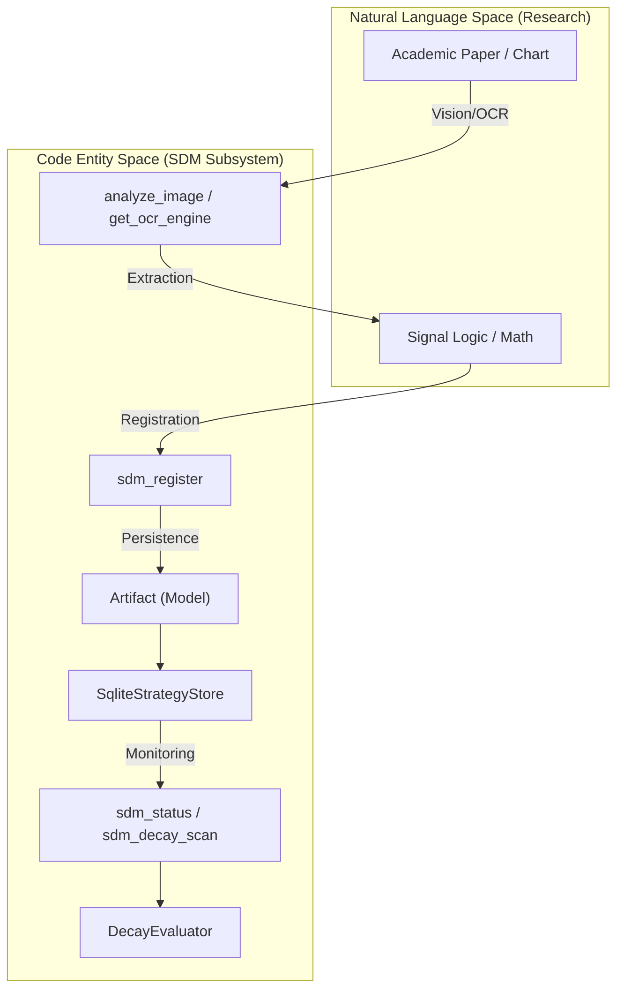
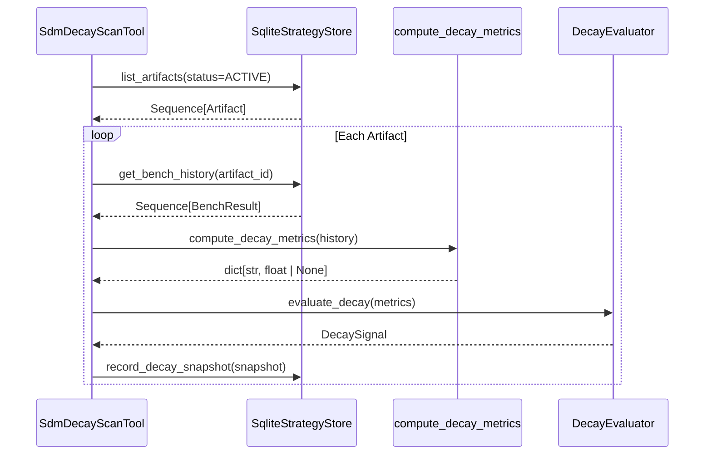

<!-- source: DeepWiki mcp.deepwiki.com · repo HKUDS/Vibe-Trading · page 15.2 Strategy Development Manager (SDM) · fetched 2026-11-09 -->

# Strategy Development Manager (SDM)

Relevant source files

The following files were used as context for generating this wiki page:

- [agent/src/skills/doc-reader/SKILL.md](agent/src/skills/doc-reader/SKILL.md)
- [agent/src/skills/strategy-dev-manager/SKILL.md](agent/src/skills/strategy-dev-manager/SKILL.md)
- [agent/src/strategy_store/metrics.py](agent/src/strategy_store/metrics.py)
- [agent/src/strategy_store/models.py](agent/src/strategy_store/models.py)
- [agent/src/strategy_store/sqlite_store.py](agent/src/strategy_store/sqlite_store.py)
- [agent/src/strategy_store/store.py](agent/src/strategy_store/store.py)
- [agent/src/tools/backtest_tool.py](agent/src/tools/backtest_tool.py)
- [agent/src/tools/doc_reader_tool.py](agent/src/tools/doc_reader_tool.py)
- [agent/src/tools/ocr/engine.py](agent/src/tools/ocr/engine.py)
- [agent/src/tools/ocr/llm_vision_ocr.py](agent/src/tools/ocr/llm_vision_ocr.py)
- [agent/src/tools/ocr/rapid_ocr.py](agent/src/tools/ocr/rapid_ocr.py)
- [agent/src/tools/sdm_decay_scan_tool.py](agent/src/tools/sdm_decay_scan_tool.py)
- [agent/src/tools/sdm_status_tool.py](agent/src/tools/sdm_status_tool.py)
- [agent/tests/test_backtest_records_bench.py](agent/tests/test_backtest_records_bench.py)
- [agent/tests/test_backtest_tool_state.py](agent/tests/test_backtest_tool_state.py)
- [agent/tests/test_doc_reader.py](agent/tests/test_doc_reader.py)
- [agent/tests/test_doc_reader_docx_order.py](agent/tests/test_doc_reader_docx_order.py)
- [agent/tests/test_doc_reader_excel_literal_text.py](agent/tests/test_doc_reader_excel_literal_text.py)
- [agent/tests/test_doc_reader_inverted_pages.py](agent/tests/test_doc_reader_inverted_pages.py)
- [agent/tests/test_doc_reader_native_fallback.py](agent/tests/test_doc_reader_native_fallback.py)
- [agent/tests/test_doc_reader_pptx_containers.py](agent/tests/test_doc_reader_pptx_containers.py)
- [agent/tests/test_doc_reader_unicode_page_dashes.py](agent/tests/test_doc_reader_unicode_page_dashes.py)
- [agent/tests/test_ocr_engine.py](agent/tests/test_ocr_engine.py)
- [agent/tests/test_ocr_integration.py](agent/tests/test_ocr_integration.py)
- [agent/tests/test_sdm_finite_metrics.py](agent/tests/test_sdm_finite_metrics.py)
- [agent/tests/test_strategy_store.py](agent/tests/test_strategy_store.py)

The Strategy Development Manager (SDM) is a specialized subsystem designed to manage the full lifecycle of quantitative factors and trading strategies. It bridges the gap between unstructured research (academic papers, chart screenshots) and structured, monitored execution artifacts. The SDM provides persistent storage for strategy metadata, automated performance benchmarking, and continuous decay monitoring to ensure strategies remain effective over time [agent/src/skills/strategy-dev-manager/SKILL.md:1-20]().

## SDM Workflow
The SDM follows a strict 5-phase workflow defined in the `strategy-dev-manager` skill:

1.  **INGEST**: Capturing raw research inputs, including PDF papers, web articles, or chart screenshots via OCR/Vision tools [agent/src/skills/strategy-dev-manager/SKILL.md:25-30]().
2.  **EXTRACT**: Translating natural language descriptions into formal mathematical definitions and signal logic [agent/src/skills/strategy-dev-manager/SKILL.md:32-35]().
3.  **IMPLEMENT**: Generating executable Python code using the `SignalEngine` contract and registering the artifact in the `StrategyStore` [agent/src/skills/strategy-dev-manager/SKILL.md:37-40]().
4.  **EVALUATE**: Running standardized backtests to compute baseline metrics (IC, IR, Sharpe) and determining if the artifact is "Alive" or "Dead" [agent/src/skills/strategy-dev-manager/SKILL.md:42-45]().
5.  **MONITOR**: Periodically scanning active artifacts for performance decay using rolling metrics vs. baseline benchmarks [agent/src/skills/strategy-dev-manager/SKILL.md:47-50]().

### Natural Language to Code Entity Space: SDM Workflow
This diagram maps the conceptual research phases to the specific code implementations and tools.

Sources: [agent/src/skills/strategy-dev-manager/SKILL.md:1-50](), [agent/src/strategy_store/models.py:1-100](), [agent/src/tools/ocr/engine.py:118-125]()

---

## Strategy Store Persistence
The SDM utilizes a persistent storage layer to track the lineage, governance metadata, and health of all quantitative artifacts.

### StrategyStoreProtocol and Backends
The system defines a `StrategyStoreProtocol` [agent/src/strategy_store/store.py:69-166]() implemented by both `InMemoryStrategyStore` [agent/src/strategy_store/store.py:173-187]() and `SqliteStrategyStore` [agent/src/strategy_store/sqlite_store.py:126-132]().

Key features of `SqliteStrategyStore`:
*   **Unique Constraint**: Enforces `UNIQUE(name, universe)` to prevent duplicate factor/strategy registrations for the same market [agent/src/strategy_store/sqlite_store.py:162-190]().
*   **WAL Mode and Concurrency**: Configures SQLite with Write-Ahead Logging (`WAL`), `PRAGMA foreign_keys=ON`, and a `busy_timeout` of 5000ms [agent/src/strategy_store/sqlite_store.py:146-152]().
*   **Model Governance Extensions**: Tables include columns for developer, owner, validator, approver, model tier, intended use, limitations, and validation status [agent/src/strategy_store/sqlite_store.py:53-65]().

### Data Models
The SDM relies on Pydantic/dataclass models defined in `src/strategy_store/models.py`:
*   **Artifact**: The root record containing metadata, source URLs, LaTeX formulas, required data columns, governance fields, and lifecycle status [agent/tests/test_strategy_store.py:87-101]().
*   **BenchResult**: Stores historical backtest performance metrics like `ic_mean`, `ic_std`, `ir`, `sharpe`, and `t_stat` [agent/tests/test_strategy_store.py:122-135]().
*   **DecaySnapshot**: A point-in-time record of rolling performance vs. baseline, tracking `decay_signal` and consecutive warnings [agent/tests/test_strategy_store.py:137-149]().

Sources: [agent/src/strategy_store/store.py:69-166](), [agent/src/strategy_store/sqlite_store.py:53-190](), [agent/tests/test_strategy_store.py:87-149]()

---

## Decay Monitoring and Evaluation
The `DecayEvaluator` and `compute_decay_metrics` utilities monitor whether a factor or strategy has lost its predictive power (Alpha Decay).

### Decay Signal Levels
Artifact health is categorized into `DecaySignal` states:
1.  **HEALTHY**: Performance matches or exceeds baseline expectations.
2.  **WARNING**: Minor degradation in rolling metrics.
3.  **DECAYED**: Significant performance drop; artifact transitions to monitoring.
4.  **CRITICAL**: Severe failure; artifact is automatically disabled.

### Evaluation Logic and Non-Finite Metric Filtering
Metrics are computed from chronological bench histories (newest-first entries reversed) [agent/src/strategy_store/metrics.py:29-45](). Non-finite values (`NaN`, `Inf`, `-Inf`) are treated as missing observations and do not satisfy minimum history requirements [agent/src/strategy_store/metrics.py:40-44](), [agent/tests/test_sdm_finite_metrics.py:21-28](). Furthermore, negative baselines disable invalid `ic_ratio` calculations to prevent false improvement readings [agent/src/strategy_store/metrics.py:88-89](), [agent/tests/test_sdm_finite_metrics.py:50-62]().

Sources: [agent/src/strategy_store/metrics.py:20-109](), [agent/src/tools/sdm_decay_scan_tool.py:1-100](), [agent/tests/test_sdm_finite_metrics.py:21-131]()

---

## Vision, OCR, and Document Ingestion
To support ingestion from unstructured sources (PDF papers, chart screenshots), the SDM integrates a pluggable OCR and document parsing subsystem.

### Pluggable OCR Engine
The `get_ocr_engine()` factory selects an OCR backend based on `VIBE_TRADING_OCR_ENGINE` [agent/src/tools/ocr/engine.py:118-125]():
*   **RapidOCR (`rapid-ocr`)**: Local ONNX-based engine, auto-selected when available (`is_cloud=False`) [agent/src/tools/ocr/engine.py:110-112]().
*   **LLM Vision OCR (`llm-vision`)**: Cloud-based vision engine compatible with any vision-capable provider using `LANGCHAIN_PROVIDER` credentials [agent/src/tools/ocr/llm_vision_ocr.py:1-12](). Never auto-selected due to privacy red lines [agent/src/tools/ocr/engine.py:126-127]().
*   **Plugins**: Discovered dynamically via entry points (`vibe_trading.ocr_engines`) [agent/src/tools/ocr/engine.py:65-78]().

### Document Reader
The `doc_reader_tool` handles multi-format file extraction (PDF via `pypdfium2` with OCR fallback, Word `.docx`, Excel `.xlsx`, PowerPoint `.pptx`, and code/text files) returning standardized JSON envelopes with security scanning [agent/src/tools/doc_reader_tool.py:1-100]().

Sources: [agent/src/tools/ocr/engine.py:34-171](), [agent/src/tools/ocr/llm_vision_ocr.py:1-154](), [agent/src/tools/doc_reader_tool.py:1-100]()

---

## SDM Tool Suite
The SDM exposes tools for the ReAct agent to interact with the strategy store:

| Tool | Action / Purpose | Key Parameters |
| :--- | :--- | :--- |
| `sdm_register` | Persists a new factor or strategy artifact | `name`, `type`, `universe`, `formula_latex`, `signal_engine_path` |
| `sdm_status` | Queries or updates artifact state | `action` (`list`, `detail`, `disable`, `enable`, `decay_check`), `artifact_id` |
| `sdm_decay_scan` | Batch evaluates decay across active artifacts | `universe`, `artifact_type`, `dry_run` |

Sources: [agent/src/tools/sdm_status_tool.py:77-118](), [agent/src/tools/sdm_decay_scan_tool.py:1-50]()

---

