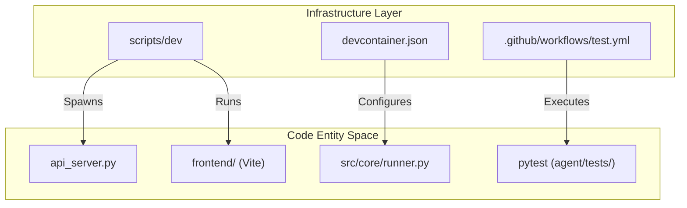
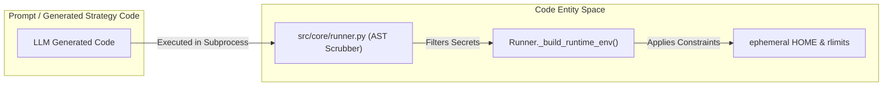

<!-- source: DeepWiki mcp.deepwiki.com · repo HKUDS/Vibe-Trading · page 16 Security, Testing, and Infrastructure · fetched 2026-11-09 -->

# Security, Testing, and Infrastructure

Relevant source files

The following files were used as context for generating this wiki page:

- [.github/workflows/test.yml](.github/workflows/test.yml)
- [.github/workflows/wiki-deploy.yml](.github/workflows/wiki-deploy.yml)
- [.github/workflows/wiki.yml](.github/workflows/wiki.yml)
- [CODE_OF_CONDUCT.md](CODE_OF_CONDUCT.md)
- [SECURITY.md](SECURITY.md)
- [agent/backtest/loaders/mt5_loader.py](agent/backtest/loaders/mt5_loader.py)
- [agent/src/core/runner.py](agent/src/core/runner.py)
- [agent/src/shadow_account/__init__.py](agent/src/shadow_account/__init__.py)
- [agent/src/shadow_account/storage.py](agent/src/shadow_account/storage.py)
- [agent/src/swarm/store.py](agent/src/swarm/store.py)
- [agent/tests/test_akshare_loader.py](agent/tests/test_akshare_loader.py)
- [agent/tests/test_matrix_stream_end_no_preview.py](agent/tests/test_matrix_stream_end_no_preview.py)
- [agent/tests/test_mt5_interval_lowercase.py](agent/tests/test_mt5_interval_lowercase.py)
- [agent/tests/test_mt5_loader.py](agent/tests/test_mt5_loader.py)
- [agent/tests/test_mt5_loader_week_month_reject.py](agent/tests/test_mt5_loader_week_month_reject.py)
- [agent/tests/test_runner_env.py](agent/tests/test_runner_env.py)
- [agent/tests/test_swarm_events_partial_tail.py](agent/tests/test_swarm_events_partial_tail.py)
- [agent/tests/test_user_state_paths.py](agent/tests/test_user_state_paths.py)
- [wiki/README.md](wiki/README.md)
- [wiki/_redirects](wiki/_redirects)
- [wiki/assets/alpha-library-og.png](wiki/assets/alpha-library-og.png)
- [wiki/docs/styles.css](wiki/docs/styles.css)
- [wiki/scripts/check_docs_parity.mjs](wiki/scripts/check_docs_parity.mjs)
- [wiki/scripts/check_social_cards.py](wiki/scripts/check_social_cards.py)
- [wiki/styles.css](wiki/styles.css)

This page provides an overview of the mechanisms used to ensure the reliability, safety, and deployability of the Vibe-Trading system. The architecture prioritizes a "secure-by-default" approach to LLM-driven code execution, a comprehensive test suite for financial logic, and a streamlined infrastructure supporting local, Docker, and CI/CD environments.

This is a parent page. For deep technical details, see the child pages:
- **[Security Boundaries and Hardening](#16.1)** — safe_path enforcement, shell tool gating, API auth and SSE tickets, AST scrubber, redaction utilities, endpoint guard against SSRF/DNS rebinding, upload restrictions, prompt-injection scanner, Docker hardening, hash-locked dependencies, and `SECURITY.md`.
- **[Test Suite and CI/CD](#16.2)** — `agent/tests/` categories and conftest fixtures, GitHub Actions workflows (`test`, `docker-build`, `loader-health`, `wiki deploy`, `desktop-windows`), `ci_grep_gates`, devcontainer, and key test patterns.
- **[Documentation Site and Wiki Assets](#16.3)** — The `wiki/` static site: home/docs/research-lab/alpha-library/tutorials pages, `content.js`, locales, Cloudflare Pages functions and middleware, `build_alpha_library.py`, social card checks, README translation set, and `CHANGELOG`.

---

## System Infrastructure Overview

The Vibe-Trading infrastructure is designed for portability and developer ergonomics. It supports three primary execution environments:
1. **Local Development**: Managed via Python virtual environments and the `vibe-trading` CLI entrypoint. The `scripts/dev` helper manages backend and frontend lifecycles, including log tailing and process status tracking [scripts/dev:1-270](), [scripts/dev:224-253]().
2. **Containerized**: A devcontainer configuration provides a standardized environment with Python 3.11 and Node 20, pre-configuring ports 8899 (API) and 5899 (Frontend) [.devcontainer/devcontainer.json:1-39](), [.devcontainer/devcontainer.json:9-24]().
3. **CI/CD**: Automated testing and quality gates are enforced via GitHub Actions workflows defined in `.github/workflows/` [.github/workflows/test.yml:1-154](), [.github/workflows/wiki.yml:1-73](), [.github/workflows/wiki-deploy.yml:1-53]().

### Infrastructure-to-Code Mapping

The following diagram maps infrastructure components to the specific files and logic that define them, bridging the gap between environment configuration and code entities.

**Infrastructure and Code Entity Association**

**Sources:** [scripts/dev:1-270](), [.devcontainer/devcontainer.json:1-39](), [.github/workflows/test.yml:70-138](), [agent/src/core/runner.py:32-121]()

---

## Security Hardening

Vibe-Trading operates as an autonomous agent capable of generating and executing Python code. To mitigate risks associated with LLM-generated code and external inputs, the system implements several layers of security:

* **Vulnerability Reporting**: A formal security policy is established in `SECURITY.md`, directing private disclosures to GitHub Security Advisories [SECURITY.md:1-47]().
* **Sandbox Subprocess Hardening**: The system uses a multi-layered defense (VT-001) for backtest execution [agent/src/core/runner.py:32-69](). This includes an AST-based scrubber and a privilege-dropped subprocess using the `vibe-sandbox` account where available.
* **Resource Limits**: The runner caps virtual address space (`RLIMIT_AS`) at 4GB and file descriptors (`RLIMIT_NOFILE`) at 512 to prevent Denial-of-Service (DoS) from generated code [agent/src/core/runner.py:49-51](), [agent/tests/test_runner_env.py:148-156]().
* **Ephemeral Home & Isolation**: Generated strategies run with an ephemeral `HOME` directory [agent/src/core/runner.py:112-146](). Only specific loader-owned paths (e.g., `qveris.json`, `cache`) are re-exposed via symlinks, keeping sensitive files like `.env` and `sessions.db` unreadable [agent/src/core/runner.py:39-44](), [agent/tests/test_runner_env.py:113-139]().

For a detailed breakdown of the security model, see **[Security Boundaries and Hardening](#16.1)**.

### Environment Scrubbing and Sandbox Isolation

The system ensures that LLM-generated strategy code cannot access broker credentials or API keys by filtering environment variables and isolating the runtime environment.

**Environment Scrubbing Logic**

**Sources:** [agent/src/core/runner.py:32-170](), [agent/tests/test_runner_env.py:61-101]()

---

## Test Suite and CI/CD

The project maintains a comprehensive testing infrastructure in `agent/tests/`. The test suite uses `pytest` and verifies financial math, data loaders, agent loops, API endpoints, and security guardrails.

| Category | Description | Key Files |
| :--- | :--- | :--- |
| **API & Upload Security** | Validates upload limits, CORS, and endpoint guards. | `agent/tests/test_upload_api.py` |
| **Sandbox Safety** | Ensures ephemeral home cleanup, secret scrubbing, and UID-drop fallbacks. | `agent/tests/test_runner_env.py` |
| **Data Loader Contracts** | Validates loader outputs (AKShare, MT5, Yahoo, etc.) against uniform OHLCV schemas. | `agent/tests/test_akshare_loader.py`, `agent/tests/test_mt5_loader.py` |
| **Swarm & Channels** | Tests multi-agent DAG event streaming, half-written tail tolerance, and chat adapters. | `agent/tests/test_swarm_events_partial_tail.py`, `agent/tests/test_matrix_stream_end_no_preview.py` |

For details on test fixtures, CI/CD pipelines, and GitHub Actions workflows, see **[Test Suite and CI/CD](#16.2)**.

**Sources:** [.github/workflows/test.yml:1-154](), [agent/tests/test_runner_env.py:1-201](), [agent/tests/test_akshare_loader.py:1-194]()

---

## Documentation Site and Wiki Assets

Vibe-Trading maintains an extensive static documentation site and wiki (`wiki/`) deployed via Cloudflare Pages. 

* **Static Site Structure**: Includes home, docs, research lab, alpha library, and tutorials pages powered by JavaScript assets and localized bundles [wiki/README.md:1-30]().
* **Validation Pipelines**: CI workflows enforce documentation parity between English and Chinese (`check_docs_parity.mjs`), check JSON syntax, synchronize site chrome, and verify social card metadata [wiki/scripts/check_social_cards.py:1-50](), [.github/workflows/wiki.yml:1-73]().
* **Cloudflare Deployment**: Automated via `.github/workflows/wiki-deploy.yml`, building the Alpha Library manifest and deploying via Wrangler [.github/workflows/wiki-deploy.yml:1-53]().

For details on wiki maintenance and translation parity, see **[Documentation Site and Wiki Assets](#16.3)**.

**Sources:** [.github/workflows/wiki.yml:1-73](), [.github/workflows/wiki-deploy.yml:1-53](), [wiki/README.md:1-30]()

---

