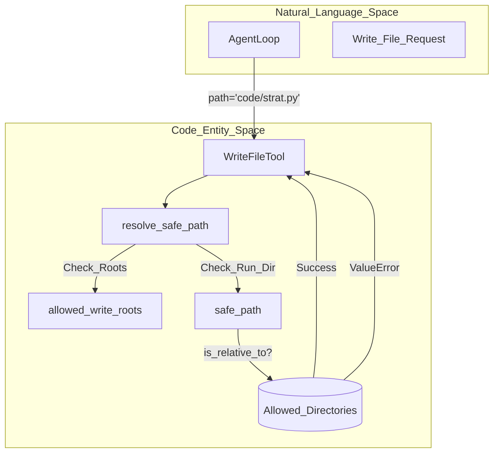
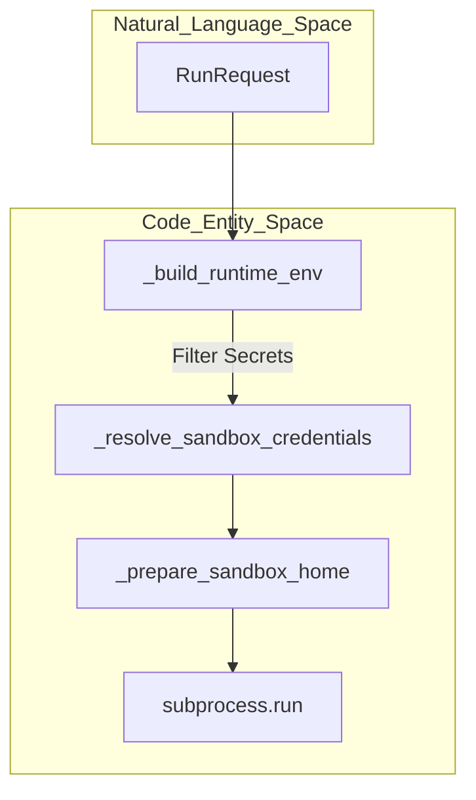

<!-- source: DeepWiki mcp.deepwiki.com · repo HKUDS/Vibe-Trading · page 16.1 Security Boundaries and Hardening · fetched 2026-11-09 -->

# Security Boundaries and Hardening

Relevant source files

The following files were used as context for generating this wiki page:

- [.github/dependabot.yml](.github/dependabot.yml)
- [.gitignore](.gitignore)
- [CODE_OF_CONDUCT.md](CODE_OF_CONDUCT.md)
- [SECURITY.md](SECURITY.md)
- [agent/backtest/loaders/mt5_loader.py](agent/backtest/loaders/mt5_loader.py)
- [agent/cli/ui/rail.py](agent/cli/ui/rail.py)
- [agent/requirements.txt](agent/requirements.txt)
- [agent/src/agent/frontmatter.py](agent/src/agent/frontmatter.py)
- [agent/src/agent/memory.py](agent/src/agent/memory.py)
- [agent/src/agent/skills.py](agent/src/agent/skills.py)
- [agent/src/api/custom_provider_routes.py](agent/src/api/custom_provider_routes.py)
- [agent/src/core/runner.py](agent/src/core/runner.py)
- [agent/src/memory/__init__.py](agent/src/memory/__init__.py)
- [agent/src/providers/endpoint_guard.py](agent/src/providers/endpoint_guard.py)
- [agent/src/shadow_account/__init__.py](agent/src/shadow_account/__init__.py)
- [agent/src/shadow_account/storage.py](agent/src/shadow_account/storage.py)
- [agent/src/skills/options-strategy/SKILL.md](agent/src/skills/options-strategy/SKILL.md)
- [agent/src/tools/edit_file_tool.py](agent/src/tools/edit_file_tool.py)
- [agent/src/tools/fund_nav_tool.py](agent/src/tools/fund_nav_tool.py)
- [agent/src/tools/path_utils.py](agent/src/tools/path_utils.py)
- [agent/src/tools/read_file_tool.py](agent/src/tools/read_file_tool.py)
- [agent/src/tools/redaction.py](agent/src/tools/redaction.py)
- [agent/src/tools/skill_writer_tool.py](agent/src/tools/skill_writer_tool.py)
- [agent/src/tools/write_file_tool.py](agent/src/tools/write_file_tool.py)
- [agent/tests/test_akshare_loader.py](agent/tests/test_akshare_loader.py)
- [agent/tests/test_cli_rail_dashboard.py](agent/tests/test_cli_rail_dashboard.py)
- [agent/tests/test_custom_provider_routes.py](agent/tests/test_custom_provider_routes.py)
- [agent/tests/test_file_tool_sandbox_security.py](agent/tests/test_file_tool_sandbox_security.py)
- [agent/tests/test_fund_nav_tool.py](agent/tests/test_fund_nav_tool.py)
- [agent/tests/test_gitignore_runtime_files.py](agent/tests/test_gitignore_runtime_files.py)
- [agent/tests/test_mt5_interval_lowercase.py](agent/tests/test_mt5_interval_lowercase.py)
- [agent/tests/test_mt5_loader.py](agent/tests/test_mt5_loader.py)
- [agent/tests/test_mt5_loader_week_month_reject.py](agent/tests/test_mt5_loader_week_month_reject.py)
- [agent/tests/test_packaging_dependencies.py](agent/tests/test_packaging_dependencies.py)
- [agent/tests/test_path_safety.py](agent/tests/test_path_safety.py)
- [agent/tests/test_provider_endpoint_guard.py](agent/tests/test_provider_endpoint_guard.py)
- [agent/tests/test_read_file_directory_errors.py](agent/tests/test_read_file_directory_errors.py)
- [agent/tests/test_read_file_refusals.py](agent/tests/test_read_file_refusals.py)
- [agent/tests/test_redaction.py](agent/tests/test_redaction.py)
- [agent/tests/test_redaction_channel_and_provider_tokens.py](agent/tests/test_redaction_channel_and_provider_tokens.py)
- [agent/tests/test_redaction_cookie_headers.py](agent/tests/test_redaction_cookie_headers.py)
- [agent/tests/test_redaction_shared.py](agent/tests/test_redaction_shared.py)
- [agent/tests/test_runner_env.py](agent/tests/test_runner_env.py)
- [agent/tests/test_skill_writer_tools.py](agent/tests/test_skill_writer_tools.py)
- [agent/tests/test_skills.py](agent/tests/test_skills.py)
- [agent/tests/test_trade_journal_fiat_pairs_not_crypto.py](agent/tests/test_trade_journal_fiat_pairs_not_crypto.py)
- [agent/tests/test_user_state_paths.py](agent/tests/test_user_state_paths.py)
- [pyproject.toml](pyproject.toml)
- [requirements-channels-lock.txt](requirements-channels-lock.txt)
- [requirements-lock.txt](requirements-lock.txt)
- [tools/requirements-loader-health.txt](tools/requirements-loader-health.txt)

Vibe-Trading implements a multi-layered security model designed to prevent unauthorized access, path traversal, and malicious code execution within the trading environment. Following security reviews, the system enforces a "least privilege" architecture for the AI agent, restricting file system access, network visibility, and shell capabilities.

## Path Enforcement and Sandboxing

The system enforces strict path validation for all file operations (reading, writing, and editing) to prevent path traversal attacks. This is primarily managed through environment variables that define "safe roots" and utility functions that resolve paths against these roots.

### safe_path Enforcement
The core of path security resides in `agent/src/tools/path_utils.py` [agent/src/tools/path_utils.py:1-16](). The utility functions resolve paths and verify they reside within allowed directories.

*   **`VIBE_TRADING_ALLOWED_FILE_ROOTS`**: Controls which directories the agent can access for general document reading (e.g., PDF reports, broker CSVs) [agent/src/tools/path_utils.py:25-25](). Defaults include `uploads/`, `data/`, and `~/.vibe-trading/imports/` [agent/src/tools/path_utils.py:84-96]().
*   **`VIBE_TRADING_ALLOWED_RUN_ROOTS`**: Controls the directories where the agent can manage backtest artifacts and `signal_engine.py` files [agent/src/tools/path_utils.py:26-26]().
*   **UNC Rejection**: All path helpers explicitly reject UNC shares (`\\server\share`) or Unix double-slashes (`//server/share`) to prevent SMB-based exfiltration or credential relay attacks [agent/src/tools/path_utils.py:29-32]().

### Path Validation Logic
Any tool accepting a file path parameter invokes validation logic. The system ensures that requests for run logs or code do not escape the designated roots using a whitelist approach.

| Tool / Function | Enforcement Mechanism | Security Goal |
| :--- | :--- | :--- |
| `ReadFileTool` | `safe_path` | Restricts reading to a specific `workdir` sandbox or `skills/` [agent/src/tools/read_file_tool.py:46-84](). |
| `WriteFileTool` | `resolve_safe_path` | Restricts writing to allowed roots or active `run_dir` [agent/src/tools/write_file_tool.py:72-86](). |
| `EditFileTool` | `resolve_safe_path` | Prevents editing system files like `/etc/passwd` [agent/src/tools/edit_file_tool.py:45-59](). |
| `resolve_safe_path` | `is_relative_to` check | Ensures path containment within `allowed_roots` [agent/src/tools/path_utils.py:182-209](). |

Title: File System Sandboxing and Resolution

Sources: [agent/src/tools/path_utils.py:1-213](), [agent/src/tools/read_file_tool.py:42-118](), [agent/src/tools/write_file_tool.py:14-106](), [agent/src/tools/edit_file_tool.py:45-59](), [agent/tests/test_file_tool_sandbox_security.py:1-165]()

---

## API Authentication and Access Control

The `api_server.py` implements a tiered authentication model that distinguishes between local development and remote production access.

### Authentication Mechanisms
*   **HTTPBearer**: Standard Bearer token authentication for REST endpoints, implemented by `require_auth`.
*   **SSE Tickets**: Short-lived, single-use tokens used for EventSource (SSE) streams, replacing long-lived URL keys to prevent session hijacking. Minted via `_mint_sse_ticket` and consumed via `_consume_sse_ticket`.
*   **`require_local_or_auth`**: A security dependency that bypasses authentication for local clients (`127.0.0.1` or `::1`) but enforces strict credentials for remote callers.
*   **Docker Loopback Trust**: If configured via `VIBE_TRADING_TRUST_DOCKER_LOOPBACK`, the system trusts the Docker bridge gateway IP for internal container communication.

### Endpoint Hardening
*   **`/correlation`**: High-compute endpoints are authenticated and rate-limited to prevent Denial-of-Service (DoS) attacks.
*   **Security Headers**: The server emits `X-Content-Type-Options: nosniff`, `Permissions-Policy`, and a `Content-Security-Policy (CSP)` in Report-Only mode via `_apply_security_headers`.
*   **Health Split**: Separate `/live` and `/ready` endpoints allow orchestrators to distinguish between a running process and one ready to handle traffic [agent/src/api/system_routes.py:100-101]().

Sources: [agent/api_server.py:1-100](), [agent/tests/test_security_auth_api.py:1-100]()

---

## Subprocess Sandboxing and Docker Hardening

Vibe-Trading uses a defense-in-depth approach for executing generated backtest code. While the AST scrubber is the primary code-level defense, the execution environment is heavily restricted.

### Subprocess Privilege Dropping
In Linux environments (specifically the hardened Docker image), the backtest runner attempts to drop privileges to a dedicated account:
*   **`vibe-sandbox` Account**: If the `vibe-sandbox` user exists, the runner uses `CAP_SETUID`/`CAP_SETGID` to execute the strategy under an unprivileged UID [agent/src/core/runner.py:39-70]().
*   **Ephemeral HOME**: The runner creates a temporary home directory and symlinks only specific, non-sensitive paths (`cache`, `data-bridge`, `qveris.json`) from the real home directory [agent/src/core/runner.py:41-46]().
*   **Resource Limits (RLIMIT)**: Caps virtual address space (default 4GB via `RLIMIT_AS`) and file descriptors (`RLIMIT_NOFILE`) to prevent resource exhaustion DoS [agent/src/core/runner.py:49-53](), [agent/src/core/runner.py:84-116]().

Title: Environment Variable Scrubbing and Subprocess Isolation

Sources: [agent/src/core/runner.py:32-167](), [SECURITY.md:1-44](), [agent/tests/test_runner_env.py:155-187]()

---

## Live Trading Security Model

The live trading system introduces a fail-closed security architecture centered on Mandates and the Order Guard.

### Pre-Trade Enforcement Gate
The `LiveOrderGuardTool` implements a strict fail-closed check before any broker interaction:
1.  **`load_mandate`**: Denies execution if no valid mandate exists.
2.  **Expiry Check**: Denies execution if `consent.expires_at` has passed.
3.  **`halt_flag_set`**: Checks the global kill switch flag.
4.  **`extract_order_intent`**: Parses and validates the order structure.
5.  **Market Snapshot**: Reads current positions and balances via restricted read-only tools.
6.  **`check_mandate`**: Validates against hard caps (max position size, max daily loss) and universe constraints.

### Isolation and Auditing
*   **Mandate Write Path**: Mandates can only be committed via authenticated API endpoints requiring an out-of-band `consent_ack` from the user.
*   **Audit Ledger**: Every live action is recorded in a tamper-evident, hash-chained audit ledger with automatic redaction of sensitive arguments.
*   **Kill Switch**: The `/live/halt` endpoint provides a global emergency stop that immediately halts execution.

Sources: [SECURITY.md:1-44]()

---

## Redaction Utilities

The system includes shared redaction modules (`agent/src/tools/redaction.py`) to prevent leakage of sensitive data (CWE-209/497) across logs, traces, and SSE streams [agent/src/tools/redaction.py:1-33]().

*   **`redact_internal_paths`**: Replaces absolute internal root prefixes with a `'<redacted>'` sentinel while preserving relative tails for debugging [agent/src/tools/redaction.py:5-10]().
*   **`redact_payload` / `is_sensitive_arg`**: Recursively scrubs credential keys (`api_key`, `authorization`, `secret`, `token`) and exact PII fields (`account_number`, `ssn`, `routing_number`) from structured tool payloads [agent/src/tools/redaction.py:11-18](). It operates with sink-aware separation between `ARGUMENTS_SINK` and `RESULT_SINK` [agent/src/tools/redaction.py:21-25]().
*   **`redact_text` / `redact_tool_result`**: Pattern-scrubs free-form text surfaces such as shell outputs, error messages, and raw log lines [agent/src/tools/redaction.py:26-32]().

Sources: [agent/src/tools/redaction.py:1-168](), [agent/tests/test_redaction.py:1-167]()

---

## Shell Tool Gating and Dependencies

*   **Shell Tool Gating**: The execution of arbitrary shell commands by the agent is controlled via the `VIBE_TRADING_ENABLE_SHELL_TOOLS` environment variable. By default, it is disabled.
*   **Hash-Locked Dependencies**: To ensure supply chain integrity and prevent dependency confusion, dependencies are explicitly pinned and hash-validated via `requirements-lock.txt` generated from `pyproject.toml` [pyproject.toml:1-88](), [requirements-lock.txt:1-91](). Dependabot is configured to monitor vulnerabilities while respecting incompatible major versions [/.github/dependabot.yml:1-102]().

Sources: [pyproject.toml:1-88](), [requirements-lock.txt:1-91](), [/.github/dependabot.yml:1-102]()

---

