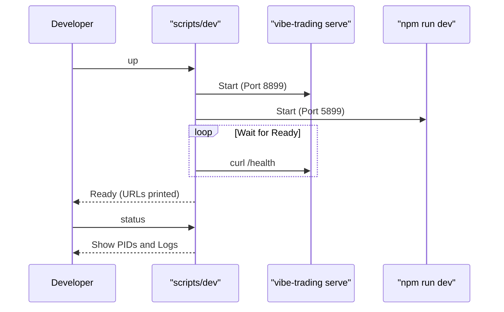

<!-- source: DeepWiki mcp.deepwiki.com · repo HKUDS/Vibe-Trading · page 16.2 Test Suite and CI/CD · fetched 2026-11-09 -->

# Test Suite and CI/CD

Relevant source files

The following files were used as context for generating this wiki page:

- [.github/workflows/loader-health.yml](.github/workflows/loader-health.yml)
- [.github/workflows/test.yml](.github/workflows/test.yml)
- [.github/workflows/wiki-deploy.yml](.github/workflows/wiki-deploy.yml)
- [.github/workflows/wiki.yml](.github/workflows/wiki.yml)
- [agent/backtest/loader_health.py](agent/backtest/loader_health.py)
- [agent/src/api/live_routes.py](agent/src/api/live_routes.py)
- [agent/src/swarm/store.py](agent/src/swarm/store.py)
- [agent/tests/conftest.py](agent/tests/conftest.py)
- [agent/tests/test_agent_config.py](agent/tests/test_agent_config.py)
- [agent/tests/test_api_live_runtime.py](agent/tests/test_api_live_runtime.py)
- [agent/tests/test_channel_media_roots.py](agent/tests/test_channel_media_roots.py)
- [agent/tests/test_config_root_sandbox.py](agent/tests/test_config_root_sandbox.py)
- [agent/tests/test_etoro_runtime.py](agent/tests/test_etoro_runtime.py)
- [agent/tests/test_loader_health.py](agent/tests/test_loader_health.py)
- [agent/tests/test_matrix_stream_end_no_preview.py](agent/tests/test_matrix_stream_end_no_preview.py)
- [agent/tests/test_swarm_events_partial_tail.py](agent/tests/test_swarm_events_partial_tail.py)
- [wiki/README.md](wiki/README.md)
- [wiki/_redirects](wiki/_redirects)
- [wiki/assets/alpha-library-og.png](wiki/assets/alpha-library-og.png)
- [wiki/docs/styles.css](wiki/docs/styles.css)
- [wiki/scripts/check_docs_parity.mjs](wiki/scripts/check_docs_parity.mjs)
- [wiki/scripts/check_social_cards.py](wiki/scripts/check_social_cards.py)
- [wiki/styles.css](wiki/styles.css)

This page documents the testing infrastructure and Continuous Integration/Deployment (CI/CD) pipelines for Vibe-Trading. The system utilizes `pytest` for automated validation across market engines, data loaders, MCP integrations, security boundaries, and the IRR-AGL (Institutional Research Reliability and Agent Governance Layer) reliability gates.

## Test Infrastructure Overview

The test suite is located in `agent/tests/` and is designed to validate the core reasoning engine, financial calculation accuracy, and security constraints. The infrastructure supports unit, integration, and regression testing patterns.

### Test Categories

1.  **Unit Tests**: Validate individual functions such as performance metrics (Sharpe, Sortino, Drawdown) and market detection regex [agent/tests/test_market_detection.py:1-10]().
2.  **Integration Tests**: Validate complex multi-component paths, including market-specific execution rules. For example, `test_crypto_engine.py` validates 24/7 execution, funding fees, and liquidation logic [agent/tests/test_crypto_engine.py:133-143]().
3.  **Security Regression Tests**: Ensure that safety boundaries are enforced. This includes logic to prevent path traversal, blocked file extensions, and cross-site request forgery in the upload API [agent/tests/test_upload_api.py:31-51](), [agent/tests/test_upload_api.py:178-185]().
4.  **Agent Eval (Deterministic)**: Replay-only tests that use fake loader/connector boundaries to verify agent reasoning and policy enforcement without network or LLM costs (referenced in CI [.github/workflows/test.yml:126-129]()).
5.  **Reliability & Research Protocol**: Validates the IRR-AGL layer, ensuring research lineage tracking and preventing lookahead bias [agent/tests/test_agent_guide_paths.py:1-15]().
6.  **E2E Smoke Tests**: These tests spawn real subprocesses to verify JSON-RPC handshakes, tool listing, and execution. Local E2E tests requiring live API keys (e.g., `test_e2e_harness_v2.py`) are excluded from CI to prevent environment-dependent failures [.github/workflows/test.yml:126-129](), [.gitignore:76-81]().

### Code Entity Mapping: Test Space to Logic Space

The following diagram illustrates how specific test modules map to the core system components they validate.

**Test to Logic Mapping**

```mermaid
graph TD
    subgraph "Test_Space"
        T_BASE["test_base_engine.py"]
        T_CRYPTO["test_crypto_engine.py"]
        T_UPL["test_upload_api.py"]
        T_GUIDE["test_agent_guide_paths.py"]
        T_SWARM_STORE["test_swarm_store_atomic_write.py"]
        T_SWARM_ROUTES["test_swarm_route_contracts.py"]
        T_AGENT_CONFIG["test_agent_config.py"]
        T_LIVE_RUNTIME["test_api_live_runtime.py"]
        T_LOADER_HEALTH["test_loader_health.py"]
        T_CONFTEST["conftest.py"]
    end

    subgraph "Code_Entity_Space"
        C_BASE["backtest/engines/base.py"]
        C_CRYPTO["backtest/engines/crypto.py"]
        C_API["api_server.py"]
        C_IRR["IRR-AGL Layer"]
        C_SWARM_STORE["src/swarm/store.py"]
        C_SWARM_ROUTES["src/api/swarm_routes.py"]
        C_AGENT_CONFIG["src/config.py"]
        C_LIVE_RUNTIME["api_server.py (live trading)"]
        C_LOADER_HEALTH["backtest/loader_health.py"]
        C_CONFTEST["conftest.py (fixtures)"]
    end

    T_BASE -- "validates_bar_loop" --> C_BASE
    T_CRYPTO -- "tests_funding_logic" --> C_CRYPTO
    T_UPL -- "enforces_size_limits" --> C_API
    T_GUIDE -- "verifies_protocol" --> C_IRR
    T_SWARM_STORE -- "validates_atomic_writes" --> C_SWARM_STORE
    T_SWARM_ROUTES -- "tests_api_contracts" --> C_SWARM_ROUTES
    T_AGENT_CONFIG -- "validates_config_schema" --> C_AGENT_CONFIG
    T_LIVE_RUNTIME -- "tests_live_api_endpoints" --> C_LIVE_RUNTIME
    T_LOADER_HEALTH -- "tests_canary_contracts" --> C_LOADER_HEALTH
    T_CONFTEST -- "provides_shared_fixtures" --> C_CONFTEST
```

Sources: [agent/tests/test_base_engine.py:1-10](), [agent/tests/test_crypto_engine.py:1-10](), [agent/tests/test_upload_api.py:1-7](), [agent/tests/test_agent_guide_paths.py:1-5](), [agent/tests/test_swarm_store_atomic_write.py:1-14](), [agent/tests/test_swarm_route_contracts.py:1-3](), [agent/tests/test_agent_config.py:1-3](), [agent/tests/test_api_live_runtime.py:1-12](), [agent/tests/test_loader_health.py:1-15](), [agent/tests/conftest.py:1-11]()

## Key Testing Patterns

### Market Engine Validation
Backtest engines are tested for market-specific nuances to ensure simulation fidelity.
*   **CryptoEngine**: Validates that funding fees are deducted at settlement hours (00:00, 08:00, 16:00 UTC) and that short positions receive funding when rates are positive [agent/tests/test_crypto_engine.py:133-169]().
*   **Global Equity & China A**: Separate suites validate T+1 delivery, overnight shorting restrictions, and specific fee structures for different exchanges [agent/tests/test_global_equity_engine.py:1-10](), [agent/tests/test_china_a_engine.py:1-10]().

### API and Security Enforcement
The system enforces strict boundaries that are verified through the test suite:
*   **Upload Streaming**: `test_upload_api.py` verifies that `MAX_UPLOAD_SIZE` is enforced during streaming to prevent memory exhaustion. It uses a 4KB limit in tests to exercise the chunking and cleanup paths [agent/tests/test_upload_api.py:19-24]().
*   **Cross-Site Blocking**: Tests ensure that `Sec-Fetch-Site: cross-site` requests are rejected even from loopback [agent/tests/test_upload_api.py:31-51]().
*   **Path Sanitization**: Verification that storage errors do not expose internal server paths (e.g., absolute system paths) in error responses [agent/tests/test_upload_api.py:187-206]().

### Swarm Store Atomic Writes and Event Logs
The `SwarmStore` uses atomic writes to prevent data corruption, especially in concurrent access scenarios on Windows.
*   `test_replace_retries_transient_winerror_then_succeeds` verifies that `os.replace` retries on transient Windows errors (e.g., `ERROR_ACCESS_DENIED`, `ERROR_SHARING_VIOLATION`) before succeeding [agent/tests/test_swarm_store_atomic_write.py:45-66]().
*   `test_non_transient_error_reraises_immediately` ensures that non-transient errors are not retried and raise immediately [agent/tests/test_swarm_store_atomic_write.py:68-81]().
*   `test_transient_budget_is_bounded` confirms that the retry budget for transient errors is bounded [agent/tests/test_swarm_store_atomic_write.py:83-96]().
*   `test_concurrent_stores_writing_same_run_do_not_crash_or_clobber` validates that concurrent writes to the same run by different `SwarmStore` instances do not crash or clobber data [agent/tests/test_swarm_store_atomic_write.py:128-164](). This is critical because `_get_swarm_store()` in `agent/src/api/swarm_routes.py` builds a fresh `SwarmStore` per tool call [agent/src/api/swarm_routes.py:20-35]().
*   `test_partial_trailing_line_is_skipped_not_raised` verifies that `SwarmStore.read_events()` gracefully skips half-written trailing event lines caused by sudden process termination [agent/tests/test_swarm_events_partial_tail.py:17-32]().

### Configuration Loading
The `agent/tests/test_agent_config.py` suite validates the structured agent configuration loading.
*   `test_load_agent_config_returns_defaults_when_file_missing` ensures that default configurations are returned if the config file is missing [agent/tests/test_agent_config.py:63-70]().
*   Tests verify that both camelCase and snake_case JSON/YAML configurations are correctly parsed and mapped to Pydantic models [agent/tests/test_agent_config.py:73-147]().
*   Validation rules for configuration fields, such as `replyTimeoutS` for channels, are tested to reject invalid values [agent/tests/test_agent_config.py:125-128]().
*   Different MCP server transport types (stdio, SSE, streamableHttp) are validated for correct schema and mutual exclusivity of fields [agent/tests/test_agent_config.py:149-222]().

### Live Trading API Contracts
The `agent/tests/test_api_live_runtime.py` suite focuses on API regressions for the live-trading runtime wiring.
*   `GET /live/status` endpoint is tested to reflect the dormant-by-default channel state, including authentication, mandate, and runner liveness [agent/tests/test_api_live_runtime.py:61-80]().
*   `POST /live/authorize` is verified as a discover-only on-ramp, describing the CLI flow for authorization without actually authorizing server-side [agent/tests/test_api_live_runtime.py:119-132]().
*   Runner control endpoints (`POST /live/runner/start|stop`) are tested to require a committed, unexpired mandate and to be blocked by the kill switch [agent/tests/test_api_live_runtime.py:146-179]().

### Public Loader Health Canary
The public loader health suite (`agent/backtest/loader_health.py` and `agent/tests/test_loader_health.py`) validates that all unauthenticated public data loaders conform to canonical OHLCV schemas without leaking operator API keys or environment secrets [agent/tests/test_loader_health.py:81-91](). It exercises timeout protections, freshness bounds, and error sanitization [agent/tests/test_loader_health.py:59-142]().

Sources: [agent/tests/test_crypto_engine.py:133-169](), [agent/tests/test_upload_api.py:1-206](), [agent/tests/test_swarm_store_atomic_write.py:1-164](), [agent/src/api/swarm_routes.py:20-35](), [agent/tests/test_agent_config.py:63-222](), [agent/tests/test_api_live_runtime.py:61-179](), [agent/tests/test_swarm_events_partial_tail.py:1-41](), [agent/tests/test_loader_health.py:1-142]()

## CI/CD and Developer Workflow

The project uses GitHub Actions for automated testing and a `scripts/dev` helper for local orchestration.

### GitHub Actions Workflows
The CI pipeline comprises several specialized workflows:
1.  **CI Workflow (`.github/workflows/test.yml`)**: Triggers on push/PR to `main` and manual `workflow_dispatch`. It runs hash-lock verification across Linux x64, macOS ARM64, and Windows x64 [.github/workflows/test.yml:32-69](), executes Python tests across Python 3.11 and 3.14 legs [.github/workflows/test.yml:81-90](), enforces repository safety gates (`tools/ci_grep_gates.sh`) [.github/workflows/test.yml:117-118](), verifies syntax compilation [.github/workflows/test.yml:123-132](), and runs `pytest` with coverage [.github/workflows/test.yml:133-138](). A separate frontend job runs `npm ci`, linting, and testing [.github/workflows/test.yml:139-165]().
2.  **Wiki Validation (`.github/workflows/wiki.yml`)**: Validates JavaScript syntax in wiki scripts, checks English and Chinese documentation parity, verifies locale JSON files, synchronizes site chrome, validates i18n completeness, and checks social card metadata [.github/workflows/wiki.yml:16-58]().
3.  **Wiki Deploy (`.github/workflows/wiki-deploy.yml`)**: Automatically exports the Alpha Library manifest, builds wiki static assets, and deploys to Cloudflare Pages via `wrangler` when changes are pushed to `main` under `wiki/` or `agent/src/factors/` [.github/workflows/wiki-deploy.yml:1-53]().
4.  **Public Loader Health Canary (`.github/workflows/loader-health.yml`)**: Scheduled weekly via cron (`17 4 * * 1`) or manual dispatch, this workflow spins up isolated virtual environments to probe public market data sources and uploads a sanitized JSON health report [.github/workflows/loader-health.yml:1-41]().

### Development Helper Script
The `scripts/dev` bash script manages the local lifecycle of both backend and frontend services. It uses a Python-based daemonizer to handle process PIDs and log redirection to `.vibe-dev/logs/` [scripts/dev:60-90]().

**Development Lifecycle Flow**

| Command | Action |
| :--- | :--- |
| `up` | Starts backend and frontend dev servers [scripts/dev:184-193](). |
| `stop` | Stops all dev servers started by the script [scripts/dev:195-198](). |
| `restart [service]` | Restarts a specific service (backend/frontend) or all [scripts/dev:200-222](). |
| `logs [service]` | Tails logs for the specified service [scripts/dev:237-253](). |

### `conftest.py` Fixtures and Sandbox Environment
The `agent/tests/conftest.py` file provides shared fixtures and sets up a sandboxed environment for all tests.
*   **Runtime Root Sandbox**: Crucially, `conftest.py` redirects the `VIBE_TRADING_HOME` and `Path.home()` to a temporary directory (`_SANDBOX_HOME`) before any test modules are imported. This prevents tests from interacting with or corrupting the user's real Vibe-Trading runtime data (e.g., live mandate, audit ledger) [agent/tests/conftest.py:20-86]().
*   **Outcome Guard**: An assertion `_assert_real_root_untouched()` is registered to run at the end of the test suite, which verifies that no test inadvertently wrote to the user's actual live ledgers [agent/tests/conftest.py:130-137]().
*   **Environment Variable Scrubbing**: It scrubs environment variables like `MARKET_DATA_ORDER_*` to ensure tests run with predictable default configurations, preventing developer-specific environment settings from influencing test outcomes [agent/tests/conftest.py:90-95]().
*   **PYTHONPATH for Subprocesses**: For tests that spawn subprocesses, `PYTHONPATH` is explicitly set to include `site.USER_SITE` to ensure that child processes can find necessary Python packages, even when `HOME` is redirected [agent/tests/conftest.py:97-111]().
*   **`_no_sleep` fixture**: The `_no_sleep` fixture is automatically applied to tests in `agent/tests/test_swarm_store_atomic_write.py` to make retry tests instant and deterministic by patching `time.sleep` [agent/tests/test_swarm_store_atomic_write.py:39-43]().

### Infrastructure Configuration
*   **Repository Safety Gates (`tools/ci_grep_gates.sh`)**: Enforces policy checks across source files, verifying that prohibited imports, private file paths, or unsecured API patterns do not land in commits [.github/workflows/test.yml:117-118]().
*   **Dependabot**: Configured to group minor and patch updates for pip, npm, and GitHub Actions to minimize PR noise, while keeping major updates separate for manual vetting [.github/dependabot.yml:1-45]().
*   **DevContainer**: The `.devcontainer/devcontainer.json` provides a pre-configured environment with all necessary tools and VS Code extensions for zero-config onboarding [.devcontainer/devcontainer.json:1-39]().

Sources: [scripts/dev:1-262](), [.github/workflows/test.yml:1-168](), [.github/workflows/wiki.yml:1-58](), [.github/workflows/wiki-deploy.yml:1-38](), [.github/workflows/loader-health.yml:1-41](), [.github/dependabot.yml:1-45](), [wiki/scripts/check_social_cards.py:1-61](), [agent/tests/conftest.py:1-141](), [agent/tests/test_swarm_store_atomic_write.py:39-43]()

---

