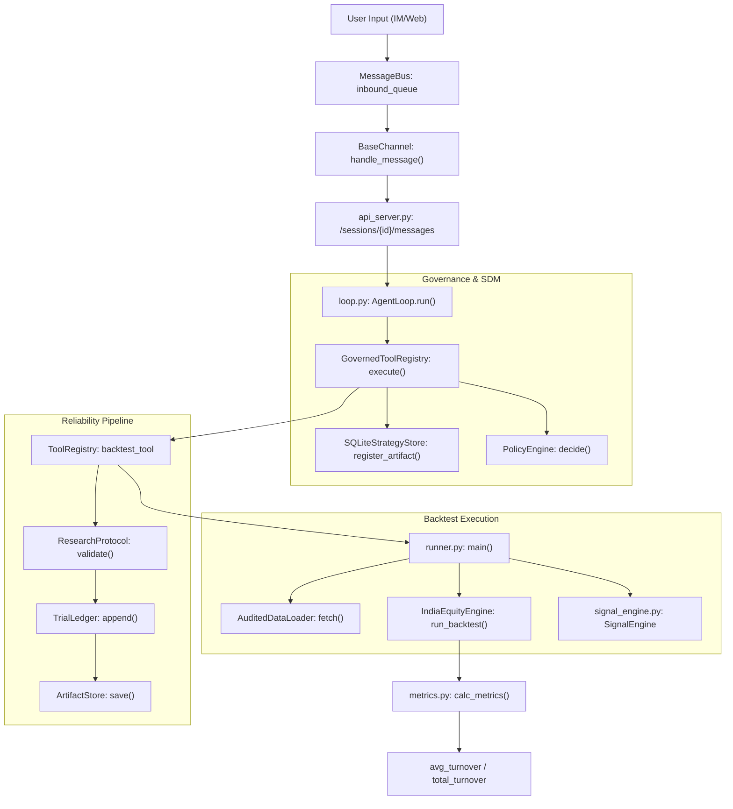
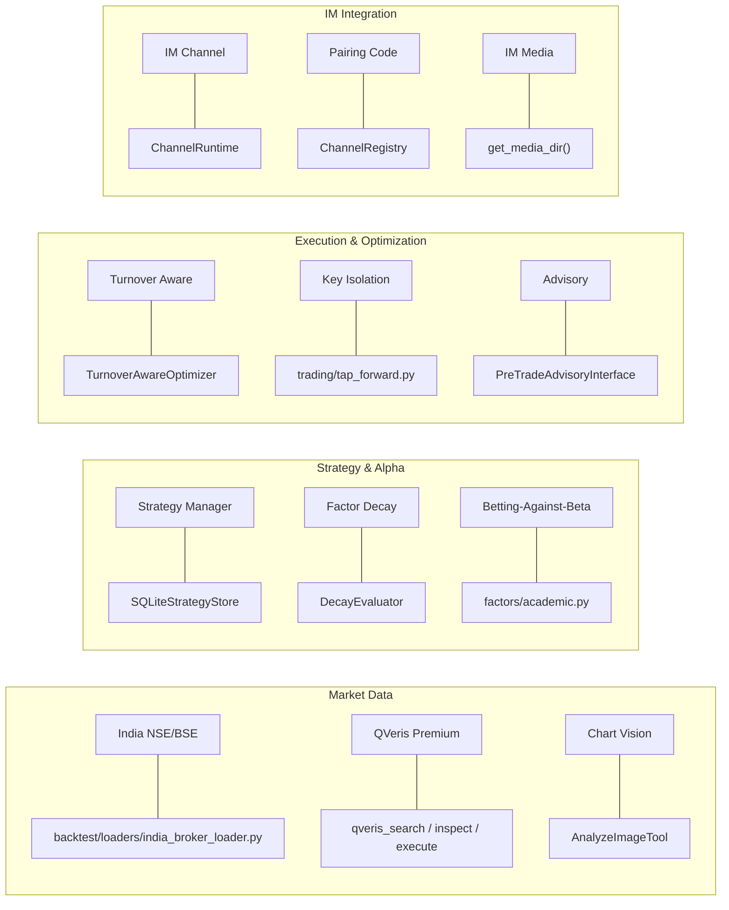

<!-- source: DeepWiki mcp.deepwiki.com · repo HKUDS/Vibe-Trading · page 17 Glossary · fetched 2026-11-09 -->

# Glossary

Relevant source files

The following files were used as context for generating this wiki page:

- [CHANGELOG.md](CHANGELOG.md)
- [README.md](README.md)
- [README_ar.md](README_ar.md)
- [README_es.md](README_es.md)
- [README_id.md](README_id.md)
- [README_ja.md](README_ja.md)
- [README_ko.md](README_ko.md)
- [README_zh.md](README_zh.md)
- [agent/SKILL.md](agent/SKILL.md)
- [agent/backtest/engines/_market_hooks.py](agent/backtest/engines/_market_hooks.py)
- [agent/backtest/engines/base.py](agent/backtest/engines/base.py)
- [agent/backtest/engines/composite.py](agent/backtest/engines/composite.py)
- [agent/backtest/engines/crypto.py](agent/backtest/engines/crypto.py)
- [agent/backtest/runner.py](agent/backtest/runner.py)
- [agent/mcp_server.py](agent/mcp_server.py)
- [agent/src/agent/loop.py](agent/src/agent/loop.py)
- [agent/src/trading/connectors/robinhood/classification.py](agent/src/trading/connectors/robinhood/classification.py)
- [agent/src/trading/connectors/robinhood/mcp.py](agent/src/trading/connectors/robinhood/mcp.py)
- [agent/src/trading/connectors/robinhood/profiles.py](agent/src/trading/connectors/robinhood/profiles.py)
- [agent/tests/test_agent_loop_dedup_arguments.py](agent/tests/test_agent_loop_dedup_arguments.py)
- [agent/tests/test_base_engine.py](agent/tests/test_base_engine.py)
- [agent/tests/test_composite_engine_fallback.py](agent/tests/test_composite_engine_fallback.py)
- [agent/tests/test_crypto_digit_leading_symbols.py](agent/tests/test_crypto_digit_leading_symbols.py)
- [agent/tests/test_crypto_engine.py](agent/tests/test_crypto_engine.py)
- [agent/tests/test_default_deny_unknown_robinhood_tool.py](agent/tests/test_default_deny_unknown_robinhood_tool.py)
- [agent/tests/test_engine_robustness.py](agent/tests/test_engine_robustness.py)
- [agent/tests/test_loop_helpers.py](agent/tests/test_loop_helpers.py)
- [agent/tests/test_market_detection.py](agent/tests/test_market_detection.py)
- [agent/tests/test_plan_rejected.py](agent/tests/test_plan_rejected.py)
- [agent/tests/test_readme_counts.py](agent/tests/test_readme_counts.py)
- [agent/tests/test_robinhood_mcp_mapping.py](agent/tests/test_robinhood_mcp_mapping.py)
- [agent/tests/test_run_card_content_filter.py](agent/tests/test_run_card_content_filter.py)
- [agent/tests/test_run_card_structured_metrics.py](agent/tests/test_run_card_structured_metrics.py)
- [agent/tests/test_session_load_metrics.py](agent/tests/test_session_load_metrics.py)

## Purpose and Scope

This page provides definitions for codebase-specific terms, domain concepts, and technical jargon used within the Vibe-Trading system. It serves as a comprehensive reference for engineers and quants to understand how natural language financial requests, quantitative models, and trading workflows are translated into executable Python code and system components, especially within the Institutional Research Reliability and Agent Governance Layer (IRR-AGL), the Strategy Development Manager (SDM), and the core ReAct agent runtime.

---

## Core System Concepts

### ReAct Agent
The central reasoning engine based on the "Reasoning and Acting" paradigm. The agent iterates through a cycle of `Thought`, `Action` (tool call), and `Observation` (tool output) to solve complex financial tasks.
*   **Implementation**: Controlled by `AgentLoop` in `agent/src/agent/loop.py`.
*   **Code Pointer**: [agent/src/agent/loop.py:1-12]()

### AgentLoop
The core execution loop of the ReAct agent. It manages context, token usage, tool execution, and progress reporting. It implements a five-layer context management strategy to handle large contexts efficiently.
*   **Five-layer context management**:
    1.  **Microcompact**: Prunes old tool results under memory pressure (`_microcompact`).
    2.  **Context Collapse**: Folds long text blocks without an LLM call (`_context_collapse`).
    3.  **Auto-compact**: LLM structured summary with token-budget tail protection.
    4.  **Compact tool**: Model explicitly calls the compact tool to trigger compaction.
    5.  **Iterative update**: Nth compression updates previous summary instead of starting fresh.
*   **Key Functions**: `AgentLoop.run()` [agent/src/agent/loop.py:170-200]()
*   **Sources**: [agent/src/agent/loop.py:1-12](), [agent/src/agent/loop.py:170-200]()

### Skill
A high-level capability described in a `SKILL.md` file. Unlike atomic tools, skills provide the agent with domain-specific knowledge (e.g., Elliott Wave analysis, Pine Script translation) and instructions on tool composition.
*   **Code Pointer**: [agent/SKILL.md:1-22]()
*   **Sources**: [agent/SKILL.md:1-22]()

### Swarm
A multi-agent orchestration system that executes Directed Acyclic Graph (DAG) workflows. Each "agent" in a swarm is a specialized worker focusing on a sub-task.
*   **Execution**: Managed by `SwarmRuntime` which schedules tasks by topological layers using a thread pool.
*   **Code Pointer**: [agent/src/swarm/runtime.py:48-84]()
*   **Sources**: [agent/src/swarm/runtime.py:48-84]()

### Alpha Zoo
A collection of pre-built quantitative factors across five major zoos (`qlib158`, `alpha101`, `gtja191`, `academic`, `fundamental`).
*   **Security**: Guarded by an AST purity gate and lookahead sentinels.
*   **Code Pointer**: [agent/SKILL.md:26-26]()
*   **Sources**: [agent/SKILL.md:26-26]()

### Shadow Account & Paper Trading
A dual mechanism for non-live verification. **Shadow Account** parses broker journals, extracts implicit rules, and runs counterfactual backtests. **Paper Trading** provides a deterministic daily-close matching engine (`paper_trade_step`) saving state to `accounts.db`.
*   **Code Pointer**: [README.md:55-58](), [agent/SKILL.md:67-75]()
*   **Sources**: [README.md:55-58](), [agent/SKILL.md:67-75]()

### Grounding Ledger & Figures Block
The subsystem responsible for identity resolution via `SymbolSearchTool`, evidence ingestion, and output discipline. A **Figures Block** enforces structured quantitative reporting within agent outputs.
*   **Code Pointer**: [agent/src/agent/grounding/__init__.py:1-20](), [agent/src/agent/loop.py:32-32]()
*   **Sources**: [agent/src/agent/grounding/__init__.py:1-20](), [agent/src/agent/loop.py:32-32]()

---

## Natural Language to Code Mapping

The following diagram illustrates how a user's natural language request flows through the messaging layer, enters the `AgentLoop`, gets validated by governance engines, and invokes specialized backtest execution runners.

Sources: [agent/src/agent/loop.py:1-35](), [agent/src/strategy_store/__init__.py:1-15](), [agent/backtest/runner.py:1-40](), [CHANGELOG.md:24-25]()

---

## Technical Definitions Table

| Term | Definition | Code Location |
| :--- | :--- | :--- |
| **ArtifactStatus** | Lifecycle state of an SDM strategy: `created`, `benching`, `active`, `monitoring`, `decayed`, `disabled`. | [agent/src/strategy_store/__init__.py:1-21]() |
| **BaseChannel** | Abstract interface for the 16 IM adapters (Telegram, Slack, etc.). | [agent/src/channels/base.py:1-20]() |
| **DecaySignal** | Evaluator output indicating if a strategy's IC/Sharpe is `healthy`, `warning`, or `critical`. | [agent/src/skills/strategy-dev-manager/references/decay_thresholds.md:1-20]() |
| **FallBack Chain** | Prioritized list of data sources (`FALLBACK_CHAINS`) for automated failover. | [agent/backtest/loaders/registry.py:27-36]() |
| **GovernedToolRegistry** | Registry extension enforcing L0-L5 policies over tool calls via `PolicyEngine`. | [agent/src/governance/registry.py:1-20]() |
| **IndiaEquityEngine** | Backtest engine for NSE/BSE with T+1 delivery and tax modeling. | [agent/backtest/engines/base.py:1-20]() |
| **LiveOrderGuard** | Fail-closed mechanism checking proposed orders against active `Mandate` and `Consent`. | [agent/src/live/order_guard.py:1-20]() |
| **Price Caliber** | Data provenance metric indicating adjustment methods (split, dividend, raw). | [agent/backtest/runner.py:30-36]() |
| **QVeris** | Optional premium data marketplace requiring paid API routing. | [agent/SKILL.md:4-4]() |
| **Run Card** | Structured artifact summarizing backtest performance metrics and evidence. | [agent/backtest/runner.py:1-50]() |
| **SignalEngine** | Dynamically loaded strategy module generating target weights or signals. | [agent/backtest/runner.py:1-20]() |
| **SSE Ticket** | Short-lived single-use token for secure Server-Sent Events authentication. | [agent/api_server.py:1-40]() |
| **TrialLedger** | Append-only, hash-chained ledger recording research trial executions. | [agent/src/research_protocol/trial_ledger.py:1-20]() |

Sources: [agent/src/strategy_store/__init__.py:1-21](), [agent/src/channels/base.py:1-20](), [agent/backtest/loaders/registry.py:27-36](), [agent/src/governance/registry.py:1-20](), [agent/src/live/order_guard.py:1-20](), [agent/backtest/runner.py:1-50](), [agent/api_server.py:1-40]()

---

## Domain Mapping: Finance to Code

This diagram bridges financial domain concepts to specific Python implementations across market data, alpha generation, execution, and IM integration.

Sources: [agent/src/channels/utils.py:16-25](), [agent/src/trading/connectors/alpaca/sdk.py:183-190](), [agent/src/strategy_store/__init__.py:1-20](), [agent/src/tools/qveris_tool.py:1-20]()

---

## Abbreviations Reference

*   **BAB (Betting-Against-Beta)**: Academic factor added to the Alpha Zoo. [agent/SKILL.md:26-26]()
*   **channelsui**: WebSocket compatibility layer connecting the React frontend to the IM channel runtime. [agent/mcp_server.py:9-18]()
*   **DSML (Domain-Specific Modeling Language)**: Structured language syntax used by LLMs to invoke tools and format arguments. [agent/src/providers/chat.py:1-20]()
*   **IRR-AGL**: Institutional Research Reliability and Agent Governance Layer. [agent/src/governance/__init__.py:1-20]()
*   **PIT (Point-In-Time)**: Data timestamping discipline preventing lookahead bias in fundamental analysis. [CHANGELOG.md:73-78]()
*   **SDM**: Strategy Development Manager lifecycle orchestration module. [agent/src/skills/strategy-dev-manager/SKILL.md:1-10]()
*   **SSE**: Server-Sent Events transport protocol used for real-time UI updates. [agent/api_server.py:1-40]()

Sources: [agent/SKILL.md:26-26](), [agent/mcp_server.py:9-18](), [agent/src/providers/chat.py:1-20](), [agent/src/governance/__init__.py:1-20](), [CHANGELOG.md:73-78](), [agent/src/skills/strategy-dev-manager/SKILL.md:1-10](), [agent/api_server.py:1-40]()