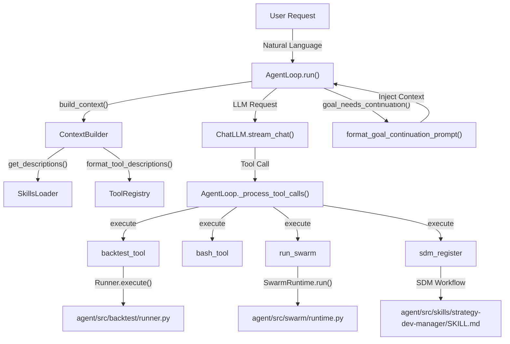
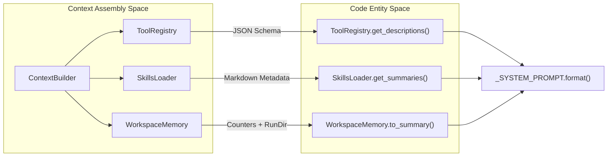

<!-- source: DeepWiki mcp.deepwiki.com · repo HKUDS/Vibe-Trading · page 2 ReAct Agent Core · fetched 2026-11-09 -->

# ReAct Agent Core

Relevant source files

The following files were used as context for generating this wiki page:

- [agent/src/agent/context_budget.py](agent/src/agent/context_budget.py)
- [agent/src/agent/llm_usage.py](agent/src/agent/llm_usage.py)
- [agent/src/agent/loop.py](agent/src/agent/loop.py)
- [agent/src/agent/result_artifacts.py](agent/src/agent/result_artifacts.py)
- [agent/src/agent/run_outcome.py](agent/src/agent/run_outcome.py)
- [agent/src/agent/tool_lifecycle.py](agent/src/agent/tool_lifecycle.py)
- [agent/src/trading/connectors/robinhood/classification.py](agent/src/trading/connectors/robinhood/classification.py)
- [agent/src/trading/connectors/robinhood/mcp.py](agent/src/trading/connectors/robinhood/mcp.py)
- [agent/src/trading/connectors/robinhood/profiles.py](agent/src/trading/connectors/robinhood/profiles.py)
- [agent/tests/test_agent_loop_dedup_arguments.py](agent/tests/test_agent_loop_dedup_arguments.py)
- [agent/tests/test_agent_loop_dsml_tool_calls.py](agent/tests/test_agent_loop_dsml_tool_calls.py)
- [agent/tests/test_default_deny_unknown_robinhood_tool.py](agent/tests/test_default_deny_unknown_robinhood_tool.py)
- [agent/tests/test_llm_cost_accounting.py](agent/tests/test_llm_cost_accounting.py)
- [agent/tests/test_loop_helpers.py](agent/tests/test_loop_helpers.py)
- [agent/tests/test_robinhood_mcp_mapping.py](agent/tests/test_robinhood_mcp_mapping.py)
- [agent/tests/test_run_outcome_module.py](agent/tests/test_run_outcome_module.py)
- [agent/tests/test_session_load_metrics.py](agent/tests/test_session_load_metrics.py)

The **ReAct Agent Core** is the central reasoning engine of Vibe-Trading. It implements a "Reasoning and Acting" (ReAct) loop that allows the AI to interleave thought processes with tool execution. The core is designed to handle complex financial tasks—such as backtesting strategies, performing multi-factor analysis, or orchestrating a swarm of specialized agents—by dynamically selecting from a library of 80+ atomic tools and specialist skills.

### Architecture Overview

The agent core is built on a modular architecture where the execution logic is decoupled from tool definitions, memory management, and LLM provider implementations.

| Component | Responsibility | Key Class/File |
|:---|:---|:---|
| **AgentLoop** | Orchestrates the iterative ReAct cycle, five-layer context management, and tool dispatch. | `AgentLoop` [agent/src/agent/loop.py:170-190]() |
| **ContextBuilder** | Constructs the system prompt and manages message history/memory recall. | `ContextBuilder` [agent/src/agent/context.py:1-10]() |
| **ToolRegistry** | Manages the registration and invocation of atomic capabilities. | `ToolRegistry` [agent/src/agent/tools.py:1-30]() |
| **WorkspaceMemory** | Maintains lightweight state (counters, `run_dir`) within a single run. | `WorkspaceMemory` [agent/src/agent/memory.py:1-50]() |
| **TraceWriter** | Provides crash-safe logging of reasoning steps and tool results. | `TraceWriter` [agent/src/agent/trace.py:1-40]() |

**Sources:** [agent/src/agent/loop.py:1-100](), [agent/src/agent/context.py:1-20]()

---

### Core Reasoning Workflow

The agent operates by building a comprehensive context that includes tool definitions and skill summaries, then entering an execution loop. It supports **Finance Research Goals**, which allow the agent to persist in complex multi-step objectives across multiple turns using continuation logic.

#### Natural Language to Code Entity Space Mapping
This diagram illustrates how a user's natural language request is transformed into specific code entities and tool calls within the ReAct loop.

**Sources:** [agent/src/agent/loop.py:1-12](), [agent/src/agent/context.py:1-35](), [agent/src/goal/context.py:84-90](), [agent/src/providers/chat.py:1-20]()

---

### Sub-Component Summaries

#### [AgentLoop and Execution Lifecycle](#2.1)
The `AgentLoop` manages the lifecycle of a single task. It features a **five-layer context management** system to handle long-running financial research: `Layer 1 (microcompact)` (pruning tool results under memory pressure) [agent/src/agent/loop.py:3-4](), `Layer 2 (context_collapse)` (folding long text blocks without LLM calls) [agent/src/agent/loop.py:5-5](), `Layer 3 (auto_compact)` (LLM structured summary), `Layer 4 (compact tool)`, and `Layer 5 (iterative update)` [agent/src/agent/loop.py:6-8](). It also manages goal token budgets and utilizes goal continuation prompts to ensure research goals are pursued to completion. The loop includes a stall watchdog, trace writing, and run outcome accounting via `resolve_final_status` [agent/src/agent/run_outcome.py:122-129]().
*For details, see [AgentLoop and Execution Lifecycle](#2.1).*

#### [Tools Registry (80+ Atomic Tools)](#2.2)
The `ToolRegistry` acts as the interface between the LLM and the local environment. It manages 80+ tools using a registry pattern, including governed tool layers (`GovernedToolRegistry`), file tools with safe path enforcement, market data and fundamentals tools, OCR doc readers, pattern and indicator utilities, and specialized quantlib or vision tools. Readonly tools support concurrent thread batching [agent/src/agent/loop.py:10-12](), and execution passes through duplicate-call gates that compare argument semantics to prevent redundant loops [agent/tests/test_agent_loop_dedup_arguments.py:1-18]().
*For details, see [Tools Registry (80+ Atomic Tools)](#2.2).*

#### [Session Management and Event Streaming](#2.3)
The system uses a session-based approach (`SessionService` lifecycle and `SessionStore`) to map chat sessions to `AgentLoop` instances. It supports FTS5 cross-session search and real-time event streaming via `EventBus` Server-Sent Events (SSE) with `last_event_id` recovery. Trace outputs and progress events ensure state visibility across runs [agent/src/agent/progress.py:1-50]().
*For details, see [Session Management and Event Streaming](#2.3).*

#### [LLM Providers and ChatLLM](#2.4)
The agent uses the `ChatLLM` abstraction and `build_llm()` factory located in `agent/src/providers/` to support diverse backends. It handles `ProviderCapabilities`, reasoning content extraction (`reasoning_content`), DeepSeek-style (DSML) tool call parsing [agent/tests/test_agent_loop_dsml_tool_calls.py:1-40](), OpenAI Codex bindings, endpoint security guards, and connection preflight checks.
*For details, see [LLM Providers and ChatLLM](#2.4).*

#### [Grounding Ledger and Output Discipline](#2.5)
The grounding subsystem (`agent/src/agent/grounding/`) enforces output discipline through entity resolution (via `SymbolSearchTool`), evidence ingestion, figures block validation contracts, policy checks, and automatic correction or redaction. It guarantees that generated metrics are tethered to verified tool results or explicitly flagged as degraded fallbacks.
*For details, see [Grounding Ledger and Output Discipline](#2.5).*

---

### Knowledge Orchestration: Skills and Tools

The agent differentiates between **Tools** (what it can *do*) and **Skills** (what it *knows*).

1.  **Tools**: Concrete Python classes that interact with the OS, APIs, or backtest engines.
2.  **Skills**: Markdown files (`SKILL.md`) that provide the LLM with domain methodologies and execution parameters.
3.  **Progressive Disclosure**: The system prompt contains dynamic summaries, and the agent must invoke tools or recall memory to reference detailed schemas.

#### Knowledge Assembly Diagram
This diagram shows how the `ContextBuilder` coordinates different code entities to prepare the agent's system prompt.

**Sources:** [agent/src/agent/context.py:1-50](), [agent/src/agent/loop.py:24-45]()

**Sources:** [agent/src/agent/loop.py:1-12](), [agent/src/agent/context.py:1-35]()

---

