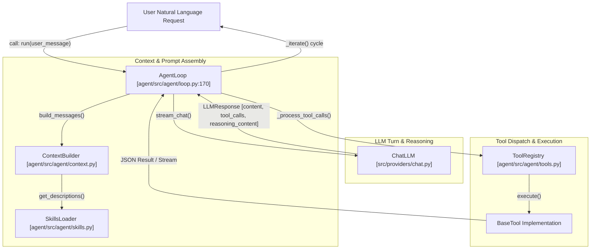
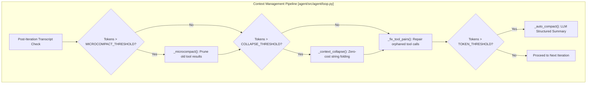
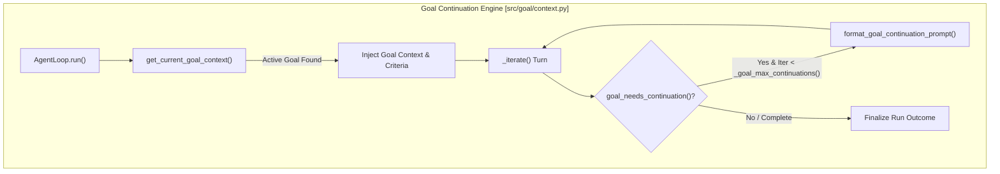

<!-- source: DeepWiki mcp.deepwiki.com · repo HKUDS/Vibe-Trading · page 2.1 AgentLoop and Execution Lifecycle · fetched 2026-11-09 -->

# AgentLoop and Execution Lifecycle

Relevant source files

The following files were used as context for generating this wiki page:

- [CONTRIBUTING.md](CONTRIBUTING.md)
- [agent/src/agent/context_budget.py](agent/src/agent/context_budget.py)
- [agent/src/agent/llm_usage.py](agent/src/agent/llm_usage.py)
- [agent/src/agent/loop.py](agent/src/agent/loop.py)
- [agent/src/agent/result_artifacts.py](agent/src/agent/result_artifacts.py)
- [agent/src/agent/run_outcome.py](agent/src/agent/run_outcome.py)
- [agent/src/agent/tool_lifecycle.py](agent/src/agent/tool_lifecycle.py)
- [agent/src/trading/connectors/robinhood/classification.py](agent/src/trading/connectors/robinhood/classification.py)
- [agent/src/trading/connectors/robinhood/mcp.py](agent/src/trading/connectors/robinhood/mcp.py)
- [agent/src/trading/connectors/robinhood/profiles.py](agent/src/trading/connectors/robinhood/profiles.py)
- [agent/tests/test_agent_goal_context.py](agent/tests/test_agent_goal_context.py)
- [agent/tests/test_agent_loop_content_filter.py](agent/tests/test_agent_loop_content_filter.py)
- [agent/tests/test_agent_loop_dedup_arguments.py](agent/tests/test_agent_loop_dedup_arguments.py)
- [agent/tests/test_agent_loop_dsml_tool_calls.py](agent/tests/test_agent_loop_dsml_tool_calls.py)
- [agent/tests/test_agent_loop_no_assistant_prefill.py](agent/tests/test_agent_loop_no_assistant_prefill.py)
- [agent/tests/test_agent_loop_stream_retry.py](agent/tests/test_agent_loop_stream_retry.py)
- [agent/tests/test_agent_loop_terminal_state.py](agent/tests/test_agent_loop_terminal_state.py)
- [agent/tests/test_agent_loop_trace.py](agent/tests/test_agent_loop_trace.py)
- [agent/tests/test_content_filter_e2e.py](agent/tests/test_content_filter_e2e.py)
- [agent/tests/test_default_deny_unknown_robinhood_tool.py](agent/tests/test_default_deny_unknown_robinhood_tool.py)
- [agent/tests/test_grounding_recovery.py](agent/tests/test_grounding_recovery.py)
- [agent/tests/test_llm_cost_accounting.py](agent/tests/test_llm_cost_accounting.py)
- [agent/tests/test_loop_helpers.py](agent/tests/test_loop_helpers.py)
- [agent/tests/test_reasoning_delta_throttle.py](agent/tests/test_reasoning_delta_throttle.py)
- [agent/tests/test_robinhood_mcp_mapping.py](agent/tests/test_robinhood_mcp_mapping.py)
- [agent/tests/test_run_outcome_module.py](agent/tests/test_run_outcome_module.py)
- [agent/tests/test_session_load_metrics.py](agent/tests/test_session_load_metrics.py)
- [agent/tests/test_swarm_worker_stream_retry.py](agent/tests/test_swarm_worker_stream_retry.py)
- [frontend/src/components/chat/MessageBubble.tsx](frontend/src/components/chat/MessageBubble.tsx)
- [frontend/src/components/chat/__tests__/MessageBubble.test.tsx](frontend/src/components/chat/__tests__/MessageBubble.test.tsx)
- [frontend/src/hooks/__tests__/useSSE.test.ts](frontend/src/hooks/__tests__/useSSE.test.ts)
- [frontend/src/hooks/useSSE.ts](frontend/src/hooks/useSSE.ts)
- [frontend/src/pages/Agent.tsx](frontend/src/pages/Agent.tsx)
- [frontend/src/pages/__tests__/AgentActivityTimerPersistence.test.tsx](frontend/src/pages/__tests__/AgentActivityTimerPersistence.test.tsx)
- [frontend/src/stores/agent.ts](frontend/src/stores/agent.ts)

The **AgentLoop** is the central execution engine of Vibe-Trading, implementing a rigorous **ReAct** (Reasoning and Acting) pattern. It manages the iterative cycle of generating thoughts, selecting tools, executing them concurrently or sequentially, and observing results. Furthermore, it incorporates a sophisticated five-layer context compaction strategy, robust stall watchdogs, trace writing, goal continuation, and comprehensive run outcome and token usage accounting.

Sources: [agent/src/agent/loop.py:1-12](), [agent/src/agent/run_outcome.py:1-29]()

## The ReAct Iteration Cycle

The execution lifecycle is managed by the `AgentLoop` class (inheriting from `ToolCallLifecycle`), defined in [agent/src/agent/loop.py:104-170](). It orchestrates the end-to-end flow between the user input, the LLM client (`ChatLLM`), and the `ToolRegistry`.

### Execution Flow and Natural Language to Code Mapping

The following diagram bridges the high-level natural language space to the precise code entities responsible for processing chat prompts, streaming tokens, parsing structured tool requests, and executing tools.

**ReAct Loop: Natural Language Space to Code Entity Mapping**

Sources: [agent/src/agent/loop.py:215-365](), [agent/src/providers/chat.py:1-140]()

### Key Lifecycle Methods
- `run(user_message)`: The entry point for a single interaction. It initializes message history, hooks into state storage via `RunStateStore`, and runs the iterative ReAct loop until completion, cancellation, or threshold exhaustion [agent/src/agent/loop.py:215-260]().
- `_iterate()`: A single turn in the ReAct cycle. It invokes `ChatLLM.stream_chat`, handles reasoning content (`reasoning_content`), parses tool calls, manages timeouts, and writes incremental trace events [agent/src/agent/loop.py:262-315]().
- `_process_tool_calls(tool_calls)`: Manages tool execution, utilizing worker threads for parallel read-only batching while strictly serializing state-mutating tools [agent/src/agent/loop.py:317-365]().

Sources: [agent/src/agent/loop.py:215-365]()

## Five-Layer Context Management

Vibe-Trading implements a tiered compaction strategy inside `agent/src/agent/loop.py` and `agent/src/agent/context_compact.py` to prevent context window overflow during prolonged research tasks without losing critical historical evidence.

| Layer | Name | Trigger Condition | Mechanism / Action |
| :--- | :--- | :--- | :--- |
| **Layer 1** | `_microcompact` | Token estimate > `MICROCOMPACT_THRESHOLD` | Silently prunes old tool results (retaining the most recent `KEEP_RECENT=3`), replacing outputs >100 chars with `[CLEARED FROM CONTEXT...]` [agent/src/agent/loop.py:52-53](), [agent/src/agent/loop.py:572-609](). |
| **Layer 2** | `_context_collapse` | Token estimate > `COLLAPSE_THRESHOLD` | Folds the middle of long text blocks (preserving `COLLAPSE_HEAD=900` and `COLLAPSE_TAIL=500`) using pure string slicing (zero LLM cost) [agent/src/agent/loop.py:611-660](), [agent/src/agent/loop.py:56-62](). |
| **Layer 3** | `_auto_compact` | Token estimate > `TOKEN_THRESHOLD` | Triggers an LLM call using `_STRUCTURED_SUMMARY_PROMPT` to compress historical conversation into a structured summary [agent/src/agent/loop.py:662-711](), [agent/src/agent/loop.py:65](). |
| **Layer 4** | Compact Tool | Agent-driven invocation | The agent explicitly calls the compact tool when it detects conversational clutter, triggering Layer 3 mechanics [agent/src/agent/loop.py:7-8](). |
| **Layer 5** | Iterative Update | Nth compression cycle | Updates the previous summary using `_ITERATIVE_UPDATE_PROMPT` instead of starting fresh, preserving continuous depth [agent/src/agent/loop.py:8-9](), [agent/src/agent/loop.py:64](). |

### Context Compaction Architecture

Sources: [agent/src/agent/loop.py:52-80](), [agent/src/agent/loop.py:572-711]()

## Tool Batching, Dedup, and Lifecycle Management

To maximize efficiency and maintain execution integrity, `AgentLoop` and its supporting base classes (`ToolCallLifecycle`) handle batching and deduplication.

- **Read/Write Batching**: Consecutive read-only tools (`is_readonly=True`) are grouped and executed in parallel using a `ThreadPoolExecutor`, significantly reducing latency when fetching multiple market data series or documents [agent/src/agent/loop.py:10-12]().
- **Deduplication Ledger**: Tracks tool execution fingerprints to prevent redundant calls within the same run context, while `_microcompact` unblocks cleared tool results when context pressure requires discarding old observations [agent/tests/test_loop_helpers.py:164-179]().
- **Timeout and Heartbeat Protection**: Each tool invocation is guarded by configurable timeouts (`_tool_timeout_seconds`) and accompanied by a `HeartbeatTimer` to emit periodic progress updates over the SSE stream [agent/src/agent/loop.py:33-46]().

Sources: [agent/src/agent/loop.py:10-12](), [agent/src/agent/loop.py:33-46](), [agent/tests/test_loop_helpers.py:164-179]()

## Stall Watchdog, Trace Writing, and Goal Continuation

### Stall Watchdog and Trace Writing
- **Stall Watchdog**: Monitors loop iterations and tool execution times against `_stall_timeout_seconds`. If a run hangs or exceeds duration limits without progress, the stall watchdog intervenes, records a failure state, and prevents infinite spinning [agent/src/agent/loop.py:36]().
- **Trace Writer**: `TraceWriter` logs every internal event (`thought`, `tool_call`, `tool_result`, `content_filter_skipped`) to structured JSONL files in the run directory. Large payloads are offloaded to sidecar files under `tool-results/` to keep traces lightweight [agent/src/agent/loop.py:83](), [CONTRIBUTING.md:39-41]().

### Goal Continuation
When executing under the Finance Research Goal System, `AgentLoop` evaluates whether open criteria remain unsatisfied after an LLM turn:
- Injects active goal state and evidence pointers using `get_current_goal_context()` [agent/src/goal/context.py:41-45]().
- Automatically continues execution up to `_goal_max_continuations()` times if `goal_needs_continuation()` evaluates to true [agent/src/agent/loop.py:35](), [agent/src/goal/context.py:34-39]().
- Formats structured steering instructions via `format_goal_continuation_prompt()` to guide the agent towards missing evidence [agent/src/goal/context.py:34-39]().

**Goal Continuation Lifecycle**

Sources: [agent/src/agent/loop.py:35](), [agent/src/goal/context.py:34-89]()

## Run Outcome and LLM Usage Accounting

### Run Outcome Resolution
Terminal states (success, failure, cancellation) are resolved through the decision ladder in `src/agent/run_outcome.py` (`resolve_final_status`) [agent/src/agent/run_outcome.py:1-129](). The branch evaluation order is load-bearing:
1. **Stall Watchdog Reason**: Honored immediately if already recorded [agent/src/agent/run_outcome.py:130-133]().
2. **User Cancellation**: Returns a cancelled status and reason [agent/src/agent/run_outcome.py:134-135]().
3. **Exhausted Token Budget**: Fails or marks degraded if usage breached limits [agent/src/agent/run_outcome.py:136-137]().
4. **No-Progress & Content Filter Breakers**: Triggers circuit breakers on persistent failures [agent/src/agent/run_outcome.py:138-146]().
5. **Success / Empty Response / Max Iterations**: Evaluates output presence and iteration counts [agent/src/agent/run_outcome.py:147-152]().

### LLM Usage Accounting
Token consumption and provider usage metadata are tracked in `src/agent/llm_usage.py` [agent/src/agent/llm_usage.py:1-144](). 
- `_normalize_llm_usage()` standardizes token counts (input, output, total, cache read/creation, and reasoning tokens) across diverse provider APIs [agent/src/agent/llm_usage.py:35-70]().
- `_record_llm_usage()` accumulates usage per iteration and atomically persists `llm_usage.json` inside the run directory [agent/src/agent/llm_usage.py:91-117](), [agent/src/agent/llm_usage.py:132-144]().
- Unreported or streaming fallback calls are counted safely without hallucinating token numbers via `_record_unreported_llm_call()` [agent/src/agent/llm_usage.py:120-130]().

Sources: [agent/src/agent/run_outcome.py:1-152](), [agent/src/agent/llm_usage.py:1-144]()

---

