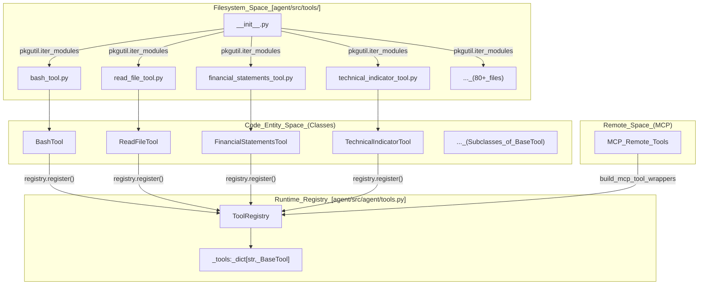
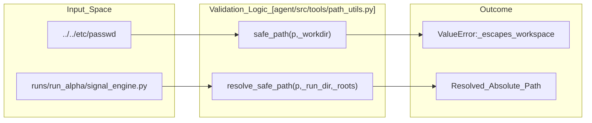

<!-- source: DeepWiki mcp.deepwiki.com · repo HKUDS/Vibe-Trading · page 2.2 Tools Registry (80+ Atomic Tools) · fetched 2026-11-09 -->

# Tools Registry (80+ Atomic Tools)

Relevant source files

The following files were used as context for generating this wiki page:

- [agent/backtest/engines/china_a.py](agent/backtest/engines/china_a.py)
- [agent/src/agent/tool_progress.py](agent/src/agent/tool_progress.py)
- [agent/src/agent/tools.py](agent/src/agent/tools.py)
- [agent/src/portfolio/service.py](agent/src/portfolio/service.py)
- [agent/src/skills/doc-reader/SKILL.md](agent/src/skills/doc-reader/SKILL.md)
- [agent/src/skills/web-reader/SKILL.md](agent/src/skills/web-reader/SKILL.md)
- [agent/src/tools/__init__.py](agent/src/tools/__init__.py)
- [agent/src/tools/bash_tool.py](agent/src/tools/bash_tool.py)
- [agent/src/tools/doc_reader_tool.py](agent/src/tools/doc_reader_tool.py)
- [agent/src/tools/edit_file_tool.py](agent/src/tools/edit_file_tool.py)
- [agent/src/tools/financial_statements_tool.py](agent/src/tools/financial_statements_tool.py)
- [agent/src/tools/ocr/engine.py](agent/src/tools/ocr/engine.py)
- [agent/src/tools/ocr/llm_vision_ocr.py](agent/src/tools/ocr/llm_vision_ocr.py)
- [agent/src/tools/ocr/rapid_ocr.py](agent/src/tools/ocr/rapid_ocr.py)
- [agent/src/tools/path_utils.py](agent/src/tools/path_utils.py)
- [agent/src/tools/pattern_tool.py](agent/src/tools/pattern_tool.py)
- [agent/src/tools/read_file_tool.py](agent/src/tools/read_file_tool.py)
- [agent/src/tools/technical_indicator_tool.py](agent/src/tools/technical_indicator_tool.py)
- [agent/src/tools/web_reader_tool.py](agent/src/tools/web_reader_tool.py)
- [agent/src/tools/write_file_tool.py](agent/src/tools/write_file_tool.py)
- [agent/tests/quantlib/test_eventstudy_post_event_window.py](agent/tests/quantlib/test_eventstudy_post_event_window.py)
- [agent/tests/test_agent_loop_deterministic_cache.py](agent/tests/test_agent_loop_deterministic_cache.py)
- [agent/tests/test_agent_loop_no_progress.py](agent/tests/test_agent_loop_no_progress.py)
- [agent/tests/test_agent_loop_repeatable_tools.py](agent/tests/test_agent_loop_repeatable_tools.py)
- [agent/tests/test_bash_tool.py](agent/tests/test_bash_tool.py)
- [agent/tests/test_china_a_engine.py](agent/tests/test_china_a_engine.py)
- [agent/tests/test_compaction_call_identity.py](agent/tests/test_compaction_call_identity.py)
- [agent/tests/test_doc_reader.py](agent/tests/test_doc_reader.py)
- [agent/tests/test_doc_reader_docx_order.py](agent/tests/test_doc_reader_docx_order.py)
- [agent/tests/test_doc_reader_excel_literal_text.py](agent/tests/test_doc_reader_excel_literal_text.py)
- [agent/tests/test_doc_reader_inverted_pages.py](agent/tests/test_doc_reader_inverted_pages.py)
- [agent/tests/test_doc_reader_native_fallback.py](agent/tests/test_doc_reader_native_fallback.py)
- [agent/tests/test_doc_reader_pptx_containers.py](agent/tests/test_doc_reader_pptx_containers.py)
- [agent/tests/test_doc_reader_unicode_page_dashes.py](agent/tests/test_doc_reader_unicode_page_dashes.py)
- [agent/tests/test_file_tool_sandbox_security.py](agent/tests/test_file_tool_sandbox_security.py)
- [agent/tests/test_financial_statements_tool.py](agent/tests/test_financial_statements_tool.py)
- [agent/tests/test_forex_engine.py](agent/tests/test_forex_engine.py)
- [agent/tests/test_mcp_regression.py](agent/tests/test_mcp_regression.py)
- [agent/tests/test_ocr_engine.py](agent/tests/test_ocr_engine.py)
- [agent/tests/test_ocr_integration.py](agent/tests/test_ocr_integration.py)
- [agent/tests/test_path_safety.py](agent/tests/test_path_safety.py)
- [agent/tests/test_pattern_tool.py](agent/tests/test_pattern_tool.py)
- [agent/tests/test_pattern_tool_argument_coercion.py](agent/tests/test_pattern_tool_argument_coercion.py)
- [agent/tests/test_pattern_tool_double_top_abs_avg.py](agent/tests/test_pattern_tool_double_top_abs_avg.py)
- [agent/tests/test_pattern_tool_head_shoulders_abs_avg.py](agent/tests/test_pattern_tool_head_shoulders_abs_avg.py)
- [agent/tests/test_portfolio_futu_prefixed_codes.py](agent/tests/test_portfolio_futu_prefixed_codes.py)
- [agent/tests/test_portfolio_service.py](agent/tests/test_portfolio_service.py)
- [agent/tests/test_read_file_directory_errors.py](agent/tests/test_read_file_directory_errors.py)
- [agent/tests/test_read_file_refusals.py](agent/tests/test_read_file_refusals.py)
- [agent/tests/test_sec_period_frames.py](agent/tests/test_sec_period_frames.py)
- [agent/tests/test_technical_indicator_small_price_rounding.py](agent/tests/test_technical_indicator_small_price_rounding.py)
- [agent/tests/test_technical_indicator_tool.py](agent/tests/test_technical_indicator_tool.py)
- [agent/tests/test_tool_progress.py](agent/tests/test_tool_progress.py)
- [agent/tests/test_tool_registry_diagnostics.py](agent/tests/test_tool_registry_diagnostics.py)
- [agent/tests/test_web_reader_privacy.py](agent/tests/test_web_reader_privacy.py)
- [frontend/src/pages/Portfolio.tsx](frontend/src/pages/Portfolio.tsx)
- [frontend/src/pages/__tests__/Portfolio.test.tsx](frontend/src/pages/__tests__/Portfolio.test.tsx)

The **Tools Registry** is the central repository for all executable capabilities available to the ReAct agent in Vibe-Trading. It provides a structured interface for the `AgentLoop` to discover, validate, and execute atomic operations ranging from filesystem manipulation and web searching to complex quantitative analysis, financial statement retrieval, pattern recognition, and swarm orchestration.

The system implements **80+ atomic tools**, organized into functional categories. These tools are auto-discovered at runtime via class inheritance and can be extended with external Model Context Protocol (MCP) servers.

---

## Tool Architecture and Registry Pattern

Vibe-Trading utilizes a registry pattern to decouple tool definitions from the agent's core logic. The `ToolRegistry` class manages a collection of `BaseTool` instances, providing lookup and registration services [agent/src/agent/tools.py:21-21]().

### Key Classes and Functions

*   **`BaseTool`**: The abstract base class that all tools inherit from. It defines the `name`, `description`, `parameters` (JSON Schema), and the `execute()` method [agent/src/agent/tools.py:21-21]().
*   **`ToolRegistry`**: A container that stores and retrieves tools by name [agent/src/agent/tools.py:21-21]().
*   **`build_registry()`**: The primary factory function. It crawls the `src/tools/` directory, instantiates concrete `BaseTool` subclasses, injects shared dependencies (such as `PersistentMemory` or session IDs), and optionally appends MCP tools from remote servers [agent/src/tools/__init__.py:76-170]().
*   **`_discover_subclasses()`**: A helper that imports all modules in the `src.tools` package to populate the `BaseTool.__subclasses__()` list via package iteration [agent/src/tools/__init__.py:34-73]().
*   **`GovernedToolRegistry`**: A wrapper used when governance mode is enabled, applying the `PolicyEngine` to filter or gate tool access based on institutional risk levels [agent/scripts/dump_tool_inventory.py:66-109]().

### Registry Initialization Flow

The following diagram illustrates how the system bridges the filesystem structure and remote MCP definitions to the runtime `ToolRegistry` entity.

**Registry Construction and Entity Mapping**

Sources: [agent/src/tools/__init__.py:34-170](), [agent/src/agent/tools.py:21-21]()

---

## Catalog of Atomic Tools

### 1. Environment & Filesystem Tools
These tools allow the agent to manage code and artifacts within the secure workspace while enforcing path sandboxing.

| Tool Name | Class | Purpose |
| :--- | :--- | :--- |
| `bash` | `BashTool` | Executes shell commands under a timeout (gated by shell tool policy) [agent/src/tools/__init__.py:31-31](). |
| `read_file` | `ReadFileTool` | Reads workspace files and bundled skills with strict containment checks and line limits [agent/src/tools/read_file_tool.py:81-170](). |
| `write_file` | `WriteFileTool` | Creates or overwrites files inside allowed roots, automatically handling model argument aliases and Markdown-to-PDF rendering [agent/src/tools/write_file_tool.py:14-117](). |
| `edit_file` | `EditFileTool` | Performs surgical find-and-replace on workspace files [agent/src/tools/edit_file_tool.py:14-29](). |
| `analyze_image` | `AnalyzeImageTool` | Vision tool for interpreting charts and screenshots via pluggable OCR engines [agent/src/tools/ocr/engine.py:45-68](). |

Sources: [agent/src/tools/__init__.py:31-31](), [agent/src/tools/read_file_tool.py:81-170](), [agent/src/tools/write_file_tool.py:14-117](), [agent/src/tools/ocr/engine.py:45-68]()

### 2. Market Data and Fundamentals Tools
These tools provide programmatic access to market data feeds, financial statements, and corporate governance actions across global exchanges.

| Tool Name | Class | Purpose |
| :--- | :--- | :--- |
| `get_financial_statements` | `FinancialStatementsTool` | Fetches balance sheets, income statements, cash flow statements, or key per-period indicators from Eastmoney (A-shares and Hong Kong) or SEC EDGAR (US) [agent/src/tools/financial_statements_tool.py:1-125](). |
| `get_shareholder_count` | `ShareholderCountTool` | Retrieves A-share shareholder count history from Eastmoney, including per-period holder changes and average holding metrics. |
| `get_lockup_expiry` | `LockupExpiryTool` | Provides A-share restricted share lockup expiry schedules from Eastmoney for specific stocks or market-wide scans. |
| `get_dragon_tiger` | `DragonTigerTool` | Queries the Eastmoney A-share dragon-tiger (龙虎榜) disclosure board, listing abnormal trading sessions and top brokerage seats. |
| `get_block_trades` | `BlockTradesTool` | Fetches A-share block trade data from Eastmoney, including transaction pricing, volumes, and institutional participants. |
| `get_margin_trading` | `MarginTradingTool` | Retrieves A-share margin trading and short selling statistics from Eastmoney data centers. |

Sources: [agent/src/tools/financial_statements_tool.py:1-125]()

### 3. Pattern and Indicator Tools
Technical analysis tools that compute quantitative indicators and recognize chart patterns from price series.

| Tool Name | Class | Purpose |
| :--- | :--- | :--- |
| `pattern_recognition` | `PatternRecognitionTool` | Detects technical chart patterns like head-and-shoulders, double tops/bottoms, support/resistance clustering, and trendline slopes [agent/src/tools/pattern_tool.py:24-200](). |
| `technical_indicators` | `TechnicalIndicatorTool` | Computes RSI (using Wilder's EWM smoothing convention), MACD, Bollinger Bands, SMA, EMA, and volume statistics [agent/src/tools/technical_indicator_tool.py:1-184](). |

Sources: [agent/src/tools/pattern_tool.py:24-200](), [agent/src/tools/technical_indicator_tool.py:1-184]()

### 4. Document Reader and OCR Tools
Universal ingestion tools for multi-format document parsing and optical character recognition.

| Tool Name | Class | Purpose |
| :--- | :--- | :--- |
| `doc_reader` | `DocReaderTool` | Universal reader dispatches by file extension supporting PDF (with pypdfium2 and automatic OCR fallback for image pages), Word (.docx), Excel (.xlsx/.xls), PowerPoint (.pptx), images, and plain text/code [agent/src/tools/doc_reader_tool.py:1-188](). |
| `analyze_image` | `AnalyzeImageTool` | Direct image OCR extraction using RapidOCR or LLM vision backends. |

Sources: [agent/src/tools/doc_reader_tool.py:1-188]()

### 5. Strategy Development Manager (SDM) & QuantLib Tools
Advanced management and quantitative analytics tools.

| Tool Name | Class | Purpose |
| :--- | :--- | :--- |
| `sdm_register` | `SdmRegisterTool` | Registers new factors and strategies into the SQLite `StrategyStore`. |
| `sdm_status` | `SdmStatusTool` | Queries or updates artifact lifecycle status and initiates decay scans. |
| `quantlib_tool` | `QuantLibTool` | Exposes the `quantlib` analytics library for options pricing, fixed income models, credit analytics, and statistical utilities. |

Sources: [agent/src/tools/sdm_status_tool.py:46-202]()

---

## File Tools and Security Boundaries

The registry implements strict path validation and sandboxing to protect the host system from unauthorized file access or path traversal attacks.

*   **Sandbox Enforcement (`safe_path`)**: Resolves user-supplied paths under a designated workspace root (`workdir`) and raises a `ValueError` if any path traversal attempt (such as `..` escaping the root or UNC share paths) is detected [agent/src/tools/path_utils.py:47-99]().
*   **Allowed Roots**: File operations are restricted to configured import/write roots (`VIBE_TRADING_ALLOWED_FILE_ROOTS` and `VIBE_TRADING_ALLOWED_WRITE_ROOTS`) alongside default runtime and upload directories [agent/src/tools/path_utils.py:107-198]().
*   **Shell Gating**: Potentially destructive shell tools (`bash`, `background_run`, `cancel_background`) are excluded by default unless `include_shell_tools=True` is explicitly passed during registry construction [agent/src/tools/__init__.py:31-31]().
*   **Redaction**: System error messages are passed through `redact_internal_paths` to prevent leaking absolute server directory structures to the LLM or client interface [agent/src/tools/write_file_tool.py:118-125]().

**Path Safety Validation Flow**

Sources: [agent/src/tools/path_utils.py:47-99](), [agent/src/tools/write_file_tool.py:77-125]()

---

## Institutional Research Reliability (IRR-AGL) Integration

When governance mode is active, the `GovernedToolRegistry` wraps the standard `ToolRegistry`, enforcing a policy-driven risk tiering model for every tool invocation:

*   **R0_READ**: Local read-only analysis tools (e.g., `read_file`, `technical_indicators`).
*   **R1_WRITE_LOCAL**: Local filesystem mutation tools (e.g., `write_file`, `edit_file`).
*   **R2_NETWORK**: External data fetching and search tools (e.g., `web_search`, `get_financial_statements`).
*   **R3_TRADE_READ**: Read-only live brokerage connector tools.
*   **R4_TRADE_WRITE**: Mutating live trading execution tools.
*   **R5_SHELL**: Shell and subprocess execution tools (e.g., `bash`).

Sources: [agent/scripts/dump_tool_inventory.py:66-109]()

---

