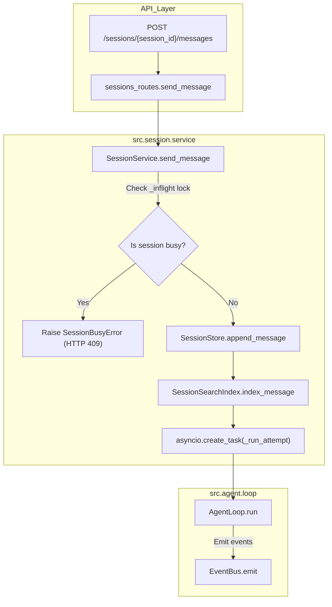
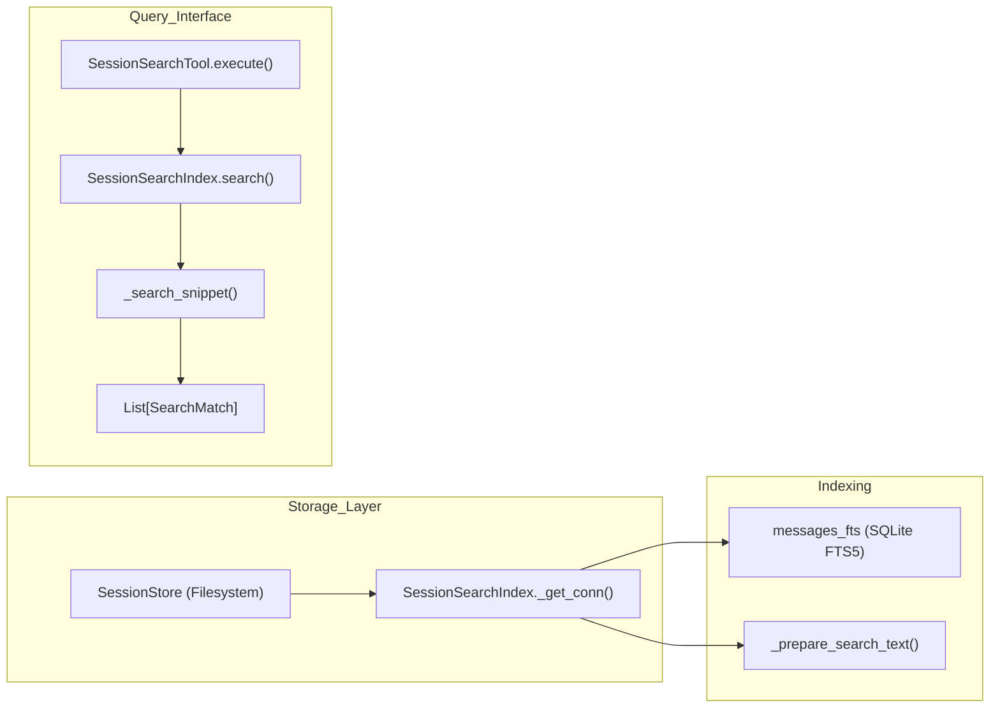
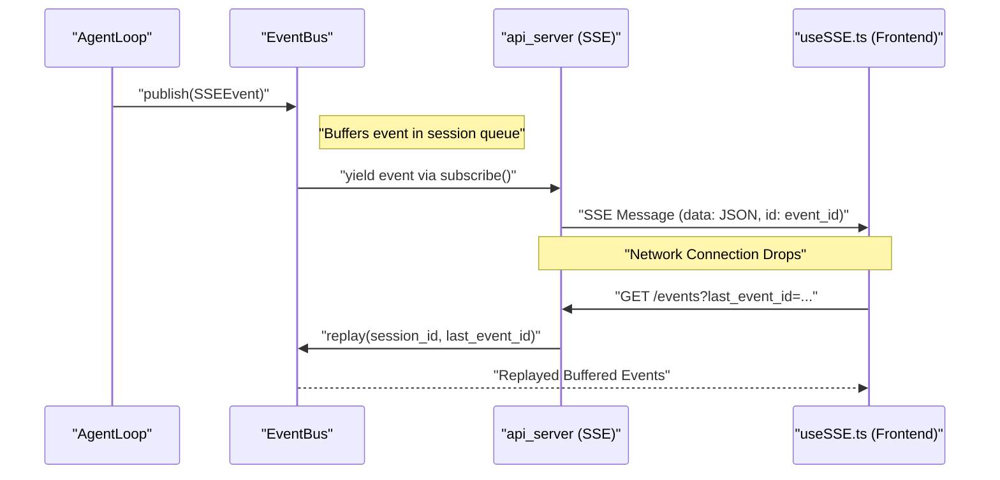

<!-- source: DeepWiki mcp.deepwiki.com · repo HKUDS/Vibe-Trading · page 2.3 Session Management and Event Streaming · fetched 2026-11-09 -->

# Session Management and Event Streaming

Relevant source files

The following files were used as context for generating this wiki page:

- [agent/src/api/sessions_routes.py](agent/src/api/sessions_routes.py)
- [agent/src/session/models.py](agent/src/session/models.py)
- [agent/src/session/search.py](agent/src/session/search.py)
- [agent/src/session/service.py](agent/src/session/service.py)
- [agent/src/tools/image_vision_tool.py](agent/src/tools/image_vision_tool.py)
- [agent/tests/test_goal_api.py](agent/tests/test_goal_api.py)
- [agent/tests/test_image_vision_tool.py](agent/tests/test_image_vision_tool.py)
- [agent/tests/test_session_events_replay_start.py](agent/tests/test_session_events_replay_start.py)
- [agent/tests/test_session_search.py](agent/tests/test_session_search.py)
- [agent/tests/test_session_search_concurrent_consumers.py](agent/tests/test_session_search_concurrent_consumers.py)
- [agent/tests/test_session_search_distinct_limit.py](agent/tests/test_session_search_distinct_limit.py)
- [agent/tests/test_session_search_native_snippets.py](agent/tests/test_session_search_native_snippets.py)
- [agent/tests/test_session_search_title_updates.py](agent/tests/test_session_search_title_updates.py)
- [agent/tests/test_session_service_lifecycle.py](agent/tests/test_session_service_lifecycle.py)
- [frontend/src/pages/__tests__/agentToolTimeline.test.ts](frontend/src/pages/__tests__/agentToolTimeline.test.ts)
- [frontend/src/pages/agentToolTimeline.ts](frontend/src/pages/agentToolTimeline.ts)

Session management in Vibe-Trading provides a persistent, stateful interface for chat-based interactions with the ReAct agent. It bridges the stateless nature of LLM requests with a long-running execution lifecycle, utilizing Server-Sent Events (SSE) to stream real-time updates from the `AgentLoop` to the frontend.

## Purpose and Scope

This page documents the implementation of `agent/src/session/`, which governs chat sessions, conversation persistence, SQLite FTS5 cross-session searching, the `EventBus` pub-sub and SSE streaming mechanism with `last_event_id` recovery, and the runtime mapping between multi-turn sessions and `AgentLoop` execution attempts.

Sources: [agent/src/session/service.py:1-4](), [agent/src/session/search.py:1-9]()

---

## SessionService Lifecycle and Concurrency

The session system is orchestrated by `SessionService`, which manages conversation lifecycles, message routing, attempt creation, and execution scheduling [agent/src/session/service.py:1-57]().

### Concurrency Control and `SessionBusyError`

Each session permits at most one in-flight run at a time [agent/src/session/service.py:46-53](). To prevent interleaved messages and race conditions from concurrent `AgentLoop` instances writing to the same session store, `SessionService` utilizes an synchronous `_inflight` set and a `threading.Lock()` (`_inflight_lock`) inside `send_message()` [agent/src/session/service.py:96-97](). If a message is sent while a session is busy, the service immediately raises `SessionBusyError`, which the API layer translates into an HTTP 409 Conflict status [agent/src/session/service.py:46-53]().

### Interrupted Attempt Recovery

When `SessionService` is initialized, it runs `_recover_interrupted_attempts()` to clean up dangling executions left behind by unexpected process restarts or crashes [agent/src/session/service.py:99-108](). Any attempt still marked as `PENDING` or `RUNNING` is resolved into an explicit terminal `INTERRUPTED` state, and an assistant recovery message is appended to the conversation history [agent/src/session/service.py:109-155]().

Title: "SessionService Lifecycle and Execution Flow"

Sources: [agent/src/session/service.py:46-155](), [agent/src/api/sessions_routes.py:31-68]()

---

## SessionStore and Core Data Models

Persistence for sessions, messages, and execution attempts is handled by `SessionStore` backed by the filesystem, while core data models are defined in `agent/src/session/models.py` [agent/src/session/models.py:1-2]().

### Key Entities
*   **`Session`**: Represents a multi-turn conversation session, containing `session_id`, `title`, `status` (`active`, `completed`, `archived`), configuration dictionaries, and an optional `Principal` owner [agent/src/session/models.py:142-168]().
*   **`Message`**: Individual chat records containing `message_id`, `session_id`, `role` (`user`, `assistant`, `system`), `content`, `linked_attempt_id`, and a `tool_trail` list [agent/src/api/sessions_routes.py:57-67]().
*   **`Attempt`**: Tracks a single execution run of an agent, transitioning through statuses like `PENDING`, `RUNNING`, `COMPLETED`, `FAILED`, `CANCELLED`, and `INTERRUPTED` [agent/src/session/models.py:130-140]().
*   **`Principal`**: Encapsulates request attribution (`subject`, `auth_method`, `tenant`, `attributable`), ensuring strict boundaries around authorization and identity [agent/src/session/models.py:42-79]().

Sources: [agent/src/session/models.py:42-168](), [agent/src/api/sessions_routes.py:57-67]()

---

## FTS5 Cross-Session Search (`SessionSearchIndex`)

To enable lightning-fast cross-session full-text search without sacrificing the simplicity of file-based session storage, Vibe-Trading implements `SessionSearchIndex` backed by SQLite FTS5 [agent/src/session/search.py:1-9]().

### Implementation Highlights
*   **Database Location**: Stored at `sessions.db` under the runtime root directory with WAL (Write-Ahead Logging) mode enabled for high concurrency [agent/src/session/search.py:7-8]().
*   **East Asian Text Tokenization**: Uses `_prepare_search_text()` to isolate ideographs, kana, and hangul characters for correct token matching under FTS5 [agent/src/session/search.py:33-42]().
*   **Snippet Generation**: Maps native FTS match spans back to original bounded excerpts via `_search_snippet()` and returns structured `SearchMatch` objects [agent/src/session/search.py:44-128]().

Title: "SessionSearchIndex and FTS5 Query Pipeline"

Sources: [agent/src/session/search.py:1-128](), [agent/src/tools/session_search_tool.py:1-20]()

---

## EventBus and SSE Streaming with Last-Event-ID Recovery

Real-time streaming to the frontend is powered by `EventBus` and FastAPI Server-Sent Events (SSE) endpoints [agent/src/session/events.py:1-3]().

### EventBus Architecture
The `EventBus` manages pub-sub distribution across active session subscriptions, maintaining an internal buffer of events for reconnection recovery [agent/src/session/events.py:1-62](). It bridges synchronous thread execution with asynchronous event loops using `_loop.call_soon_threadsafe()` [agent/src/session/events.py:123-124]().

### Reconnection and `last_event_id` Recovery
When a client loses connection and reconnects with a `Last-Event-ID` HTTP header, the `EventBus` inspects its buffer and replays any missed events, ensuring seamless UI state synchronization [agent/src/session/events.py:200-219]().

Title: "EventBus SSE Streaming and Replay Sequence"

Sources: [agent/src/session/events.py:1-219](), [agent/src/session/service.py:150-187]()

---

## Session ↔ AgentLoop Mapping

A single chat session spans multiple execution interactions (attempts). Each invocation of `send_message()` performs the following translation to instantiate and execute an `AgentLoop`:

1.  **Attempt Initialization**: Creates a durable `Attempt` record linked to the session [agent/src/session/service.py:1-30]().
2.  **Context Assembly**: Pulls conversation history from `SessionStore` to construct the prompt payload [agent/src/agent/context.py:1-50]().
3.  **Loop Execution**: Executes the ReAct cycle within `AgentLoop`, piping intermediate tool calls, thoughts, and outputs into `EventBus` [agent/src/agent/loop.py:1-100]().
4.  **Cancellation Handling**: Tracks active tasks in `self._active_tasks` and active loops in `self._active_loops`, allowing users to gracefully cancel runs via `cancel_current()` [agent/src/session/service.py:85-95]().

Sources: [agent/src/session/service.py:56-150](), [agent/src/agent/loop.py:1-80]()

---

