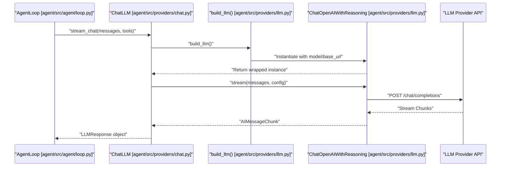
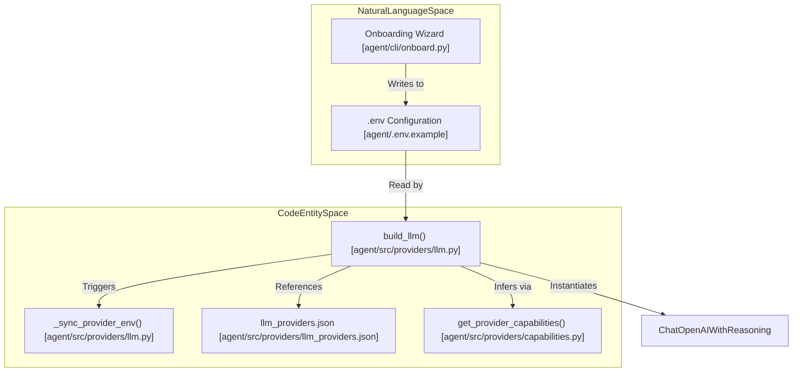

<!-- source: DeepWiki mcp.deepwiki.com · repo HKUDS/Vibe-Trading · page 2.4 LLM Providers and ChatLLM · fetched 2026-11-09 -->

# LLM Providers and ChatLLM

Relevant source files

The following files were used as context for generating this wiki page:

- [agent/.env.example](agent/.env.example)
- [agent/cli/_legacy.py](agent/cli/_legacy.py)
- [agent/cli/onboard.py](agent/cli/onboard.py)
- [agent/src/config/env_schema.py](agent/src/config/env_schema.py)
- [agent/src/preflight.py](agent/src/preflight.py)
- [agent/src/providers/capabilities.py](agent/src/providers/capabilities.py)
- [agent/src/providers/chat.py](agent/src/providers/chat.py)
- [agent/src/providers/llm.py](agent/src/providers/llm.py)
- [agent/src/providers/llm_providers.json](agent/src/providers/llm_providers.json)
- [agent/src/providers/openai_codex.py](agent/src/providers/openai_codex.py)
- [agent/tests/test_chat_llm_streaming.py](agent/tests/test_chat_llm_streaming.py)
- [agent/tests/test_cli_init.py](agent/tests/test_cli_init.py)
- [agent/tests/test_env_schema.py](agent/tests/test_env_schema.py)
- [agent/tests/test_kimi_reasoning_content.py](agent/tests/test_kimi_reasoning_content.py)
- [agent/tests/test_llm.py](agent/tests/test_llm.py)
- [agent/tests/test_llm_provider_defaults.py](agent/tests/test_llm_provider_defaults.py)
- [agent/tests/test_llm_reasoning_effort.py](agent/tests/test_llm_reasoning_effort.py)
- [agent/tests/test_openai_codex.py](agent/tests/test_openai_codex.py)
- [agent/tests/test_openai_codex_usage.py](agent/tests/test_openai_codex_usage.py)
- [agent/tests/test_preflight.py](agent/tests/test_preflight.py)
- [agent/tests/test_provider_diagnostics.py](agent/tests/test_provider_diagnostics.py)
- [agent/tests/test_provider_header_isolation.py](agent/tests/test_provider_header_isolation.py)
- [agent/tests/test_session_service_mcp.py](agent/tests/test_session_service_mcp.py)

## Purpose and Scope
The `agent/src/providers/` subsystem provides the foundational abstraction layer for interacting with Large Language Models (LLMs) across dozens of commercial providers, local runtimes, and authenticated relays. Vibe-Trading relies on this subsystem to maintain a unified tool-calling interface (`ChatLLM`), manage provider-specific credentials, handle reasoning payloads (such as DeepSeek and Zhipu thinking traces), and enforce robust preflight and endpoint guards.

Sources: [agent/src/providers/llm.py:1-40](), [agent/src/providers/chat.py:1-25]()

---

## LLM Architecture and Execution Data Flow
The core runtime agent loop delegates all inference and function calling through the `ChatLLM` interface [agent/src/providers/chat.py:1-4](). The `build_llm()` factory inspects environment variables and capabilities catalogs to return a suitably configured LangChain-compatible model instance wrapped with reasoning and streaming support [agent/src/providers/llm.py:1-25]().

### LLM Execution Flow Diagram

Sources: [agent/src/providers/llm.py:1-43](), [agent/src/providers/chat.py:1-30]()

---

## ChatLLM Abstraction and Response Handling
The `ChatLLM` client processes raw model streams into structured `LLMResponse` objects containing plain text, tool call requests, token usage metadata, and reasoning traces [agent/src/providers/chat.py:100-150]().

### Key Entities and Data Classes
| Entity | Role / Responsibility | Code Location |
|:---|:---|:---|
| `ChatLLM` | Main wrapper handling message formatting, tool binding, and stream parsing. | [agent/src/providers/chat.py:1-30]() |
| `LLMResponse` | Structured response object holding `content`, `tool_calls`, `reasoning_content`, and `usage_metadata`. | [agent/src/providers/chat.py:112-144]() |
| `ToolCallRequest` | Represents an invocation of an atomic tool with arguments and optional thought signatures. | [agent/src/providers/chat.py:83-100]() |
| `ChatOpenAIWithReasoning` | Subclass of LangChain's `ChatOpenAI` preserving inbound reasoning traces. | [agent/src/providers/llm.py:30-43]() |

Sources: [agent/src/providers/chat.py:83-144](), [agent/src/providers/llm.py:30-43]()

---

## Provider Capabilities and Factory Pattern
Vibe-Trading supports a wide catalog of LLM providers defined in `llm_providers.json` [agent/src/providers/llm_providers.json:1-214]() and modeled via `ProviderCapabilities` [agent/src/providers/capabilities.py:17-57]().

The `build_llm()` factory leverages `_sync_provider_env()` to map provider-specific environment variables (such as `DEEPSEEK_API_KEY` or `ZHIPU_API_KEY`) to standard OpenAI environment variables when using compatible endpoints [agent/src/providers/llm.py:181-230]().

### Natural Language and Configuration to Code Entity Mapping

Sources: [agent/src/providers/llm.py:181-230](), [agent/src/providers/llm_providers.json:1-214](), [agent/src/providers/capabilities.py:17-57](), [agent/cli/onboard.py:1-50]()

---

## Configuration, Reasoning Effort, and Specialized Provider Adaptations
Environment configuration is governed by `EnvConfig` and `LLMConfig` in `agent/src/config/env_schema.py` [agent/src/config/env_schema.py:155-180](). 

### Specialized Provider Rules
1. **MiniMax Temperature Clamping**: MiniMax requires `temperature > 0`. The factory automatically adjusts `0.0` to `0.01` if needed [agent/src/providers/llm.py:271-276]().
2. **OpenCode Relay Headers**: OpenCode Go endpoints require an `x-opencode-session` header corresponding to the active session identifier [agent/src/providers/llm.py:75-94]().
3. **Reasoning Effort Delivery**: Configured via `LANGCHAIN_REASONING_EFFORT`, delivered either via OpenRouter's `extra_body` or top-level request parameters depending on provider capabilities [agent/src/providers/capabilities.py:31-41]().

Sources: [agent/src/config/env_schema.py:155-180](), [agent/src/providers/llm.py:75-94](), [agent/src/providers/capabilities.py:31-41]()

---

## Data Contracts, Token Tracking, and Preflight Guards
To ensure reliable research runs and strict artifact auditing:
1. **Token Accounting**: `_parse_response` extracts `usage_metadata` from LangChain AIMessages, tracking input, output, and total tokens for downstream aggregation in run cards [agent/src/providers/chat.py:112-140]().
2. **Finish Reason Deduping**: `_dedupe_finish_reason` normalizes concatenated gateway finish strings (e.g., `stopstop` → `stop`) [agent/src/providers/chat.py:52-61]().
3. **Preflight Checks**: Startup routines in `agent/src/preflight.py` validate credentials and perform endpoint connectivity verification before accepting user prompts.

Sources: [agent/src/providers/chat.py:52-140](), [agent/src/preflight.py:1-134]()

---

