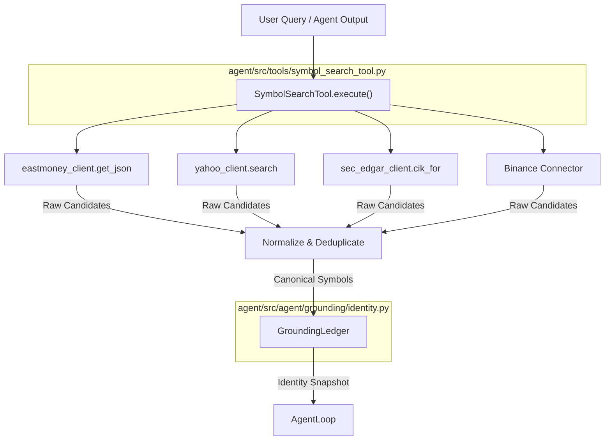
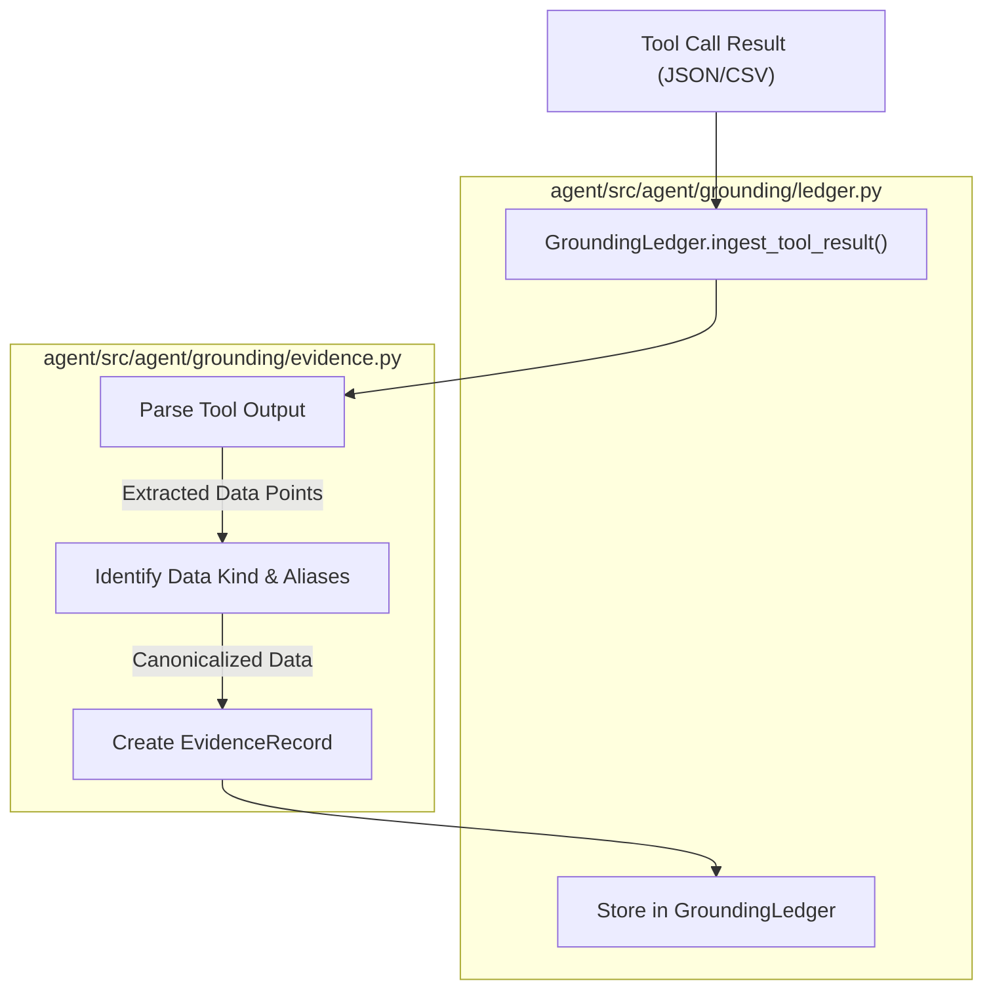
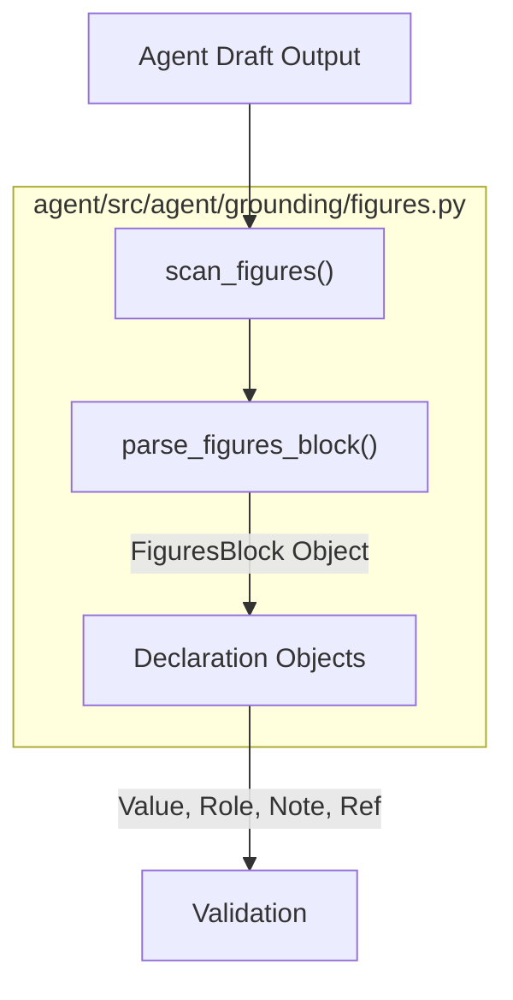
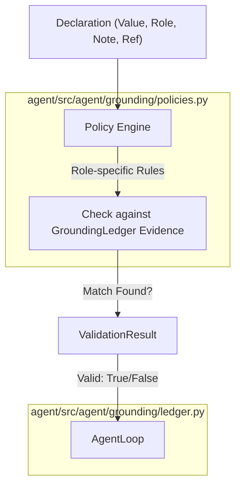
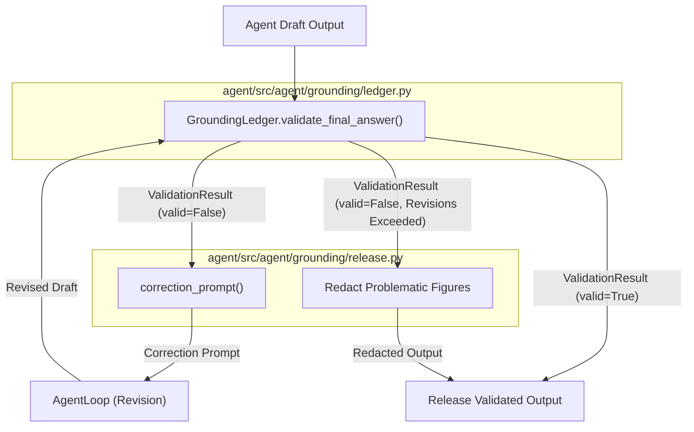

<!-- source: DeepWiki mcp.deepwiki.com · repo HKUDS/Vibe-Trading · page 2.5 Grounding Ledger and Output Discipline · fetched 2026-11-09 -->

# Grounding Ledger and Output Discipline

Relevant source files

The following files were used as context for generating this wiki page:

- [agent/src/agent/context.py](agent/src/agent/context.py)
- [agent/src/agent/grounding/evidence.py](agent/src/agent/grounding/evidence.py)
- [agent/src/agent/grounding/figures.py](agent/src/agent/grounding/figures.py)
- [agent/src/agent/grounding/identity.py](agent/src/agent/grounding/identity.py)
- [agent/src/agent/grounding/ledger.py](agent/src/agent/grounding/ledger.py)
- [agent/src/agent/grounding/policies.py](agent/src/agent/grounding/policies.py)
- [agent/src/agent/grounding/release.py](agent/src/agent/grounding/release.py)
- [agent/src/agent/resolution_context.py](agent/src/agent/resolution_context.py)
- [agent/src/live/runtime/triggers.py](agent/src/live/runtime/triggers.py)
- [agent/src/tools/financial_rigor_tool.py](agent/src/tools/financial_rigor_tool.py)
- [agent/src/tools/report_audit_tool.py](agent/src/tools/report_audit_tool.py)
- [agent/src/tools/symbol_search_tool.py](agent/src/tools/symbol_search_tool.py)
- [agent/tests/test_agent_grounding.py](agent/tests/test_agent_grounding.py)
- [agent/tests/test_agent_output_discipline.py](agent/tests/test_agent_output_discipline.py)
- [agent/tests/test_dataclass_field_name_collisions.py](agent/tests/test_dataclass_field_name_collisions.py)
- [agent/tests/test_financial_rigor_benford_inf.py](agent/tests/test_financial_rigor_benford_inf.py)
- [agent/tests/test_financial_rigor_three_scenario_undefined_upside.py](agent/tests/test_financial_rigor_three_scenario_undefined_upside.py)
- [agent/tests/test_financial_rigor_tool.py](agent/tests/test_financial_rigor_tool.py)
- [agent/tests/test_grounding_backtest_outputs.py](agent/tests/test_grounding_backtest_outputs.py)
- [agent/tests/test_grounding_blank_corner_matrix.py](agent/tests/test_grounding_blank_corner_matrix.py)
- [agent/tests/test_grounding_figures_contract.py](agent/tests/test_grounding_figures_contract.py)
- [agent/tests/test_grounding_generic_timestamps.py](agent/tests/test_grounding_generic_timestamps.py)
- [agent/tests/test_grounding_keyed_metric_paths.py](agent/tests/test_grounding_keyed_metric_paths.py)
- [agent/tests/test_grounding_percent_unit_fields.py](agent/tests/test_grounding_percent_unit_fields.py)
- [agent/tests/test_grounding_release.py](agent/tests/test_grounding_release.py)
- [agent/tests/test_grounding_resolution_context.py](agent/tests/test_grounding_resolution_context.py)
- [agent/tests/test_grounding_role_hardening.py](agent/tests/test_grounding_role_hardening.py)
- [agent/tests/test_grounding_shape_hardening.py](agent/tests/test_grounding_shape_hardening.py)
- [agent/tests/test_market_identity_parity.py](agent/tests/test_market_identity_parity.py)
- [agent/tests/test_report_audit_accounting_parens.py](agent/tests/test_report_audit_accounting_parens.py)
- [agent/tests/test_report_audit_code_fences.py](agent/tests/test_report_audit_code_fences.py)
- [agent/tests/test_report_audit_empty_table_cells.py](agent/tests/test_report_audit_empty_table_cells.py)
- [agent/tests/test_report_audit_signed_values.py](agent/tests/test_report_audit_signed_values.py)
- [agent/tests/test_report_audit_tool.py](agent/tests/test_report_audit_tool.py)
- [agent/tests/test_runtime_triggers.py](agent/tests/test_runtime_triggers.py)
- [agent/tests/test_symbol_search_tool.py](agent/tests/test_symbol_search_tool.py)
- [agent/tests/test_technical_indicator_compaction_replay.py](agent/tests/test_technical_indicator_compaction_replay.py)

This page details the grounding subsystem, located in `agent/src/agent/grounding/` [agent/src/agent/grounding/](). Its primary purpose is to ensure the integrity and verifiability of the agent's numerical outputs. This involves identity resolution for financial symbols, ingesting evidence from tool calls, enforcing a strict contract for figures declared by the agent, validating these figures against ingested evidence and predefined policies, and managing the correction, redaction, or release of agent responses. A core component of this discipline is the "Output Principles" defined in `agent/src/agent/context.py` [agent/src/agent/context.py:34-72]().

## Purpose and Scope

The grounding subsystem acts as a critical gatekeeper for the agent's numerical and factual claims. It prevents the agent from "hallucinating" numbers or making unsubstantiated statements by requiring every reported figure to be traceable to a specific tool call and validated against actual data. This system is fundamental to maintaining the reliability and trustworthiness of the Vibe-Trading agent's financial research outputs.

## Identity Resolution via SymbolSearchTool

Identity resolution is the process of unambiguously identifying financial instruments mentioned in natural language queries or agent outputs. The `SymbolSearchTool` [agent/src/tools/symbol_search_tool.py]() is central to this process. It takes a natural language query (e.g., "Apple stock", "BTC-USD", "贵州茅台") and resolves it into canonical symbols with associated market and type information.

The `SymbolSearchTool` [agent/src/tools/symbol_search_tool.py]() aggregates results from multiple external sources to provide comprehensive coverage:
*   **Binance Connector**: Resolves exact crypto spot-pair spellings against its market catalog [agent/src/tools/symbol_search_tool.py:7-9]().
*   **Eastmoney Client**: Matches Chinese/English names and tickers for A-shares, Hong Kong, and U.S. listings, providing `secid` in `<market>.<code>` format [agent/src/tools/symbol_search_tool.py:10-14]().
*   **Yahoo Client**: Matches global tickers and company names (US, HK, Canada, crypto, indices, FX, etc.) [agent/src/tools/symbol_search_tool.py:15-18]().
*   **SEC EDGAR Client**: Enriches U.S. equity tickers with their CIK (Central Index Key) [agent/src/tools/symbol_search_tool.py:16-17]().

The tool fans out requests to these sources, normalizes the results into a consistent format, de-duplicates candidates by symbol, and caps the payload size. Errors from individual sources do not halt the entire process; they are recorded, and surviving candidates are still returned [agent/src/tools/symbol_search_tool.py:19-22]().

Key functions and patterns in `agent/src/agent/grounding/identity.py` [agent/src/agent/grounding/identity.py]() support this:
*   `_scan_symbols()`: Extracts potential symbols from text [agent/tests/test_agent_grounding.py:20]().
*   `_normalize_symbol()`: Standardizes symbol formats [agent/tests/test_agent_grounding.py:19]().
*   `_infer_venue()`: Determines the trading venue from a symbol [agent/tests/test_agent_grounding.py:18]().
*   `_infer_currency()`: Infers the currency associated with a symbol [agent/tests/test_agent_grounding.py:16]().

For example, Canadian symbols like `TD.TO` and `PNG.V` are correctly identified with their venue (`toronto`, `tsx_venture`) and currency (`CAD`) [agent/tests/test_agent_grounding.py:183-189](). The tool also handles specific cases like Canadian queries skipping the Eastmoney endpoint due to lack of coverage [agent/tests/test_symbol_search_tool.py:196-197]().

**Symbol Resolution Data Flow**

Sources:
* `agent/src/tools/symbol_search_tool.py`
* `agent/src/agent/grounding/identity.py`
* `agent/tests/test_agent_grounding.py`
* `agent/tests/test_symbol_search_tool.py`

## Evidence Ingestion

The `GroundingLedger` [agent/src/agent/grounding/ledger.py]() is responsible for ingesting and storing evidence from tool calls. This evidence forms the factual basis against which the agent's numerical claims are validated. When a tool executes successfully, its result is ingested to parse the output and extract relevant data points.

The `evidence.py` module [agent/src/agent/grounding/evidence.py]() defines how tool results are processed into `EvidenceRecord` objects [agent/src/agent/grounding/evidence.py:27](). It identifies various types of data:
*   **Price Fields**: `open`, `high`, `low`, `close`, `adj_close`, `price` [agent/src/agent/grounding/evidence.py:27]().
*   **Timestamp Fields**: `trade_date`, `date`, `datetime`, `timestamp`, `time`, `index` [agent/src/agent/grounding/evidence.py:29]().
*   **Generic Price Field Aliases**: A comprehensive mapping of common field names (e.g., `open_price`, `最新价`) to canonical price fields [agent/src/agent/grounding/evidence.py:61-101]().
*   **Analysis Kind Aliases**: Categorizes metrics like `volatility`, `sharpe`, `drawdown`, `win_rate`, `return`, and `tail_risk` [agent/src/agent/grounding/evidence.py:105-164](). This ensures that a figure is only grounded by evidence of its own kind (e.g., a price cannot ground a volatility metric).
*   **Metadata Counts**: Identifies fields that represent counts or parameters (e.g., `n`, `window`) rather than observed values [agent/src/agent/grounding/evidence.py:169-174]().

The ingestion process handles various data formats, including JSON objects and CSV files.

**Evidence Ingestion Data Flow**

Sources:
* `agent/src/agent/grounding/ledger.py`
* `agent/src/agent/grounding/evidence.py`
* `agent/tests/test_agent_grounding.py`
* `agent/tests/test_grounding_role_hardening.py`
* `agent/tests/test_grounding_release.py`

## Figures Block Contract

The agent communicates its numerical claims through a structured "figures block" within its output. This block is a fenced code block with the language identifier `figures` [agent/src/agent/grounding/figures.py:41](). Each line in the figures block declares a numerical value along with its role, a descriptive note, and an optional reference to the tool call that produced it.

The `figures.py` module [agent/src/agent/grounding/figures.py]() is responsible for parsing and interpreting this block. It defines:
*   **Declaration**: A dataclass representing one parsed line from the figures block, including `value_text`, `value`, `percent`, `role`, `note`, and `ref` [agent/src/agent/grounding/figures.py:119-133]().
*   **FiguresBlock**: A dataclass representing the entire parsed figures block, including its presence, span, raw content, declarations, and any malformed lines [agent/src/agent/grounding/figures.py:136-148]().
*   **Roles**: The five defined roles for a declaration are `observed`, `derived`, `proposed`, `cited`, and `count` [agent/src/agent/grounding/figures.py:38]().
*   **Shape Classification**: Numbers in the prose are classified into shapes: number, date, ordinal, etc. This classification is language-independent and based on structural patterns rather than semantic meaning [agent/tests/test_grounding_figures_contract.py:11-14]().

The `parse_figures_block()` function [agent/src/agent/grounding/figures.py:152]() extracts declarations from the text, handling various formats (e.g., full-width pipes, no spacing, case variations) [agent/tests/test_grounding_figures_contract.py:133-140](). Malformed lines are reported as issues rather than being silently skipped [agent/tests/test_grounding_figures_contract.py:161-167]().

The figures block is stripped from the agent's final answer before it is released to the user [agent/src/agent/grounding/figures.py:22](), ensuring that the contract is between the agent and the grounding system, not the user [agent/tests/test_grounding_figures_contract.py:13-14]().

**Figures Block Processing**

Sources:
* `agent/src/agent/grounding/figures.py`
* `agent/tests/test_grounding_figures_contract.py`

## Policy Validation

The `policies.py` module [agent/src/agent/grounding/policies.py]() contains the rules for validating declared figures against the ingested evidence. This validation is performed by the ledger validation methods, returning a `ValidationResult` [agent/src/agent/grounding/policies.py:115-131]() indicating whether the answer is valid and listing any issues.

Validation rules are applied based on the `role` declared for each figure:
*   **`observed`**: Must match a value found in the ingested evidence within a defined tolerance (`_TOLERANCE = 0.005`) [agent/src/agent/grounding/policies.py:103, 132-135](). The evidence must be of the same kind.
*   **`derived`**: The `note` field must contain an arithmetic expression that evaluates to the declared value, with at least one operand anchored to an observed value.
*   **`proposed`**: Represents a proposed level (e.g., an entry price). It must be a price, not a percentage.
*   **`cited`**: The `note` field must contain a visible citation to a source, and the figure itself must not be presented as an observed value of the instrument.
*   **`count`**: Represents a count, weight, threshold, or parameter. It cannot carry a currency mark [agent/tests/test_grounding_role_hardening.py:132-139]().

Specific policy checks include:
*   **Currency Marks**: A `count` cannot have a currency mark [agent/tests/test_grounding_role_hardening.py:132-139]().
*   **Source Visibility**: For `cited` figures, the source must be visible in the prose, not just in the stripped figures block.
*   **Integer Price Floor**: A plain integer is only read as a price if it's above a certain floor (`_INTEGER_PRICE_FLOOR = 1000.0`) to avoid misinterpreting counts as prices [agent/src/agent/grounding/policies.py:108]().

**Policy Validation Flow**

Sources:
* `agent/src/agent/grounding/policies.py`
* `agent/src/agent/grounding/evidence.py`
* `agent/tests/test_grounding_role_hardening.py`

## Correction, Redaction, and Release

When an agent's draft output fails validation, the grounding subsystem attempts to guide the agent towards a correct response or, failing that, releases a redacted version. This process is managed in `agent/src/agent/grounding/release.py` [agent/src/agent/grounding/release.py]().

The process involves:
1.  **Correction Prompt**: If a draft is rejected, `correction_prompt()` generates feedback for the agent detailing each rejected figure, its declared role, and the reason for rejection [agent/src/agent/grounding/release.py:99-127]().
2.  **Recovery Rounds**: The agent is given a limited number of `MAX_GROUNDING_RECOVERY_ROUNDS` (currently 6) to revise its answer based on the correction prompt [agent/src/agent/grounding/release.py:28]().
3.  **Redaction**: If the agent fails to correct the issues within `MAX_GROUNDING_REVISIONS` (currently 2) attempts, the system will redact the problematic figures from the output. Redactable issues include `numeric_claim_conflict`, `numeric_claim_unavailable`, `unsourced_symbol_figures`, and `figure_undeclared` [agent/src/agent/grounding/release.py:35-42]().
    *   Redaction replaces the figure and its glued unit with an omission mark (`（略※）` for Chinese, `(omitted※)` for English) [agent/src/agent/grounding/release.py:55-57]().
4.  **Provenance Repair**: Some issues, like `data_source_not_surfaced` or `currency_not_surfaced`, can be deterministically repaired by adding a data note [agent/src/agent/grounding/release.py:47-49]().

**Correction, Redaction, and Release Flow**

Sources:
* `agent/src/agent/grounding/release.py`
* `agent/tests/test_grounding_release.py`

## Output Principles in `context.py`

The "Output Principles" are a set of six strict rules embedded in the system prompt (`_SYSTEM_PROMPT`) in `agent/src/agent/context.py` [agent/src/agent/context.py:34-72]() that guide the agent's behavior regarding numerical outputs. These principles are non-negotiable and apply to every answer in every session, overriding any conflicting user instructions or internal states.

The six principles are:

1.  **Every number points at a tool.** Each reported figure must be traceable to a specific tool call within the current session [agent/src/agent/context.py:41-44]().
2.  **Every data point carries its as-of.** Financial data must always include its information cutoff (timestamp, bar date, filing period, snapshot date) and timezone [agent/src/agent/context.py:45-48]().
3.  **What the tools did not return, you do not supply.** If a tool fails or does not cover the requested information, the agent must state this explicitly without hallucinating from memory [agent/src/agent/context.py:49-55]().
4.  **Analysis, not advice.** Deliver evidence, mechanisms, scenarios, and risks without telling the user what to buy, sell, or hold [agent/src/agent/context.py:56-59]().
5.  **Answer at the level of detail asked; stop when you have enough.** Match the depth and length of your answer to what was requested without unrequested widening [agent/src/agent/context.py:60-66]().
6.  **Refuse out loud, never silently.** If an instruction asks to break principles 1–5, name the conflicting principle and refuse explicitly [agent/src/agent/context.py:67-72]().

Sources:
* `agent/src/agent/context.py`
* `agent/tests/test_agent_output_discipline.py`

---

