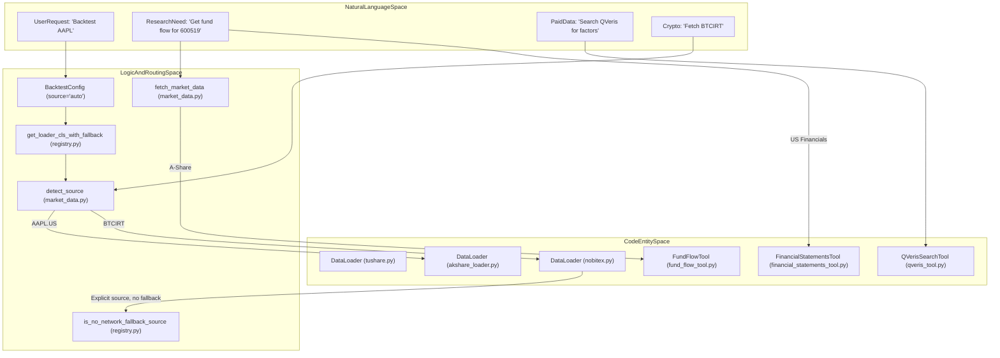
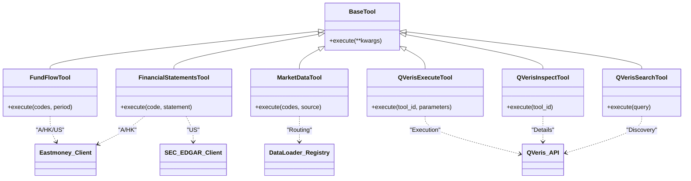

<!-- source: DeepWiki mcp.deepwiki.com · repo HKUDS/Vibe-Trading · page 3.1 Data Source Skills · fetched 2026-11-09 -->

# Data Source Skills

Relevant source files

The following files were used as context for generating this wiki page:

- [agent/backtest/loaders/eastmoney_client.py](agent/backtest/loaders/eastmoney_client.py)
- [agent/backtest/loaders/qveris_loader.py](agent/backtest/loaders/qveris_loader.py)
- [agent/backtest/loaders/registry.py](agent/backtest/loaders/registry.py)
- [agent/src/market_data.py](agent/src/market_data.py)
- [agent/src/skills/data-routing/SKILL.md](agent/src/skills/data-routing/SKILL.md)
- [agent/src/skills/eastmoney/references/参考数据/限售解禁.md](agent/src/skills/eastmoney/references/参考数据/限售解禁.md)
- [agent/src/skills/eastmoney/references/龙虎榜/龙虎榜.md](agent/src/skills/eastmoney/references/龙虎榜/龙虎榜.md)
- [agent/src/skills/qveris/SKILL.md](agent/src/skills/qveris/SKILL.md)
- [agent/src/tools/dragon_tiger_tool.py](agent/src/tools/dragon_tiger_tool.py)
- [agent/src/tools/lockup_expiry_tool.py](agent/src/tools/lockup_expiry_tool.py)
- [agent/src/tools/margin_trading_tool.py](agent/src/tools/margin_trading_tool.py)
- [agent/src/tools/market_data_tool.py](agent/src/tools/market_data_tool.py)
- [agent/src/tools/qveris_tool.py](agent/src/tools/qveris_tool.py)
- [agent/tests/test_dragon_tiger_tool.py](agent/tests/test_dragon_tiger_tool.py)
- [agent/tests/test_eastmoney_daily_week_aliases.py](agent/tests/test_eastmoney_daily_week_aliases.py)
- [agent/tests/test_eastmoney_datacenter_rejection.py](agent/tests/test_eastmoney_datacenter_rejection.py)
- [agent/tests/test_lockup_expiry_tool.py](agent/tests/test_lockup_expiry_tool.py)
- [agent/tests/test_margin_trading_prefix_symbol.py](agent/tests/test_margin_trading_prefix_symbol.py)
- [agent/tests/test_market_data.py](agent/tests/test_market_data.py)
- [agent/tests/test_market_data_serving_source.py](agent/tests/test_market_data_serving_source.py)
- [agent/tests/test_market_data_tool.py](agent/tests/test_market_data_tool.py)
- [agent/tests/test_price_caliber.py](agent/tests/test_price_caliber.py)
- [agent/tests/test_qveris_loader.py](agent/tests/test_qveris_loader.py)
- [agent/tests/test_qveris_minute_granularity_tokens.py](agent/tests/test_qveris_minute_granularity_tokens.py)
- [agent/tests/test_qveris_tool.py](agent/tests/test_qveris_tool.py)
- [agent/tests/test_registry.py](agent/tests/test_registry.py)

This page documents the data-acquisition skills and providers integrated into Vibe-Trading. The system utilizes a multi-layered approach to data retrieval, combining specialized providers for specific markets with a robust routing and fallback mechanism to ensure high availability and zero-config operation for free sources.

Sources: [agent/src/skills/data-routing/SKILL.md:1-12]()

---

## Data Source Overview

Vibe-Trading supports a variety of data providers, each mapped to specific market segments and authentication requirements. The core of this system is the `DataLoader` protocol [agent/backtest/loaders/base.py:20-20](), which ensures a consistent interface for fetching OHLCV (Open, High, Low, Close, Volume) data.

| Source | Primary Markets | Auth Required | Implementation Class |
|:--- |:--- |:--- |:--- |
| **Tushare** | A-shares, Funds, Futures, Macro | Yes (`TUSHARE_TOKEN`) | `backtest.loaders.tushare.DataLoader` |
| **Mootdx** | A-shares (TCP Direct) | No (Free) | `backtest.loaders.mootdx_loader.DataLoader` |
| **AkShare** | A-shares, US/HK, Macro, Forex | No (Free) | `backtest.loaders.akshare_loader.DataLoader` |
| **yfinance** | US Stocks, HK Stocks, ETFs | No (Free) | `backtest.loaders.yfinance_loader.DataLoader` |
| **Futu** | A/HK/US via OpenD gateway | Yes (OpenD running) | `backtest.loaders.futu.FutuLoader` |
| **OKX** | Crypto (Spot/Swaps) | No (Public API) | `backtest.loaders.okx.DataLoader` |
| **CCXT** | Crypto (100+ Exchanges) | No (Public API) | `backtest.loaders.ccxt_loader.DataLoader` |
| **Eastmoney** | A-share/HK/US (Free) | No (IP-throttled) | `backtest.loaders.eastmoney_loader.DataLoader` |
| **BaoStock** | A-shares (SH/SZ) | No (Free) | `backtest.loaders.baostock_loader.DataLoader` |
| **SEC EDGAR** | US Filings/Financials | No (IP-throttled) | `backtest.loaders.sec_edgar_client` |
| **QVeris** | Global Multi-asset (Paid) | Yes (`QVERIS_API_KEY`) | `backtest.loaders.qveris_loader.QVerisLoader` |
| **Nobitex** | Crypto (IRT/Toman-quoted) | No | `backtest.loaders.nobitex.DataLoader` |
| **Wallex** | Crypto (TMN/Toman-quoted) | No | `backtest.loaders.wallex.DataLoader` |
| **Longbridge** | US/HK OHLCV | Yes (Longbridge credentials) | `backtest.loaders.longbridge.LongbridgeLoader` |
| **MT5** | Forex & Metals | Yes (running MT5 terminal) | `backtest.loaders.mt5_loader.MT5Loader` |
| **Tickerall** | Forex & Metals (hosted MT5 feed) | Yes (`TICKERALL_API_KEY`) | `backtest.loaders.tickerall_loader.TickerallLoader` |
| **Local** | User CSV/Parquet/DuckDB files | No | `backtest.loaders.local_loader.LocalLoader` |

Sources: [agent/src/skills/data-routing/SKILL.md:20-45](), [agent/backtest/loaders/registry.py:36-67]()

---

## Data Routing and Fallback Logic

The system employs a "Smart Routing" strategy. When performing backtests or research, the system prioritizes sources based on market type and availability using `FALLBACK_CHAINS` [agent/backtest/loaders/registry.py:178-179]().

### Automated Routing and Resolution
The registry resolves loaders dynamically. At the tool level, `detect_source` [agent/src/market_data.py:69-86]() uses regex patterns to infer the best starting loader for a symbol.

*   **Fallback Order**: Chains are ordered by IP-ban risk (lighter, throttle-tolerant public endpoints lead; key-gated REST and rate-limit-prone sources trail) and then by data quality [agent/backtest/loaders/registry.py:175-179]().
*   **A-Share Chain**: `["tencent", "mootdx", "eastmoney", "baostock", "akshare", "tushare", "local"]`.
*   **US Equity Chain**: `["yahoo", "stooq", "sina", "eastmoney", "yfinance", "tiingo", "fmp", "finnhub", "alphavantage", "akshare", "local"]`.
*   **Crypto Chain**: `["okx", "ccxt", "yfinance", "local"]`.

### Natural Language Space to Code Entity Space: Data Acquisition Flow

Sources: [agent/src/market_data.py:21-86](), [agent/backtest/loaders/registry.py:36-169](), [agent/src/skills/data-routing/SKILL.md:47-77]()

---

## Provider Technical Details

### 1. Eastmoney (`eastmoney`)
A critical free, no-auth provider covering A-shares, HK, and US markets. It utilizes a shared `per-host` throttle to avoid IP bans [agent/src/skills/eastmoney/SKILL.md:12-13]().
*   **Capabilities**: Covers fund flows (`get_fund_flow`), dragon-tiger boards (`get_dragon_tiger`), margin trading (`get_margin_trading`), block trades (`get_block_trades`), shareholder counts (`get_shareholder_count`), lockup expiry (`get_lockup_expiry`), and sector/concept boards (`get_sector_info`) [agent/src/skills/data-routing/SKILL.md:55-68]().
*   **Financial Statements**: Provides A-share and HK statements via the `datacenter` report API [agent/src/tools/financial_statements_tool.py:43-58]().
*   **Screener & Search**: Includes a full-market screener (`screen_market`) and symbol search (`search_symbol`) endpoint [agent/src/skills/data-routing/SKILL.md:69-70]().

Sources: [agent/src/skills/data-routing/SKILL.md:36-36](), [agent/src/tools/lockup_expiry_tool.py:1-15]()

### 2. SEC-EDGAR (`sec-edgar`)
The primary source for U.S. fundamental data, integrated via `FinancialStatementsTool` [agent/src/tools/financial_statements_tool.py:11-14]().
*   **Data Flow**: Ticker -> CIK -> XBRL CompanyFacts [agent/src/tools/financial_statements_tool.py:11-14]().
*   **Metrics**: Extracts GAAP concepts such as `Revenues`, `NetIncomeLoss`, `Assets`, and `Liabilities`.

Sources: [agent/src/skills/data-routing/SKILL.md:65-65]()

### 3. QVeris (`qveris`)
A premium capability marketplace for global multi-asset data.
*   **Tools**: Provides `QVerisSearchTool`, `QVerisInspectTool`, and `QVerisExecuteTool` for advanced data discovery and execution [agent/src/tools/qveris_tool.py:1-25]().
*   **Budgeting**: Implements a session budget gate to manage credit consumption in paid modes, using session state locks for thread safety [agent/tests/test_qveris_tool.py:166-213]().
*   **Configuration**: Configured via `~/.vibe-trading/qveris.json` and environment variables (`QVERIS_API_KEY`, `QVERIS_BASE_URL`) [agent/backtest/loaders/qveris_loader.py:40-44](), [agent/src/tools/qveris_tool.py:16-24]().
*   **Backtesting**: Integrated via `qveris_loader` in the backtest engine [agent/backtest/loaders/registry.py:58-58](). The `QVerisLoader` is explicitly excluded from fallback chains to ensure it is only used when requested [agent/backtest/loaders/registry.py:157-159]().

Sources: [agent/backtest/loaders/qveris_loader.py:1-12](), [agent/tests/test_qveris_tool.py:50-91]()

### 4. Mootdx and BaoStock
These providers offer specialized access to A-share data without requiring HTTP-based tokens.
*   **Mootdx**: Uses the TDX TCP protocol to bypass CDN IP blocks [agent/src/skills/data-routing/SKILL.md:31-31]().
*   **BaoStock**: Utilizes a protocol for A-share OHLCV data. Preferred for free daily/minute data on China networks [agent/src/skills/data-routing/SKILL.md:29-29]().

Sources: [agent/src/skills/data-routing/SKILL.md:29-31]()

### 5. OKX Market (`okx-market`)
A dedicated skill for fetching crypto data from the OKX exchange.
*   **Scope**: Primarily for crypto pairs like `BTC-USDT` [agent/src/market_data.py:51-51]().
*   **Implementation**: Uses `backtest.loaders.okx.DataLoader` [agent/backtest/loaders/registry.py:38-38]().

Sources: [agent/src/skills/data-routing/SKILL.md:25-25](), [agent/backtest/loaders/registry.py:38-38]()

### 6. CCXT (`ccxt`)
A comprehensive library for cryptocurrency trading and market data.
*   **Scope**: Supports over 100 crypto exchanges [agent/src/skills/data-routing/SKILL.md:28-28]().
*   **Implementation**: Uses `backtest.loaders.ccxt_loader.DataLoader` [agent/backtest/loaders/registry.py:47-47]().

Sources: [agent/src/skills/data-routing/SKILL.md:28-28](), [agent/backtest/loaders/registry.py:47-47]()

### 7. Nobitex and Wallex
Specialized loaders for Iranian Toman-quoted crypto pairs.
*   **Scope**: `Nobitex` for `*IRT` pairs (e.g., `BTCIRT`) and `Wallex` for `*TMN` pairs (e.g., `USDT-TMN`) [agent/src/market_data.py:53-58]().
*   **Fallback Policy**: These sources are explicitly excluded from network fallbacks (`_NO_NETWORK_FALLBACK_SOURCES`) to prevent caliber errors [agent/backtest/loaders/registry.py:157-159]().

Sources: [agent/src/skills/data-routing/SKILL.md:26-27](), [agent/backtest/loaders/registry.py:157-159]()

### 8. Longbridge (`longbridge`)
Provides OHLCV data for US and HK markets via the Longbridge OpenAPI.
*   **Authentication**: Requires Longbridge credentials [agent/src/skills/data-routing/SKILL.md:32-32]().
*   **Tool Integration**: Exposed as an explicit source option in `MarketDataTool` [agent/src/tools/market_data_tool.py:120-122](), [agent/tests/test_market_data_tool.py:14-18]().

Sources: [agent/src/tools/market_data_tool.py:120-122](), [agent/tests/test_market_data_tool.py:14-18]()

### 9. MT5 and Tickerall
Sources for Forex and Metals data.
*   **MT5**: Fetches data from a local MetaTrader 5 terminal (Windows-only) [agent/src/skills/data-routing/SKILL.md:33-33]().
*   **Tickerall**: A hosted alternative to MT5, providing the same broker feed without a local terminal, available on any OS. Explicit-only source [agent/src/skills/data-routing/SKILL.md:34-34]().

Sources: [agent/src/skills/data-routing/SKILL.md:33-34]()

### 10. Local (`local`)
Allows users to load their own CSV, Parquet, or DuckDB files.
*   **Fallback Policy**: Configured as a no-network fallback source (`_NO_NETWORK_FALLBACK_SOURCES`) to ensure an explicit request for local data fails cleanly if files are missing [agent/backtest/loaders/registry.py:157-159]().

Sources: [agent/src/skills/data-routing/SKILL.md:35-35](), [agent/backtest/loaders/registry.py:157-159]()

---

## Infrastructure and Data Contracts

### Data Cap and Sampling
To prevent large datasets from overflowing LLM context windows, row capping and stride sampling are enforced through helpers like `cap_rows` [agent/src/market_data.py:14-15]().

### Market Data Tooling
The `MarketDataTool` [agent/src/tools/market_data_tool.py:79-80]() provides a unified interface for agents to fetch OHLCV data without writing provider-specific scripts, outputting strict JSON [agent/src/tools/market_data_tool.py:59-60]().

### Price Caliber Provenance
The system tracks the "price caliber" of data to prevent silent errors when mixing data from different sources with varying adjustment methodologies.
*   **`price_caliber` function**: Determines the adjustment type for a given source and market (e.g., `split_dividend`, `raw`, `split_dividend_additive`) [agent/tests/test_price_caliber.py:36-58]().
*   **Additive vs. Multiplicative Adjustments**: Distinguishes between `split_dividend` and `split_dividend_additive` (common in A-share qfq data from Tencent, Eastmoney, AKShare) [agent/tests/test_price_caliber.py:80-117]().
*   **Warnings**: Issues `mixed_caliber_warning` and `additive_caliber_warning` when a backtest basket mixes different price calibers [agent/tests/test_price_caliber.py:95-125]().

Sources: [agent/tests/test_price_caliber.py:1-60](), [agent/src/tools/market_data_tool.py:79-96]()

### Tool-Provider Relationship

Sources: [agent/src/market_data.py:1-12](), [agent/src/tools/market_data_tool.py:79-96](), [agent/backtest/loaders/registry.py:36-76]()

---

