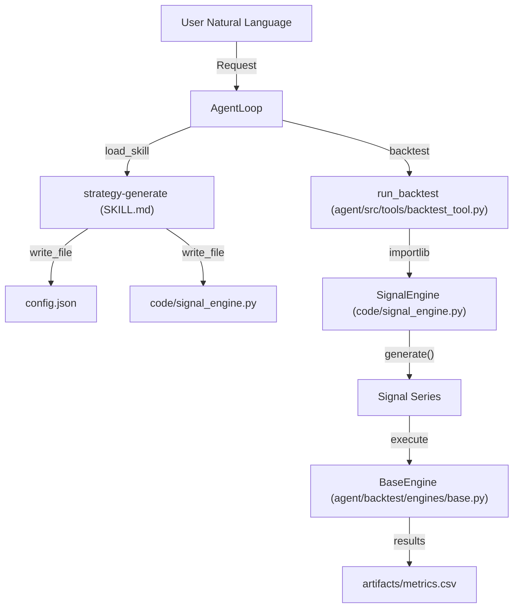
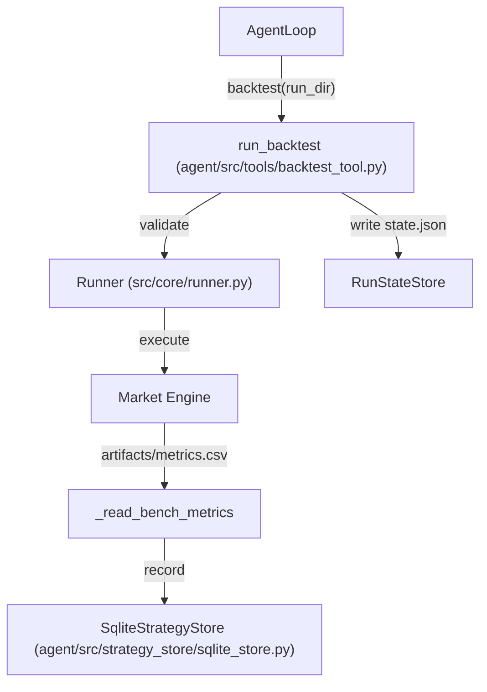
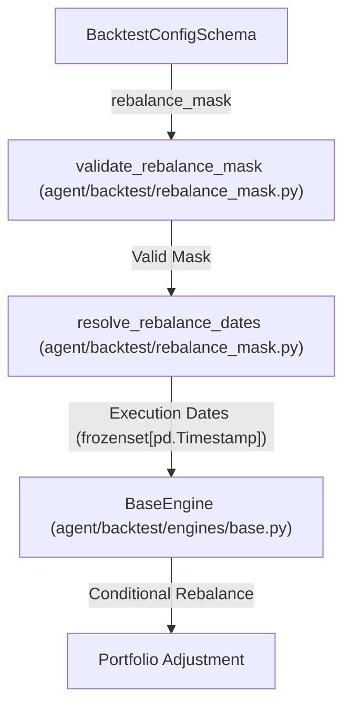
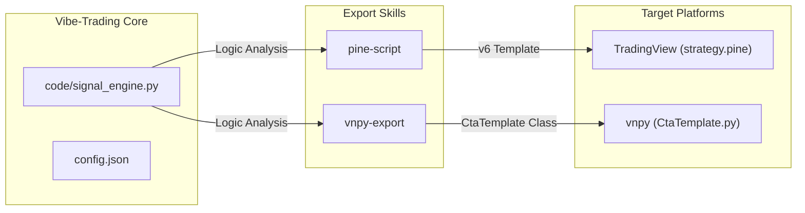

<!-- source: DeepWiki mcp.deepwiki.com · repo HKUDS/Vibe-Trading · page 3.2 Strategy and Backtesting Skills · fetched 2026-11-09 -->

# Strategy and Backtesting Skills

Relevant source files

The following files were used as context for generating this wiki page:

- [agent/backtest/engines/__init__.py](agent/backtest/engines/__init__.py)
- [agent/backtest/engines/global_equity.py](agent/backtest/engines/global_equity.py)
- [agent/backtest/rebalance_mask.py](agent/backtest/rebalance_mask.py)
- [agent/src/skills/strategy-dev-manager/SKILL.md](agent/src/skills/strategy-dev-manager/SKILL.md)
- [agent/src/skills/strategy-generate/SKILL.md](agent/src/skills/strategy-generate/SKILL.md)
- [agent/src/strategy_store/metrics.py](agent/src/strategy_store/metrics.py)
- [agent/src/strategy_store/models.py](agent/src/strategy_store/models.py)
- [agent/src/strategy_store/sqlite_store.py](agent/src/strategy_store/sqlite_store.py)
- [agent/src/strategy_store/store.py](agent/src/strategy_store/store.py)
- [agent/src/tools/backtest_tool.py](agent/src/tools/backtest_tool.py)
- [agent/src/tools/sdm_decay_scan_tool.py](agent/src/tools/sdm_decay_scan_tool.py)
- [agent/src/tools/sdm_status_tool.py](agent/src/tools/sdm_status_tool.py)
- [agent/tests/test_backtest_records_bench.py](agent/tests/test_backtest_records_bench.py)
- [agent/tests/test_backtest_tool_state.py](agent/tests/test_backtest_tool_state.py)
- [agent/tests/test_dropped_target_adjustments.py](agent/tests/test_dropped_target_adjustments.py)
- [agent/tests/test_global_equity_hk_lot_sizes.py](agent/tests/test_global_equity_hk_lot_sizes.py)
- [agent/tests/test_rebalance_mask.py](agent/tests/test_rebalance_mask.py)
- [agent/tests/test_rebalance_tolerance.py](agent/tests/test_rebalance_tolerance.py)
- [agent/tests/test_sdm_finite_metrics.py](agent/tests/test_sdm_finite_metrics.py)
- [agent/tests/test_signal_alignment_perf.py](agent/tests/test_signal_alignment_perf.py)
- [agent/tests/test_strategy_store.py](agent/tests/test_strategy_store.py)
- [agent/tests/test_uk_backtest_smoke.py](agent/tests/test_uk_backtest_smoke.py)

The Strategy and Backtesting subsystem provides the agent with the specialized knowledge required to transform natural language investment ideas into executable Python code, diagnose performance issues, model realistic trade execution, and export strategies to external platforms. This system bridges the gap between high-level reasoning and the rigorous [Backtesting Framework]() described in section 4.

## Strategy Generation Workflow

The generation process follows a strict lifecycle managed by the `strategy-generate` skill [agent/src/skills/strategy-generate/SKILL.md:1-5](). The agent acts as a quantitative developer, translating user intent into a standardized `SignalEngine` implementation and a corresponding `config.json` [agent/src/skills/strategy-generate/SKILL.md:7-17]().

### 1. Requirements Parsing and Configuration
The agent first normalizes instrument codes (e.g., appending `.SH` or `.SZ` for China A-shares, or using the `XXX-USDT` hyphenated format for OKX crypto) and determines the appropriate data source based on the asset class [agent/src/skills/strategy-generate/SKILL.md:27-30](). A `config.json` is created to define the backtest environment, including parameters like `start_date`, `end_date`, and `initial_cash` [agent/src/skills/strategy-generate/SKILL.md:40-41]().

### 2. The SignalEngine Contract
All strategies must implement the `SignalEngine` class [agent/src/skills/strategy-generate/SKILL.md:54-57](). This contract ensures compatibility with the backtest runner and engines.

| Component | Requirement |
| :--- | :--- |
| **Class Name** | Must be `SignalEngine` [agent/src/skills/strategy-generate/SKILL.md:57-57]() |
| **Method** | `generate(self, data_map: Dict[str, pd.DataFrame]) -> Dict[str, pd.Series]` [agent/src/skills/strategy-generate/SKILL.md:58-70]() |
| **Input** | `data_map` containing OHLCV and optional `extra_fields` (PE, PB, ROE) or `fundamental_fields` [agent/src/skills/strategy-generate/SKILL.md:61-64]() |
| **Output** | A dictionary of pandas Series with values in range `[-1.0, 1.0]` [agent/src/skills/strategy-generate/SKILL.md:65-69]() |
| **Constraints** | Pure pandas/numpy; no external signal libraries; index must align with input [agent/src/skills/strategy-generate/SKILL.md:73-79]() |

### Strategy Development Data Flow
The following diagram illustrates how the agent moves from a user request to a running backtest, bridging natural language space to code entities (`AgentLoop`, `strategy-generate`, `run_backtest`, `SignalEngine`).

**Title: Strategy Generation and Execution Flow**

Sources: [agent/src/skills/strategy-generate/SKILL.md:7-17](), [agent/src/skills/strategy-generate/SKILL.md:54-71](), [agent/src/tools/backtest_tool.py:1-21]()

---

## Backtest Execution and State Recording

When the agent invokes the `backtest` tool (`run_backtest`), the system validates the configuration and `signal_engine.py` presence, executes the runner via `Runner`, and records lifecycle status and bench history [agent/src/tools/backtest_tool.py:1-166]().

### State and Bench Registration
*   **State Tracking**: Successful and failed runs persist their status in `state.json` within the run directory (e.g., `{"status": "success"}` or `{"status": "failed", "reason": "..."}`) [agent/tests/test_backtest_tool_state.py:48-62]().
*   **Bench Recording**: If an `artifact_id` is declared in `config.json`, `_record_bench_if_declared` extracts finite metrics from `artifacts/metrics.csv` (`sharpe`, `annual_return`, `max_drawdown`, `calmar`) and stores them atomically against the strategy store [agent/src/tools/backtest_tool.py:65-166]().

**Title: Backtest Tool Execution and Bench Recording**

Sources: [agent/src/tools/backtest_tool.py:1-166](), [agent/tests/test_backtest_tool_state.py:1-128](), [agent/src/strategy_store/sqlite_store.py:1-190]()

---

## Rebalance Masks

The `rebalance_mask` feature allows precise control over when a portfolio rebalances, enabling strategies to specify rebalancing cadences (e.g., monthly, quarterly) or specific dates [agent/backtest/rebalance_mask.py:1-106](). This is crucial for managing transaction costs and aligning with strategy logic.

The `rebalance_mask` can be specified as:
*   A pandas offset alias (e.g., `"MS"` for month start) [agent/backtest/rebalance_mask.py:19-28]().
*   A list of ISO-formatted date strings (e.g., `["2026-01-02", "2026-01-05"]`) [agent/backtest/rebalance_mask.py:29-44]().
*   `None`, which implies rebalancing on every bar where the target weight changes (legacy behavior) [agent/tests/test_rebalance_mask.py:101-111]().

The `validate_rebalance_mask` function ensures the mask format is correct [agent/backtest/rebalance_mask.py:15-44](), while `resolve_rebalance_dates` maps the mask to actual trading dates within the backtest period [agent/backtest/rebalance_mask.py:47-106]().

**Title: Rebalance Mask Logic Flow**

Sources: [agent/backtest/rebalance_mask.py:1-106](), [agent/tests/test_rebalance_mask.py:1-206]()

---

## Strategy Export Skills

Vibe-Trading supports exporting strategies to multiple professional platforms to bridge the gap between backtesting and live execution.

### 1. Pine Script (TradingView)
The `pine-script` skill translates `SignalEngine` logic into TradingView Pine Script v6. It maps Python rolling windows to `ta.sma` and handles symbol mapping (e.g., `000001.SZ` to `SZSE:000001`).

### 2. vnpy Export
The `vnpy-export` skill translates strategies into a **vnpy `CtaTemplate` subclass**.

*   **BarGenerator**: Handles the transition from ticks to bars.
*   **ArrayManager**: Used for vectorized indicator calculations (e.g., `am.sma`, `am.rsi`) within the vnpy framework.
*   **Lifecycle Methods**: Implements standard vnpy hooks including `on_init`, `on_start`, `on_bar`, and `on_tick`.
*   **Template Structure**: The `cta_template.py` file serves as the reference implementation, defining the class structure, parameters, and variables. It requires `cancel_all()` at the start of `on_bar` to prevent stale orders.

**Title: Strategy Translation and Export Architecture**

Sources: [agent/src/skills/strategy-generate/SKILL.md:1-109]()

---

