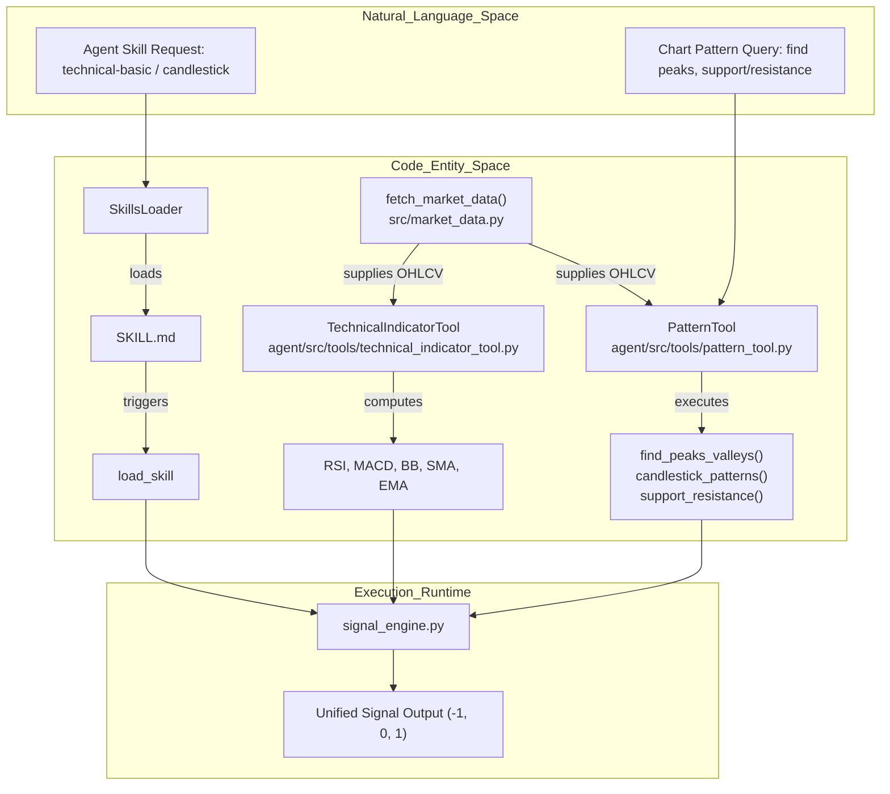
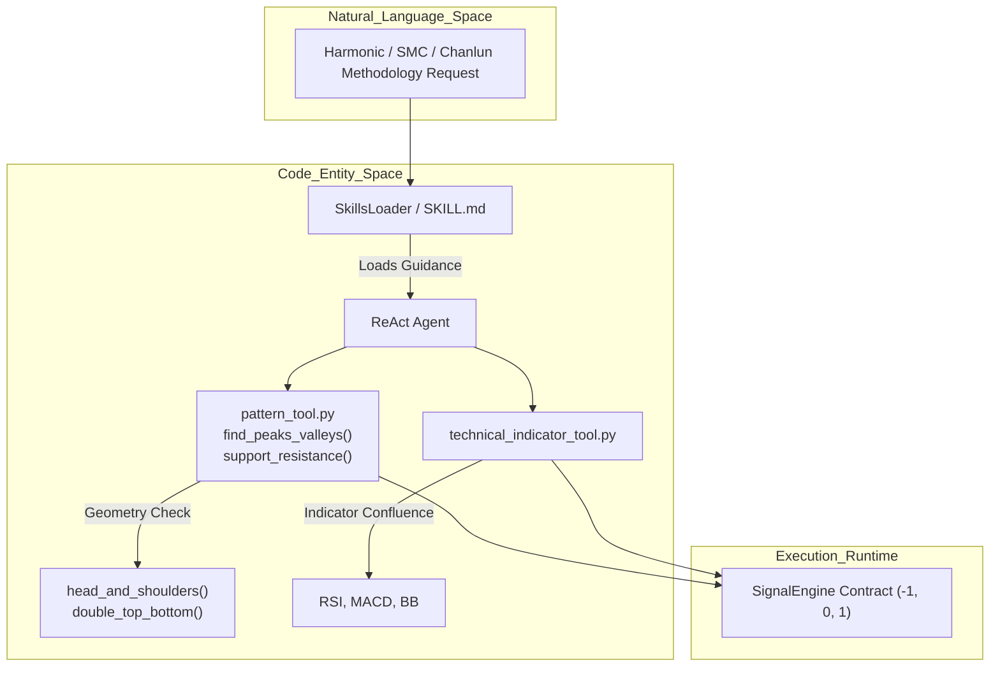

<!-- source: DeepWiki mcp.deepwiki.com · repo HKUDS/Vibe-Trading · page 3.3 Technical Analysis Skills · fetched 2026-11-09 -->

# Technical Analysis Skills

Relevant source files

The following files were used as context for generating this wiki page:

- [agent/backtest/engines/china_a.py](agent/backtest/engines/china_a.py)
- [agent/src/portfolio/service.py](agent/src/portfolio/service.py)
- [agent/src/tools/financial_statements_tool.py](agent/src/tools/financial_statements_tool.py)
- [agent/src/tools/pattern_tool.py](agent/src/tools/pattern_tool.py)
- [agent/src/tools/technical_indicator_tool.py](agent/src/tools/technical_indicator_tool.py)
- [agent/tests/quantlib/test_eventstudy_post_event_window.py](agent/tests/quantlib/test_eventstudy_post_event_window.py)
- [agent/tests/test_china_a_engine.py](agent/tests/test_china_a_engine.py)
- [agent/tests/test_financial_statements_tool.py](agent/tests/test_financial_statements_tool.py)
- [agent/tests/test_forex_engine.py](agent/tests/test_forex_engine.py)
- [agent/tests/test_pattern_tool.py](agent/tests/test_pattern_tool.py)
- [agent/tests/test_pattern_tool_argument_coercion.py](agent/tests/test_pattern_tool_argument_coercion.py)
- [agent/tests/test_pattern_tool_double_top_abs_avg.py](agent/tests/test_pattern_tool_double_top_abs_avg.py)
- [agent/tests/test_pattern_tool_head_shoulders_abs_avg.py](agent/tests/test_pattern_tool_head_shoulders_abs_avg.py)
- [agent/tests/test_portfolio_futu_prefixed_codes.py](agent/tests/test_portfolio_futu_prefixed_codes.py)
- [agent/tests/test_portfolio_service.py](agent/tests/test_portfolio_service.py)
- [agent/tests/test_sec_period_frames.py](agent/tests/test_sec_period_frames.py)
- [agent/tests/test_technical_indicator_small_price_rounding.py](agent/tests/test_technical_indicator_small_price_rounding.py)
- [agent/tests/test_technical_indicator_tool.py](agent/tests/test_technical_indicator_tool.py)
- [frontend/src/pages/Portfolio.tsx](frontend/src/pages/Portfolio.tsx)
- [frontend/src/pages/__tests__/Portfolio.test.tsx](frontend/src/pages/__tests__/Portfolio.test.tsx)

The Technical Analysis (TA) skills in Vibe-Trading provide the ReAct agent with a comprehensive suite of market analysis methodologies, ranging from classic Western indicators to advanced structural theories like Chanlun, Smart Money Concepts (SMC), and Harmonic patterns. These skills are backed by dedicated vector/indicator tools (`src/tools/technical_indicator_tool.py` and `src/tools/pattern_tool.py`) that transform raw OHLCV data into actionable trading signals and geometric pattern classifications.

Sources: [agent/src/tools/technical_indicator_tool.py:1-23](), [agent/src/tools/pattern_tool.py:1-5]()

---

## Architecture and Data Flow

Technical analysis skills are managed by the `SkillsLoader`, which scans for `SKILL.md` files in the agent skills directory. The agent interacts with these skills via the `load_skill` tool, which retrieves the full methodology and code templates for the requested skill.

To compute indicators and detect patterns, tools query the market data pipeline (`fetch_market_data`) and process frames using pure Python/NumPy/Pandas logic. All TA skills adhere to a unified signal convention:
*   `1`: Bullish / Long Signal
*   `-1`: Bearish / Short Signal
*   `0`: Neutral / Stand Aside

**Diagram: TA Skill and Tool Pipeline (Natural Language Space to Code Entity Space)**

Sources: [agent/src/tools/technical_indicator_tool.py:1-20](), [agent/src/tools/pattern_tool.py:1-17]()

---

## Technical Indicator Tool & Core Indicators

The `TechnicalIndicatorTool` implemented in `agent/src/tools/technical_indicator_tool.py` provides read-only computations for classic indicators using Wilder smoothing and vectorized pandas operations [agent/src/tools/technical_indicator_tool.py:1-6]() [agent/src/tools/technical_indicator_tool.py:174-182]().

### Key Indicator Implementations
*   **Simple & Exponential Moving Averages:** Computed via `_compute_sma()` and `_compute_ema()` over standard windows (20, 50, 200 bars) [agent/src/tools/technical_indicator_tool.py:32-33]() [agent/src/tools/technical_indicator_tool.py:160-172]().
*   **Relative Strength Index (RSI):** Implements Wilder smoothing convention (`_compute_rsi()`) using exponential weighted moving averages on gains and losses, matching sibling implementations across the codebase [agent/src/tools/technical_indicator_tool.py:174-184]() [agent/tests/test_technical_indicator_tool.py:70-110]().
*   **MACD:** Calculates fast/slow EMA differences and signal lines (`_compute_macd()`) [agent/src/tools/technical_indicator_tool.py:27-29]() [agent/tests/test_technical_indicator_tool.py:170-184]().
*   **Bollinger Bands:** Evaluates rolling mean and standard deviation bands (`_compute_bollinger()`) [agent/src/tools/technical_indicator_tool.py:30-31]() [agent/tests/test_technical_indicator_tool.py:185-195]().
*   **Volume Statistics:** Analyzes trailing volume averages and volume ratios (`_compute_volume_stats()`) under complete-window constraints [agent/src/tools/technical_indicator_tool.py:122-144]().

Sources: [agent/src/tools/technical_indicator_tool.py:1-184](), [agent/tests/test_technical_indicator_tool.py:70-110]()

---

## Pattern Recognition Tools

Chart patterns and geometric formations are processed via `agent/src/tools/pattern_tool.py` [agent/src/tools/pattern_tool.py:1-5]().

### Vectorized Pattern Functions
*   **Peaks and Valleys:** `find_peaks_valleys()` uses rolling window half-widths to detect local extrema while correctly handling flat plateaus and `NaN` values [agent/src/tools/pattern_tool.py:24-63]() [agent/tests/test_pattern_tool.py:35-62]().
*   **Candlestick Patterns:** `candlestick_patterns()` classifies doji, hammer, and bullish/engulfing formations into `-1`, `0`, or `1` states [agent/src/tools/pattern_tool.py:66-102]() [agent/tests/test_pattern_tool.py:96-132]().
*   **Support and Resistance:** `support_resistance()` clusters valley and peak prices to extract primary boundary levels [agent/src/tools/pattern_tool.py:104-140]() [agent/tests/test_pattern_tool.py:139-155]().
*   **Trend Slope & Formations:** `trend_line_slope()`, `head_and_shoulders()`, and `double_top_bottom()` evaluate geometric continuity using least-squares fits and peak comparisons [agent/src/tools/pattern_tool.py:142-200]() [agent/tests/test_pattern_tool.py:78-90]() [agent/tests/test_pattern_tool.py:161-190]().

Sources: [agent/src/tools/pattern_tool.py:1-200](), [agent/tests/test_pattern_tool.py:35-190]()

---

## Advanced Structural & Harmonic Skills

### Chanlun / Zen Theory (`chanlun`)
Implements structural market decomposition:
1.  **K-line Inclusion Processing:** Merges overlapping bars.
2.  **Fractal (FX) Identification:** Detects local tops and bottoms.
3.  **Stroke (BI) & Segment (XUANDUAN) Construction:** Links adjacent fractals.
4.  **Centrality (ZS) & Buy/Sell Points:** Maps overlapping price zones to generate 1st, 2nd, and 3rd category buy/sell signals.
Sources: [agent/src/skills/chanlun/SKILL.md]()

### Smart Money Concepts (`smc`)
Tracks institutional order flow using ICT methodologies:
*   **Key Concepts:** Break of Structure (BOS), Change of Character (ChoCH), Fair Value Gaps (FVG), and Order Blocks (OB).
*   **Execution Logic:** Requires structural character reversal confirmed by continuation patterns.
Sources: [agent/src/skills/smc/SKILL.md]()

### Harmonic Patterns (`harmonic`)
Identifies Fibonacci-based XABCD geometric structures within Potential Reversal Zones (PRZ), utilizing the `pyharmonics` optional library or bundled fallbacks.

**Diagram: Harmonic & Structural Pattern Architecture (Natural Language Space to Code Entity Space)**

Sources: [agent/src/tools/pattern_tool.py:104-200](), [agent/src/tools/technical_indicator_tool.py:1-184]()

---

