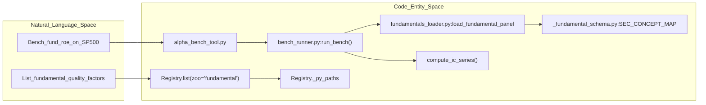
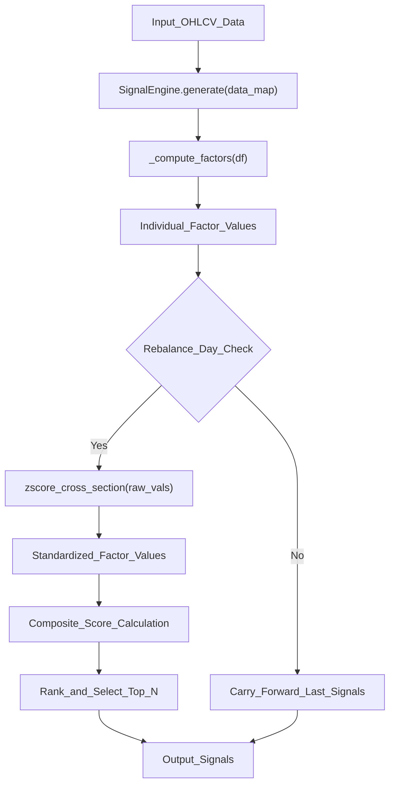
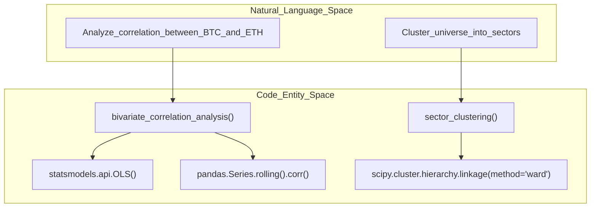

<!-- source: DeepWiki mcp.deepwiki.com · repo HKUDS/Vibe-Trading · page 3.4 Quantitative and Factor Research Skills · fetched 2026-11-09 -->

# Quantitative and Factor Research Skills

Relevant source files

The following files were used as context for generating this wiki page:

- [MANIFEST.in](MANIFEST.in)
- [agent/backtest/correlation.py](agent/backtest/correlation.py)
- [agent/src/quantlib/__init__.py](agent/src/quantlib/__init__.py)
- [agent/src/skills/correlation-analysis/SKILL.md](agent/src/skills/correlation-analysis/SKILL.md)
- [agent/src/skills/etf-analysis/SKILL.md](agent/src/skills/etf-analysis/SKILL.md)
- [agent/src/skills/factor-research/SKILL.md](agent/src/skills/factor-research/SKILL.md)
- [agent/src/skills/financial-statement/SKILL.md](agent/src/skills/financial-statement/SKILL.md)
- [agent/src/skills/ml-strategy/SKILL.md](agent/src/skills/ml-strategy/SKILL.md)
- [agent/src/skills/multi-factor/example_signal_engine.py](agent/src/skills/multi-factor/example_signal_engine.py)
- [agent/src/skills/multi-factor/zoo_signal_engine.py](agent/src/skills/multi-factor/zoo_signal_engine.py)
- [agent/src/skills/pine-script/SKILL.md](agent/src/skills/pine-script/SKILL.md)
- [agent/src/skills/strategy-dev-manager/templates/factor_signal_engine.py](agent/src/skills/strategy-dev-manager/templates/factor_signal_engine.py)
- [agent/src/skills/volatility/example_signal_engine.py](agent/src/skills/volatility/example_signal_engine.py)
- [agent/src/swarm/presets/factor_research_committee.yaml](agent/src/swarm/presets/factor_research_committee.yaml)
- [agent/src/tools/background_tools.py](agent/src/tools/background_tools.py)
- [agent/src/tools/paper_trade/accounts.py](agent/src/tools/paper_trade/accounts.py)
- [agent/src/tools/pdf_report.py](agent/src/tools/pdf_report.py)
- [agent/src/tools/quantlib_tool.py](agent/src/tools/quantlib_tool.py)
- [agent/tests/test_background_tools.py](agent/tests/test_background_tools.py)
- [agent/tests/test_context_attribution_layers.py](agent/tests/test_context_attribution_layers.py)
- [agent/tests/test_correlation.py](agent/tests/test_correlation.py)
- [agent/tests/test_correlation_analysis_skill.py](agent/tests/test_correlation_analysis_skill.py)
- [agent/tests/test_ml_strategy_skill.py](agent/tests/test_ml_strategy_skill.py)
- [agent/tests/test_multi_factor_strategy_template.py](agent/tests/test_multi_factor_strategy_template.py)
- [agent/tests/test_paper_accounts.py](agent/tests/test_paper_accounts.py)
- [agent/tests/test_pdf_report_arabic.py](agent/tests/test_pdf_report_arabic.py)
- [agent/tests/test_skill_pct_change_guard.py](agent/tests/test_skill_pct_change_guard.py)
- [agent/tests/test_system_prompt_cache_stability.py](agent/tests/test_system_prompt_cache_stability.py)
- [desktop/electron/requirements-windows-lock.txt](desktop/electron/requirements-windows-lock.txt)
- [frontend/src/components/charts/CorrelationMatrix.tsx](frontend/src/components/charts/CorrelationMatrix.tsx)
- [frontend/src/components/charts/__tests__/CorrelationMatrix.test.tsx](frontend/src/components/charts/__tests__/CorrelationMatrix.test.tsx)

The Quantitative and Factor Research subsystem provides the agent with advanced statistical modeling, alpha factor evaluation, machine-learning prediction, and cross-asset correlation analysis. These skills enable the platform to move beyond simple technical indicators into systematic asset pricing, multi-factor ranking, statistical arbitrage, and volatility modeling.

Sources: [agent/src/quantlib/__init__.py:1-39](), [agent/src/skills/factor-research/SKILL.md:1-20]()

---

## Alpha Zoo and Factor Research Pipeline

The system features a comprehensive Alpha Zoo containing pre-built quantitative factors across five core libraries: `qlib158`, `alpha101` (Kakushadze), `gtja191`, `academic` (Fama-French/Carhart), and the `fundamental` zoo.

### Factor Registry and Registry Contract
The `Registry` class acts as the central management hub [agent/src/factors/registry.py:201-203](). It uses AST (Abstract Syntax Tree) scanning to load metadata from factor modules without executing arbitrary code, ensuring security and efficiency [agent/src/factors/registry.py:147-152]().

*   **AlphaMeta**: A strict Pydantic schema enforcing fields like `id`, `theme`, `formula_latex`, `columns_required`, and `decay_horizon` [agent/src/factors/registry.py:87-103]().
*   **AST Purity Gate**: The `load_alpha_meta_from_py` function validates alpha definitions before registration to prevent unsafe code execution or lookahead bias [agent/src/factors/registry.py:147-184]().
*   **Base Operators**: Mathematical primitives like `ts_rank`, `ts_corr`, and `zscore` are implemented in `base.py` to ensure consistency across the zoo [agent/src/factors/base.py:1-207](). These operators act on wide `pd.DataFrame` structures where the index is `trading_date` and columns are `instrument_code` [agent/src/factors/base.py:3-6]().

### Fundamental Zoo and PIT-Safe Factors
The `fundamental` zoo introduces Point-in-Time (PIT) safe factors derived from SEC and other financial statement sources. These factors use the `fund:` prefix in `columns_required` [agent/src/factors/registry.py:82-83]().

*   **PIT Safety**: Values become visible only on their `filed` date, never on `period_end` [agent/backtest/loaders/fundamentals_loader.py:3-4]().
*   **Concept Mapping**: The `SEC_CONCEPT_MAP` translates unified fields (e.g., `revenue`, `cogs`) into specific XBRL tags [agent/backtest/loaders/_fundamental_schema.py:86-92]().

**Alpha Zoo Entity Mapping**

Sources: [agent/src/factors/registry.py:87-215](), [agent/src/factors/base.py:1-207](), [agent/src/factors/bench_runner.py:1-161](), [agent/backtest/loaders/fundamentals_loader.py:1-25](), [agent/backtest/loaders/_fundamental_schema.py:82-153]()

---

## Multi-Factor Ranking and Strategy

The `multi-factor` skill provides cross-sectional stock ranking logic. It standardizes multiple factors and combines them into a single composite score.

### Factor Operators and Mathematical Consistency
The system relies on `agent/src/factors/base.py` for vectorized operations.
*   **NaN Policy**: Every operator propagates NaNs; no silent `fillna(0)` is performed [agent/src/factors/base.py:8-9]().
*   **Lookahead Prevention**: `delta(df, d)` requires $d \ge 1$; the negative-shift `Ref(df, -n)` is intentionally absent [agent/src/factors/base.py:11-12]().
*   **Performance**: `ts_rank` uses `numpy.sliding_window_view` for high-speed rolling calculations compared to standard pandas loops [agent/src/factors/base.py:98-100]().

### `multi-factor` Skill Implementation
The `multi-factor` skill provides primary signal engines such as `example_signal_engine.py` and `zoo_signal_engine.py`:
1.  **`example_signal_engine.py`**: Computes momentum, reversal, volatility, and volume ratio factors for individual stocks, performs cross-sectional Z-score standardization, and combines them into a composite score [agent/src/skills/multi-factor/example_signal_engine.py:32-91](). It selects top N stocks based on this score for equal-weighted long positions [agent/src/skills/multi-factor/example_signal_engine.py:145-162]().
2.  **`zoo_signal_engine.py`**: Combines multiple alphas from the Alpha Zoo registry by calling `Registry.compute(alpha_id, panel)`, standardizing them cross-sectionally, and computing a weighted sum [agent/src/skills/multi-factor/zoo_signal_engine.py:10-20]().

**Multi-Factor Signal Generation Flow**

Sources: [agent/src/factors/base.py:1-150](), [agent/src/skills/multi-factor/example_signal_engine.py:1-213](), [agent/src/skills/multi-factor/zoo_signal_engine.py:1-378]()

---

## Machine Learning Predictive Strategies

The `ml-strategy` skill implements machine-learning predictive strategies using `sklearn` models for walk-forward training, feature engineering, and signal generation [agent/src/skills/ml-strategy/SKILL.md:1-10]().

### Signal Logic and Feature Engineering
1.  **Input Validation**: `validate_data` verifies OHLCV data completeness, row counts, and acceptable NaN ratios [agent/src/skills/ml-strategy/SKILL.md:32-49]().
2.  **Feature Engineering**: `build_features` extracts multi-dimensional factors (momentum, volatility, RSI, moving-average ratios, volume ratios) and sanitizes them by removing `inf` values [agent/src/skills/ml-strategy/SKILL.md:69-96]().
3.  **Label Construction**: Future N-day returns form binary labels (`1` for positive, `0` for negative) [agent/src/skills/ml-strategy/SKILL.md:16-16]().
4.  **Walk-Forward Training**: `walk_forward_predict` trains models on historical data using expanding or sliding windows to eliminate lookahead bias [agent/src/skills/ml-strategy/SKILL.md:100-154]().
5.  **Signal Generation**: Probabilities and predictions are mapped to clean target signals in `[-1.0, 1.0]` [agent/src/skills/ml-strategy/SKILL.md:18-18]().

Sources: [agent/src/skills/ml-strategy/SKILL.md:1-165](), [agent/tests/test_ml_strategy_skill.py:1-50]()

---

## Correlation, Cointegration, and Pair Trading

The `correlation-analysis` skill covers co-movement discovery, deep bivariate return analysis, sector clustering, and cointegration testing [agent/src/skills/correlation-analysis/SKILL.md:1-12]().

### Core Modules and Implementation
*   **Market Inference & Normalization**: `backtest/correlation.py` infers asset markets (crypto, A-share, US equity, HK equity, forex, futures) and normalizes tickers to canonical formats (e.g., `AAPL.US`, `0700.HK`, `600000.SH`) [agent/backtest/correlation.py:20-148]().
*   **Co-Movement Discovery**: Scans a candidate universe for assets correlated with a target using Pearson or Spearman coefficients [agent/src/skills/correlation-analysis/SKILL.md:15-18]().
*   **Bivariate Analysis**: Computes static correlation coefficients (Pearson, Spearman, Kendall), OLS regression parameters ($\alpha$, $\beta$, $R^2$), rolling correlations, and spread Z-scores [agent/src/skills/correlation-analysis/SKILL.md:81-143]().
*   **Sector Clustering**: Uses hierarchical clustering via `scipy.cluster.hierarchy.linkage` with the Ward method [agent/src/skills/correlation-analysis/SKILL.md:162-175]().

**Correlation Analysis Entity Mapping**

Sources: [agent/backtest/correlation.py:1-148](), [agent/src/skills/correlation-analysis/SKILL.md:1-188](), [frontend/src/components/charts/CorrelationMatrix.tsx:1-131]()

---

## Volatility Modeling and QuantLib Analytics

The `volatility` skill and `src/quantlib` package provide battle-tested financial-mathematics primitives exposed safely via `quantlib_tool.py` [agent/src/quantlib/__init__.py:1-39](), [agent/src/tools/quantlib_tool.py:1-91]().

### QuantLib Submodules
*   `options`: Black-Scholes pricing, Greeks, and implied-volatility inversion [agent/src/quantlib/__init__.py:16-16]().
*   `fixedincome`: Bond pricing, YTM, duration, convexity, DV01 [agent/src/quantlib/__init__.py:17-17]().
*   `timeseries`: Stationarity, cointegration, GARCH, bootstrap [agent/src/quantlib/__init__.py:19-19]().
*   `risk`: VaR/CVaR, drawdown, Monte Carlo, EVT tail fitting [agent/src/quantlib/__init__.py:20-20]().
*   `factormodel`: Cross-sectional style exposures and factor returns [agent/src/quantlib/__init__.py:25-25]().
*   `neutralization`: Per-observation OLS/WLS factor residuals and cross-sectional PCA [agent/src/quantlib/__init__.py:26-26]().
*   `combination`: Walk-forward IC/ICIR composites of factor panels [agent/src/quantlib/__init__.py:27-27]().

### QuantlibCallTool Security Constraints
To prevent arbitrary code execution (RCE) while making math routines accessible across API and MCP transports, `QuantlibCallTool` enforces:
1.  **Module Allowlist**: Only modules in `ALLOWED_MODULES` can be imported via static dictionary lookup [agent/src/tools/quantlib_tool.py:19-21]().
2.  **`__all__` Enforcement**: Only public names exported in `__all__` are callable [agent/src/tools/quantlib_tool.py:22-24]().
3.  **No File Writers**: Functions matching `_WRITER_PREFIXES` (`export_`) are strictly blocked [agent/src/tools/quantlib_tool.py:25-28]().

Sources: [agent/src/quantlib/__init__.py:1-39](), [agent/src/tools/quantlib_tool.py:1-100](), [agent/src/skills/volatility/example_signal_engine.py:1-100]()

---

## Strategy Development Manager (SDM) for Factor Research

The Strategy Development Manager (SDM) provides a structured workflow for developing, testing, and managing quantitative strategies and alpha factors.

### Factor SignalEngine Template
The SDM provides a `factor_signal_engine.py` template that adheres to the `SignalEngine` contract required by the backtest runner [agent/src/skills/strategy-dev-manager/templates/factor_signal_engine.py:7-11]().
*   **Factor Computation**: Computes raw factor exposures for each symbol cross-sectionally [agent/src/skills/strategy-dev-manager/templates/factor_signal_engine.py:45-51]().
*   **Ranking & Clipping**: Ranks factor values and assigns discrete directional weights, clipping output to `[-1, 1]` [agent/src/skills/strategy-dev-manager/templates/factor_signal_engine.py:53-80]().

Sources: [agent/src/skills/strategy-dev-manager/templates/factor_signal_engine.py:1-82](), [agent/src/skills/strategy-dev-manager/examples.md:1-133]()

---

