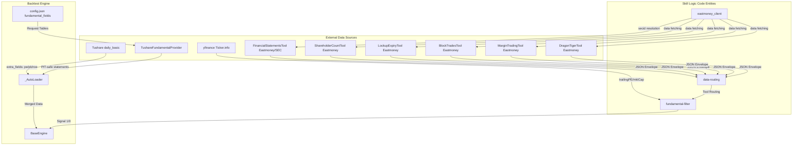
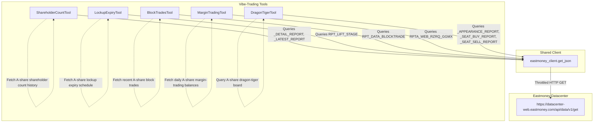
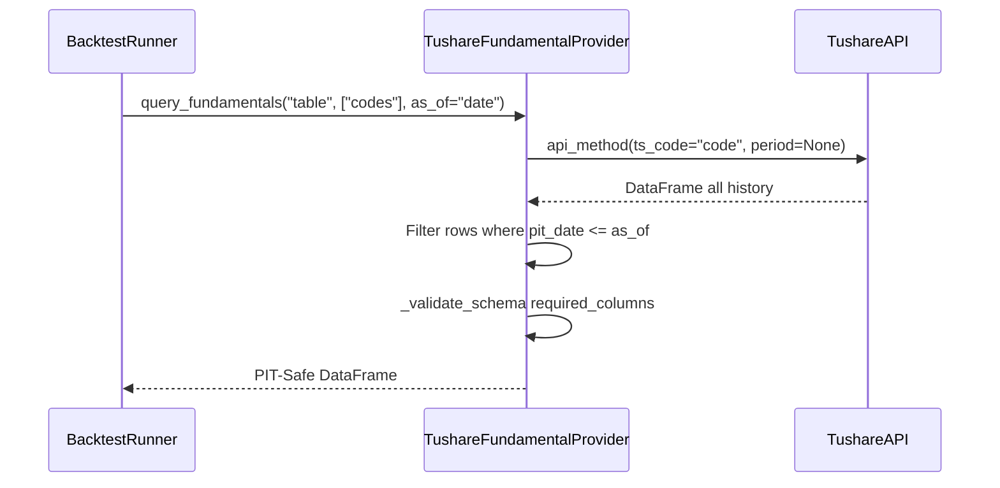

<!-- source: DeepWiki mcp.deepwiki.com · repo HKUDS/Vibe-Trading · page 3.5 Fundamental, Macro, and Commodity Analysis Skills · fetched 2026-11-09 -->

# Fundamental, Macro, and Commodity Analysis Skills

<details>
<summary>Relevant source files</summary>

The following files were used as context for generating this wiki page:

- [agent/backtest/loaders/tushare_fundamentals.py](agent/backtest/loaders/tushare_fundamentals.py)
- [agent/src/memory/search_index.py](agent/src/memory/search_index.py)
- [agent/src/skills/eastmoney/references/参考数据/股东户数.md](agent/src/skills/eastmoney/references/参考数据/股东户数.md)
- [agent/src/skills/eastmoney/references/研报舆情/财经新闻.md](agent/src/skills/eastmoney/references/研报舆情/财经新闻.md)
- [agent/src/skills/fundamental-filter/SKILL.md](agent/src/skills/fundamental-filter/SKILL.md)
- [agent/src/skills/fundamental-filter/example_signal_engine.py](agent/src/skills/fundamental-filter/example_signal_engine.py)
- [agent/src/tools/backtest_summary.py](agent/src/tools/backtest_summary.py)
- [agent/src/tools/block_trades_tool.py](agent/src/tools/block_trades_tool.py)
- [agent/src/tools/fred_macro_tool.py](agent/src/tools/fred_macro_tool.py)
- [agent/src/tools/research_reports_tool.py](agent/src/tools/research_reports_tool.py)
- [agent/src/tools/run_artifact_tool.py](agent/src/tools/run_artifact_tool.py)
- [agent/src/tools/shareholder_count_tool.py](agent/src/tools/shareholder_count_tool.py)
- [agent/src/tools/stock_news_tool.py](agent/src/tools/stock_news_tool.py)
- [agent/tests/memory/test_search_index.py](agent/tests/memory/test_search_index.py)
- [agent/tests/test_backtest_summary.py](agent/tests/test_backtest_summary.py)
- [agent/tests/test_block_trades_bare_code.py](agent/tests/test_block_trades_bare_code.py)
- [agent/tests/test_fred_macro_tool.py](agent/tests/test_fred_macro_tool.py)
- [agent/tests/test_fundamental_filter_example.py](agent/tests/test_fundamental_filter_example.py)
- [agent/tests/test_memory_runtime_root.py](agent/tests/test_memory_runtime_root.py)
- [agent/tests/test_research_reports_tool.py](agent/tests/test_research_reports_tool.py)
- [agent/tests/test_run_artifact_tool.py](agent/tests/test_run_artifact_tool.py)
- [agent/tests/test_shareholder_count_tool.py](agent/tests/test_shareholder_count_tool.py)
- [agent/tests/test_stock_news_tool.py](agent/tests/test_stock_news_tool.py)
- [agent/tests/test_tushare_fundamentals_provider.py](agent/tests/test_tushare_fundamentals_provider.py)

</details>


The Fundamental, Macro, and Commodity Analysis Skills category encompasses the quantitative and qualitative frameworks used to evaluate securities based on financial health, economic cycles, and systemic risks. These skills bridge the gap between raw financial data and actionable investment signals by providing methodologies for valuation, earnings forecasting, global macro positioning, and physical commodity supply-demand modeling.

## Core Analytical Frameworks

The system implements a multi-tiered approach to fundamental analysis, moving from top-down macro cycles to bottom-up security-specific financial statement interrogation and physical commodity inventory cycles.

### 1. Macro and Global Strategy
This layer focuses on central bank policy transmission, exchange rate forecasting, and geopolitical risk quantification. It uses proxy indicators to convert narrative risks into numerical factors for asset allocation.

| Skill | Core Focus | Key Code Entities / Concepts |
|:---|:---|:---|
| `global-macro` | Policy Transmission | FedWatch, China-US 10Y Spread, Northbound Flows |
| `macro-analysis` | Cycle Positioning | Merrill Lynch Clock, PMI/GDP/CPI Thresholds |
| `geopolitical-risk` | Event Quantification | GPR Index, Brent-WTI Spread, TSM ADR Premium |
| `asset-allocation` | Portfolio Optimization | MPT, Black-Litterman, Risk Parity, All-Weather |
| `sector-rotation` | Relative Strength | Diffusion Index, Relative Rotation Graphs (RRG) |
| `global-macro-series`| FRED Data | `FredMacroTool` [agent/src/tools/fred_macro_tool.py:50-50](), `get_macro_series` (`FRED_API_KEY`) |

Sources: [agent/src/skills/strategy-generate/SKILL.md:100-100](), [agent/src/tools/fred_macro_tool.py:50-50]()

### 2. Fundamental Filtering and Valuation
This layer applies accounting principles and valuation models to filter the investment universe and determine intrinsic value. The system leverages `FinancialStatementsTool` for multi-market retrieval and `TushareFundamentalProvider` for backtesting.

| Skill | Core Focus | Key Code Entities / Concepts |
|:---|:---|:---|
| `financial-statement` | Accounting Quality | `FinancialStatementsTool`, `SEC EDGAR`, `Eastmoney F10` |
| `fundamental-filter` | Quantitative Screening | `extra_fields` (pe, pb, roe), `fundamental_fields` |
| `valuation-model` | Price Justification | DCF, WACC, PE-Band, SOTP, EV/EBITDA |
| `dividend-analysis` | Income Quality | Payout Ratio, FCF Coverage, Yield-Trap Checks |
| `earnings-forecast` | Forward Estimates | `ResearchReportsTool` [agent/src/tools/research_reports_tool.py:58-58](), Consensus EPS, Rating Distributions |
| `earnings-revision` | Sentiment Shifts | Revision Breadth, Diffusion Index of Analyst Estimates |
| `regulatory-knowledge` | Compliance & Impact | SEC filings, industry-specific regulations, policy changes |
| `risk-analysis` | Financial Health & Solvency | Debt-to-equity, interest coverage, liquidity ratios |
| `shareholder-count` | Ownership Structure | `ShareholderCountTool` [agent/src/tools/shareholder_count_tool.py:48-50]() (Eastmoney) |
| `lockup-expiry` | Supply Dynamics | `LockupExpiryTool` (Eastmoney) |
| `block-trades` | Institutional Flow | `BlockTradesTool` [agent/src/tools/block_trades_tool.py:174-177]() (Eastmoney) |
| `margin-trading` | Leverage & Sentiment | `MarginTradingTool` (Eastmoney) |
| `dragon-tiger` | Institutional Activity | `DragonTigerTool` (Eastmoney) |

Sources: [agent/src/skills/fundamental-filter/SKILL.md:1-20](), [agent/src/tools/financial_statements_tool.py:13-23](), [agent/src/skills/fundamental-filter/example_signal_engine.py:14-38](), [agent/src/tools/shareholder_count_tool.py:48-50](), [agent/src/tools/lockup_expiry_tool.py:19-20](), [agent/src/tools/block_trades_tool.py:174-177](), [agent/src/tools/margin_trading_tool.py:128-130](), [agent/src/tools/dragon_tiger_tool.py:191-193](), [agent/src/tools/research_reports_tool.py:58-58]()

### 3. Commodity Analysis
The `commodity-analysis` skill covers the physical and financial aspects of the commodity markets, focusing on supply-demand balances and futures structures.

| Commodity | Analysis Focus | Key Metrics |
|:---|:---|:---|
| **Oil** | Supply-Demand Balance | OPEC+ quotas, EIA inventory, Refinery margins, Crack spreads |
| **Gold** | Pricing Models | Real yields (TIPS), USD correlation, Central bank reserves |
| **Copper** | Economic Predictor | "Dr. Copper" LME/SHFE inventory, Manufacturing PMI |
| **All** | Futures Structure | Contango/Backwardation, Premium-Discount structure, Inventory cycles |

Sources: [agent/src/skills/strategy-generate/SKILL.md:100-100]()

## Data Flow: From Macro to Execution

The following diagram illustrates how macro signals and fundamental filters propagate through the system to influence the `AgentLoop`.

Diagram: Fundamental Analysis Data Flow

Sources: [agent/backtest/loaders/tushare_fundamentals.py:118-123](), [agent/src/skills/fundamental-filter/SKILL.md:54-82](), [agent/src/tools/financial_statements_tool.py:13-32](), [agent/src/skills/strategy-generate/SKILL.md:100-100](), [agent/src/tools/shareholder_count_tool.py:48-50](), [agent/src/tools/lockup_expiry_tool.py:19-30](), [agent/src/tools/block_trades_tool.py:30-31](), [agent/src/tools/margin_trading_tool.py:29-30]()

## Implementation Details

### Multi-Market Financial Statements (`FinancialStatementsTool`)
The system provides a unified interface for three-statement analysis across different markets via `FinancialStatementsTool` [agent/src/tools/financial_statements_tool.py:13-23]():
- **A-Shares & HK**: Routes to Eastmoney's F10 report datasets. A-shares use the dotted `SECUCODE` (e.g., `600519.SH`) while HK uses the bare `SECURITY_CODE`.
- **US Stocks**: Routes to SEC EDGAR company facts via CIK resolution. It standardizes GAAP concepts like `Assets`, `Revenues`, and `NetIncomeLoss`.
- **Context Management**: Tools enforce `_MAX_PERIODS` (40) and `_MAX_FIELDS_PER_PERIOD` (200) to prevent blowing up LLM context windows.

Sources: [agent/src/tools/financial_statements_tool.py:13-23](), [agent/src/tools/financial_statements_tool.py:11-11](), [agent/src/tools/financial_statements_tool.py:64-100](), [agent/src/tools/financial_statements_tool.py:108-110]()

### Eastmoney-backed A-share Specific Tools
Several tools leverage the Eastmoney datacenter API for specific A-share market insights. These tools all route through the shared, throttled `eastmoney_client` to manage rate limits.

Diagram: Eastmoney A-share Tools Overview

Sources: [agent/src/tools/shareholder_count_tool.py:27-29](), [agent/src/tools/lockup_expiry_tool.py:29-30](), [agent/src/tools/block_trades_tool.py:30-31](), [agent/src/tools/margin_trading_tool.py:29-30](), [agent/src/tools/dragon_tiger_tool.py:28-31](), [agent/src/tools/shareholder_count_tool.py:48-60](), [agent/src/tools/lockup_expiry_tool.py:51-56](), [agent/src/tools/block_trades_tool.py:174-184](), [agent/src/tools/margin_trading_tool.py:128-138](), [agent/src/tools/dragon_tiger_tool.py:191-200]()

- **`ShareholderCountTool`**: Fetches the number of registered shareholders for mainland A-shares, including per-period changes and average holding values. It combines data from a detail report and a latest-only report [agent/src/tools/shareholder_count_tool.py:28-29](). The tool handles A-share suffixes (`.SH`, `.SZ`, `.BJ`) and provides error envelopes for unsupported markets [agent/src/tools/shareholder_count_tool.py:43-44]().
- **`LockupExpiryTool`**: Provides historical and upcoming lockup expiry schedules for A-shares. It can query for a single stock or a market-wide calendar within a specified horizon (default 90 days, max 365 days). The tool normalizes A-share codes to bare 6-digit numbers for Eastmoney's API [agent/src/tools/lockup_expiry_tool.py:75-91]().
- **`BlockTradesTool`**: Retrieves recent A-share block trades, including deal price, volume, premium/discount, and buyer/seller brokerage seats. It supports a configurable lookback window (default 30 days, max 365 days) [agent/src/tools/block_trades_tool.py:43-44]().
- **`MarginTradingTool`**: Fetches daily margin-financing and securities-lending balances for individual A-share stocks. It provides data on outstanding financing balance, financing buy amount, short-selling balance, and combined RZRQ balance [agent/src/tools/margin_trading_tool.py:133-138](). The tool extracts the bare 6-digit A-share code from various input formats [agent/src/tools/margin_trading_tool.py:50-73]().
- **`DragonTigerTool`**: Queries the daily "dragon-tiger" (龙虎榜) board, which lists A-shares that triggered abnormal trading disclosures and the top buying/selling brokerage seats. It can fetch the board for a specific date or for a particular stock [agent/src/tools/dragon_tiger_tool.py:193-200]().

Sources: [agent/src/tools/shareholder_count_tool.py:28-44](), [agent/src/tools/lockup_expiry_tool.py:75-91](), [agent/src/tools/block_trades_tool.py:43-44](), [agent/src/tools/margin_trading_tool.py:50-138](), [agent/src/tools/dragon_tiger_tool.py:193-200]()

### Point-in-Time Safeguards (`TushareFundamentalProvider`)
The `TushareFundamentalProvider` ensures that backtests do not use financial data before it was publicly available [agent/backtest/loaders/tushare_fundamentals.py:1-1](). It uses the `f_ann_date` (first announcement date) as the primary timestamp, falling back to `ann_date` if necessary [agent/backtest/loaders/tushare_fundamentals.py:168-176]().

Diagram: Point-in-Time Data Flow

Sources: [agent/backtest/loaders/tushare_fundamentals.py:118-180](), [agent/tests/test_tushare_fundamentals_provider.py:73-92]()

### Fundamental Filtering (`fundamental-filter`)
The system supports both time-series filtering (A-shares) and point-in-time screening (US/HK).
- **A-Shares (Daily Basic):** Uses Tushare's `daily_basic` data. The `DataLoader` merges `extra_fields` (e.g., `pe`, `pb`, `roe`) directly into the daily price DataFrame [agent/src/skills/fundamental-filter/SKILL.md:36-52]().
- **A-Shares (Statement PIT):** Uses `fundamental_fields` in `config.json` to query `income`, `balancesheet`, `cashflow`, and `fina_indicator` tables via the `TushareFundamentalProvider` [agent/src/skills/fundamental-filter/SKILL.md:54-72]().

Sources: [agent/src/skills/fundamental-filter/SKILL.md:36-72]()

## SignalEngine Integration

Fundamental signals are implemented within the `SignalEngine.generate` method. The `data_map` provides access to fundamental columns which are prefixed by their source table (e.g., `income_total_revenue`) [agent/src/skills/strategy-generate/SKILL.md:50-62]().

```python
def generate(self, data_map: Dict[str, pd.DataFrame]) -> Dict[str, pd.Series]:
    # Example: Filter by ROE and Revenue growth using PIT-safe columns
    for code, df in data_map.items():
        # Accessing fundamental data merged by the DataLoader
        # Example column names: income_total_revenue, fina_indicator_roe
        
        signal = pd.Series(0.0, index=df.index)
        for dt, row in df.iterrows():
            statement_pass = self._passes_statement_filter(row) 
            if statement_pass is not None:
                if statement_pass:
                    signal.loc[dt] = 1.0 
                continue

            pe = row.get("pe", np.nan)
            pb = row.get("pb", np.nan)
            roe_daily = row.get("roe", np.nan) 
            
            if pd.notna(pe) and pd.notna(pb) and pd.notna(roe_daily):
                if self.pe_min < pe <= self.pe_max and pb <= self.pb_max and roe_daily >= self.roe_min:
                    signal.loc[dt] = 1.0 
```
Sources: [agent/src/skills/fundamental-filter/example_signal_engine.py:75-126](), [agent/tests/test_fundamental_filter_example.py:21-46](), [agent/src/skills/strategy-generate/SKILL.md:50-62]()

## Data Provider Schemas
The `TushareFundamentalProvider` maintains `TableSchema` definitions for core financial tables to ensure data integrity [agent/backtest/loaders/tushare_fundamentals.py:43-107]().

| Table | Point-in-Time Column | Key Columns |
|:---|:---|:---|
| `balancesheet` | `f_ann_date` | `total_assets`, `total_liab`, `total_hldr_eqy_exc_min_int` |
| `cashflow` | `f_ann_date` | `net_profit`, `n_cashflow_act`, `c_cash_equ_end_period` |
| `income` | `f_ann_date` | `total_revenue`, `revenue`, `operate_profit`, `n_income` |
| `fina_indicator` | `ann_date` | `eps`, `roe`, `grossprofit_margin`, `debt_to_assets` |

Sources: [agent/backtest/loaders/tushare_fundamentals.py:43-107](), [agent/src/skills/fundamental-filter/SKILL.md:14-19]()

---

