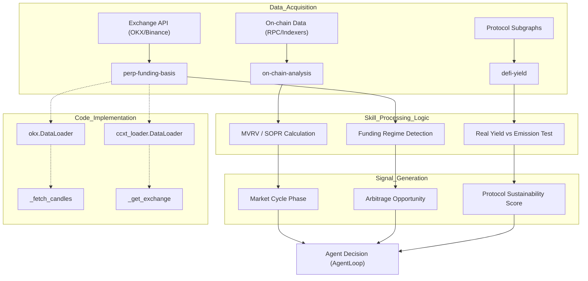
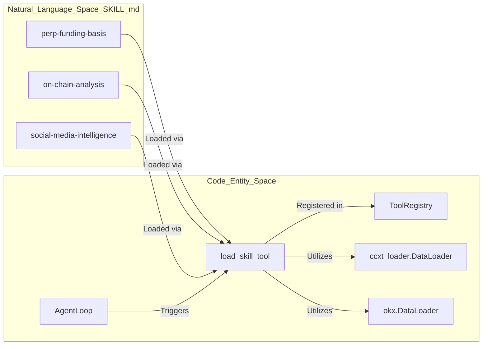

<!-- source: DeepWiki mcp.deepwiki.com · repo HKUDS/Vibe-Trading · page 3.6 Crypto and DeFi Skills · fetched 2026-11-09 -->

# Crypto and DeFi Skills

<details>
<summary>Relevant source files</summary>

The following files were used as context for generating this wiki page:

- [agent/backtest/engines/_market_hooks.py](agent/backtest/engines/_market_hooks.py)
- [agent/backtest/engines/base.py](agent/backtest/engines/base.py)
- [agent/backtest/engines/composite.py](agent/backtest/engines/composite.py)
- [agent/backtest/engines/crypto.py](agent/backtest/engines/crypto.py)
- [agent/backtest/loaders/ccxt_loader.py](agent/backtest/loaders/ccxt_loader.py)
- [agent/backtest/loaders/okx.py](agent/backtest/loaders/okx.py)
- [agent/backtest/runner.py](agent/backtest/runner.py)
- [agent/tests/test_base_engine.py](agent/tests/test_base_engine.py)
- [agent/tests/test_ccxt_interval_map.py](agent/tests/test_ccxt_interval_map.py)
- [agent/tests/test_ccxt_loader_bounded.py](agent/tests/test_ccxt_loader_bounded.py)
- [agent/tests/test_ccxt_perpetual_loader.py](agent/tests/test_ccxt_perpetual_loader.py)
- [agent/tests/test_composite_engine_fallback.py](agent/tests/test_composite_engine_fallback.py)
- [agent/tests/test_crypto_digit_leading_symbols.py](agent/tests/test_crypto_digit_leading_symbols.py)
- [agent/tests/test_crypto_engine.py](agent/tests/test_crypto_engine.py)
- [agent/tests/test_engine_robustness.py](agent/tests/test_engine_robustness.py)
- [agent/tests/test_market_detection.py](agent/tests/test_market_detection.py)
- [agent/tests/test_okx_loader_bounded.py](agent/tests/test_okx_loader_bounded.py)
- [agent/tests/test_okx_loader_interval_case.py](agent/tests/test_okx_loader_interval_case.py)
- [agent/tests/test_plan_rejected.py](agent/tests/test_plan_rejected.py)
- [agent/tests/test_run_card_content_filter.py](agent/tests/test_run_card_content_filter.py)
- [agent/tests/test_run_card_structured_metrics.py](agent/tests/test_run_card_structured_metrics.py)

</details>


This page documents the specialized skills used by the ReAct agent to analyze cryptocurrency markets, decentralized finance (DeFi) protocols, and on-chain data. These skills enable the system to perform complex tasks such as funding-rate arbitrage, liquidation risk assessment, and token emission modeling across global markets.

## 1. Crypto Derivatives and Basis Trading

The system analyzes perpetual futures, dated futures, and options to identify carry trade opportunities and market sentiment extremes. The primary focus is on the funding rate mechanism, which anchors perpetual contract prices to spot prices.

### Funding Rate and Basis Analysis
The `perp-funding-basis` and `crypto-derivatives` skills provide frameworks for evaluating the cost of carry and leverage crowding.

| Market State | Annualized Funding (8h) | Interpretation | Signal |
|:---|:---|:---|:---|
| Extreme Greed | > 109% (> 0.1%) | Overheated longs; unsustainable | Contrarian Short |
| Bullish Bias | 33-109% (0.03-0.1%) | Attractive for positive carry | Long Spot + Short Perp |
| Neutral | -11% to 11% | Balanced positioning | No Arbitrage |
| Extreme Panic | < -109% (< -0.1%) | Overheated shorts; squeeze risk | Contrarian Long |

### Technical Implementation: Term Structure
The `crypto-derivatives` skill includes logic for calculating the futures term structure (Contango vs. Backwardation) to drive cash-and-carry or calendar spread strategies.

```python
# Conceptual implementation from SKILL.md
def term_structure_spread(spot_price, futures_prices: dict) -> dict:
    results = {}
    for expiry, price in futures_prices.items():
        days_to_expiry = (pd.Timestamp(expiry) - pd.Timestamp.now()).days
        basis = (price - spot_price) / spot_price
        annualized = basis / days_to_expiry * 365
        results[expiry] = {
            'basis': basis,
            'annualized_basis': annualized,
            'days': days_to_expiry,
        }
    return results
```

Sources: `[agent/SKILL.md:96-121]()`, `[agent/backtest/engines/crypto.py:43-86]()`

---

## 2. DeFi Yield and Liquidity Analysis

The `defi-yield` skill documents how the agent evaluates returns across lending protocols (Aave, Compound), decentralized exchanges (Uniswap, Curve), and liquid staking (Lido).

### Yield Sustainability
A core component of DeFi analysis is the "Real Yield" test, which distinguishes between protocol revenue and inflationary token emissions.

*   **Real Yield:** Funded by actual economic activity (trading fees, interest).
*   **Token Yield:** Funded by protocol token minting (unsustainable "ponzi" risk if >80% of total yield).

### Impermanent Loss (IL) Modeling
The agent uses IL calculations to assess the risk-adjusted returns of Liquidity Provider (LP) positions.

| Price Change | Impermanent Loss |
|:---|:---|
| +100% (2x) | -5.7% |
| +200% (3x) | -13.4% |
| -50% | -5.7% |
| -75% | -20.0% |

Sources: `[agent/SKILL.md:121-121]()`, `[agent/backtest/engines/crypto.py:111-133]()`

---

## 3. On-Chain and Flow Analysis

These skills leverage the transparency of public blockchains to track "smart money" and capital flows.

### On-Chain Valuation Metrics
The `on-chain-analysis` skill utilizes three primary metrics to identify market tops and bottoms:
1.  **MVRV (Market Value to Realized Value):** MVRV > 3.5 indicates extreme overvaluation; MVRV < 1.0 indicates a bear market bottom.
2.  **NVT (Network Value to Transactions):** Acts as a crypto P/E ratio.
3.  **SOPR (Spent Output Profit Ratio):** Measures whether coins are being sold at a profit or loss.

### Stablecoin Flow
The `stablecoin-flow` skill treats stablecoins (USDT, USDC) as "dry powder."
*   **Bullish:** Large mints ($500M+), rising exchange reserves, and high stablecoin velocity.
*   **Bearish:** Large redemptions (burns), falling exchange reserves, and low velocity.

Sources: `[agent/SKILL.md:121-121]()`, `[agent/backtest/loaders/okx.py:131-205]()`

---

## 4. Liquidation Heatmaps and Tokenomics

### Liquidation Magnets
The `liquidation-heatmap` skill identifies clusters of leveraged positions. These clusters act as "magnets" because market makers seek to trigger cascading liquidations to generate liquidity.

### Token Unlocks and Treasury
The `token-unlock-treasury` skill forecasts sell pressure from vesting schedules.
*   **Cliff Unlocks:** Large one-time releases (e.g., >5% of supply) often cause -5% to -20% price declines in the surrounding 7 days.
*   **Treasury Health:** Evaluates "runway" (months of funding) and diversification (native token vs. stables).

Sources: `[agent/SKILL.md:121-121]()`, `[agent/backtest/engines/crypto.py:61-86]()`

---

## 5. System Architecture: Crypto Skills Data Flow

The following diagrams illustrate how crypto-specific data is processed by the agent and mapped to codebase entities.

### Crypto Data Intelligence Flow
This diagram shows how raw on-chain and exchange data is transformed into actionable signals. Data is fetched via the `DataLoader` implementations for `okx` and `ccxt`.



Sources: `[agent/backtest/loaders/okx.py:59-125]`, `[agent/backtest/loaders/ccxt_loader.py:60-92]`, `[agent/backtest/loaders/okx.py:185-203]`, `[agent/backtest/loaders/ccxt_loader.py:131-152]`

### Skill Entity Mapping
This diagram bridges the natural language concepts in `SKILL.md` files to the code entities that execute them. The `load_skill_tool` registers these for use by the `AgentLoop`.



Sources: `[agent/backtest/loaders/ccxt_loader.py:28-28]()`, `[agent/backtest/loaders/okx.py:101-107]()`, `[agent/backtest/engines/crypto.py:43-53]()`

---

## 6. Social Media Intelligence

The `social-media-intelligence` skill extracts financial signals from non-traditional sources. It categorizes platforms by their signal value:

*   **Twitter/X (FinTwit):** High-speed reaction to macro events and crypto KOL endorsements.
*   **Telegram:** Primary venue for "Whale Alerts" and crypto research push channels.
*   **Discord:** Used for developer activity monitoring and governance participation.
*   **Reddit:** Barometer for retail sentiment (e.g., `r/wallstreetbets`).

### Implementation via Web Search
The agent uses the `web_search` and `web_reader` tools to gather intelligence described in these skills.

| Component | Entity | Role |
| :--- | :--- | :--- |
| Search Tool | `web_search_tool` | Executes queries via search providers |
| Reader Tool | `web_reader_tool` | Converts web pages to Markdown for LLM ingestion |
| Dependency | `ccxt` | Handles 100+ exchanges for market data `[agent/backtest/loaders/ccxt_loader.py:1-6]()` |
| Data Source | `okx` | Primary zero-config crypto data provider `[agent/backtest/loaders/okx.py:1-21]()` |

### Robust Data Fetching
The `ccxt_loader.py` and `okx.py` loaders are hardened with budget enforcement and bounded retries to prevent hangs during long fetches or transient network issues.

*   **CCXT Budget:** Enforced via `_CCXT_FETCH_BUDGET_S` (default 60.0s) `[agent/backtest/loaders/ccxt_loader.py:56-56]()`.
*   **OKX Budget:** Enforced via `_OKX_FETCH_BUDGET_S` (default 90.0s) `[agent/backtest/loaders/okx.py:68-68]()`.
*   **Retry Pattern:** Both loaders use `retry_with_budget` from `backtest.loaders.base` to handle transient errors like `ccxt.NetworkError` or `requests.RequestException` `[agent/backtest/loaders/ccxt_loader.py:25-26]()`, `[agent/backtest/loaders/okx.py:54-55]()`.
*   **Budget Checks:** Paginated fetches call `check_budget` between pages to fail fast if the wall-clock limit is exceeded `[agent/backtest/loaders/ccxt_loader.py:23-23]()`, `[agent/backtest/loaders/okx.py:51-51]()`.
*   **Proxy Configuration:** The CCXT loader automatically builds proxy settings from `ALL_PROXY`, `HTTP_PROXY`, and `HTTPS_PROXY` environment variables `[agent/backtest/loaders/ccxt_loader.py:81-92]()`. The OKX loader also supports proxy configuration `[agent/backtest/loaders/okx.py:80-92]()`.
*   **Data Validation:** Loaders use `validate_date_range` to ensure valid date inputs `[agent/backtest/loaders/ccxt_loader.py:27-27]()`, `[agent/backtest/loaders/okx.py:56-56]()`.
*   **Perpetual Support:** The CCXT loader supports Binance USD-M perpetuals by parsing symbols like `BTC-USDT-PERP` into `BTC/USDT:USDT` and fetching both execution and mark prices `[agent/backtest/loaders/ccxt_loader.py:60-69]()`, `[agent/tests/test_ccxt_perpetual_loader.py:130-151]()`. It also handles maintenance bracket artifacts for risk calculations `[agent/backtest/loaders/ccxt_loader.py:98-181]()`.

Sources: `[agent/backtest/loaders/ccxt_loader.py:20-57]()`, `[agent/backtest/loaders/okx.py:49-70]()`, `[agent/tests/test_ccxt_perpetual_loader.py:107-152]()`, `[agent/backtest/engines/crypto.py:31-41]()`

---

