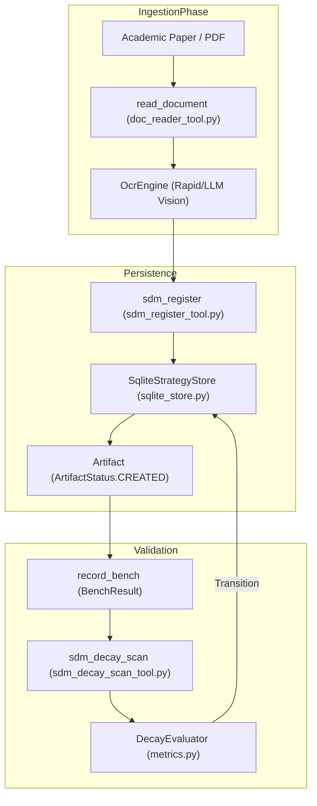
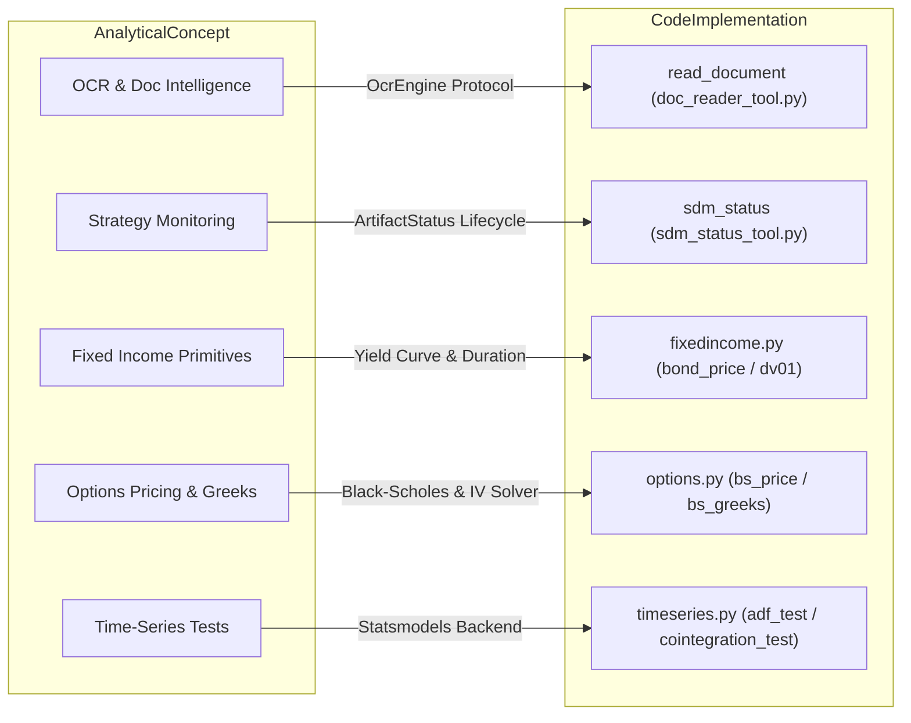

<!-- source: DeepWiki mcp.deepwiki.com · repo HKUDS/Vibe-Trading · page 3.7 Options, Fixed Income, and Specialty Skills · fetched 2026-11-09 -->

# Options, Fixed Income, and Specialty Skills

Relevant source files

The following files were used as context for generating this wiki page:

- [agent/src/quantlib/fixedincome.py](agent/src/quantlib/fixedincome.py)
- [agent/src/quantlib/multipletesting.py](agent/src/quantlib/multipletesting.py)
- [agent/src/quantlib/options.py](agent/src/quantlib/options.py)
- [agent/src/quantlib/timeseries.py](agent/src/quantlib/timeseries.py)
- [agent/src/skills/doc-reader/SKILL.md](agent/src/skills/doc-reader/SKILL.md)
- [agent/src/tools/doc_reader_tool.py](agent/src/tools/doc_reader_tool.py)
- [agent/src/tools/ocr/engine.py](agent/src/tools/ocr/engine.py)
- [agent/src/tools/ocr/llm_vision_ocr.py](agent/src/tools/ocr/llm_vision_ocr.py)
- [agent/src/tools/ocr/rapid_ocr.py](agent/src/tools/ocr/rapid_ocr.py)
- [agent/tests/quantlib/test_fixedincome.py](agent/tests/quantlib/test_fixedincome.py)
- [agent/tests/quantlib/test_multipletesting.py](agent/tests/quantlib/test_multipletesting.py)
- [agent/tests/quantlib/test_options.py](agent/tests/quantlib/test_options.py)
- [agent/tests/quantlib/test_timeseries.py](agent/tests/quantlib/test_timeseries.py)
- [agent/tests/test_doc_reader.py](agent/tests/test_doc_reader.py)
- [agent/tests/test_doc_reader_docx_order.py](agent/tests/test_doc_reader_docx_order.py)
- [agent/tests/test_doc_reader_excel_literal_text.py](agent/tests/test_doc_reader_excel_literal_text.py)
- [agent/tests/test_doc_reader_inverted_pages.py](agent/tests/test_doc_reader_inverted_pages.py)
- [agent/tests/test_doc_reader_native_fallback.py](agent/tests/test_doc_reader_native_fallback.py)
- [agent/tests/test_doc_reader_pptx_containers.py](agent/tests/test_doc_reader_pptx_containers.py)
- [agent/tests/test_doc_reader_unicode_page_dashes.py](agent/tests/test_doc_reader_unicode_page_dashes.py)
- [agent/tests/test_ocr_engine.py](agent/tests/test_ocr_engine.py)
- [agent/tests/test_ocr_integration.py](agent/tests/test_ocr_integration.py)
- [agent/tests/test_ou_missing_lag_pairs_regressions.py](agent/tests/test_ou_missing_lag_pairs_regressions.py)
- [agent/tests/test_quantlib_tool.py](agent/tests/test_quantlib_tool.py)

This page documents the specialized analytical skills within Vibe-Trading that handle complex asset classes (Options, Fixed Income, ETFs), flow-based analysis (Stock Connect, ETF flows), and advanced research capabilities (SEC filings, document reading, and behavioral finance). These skills extend the agent's reasoning into non-linear instruments and institutional-grade data sources.

## 1. Options and Hedging Framework

The options and hedging skills provide the mathematical and strategic foundation for managing non-linear risk and designing protection schemes.

### 1.1 Options Pricing and Strategies
The system supports a tiered approach to options, from basic strategy selection to advanced Greeks-based analysis using the Black-Scholes model.

*   **Options Pricing Tool**: The `OptionsPricingTool` in `agent/src/tools/options_pricing_tool.py` implements the `options_pricing` tool. It calculates theoretical prices and Greeks (Delta, Gamma, Theta, Vega).
*   **Black-Scholes Implementation**: The `_bs_price_and_greeks` function handles standard calculations, with a fallback to intrinsic value for options at expiry ($T=0$) to avoid division-by-zero errors.
*   **Degenerate Handling**: Inputs such as non-positive volatility or negative expiry are rejected with an error envelope. $T=0$ cases are explicitly flagged as `status: "degenerate"`.
*   **Options Strategy**: Focuses on standard structures like Covered Calls, Vertical Spreads, and Iron Condors. The `options-strategy` skill provides a framework for backtesting multi-leg option strategies, supporting European and American options via Black-Scholes with IV smile approximation [agent/src/skills/options-strategy/SKILL.md:3-4](). It synthesizes theoretical option prices from underlying prices and supports multi-leg strategies [agent/src/skills/options-strategy/SKILL.md:8-9]().
    *   **IV Smile Model**: The `iv_smile_adjustment` function adjusts implied volatility for moneyness using a quadratic model: `IV(K) = base_iv + skew * log(K/S) + curvature * log(K/S)^2` [agent/backtest/engines/options_portfolio.py:60-83](). The `leg_iv` function ensures consistent pricing across all stages (opening, marking to market, Greeks, American continuation value) by applying this smile adjustment [agent/backtest/engines/options_portfolio.py:85-107]().
    *   **Historical Volatility**: The `historical_volatility` function calculates annualised historical volatility from a close price series, using a configurable `window` and `default_iv` for warm-up periods [agent/backtest/engines/options_portfolio.py:36-56](). The `default_iv` must be positive and finite [agent/tests/test_options_hv_warmup.py:51-52]().
    *   **Option Positions**: The `OptionPosition` class represents a single option leg, storing `option_type`, `strike`, `expiry`, `qty`, `entry_price`, `entry_date`, and `underlying_code` [agent/backtest/engines/options_portfolio.py:114-141](). It includes methods for `time_to_expiry` and `intrinsic_value` [agent/backtest/engines/options_portfolio.py:143-177]().
    *   **Backtest Engine**: The `run_options_backtest` function simulates day-by-day, marking positions to market, executing trades, and handling expiration/exercise [agent/backtest/engines/options_portfolio.py:182-196](). It outputs `equity.csv`, `metrics.csv`, `trades.csv`, and `greeks.csv` [agent/backtest/engines/options_portfolio.py:14-14]().
    *   **Fill Logic**: Signals dated T now fill on the next bar's close by default, aligning with equity engines. The `same_day_fill: true` option restores legacy same-day fill behavior [agent/tests/test_options_next_bar_fill.py:2-9]().

### 1.2 Hedging Strategy Design
The `hedging-strategy` skill implements systematic risk reduction using linear (Futures/ETFs) and non-linear (Options) instruments.

| Method | Implementation Logic | Key Metric |
| :--- | :--- | :--- |
| **Beta Hedge** | $N = \beta \times (Value_{Portfolio} / Value_{Futures})$ | Minimum-variance ratio |
| **Protective Put** | Long Underlying + Long OTM Put | Premium cost vs. Floor price |
| **Collar** | Long Underlying + Long Put + Short Call | Zero-cost boundary |
| **Tail Risk** | Deep OTM Puts (Delta $\approx$ -0.05) | Black Swan protection |

Sources: [agent/backtest/engines/options_portfolio.py:1-200](), [agent/src/skills/options-strategy/SKILL.md:1-152](), [agent/tests/test_options_hv_warmup.py:1-83](), [agent/tests/test_options_next_bar_fill.py:1-152](), [agent/tests/test_options_bs_nonpositive_strike.py:1-24]()

---

## 2. Fixed Income and Specialty Risk

Vibe-Trading treats Fixed Income through a credit-risk lens, supported by primitives in `agent/src/quantlib/fixedincome.py` covering day count conventions, bond pricing, risk metrics (Duration, Convexity, DV01), and yield curve fitting (Nelson-Siegel, Svensson).

### 2.1 Fixed Income Primitives and Yield Curves
*   **Day Count Conventions**: Implemented via `year_fraction()` supporting `ACT/365F`, `ACT/360`, `ACT/ACT`, `30/360`, and `30E/360` [agent/src/quantlib/fixedincome.py:41-118]().
*   **Pricing and YTM**: `bond_price()` computes discrete or continuously compounded bond values, while `ytm_solve()` uses Brent's method to invert yields [agent/src/quantlib/fixedincome.py:28-28]().
*   **Risk Sensitivities**: Analytical metrics including `macaulay_duration()`, `modified_duration()`, `convexity()`, `dv01()`, and `key_rate_duration()` are verified against finite-difference repricing [agent/src/quantlib/fixedincome.py:29-34]().
*   **Curve Fitting**: `fit_yield_curve()` calibrates parametric models like `nelson_siegel()` and `svensson()` to observed market prices [agent/src/quantlib/fixedincome.py:35-37]().

### 2.2 Credit and ST Risk Analysis
The `ashare-pre-st-filter` provides specialized risk forecasting for China A-shares based on the latest exchange listing rules [agent/src/skills/ashare-pre-st-filter/SKILL.md:2-4]().

*   **A-Share ST Filter**: Predicts risk of Special Treatment (ST/*ST) based on revenue thresholds (<300M for Main Board, <100M for ChiNext/STAR), net assets (<0), and audit opinions [agent/src/skills/ashare-pre-st-filter/SKILL.md:88-102]().
*   **Regulatory Penalty Scraper**: Integrates regulatory penalty data (E2 evidence) via `fetch_sina_penalties.py` [agent/src/skills/ashare-pre-st-filter/scripts/fetch_sina_penalties.py:32-35](). It classifies penalties by subject (`shareholder`, `officer`, or `company`) [agent/src/skills/ashare-pre-st-filter/scripts/fetch_sina_penalties.py:145-162]() and uses an `HTMLParser` to process Sina's legacy HTML tables [agent/src/skills/ashare-pre-st-filter/scripts/fetch_sina_penalties.py:118-140]().
*   **Penalty Normalization**: The `_validate_stockid` function ensures correct 6-digit stock code extraction [agent/src/skills/ashare-pre-st-filter/scripts/fetch_sina_penalties.py:112-120](). The `_normalize_subject` handles priority for overlapping subject keywords (e.g., "董事长 X 作为控股股东" is classified as `shareholder`) [agent/src/skills/ashare-pre-st-filter/scripts/fetch_sina_penalties.py:145-162]().
*   **Subject Weighting**: Non-company subjects (shareholders/officers) have their penalty weights reduced by 0.5 as they reflect personal behavior rather than systemic corporate governance failure [agent/src/skills/ashare-pre-st-filter/scripts/fetch_sina_penalties.py:64-66]().

### 2.3 Convertible Bond (CB) Specialization
The `convertible-bond` skill uses a "Three-Dimensional Valuation" framework involving the Bond Floor (discounted cash flows), Conversion Value (parity), and Option Value (embedded warrant).

Sources: [agent/src/quantlib/fixedincome.py:1-821](), [agent/src/skills/ashare-pre-st-filter/SKILL.md:1-112](), [agent/src/skills/ashare-pre-st-filter/scripts/fetch_sina_penalties.py:1-165](), [agent/tests/test_fetch_sina_penalties.py:1-210]()

---

## 3. Behavioral Finance and Sentiment Intelligence

Vibe-Trading incorporates sentiment and event-driven data into its analytical pipeline, using point-in-time safe indicators.

### 3.1 Event-Driven Sentiment
The `event-driven` skill and `RSSHubEventProvider` allow the agent to consume news and announcements with proper temporal safeguards.

*   **Point-in-Time Discipline**: Items published after market close (default 16:00) are rolled to the next trading day to prevent look-ahead bias.
*   **Sentiment Scoring**: A `default_lexicon_scorer` provides deterministic scoring of titles and summaries.
*   **Decay Model**: Sentiment scores can be enriched into price frames with a monotonic decay, reflecting the diminishing impact of news over time.

### 3.2 Trade Journal Analysis (Shadow Accounts)
The `analyze_trade_journal` tool [agent/src/skills/trade-journal/SKILL.md:3-4]() parses broker exports (Tonghuashun, Eastmoney, Futu, etc.) [agent/src/tools/trade_journal_parsers.py:94-120]().

*   **Format Detection**: The `detect_format` function uses column signature matching (e.g., `成交时间` for Tonghuashun, `买卖标志` for Eastmoney) [agent/src/tools/trade_journal_parsers.py:106-112]().
*   **Behavioral Diagnostics**: Generates reports on biases like the **Disposition Effect** [agent/src/skills/trade-journal/SKILL.md:152-158](). Metrics include `avg_loser_hold / avg_winner_hold >= 1.5` for high severity [agent/src/skills/trade-journal/SKILL.md:183-185]().
*   **PnL Matching**: Uses FIFO lot matching to calculate realized PnL from standardized `TradeRecord` objects [agent/src/skills/trade-journal/SKILL.md:78-79]().

Sources: [agent/src/skills/trade-journal/SKILL.md:1-210](), [agent/src/tools/trade_journal_parsers.py:1-212]()

---

## 4. Strategy Development Manager (SDM)

The `strategy-dev-manager` (SDM) skill orchestrates the lifecycle of quantitative strategies from academic ingestion to decay monitoring [agent/src/skills/strategy-dev-manager/SKILL.md:1-10]().

### 4.1 Strategy Store and Artifacts
SDM uses a persistent SQLite backend, `SqliteStrategyStore`, to store strategy artifacts [agent/src/strategy_store/sqlite_store.py:92-98]().
*   **Artifact Lifecycle**: Transitions through `created` → `benching` → `active` → `monitoring` → `decayed` → `disabled` [agent/src/strategy_store/models.py:110-112]().
*   **Integrity**: Enforces `UNIQUE(name, universe)` to prevent duplicate factor/strategy registration [agent/src/strategy_store/sqlite_store.py:154-154]().

### 4.2 Decay Monitoring
The `sdm_decay_scan` tool performs batch evaluations of active artifacts [agent/src/tools/sdm_decay_scan_tool.py:30-35]().
*   **Metrics**: Computes `rolling_ic_mean`, `rolling_ir`, and `ic_ratio` (rolling vs. baseline) [agent/src/strategy_store/metrics.py:36-38]().
*   **Evaluator**: The `DecayEvaluator` maps metrics to signals: `HEALTHY`, `WARNING`, `DECAYED`, or `CRITICAL` [agent/src/tools/sdm_decay_scan_tool.py:124-129]().
*   **Transitions**: Automatically transitions artifacts to `MONITORING` or `DECAYED` status based on consecutive warning signals [agent/src/tools/sdm_decay_scan_tool.py:158-168]().

Sources: [agent/src/strategy_store/sqlite_store.py:1-182](), [agent/src/tools/sdm_decay_scan_tool.py:1-193](), [agent/src/strategy_store/metrics.py:1-89](), [agent/tests/test_strategy_store.py:1-209]()

---

## 5. Research and Document Intelligence

### 5.1 Universal Document Reader
The `doc-reader` skill provides a unified interface (`read_document` via `doc_reader_tool.py`) for multiple formats [agent/src/skills/doc-reader/SKILL.md:3-5](). The `_envelope` function ensures a consistent JSON output format including `status`, `file`, `format`, `char_count`, `truncated`, and `text` [agent/src/tools/doc_reader_tool.py:87-100](). Text content is truncated to `_MAX_CHARS` (15000) to manage token limits [agent/src/tools/doc_reader_tool.py:28-28]().

| Format | Handler Logic | Notes |
| :--- | :--- | :--- |
| **PDF** | `pypdfium2` extraction | Supports page range selection via `_parse_pages` and OCR fallback for pages with insufficient text [agent/src/tools/doc_reader_tool.py:133-189]().
| **Excel** | `pandas` + `pd.read_excel` | Previews all sheets, limited to 100 rows per sheet [agent/src/skills/doc-reader/SKILL.md:20-20]() |
| **Word** | `python-docx` | Extracts paragraphs and table cells [agent/src/skills/doc-reader/SKILL.md:19-19]() |
| **Images** | `AnalyzeImageTool` | OCR via `RapidOCR` (local) or `LLM Vision` (cloud) [agent/src/tools/ocr/engine.py:48-52]() |
| **Source Code** | `.py`, `.js`, `.ts`, etc. | Returns raw text [agent/src/skills/doc-reader/SKILL.md:27-27]() |
| **Plain Text** | `.txt`, `.md`, `.log`, `.json`, `.csv`, etc. | Handles various encodings including `utf-8`, `gbk`, `utf-16` [agent/src/tools/doc_reader_tool.py:30-30]().

### 5.2 Pluggable OCR Engine
The system supports local and cloud-based OCR via the `OcrEngine` protocol defined in `agent/src/tools/ocr/engine.py` [agent/src/tools/ocr/engine.py:34-40]().
*   **Selection**: Controlled by `VIBE_TRADING_OCR_ENGINE`. Defaults to `auto` (local RapidOCR via `rapid_ocr.py`) [agent/src/tools/ocr/engine.py:93-97](). The `get_ocr_engine()` function handles this selection, including backward compatibility aliases like `qwen-vl` to `llm-vision` [agent/src/tools/ocr/engine.py:118-150]().
*   **Privacy**: Cloud engines like `llm-vision` (`llm_vision_ocr.py`) are never auto-selected; they must be explicitly chosen to prevent accidental document upload [agent/src/tools/ocr/engine.py:122-126]().
*   **LLM Vision OCR**: The `LlmVisionOcrEngine` uses any OpenAI-compatible multimodal LLM for OCR. It resolves provider configuration (`base_url`, `api_key`, `model`) from existing LLM settings [agent/src/tools/ocr/llm_vision_ocr.py:109-154](). It uses a detailed system prompt to ensure high-fidelity extraction, including Markdown for text, HTML for complex tables, and LaTeX for formulas [agent/src/tools/ocr/llm_vision_ocr.py:33-86]().

### 5.3 Web Reader
The `web-reader` skill uses the `read_url` tool to convert URLs into Markdown via the Jina Reader API [agent/src/tools/web_reader_tool.py:1-18]().
*   **Security Constraints**: Prevents SSRF by blocking localhost and private IPs [agent/src/tools/web_reader_tool.py:24-58]().
*   **Truncation**: Content is truncated at 8000 characters to manage token budgets [agent/src/tools/web_reader_tool.py:109-111]().

Sources: [agent/src/tools/doc_reader_tool.py:1-188](), [agent/src/tools/ocr/engine.py:1-211](), [agent/src/tools/ocr/rapid_ocr.py:1-42](), [agent/src/tools/ocr/llm_vision_ocr.py:1-174](), [agent/src/skills/doc-reader/SKILL.md:1-115]()

---

## 6. Implementation Diagrams

### Strategy Lifecycle: SDM Flow
This diagram illustrates the progression of a strategy artifact within the Strategy Development Manager.

Sources: [agent/src/tools/doc_reader_tool.py:1-188](), [agent/src/tools/ocr/engine.py:34-58](), [agent/src/strategy_store/sqlite_store.py:92-155](), [agent/src/tools/sdm_decay_scan_tool.py:30-168](), [agent/src/strategy_store/metrics.py:36-89]()

### Logic Mapping: Specialized Analytical Tools
Associating high-level analytical concepts with their code implementation counterparts.

Sources: [agent/src/tools/doc_reader_tool.py:1-188](), [agent/src/quantlib/fixedincome.py:23-38](), [agent/src/quantlib/options.py:33-42](), [agent/src/quantlib/timeseries.py:42-56]()

---

