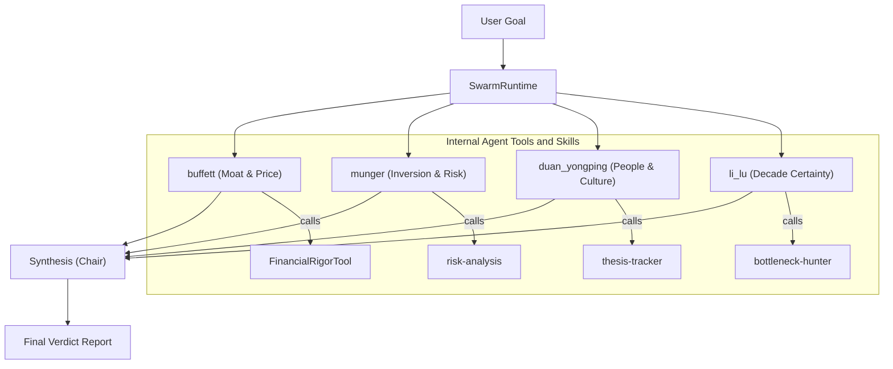
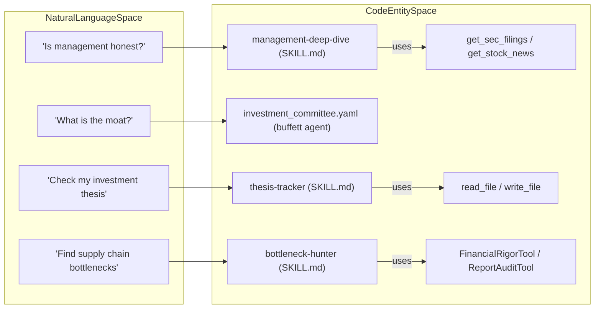
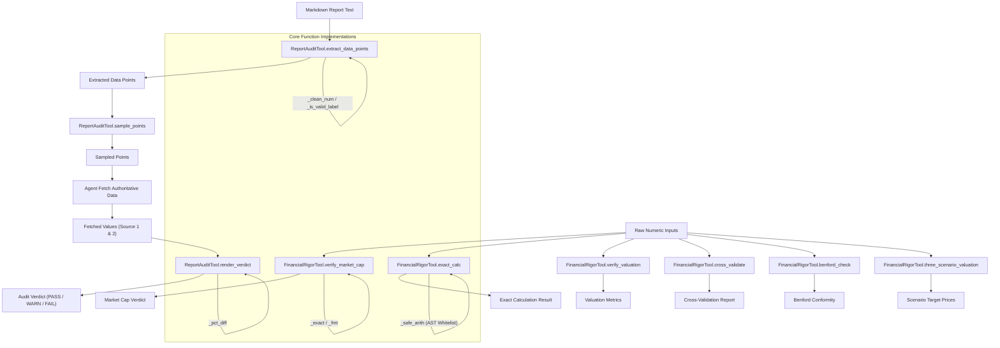

<!-- source: DeepWiki mcp.deepwiki.com · repo HKUDS/Vibe-Trading · page 3.8 Value Investing and Deep Research Skills · fetched 2026-11-09 -->

# Value Investing and Deep Research Skills

Relevant source files

The following files were used as context for generating this wiki page:

- [agent/src/live/runtime/triggers.py](agent/src/live/runtime/triggers.py)
- [agent/src/swarm/presets/convertible_bond_team.yaml](agent/src/swarm/presets/convertible_bond_team.yaml)
- [agent/src/swarm/presets/credit_research_team.yaml](agent/src/swarm/presets/credit_research_team.yaml)
- [agent/src/swarm/presets/equity_research_team.yaml](agent/src/swarm/presets/equity_research_team.yaml)
- [agent/src/swarm/presets/event_driven_task_force.yaml](agent/src/swarm/presets/event_driven_task_force.yaml)
- [agent/src/swarm/presets/fund_selection_panel.yaml](agent/src/swarm/presets/fund_selection_panel.yaml)
- [agent/src/swarm/presets/fundamental_research_team.yaml](agent/src/swarm/presets/fundamental_research_team.yaml)
- [agent/src/swarm/presets/investment_committee.yaml](agent/src/swarm/presets/investment_committee.yaml)
- [agent/src/swarm/presets/risk_committee.yaml](agent/src/swarm/presets/risk_committee.yaml)
- [agent/src/swarm/presets/statistical_arbitrage_desk.yaml](agent/src/swarm/presets/statistical_arbitrage_desk.yaml)
- [agent/src/tools/financial_rigor_tool.py](agent/src/tools/financial_rigor_tool.py)
- [agent/src/tools/report_audit_tool.py](agent/src/tools/report_audit_tool.py)
- [agent/tests/test_dataclass_field_name_collisions.py](agent/tests/test_dataclass_field_name_collisions.py)
- [agent/tests/test_financial_rigor_benford_inf.py](agent/tests/test_financial_rigor_benford_inf.py)
- [agent/tests/test_financial_rigor_three_scenario_undefined_upside.py](agent/tests/test_financial_rigor_three_scenario_undefined_upside.py)
- [agent/tests/test_financial_rigor_tool.py](agent/tests/test_financial_rigor_tool.py)
- [agent/tests/test_grounding_generic_timestamps.py](agent/tests/test_grounding_generic_timestamps.py)
- [agent/tests/test_report_audit_accounting_parens.py](agent/tests/test_report_audit_accounting_parens.py)
- [agent/tests/test_report_audit_code_fences.py](agent/tests/test_report_audit_code_fences.py)
- [agent/tests/test_report_audit_empty_table_cells.py](agent/tests/test_report_audit_empty_table_cells.py)
- [agent/tests/test_report_audit_signed_values.py](agent/tests/test_report_audit_signed_values.py)
- [agent/tests/test_report_audit_tool.py](agent/tests/test_report_audit_tool.py)
- [agent/tests/test_runtime_triggers.py](agent/tests/test_runtime_triggers.py)
- [agent/tests/test_swarm_presets_packaging.py](agent/tests/test_swarm_presets_packaging.py)
- [agent/tests/test_technical_indicator_compaction_replay.py](agent/tests/test_technical_indicator_compaction_replay.py)
- [agent/tests/test_tushare_loader.py](agent/tests/test_tushare_loader.py)

## Purpose and Scope

This page documents the Value Investing and Deep Research subsystem within Vibe-Trading. This subsystem provides institutional-grade analysis tools, structured SKILL definitions, and adversarial multi-agent swarms designed for deep-company due diligence, post-investment tracking, management integrity assessment, and structural bottleneck identification. The architecture relies on exact arithmetic (`decimal.Decimal`), rigorous data extraction, and strict hallucination safeguards (`report_audit` and `financial_rigor` tools) to ensure auditability across all research artifacts.

Sources: [agent/src/tools/financial_rigor_tool.py:1-27](), [agent/src/tools/report_audit_tool.py:1-19]()

---

## Deep Research Skill Architecture

The deep research suite comprises specialized `SKILL.md` definitions loaded via the `SkillsLoader` to guide the `AgentLoop` [agent/src/agent/loop.py:40-60]() through complex qualitative and fundamental investigations.

### Core Research Skills

| Skill Name | Purpose | Key Methodology |
|:---|:---|:---|
| `deep-company-series` | Comprehensive 8-part deep dive (~120k words) | Strict fact-check checklist, distinguishing GAAP vs Non-IFRS metrics [agent/src/skills/deep-company-series/SKILL.md:2-79](). |
| `thesis-tracker` | Post-buy investment discipline | Falsifiable assumptions, red lines, and quarterly health score calculations [agent/src/skills/thesis-tracker/SKILL.md:2-131](). |
| `research-discipline` | AI bias self-check | 60-second reset targeting leader, English, narrative, and confirmation biases [agent/src/skills/research-discipline/SKILL.md:2-18](). |
| `management-deep-dive` | Management integrity and ability scoring | Promise-vs-delivery tracking, capital allocation scoring [agent/src/skills/management-deep-dive/SKILL.md:2-78](). |
| `private-company-research` | Pre-IPO valuation & analysis | Information-gap mapping and multi-lens parallel research [agent/src/skills/private-company-research/SKILL.md:2-15](). |
| `bottleneck-hunter` | Supply-chain arbitrage | Decomposing super-trends into Layer 2/3 physical choke points [agent/src/skills/bottleneck-hunter/SKILL.md:2-100](). |

Sources: [agent/src/skills/deep-company-series/SKILL.md:2-79](), [agent/src/skills/thesis-tracker/SKILL.md:2-131](), [agent/src/skills/research-discipline/SKILL.md:2-18](), [agent/src/skills/management-deep-dive/SKILL.md:2-78](), [agent/src/skills/private-company-research/SKILL.md:2-15](), [agent/src/skills/bottleneck-hunter/SKILL.md:2-100]()

---

## Value Investing Committee Swarm

The `value_investing_committee` is a multi-agent swarm preset (routability verified in `test_value_investing_committee_is_routable` [agent/tests/test_swarm_presets_packaging.py:44-50]()) that orchestrates adversarial investor perspectives. It leverages master value investment mental models to debate long/short cases before synthesizing a final verdict.

### Swarm Data Flow

Title: "ValueInvestingCommitteeDataFlow"

Sources: [agent/src/swarm/presets/investment_committee.yaml:1-125](), [agent/tests/test_swarm_presets_packaging.py:44-50]()

---

## Technical Implementation Details

### Deep Company Series: The Revision Protocol
The `deep-company-series` skill enforces a strict revision protocol rather than simple single-pass generation [agent/src/skills/deep-company-series/SKILL.md:7-9](). It requires verifying cross-article consistency and separating GAAP figures from Non-IFRS adjustments [agent/src/skills/deep-company-series/SKILL.md:69-79]().

### Research Discipline & Bias Mitigation
The `research-discipline` skill executes upfront before search or statement retrieval to neutralize cognitive traps:
* **Leader-bias Correction**: Forces exploration of secondary and mid-cap alternatives [agent/src/skills/research-discipline/SKILL.md:15-15]().
* **English-bias Correction**: Queries local-language databases (JP, KR, TW) for supply chain intelligence [agent/src/skills/research-discipline/SKILL.md:16-16]().
* **Confirmation-bias Correction**: Requires "Munger Inversion" to document at least one invalidating counter-evidence point [agent/src/skills/research-discipline/SKILL.md:18-18]().

### Management Scoring Logic
The `management-deep-dive` skill evaluates management integrity by mapping historical commitments against delivered outcomes extracted from SEC filings and news [agent/src/skills/management-deep-dive/SKILL.md:64-70]().

| Delivery Rate | Rating | Interpretation |
|:---|:---|:---|
| >80% | Excellent | Reliable execution |
| 40–60% | Concerning | Over-promises, under-delivers |
| <40% | Serious Problem | Untrustworthy; potential exit signal |

Sources: [agent/src/skills/management-deep-dive/SKILL.md:64-78]()

### Thesis Tracker & Health Formula
The `thesis-tracker` stores evaluation state in markdown files (`reports/{company}-thesis.md`) [agent/src/skills/thesis-tracker/SKILL.md:86-86]() and computes a quarterly **Thesis Health Score** (1-10):

$$\text{Health} = 10 - (\text{Broken} \times 3) - (\text{Impaired} \times 2) - (\text{Weakening} \times 1) - (\text{RedLinesTriggered} \times 5)$$

Sources: [agent/src/skills/thesis-tracker/SKILL.md:86-131]()

---

## Natural Language to Code Mapping

This diagram bridges user queries in natural language to specific skill definitions and code entities.

Title: "DeepResearchConceptToCodeMapping"

Sources: [agent/src/skills/management-deep-dive/SKILL.md:4-5](), [agent/src/swarm/presets/investment_committee.yaml:6-30](), [agent/src/skills/thesis-tracker/SKILL.md:4-5](), [agent/src/skills/bottleneck-hunter/SKILL.md:4-5]()

---

## Bottleneck Hunter Framework

The `bottleneck-hunter` skill decomposes industrial value chains into physical choke points:
1. **Trend Filter**: Validates 3-5 year durability and hardware/material physicality [agent/src/skills/bottleneck-hunter/SKILL.md:23-29]().
2. **Decomposition**: Traces from Layer 0 (End Product) down to Layer 3 (Upstream Materials/Equipment) [agent/src/skills/bottleneck-hunter/SKILL.md:36-42]().
3. **Scarcity Scoring**: Evaluates criteria including expansion lead time and customer qualification barriers [agent/src/skills/bottleneck-hunter/SKILL.md:68-76]().
4. **Valuation Gate**: Evaluated via `FinancialRigorTool`; flags red if Market Cap > 10x 5-year optimistic revenue forecast [agent/src/skills/bottleneck-hunter/SKILL.md:92-100]().

Sources: [agent/src/skills/bottleneck-hunter/SKILL.md:9-100]()

---

## Report Audit and Financial Rigor Tools

Two primary tools enforce data integrity and numerical verification across research workflows: `ReportAuditTool` and `FinancialRigorTool`.

### `ReportAuditTool` Implementation
`ReportAuditTool` [agent/src/tools/report_audit_tool.py:1-29]() performs a two-phase data audit on markdown research reports:
1. **Extraction**: Parses markdown text and tables via `extract_data_points`, supporting Chinese financial units (`亿`, `万亿`, `倍`, `%`) [agent/src/tools/report_audit_tool.py:34-185]() and accounting negative bracket notation like `(25.3)亿` -> `-25.3` [agent/tests/test_report_audit_accounting_parens.py:19-29](). It samples 15% of extracted points (clamped to [3, 30]) using `sample_points` [agent/src/tools/report_audit_tool.py:11-12]().
2. **Verdict**: `render_verdict` compares reported figures against authoritative fetched data at a 1% tolerance threshold [agent/src/tools/report_audit_tool.py:12-14](). Single-source mismatches fail the entire report, whereas multi-source splits generate warnings [agent/src/tools/report_audit_tool.py:14-15](), [agent/tests/test_report_audit_tool.py:122-162]().

### `FinancialRigorTool` Implementation
`FinancialRigorTool` [agent/src/tools/financial_rigor_tool.py:1-27]() uses `decimal.Decimal` under a 28-digit context (`_CTX`) to prevent IEEE-754 floating-point drift [agent/src/tools/financial_rigor_tool.py:7-39]().
* **`verify_market_cap`**: Computes $\text{price} \times \text{shares}$ and checks against reported cap, returning `pass` ($\le 1\%$), `warn` ($1\text{--}5\%$), or `fail` ($>5\%$) [agent/src/tools/financial_rigor_tool.py:143-181]().
* **`verify_valuation`**: Derives exact PE, PB, ROE, P/FCF, FCF yield, dividend yield, and PS metrics [agent/src/tools/financial_rigor_tool.py:184-257]().
* **`cross_validate`**: Compares a field across multiple sources, establishing a median consensus and flagging outliers outside tolerance [agent/src/tools/financial_rigor_tool.py:260-290]().
* **`benford`**: Conducts Benford's Law first-digit checks on $\ge 50$ samples, computing MAD and conformity [agent/src/tools/financial_rigor_tool.py:293-340]().
* **`calc`**: Evaluates arithmetic expressions safely using an AST whitelist (`+`, `-`, `*`, `/`) with zero `eval` usage [agent/src/tools/financial_rigor_tool.py:44-137]().
* **`three_scenario`**: Projects bull, base, and bear target prices based on EPS growth and target PE assumptions [agent/src/tools/financial_rigor_tool.py:343-390]().

Sources: [agent/src/tools/report_audit_tool.py:1-185](), [agent/src/tools/financial_rigor_tool.py:1-390](), [agent/tests/test_report_audit_accounting_parens.py:19-29](), [agent/tests/test_report_audit_tool.py:122-162]()

### Tool Architecture and Data Flow

Title: "ReportAuditAndFinancialRigorArchitecture"

Sources: [agent/src/tools/report_audit_tool.py:1-185](), [agent/src/tools/financial_rigor_tool.py:1-390](), [agent/tests/test_report_audit_tool.py:1-196](), [agent/tests/test_financial_rigor_tool.py:1-193]()

---

