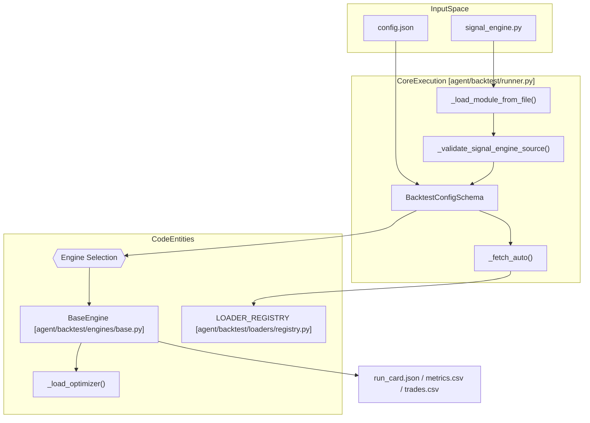
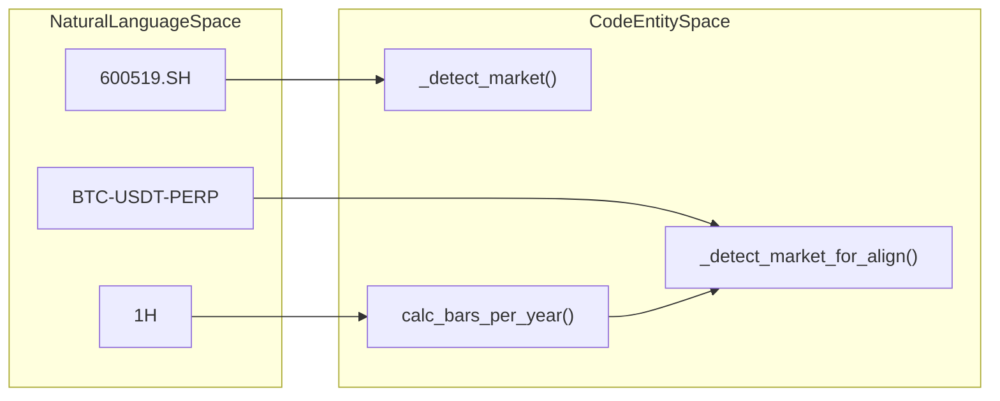

<!-- source: DeepWiki mcp.deepwiki.com · repo HKUDS/Vibe-Trading · page 4 Backtesting Framework · fetched 2026-11-09 -->

# Backtesting Framework

Relevant source files

The following files were used as context for generating this wiki page:

- [agent/backtest/engines/_market_hooks.py](agent/backtest/engines/_market_hooks.py)
- [agent/backtest/engines/base.py](agent/backtest/engines/base.py)
- [agent/backtest/engines/composite.py](agent/backtest/engines/composite.py)
- [agent/backtest/engines/crypto.py](agent/backtest/engines/crypto.py)
- [agent/backtest/runner.py](agent/backtest/runner.py)
- [agent/src/skills/strategy-dev-manager/SKILL.md](agent/src/skills/strategy-dev-manager/SKILL.md)
- [agent/src/strategy_store/metrics.py](agent/src/strategy_store/metrics.py)
- [agent/src/strategy_store/models.py](agent/src/strategy_store/models.py)
- [agent/src/strategy_store/sqlite_store.py](agent/src/strategy_store/sqlite_store.py)
- [agent/src/strategy_store/store.py](agent/src/strategy_store/store.py)
- [agent/src/tools/backtest_tool.py](agent/src/tools/backtest_tool.py)
- [agent/src/tools/sdm_decay_scan_tool.py](agent/src/tools/sdm_decay_scan_tool.py)
- [agent/src/tools/sdm_status_tool.py](agent/src/tools/sdm_status_tool.py)
- [agent/tests/test_backtest_records_bench.py](agent/tests/test_backtest_records_bench.py)
- [agent/tests/test_backtest_tool_state.py](agent/tests/test_backtest_tool_state.py)
- [agent/tests/test_base_engine.py](agent/tests/test_base_engine.py)
- [agent/tests/test_composite_engine_fallback.py](agent/tests/test_composite_engine_fallback.py)
- [agent/tests/test_crypto_digit_leading_symbols.py](agent/tests/test_crypto_digit_leading_symbols.py)
- [agent/tests/test_crypto_engine.py](agent/tests/test_crypto_engine.py)
- [agent/tests/test_engine_robustness.py](agent/tests/test_engine_robustness.py)
- [agent/tests/test_market_detection.py](agent/tests/test_market_detection.py)
- [agent/tests/test_plan_rejected.py](agent/tests/test_plan_rejected.py)
- [agent/tests/test_run_card_content_filter.py](agent/tests/test_run_card_content_filter.py)
- [agent/tests/test_run_card_structured_metrics.py](agent/tests/test_run_card_structured_metrics.py)
- [agent/tests/test_sdm_finite_metrics.py](agent/tests/test_sdm_finite_metrics.py)
- [agent/tests/test_strategy_store.py](agent/tests/test_strategy_store.py)

The Vibe-Trading Backtesting Framework is a high-performance, multi-market simulation system designed to bridge the gap between AI-generated strategies and executable performance validation. It supports A-shares, US/HK equities, Crypto, Futures, Forex, India Equities, and Options through a unified interface that handles data acquisition, event-driven execution, and comprehensive risk reporting.

### System Architecture

The framework operates on a configuration-driven model. A backtest is initiated by providing a directory containing a `config.json` and a `signal_engine.py`. The system then orchestrates data loading, engine selection, and execution loop [agent/backtest/runner.py:1-9]().

#### Backtest Execution Flow
The following diagram illustrates how `agent/backtest/runner.py` coordinates between the user's strategy code and internal system entities.

**Backtest Lifecycle: From Config to Artifacts**

Sources: [agent/backtest/runner.py:1-9](), [agent/backtest/runner.py:63-75](), [agent/backtest/engines/base.py:1-7](), [agent/backtest/engines/base.py:140-158]()

---

### Core Sub-Topics and Child Pages

#### 1. Backtest Runner and Configuration
The `agent/backtest/runner.py` module serves as the central entry point. It parses and validates `config.json` via `BacktestConfigSchema` to determine symbols (`codes`), date ranges, and data sources [agent/backtest/runner.py:77-113](). It features an AST (Abstract Syntax Tree) security scrubbing layer via `_validate_signal_engine_source` to block unauthorized imports and unsafe calls [agent/backtest/runner.py:165-203](). Sandbox execution is managed through `src/core/runner.py`.

For details, see [Backtest Runner and Configuration](#4.1).
Sources: [agent/backtest/runner.py:47-52](), [agent/backtest/runner.py:57-58](), [agent/backtest/runner.py:77-113](), [agent/backtest/runner.py:165-203]()

#### 2. Market Execution Engines
Vibe-Trading utilizes specialized engines inheriting from `BaseEngine` [agent/backtest/engines/base.py:1-7]() to model market microstructures across China A-shares [agent/backtest/engines/china_a.py](), Crypto perpetuals [agent/backtest/engines/crypto.py:1-9](), Global Equities, Forex, China Futures, Global Futures, India Equities, and Composite cross-market portfolios [agent/backtest/engines/composite.py:1-7](). Perpetual risk models and futures bases are fully integrated.

For details, see [Market Execution Engines](#4.2).
Sources: [agent/backtest/engines/base.py:1-7](), [agent/backtest/engines/crypto.py:1-9](), [agent/backtest/engines/composite.py:1-7]()

#### 3. Data Loaders and Registry
The framework provides a virtual data layer via `agent/backtest/loaders/` implementing the `DataLoader` protocol. Providers register via `@register` in `LOADER_REGISTRY` [agent/backtest/loaders/registry.py]() supporting fallback chains, price caliber provenance, and health checks across Yahoo/yfinance, Tencent, Baostock, AkShare, Tushare, OKX, CCXT, Futu, Longbridge, Stooq, Mootdx, local, QVeris, FMP/Tiingo, and MT5.

For details, see [Data Loaders and Registry](#4.3).
Sources: [agent/backtest/runner.py:28-34]()

#### 4. Performance Metrics, Validation, and Portfolio Optimizers
Quantitative performance reporting uses `metrics.py` (`calc_metrics`, turnover ratios) [agent/backtest/metrics.py:176-205](), risk xray, benchmarking, and validation suites (`validation.py` for Monte Carlo, Bootstrap CI, and Walk-Forward analysis). Portfolio optimization supports MeanVariance, RiskParity, EqualVol, MaxDiversification, and TurnoverAware constraints.

For details, see [Performance Metrics, Validation, and Portfolio Optimizers](#4.4).
Sources: [agent/backtest/metrics.py:34-46](), [agent/backtest/metrics.py:151-174](), [agent/backtest/metrics.py:176-205]()

#### 5. QuantLib Analytics Library
The `agent/src/quantlib/` package supplies advanced financial analytics covering options pricing, fixed income, credit models, event studies, factor models, cross-validation, fund performance math, market microstructure, and time-series utilities exposed via `quantlib_tool`.

For details, see [QuantLib Analytics Library](#4.5).
Sources: [agent/backtest/engines/base.py:1-7]()

---

### Data Space to Code Entity Mapping

This diagram maps natural language market terms and symbols to the specific code identifiers used for alignment and execution routing.

**Market Detection and Engine Association**

Sources: [agent/backtest/engines/_market_hooks.py:131](), [agent/backtest/engines/base.py:131](), [agent/backtest/metrics.py:34-46]()

### Summary of Artifacts
Every backtest run generates standardized execution artifacts. Robustness is enforced through all-NaN symbol detection and forward-filling limits (default 5 bars, 10 for cross-market) to prevent stale price propagation [agent/backtest/engines/base.py:157-158]().

| Artifact | File Path | Code Reference | Description |
| :--- | :--- | :--- | :--- |
| **Metrics** | `metrics.csv` | `calc_metrics` | Performance ratios (Sharpe, Calmar, Turnover) [agent/backtest/metrics.py:176-205](). |
| **Trades** | `trades.csv` | `TradeRecord` | List of completed round-trip trades [agent/backtest/models.py:39-71](). |
| **Equity** | `equity.csv` | `EquitySnapshot` | Time-series of portfolio equity and cash [agent/backtest/models.py:74-90](). |
| **Positions** | `positions.csv` | `Position` | Log of open positions during the run [agent/backtest/models.py:14-36](). |

Sources: [agent/backtest/metrics.py:176-205](), [agent/backtest/engines/base.py:157-158]()

---

