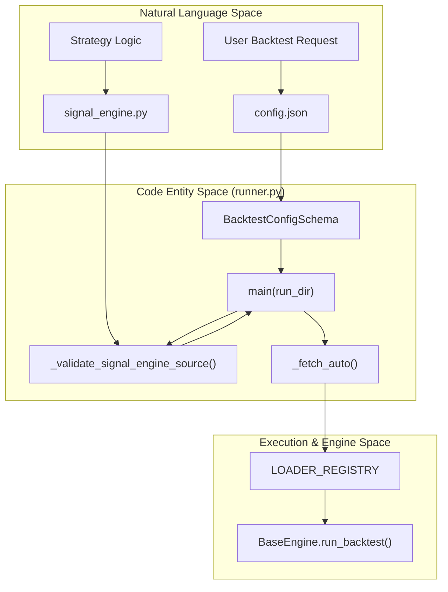
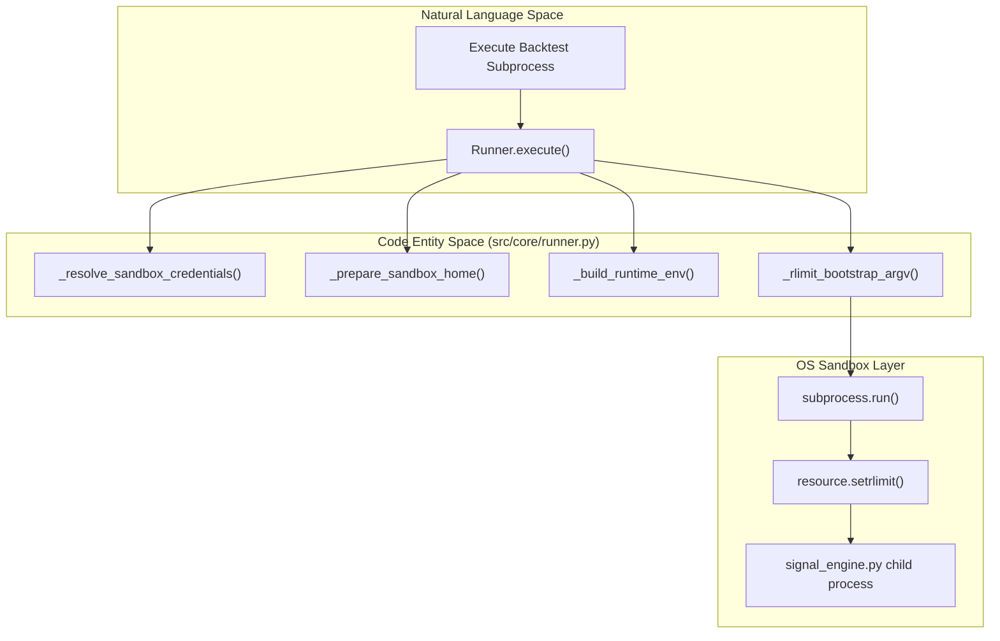

<!-- source: DeepWiki mcp.deepwiki.com · repo HKUDS/Vibe-Trading · page 4.1 Backtest Runner and Configuration · fetched 2026-11-09 -->

# Backtest Runner and Configuration

Relevant source files

The following files were used as context for generating this wiki page:

- [CODE_OF_CONDUCT.md](CODE_OF_CONDUCT.md)
- [SECURITY.md](SECURITY.md)
- [agent/backtest/constraints.py](agent/backtest/constraints.py)
- [agent/backtest/engines/_market_hooks.py](agent/backtest/engines/_market_hooks.py)
- [agent/backtest/engines/base.py](agent/backtest/engines/base.py)
- [agent/backtest/engines/composite.py](agent/backtest/engines/composite.py)
- [agent/backtest/engines/crypto.py](agent/backtest/engines/crypto.py)
- [agent/backtest/loaders/mt5_loader.py](agent/backtest/loaders/mt5_loader.py)
- [agent/backtest/runner.py](agent/backtest/runner.py)
- [agent/src/api/uploads_routes.py](agent/src/api/uploads_routes.py)
- [agent/src/core/runner.py](agent/src/core/runner.py)
- [agent/src/shadow_account/__init__.py](agent/src/shadow_account/__init__.py)
- [agent/src/shadow_account/storage.py](agent/src/shadow_account/storage.py)
- [agent/tests/test_akshare_loader.py](agent/tests/test_akshare_loader.py)
- [agent/tests/test_base_engine.py](agent/tests/test_base_engine.py)
- [agent/tests/test_composite_engine_fallback.py](agent/tests/test_composite_engine_fallback.py)
- [agent/tests/test_constraints.py](agent/tests/test_constraints.py)
- [agent/tests/test_crypto_digit_leading_symbols.py](agent/tests/test_crypto_digit_leading_symbols.py)
- [agent/tests/test_crypto_engine.py](agent/tests/test_crypto_engine.py)
- [agent/tests/test_engine_robustness.py](agent/tests/test_engine_robustness.py)
- [agent/tests/test_market_detection.py](agent/tests/test_market_detection.py)
- [agent/tests/test_mt5_interval_lowercase.py](agent/tests/test_mt5_interval_lowercase.py)
- [agent/tests/test_mt5_loader.py](agent/tests/test_mt5_loader.py)
- [agent/tests/test_mt5_loader_week_month_reject.py](agent/tests/test_mt5_loader_week_month_reject.py)
- [agent/tests/test_plan_rejected.py](agent/tests/test_plan_rejected.py)
- [agent/tests/test_run_card_content_filter.py](agent/tests/test_run_card_content_filter.py)
- [agent/tests/test_run_card_structured_metrics.py](agent/tests/test_run_card_structured_metrics.py)
- [agent/tests/test_runner_env.py](agent/tests/test_runner_env.py)
- [agent/tests/test_shadow_report_route_runtime_root.py](agent/tests/test_shadow_report_route_runtime_root.py)
- [agent/tests/test_trade_journal_parser_european_decimal.py](agent/tests/test_trade_journal_parser_european_decimal.py)
- [agent/tests/test_upload_cancellation.py](agent/tests/test_upload_cancellation.py)
- [agent/tests/test_user_state_paths.py](agent/tests/test_user_state_paths.py)

The Backtest Runner (`agent/backtest/runner.py`) is the central execution entrypoint for the Vibe-Trading backtesting framework [agent/backtest/runner.py:1-9](). It orchestrates the lifecycle of a backtest by parsing configurations, enforcing security via Abstract Syntax Tree (AST) validation, dynamically loading strategy code, routing data requests to appropriate loaders based on symbol patterns, and initializing the specific execution environment required for the market type [agent/backtest/runner.py:1-9]().

---

### Execution Lifecycle and Data Flow

The runner operates on a run directory pattern where configuration files and strategy code reside in a designated filesystem location [agent/backtest/runner.py:1-9]().

1. **Config Validation**: Reads `config.json` and validates it against `BacktestConfigSchema` to ensure data types, date ranges, and engine types are correct [agent/backtest/runner.py:80-116]().
2. **Signal Engine Import**: Dynamically imports the `SignalEngine` class from `signal_engine.py` using `importlib` after executing AST security checks [agent/backtest/runner.py:11-24]().
3. **Data Acquisition**: Fetches historical OHLCV data. When `source="auto"` is specified, symbols are routed to specialized loaders (e.g., Tushare for A-shares, OKX for Crypto) [agent/backtest/runner.py:1-9]().
4. **Engine Selection**: Initializes execution subclasses such as `ChinaAEngine` or `CryptoEngine` depending on the `engine` configuration parameter [agent/backtest/runner.py:80-116]().
5. **Execution & Metrics**: Executes the bar-by-bar simulation loop, computes performance indicators, and serializes artifact outputs [agent/backtest/engines/base.py:1-7]().

Sources: [agent/backtest/runner.py:1-116](), [agent/backtest/engines/base.py:1-7]()

---

### Configuration Schema (`config.json`)

The `BacktestConfigSchema` Pydantic model enforces strict schema validation on `config.json` prior to execution [agent/backtest/runner.py:80-116]().

| Field | Type | Description |
| :--- | :--- | :--- |
| `codes` | `List[str]` | Non-empty list of target symbols (e.g., `["000001.SZ", "BTC-USDT"]`) [agent/backtest/runner.py:85](). |
| `start_date` | `str` | Start date string in `YYYY-MM-DD` format [agent/backtest/runner.py:86](). |
| `end_date` | `str` | End date string in `YYYY-MM-DD` format [agent/backtest/runner.py:87](). |
| `source` | `str` | Data provider source name (`tushare`, `okx`, `yfinance`, `auto`, etc.) [agent/backtest/runner.py:88](). |
| `interval` | `str` | Bar timeframe (`1m`, `5m`, `15m`, `30m`, `1H`, `4H`, `1D`, `1W`, `1M`) [agent/backtest/runner.py:89](). |
| `engine` | `str` | Execution engine type (`daily` or `options`) [agent/backtest/runner.py:90](). |
| `position_adjustment` | `Literal["hold", "rebalance"]` | Position management strategy mode [agent/backtest/runner.py:91](). |
| `rebalance_mask` | `RebalanceMask` | Optional frequency or explicit calendar mask for rebalancing [agent/backtest/runner.py:92](). |
| `rebalance_tolerance` | `float` | Minimum target drift fraction required to trigger rebalance execution [agent/backtest/runner.py:100](). |
| `initial_cash` | `float` | Starting capital allocation (must be greater than 0) [agent/backtest/runner.py:104](). |
| `fundamental_fields` | `Optional[Dict[str, List[str]]]` | Mapping of fundamental database tables to field requirements [agent/backtest/runner.py:105](). |
| `event_feeds` | `Optional[List[Dict[str, Any]]]` | External RSSHub or event feed configuration specifications [agent/backtest/runner.py:106](). |
| `warmup_bars` | `Optional[int]` | Indicator lookback bar count excluded from evaluation scoring [agent/backtest/runner.py:114](). |
| `evaluation_start_date` | `Optional[str]` | Explicit calendar date marking the beginning of metric scoring [agent/backtest/runner.py:115](). |

Sources: [agent/backtest/runner.py:80-116]()

---

### Market Detection and Multi-Source Routing

Vibe-Trading implements symbol-to-market classification via regular expressions in `agent/backtest/engines/_market_hooks.py` [agent/backtest/engines/_market_hooks.py:1-166](). When `source="auto"` is configured, the runner utilizes these hooks to categorize instruments and route data requests through `LOADER_REGISTRY` [agent/backtest/runner.py:3-36]().

* **A-Share**: Matches mainland exchange patterns like `^\d{6}\.(SZ|SH|BJ)$` [agent/backtest/engines/_market_hooks.py:96-97]().
* **US Equity**: Matches ticker notations including class-share extensions such as `^[A-Z0-9&.\-]+\.US$` or bare tickers [agent/backtest/engines/_market_hooks.py:100]().
* **Crypto**: Recognizes spot and perpetual notations such as `^(?=[A-Z0-9]*[A-Z])[A-Z0-9]+-USDT$` or `^[A-Z0-9]+-USDT-PERP` [agent/backtest/engines/_market_hooks.py:122-131]().
* **Futures**: Identifies domestic and international contracts via product whitelists and exchange suffixes [agent/backtest/engines/_market_hooks.py:147-159]().
* **Forex**: Captures major currency pairs and metal notations like `^[A-Z]{3}/[A-Z]{3}$` [agent/backtest/engines/_market_hooks.py:126-132]().

Sources: [agent/backtest/runner.py:3-36](), [agent/backtest/engines/_market_hooks.py:1-166]()

---

### Dynamic SignalEngine Loading and Security

Strategy scripts are loaded from `signal_engine.py` dynamically [agent/backtest/runner.py:11-24](). Prior to module instantiation, the runner executes security analysis via Abstract Syntax Tree (AST) inspection to block unsafe operations.

* **AST Purity Checks**: Rejects non-literal defaults, dynamic code evaluation primitives, and unauthorized system modules [agent/backtest/runner.py:11-24]() [SECURITY.md:1-15]().
* **Execution Boundary**: Ensures imported classes expose the mandatory `SignalEngine` contract without inheriting or invoking system-level side effects [agent/backtest/runner.py:11-24]().

Sources: [agent/backtest/runner.py:11-24](), [SECURITY.md:1-15]()

---

### Sandbox Execution via `src/core/runner.py`

Subprocess execution of generated code is managed through `src/core/runner.py` to enforce environment hardening and resource constraints [agent/src/core/runner.py:1-170]().

* **Privilege Dropping**: Supports user context shifts to the `vibe-sandbox` account in containerized environments [agent/src/core/runner.py:56-72]().
* **Resource Limits (`RLIMIT_AS`, `RLIMIT_NOFILE`)**: Caps virtual address space (defaulting to 4GB via `_DEFAULT_RLIMIT_AS_MB`) and open file descriptor ceilings safely after process initialization [agent/src/core/runner.py:48-116]().
* **Ephemeral HOME Sandboxing**: Generates isolated home directories, re-exposing only designated paths like caches and data bridges while masking sensitive credentials and configurations [agent/src/core/runner.py:41-46]().
* **Secret Scrubbing**: Strips API tokens, broker passwords, and service secrets from runtime environment dictionaries passed to child processes [agent/tests/test_runner_env.py:61-90]().

Sources: [agent/src/core/runner.py:1-170](), [agent/tests/test_runner_env.py:61-90]()

---

