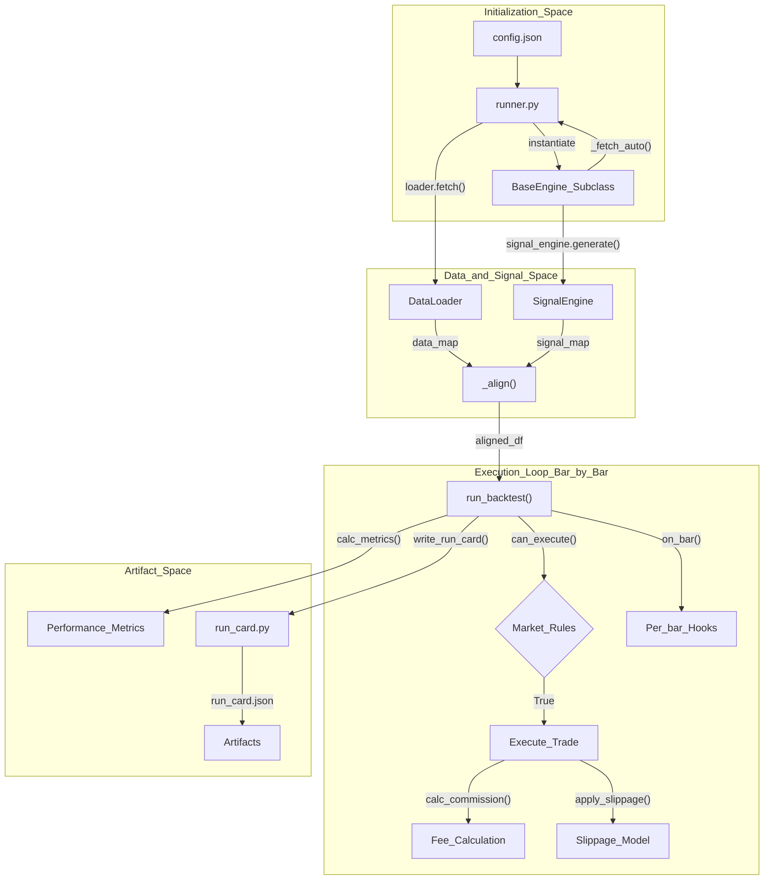
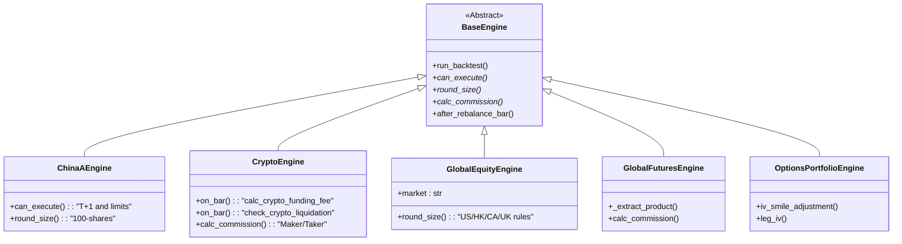

<!-- source: DeepWiki mcp.deepwiki.com · repo HKUDS/Vibe-Trading · page 4.2 Market Execution Engines · fetched 2026-11-09 -->

# Market Execution Engines

Relevant source files

The following files were used as context for generating this wiki page:

- [agent/backtest/engines/__init__.py](agent/backtest/engines/__init__.py)
- [agent/backtest/engines/china_futures.py](agent/backtest/engines/china_futures.py)
- [agent/backtest/engines/global_equity.py](agent/backtest/engines/global_equity.py)
- [agent/backtest/engines/global_futures.py](agent/backtest/engines/global_futures.py)
- [agent/backtest/engines/india_equity.py](agent/backtest/engines/india_equity.py)
- [agent/backtest/engines/options_portfolio.py](agent/backtest/engines/options_portfolio.py)
- [agent/backtest/metrics.py](agent/backtest/metrics.py)
- [agent/backtest/models.py](agent/backtest/models.py)
- [agent/backtest/rebalance_mask.py](agent/backtest/rebalance_mask.py)
- [agent/src/skills/strategy-generate/SKILL.md](agent/src/skills/strategy-generate/SKILL.md)
- [agent/src/strategy_discovery/evidence_harness.py](agent/src/strategy_discovery/evidence_harness.py)
- [agent/src/strategy_discovery/run_artifacts.py](agent/src/strategy_discovery/run_artifacts.py)
- [agent/tests/test_china_futures_engine.py](agent/tests/test_china_futures_engine.py)
- [agent/tests/test_china_futures_pricing_assumptions.py](agent/tests/test_china_futures_pricing_assumptions.py)
- [agent/tests/test_composite_market_rules.py](agent/tests/test_composite_market_rules.py)
- [agent/tests/test_cross_market_annualization.py](agent/tests/test_cross_market_annualization.py)
- [agent/tests/test_dropped_target_adjustments.py](agent/tests/test_dropped_target_adjustments.py)
- [agent/tests/test_equity_artifact_drawdown.py](agent/tests/test_equity_artifact_drawdown.py)
- [agent/tests/test_global_equity_hk_lot_sizes.py](agent/tests/test_global_equity_hk_lot_sizes.py)
- [agent/tests/test_global_futures_engine.py](agent/tests/test_global_futures_engine.py)
- [agent/tests/test_india_equity_engine.py](agent/tests/test_india_equity_engine.py)
- [agent/tests/test_metrics.py](agent/tests/test_metrics.py)
- [agent/tests/test_metrics_holding_period.py](agent/tests/test_metrics_holding_period.py)
- [agent/tests/test_options_bs_nonpositive_strike.py](agent/tests/test_options_bs_nonpositive_strike.py)
- [agent/tests/test_options_hv_bars_per_year.py](agent/tests/test_options_hv_bars_per_year.py)
- [agent/tests/test_options_hv_warmup.py](agent/tests/test_options_hv_warmup.py)
- [agent/tests/test_options_portfolio_correctness.py](agent/tests/test_options_portfolio_correctness.py)
- [agent/tests/test_period_returns.py](agent/tests/test_period_returns.py)
- [agent/tests/test_realized_turnover.py](agent/tests/test_realized_turnover.py)
- [agent/tests/test_rebalance_mask.py](agent/tests/test_rebalance_mask.py)
- [agent/tests/test_rebalance_tolerance.py](agent/tests/test_rebalance_tolerance.py)
- [agent/tests/test_signal_alignment_perf.py](agent/tests/test_signal_alignment_perf.py)
- [agent/tests/test_strategy_discovery_harness.py](agent/tests/test_strategy_discovery_harness.py)
- [agent/tests/test_uk_backtest_smoke.py](agent/tests/test_uk_backtest_smoke.py)
- [agent/tests/test_validation_missing_equity.py](agent/tests/test_validation_missing_equity.py)

Market Execution Engines provide the core simulation logic for backtesting trading strategies within the Vibe-Trading framework. While the `SignalEngine` generates alpha [agent/backtest/engines/options_portfolio.py:13](), the execution engines enforce market-specific constraints, calculate transaction costs, and simulate the bar-by-bar lifecycle of a portfolio. 

The architecture relies on a common `BaseEngine` loop handling data alignment, while specialized subclasses implement distinct market rules.

---

### Engine Architecture and Data Flow

The simulation pipeline processes configurations through data loading, signal alignment, weight optimization, and bar-by-bar iteration.

Title: "Engine Execution Lifecycle"

Sources: [agent/backtest/engines/base.py:1-7](), [agent/backtest/runner.py:1-45]()

---

### BaseEngine Core Loop and Signal Alignment

The `BaseEngine` class defined in `agent/backtest/engines/base.py` serves as the abstract base class for all market engines, implementing `run_backtest()` and underlying data synchronization helpers.

*   **Signal Alignment (`_align`)**: Synchronizes multi-asset OHLCV data frames and signal series into a unified time-indexed matrix, automatically shifting signals by one bar to execute at next-bar-open prices [agent/backtest/engines/base.py:205-210]().
*   **Missing Data Management**: Uses `_ffill_1d` and `_ffill_2d` to perform vectorized forward filling on NumPy arrays with limits (e.g. limit of 10 for cross-market portfolios spanning holiday gaps, 5 for single markets) [agent/backtest/engines/base.py:141-162]().
*   **Robustness Checks**: Automatically drops symbols containing entirely `NaN` data to prevent execution crashes [agent/tests/test_engine_robustness.py:58-79]().
*   **Optimizer & Fundamental Enrichment**: Dynamically loads portfolio weight optimizers via `_load_optimizer` and enriches price tables with point-in-time fundamental fields via `_maybe_enrich_fundamentals` [agent/backtest/engines/base.py:139-205]().
*   **Rebalance Masks**: Supports calendar or explicit date execution masks (`rebalance_mask` parameter) to constrain portfolio rebalancing frequency or target dates [agent/tests/test_rebalance_mask.py:1-40]().

Sources: [agent/backtest/engines/base.py:10-21](), [agent/backtest/engines/base.py:77-158](), [agent/tests/test_rebalance_mask.py:1-40]()

---

### Market Execution Engine Catalog

Specialized execution engines extend `BaseEngine` to enforce specific exchange regulations and structural characteristics:

#### 1. ChinaAEngine
*   **Rules**: Implements T+1 settlement restrictions, 100-share board lot rounding, and price limit filters (10% Mainboard, 20% ChiNext/STAR) [agent/backtest/engines/china_a.py:113-130]().
*   **Fees**: Includes minimum commission floors (¥5), sell-side stamp taxes, and transfer fees [agent/backtest/engines/china_a.py:125-130]().

#### 2. CryptoEngine & Perpetual Risk
*   **Rules**: Built for 24/7 digital asset spot and perpetual futures markets.
*   **Funding Fees**: Executes 8-hour funding cycles (00:00, 08:00, 16:00 UTC) via `calc_crypto_funding_fee` with duplicate guards (`_funding_applied`) [agent/backtest/engines/crypto.py:6-85]().
*   **Liquidation**: Enforces maintenance margin thresholds through `check_crypto_liquidation` and advanced models (`CrossMarginRiskModel`, `MaintenanceSchedule`) when `perpetual_strict` is enabled [agent/backtest/engines/crypto.py:35-78]().
*   **Sizing & Fees**: High-precision fractional quantities (6 decimal places) and maker/taker fee differentiation [agent/backtest/engines/crypto.py:116-127]().

#### 3. GlobalEquityEngine
*   **Markets**: Covers US (T+0, zero commissions, fractional shares to 0.01), HK (100-share default or custom `hk_lot_sizes`, bilateral stamp tax, SFC/FRC levies, CCASS settlement), Canada TSX/TSXV (odd/mixed lots, whole-share floors), and UK LSE (Main Market 0.5% SDRT on purchases) [agent/backtest/engines/global_equity.py:1-111]().

#### 4. Futures, Forex, and Composite Engines
*   **FuturesBaseEngine / ChinaFuturesEngine / GlobalFuturesEngine**: Implements product code extraction via `_extract_product`, contract multipliers (`_MULTIPLIER`), margin requirements (`_MARGIN_RATE`), price limits, and per-contract commissions across CFFEX, SHFE, DCE, ZCE, INE, GFEX, CME, ICE, and Eurex [agent/backtest/engines/china_futures.py:1-155](), [agent/backtest/engines/global_futures.py:1-174]().
*   **ForexEngine**: Simulates FX spot and CFDs with bid-ask spreads and overnight swap rates.
*   **CompositeEngine**: Manages multi-engine portfolios under a shared capital pool, routing symbols to corresponding sub-engines via `_detect_market` while rejecting mixed-currency baskets [agent/backtest/engines/composite.py:1-117]().

#### 5. IndiaEquityEngine
*   **Rules**: Targets NSE (`.NS`) and BSE (`.BO`) equities with T+1 delivery, circuit band checks, and a comprehensive tax stack including STT, stamp duty, exchange transaction charges, SEBI turnover fees, and GST.

#### 6. OptionsPortfolioEngine (v2)
*   **Pricing**: Leverages Black-Scholes pricing models via `src.quantlib.options` with implied volatility (IV) smile adjustment (`iv_smile_adjustment`, `leg_iv`) [agent/backtest/engines/options_portfolio.py:1-125]().
*   **Exercise & Greeks**: Supports American option early exercise heuristics (dividends and deep ITM puts) and computes portfolio-level Greeks (Delta, Gamma, Theta, Vega) [agent/backtest/engines/options_portfolio.py:8-33]().

Sources: [agent/backtest/engines/china_a.py:113-130](), [agent/backtest/engines/crypto.py:6-127](), [agent/backtest/engines/global_equity.py:1-111](), [agent/backtest/engines/global_futures.py:1-174](), [agent/backtest/engines/china_futures.py:1-155](), [agent/backtest/engines/options_portfolio.py:1-125]()

---

### Performance Metrics & Annualisation

Performance metrics and annualisation conventions are centralized in `agent/backtest/metrics.py`. The engine looks up annual trading days and intraday bar densities using `_TRADING_DAYS` and `_BARS_PER_DAY` maps supporting sources such as `tushare`, `yfinance`, `okx`, `mootdx`, `futu`, `mt5`, `tickerall`, and others [agent/backtest/metrics.py:1-146](). For cross-market portfolios, calendar-day annualisation is dynamically computed using `effective_bars_per_year`.

Sources: [agent/backtest/metrics.py:1-146](), [agent/tests/test_metrics.py:66-170]()

---

### Code Entity Mapping

The mapping between core execution engine concepts and concrete code implementations is outlined below.

Title: "Market Execution Engine Code Entity Map"

Sources: [agent/backtest/engines/base.py:10-21](), [agent/backtest/engines/crypto.py:22-32](), [agent/backtest/engines/global_equity.py:60-85](), [agent/backtest/engines/global_futures.py:176-190](), [agent/backtest/engines/options_portfolio.py:130-158]()

---

