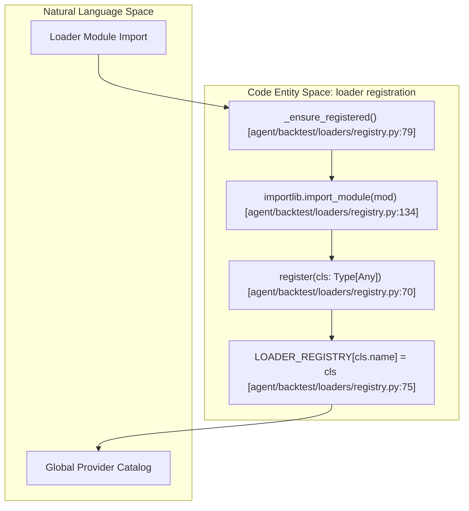
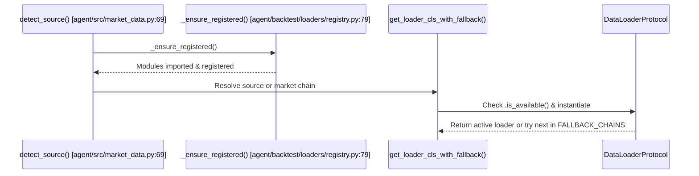

<!-- source: DeepWiki mcp.deepwiki.com · repo HKUDS/Vibe-Trading · page 4.3 Data Loaders and Registry · fetched 2026-11-09 -->

# Data Loaders and Registry

Relevant source files

The following files were used as context for generating this wiki page:

- [.github/workflows/loader-health.yml](.github/workflows/loader-health.yml)
- [agent/backtest/loader_health.py](agent/backtest/loader_health.py)
- [agent/backtest/loaders/additive_conversion.py](agent/backtest/loaders/additive_conversion.py)
- [agent/backtest/loaders/akshare_loader.py](agent/backtest/loaders/akshare_loader.py)
- [agent/backtest/loaders/alphavantage_loader.py](agent/backtest/loaders/alphavantage_loader.py)
- [agent/backtest/loaders/baostock_loader.py](agent/backtest/loaders/baostock_loader.py)
- [agent/backtest/loaders/base.py](agent/backtest/loaders/base.py)
- [agent/backtest/loaders/eastmoney_loader.py](agent/backtest/loaders/eastmoney_loader.py)
- [agent/backtest/loaders/finnhub_loader.py](agent/backtest/loaders/finnhub_loader.py)
- [agent/backtest/loaders/fmp_loader.py](agent/backtest/loaders/fmp_loader.py)
- [agent/backtest/loaders/futu.py](agent/backtest/loaders/futu.py)
- [agent/backtest/loaders/local_loader.py](agent/backtest/loaders/local_loader.py)
- [agent/backtest/loaders/mootdx_loader.py](agent/backtest/loaders/mootdx_loader.py)
- [agent/backtest/loaders/registry.py](agent/backtest/loaders/registry.py)
- [agent/backtest/loaders/stooq_loader.py](agent/backtest/loaders/stooq_loader.py)
- [agent/backtest/loaders/tencent_loader.py](agent/backtest/loaders/tencent_loader.py)
- [agent/backtest/loaders/tiingo_loader.py](agent/backtest/loaders/tiingo_loader.py)
- [agent/backtest/loaders/tushare.py](agent/backtest/loaders/tushare.py)
- [agent/backtest/loaders/yahoo_client.py](agent/backtest/loaders/yahoo_client.py)
- [agent/backtest/loaders/yahoo_loader.py](agent/backtest/loaders/yahoo_loader.py)
- [agent/backtest/loaders/yfinance_loader.py](agent/backtest/loaders/yfinance_loader.py)
- [agent/src/market_data.py](agent/src/market_data.py)
- [agent/src/skills/data-routing/SKILL.md](agent/src/skills/data-routing/SKILL.md)
- [agent/src/skills/mootdx/SKILL.md](agent/src/skills/mootdx/SKILL.md)
- [agent/src/tools/market_data_tool.py](agent/src/tools/market_data_tool.py)
- [agent/tests/loader_contract.py](agent/tests/loader_contract.py)
- [agent/tests/test_additive_conversion.py](agent/tests/test_additive_conversion.py)
- [agent/tests/test_alphavantage_interval_reject.py](agent/tests/test_alphavantage_interval_reject.py)
- [agent/tests/test_alphavantage_loader.py](agent/tests/test_alphavantage_loader.py)
- [agent/tests/test_baostock_interval_reject.py](agent/tests/test_baostock_interval_reject.py)
- [agent/tests/test_baostock_loader.py](agent/tests/test_baostock_loader.py)
- [agent/tests/test_baostock_socket_deadline.py](agent/tests/test_baostock_socket_deadline.py)
- [agent/tests/test_eastmoney_loader.py](agent/tests/test_eastmoney_loader.py)
- [agent/tests/test_finnhub_interval_reject.py](agent/tests/test_finnhub_interval_reject.py)
- [agent/tests/test_finnhub_loader.py](agent/tests/test_finnhub_loader.py)
- [agent/tests/test_fmp_daily_aliases.py](agent/tests/test_fmp_daily_aliases.py)
- [agent/tests/test_fmp_loader.py](agent/tests/test_fmp_loader.py)
- [agent/tests/test_fmp_stable_regression.py](agent/tests/test_fmp_stable_regression.py)
- [agent/tests/test_futu_loader.py](agent/tests/test_futu_loader.py)
- [agent/tests/test_futu_loader_interval_case.py](agent/tests/test_futu_loader_interval_case.py)
- [agent/tests/test_loader_health.py](agent/tests/test_loader_health.py)
- [agent/tests/test_loader_retry_helpers.py](agent/tests/test_loader_retry_helpers.py)
- [agent/tests/test_loader_volume_units.py](agent/tests/test_loader_volume_units.py)
- [agent/tests/test_local_loader.py](agent/tests/test_local_loader.py)
- [agent/tests/test_local_loader_cache_identity.py](agent/tests/test_local_loader_cache_identity.py)
- [agent/tests/test_local_loader_end_day.py](agent/tests/test_local_loader_end_day.py)
- [agent/tests/test_local_loader_interval_case.py](agent/tests/test_local_loader_interval_case.py)
- [agent/tests/test_local_loader_source_revision.py](agent/tests/test_local_loader_source_revision.py)
- [agent/tests/test_market_data.py](agent/tests/test_market_data.py)
- [agent/tests/test_market_data_serving_source.py](agent/tests/test_market_data_serving_source.py)
- [agent/tests/test_market_data_tool.py](agent/tests/test_market_data_tool.py)
- [agent/tests/test_mootdx_loader.py](agent/tests/test_mootdx_loader.py)
- [agent/tests/test_ohlc_validation.py](agent/tests/test_ohlc_validation.py)
- [agent/tests/test_price_caliber.py](agent/tests/test_price_caliber.py)
- [agent/tests/test_registry.py](agent/tests/test_registry.py)
- [agent/tests/test_stooq_interval_reject.py](agent/tests/test_stooq_interval_reject.py)
- [agent/tests/test_stooq_loader.py](agent/tests/test_stooq_loader.py)
- [agent/tests/test_tencent_loader.py](agent/tests/test_tencent_loader.py)
- [agent/tests/test_tiingo_interval_reject.py](agent/tests/test_tiingo_interval_reject.py)
- [agent/tests/test_tiingo_loader.py](agent/tests/test_tiingo_loader.py)
- [agent/tests/test_uk_equity_support.py](agent/tests/test_uk_equity_support.py)
- [agent/tests/test_volume_unit_consistency.py](agent/tests/test_volume_unit_consistency.py)
- [agent/tests/test_yahoo_client.py](agent/tests/test_yahoo_client.py)
- [agent/tests/test_yahoo_loader.py](agent/tests/test_yahoo_loader.py)
- [agent/tests/test_yfinance_auto_adjust.py](agent/tests/test_yfinance_auto_adjust.py)
- [agent/tests/test_yfinance_symbol_map.py](agent/tests/test_yfinance_symbol_map.py)
- [agent/tests/test_yfinance_uk_scale.py](agent/tests/test_yfinance_uk_scale.py)

This page documents the data acquisition layer located in `agent/backtest/loaders/`. The system uses a provider-agnostic protocol to fetch OHLCV (Open, High, Low, Close, Volume) data across multiple asset classes including China A-shares, US/HK equities, Cryptocurrencies, and Indian equities. It features a central registry with automatic fallback logic to ensure high availability even when specific API providers fail or lack credentials.

Sources:
- [agent/backtest/loaders/base.py:1-20]()
- [agent/backtest/loaders/registry.py:1-68]()

---

## DataLoader Base Protocol and Retry Helpers

All data loaders implement the protocol defined or expected by the base module [agent/backtest/loaders/base.py:1-20](). This ensures a consistent interface for the `BacktestRunner` and analysis tools like `MarketDataTool` [agent/src/tools/market_data_tool.py:79-82]().

### Interface Specification
- **`name`**: A unique string identifier for the provider (e.g., `"tushare"`, `"okx"`, `"ccxt"`, `"futu"`, `"mootdx"`) [agent/backtest/loaders/ccxt_loader.py:83]().
- **`markets`**: A set of supported market types (e.g., `{"a_share", "crypto"}`) [agent/backtest/loaders/akshare_loader.py:93-94]().
- **`requires_auth`**: Boolean indicating if an API token or local gateway is mandatory [agent/backtest/loaders/tushare.py:56]().
- **`is_available()`**: A runtime check to verify if the loader can be used, checking environment variables or library installations [agent/backtest/loaders/akshare_loader.py:102-108]().
- **`fetch(...)`**: The primary execution method that returns a dictionary mapping symbols to pandas DataFrames [agent/backtest/loaders/akshare_loader.py:113-121]().

### Reliability: Bounded Retry and Budgets
Shared retry logic in [agent/backtest/loaders/base.py:1-20]() prevents system hangs on flaky external APIs:
- **`check_budget`**: Raises `TimeoutError` if the wall-clock budget is exceeded.
- **`retry_with_budget`**: Executes a function with bounded retries on transient errors.
- **`validate_ohlc`**: Sanity checks data for `high < low` or non-positive prices.
- **`cached_loader_fetch`**: Wraps the fetch operation in an optional disk-based cache layer.

Sources:
- [agent/backtest/loaders/base.py:1-184]()
- [agent/src/tools/market_data_tool.py:79-96]()

---

## LOADER_REGISTRY and @register

The `LOADER_REGISTRY` is a global dictionary mapping source names to their respective class implementations [agent/backtest/loaders/registry.py:25](). Loaders use the `@register` decorator to add themselves to this registry upon module import [agent/backtest/loaders/registry.py:70-76](). `VALID_SOURCES` defines the canonical set of accepted data source identifiers plus `"auto"` [agent/backtest/loaders/registry.py:36-67]().

Sources:
- [agent/backtest/loaders/registry.py:25-139]()
- [agent/tests/test_registry.py:105-117]()

---

## Fallback Chains and Source Resolution

The system defines `FALLBACK_CHAINS` for each market type [agent/backtest/loaders/registry.py:178-180](). If a primary data source is unavailable, the system automatically attempts the next provider in the chain [agent/backtest/loaders/registry.py:200-202](). Explicit non-network fallback sources (`_NO_NETWORK_FALLBACK_SOURCES`) like `"local"` or `"qveris"` prevent silent degradation to unwanted public endpoints [agent/backtest/loaders/registry.py:157-168]().

| Market | Fallback Chain (Ordered) |
| :--- | :--- |
| `a_share` | `tencent` → `mootdx` → `eastmoney` → `baostock` → `akshare` → `tushare` → `local` |
| `us_equity` | `yahoo` → `stooq` → `sina` → `eastmoney` → `yfinance` → `tiingo` → `fmp` → `finnhub` → `alphavantage` → `longbridge` → `akshare` → `local` |
| `hk_equity` | `eastmoney` → `yahoo` → `futu` → `yfinance` → `akshare` → `longbridge` → `local` |
| `india_equity` | `yahoo` → `yfinance` → `india_broker` → `local` |
| `crypto` | `okx` → `ccxt` → `yfinance` → `local` |
| `futures` | `tushare` → `akshare` → `local` |
| `fund` | `tushare` → `akshare` → `local` |
| `macro` | `akshare` → `tushare` → `local` |
| `forex` | `akshare` → `yfinance` → `local` |

### Code Entity Relationship: Loader Resolution Flow

Sources:
- [agent/backtest/loaders/registry.py:1-202]()
- [agent/src/market_data.py:69-86]()

---

## Price Caliber Provenance

The system tracks the "price caliber" of data, which describes how prices are adjusted for corporate actions like splits and dividends. Each fetched DataFrame includes `_provenance.adjustment` and `_provenance.volume_unit` fields [agent/src/tools/market_data_tool.py:83-95]().

### Caliber Types
- **`raw`**: Unadjusted prices.
- **`split`**: Adjusted for stock splits only.
- **`split_dividend`**: Adjusted for both splits and dividends (multiplicative adjustment).
- **`split_dividend_additive`**: Adjusted for splits and dividends, where dividends are handled additively (e.g., Tencent's qfq for A-shares) [agent/tests/test_price_caliber.py:78-82]().
- **`na`**: Not applicable (e.g., for crypto).
- **`unknown`**: Caliber could not be determined.

Sources:
- [agent/src/tools/market_data_tool.py:83-96]()
- [agent/tests/test_price_caliber.py:38-106]()

---

## Loader Health Checks

Loader health checks (`agent/backtest/loader_health.py` and `.github/workflows/loader-health.yml`) regularly probe available providers to verify live connectivity, authentication validity, and schema compliance across all integrated endpoints.

Sources:
- [.github/workflows/loader-health.yml:1-30]()
- [agent/backtest/loader_health.py:1-50]()

---

## Per-Provider Loaders

The registry includes specialized loaders for over 20 providers:

- **`yahoo` / `yfinance`**: Free global equity, index (`^SPX`), and crypto/futures (`=F`, `=X`) data [agent/backtest/loaders/yahoo_loader.py:1-71](), [agent/backtest/loaders/yfinance_loader.py:1-80](). Handles LSE pence-to-pound normalization [agent/backtest/loaders/base.py:28-63]().
- **`tencent`**: Free A-share and HK equity data via `web.ifzq.gtimg.cn` [agent/backtest/loaders/tencent_loader.py:1-9]().
- **`baostock`**: A-share historical data via Baostock API socket client.
- **`akshare`**: Free financial data aggregator covering A-shares, US/HK, futures, forex, and macro [agent/backtest/loaders/akshare_loader.py:1-5]().
- **`tushare`**: Key-gated professional A-share data provider [agent/backtest/loaders/tushare.py:1-5]().
- **`okx` / `ccxt`**: Crypto loaders supporting spot, perpetuals (`-PERP`), and multi-exchange REST APIs [agent/backtest/loaders/ccxt_loader.py:1-55]().
- **`futu` / `longbridge`**: Gateway and OpenAPI loaders for HK and US equities [agent/backtest/loaders/longbridge.py:1-4]().
- **`stooq`**: Global EOD data loader.
- **`mootdx`**: A-share data via Pytdx / mootdx library.
- **`local`**: User-configured CSV, Parquet, and DuckDB files (`~/.vibe-trading/data-bridge/config.yaml`) [agent/backtest/loaders/local_loader.py:1-30]().
- **`qveris`**: Premium financial marketplace loader.
- **`fmp` / `tiingo` / `finnhub` / `alphavantage`**: Key-gated US/global REST data providers.
- **`mt5`**: Forex and metals data via local MetaTrader 5 terminal bindings.

Sources:
- [agent/backtest/loaders/local_loader.py:1-45]()
- [agent/backtest/loaders/akshare_loader.py:1-110]()
- [agent/backtest/loaders/tencent_loader.py:1-75]()
- [agent/backtest/loaders/yahoo_loader.py:1-70]()
- [agent/backtest/loaders/yfinance_loader.py:1-80]()
- [agent/backtest/loaders/ccxt_loader.py:1-60]()

---

