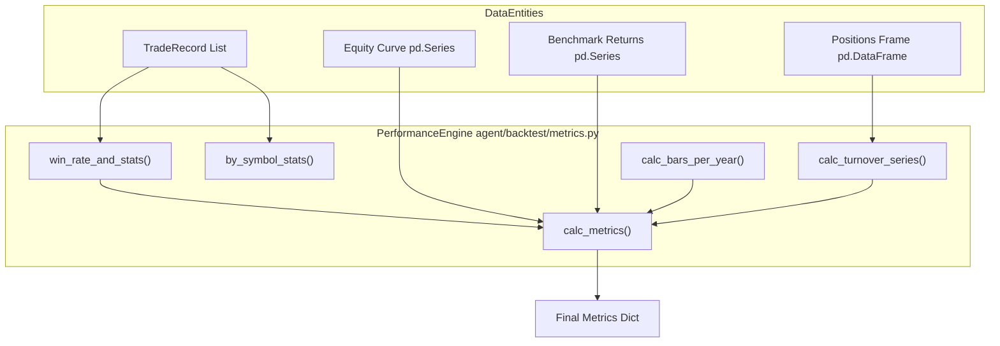
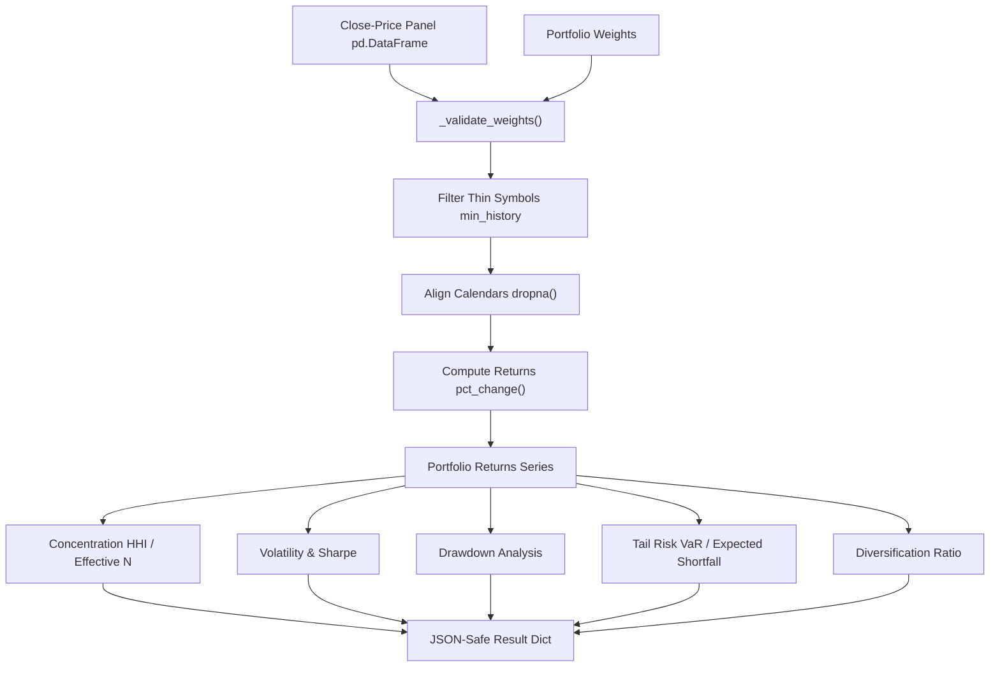
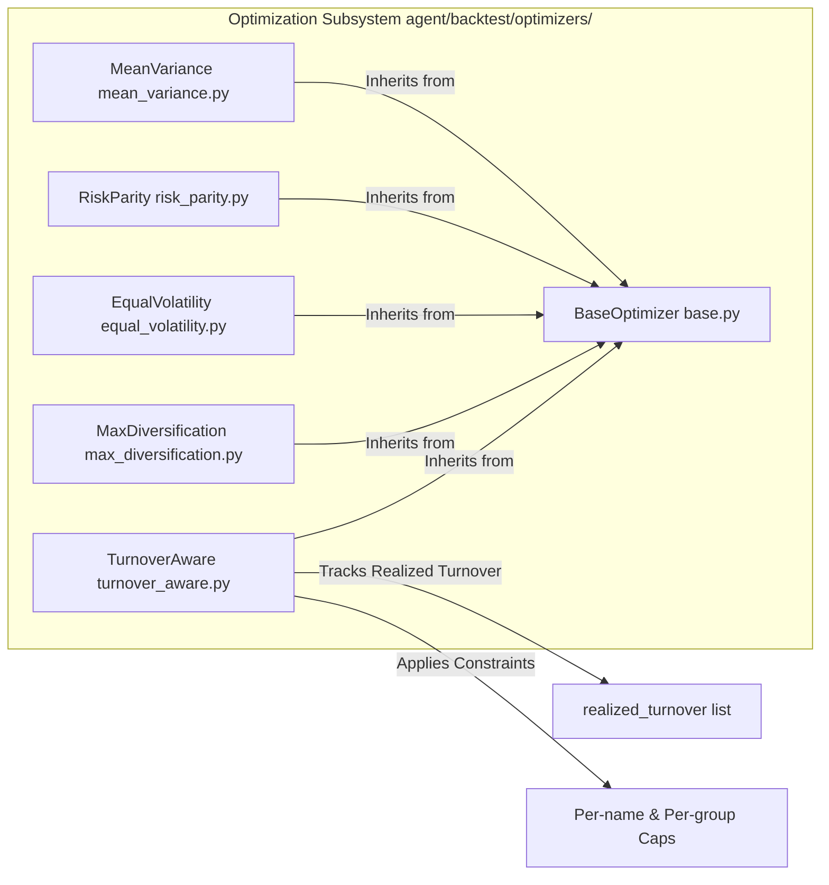

<!-- source: DeepWiki mcp.deepwiki.com · repo HKUDS/Vibe-Trading · page 4.4 Performance Metrics, Validation, and Portfolio Optimizers · fetched 2026-11-09 -->

# Performance Metrics, Validation, and Portfolio Optimizers

Relevant source files

The following files were used as context for generating this wiki page:

- [agent/backtest/benchmark.py](agent/backtest/benchmark.py)
- [agent/backtest/engines/options_portfolio.py](agent/backtest/engines/options_portfolio.py)
- [agent/backtest/metrics.py](agent/backtest/metrics.py)
- [agent/backtest/models.py](agent/backtest/models.py)
- [agent/backtest/optimizers/__init__.py](agent/backtest/optimizers/__init__.py)
- [agent/backtest/optimizers/base.py](agent/backtest/optimizers/base.py)
- [agent/backtest/optimizers/mean_variance.py](agent/backtest/optimizers/mean_variance.py)
- [agent/backtest/optimizers/turnover_aware.py](agent/backtest/optimizers/turnover_aware.py)
- [agent/backtest/risk_xray.py](agent/backtest/risk_xray.py)
- [agent/backtest/run_card.py](agent/backtest/run_card.py)
- [agent/backtest/validation.py](agent/backtest/validation.py)
- [agent/src/agent/trace.py](agent/src/agent/trace.py)
- [agent/src/tools/portfolio_risk_tool.py](agent/src/tools/portfolio_risk_tool.py)
- [agent/tests/quantlib/test_options_iv_price_tolerance.py](agent/tests/quantlib/test_options_iv_price_tolerance.py)
- [agent/tests/test_benchmark_excess_return_consistency.py](agent/tests/test_benchmark_excess_return_consistency.py)
- [agent/tests/test_benchmark_exchange_suffix_regressions.py](agent/tests/test_benchmark_exchange_suffix_regressions.py)
- [agent/tests/test_cross_market_annualization.py](agent/tests/test_cross_market_annualization.py)
- [agent/tests/test_equity_artifact_drawdown.py](agent/tests/test_equity_artifact_drawdown.py)
- [agent/tests/test_load_equity_aliases.py](agent/tests/test_load_equity_aliases.py)
- [agent/tests/test_local_source_routing.py](agent/tests/test_local_source_routing.py)
- [agent/tests/test_mean_variance_optimizer.py](agent/tests/test_mean_variance_optimizer.py)
- [agent/tests/test_metrics.py](agent/tests/test_metrics.py)
- [agent/tests/test_metrics_holding_period.py](agent/tests/test_metrics_holding_period.py)
- [agent/tests/test_optimizer_causality.py](agent/tests/test_optimizer_causality.py)
- [agent/tests/test_options_bs_nonpositive_strike.py](agent/tests/test_options_bs_nonpositive_strike.py)
- [agent/tests/test_options_hv_bars_per_year.py](agent/tests/test_options_hv_bars_per_year.py)
- [agent/tests/test_options_hv_warmup.py](agent/tests/test_options_hv_warmup.py)
- [agent/tests/test_options_portfolio_correctness.py](agent/tests/test_options_portfolio_correctness.py)
- [agent/tests/test_period_returns.py](agent/tests/test_period_returns.py)
- [agent/tests/test_portfolio_risk_calendar_bars.py](agent/tests/test_portfolio_risk_calendar_bars.py)
- [agent/tests/test_realized_turnover.py](agent/tests/test_realized_turnover.py)
- [agent/tests/test_risk_xray.py](agent/tests/test_risk_xray.py)
- [agent/tests/test_risk_xray_return_gaps_regressions.py](agent/tests/test_risk_xray_return_gaps_regressions.py)
- [agent/tests/test_trace_writer.py](agent/tests/test_trace_writer.py)
- [agent/tests/test_turnover_aware_optimizer.py](agent/tests/test_turnover_aware_optimizer.py)
- [agent/tests/test_turnover_direction_changes.py](agent/tests/test_turnover_direction_changes.py)
- [agent/tests/test_turnover_single_asset_caps.py](agent/tests/test_turnover_single_asset_caps.py)
- [agent/tests/test_validation.py](agent/tests/test_validation.py)
- [agent/tests/test_validation_cli.py](agent/tests/test_validation_cli.py)
- [agent/tests/test_validation_cli_settings.py](agent/tests/test_validation_cli_settings.py)
- [agent/tests/test_validation_missing_equity.py](agent/tests/test_validation_missing_equity.py)
- [agent/tests/test_warmup_window.py](agent/tests/test_warmup_window.py)

The Vibe-Trading performance suite provides standardized tools for evaluating strategy returns, benchmarking against market indexes, statistically validating backtest results, and optimizing asset allocation under risk and turnover constraints. The subsystem spans post-trade analysis (`metrics.py`), reference data fetching (`benchmark.py`), portfolio risk profiling (`risk_xray.py`), significance testing (`validation.py`), and mathematical portfolio construction (`optimizers/`).

---

## 1. Performance Metrics Engine (`metrics.py`)

The metrics engine calculates risk-adjusted returns, drawdown statistics, and trade-level performance. It handles the complexities of annualization across diverse market structures (e.g., 24/7 Crypto vs. 5-day Equity markets) and sampling intervals [agent/backtest/metrics.py:1-49]().

### Annualization Logic and Data Source Mapping
The system maps each data source and bar interval to its exact trading days and intraday bar count to prevent mis-annualization of volatility and Sharpe ratios [agent/backtest/metrics.py:16-117](), [agent/tests/test_metrics.py:66-116]().

| Source Category | Representative Sources | Trading Days/Year (`_TRADING_DAYS`) | Bars Per Day (`_BARS_PER_DAY` at `1m`) |
| :--- | :--- | :--- | :--- |
| **Crypto** | `okx`, `ccxt`, `binance`, `nobitex`, `wallex` | 365 | 1,440 [agent/backtest/metrics.py:30-33](), [agent/backtest/metrics.py:67-69]() |
| **Traditional Equity** | `tushare`, `yfinance`, `akshare`, `yahoo`, `finnhub`, `alphavantage`, `tiingo`, `fmp`, `stooq`, `longbridge`, `local`, `qveris`, `india_broker`, `pykrx` | 252 | 390 (US/KRX) or 240 (A-share) [agent/backtest/metrics.py:23-47](), [agent/backtest/metrics.py:60-75]() |
| **Forex / CFD** | `mt5`, `tickerall` | 260 | 1,440 (24x5 intraday) [agent/backtest/metrics.py:28-30](), [agent/backtest/metrics.py:70-71]() |

The function `calc_bars_per_year` computes the product of annual trading days and intraday frequency [agent/backtest/metrics.py:151-173](). If `bars_per_year` is passed as `None`, the engine derives the factor from the elapsed calendar span of the equity curve [agent/backtest/metrics.py:206-210]().

### Turnover Analysis
Vibe-Trading tracks realized portfolio turnover to evaluate strategy cost-efficiency. Turnover is defined as half of the sum of absolute weight changes between rebalance steps:
$$\text{Turnover}_t = 0.5 \sum_{i} |w_{t,i} - w_{t-1,i}|$$

*   **`calc_turnover_series`**: Generates a per-bar turnover time series from the executed position-weight frame [agent/backtest/metrics.py:220-242]().
*   **`avg_turnover` / `total_turnover`**: Summarized in the final metrics dictionary for transaction cost modeling [agent/backtest/metrics.py:265-266]().

### Key Calculation Functions & Data Structures
*   **`calc_metrics`**: Consumes an equity curve (`pd.Series`) and a list of `TradeRecord` items to compute Sharpe, Sortino, Calmar, and Information ratios [agent/backtest/metrics.py:205-273]().
*   **`win_rate_and_stats`**: Aggregates trade PnLs to derive Profit Factor, Win/Loss Ratio, and Max Consecutive Losses [agent/backtest/metrics.py:276-326]().
*   **`by_symbol_stats`** & **`by_exit_reason_stats`**: Segregate performance by underlying instrument and exit trigger (`signal`, `stop_loss`, `liquidation`) [agent/backtest/metrics.py:329-378]().

Sources: [agent/backtest/metrics.py:1-378](), [agent/tests/test_metrics.py:32-185]()

---

## 2. Benchmark Resolution and Fetch (`benchmark.py`)

The `benchmark.py` module handles automatic benchmark ticker selection and return series fetching across distinct market regimes [agent/backtest/benchmark.py:1-33]().

### Market Inference and Fallbacks
`resolve_benchmark` inspects strategy instrument codes and data sources to choose an appropriate benchmark index (e.g., `SPY` for US equities, `000300.SH` for China A-shares, `BTC-USDT` for crypto) [agent/backtest/benchmark.py:24-34](), [agent/backtest/benchmark.py:140-184]().

*   **`BenchmarkResult`**: Encapsulates the resolved ticker symbol, per-bar return series (`ret_series`), total buy-and-hold return, and price close series [agent/backtest/benchmark.py:36-41]().
*   **`total_return_over(dates)`**: Computes buy-and-hold returns restricted strictly to the evaluated strategy bar index, avoiding look-ahead or mismatched window artifacts [agent/backtest/benchmark.py:43-66]().

Sources: [agent/backtest/benchmark.py:1-245](), [agent/tests/test_benchmark_exchange_suffix_regressions.py]()

---

## 3. Portfolio Risk X-Ray (`risk_xray.py`)

The `risk_xray.py` module provides portfolio-level diagnostics computed from close-price panels without external network I/O [agent/backtest/risk_xray.py:1-17]().

### Diagnostic Dimensions
1.  **Concentration**: Herfindahl-Hirschman Index (HHI), Effective Number of Constituents (`1 / HHI`), Top-1 weight, and Top-3 weight [agent/backtest/risk_xray.py:67-82]().
2.  **Tail Risk**: Historical Value at Risk (VaR) and Expected Shortfall at configurable confidence levels (95%, 99%) [agent/backtest/risk_xray.py:34-34](), [agent/backtest/risk_xray.py:142-151]().
3.  **Co-Movement & Diversification**: Average pairwise absolute correlation, beta to equal-weight proxy, and the diversification ratio [agent/backtest/risk_xray.py:159-180]().

All computed metrics pass through strict finiteness checks (`_finite`) ensuring compatibility with strict JSON serialization (`json.dumps(..., allow_nan=False)`) [agent/backtest/risk_xray.py:12-15](), [agent/backtest/risk_xray.py:37-45]().

Sources: [agent/backtest/risk_xray.py:1-395](), [agent/tests/test_risk_xray.py:1-188]()

---

## 4. Statistical Validation Suite (`validation.py`)

The `validation.py` module subjects backtest outcomes to rigorous statistical testing to differentiate genuine alpha from data-snooping artifacts [agent/backtest/validation.py:1-10]().

### Validation Methodologies
1.  **Monte Carlo Permutation Test (`monte_carlo_test`)**: Shuffles trade PnL sequences via `np.random.default_rng().permutation` to test the null hypothesis that observed Sharpe ratios and maximum drawdowns are indistinguishable from random trade ordering [agent/backtest/validation.py:30-117]().
2.  **Bootstrap Sharpe CI (`bootstrap_sharpe_ci`)**: Resamples daily returns with replacement to build confidence intervals (e.g., 95% CI) around the observed Sharpe ratio and computes the probability of a positive Sharpe [agent/backtest/validation.py:144-196]().
3.  **Walk-Forward Analysis (`walk_forward_analysis`)**: Partitions backtest series into sequential training/testing windows to verify performance stability across different temporal regimes [agent/backtest/validation.py:209-261]().

The validation output is saved as `validation.json` via CLI runners, enforcing strict JSON serialization guardrails [agent/backtest/validation.py:264-350]().

Sources: [agent/backtest/validation.py:1-350](), [agent/tests/test_validation.py:1-170]()

---

## 5. Portfolio Optimizers & Constraints (`optimizers/`)

Portfolio optimizers determine capital allocation across multi-asset universes during rebalance intervals. All optimizers inherit from `BaseOptimizer` [agent/backtest/optimizers/base.py]() and reside in `agent/backtest/optimizers/`.

### Optimizer Implementations
*   **`MeanVariance`**: Classical Markowitz optimization minimizing variance for target returns or maximizing mean-variance utility [agent/backtest/optimizers/mean_variance.py]().
*   **`RiskParity`**: Equates the risk contribution of each asset to the total portfolio variance [agent/backtest/optimizers/risk_parity.py]().
*   **`EqualVolatility`**: Inverse-volatility weighting across active assets [agent/backtest/optimizers/equal_volatility.py]().
*   **`MaxDiversification`**: Maximizes the ratio of weighted asset volatility to portfolio volatility [agent/backtest/optimizers/max_diversification.py]().
*   **`TurnoverAware`**: Solves a penalized mean-variance objective balancing expected return, portfolio variance, and an L1 turnover penalty [agent/backtest/optimizers/turnover_aware.py:1-26]():
    $$\min_{w} -w^T\mu + \lambda w^T\Sigma w + \gamma \|w - w_{\text{prev}}\|_1$$
    Subject to weight sums, non-negativity ($w \ge 0$), per-name limits (`max_per_name`), and per-group caps (`max_per_group`) [agent/backtest/optimizers/turnover_aware.py:3-8]().

Sources: [agent/backtest/optimizers/base.py](), [agent/backtest/optimizers/turnover_aware.py:1-151](), [agent/tests/test_turnover_aware_optimizer.py:1-164]()

---

