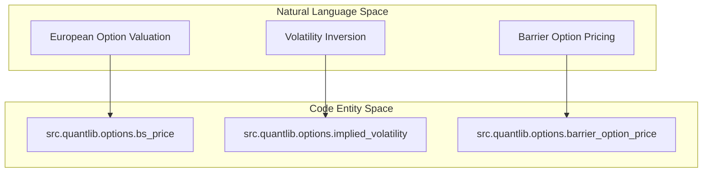
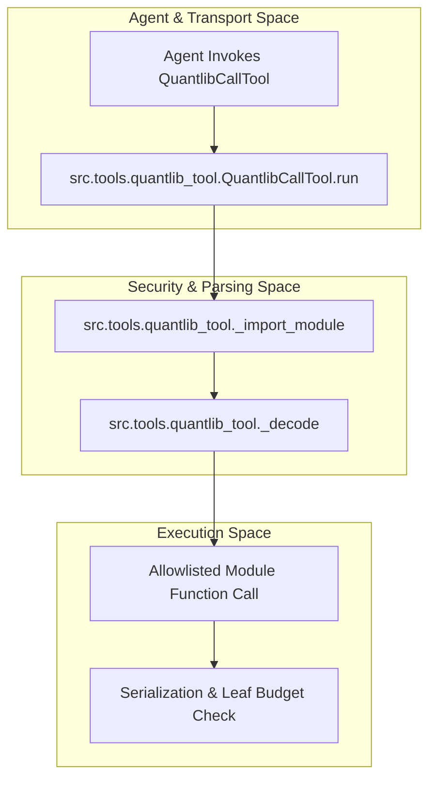

<!-- source: DeepWiki mcp.deepwiki.com · repo HKUDS/Vibe-Trading · page 4.5 QuantLib Analytics Library · fetched 2026-11-09 -->

# QuantLib Analytics Library

Relevant source files

The following files were used as context for generating this wiki page:

- [agent/backtest/factor_costs.py](agent/backtest/factor_costs.py)
- [agent/src/entities/__init__.py](agent/src/entities/__init__.py)
- [agent/src/entities/cashflow.py](agent/src/entities/cashflow.py)
- [agent/src/entities/ingest.py](agent/src/entities/ingest.py)
- [agent/src/entities/models.py](agent/src/entities/models.py)
- [agent/src/governance/__init__.py](agent/src/governance/__init__.py)
- [agent/src/governance/manifest.py](agent/src/governance/manifest.py)
- [agent/src/quantlib/__init__.py](agent/src/quantlib/__init__.py)
- [agent/src/quantlib/credit.py](agent/src/quantlib/credit.py)
- [agent/src/quantlib/crossvalidation.py](agent/src/quantlib/crossvalidation.py)
- [agent/src/quantlib/eventstudy.py](agent/src/quantlib/eventstudy.py)
- [agent/src/quantlib/factormodel.py](agent/src/quantlib/factormodel.py)
- [agent/src/quantlib/fixedincome.py](agent/src/quantlib/fixedincome.py)
- [agent/src/quantlib/fundmath.py](agent/src/quantlib/fundmath.py)
- [agent/src/quantlib/multipletesting.py](agent/src/quantlib/multipletesting.py)
- [agent/src/quantlib/options.py](agent/src/quantlib/options.py)
- [agent/src/quantlib/performance.py](agent/src/quantlib/performance.py)
- [agent/src/quantlib/timeseries.py](agent/src/quantlib/timeseries.py)
- [agent/src/skills/factor-research/SKILL.md](agent/src/skills/factor-research/SKILL.md)
- [agent/src/swarm/presets/factor_research_committee.yaml](agent/src/swarm/presets/factor_research_committee.yaml)
- [agent/src/tools/cashflow_analytics_tool.py](agent/src/tools/cashflow_analytics_tool.py)
- [agent/src/tools/quantlib_tool.py](agent/src/tools/quantlib_tool.py)
- [agent/tests/quantlib/test_credit.py](agent/tests/quantlib/test_credit.py)
- [agent/tests/quantlib/test_crossvalidation.py](agent/tests/quantlib/test_crossvalidation.py)
- [agent/tests/quantlib/test_eventstudy.py](agent/tests/quantlib/test_eventstudy.py)
- [agent/tests/quantlib/test_factormodel.py](agent/tests/quantlib/test_factormodel.py)
- [agent/tests/quantlib/test_factormodel_negative_specific_variance.py](agent/tests/quantlib/test_factormodel_negative_specific_variance.py)
- [agent/tests/quantlib/test_fixedincome.py](agent/tests/quantlib/test_fixedincome.py)
- [agent/tests/quantlib/test_fundmath.py](agent/tests/quantlib/test_fundmath.py)
- [agent/tests/quantlib/test_fundmath_nonfinite_waterfall_inputs.py](agent/tests/quantlib/test_fundmath_nonfinite_waterfall_inputs.py)
- [agent/tests/quantlib/test_multipletesting.py](agent/tests/quantlib/test_multipletesting.py)
- [agent/tests/quantlib/test_options.py](agent/tests/quantlib/test_options.py)
- [agent/tests/quantlib/test_performance.py](agent/tests/quantlib/test_performance.py)
- [agent/tests/quantlib/test_timeseries.py](agent/tests/quantlib/test_timeseries.py)
- [agent/tests/test_cashflow_analytics_tool.py](agent/tests/test_cashflow_analytics_tool.py)
- [agent/tests/test_cds_final_stub_regressions.py](agent/tests/test_cds_final_stub_regressions.py)
- [agent/tests/test_entities_spine.py](agent/tests/test_entities_spine.py)
- [agent/tests/test_ou_missing_lag_pairs_regressions.py](agent/tests/test_ou_missing_lag_pairs_regressions.py)
- [agent/tests/test_quantlib_tool.py](agent/tests/test_quantlib_tool.py)
- [agent/tests/test_style_missing_exposures_regressions.py](agent/tests/test_style_missing_exposures_regressions.py)
- [agent/tests/test_walkforward_empty_training_regressions.py](agent/tests/test_walkforward_empty_training_regressions.py)

The `quantlib` module (`agent/src/quantlib/`) provides a comprehensive suite of quantitative finance tools for various analytical tasks [agent/src/quantlib/credit.py:1-4](). It encompasses functionalities for options pricing, fixed income analysis, credit risk modeling, event studies, factor models, cross-validation techniques, copulas, market microstructure analysis, and general risk and time-series utilities [agent/src/quantlib/fixedincome.py:1-5](). These capabilities are exposed to the agent through the `quantlib_tool` (`agent/src/tools/quantlib_tool.py`) for integration into automated workflows [agent/src/tools/quantlib_tool.py:1-13]().

Sources:
- [agent/src/quantlib/credit.py:1-4]()
- [agent/src/quantlib/fixedincome.py:1-5]()
- [agent/src/tools/quantlib_tool.py:1-13]()

## Options Pricing and Greeks

The `agent/src/quantlib/options.py` module implements Black-Scholes pricing for European options, including the calculation of various Greeks (`delta`, `gamma`, `theta`, `vega`, `rho`), and implied volatility inversion [agent/src/quantlib/options.py:1-23](). It also supports barrier options [agent/src/quantlib/options.py:34-42]().

Key design principles include:
*   **Time and Rates Conventions**: `T` (time to expiry) is in years, while `r` (risk-free rate) and `q` (dividend yield) are continuously compounded annual rates [agent/src/quantlib/options.py:10-13]().
*   **Greeks Scaling**: `theta` is per calendar day, `vega` and `rho` are per 1 percentage point of volatility/rate, and `delta`/`gamma` are per 1.0 of spot price [agent/src/quantlib/options.py:13-15]().
*   **Precision**: No rounding is performed internally to maintain precision for implied volatility solvers [agent/src/quantlib/options.py:15-16]().
*   **Degenerate Input Handling**: The functions gracefully handle degenerate inputs (e.g., at expiry, non-positive spot/strike, zero volatility) by returning intrinsic values rather than raising errors [agent/src/quantlib/options.py:16-23]().

### Core Functions

*   `bs_price(S, K, T, r, q, sigma, option_type)`: Calculates the Black-Scholes price of a European option [agent/src/quantlib/options.py:37-38]().
*   `bs_greeks(S, K, T, r, q, sigma, option_type)`: Computes the Black-Scholes Greeks [agent/src/quantlib/options.py:37-37]().
*   `implied_volatility(price, S, K, T, r, q, option_type)`: Inverts the Black-Scholes model to find implied volatility using a combination of Newton-Raphson and Brent's method [agent/src/quantlib/options.py:30-31]().
*   `barrier_option_price(...)`: Prices barrier options (`down-and-out`, `down-and-in`, `up-and-out`, `up-and-in`) [agent/src/quantlib/options.py:34-36]().
*   `normalise_option_type(option_type)`: Standardizes option type strings, handling aliases like `"C"`, `"calls"`, and `"认购"` [agent/src/quantlib/options.py:41-41]().

**Diagram: Options Analytics Mapping (Natural Language to Code Entity Space)**

Sources:
- [agent/src/quantlib/options.py:1-23]()
- [agent/src/quantlib/options.py:34-42]()
- [agent/src/quantlib/options.py:37-38]()
- [agent/src/quantlib/options.py:30-31]()
- [agent/src/quantlib/options.py:41-41]()

## Fixed Income Analytics

The `agent/src/quantlib/fixedincome.py` module provides tools for bond pricing, yield curve fitting, and risk metrics, standardizing day count and compounding conventions [agent/src/quantlib/fixedincome.py:1-5]().

### Core Functions

*   `year_fraction(start, end, day_count)`: Calculates the accrual factor between two dates using conventions such as `ACT/365F`, `ACT/360`, `ACT/ACT`, `30/360`, and `30E/360` [agent/src/quantlib/fixedincome.py:24-34]().
*   `accrued_interest(...)`: Computes interest earned by the seller between the last coupon and settlement [agent/src/quantlib/fixedincome.py:25-25]().
*   `bond_price(...)`: Prices a bond given its yield to maturity [agent/src/quantlib/fixedincome.py:27-27]().
*   `ytm_solve(...)`: Solves for the YTM given a bond price [agent/src/quantlib/fixedincome.py:28-28]().
*   `macaulay_duration(...)`, `modified_duration(...)`, `convexity(...)`, `dv01(...)`: Computes standard risk metrics [agent/src/quantlib/fixedincome.py:29-33]().
*   `fit_yield_curve(...)`: Fits a yield curve to observed bond data using Nelson-Siegel or Svensson models [agent/src/quantlib/fixedincome.py:35-37]().

Sources:
- [agent/src/quantlib/fixedincome.py:1-5]()
- [agent/src/quantlib/fixedincome.py:24-34]()
- [agent/src/quantlib/fixedincome.py:25-27]()
- [agent/src/quantlib/fixedincome.py:28-37]()

## Credit Models

The `agent/src/quantlib/credit.py` module provides tools for credit risk assessment, including Altman Z-Score variants, Merton/KMV structural models, CDS pricing, and credit spread analysis [agent/src/quantlib/credit.py:1-4]().

### Altman Z-Score

The `altman_z_score` function calculates a firm's distress risk using the `"original"`, `"prime"`, or `"double_prime"` variants [agent/src/quantlib/credit.py:27-27](). It returns an `AltmanZScore` object containing the composite score, the model specification, and zone labels [agent/src/quantlib/credit.py:86-107]().

### Merton/KMV and CDS Pricing

*   `merton_asset_solve(...)`: Solves for the firm's asset value and asset volatility [agent/src/quantlib/credit.py:28-28]().
*   `distance_to_default(...)` / `kmv_distance_to_default(...)`: Computes structural distance to default metrics [agent/src/quantlib/credit.py:30-32]().
*   `cds_price(...)`: Prices Credit Default Swaps under hazard rate assumptions [agent/src/quantlib/credit.py:38-38]().

Sources:
- [agent/src/quantlib/credit.py:1-4]()
- [agent/src/quantlib/credit.py:27-27]()
- [agent/src/quantlib/credit.py:86-107]()
- [agent/src/quantlib/credit.py:28-32]()
- [agent/src/quantlib/credit.py:38-38]()

## Event Studies

The `agent/src/quantlib/eventstudy.py` module measures abnormal returns around dated corporate or macro events [agent/src/quantlib/eventstudy.py:1-8]().

### Core Functions

*   `estimate_market_model(asset_returns, market_returns, model)`: Fits a normal-return model (`market`, `market_adjusted`, `mean_adjusted`) over an estimation window separated from the event window by `DEFAULT_ESTIMATION_GAP` [agent/src/quantlib/eventstudy.py:72-78]().
*   `event_study(...)`: Conducts an event study across multiple assets and events, computing Cumulative Abnormal Returns (CAR), Cumulative Average Abnormal Returns (CAAR), and test statistics (`t_statistic`, `patell_z`, `bmp_z`) [agent/src/quantlib/eventstudy.py:73-73]().

Sources:
- [agent/src/quantlib/eventstudy.py:1-8]()
- [agent/src/quantlib/eventstudy.py:72-78]()
- [agent/src/quantlib/eventstudy.py:73-73]()

## Factor Models

The `agent/src/quantlib/factormodel.py` module provides cross-sectional style factor models [agent/src/quantlib/factormodel.py:1-5]().

### Key Concepts

*   **Public Academic Definitions**: Implements public-domain academic factor constructions (`STYLE_FACTOR_DEFINITIONS`) rather than commercial models [agent/src/quantlib/factormodel.py:102-117]().
*   **Standardization Pipeline**: Winsorizes before standardizing [agent/src/quantlib/factormodel.py:79-80](), uses cap-weighted centring and equal-weighted standard deviation [agent/src/quantlib/factormodel.py:28-32]().

### Core Functions

*   `standardise_exposures(...)` [agent/src/quantlib/factormodel.py:69-69]()
*   `build_style_exposures(...)` [agent/src/quantlib/factormodel.py:70-70]()
*   `cross_sectional_factor_returns(...)` [agent/src/quantlib/factormodel.py:71-71]()
*   `factor_risk_decomposition(...)` [agent/src/quantlib/factormodel.py:75-75]()

Sources:
- [agent/src/quantlib/factormodel.py:1-5]()
- [agent/src/quantlib/factormodel.py:79-80]()
- [agent/src/quantlib/factormodel.py:28-32]()
- [agent/src/quantlib/factormodel.py:69-75]()
- [agent/src/quantlib/factormodel.py:102-117]()

## Cross-Validation

The `agent/src/quantlib/crossvalidation.py` module implements purged and embargoed cross-validation for overlapping financial labels [agent/src/quantlib/crossvalidation.py:1-8]().

### Core Functions

*   `purged_kfold_splits(...)` [agent/src/quantlib/crossvalidation.py:55-55]()
*   `purged_walk_forward_splits(...)` [agent/src/quantlib/crossvalidation.py:57-57]()
*   `combinatorial_purged_splits(...)` [agent/src/quantlib/crossvalidation.py:53-53]()
*   `detect_boundary_leakage(...)` [agent/src/quantlib/crossvalidation.py:54-54]()

Sources:
- [agent/src/quantlib/crossvalidation.py:1-8]()
- [agent/src/quantlib/crossvalidation.py:53-57]()

## `quantlib_tool`

The `quantlib_tool` (`agent/src/tools/quantlib_tool.py`) exposes public functions from allowlisted quantlib modules to the agent through a controlled schema, avoiding arbitrary code execution while granting robust mathematical capabilities [agent/src/tools/quantlib_tool.py:1-34]().

### Architecture & Safety

*   **Module Allowlist**: Only modules in `ALLOWED_MODULES` can be imported [agent/src/tools/quantlib_tool.py:65-91]().
*   **`__all__` Only**: Only exported callables are reachable [agent/src/tools/quantlib_tool.py:120-137]().
*   **No File Writers**: Names matching `_WRITER_PREFIXES` are refused [agent/src/tools/quantlib_tool.py:93-96]().
*   **DataFrame/Series Envelopes**: JSON serialization supports `__series__` and `__dataframe__` envelopes to preserve index metadata [agent/src/tools/quantlib_tool.py:36-48]().

**Diagram: QuantLib Tool Execution Flow (Natural Language to Code Entity Space)**

Sources:
- [agent/src/tools/quantlib_tool.py:1-34]()
- [agent/src/tools/quantlib_tool.py:65-91]()
- [agent/src/tools/quantlib_tool.py:120-137]()
- [agent/src/tools/quantlib_tool.py:93-96]()
- [agent/src/tools/quantlib_tool.py:36-48]()

---

