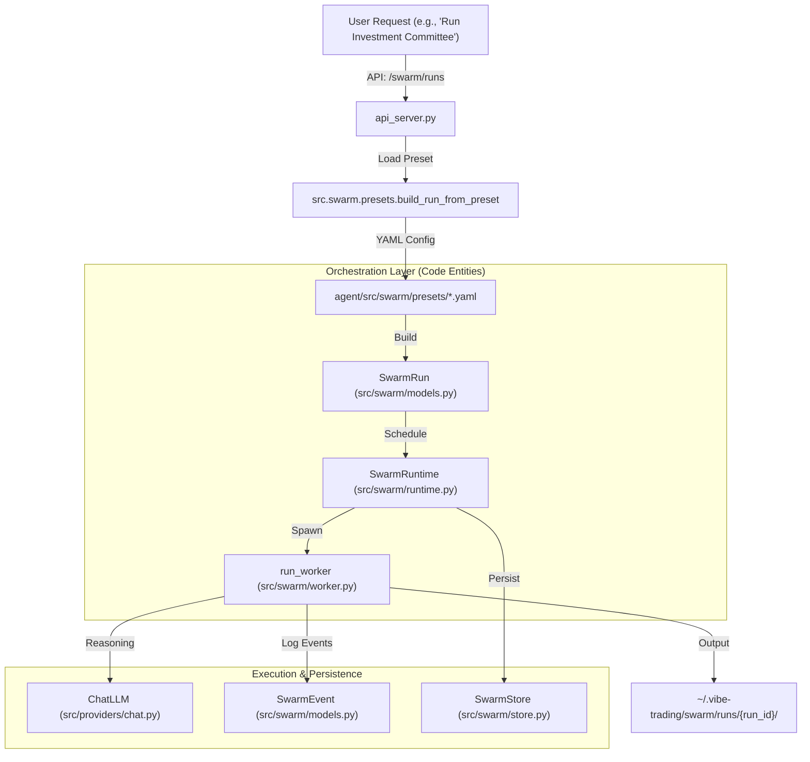
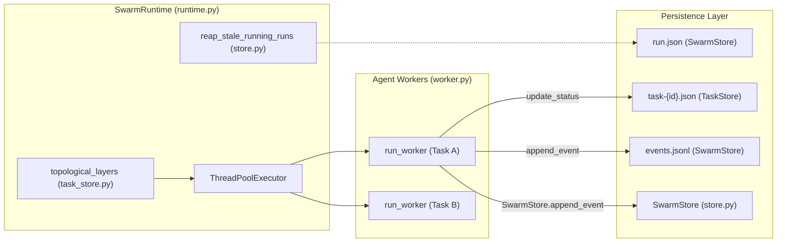

<!-- source: DeepWiki mcp.deepwiki.com · repo HKUDS/Vibe-Trading · page 5 Swarm Intelligence (Multi-Agent DAG Workflows) · fetched 2026-11-09 -->

# Swarm Intelligence (Multi-Agent DAG Workflows)

Relevant source files

The following files were used as context for generating this wiki page:

- [agent/src/api/swarm_routes.py](agent/src/api/swarm_routes.py)
- [agent/src/swarm/models.py](agent/src/swarm/models.py)
- [agent/src/swarm/runtime.py](agent/src/swarm/runtime.py)
- [agent/src/swarm/worker.py](agent/src/swarm/worker.py)
- [agent/src/tools/swarm_tool.py](agent/src/tools/swarm_tool.py)
- [agent/tests/test_swarm_cache_source.py](agent/tests/test_swarm_cache_source.py)
- [agent/tests/test_swarm_dag_gating.py](agent/tests/test_swarm_dag_gating.py)
- [agent/tests/test_swarm_replay.py](agent/tests/test_swarm_replay.py)
- [agent/tests/test_swarm_retry.py](agent/tests/test_swarm_retry.py)
- [agent/tests/test_swarm_route_contracts.py](agent/tests/test_swarm_route_contracts.py)
- [agent/tests/test_swarm_routes_usage.py](agent/tests/test_swarm_routes_usage.py)
- [agent/tests/test_swarm_run_metadata.py](agent/tests/test_swarm_run_metadata.py)
- [agent/tests/test_swarm_status_hydration.py](agent/tests/test_swarm_status_hydration.py)
- [agent/tests/test_swarm_tool_preset_matching.py](agent/tests/test_swarm_tool_preset_matching.py)
- [frontend/src/components/chat/LlmUsageCounter.tsx](frontend/src/components/chat/LlmUsageCounter.tsx)
- [frontend/src/components/chat/__tests__/LlmUsageCounter.test.tsx](frontend/src/components/chat/__tests__/LlmUsageCounter.test.tsx)
- [frontend/src/hooks/__tests__/useLlmUsageCounter.test.ts](frontend/src/hooks/__tests__/useLlmUsageCounter.test.ts)
- [frontend/src/hooks/useLlmUsageCounter.ts](frontend/src/hooks/useLlmUsageCounter.ts)
- [frontend/src/lib/__tests__/llmUsage.test.ts](frontend/src/lib/__tests__/llmUsage.test.ts)
- [frontend/src/lib/__tests__/swarmStatus.usage.test.ts](frontend/src/lib/__tests__/swarmStatus.usage.test.ts)
- [frontend/src/lib/swarmStatus.ts](frontend/src/lib/swarmStatus.ts)
- [frontend/src/types/agent.ts](frontend/src/types/agent.ts)

The Swarm Intelligence system in Vibe-Trading is a high-level orchestration framework designed to deploy specialized teams of AI agents to solve complex financial research and trading problems. While a single ReAct agent handles linear tasks, the Swarm system enables parallel execution, inter-agent communication, and structured Directed Acyclic Graph (DAG) workflows.

### System Overview

The Swarm architecture bridges the gap between natural language requests and complex multi-step execution by using YAML-defined "Presets." These presets define a team of agents, their specific roles (skills), and the dependencies between their tasks. The `SwarmRuntime` engine executes these tasks in topological order, allowing agents to work in parallel where possible.

#### From Natural Language to Swarm Entities
The following diagram illustrates how a user request triggers the Swarm infrastructure and maps to specific code components and data models.

**Swarm Execution Mapping**

Sources: [agent/src/swarm/runtime.py:85-130](), [agent/src/swarm/worker.py:1-5](), [agent/src/swarm/presets.py:26-44]()

---

### Core Components and SwarmRuntime (`#5.1`)

The Swarm system is built on architectural pillars managed by `SwarmRuntime` and `SwarmStore`:

1.  **Presets (YAML Configuration):** Declarative definitions located in `agent/src/swarm/presets/`. Each preset specifies `SwarmAgentSpec` (roles, tools, skills) and `SwarmTask` (prompt templates and dependencies) [agent/src/swarm/models.py:174-211]().
2.  **SwarmRuntime (The Orchestrator):** The central engine that manages background execution threads using `topological_layers` and a `ThreadPoolExecutor` [agent/src/swarm/runtime.py:13-20](), [agent/src/swarm/task_store.py:47-48]().
3.  **SwarmWorker (The Individual Agent):** A standalone execution engine with a lightweight ReAct loop using `ChatLLM.chat` directly [agent/src/swarm/worker.py:1-5]().
4.  **Persistence and Monitoring:** Managed by `SwarmStore` and `TaskStore`, providing atomic file-system-based state management, append-only event logging, and stale-run reaping [agent/src/swarm/runtime.py:111-116](), [agent/src/swarm/store.py:1-10]().

For deep technical details on scheduling, worker execution loops, output contracts, mailbox, grounding pre-fetch, atomic persistence, and swarm API routes, see **[SwarmRuntime and DAG Execution](#5.1)**.

**Component Interaction Diagram**

Sources: [agent/src/swarm/runtime.py:13-41](), [agent/src/swarm/worker.py:76-105](), [agent/src/swarm/presets.py:130-140]()

---

### Swarm Preset Catalog (`#5.2`)

Vibe-Trading ships with **30 built-in team presets** located in `agent/src/swarm/presets/`. These presets cover domains from institutional decision-making to crypto-specific research.

| Category | Example Presets | Purpose |
| :--- | :--- | :--- |
| **Institutional** | `investment_committee`, `risk_committee` | Multi-perspective review (Bull/Bear advocates). |
| **Value Investing** | `value_investing_committee` | Adversarial perspectives from Buffett, Munger, and Li Lu. |
| **Quantitative** | `quant_strategy_desk`, `factor_research_committee` | Alpha discovery and statistical validation. |
| **Crypto/DeFi** | `crypto_research_lab`, `crypto_trading_desk` | On-chain data and perp funding basis analysis. |
| **Fundamental** | `equity_research_team`, `geopolitical_war_room` | Financial statement analysis and macro-to-micro routing. |

The `SwarmTool` provides a natural-language entry point, using keyword patterns to auto-select the best preset [agent/src/tools/swarm_tool.py:32-318](). Each preset is validated for DAG integrity via `validate_dag` [agent/src/swarm/task_store.py:49]() in `SwarmRuntime` [agent/src/swarm/runtime.py:49]().

For a full list of available teams, the preset schema, packaging tests, and instructions on creating custom workflows, see **[Swarm Preset Catalog](#5.2)**.

Sources: [agent/src/swarm/presets.py:47-71](), [agent/src/swarm/models.py:174-211](), [agent/src/tools/swarm_tool.py:32-318]()

---

### Integration and Output Contract

The Swarm system maintains strict operational guarantees across runs:
*   **Market Grounding:** Scans `user_vars` for symbols and pre-fetches recent OHLCV data via `fetch_grounding_data` [agent/src/swarm/grounding.py:152-163]() to prevent hallucinated pricing.
*   **DAG Gating:** Failed upstream tasks mark downstream tasks as `TaskStatus.blocked` [agent/src/swarm/models.py:130]() and skip them [agent/tests/test_swarm_dag_gating.py:78-96]().
*   **Artifact Re-homing:** Resumed runs safely copy artifacts using `_rehome_artifact_paths` to prevent path traversal [agent/src/swarm/runtime.py:98-182]().
*   **Report Generation:** Workers prioritize writing to `report.md`, returned as primary task results [agent/tests/test_swarm_worker_report.py:10-17]().
*   **Token Tracking:** Captures real provider-reported usage [agent/src/swarm/worker.py:130-179]() with fallback heuristics.
*   **Event Redaction:** Sensitive arguments are redacted via `redact_payload` [agent/src/swarm/worker.py:36](), [agent/src/tools/redaction.py:36]().
*   **Stale Run Reaping:** Automatically terminates dead or hung worker loops via heartbeat tracking [agent/src/swarm/runtime.py:111-116]().

**Sources:**
* [agent/src/swarm/runtime.py:98-182]()
* [agent/src/swarm/runtime.py:111-116]()
* [agent/src/swarm/worker.py:130-179]()
* [agent/src/swarm/grounding.py:5-48]()
* [agent/src/tools/redaction.py:36-37]()
* [agent/tests/test_swarm_worker_report.py:10-17]()
* [agent/tests/test_swarm_dag_gating.py:78-96]()

---

