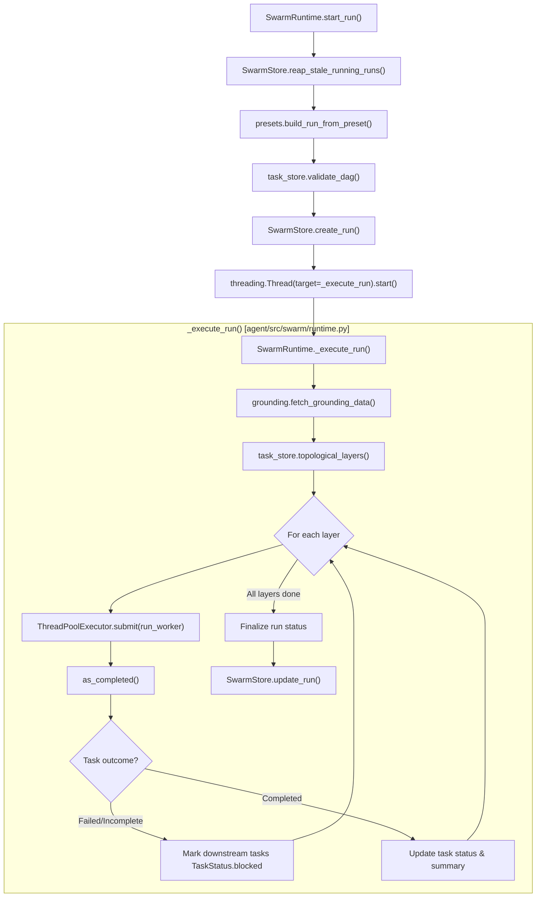
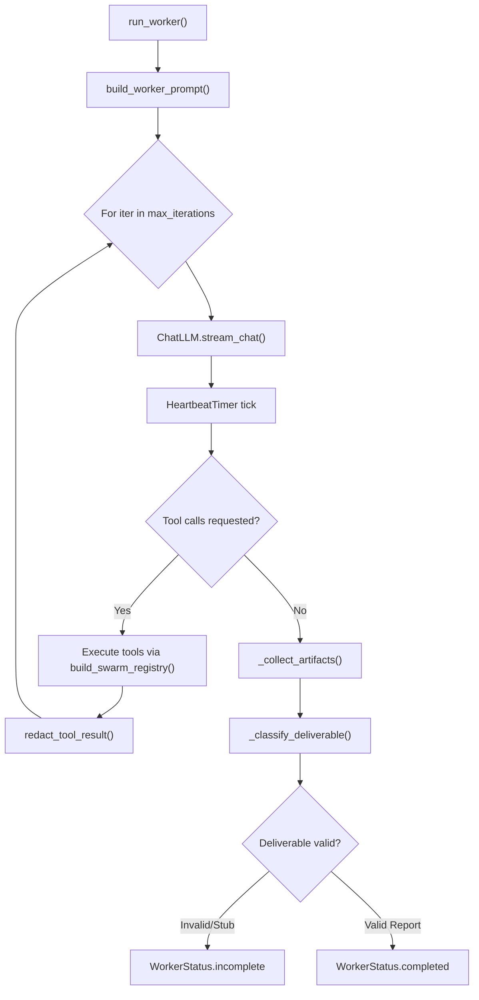
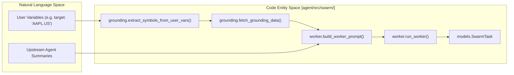
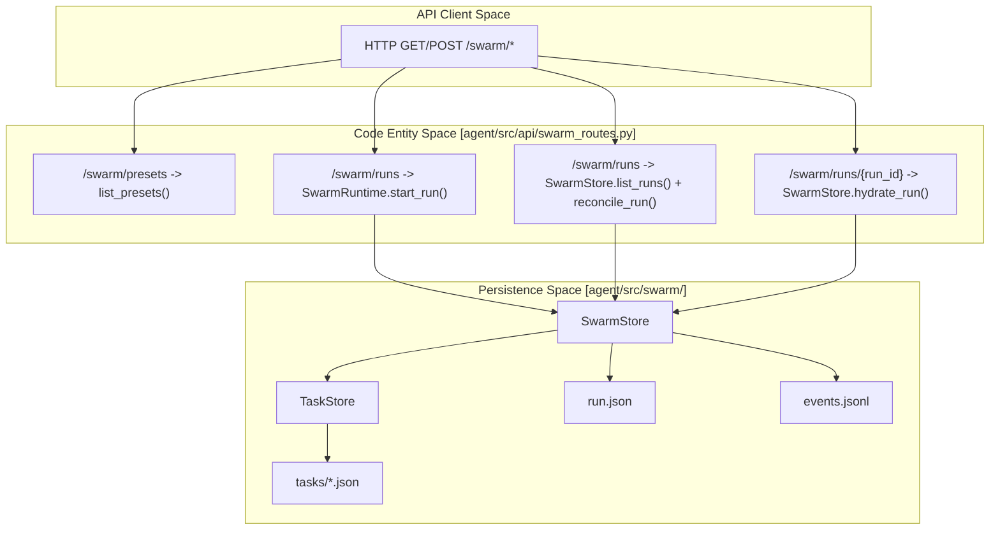

<!-- source: DeepWiki mcp.deepwiki.com · repo HKUDS/Vibe-Trading · page 5.1 SwarmRuntime and DAG Execution · fetched 2026-11-09 -->

# SwarmRuntime and DAG Execution

Relevant source files

The following files were used as context for generating this wiki page:

- [agent/src/api/swarm_routes.py](agent/src/api/swarm_routes.py)
- [agent/src/swarm/models.py](agent/src/swarm/models.py)
- [agent/src/swarm/runtime.py](agent/src/swarm/runtime.py)
- [agent/src/swarm/worker.py](agent/src/swarm/worker.py)
- [agent/src/tools/load_skill_tool.py](agent/src/tools/load_skill_tool.py)
- [agent/src/tools/swarm_tool.py](agent/src/tools/swarm_tool.py)
- [agent/tests/test_load_skill_allowlist.py](agent/tests/test_load_skill_allowlist.py)
- [agent/tests/test_swarm_cache_source.py](agent/tests/test_swarm_cache_source.py)
- [agent/tests/test_swarm_dag_gating.py](agent/tests/test_swarm_dag_gating.py)
- [agent/tests/test_swarm_m4_e2e.py](agent/tests/test_swarm_m4_e2e.py)
- [agent/tests/test_swarm_m5_trust_model.py](agent/tests/test_swarm_m5_trust_model.py)
- [agent/tests/test_swarm_output_contract.py](agent/tests/test_swarm_output_contract.py)
- [agent/tests/test_swarm_replay.py](agent/tests/test_swarm_replay.py)
- [agent/tests/test_swarm_retry.py](agent/tests/test_swarm_retry.py)
- [agent/tests/test_swarm_retry_artifact_isolation.py](agent/tests/test_swarm_retry_artifact_isolation.py)
- [agent/tests/test_swarm_route_contracts.py](agent/tests/test_swarm_route_contracts.py)
- [agent/tests/test_swarm_routes_usage.py](agent/tests/test_swarm_routes_usage.py)
- [agent/tests/test_swarm_run_metadata.py](agent/tests/test_swarm_run_metadata.py)
- [agent/tests/test_swarm_status_hydration.py](agent/tests/test_swarm_status_hydration.py)
- [agent/tests/test_swarm_tool_preset_matching.py](agent/tests/test_swarm_tool_preset_matching.py)
- [agent/tests/test_swarm_tool_run_dir.py](agent/tests/test_swarm_tool_run_dir.py)
- [agent/tests/test_swarm_worker_content_filter.py](agent/tests/test_swarm_worker_content_filter.py)
- [agent/tests/test_swarm_worker_tool_result_truncation.py](agent/tests/test_swarm_worker_tool_result_truncation.py)
- [frontend/src/components/chat/LlmUsageCounter.tsx](frontend/src/components/chat/LlmUsageCounter.tsx)
- [frontend/src/components/chat/__tests__/LlmUsageCounter.test.tsx](frontend/src/components/chat/__tests__/LlmUsageCounter.test.tsx)
- [frontend/src/hooks/__tests__/useLlmUsageCounter.test.ts](frontend/src/hooks/__tests__/useLlmUsageCounter.test.ts)
- [frontend/src/hooks/useLlmUsageCounter.ts](frontend/src/hooks/useLlmUsageCounter.ts)
- [frontend/src/lib/__tests__/llmUsage.test.ts](frontend/src/lib/__tests__/llmUsage.test.ts)
- [frontend/src/lib/__tests__/swarmStatus.usage.test.ts](frontend/src/lib/__tests__/swarmStatus.usage.test.ts)
- [frontend/src/lib/swarmStatus.ts](frontend/src/lib/swarmStatus.ts)
- [frontend/src/types/agent.ts](frontend/src/types/agent.ts)

The Swarm system in Vibe-Trading enables multi-agent orchestration through Directed Acyclic Graph (DAG) workflows. It allows specialized agents to collaborate on complex financial research tasks by passing messages, sharing persistent state, and executing tools in parallel. This page covers the architectural internals of `SwarmRuntime`, topological task scheduling, self-contained `SwarmWorker` ReAct loops, strict output contracts, mailbox communication, grounding pre-fetch, atomic persistence via `SwarmStore`/`TaskStore`, and the FastAPI endpoints supporting swarm operations.

---

## 1. Swarm Architecture Overview

The Swarm infrastructure separates task scheduling from individual agent reasoning. The `SwarmRuntime` orchestrates workflow execution, while standalone `SwarmWorker` instances execute bounded ReAct loops.

| Component | Class / Entity | Role & Implementation Pointer |
| :--- | :--- | :--- |
| **Orchestrator** | `SwarmRuntime` | Manages DAG topological sorting, parallel execution via `ThreadPoolExecutor`, and cancellation [agent/src/swarm/runtime.py:1-6]() |
| **Worker Engine** | `run_worker` | Standalone execution engine with a lightweight ReAct loop using `ChatLLM.chat` without full `AgentLoop` overhead [agent/src/swarm/worker.py:1-5]() |
| **Run Persistence** | `SwarmStore` | Manages file-system state (`run.json`, `events.jsonl`, run subdirectories) with atomic replacement [agent/src/swarm/store.py:1-10]() |
| **Task Store** | `TaskStore` | Tracks node states (`pending`, `blocked`, `in_progress`, `completed`, `failed`, `cancelled`) in `tasks/*.json` [agent/src/swarm/task_store.py:1-48]() |
| **Grounding** | `grounding.py` | Pre-fetches market data for symbols mentioned in user variables to anchor LLM reasoning [agent/src/swarm/grounding.py:1-10]() |
| **API Routes** | `register_swarm_routes` | FastAPI endpoints for listing presets, starting runs, inspecting status, and streaming events [agent/src/api/swarm_routes.py:45-54]() |

Sources: [agent/src/swarm/runtime.py:1-6](), [agent/src/swarm/worker.py:1-5](), [agent/src/swarm/store.py:1-10](), [agent/src/swarm/task_store.py:1-48](), [agent/src/swarm/grounding.py:1-10](), [agent/src/api/swarm_routes.py:45-54]()

---

## 2. SwarmRuntime and DAG Execution Flow

The `SwarmRuntime` executes presets by parsing dependencies into a dependency graph, applying topological sorting to identify layers of agents that run in parallel.

### Execution Lifecycle & Retries
1. **Initialization**: The runtime builds a `SwarmRun` using `build_run_from_preset` and validates DAG acyclicity via `validate_dag` [agent/src/swarm/runtime.py:42](), [agent/src/swarm/runtime.py:49]().
2. **Grounding Pre-fetch**: It scans `user_vars` for symbols (e.g., `NVDA.US`, `BTC-USDT`) and fetches recent OHLCV bars [agent/src/swarm/grounding.py:84-90](), [agent/src/swarm/grounding.py:128-151]().
3. **Topological Layering**: `topological_layers` groups tasks into independent execution stages [agent/src/swarm/task_store.py:47-48]().
4. **Parallel Dispatch**: Within each layer, tasks are submitted to a `ThreadPoolExecutor` [agent/src/swarm/runtime.py:15-18](). The runtime awaits layer completion via `as_completed` [agent/src/swarm/runtime.py:19-20]().
5. **Worker Retries & Backoff**: If a worker fails, `_worker_retry_delay_s` calculates an equal-jitter exponential backoff ceiling (`_worker_retry_delay_ceiling_s`) before retrying up to `max_retries` [agent/src/swarm/runtime.py:57-77]().
6. **Task Gating**: Downstream tasks depending on a failed or incomplete task are transitioned to `TaskStatus.blocked` [agent/src/swarm/models.py:132](), [agent/src/swarm/runtime.py:300-301]().

Sources: [agent/src/swarm/runtime.py:42](), [agent/src/swarm/runtime.py:49](), [agent/src/swarm/runtime.py:57-77](), [agent/src/swarm/grounding.py:84-90](), [agent/src/swarm/grounding.py:128-151](), [agent/src/swarm/task_store.py:47-48](), [agent/src/swarm/runtime.py:15-20](), [agent/src/swarm/models.py:132]()

---

## 3. SwarmWorker ReAct Loop and Output Contracts

The `run_worker` function provides a self-contained ReAct loop, invoking `ChatLLM.chat` and stream methods directly while enforcing strict output validation.

### Worker Execution Steps
1. **Prompt Construction**: `build_worker_prompt` assembles system prompts incorporating agent roles, upstream task summaries (`upstream_summaries`), and grounded market pricing [agent/src/swarm/worker.py:18-21]().
2. **Heartbeat Emission**: During execution and tool invocation, `HeartbeatTimer` emits `task_heartbeat` events to prevent the staleness reaper from aborting active workers [agent/src/swarm/worker.py:20-21](), [agent/src/swarm/worker.py:60-64]().
3. **Token Usage & Provenance**: LLM token consumption is captured via `_measure_usage` into a `UsageMeasure` named tuple, tracking exact provider counts or falling back to `estimated` provenance labels [agent/src/swarm/worker.py:174-193]().
4. **Hybrid Output Contracts**: The worker evaluates final deliverables using `_classify_deliverable`. It rejects plan-only stubs, unparsed tool markup, mock data, and raw JSON envelopes (e.g., `{"ok": true, ...}`) from data-fetching agents, marking them `incomplete` rather than falsely succeeding [agent/src/swarm/models.py:167-171](), [agent/src/swarm/worker.py:36]() [agent/tests/test_swarm_output_contract.py:63-90]().

Sources: [agent/src/swarm/worker.py:1-25](), [agent/src/swarm/worker.py:60-64](), [agent/src/swarm/worker.py:174-193](), [agent/src/swarm/models.py:167-171](), [agent/tests/test_swarm_output_contract.py:63-90]()

---

## 4. Inter-Agent Communication, Mailbox, and Grounding Pre-Fetch

Agents communicate asynchronously through the swarm mailbox mechanism, where downstream tasks receive upstream summaries via `depends_on` edges.

### Grounding Pre-Fetch Mechanics
To eliminate LLM price hallucinations, the grounding module executes pre-flight checks:
* **Symbol Extraction**: Uses regex patterns to detect market symbols (e.g., `\b[A-Z]{1,5}\.US\b`, `\b[A-Z]{2,6}-USDT\b`) within `user_vars` [agent/src/swarm/grounding.py:84-90]().
* **Ticker Promotion**: Promotes bare tickers (e.g., `NVDA` to `NVDA.US`) while guarding against common financial acronyms (`CEO`, `FED`, `ETF`) [agent/src/swarm/grounding.py:96-125]().
* **Data Retrieval**: Resolves loaders to fetch 30-day OHLCV bars, formatting them into a grounded context block injected into the worker prompt [agent/src/swarm/grounding.py:152-165]().

Sources: [agent/src/swarm/grounding.py:84-90](), [agent/src/swarm/grounding.py:96-125](), [agent/src/swarm/grounding.py:152-165](), [agent/src/swarm/worker.py:18-21](), [agent/src/swarm/models.py:203-211]()

---

## 5. Atomic Persistence and Swarm API Routes

The swarm persistence architecture guarantees crash recovery and concurrent read safety across filesystem operations.

### Storage Layers
* **`SwarmStore`**: Manages run directories (`agent/.swarm/runs/{run_id}/`). Uses `os.replace` with retry logic to prevent Windows file-lock contention during concurrent writes [agent/src/swarm/store.py:1-10]().
* **`TaskStore`**: Stores individual task records in `tasks/{task_id}.json` for fine-grained progress tracking [agent/src/swarm/task_store.py:1-48]().
* **Hydration**: `SwarmStore.hydrate_run` merges live `tasks/*.json` state into the `SwarmRun` object on read, providing real-time visibility into long-running swarms [agent/src/swarm/store.py:300-305]().

### Swarm API Endpoints
Mounted via `register_swarm_routes` in `agent/api_server.py`:
* `GET /swarm/presets`: Lists available YAML presets (`list_swarm_presets`) [agent/src/api/swarm_routes.py:79-90]().
* `POST /swarm/runs`: Initializes and launches a swarm run (`create_swarm_run`) [agent/src/api/swarm_routes.py:91-108]().
* `GET /swarm/runs`: Lists runs with automated zombie reconciliation (`list_swarm_runs`) [agent/src/api/swarm_routes.py:109-134]().
* `GET /swarm/runs/{run_id}`: Returns run details, agent states, and token usage metrics (`get_swarm_run`) [agent/src/api/swarm_routes.py:135-169]().

Sources: [agent/src/swarm/store.py:1-10](), [agent/src/swarm/task_store.py:1-48](), [agent/src/swarm/store.py:300-305](), [agent/src/api/swarm_routes.py:45-169]()

---

