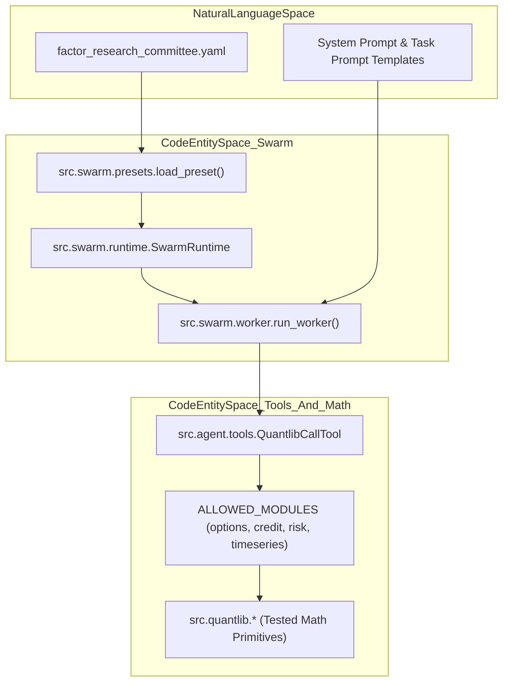
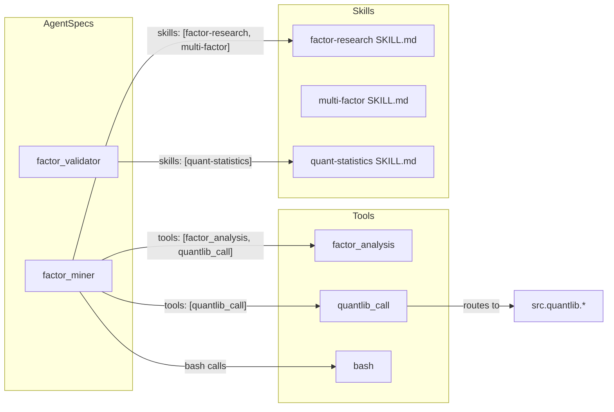

<!-- source: DeepWiki mcp.deepwiki.com · repo HKUDS/Vibe-Trading · page 5.2 Swarm Preset Catalog · fetched 2026-11-09 -->

# Swarm Preset Catalog

Relevant source files

The following files were used as context for generating this wiki page:

- [agent/src/quantlib/__init__.py](agent/src/quantlib/__init__.py)
- [agent/src/skills/factor-research/SKILL.md](agent/src/skills/factor-research/SKILL.md)
- [agent/src/swarm/presets/convertible_bond_team.yaml](agent/src/swarm/presets/convertible_bond_team.yaml)
- [agent/src/swarm/presets/credit_research_team.yaml](agent/src/swarm/presets/credit_research_team.yaml)
- [agent/src/swarm/presets/equity_research_team.yaml](agent/src/swarm/presets/equity_research_team.yaml)
- [agent/src/swarm/presets/event_driven_task_force.yaml](agent/src/swarm/presets/event_driven_task_force.yaml)
- [agent/src/swarm/presets/factor_research_committee.yaml](agent/src/swarm/presets/factor_research_committee.yaml)
- [agent/src/swarm/presets/fund_selection_panel.yaml](agent/src/swarm/presets/fund_selection_panel.yaml)
- [agent/src/swarm/presets/fundamental_research_team.yaml](agent/src/swarm/presets/fundamental_research_team.yaml)
- [agent/src/swarm/presets/investment_committee.yaml](agent/src/swarm/presets/investment_committee.yaml)
- [agent/src/swarm/presets/risk_committee.yaml](agent/src/swarm/presets/risk_committee.yaml)
- [agent/src/swarm/presets/statistical_arbitrage_desk.yaml](agent/src/swarm/presets/statistical_arbitrage_desk.yaml)
- [agent/src/tools/quantlib_tool.py](agent/src/tools/quantlib_tool.py)
- [agent/tests/test_swarm_presets_packaging.py](agent/tests/test_swarm_presets_packaging.py)
- [agent/tests/test_tushare_loader.py](agent/tests/test_tushare_loader.py)

The Swarm Preset Catalog documents the 30 YAML-defined multi-agent swarm presets in `agent/src/swarm/presets/`, detailing the preset schema, packaging tests, validation mechanisms, quantitative tool integration, and user-defined custom presets [agent/tests/test_swarm_presets_packaging.py:1-22]().

## 1. Preset Architecture, Schema, and Packaging Tests

Each swarm preset is defined as a YAML file stored in `agent/src/swarm/presets/`. These files are parsed by the `SwarmRuntime` into `SwarmRun`, `SwarmAgentSpec`, and `SwarmTask` data models [agent/src/swarm/presets.py:19-44]().

### 1.1 YAML Schema and Validation
Presets follow a strict structural contract mapping natural language instructions to executable agent specs and DAG execution tasks:

| Field | Description | Code Reference |
| :--- | :--- | :--- |
| `name` | Unique identifier for the swarm team (e.g., `quant_strategy_desk`, `investment_committee`). | [agent/tests/test_swarm_presets_packaging.py:44-50]() |
| `title` | Human-readable title displayed in the UI. | [agent/src/swarm/presets/factor_research_committee.yaml:2-2]() |
| `description` | Summary of the team's objective and workflow. | [agent/src/swarm/presets/factor_research_committee.yaml:3-3]() |
| `agents` | List of agent definitions (`id`, `role`, `system_prompt`, `tools`, `skills`, `max_iterations`, `timeout_seconds`). | [agent/src/swarm/presets/factor_research_committee.yaml:5-52]() |
| `tasks` | DAG task nodes (`id`, `agent_id`, `prompt_template`, `depends_on`, `input_from`). | [agent/src/swarm/presets/equity_research_team.yaml:113-142]() |
| `variables` | Template input parameters (`name`, `description`, `required`). | [agent/src/swarm/presets/equity_research_team.yaml:143-149]() |

### 1.2 Packaging Tests and Registry Synchronization
To prevent packaging regressions (such as issue #55 where preset YAMLs ended up in incorrect paths during wheel builds), automated tests enforce that exactly 30 bundled presets are discoverable and loadable [agent/tests/test_swarm_presets_packaging.py:20-43](). 

The test suite validates:
- **`PRESETS_DIR` Integrity**: Asserts that `PRESETS_DIR` resides as a sibling package directory to `presets.py` so source-installs and wheels remain aligned [agent/tests/test_swarm_presets_packaging.py:25-32]().
- **Full Roster Count**: Filters bundled presets and checks `EXPECTED_PRESET_COUNT = 30` [agent/tests/test_swarm_presets_packaging.py:34-42]().
- **Parsing and Structure**: Iterates through every bundled YAML to verify successful parsing into dictionaries containing non-empty `agents` and `tasks` [agent/tests/test_swarm_presets_packaging.py:52-60]().
- **Structural Routing**: Ensures headline workflows (e.g., `quant_strategy_desk`, `investment_committee`, `risk_committee`, `value_investing_committee`) resolve correctly in routing tables [agent/tests/test_swarm_presets_packaging.py:44-50](). For instance, `quant_strategy_desk` explicitly terminates with a `report_aggregator` agent executing `task-report` consuming upstream task outputs [agent/tests/test_swarm_presets_packaging.py:72-97]().

Sources: [agent/tests/test_swarm_presets_packaging.py:1-120](), [agent/src/swarm/presets.py:1-44]()

---

## 2. Value Investing and Deep Research Teams

Institutional-grade fundamental analysis teams incorporate adversarial perspectives and structured methodologies.

### 2.1 Value Investing Committee and Specialized Desks
The `value_investing_committee` preset organizes four master investor personas:
- **`buffett`**: Moat assessment, circle of competence, and margin of safety calculations.
- **`munger`**: Inversion analysis, identifying failure modes, and avoiding cognitive errors [agent/src/swarm/presets/investment_committee.yaml:55-107]().
- **`duan_yongping`**: "本分" (doing the right thing), management trustworthiness, and business simplicity.
- **`li_lu`**: 10-year certainty, civilizational trends, and macroeconomic positioning.

Other notable committee presets include:
- **`factor_research_committee`**: Pairs a `factor_miner` (economics-driven discovery and candidate factor construction) with a `factor_validator` (IC/IR analysis, quantile backtests, decay curves, and robustness checks) [agent/src/swarm/presets/factor_research_committee.yaml:5-96]().
- **`credit_research_team`**: Combines a `credit_analyst` (financial health, Altman Z-Scores, Merton/KMV default probability models via `src.quantlib.credit`) with an interest rate analyst [agent/src/swarm/presets/credit_research_team.yaml:5-93]().
- **`risk_committee`**: Executes parallel drawdown analysis, tail risk assessment (VaR, CVaR, Basel traffic lights via `src.quantlib.risk`), and market regime detection (`fit_markov_regime`) [agent/src/swarm/presets/risk_committee.yaml:1-110]().
- **`fund_selection_panel`**: Screens funds quantitatively before passing them to a `attribution_analyst` executing Brinson-Fachler attribution and style factor decomposition (`src.quantlib.attribution` and `src.quantlib.factormodel`) [agent/src/swarm/presets/fund_selection_panel.yaml:1-85]().
- **`statistical_arbitrage_desk`**: Combines a `pair_scanner` (correlation pre-screening, Engle-Granger cointegration, OU half-life estimation via `src.quantlib.timeseries`) with a `microstructure_analyst` evaluating liquidity and transaction costs [agent/src/swarm/presets/statistical_arbitrage_desk.yaml:1-124]().

Sources: [agent/src/swarm/presets/investment_committee.yaml:1-114](), [agent/src/swarm/presets/factor_research_committee.yaml:1-96](), [agent/src/swarm/presets/credit_research_team.yaml:1-93](), [agent/src/swarm/presets/risk_committee.yaml:1-110](), [agent/src/swarm/presets/fund_selection_panel.yaml:1-85](), [agent/src/swarm/presets/statistical_arbitrage_desk.yaml:1-124]()

---

## 3. QuantLib Tool Integration in Swarm Workflows

Swarm presets frequently grant agents access to `quantlib_call` alongside `bash`, `read_file`, and `write_file`. The `QuantlibCallTool` (`agent/src/tools/quantlib_tool.py`) bridges transport boundaries (Web, API, MCP) by exposing pure-compute financial math functions from `src.quantlib` without requiring arbitrary shell execution [agent/src/tools/quantlib_tool.py:1-35]().

### Security and Data Envelopes
To prevent arbitrary code execution, `QuantlibCallTool` enforces three structural constraints:
1. **Module Allowlist**: Only modules in `ALLOWED_MODULES` (e.g., `options`, `fixedincome`, `credit`, `timeseries`, `risk`, `attribution`, `factormodel`, `neutralization`, `combination`) are reachable via string lookup [agent/src/tools/quantlib_tool.py:65-91]().
2. **`__all__` Export Enforcement**: Only functions explicitly listed in a module's `__all__` are callable; private helpers and dunders are blocked [agent/src/tools/quantlib_tool.py:22-24]().
3. **No File-Writing Entrypoints**: Names matching `_WRITER_PREFIXES` (e.g., `export_*`) are strictly refused [agent/src/tools/quantlib_tool.py:25-28, 93-95]().

Furthermore, JSON data payloads can preserve pandas indexes using custom envelopes (`__series__` and `__dataframe__`) decoded transparently by `_decode` [agent/src/tools/quantlib_tool.py:36-48, 140-172]().

Sources: [agent/src/tools/quantlib_tool.py:1-177]()

---

## 4. Implementation Mapping: Natural Language to Code Entity Space

The following diagrams bridge natural language workflow definitions to underlying Python code entities and modules.

### Swarm Execution and QuantLib Flow
Title: Swarm Runtime and QuantLib Execution Architecture

Sources: [agent/src/swarm/presets.py:19-44](), [agent/src/swarm/runtime.py:1-100](), [agent/src/swarm/worker.py:1-17](), [agent/src/tools/quantlib_tool.py:65-91]()

### Agent Tool and Skill Mapping
Title: Entity Association for Factor Research Agents

Sources: [agent/src/swarm/presets/factor_research_committee.yaml:38-49](), [agent/src/tools/quantlib_tool.py:65-91]()

---

## 5. Custom Preset Creation and User Directories

Developers and power users can define custom swarm presets in addition to the 30 bundled presets.

### 5.1 User Preset Discovery and Overrides
Custom presets are loaded from the user configuration directory (`~/.vibe-trading/swarm/presets/`, configurable via `USER_PRESETS_DIR`) [agent/tests/test_swarm_presets_packaging.py:146-152](). 
- **Discovery**: `list_presets()` scans both bundled and user directories, tagging entries with `source: "bundled"` or `source: "user"` [agent/tests/test_swarm_presets_packaging.py:155-165]().
- **Stem Overriding**: If a user preset shares the same stem name as a bundled preset (e.g., `risk_committee.yaml`), the user-defined YAML entirely overrides the bundled version without duplication [agent/tests/test_swarm_presets_packaging.py:167-177]().
- **Path Traversal Security**: Preset names containing path traversal characters (`../`, `..`, absolute paths, backslashes) are rejected to prevent arbitrary file inclusion [agent/tests/test_swarm_presets_packaging.py:187-190]().

### 5.2 Variable Interpolation and Dependency Wiring
Custom presets use variable templates and DAG dependencies:
- **Variables**: Declared in the `variables` block and referenced in agent prompts using `{variable_name}` [agent/tests/test_swarm_presets_packaging.py:124-142]().
- **Upstream Context**: Task results flow downstream via `depends_on` and `input_from`, injecting serialized outputs into downstream agent context under `{upstream_context}` [agent/src/swarm/presets/equity_research_team.yaml:113-142]().

Sources: [agent/tests/test_swarm_presets_packaging.py:120-190](), [agent/src/swarm/presets/equity_research_team.yaml:108-149]()

---

