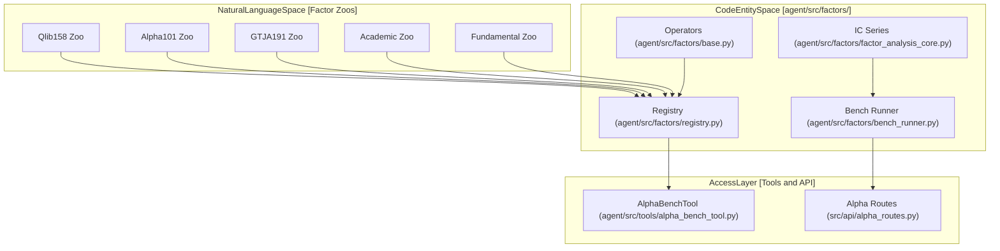
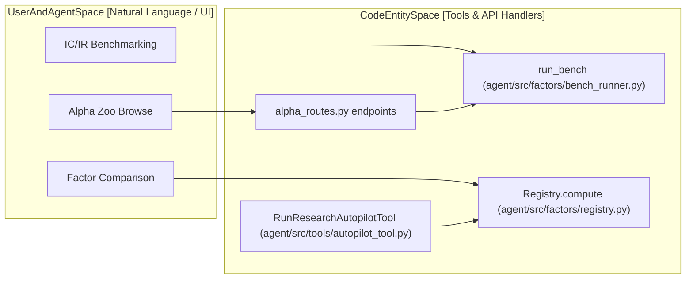

<!-- source: DeepWiki mcp.deepwiki.com · repo HKUDS/Vibe-Trading · page 6 Alpha Zoo and Factor Research Pipeline · fetched 2026-11-09 -->

# Alpha Zoo and Factor Research Pipeline

Relevant source files

The following files were used as context for generating this wiki page:

- [agent/backtest/loaders/_fundamental_schema.py](agent/backtest/loaders/_fundamental_schema.py)
- [agent/backtest/loaders/cn_adjust.py](agent/backtest/loaders/cn_adjust.py)
- [agent/backtest/loaders/gildata_codes.py](agent/backtest/loaders/gildata_codes.py)
- [agent/src/factors/bench_runner.py](agent/src/factors/bench_runner.py)
- [agent/src/factors/registry.py](agent/src/factors/registry.py)
- [agent/src/factors/zoo/fundamental/__init__.py](agent/src/factors/zoo/fundamental/__init__.py)
- [agent/src/factors/zoo/fundamental/asset_growth.py](agent/src/factors/zoo/fundamental/asset_growth.py)
- [agent/src/factors/zoo/fundamental/earnings_yield.py](agent/src/factors/zoo/fundamental/earnings_yield.py)
- [agent/src/factors/zoo/fundamental/gross_profitability.py](agent/src/factors/zoo/fundamental/gross_profitability.py)
- [agent/src/factors/zoo/fundamental/roe.py](agent/src/factors/zoo/fundamental/roe.py)
- [agent/src/tools/alpha_bench_tool.py](agent/src/tools/alpha_bench_tool.py)
- [agent/src/tools/autopilot_tool.py](agent/src/tools/autopilot_tool.py)
- [agent/tests/factors/test_registry.py](agent/tests/factors/test_registry.py)
- [agent/tests/test_alpha_bench_meta_survivorship.py](agent/tests/test_alpha_bench_meta_survivorship.py)
- [agent/tests/test_alpha_bench_qfq.py](agent/tests/test_alpha_bench_qfq.py)
- [agent/tests/test_alpha_bench_sector_tag.py](agent/tests/test_alpha_bench_sector_tag.py)
- [agent/tests/test_alpha_bench_top_zero.py](agent/tests/test_alpha_bench_top_zero.py)
- [agent/tests/test_alpha_bench_universe_metadata.py](agent/tests/test_alpha_bench_universe_metadata.py)
- [agent/tests/test_autopilot_phase3.py](agent/tests/test_autopilot_phase3.py)
- [agent/tests/test_autopilot_tool.py](agent/tests/test_autopilot_tool.py)
- [agent/tests/test_bench_multiple_testing.py](agent/tests/test_bench_multiple_testing.py)
- [agent/tests/test_bench_single_ic_observation.py](agent/tests/test_bench_single_ic_observation.py)
- [agent/tests/test_classification.py](agent/tests/test_classification.py)
- [agent/tests/test_fundamental_schema.py](agent/tests/test_fundamental_schema.py)
- [agent/tests/test_oauth_token_cache.py](agent/tests/test_oauth_token_cache.py)
- [agent/tests/test_readonly_default.py](agent/tests/test_readonly_default.py)
- [agent/tests/test_runtime_root_cache_report_dirs.py](agent/tests/test_runtime_root_cache_report_dirs.py)

The **Alpha Zoo** is Vibe-Trading's specialized subsystem for managing, benchmarking, and exploring a library of **478 pre-built quantitative factors**. It provides a unified interface for formulaic alphas sourced from major industry benchmarks, academic literature, and fundamental data, integrated with a high-performance IC/IR (Information Coefficient / Information Ratio) analysis engine.

The pipeline bridges the gap between raw mathematical formulas and actionable trading signals through a rigorous validation process, including an **AST (Abstract Syntax Tree) purity gate** to ensure code safety and a **lookahead sentinel test** to prevent data leakage.

### System Overview

The Alpha Zoo architecture connects the back-end factor registry to a dedicated research UI, allowing users (and the AI agent) to discover factors that exhibit persistent alpha in specific markets.

Title: Alpha Zoo Data Flow and Code Architecture

Sources: [agent/src/factors/registry.py:1-67](), [agent/src/factors/base.py:1-13](), [agent/src/factors/bench_runner.py:142-176](), [agent/src/tools/alpha_bench_tool.py:102-135]()

---

### Factor Libraries (The Zoos)

The system categorizes factors into five distinct "zoos," representing different lineages of quantitative research. Metadata is extracted via AST parsing of the `__alpha_meta__` dict literal in each factor file to ensure safety and prevent arbitrary code execution during the discovery phase [agent/src/factors/registry.py:147-184]().

| Zoo ID | Name | Description | Approximate Count |
|:---|:---|:---|:---|
| `qlib158` | **Qlib Alpha158** | Microsoft Qlib's production alphas tuned for ML pipelines. | ~158 |
| `alpha101` | **Kakushadze 101** | Formulaic alphas from Kakushadze (2015); short-horizon cross-sectional signals. | ~101 |
| `gtja191` | **GTJA 191** | Guotai Junan Securities' 191 alphas; technical signals tuned to China A-shares. | ~191 |
| `academic` | **Academic** | Curated anomalies from academic literature (e.g., STREV, ILLIQ, HIGH52W). | <20 |
| `fundamental`| **Fundamental** | PIT-safe quality and value factors (e.g., ROE, Gross Profitability). | ~5 |

The **fundamental zoo** introduces point-in-time (PIT) safe factors that leverage the `fund:` panel column prefix [agent/src/factors/registry.py:82-84](). These factors, such as `fund_gross_profitability` [agent/src/factors/zoo/fundamental/gross_profitability.py:9-23](), `fund_roe` [agent/src/factors/zoo/fundamental/roe.py:9-24](), `fund_asset_growth` [agent/src/factors/zoo/fundamental/asset_growth.py:9-24](), and `fund_earnings_yield` [agent/src/factors/zoo/fundamental/earnings_yield.py:10-29](), are backed by `_fundamental_schema.py` which defines raw and derived fundamental fields and their dependencies [agent/backtest/loaders/_fundamental_schema.py:28-186]().

Sources: [agent/src/factors/registry.py:21-61](), [agent/src/factors/registry.py:147-184](), [agent/src/factors/zoo/fundamental/gross_profitability.py:9-23](), [agent/src/factors/zoo/fundamental/roe.py:9-24](), [agent/src/factors/zoo/fundamental/asset_growth.py:9-24](), [agent/src/factors/zoo/fundamental/earnings_yield.py:10-29](), [agent/backtest/loaders/_fundamental_schema.py:28-186]()

---

### Research Pipeline & Benchmarking

The research pipeline identifies factor efficacy through historical cross-sectional analysis and rigorous statistical validation.

1. **Registry Discovery**: The `Registry` class scans `agent/src/factors/zoo/` for modules, validating metadata using `AlphaMeta` Pydantic models without importing the code [agent/src/factors/registry.py:87-127](), [agent/src/factors/registry.py:147-184]().
2. **Operator Foundation**: Factors use standardized operators in `base.py` (e.g., `ts_rank`, `zscore`, `ts_corr`) [agent/src/factors/base.py:61-162](). These are optimized using `bottleneck` and `numpy` sliding windows for high-speed execution [agent/src/factors/_backend.py:24-25]().
3. **Standard IC/IR Benchmarking**: The `bench_runner.py` executes full zoo evaluations, categorizing factors as `alive` (IC > 0.02, t > 2), `reversed` (IC < -0.02, t > 2), or `dead` [agent/src/factors/bench_runner.py:9-14]().
4. **Strict Validation**: Strict runner modules add control gates and out-of-sample splits to test robustness against random baselines and multiple testing distortions [agent/src/factors/bench_runner.py:29-40]().
5. **Parallel Execution**: Large-scale benchmarks utilize process pool executors or concurrent workers to distribute alpha computations efficiently across CPU cores [agent/src/factors/bench_runner.py:22-25](), [agent/tools/alpha_bench_tool.py:37-37]().

Sources: [agent/src/factors/bench_runner.py:9-14](), [agent/src/factors/base.py:61-162](), [agent/src/factors/registry.py:201-216](), [agent/src/tools/alpha_bench_tool.py:37-37]()

---

### Factor Interaction Space

Interaction with the Alpha Zoo occurs through three primary interfaces, mapping code entities to research actions.

Title: Research Interface and Tool Mapping

Sources: [agent/src/tools/autopilot_tool.py:49-80](), [agent/src/factors/bench_runner.py:142-176](), [agent/src/factors/registry.py:205-216]()

---

### Detailed Sub-Components

For in-depth technical documentation of the underlying engines and interfaces, see the following child pages:

#### Factor Registry and Benchmarking Engine {#6.1}
Covers the mathematical foundation in `base.py`, the `Registry` implementation for AST-based metadata extraction [agent/src/factors/registry.py:1-20](), the `bench_runner.py` IC/IR analysis pipeline [agent/src/factors/bench_runner.py:1-14](), and rigorous validation logic. It also details the fundamental factor schema and PIT-safe loading [agent/backtest/loaders/_fundamental_schema.py:1-7]().

#### Alpha Zoo Web UI and API Routes {#6.2}
Documents the React-based factor browser (`AlphaZoo.tsx`), FastAPI endpoints, and SSE streams for real-time benchmarking progress updates. Also covers background job management and the static wiki build pipeline.

Sources: [agent/src/factors/registry.py:1-20](), [agent/src/factors/bench_runner.py:1-14](), [agent/backtest/loaders/_fundamental_schema.py:1-7]()

---

