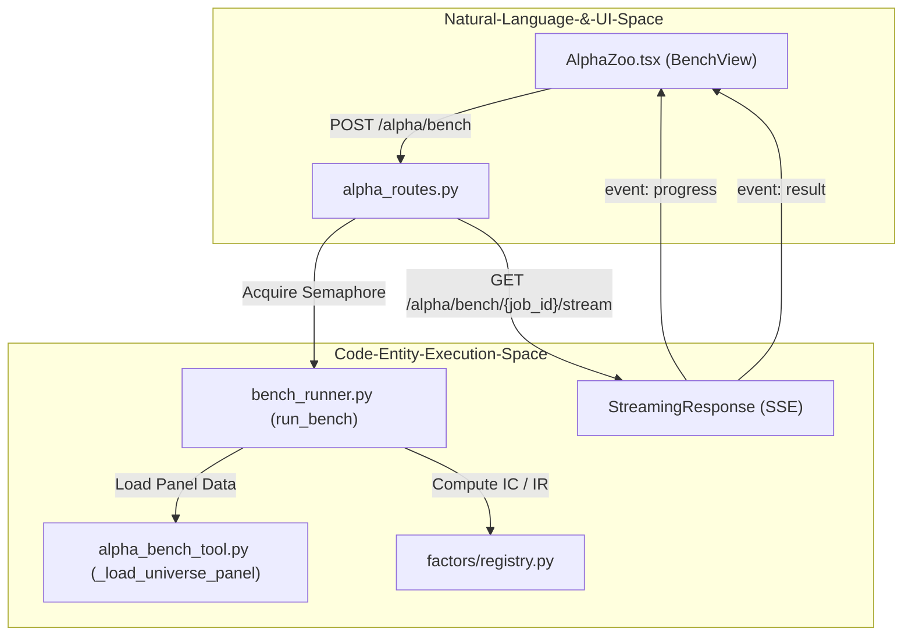
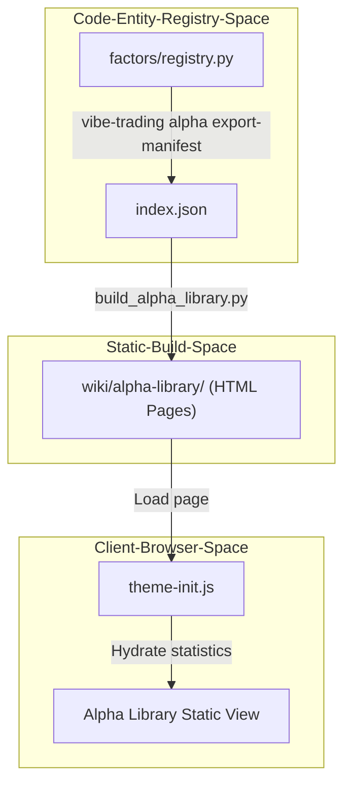

<!-- source: DeepWiki mcp.deepwiki.com · repo HKUDS/Vibe-Trading · page 6.2 Alpha Zoo Web UI and API Routes · fetched 2026-11-09 -->

# Alpha Zoo Web UI and API Routes

Relevant source files

The following files were used as context for generating this wiki page:

- [frontend/src/components/charts/CandlestickChart.tsx](frontend/src/components/charts/CandlestickChart.tsx)
- [frontend/src/components/charts/ValidationPanel.tsx](frontend/src/components/charts/ValidationPanel.tsx)
- [frontend/src/components/chat/PineScriptViewer.tsx](frontend/src/components/chat/PineScriptViewer.tsx)
- [frontend/src/components/chat/WelcomeScreen.tsx](frontend/src/components/chat/WelcomeScreen.tsx)
- [frontend/src/components/chat/__tests__/WelcomeScreen.test.tsx](frontend/src/components/chat/__tests__/WelcomeScreen.test.tsx)
- [frontend/src/components/layout/Layout.tsx](frontend/src/components/layout/Layout.tsx)
- [frontend/src/pages/AlphaZoo.tsx](frontend/src/pages/AlphaZoo.tsx)
- [frontend/src/router.tsx](frontend/src/router.tsx)
- [wiki/alpha-library/alpha.js](wiki/alpha-library/alpha.js)
- [wiki/alpha-library/index.html](wiki/alpha-library/index.html)
- [wiki/docs/content.js](wiki/docs/content.js)
- [wiki/docs/index.html](wiki/docs/index.html)
- [wiki/docs/main.js](wiki/docs/main.js)
- [wiki/home/index.html](wiki/home/index.html)
- [wiki/main.js](wiki/main.js)
- [wiki/partials/site-head.html](wiki/partials/site-head.html)
- [wiki/research-lab/index.html](wiki/research-lab/index.html)
- [wiki/research-lab/posts/alpha-191-in-2026-zh.html](wiki/research-lab/posts/alpha-191-in-2026-zh.html)
- [wiki/research-lab/posts/alpha-191-in-2026.html](wiki/research-lab/posts/alpha-191-in-2026.html)
- [wiki/scripts/build_alpha_library.py](wiki/scripts/build_alpha_library.py)
- [wiki/tutorials/index.html](wiki/tutorials/index.html)
- [wiki/tutorials/vibe-trading-beginner-zh.html](wiki/tutorials/vibe-trading-beginner-zh.html)

The Alpha Zoo subsystem provides an interactive web interface and asynchronous FastAPI backend for exploring, inspecting, and benchmarking over 460 quantitative factors across five specialized zoos [wiki/alpha-library/index.html:8](). It bridges mathematical factor definitions with empirical performance metrics such as Information Coefficient (IC) and Information Ratio (IR) [agent/src/api/alpha_routes.py:1-27](), exposing both human-facing web views and agentic tooling.

---

## Frontend Architecture and Views (`AlphaZoo.tsx`)

The Alpha Zoo web interface is implemented as a single-page component supporting four distinct operational views routed via `frontend/src/router.tsx:76-79` and managed within `frontend/src/pages/AlphaZoo.tsx:124-139` [frontend/src/pages/AlphaZoo.tsx:2-12]():

*   **BrowseView**: Default listing view supporting multi-parameter filtering by zoo, theme, factor universe, and keyword search [frontend/src/pages/AlphaZoo.tsx:143-203](). It tracks selection state for head-to-head comparison [frontend/src/pages/AlphaZoo.tsx:148-160]().
*   **DetailView**: Inspects individual factor parameters, mathematical expressions, metadata, and historical performance cards for a given `alphaId` [frontend/src/pages/AlphaZoo.tsx:135-137]().
*   **BenchView**: Interface for triggering and monitoring full zoo benchmarking jobs via asynchronous Server-Sent Events (SSE) [frontend/src/pages/AlphaZoo.tsx:130-132]().
*   **CompareView**: Side-by-side head-to-head ranking and statistical delta analysis for two or more selected factors [frontend/src/pages/AlphaZoo.tsx:133-135]().

The browse view categorizes factors into five distinct zoo modules defined by `ZOO_CARDS` [frontend/src/pages/AlphaZoo.tsx:53-74]():
1.  `qlib158`: Microsoft Qlib's 158-feature technical factor library [frontend/src/pages/AlphaZoo.tsx:54-57]().
2.  `alpha101`: Kakushadze's 101 formulaic alpha expressions [frontend/src/pages/AlphaZoo.tsx:58-61]().
3.  `gtja191`: Guotai Junan's 191 short-horizon alpha signals tuned for Asian markets [frontend/src/pages/AlphaZoo.tsx:62-65]().
4.  `academic`: Curated long-horizon academic anomalies [frontend/src/pages/AlphaZoo.tsx:66-69]().
5.  `fundamental`: Point-in-time (PIT) SEC-derived fundamental factors [frontend/src/pages/AlphaZoo.tsx:70-74]().

**Sources:** [frontend/src/pages/AlphaZoo.tsx:1-140](), [frontend/src/router.tsx:32-34](), [frontend/src/router.tsx:76-79]()

---

## Backend API Endpoints and Server-Sent Events (`alpha_routes.py`)

The FastAPI routing layer in `agent/src/api/alpha_routes.py` manages factor metadata queries and coordinates long-running benchmark and comparison tasks. It is mounted into the main FastAPI application via `register_alpha_routes` [agent/src/api/alpha_routes.py:1-4]().

### Endpoint Reference

| HTTP Method | Path | Description |
| :--- | :--- | :--- |
| `GET` | `/alpha/list` | Returns filtered summaries of available factors across all zoos [agent/src/api/alpha_routes.py:9]() |
| `GET` | `/alpha/{alpha_id}` | Retrieves detailed metadata, math formulas, and code for a single factor [agent/src/api/alpha_routes.py:10]() |
| `POST` | `/alpha/bench` | Initiates an asynchronous factor/zoo benchmark job, returning a `job_id` [agent/src/api/alpha_routes.py:11]() |
| `GET` | `/alpha/bench/{job_id}/stream` | SSE stream yielding `progress`, `result`, `done`, or `error` events for benchmarking [agent/src/api/alpha_routes.py:12]() |
| `POST` | `/alpha/compare` | Initiates a head-to-head comparison job for two or more factor IDs [agent/src/api/alpha_routes.py:13]() |
| `GET` | `/alpha/compare/{job_id}/stream` | SSE stream for head-to-head factor comparison execution [agent/src/api/alpha_routes.py:14]() |

### Concurrency Control and Job Lifecycle
Asynchronous jobs are bounded by concurrency limits and automated clean-up cycles:
*   **Job Store**: In-memory dictionaries `ALPHA_BENCH_JOBS` and `ALPHA_COMPARE_JOBS` track task states [agent/src/api/alpha_routes.py:53-54]().
*   **Concurrency Gates**: Controlled via asyncio semaphores `MAX_CONCURRENT_BENCHES = 2` and `MAX_CONCURRENT_COMPARES = 2` [agent/src/api/alpha_routes.py:69-75]().
*   **Task Retention**: Background tasks are stored in `_RUNNING_TASKS` to prevent premature garbage collection [agent/src/api/alpha_routes.py:59](), and evicted after `_JOB_TTL_SECONDS` (3600 seconds) [agent/src/api/alpha_routes.py:61-132]().

**Client-Server Bridge for Benchmarking / SSE Execution**

**Sources:** [agent/src/api/alpha_routes.py:1-140](), [frontend/src/pages/AlphaZoo.tsx:130-132]()

---

## ECharts Integration and Visualization

The Alpha Zoo UI leverages Apache ECharts for rendering rolling Information Coefficient (IC) time-series and comparative distribution charts [frontend/src/pages/AlphaZoo.tsx:41]().

*   **Chart Lifecycle Hook**: The `useChartLifecycle` hook coordinates mount, resize observers, and disposal of chart instances when switching views or resizing containers [frontend/src/pages/AlphaZoo.tsx:38]().
*   **Theme Resolution**: Dynamic color palettes are injected via `getChartTheme()` to adapt chart axes, tooltips, and series colors to the user's current dark/light mode preference [frontend/src/pages/AlphaZoo.tsx:39]() [frontend/src/pages/AlphaZoo.tsx:42-43]().
*   **Live Stream Rendering**: As SSE events arrive from `/alpha/bench/{job_id}/stream` [agent/src/api/alpha_routes.py:12](), progress bars and comparative performance tables update reactively [frontend/src/pages/AlphaZoo.tsx:41]().

**Sources:** [frontend/src/pages/AlphaZoo.tsx:38-43]()

---

## Static Wiki Alpha Library Pipeline

In addition to the runtime web UI, the Alpha Zoo code generator builds a static documentation site for search engines and offline deployment [wiki/alpha-library/index.html:1-53]().

### Build Pipeline Steps
1.  **Manifest Export**: Factor metadata is exported from the registry using the CLI command `vibe-trading alpha export-manifest` into a structured JSON index [agent/src/factors/cli_handlers.py:12-14]().
2.  **Static Processing**: The build script `wiki/scripts/build_alpha_library.py` compiles the exported manifest into static HTML pages for each factor under `wiki/alpha-library/`.
3.  **Client Hydration**: The static pages utilize `theme-init.js` and `alpha.js` to fetch manifest statistics, hydrate aggregate counters, and render metadata tags [wiki/alpha-library/index.html:28-31]().

**Static Wiki Build and Hydration Pipeline**

**Sources:** [agent/src/factors/cli_handlers.py:12-14](), [wiki/alpha-library/index.html:1-32]()

---

## Agent Tool Integration

The Alpha Zoo exposes its core factor research capabilities to the ReAct agent framework via dedicated tool definitions:

1.  **`AlphaCompareTool`**: Allows agents to run head-to-head factor comparisons programmatically. It validates inputs against a JSON schema requiring `alpha_ids`, `universe`, and `period`, with optional sorting parameters (`ir`, `ic_mean`, `ic_positive_ratio`, `ic_count`) [agent/src/tools/alpha_compare_tool.py:47-50]() and automatically de-duplicates input IDs [agent/src/tools/alpha_compare_tool.py:16-37]().
2.  **`AlphaBenchTool`**: Enables agents to trigger broad zoo benchmarks across universes like `csi300` or `sp500` [agent/src/api/alpha_routes.py:149-174]().

**Sources:** [agent/src/tools/alpha_compare_tool.py:1-55](), [agent/src/api/alpha_routes.py:149-184]()

---

