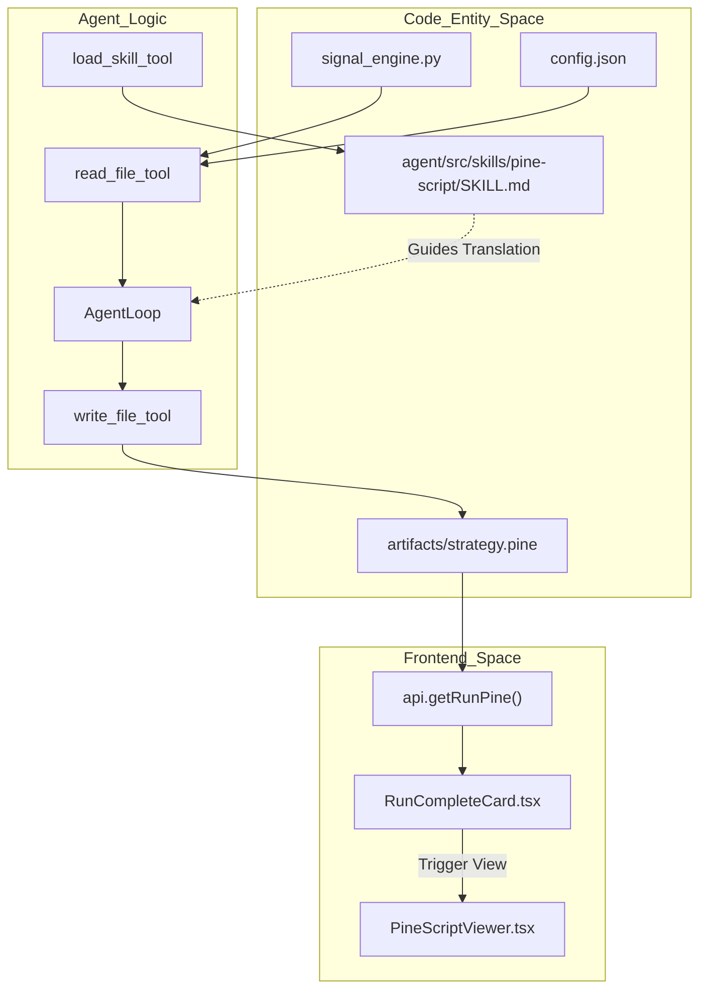
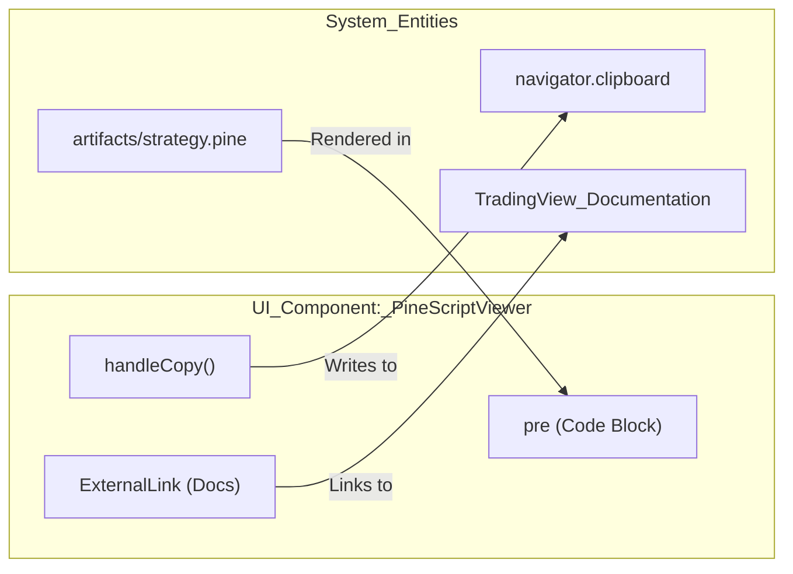

<!-- source: DeepWiki mcp.deepwiki.com · repo HKUDS/Vibe-Trading · page 7 Pine Script Export and TradingView Integration · fetched 2026-11-09 -->

# Pine Script Export and TradingView Integration

Relevant source files

The following files were used as context for generating this wiki page:

- [agent/src/skills/correlation-analysis/SKILL.md](agent/src/skills/correlation-analysis/SKILL.md)
- [agent/src/skills/etf-analysis/SKILL.md](agent/src/skills/etf-analysis/SKILL.md)
- [agent/src/skills/financial-statement/SKILL.md](agent/src/skills/financial-statement/SKILL.md)
- [agent/src/skills/ml-strategy/SKILL.md](agent/src/skills/ml-strategy/SKILL.md)
- [agent/src/skills/multi-factor/example_signal_engine.py](agent/src/skills/multi-factor/example_signal_engine.py)
- [agent/src/skills/multi-factor/zoo_signal_engine.py](agent/src/skills/multi-factor/zoo_signal_engine.py)
- [agent/src/skills/pine-script/SKILL.md](agent/src/skills/pine-script/SKILL.md)
- [agent/src/skills/strategy-dev-manager/templates/factor_signal_engine.py](agent/src/skills/strategy-dev-manager/templates/factor_signal_engine.py)
- [agent/src/skills/volatility/example_signal_engine.py](agent/src/skills/volatility/example_signal_engine.py)
- [agent/tests/test_context_attribution_layers.py](agent/tests/test_context_attribution_layers.py)
- [agent/tests/test_correlation_analysis_skill.py](agent/tests/test_correlation_analysis_skill.py)
- [agent/tests/test_ml_strategy_skill.py](agent/tests/test_ml_strategy_skill.py)
- [agent/tests/test_multi_factor_strategy_template.py](agent/tests/test_multi_factor_strategy_template.py)
- [agent/tests/test_skill_pct_change_guard.py](agent/tests/test_skill_pct_change_guard.py)
- [agent/tests/test_system_prompt_cache_stability.py](agent/tests/test_system_prompt_cache_stability.py)

This page covers the system's ability to bridge Python-based quantitative research with the TradingView ecosystem and other professional trading platforms [agent/src/skills/pine-script/SKILL.md:1-5](). Vibe-Trading provides specialized skills for translating backtested strategies into Pine Script v6, TDX Formula, and MQL5, alongside a dedicated UI component for viewing and exporting this code [frontend/src/components/chat/PineScriptViewer.tsx:10-13]().

## Overview

The export integration serves as the final step in the strategy development lifecycle. After an agent has researched, coded, and backtested a strategy in the Python environment, it can export that logic into formats compatible with external charting, alerting, and execution engines. This is primarily facilitated by the `pine-script` skill [agent/src/skills/pine-script/SKILL.md:7-19]().

The integration consists of two primary components:
1.  **The `pine-script` Skill**: A multi-platform export tool that translates Python/Pandas logic into Pine Script v6 (TradingView), TDX Formula (通达信/同花顺/东方财富), and MQL5 (MetaTrader 5) [agent/src/skills/pine-script/SKILL.md:12-19]().
2.  **The `PineScriptViewer` Component**: A React modal that provides a clean interface for users to inspect, copy, and reference documentation for the generated script [frontend/src/components/chat/PineScriptViewer.tsx:10-13]().

### Strategy Translation and Export Flow

Sources: [agent/src/skills/pine-script/SKILL.md:1-62](), [frontend/src/components/chat/PineScriptViewer.tsx:10-30]()

---

## Pine Script Translation Engine

The translation engine is encapsulated within the `pine-script` skill [agent/src/skills/pine-script/SKILL.md:1-5](). It provides the agent with a comprehensive mapping table between common Python libraries (Pandas, NumPy) and Pine Script v6 functions [agent/src/skills/pine-script/SKILL.md:120-142](). Key capabilities include multi-platform unified export, vector-to-series logic mapping, execution mapping via `strategy.entry` and `strategy.close`, and platform-specific symbol formatting [agent/src/skills/pine-script/SKILL.md:13-175]().

For deep technical details regarding template structures, repainting avoidance techniques, and quality checklists, see **[Pine Script Translation Engine](#7.1)**.

Sources: [agent/src/skills/pine-script/SKILL.md:1-175]()

---

## PineScriptViewer UI Component

The `PineScriptViewer` is a specialized UI component located in `frontend/src/components/chat/` [frontend/src/components/chat/PineScriptViewer.tsx:1-13](). It is typically invoked from a `RunCompleteCard` or the `RunDetail` page after a backtest finishes and a Pine Script artifact is accessible via the backend API [frontend/src/components/chat/PineScriptViewer.tsx:10-15]().

### UI to Code Entity Space Mapping

Sources: [frontend/src/components/chat/PineScriptViewer.tsx:14-75]()

The viewer manages modal lifecycles, provides fallback clipboard copying via `navigator.clipboard` or manual textareas, renders code blocks, and integrates directly with run completion workflows [frontend/src/components/chat/PineScriptViewer.tsx:14-86]().

For detailed information on modal states, clipboard interactions, and integration patterns, see **[PineScriptViewer UI Component](#7.2)**.

Sources: [frontend/src/components/chat/PineScriptViewer.tsx:1-86]()

---

