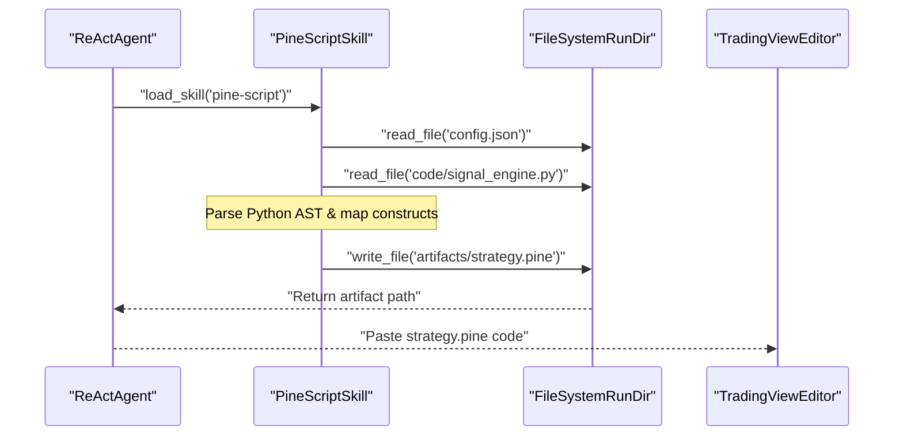

<!-- source: DeepWiki mcp.deepwiki.com · repo HKUDS/Vibe-Trading · page 7.1 Pine Script Translation Engine · fetched 2026-11-09 -->

# Pine Script Translation Engine

<details>
<summary>Relevant source files</summary>

The following files were used as context for generating this wiki page:

- [agent/src/skills/correlation-analysis/SKILL.md](agent/src/skills/correlation-analysis/SKILL.md)
- [agent/src/skills/etf-analysis/SKILL.md](agent/src/skills/etf-analysis/SKILL.md)
- [agent/src/skills/financial-statement/SKILL.md](agent/src/skills/financial-statement/SKILL.md)
- [agent/src/skills/ml-strategy/SKILL.md](agent/src/skills/ml-strategy/SKILL.md)
- [agent/src/skills/multi-factor/example_signal_engine.py](agent/src/skills/multi-factor/example_signal_engine.py)
- [agent/src/skills/multi-factor/zoo_signal_engine.py](agent/src/skills/multi-factor/zoo_signal_engine.py)
- [agent/src/skills/pine-script/SKILL.md](agent/src/skills/pine-script/SKILL.md)
- [agent/src/skills/strategy-dev-manager/templates/factor_signal_engine.py](agent/src/skills/strategy-dev-manager/templates/factor_signal_engine.py)
- [agent/src/skills/volatility/example_signal_engine.py](agent/src/skills/volatility/example_signal_engine.py)
- [agent/tests/test_context_attribution_layers.py](agent/tests/test_context_attribution_layers.py)
- [agent/tests/test_correlation_analysis_skill.py](agent/tests/test_correlation_analysis_skill.py)
- [agent/tests/test_ml_strategy_skill.py](agent/tests/test_ml_strategy_skill.py)
- [agent/tests/test_multi_factor_strategy_template.py](agent/tests/test_multi_factor_strategy_template.py)
- [agent/tests/test_skill_pct_change_guard.py](agent/tests/test_skill_pct_change_guard.py)
- [agent/tests/test_system_prompt_cache_stability.py](agent/tests/test_system_prompt_cache_stability.py)

</details>


The Pine Script Translation Engine bridges the gap between Python-based algorithmic research within Vibe-Trading and major external trading platforms. While primarily focused on TradingView's **Pine Script v6**, the engine also supports **TDX Formula** for China A-shares and **MQL5** for MetaTrader 5, enabling seamless export of backtested strategies or natural language strategy generation.

Sources: [agent/src/skills/pine-script/SKILL.md:1-19]()

## Overview and Purpose

The translation engine operates across two distinct execution domains:
1. **Python Space**: High-performance, multi-asset backtesting using `pandas`, `numpy`, and specialized signal engines defined in `agent/backtest/engines/`.
2. **External Platform Space**: Real-time chart visualization, indicator rendering, alerting, and script execution on TradingView, 通达信 / 同花顺 / 东方财富 (TDX), and MT5.

Sources: [agent/src/skills/pine-script/SKILL.md:1-19]()

## System Architecture: Translation Flow

The engine is governed by the `pine-script` skill [agent/src/skills/pine-script/SKILL.md:1-5](), which parses strategy artifacts (such as `config.json` and `code/signal_engine.py`) and maps them to target platform syntax.

### Natural Language and Code Entity Mapping

The following diagram bridges natural language intents and Python code entities to their respective Pine Script v6 constructs.

**Translation Concept Mapping**
```mermaid
graph TD
    subgraph "NaturalLanguageSpace"
        NL_Idea[""Cross-over strategy with RSI filter""]
    end

    subgraph "CodeEntitySpace"
        PY_Rolling[""df['close'].rolling(n).mean()""]
        PY_Shift[""df['close'].shift(1)""]
        PY_Signal[""(fast > slow) & (fast.shift(1) <= slow.shift(1))""]
        PY_Pos[""strategy.entry()""]
    end

    subgraph "PineScriptSpace"
        PS_SMA[""ta.sma(close, n)""]
        PS_Ref[""close[1]""]
        PS_Cross[""ta.crossover(fast, slow)""]
        PS_Entry[""strategy.entry('Long', strategy.long)""]
    end

    NL_Idea --> PY_Rolling
    PY_Rolling -.-> PS_SMA
    PY_Shift -.-> PS_Ref
    PY_Signal -.-> PS_Cross
    PY_Pos -.-> PS_Entry
```
Sources: [agent/src/skills/pine-script/SKILL.md:20-45]()

## Implementation Details

### Strategy Template Structure

Generated Pine Script v6 files adhere to a strict template structure to ensure successful parsing in the TradingView Pine Editor [agent/src/skills/pine-script/SKILL.md:70-75](). The layout is organized into discrete sections:

1. **Header**: Version declaration (`//@version=6`) and global strategy configuration parameters (`strategy(...)`) [agent/src/skills/pine-script/SKILL.md:73-76]().
2. **Inputs Block**: Grouped parameters using `input.int()`, `input.float()`, and `input.string()` [agent/src/skills/pine-script/SKILL.md:78-82]().
3. **Calculations**: Core indicator formulas [agent/src/skills/pine-script/SKILL.md:83-87]().
4. **Conditions**: Boolean flag assignments for `longCondition`, `shortCondition`, `exitLongCondition`, and `exitShortCondition` [agent/src/skills/pine-script/SKILL.md:88-95]().
5. **Strategy Execution**: Conditional order entries and exits via `strategy.entry()` and `strategy.close()` [agent/src/skills/pine-script/SKILL.md:96-107]().
6. **Plots & Alerts**: Visual overlays (`plot()`) and alert triggers (`alertcondition()`) [agent/src/skills/pine-script/SKILL.md:108-118]().

Sources: [agent/src/skills/pine-script/SKILL.md:70-118]()

### Python-to-Pine Mapping

The engine translates common Pandas and NumPy functions into built-in Pine Script v6 functions.

| Python (pandas/numpy) | Pine Script v6 |
|-----------------------|----------------|
| `df['close'].rolling(n).mean()` | `ta.sma(close, n)` |
| `df['close'].ewm(span=n).mean()` | `ta.ema(close, n)` |
| `ta.RSI(df['close'], n)` | `ta.rsi(close, n)` |
| `ta.MACD(df['close'])` | `[macdLine, signalLine, hist] = ta.macd(close, 12, 26, 9)` |
| `df['close'].rolling(n).std()` | `ta.stdev(close, n)` |
| `df['high'].rolling(n).max()` | `ta.highest(high, n)` |
| `df['low'].rolling(n).min()` | `ta.lowest(low, n)` |
| `df['close'].pct_change(fill_method=None)` | `(close - close[1]) / close[1]` |
| `df['volume'].rolling(n).mean()` | `ta.sma(volume, n)` |
| Bollinger Bands | `[mid, upper, lower] = ta.bb(close, length, mult)` |
| ATR | `ta.atr(length)` |
| ADX | `ta.adx(high, low, close, length)` |

Sources: [agent/src/skills/pine-script/SKILL.md:121-143]()

### Data References and Signal Logic Mapping

DataFrame attributes and series operations map directly to Pine Script primitives and conditional expressions.

| Python Expression | Pine Script v6 Equivalent |
|-------------------|---------------------------|
| `df['open']` | `open` |
| `df['close'].shift(n)` | `close[n]` |
| `(fast > slow) & (fast.shift(1) <= slow.shift(1))` | `ta.crossover(fast, slow)` |
| `np.where(cond, val_true, val_false)` | `cond ? val_true : val_false` |
| `signal.clip(-1, 1)` | `math.max(-1, math.min(1, signal))` |
| `signal.fillna(0)` | `nz(signal, 0)` |

Sources: [agent/src/skills/pine-script/SKILL.md:144-167]()

### Position Sizing and Symbol Mapping

Position sizing rules are mapped into strategy equity parameters, and international/domestic market symbols are converted to match TradingView ticker formats [agent/src/skills/pine-script/SKILL.md:43-47]().

| Internal Format | TradingView Format | Market |
|------------------|-------------------|--------|
| `000001.SZ` | `SZSE:000001` | Shenzhen Stock Exchange |
| `600000.SH` | `SSE:600000` | Shanghai Stock Exchange |
| `BTC-USDT` | `BINANCE:BTCUSDT` | Crypto (Binance default) |

Sources: [agent/src/skills/pine-script/SKILL.md:43-47](), [agent/src/skills/pine-script/SKILL.md:168-175]()

## Execution Workflows

### Export Sequence

When translating a completed backtest run, the ReAct agent invokes the `pine-script` skill to read configuration files and strategy code, producing a unified output file at `artifacts/strategy.pine` [agent/src/skills/pine-script/SKILL.md:10-28]().

**Export Workflow**

Sources: [agent/src/skills/pine-script/SKILL.md:20-28]()

## Quality and Safety Checklist

To prevent look-ahead bias and syntax failures, the translation engine enforces rigorous validation rules:

* **Repainting Avoidance**: Signals must use historical referencing (`close[1]`) or state-change functions (`ta.crossover()`) to prevent evaluating data from uncompleted bars. This aligns with walk-forward validation rules implemented in machine learning strategies [agent/src/skills/ml-strategy/SKILL.md:100-124]().
* **Syntax Integrity**: 
  * The version declaration `//@version=6` must occupy the first line [agent/src/skills/pine-script/SKILL.md:70-75]().
  * Ternary statements remain inline to prevent compilation breaks.
  * Plot directives (`plot()`) are restricted to the global scope.
* **Security Scrubber**: Strategy code ingestion is gated by AST analysis to block arbitrary network or subprocess calls during file parsing [agent/tests/test_ml_strategy_skill.py:3-25]().

Sources: [agent/src/skills/pine-script/SKILL.md:70-118](), [agent/src/skills/ml-strategy/SKILL.md:100-124](), [agent/tests/test_ml_strategy_skill.py:3-25]()

---

