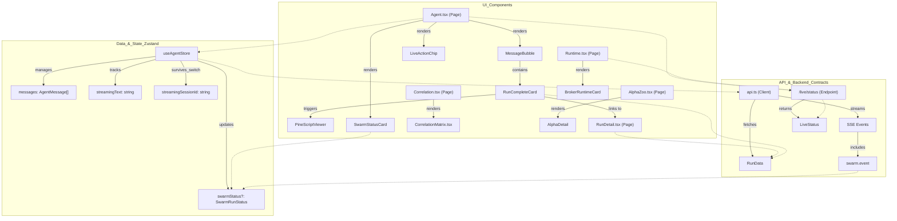
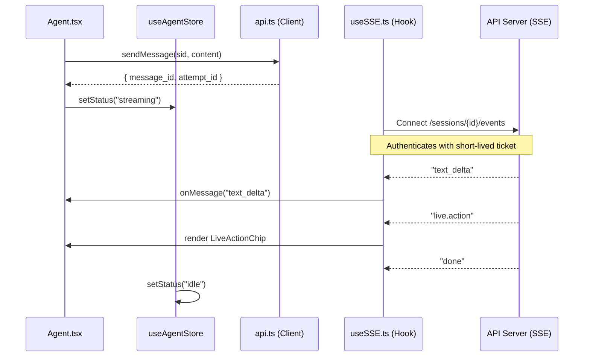

<!-- source: DeepWiki mcp.deepwiki.com · repo HKUDS/Vibe-Trading · page 8 Frontend Web Application · fetched 2026-11-09 -->

# Frontend Web Application

Relevant source files

The following files were used as context for generating this wiki page:

- [Dockerfile](Dockerfile)
- [frontend/package-lock.json](frontend/package-lock.json)
- [frontend/package.json](frontend/package.json)
- [frontend/src/components/charts/CandlestickChart.tsx](frontend/src/components/charts/CandlestickChart.tsx)
- [frontend/src/components/charts/ValidationPanel.tsx](frontend/src/components/charts/ValidationPanel.tsx)
- [frontend/src/components/chat/PineScriptViewer.tsx](frontend/src/components/chat/PineScriptViewer.tsx)
- [frontend/src/components/chat/WelcomeScreen.tsx](frontend/src/components/chat/WelcomeScreen.tsx)
- [frontend/src/components/chat/__tests__/WelcomeScreen.test.tsx](frontend/src/components/chat/__tests__/WelcomeScreen.test.tsx)
- [frontend/src/components/layout/Layout.tsx](frontend/src/components/layout/Layout.tsx)
- [frontend/src/pages/AlphaZoo.tsx](frontend/src/pages/AlphaZoo.tsx)
- [frontend/src/router.tsx](frontend/src/router.tsx)

The Vibe-Trading frontend is a modern React 19 application designed to provide a high-performance, real-time interface for quantitative strategy development. It serves as the primary orchestration layer for interacting with the ReAct agent, visualizing backtest results, managing multi-agent Swarm workflows, and monitoring live trading execution.

The application leverages **Zustand** for state management, **ECharts** for financial visualization, and **Server-Sent Events (SSE)** for streaming agent reasoning, live trading actions, and research goal progress.

## System Architecture and Code Mapping

The frontend bridges the "Natural Language Space" (where users describe strategies) and the "Code Entity Space" (where backtests are executed and visualized). The following diagram illustrates how UI components map to underlying data structures and API contracts.

### Frontend Entity Mapping

Sources: `[frontend/src/pages/Agent.tsx:1-24]`, `[frontend/src/lib/api.ts:1-21]`, `[frontend/src/components/layout/Layout.tsx:18-39]()`

## Core Technologies

The frontend is built on a stack optimized for real-time financial data and interactive visualizations:

| Technology | Usage in Vibe-Trading |
| :--- | :--- |
| **React 19** | Core UI framework with support for modern hooks and functional components `[frontend/src/router.tsx:1-40]()`. |
| **Zustand** | Lightweight state management for chat sessions and SSE status via `useAgentStore` `[frontend/src/components/layout/Layout.tsx:9-35]()`. |
| **ECharts** | High-performance rendering of Candlestick charts, equity curves, and heatmaps `[frontend/src/components/charts/CandlestickChart.tsx:1-12]()`. |
| **SSE Integration** | Custom SSE handling with auto-reconnect, exponential backoff, and `Last-Event-ID` recovery `[frontend/src/components/layout/Layout.tsx:32-42]()`. |
| **i18next** | Internationalization support with localized strings for all UI components `[frontend/src/components/layout/Layout.tsx:1-15]()`. |

Sources: `[frontend/package.json:17-39]`, `[frontend/src/router.tsx:1-40]`, `[frontend/src/components/layout/Layout.tsx:1-39]()`

## Key Functional Modules

### 1. Pages, Routing, and State Management
The application manages navigation between the main chat interface (`Agent.tsx`), detailed backtest reports (`RunDetail.tsx`), and specialized research views like the `AlphaZoo.tsx` factor browser `[frontend/src/router.tsx:58-81]()`. Global state in `useAgentStore` handles session caching and tracks `streamingSessionId` so UI indicators persist even when navigating away from an active run `[frontend/src/components/layout/Layout.tsx:39-42]()`. The layout provides a persistent sidebar for session management, allowing users to rename or delete historical chats `[frontend/src/components/layout/Layout.tsx:114-142]()`.

For details, see [Pages, Routing, and State Management](#8.1).

Sources: `[frontend/src/router.tsx:58-81]`, `[frontend/src/components/layout/Layout.tsx:39-142]()`

### 2. Chat Interface Components
The chat interface renders the agent's reasoning process using a message grouping pattern that separates text messages from thinking blocks and tool results. It includes specialized welcome dashboards `[frontend/src/components/chat/WelcomeScreen.tsx:1-177]()` and modal viewers like `PineScriptViewer` for strategy translation `[frontend/src/components/chat/PineScriptViewer.tsx:11-30]()`. The system uses a dedicated hook pattern to handle real-time events ranging from `text_delta` to live actions.

For details, see [Chat Interface Components](#8.2).

Sources: `[frontend/src/components/chat/WelcomeScreen.tsx:1-177]`, `[frontend/src/components/chat/PineScriptViewer.tsx:11-30]()`

### 3. Financial Charts and Visualization
Vibe-Trading provides high-fidelity financial visualization through specialized charts and panels. The `CandlestickChart` component handles technical indicator overlays (MA, EMA, BOLL) and trade markers `[frontend/src/components/charts/CandlestickChart.tsx:37-53]()`. Additionally, validation components such as `ValidationPanel` render distribution charts and Monte Carlo simulation paths to support robust backtest evaluation `[frontend/src/components/charts/ValidationPanel.tsx:43-67]()`.

For details, see [Financial Charts and Visualization](#8.3).

Sources: `[frontend/src/components/charts/CandlestickChart.tsx:37-53]`, `[frontend/src/components/charts/ValidationPanel.tsx:43-67]()`

### 4. API Client and Data Contracts
The frontend communicates with the FastAPI backend via a central `api.ts` client wrapper. It defines TypeScript interfaces for all shared data structures, such as `RunData`, `SessionItem`, and validation payloads. The client manages complex operations like session management, report fetching, and alpha research queries.

For details, see [API Client and Data Contracts](#8.4).

Sources: `[frontend/src/lib/api.ts:1-40]`, `[frontend/src/pages/AlphaZoo.tsx:30-43]()`

### 5. Internationalization and Settings UI
The frontend supports internationalization through `i18n` (i18next), allowing the application to be localized into multiple languages. The `Layout` component uses `useTranslation` to fetch localized strings for navigation labels and other UI elements `[frontend/src/components/layout/Layout.tsx:1-23]()`. The settings UI provides various configuration options, including LLM and data source settings.

For details, see [Internationalization and Settings UI](#8.5).

Sources: `[frontend/src/components/layout/Layout.tsx:1-23]`, `[frontend/package.json:17-30]()`

## Data Flow: Event Streaming & UI Updates

The following diagram shows how the frontend handles the lifecycle of an agent session, from message submission to real-time status updates via SSE.

### Agent Interaction Pipeline

Sources: `[frontend/src/pages/Agent.tsx:59-75]`, `[frontend/src/stores/agent.ts:60-80]()`

## Child Pages

1. **[Pages, Routing, and State Management](#8.1)** — Deep dive into the `Agent.tsx` interface, routing configuration in `router.tsx`, and the Zustand `useAgentStore` logic.
2. **[Chat Interface Components](#8.2)** — Detailed documentation of chat components, timelines, and specialized cards like `PineScriptViewer`.
3. **[Financial Charts and Visualization](#8.3)** — Technical details of ECharts integration, including Candlestick charts, validation panels, and technical indicator overlays.
4. **[API Client and Data Contracts](#8.4)** — Reference for the `api.ts` request wrapper, SSE event handling, and shared TypeScript interfaces.
5. **[Internationalization and Settings UI](#8.5)** — Details on `i18n` implementation and the various settings components.

---

