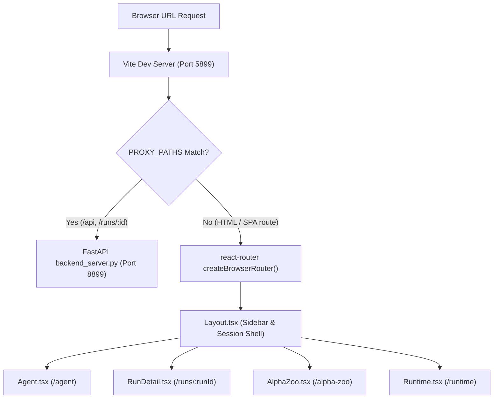
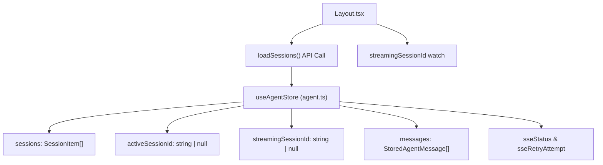

<!-- source: DeepWiki mcp.deepwiki.com · repo HKUDS/Vibe-Trading · page 8.1 Pages, Routing, and State Management · fetched 2026-11-09 -->

# Pages, Routing, and State Management

Relevant source files

The following files were used as context for generating this wiki page:

- [agent/src/api/channels_routes.py](agent/src/api/channels_routes.py)
- [agent/src/providers/custom_profiles.py](agent/src/providers/custom_profiles.py)
- [frontend/src/__tests__/viteProxy.test.ts](frontend/src/__tests__/viteProxy.test.ts)
- [frontend/src/components/charts/CandlestickChart.tsx](frontend/src/components/charts/CandlestickChart.tsx)
- [frontend/src/components/charts/StrategyResearchDashboard.tsx](frontend/src/components/charts/StrategyResearchDashboard.tsx)
- [frontend/src/components/charts/ValidationPanel.tsx](frontend/src/components/charts/ValidationPanel.tsx)
- [frontend/src/components/charts/__tests__/StrategyResearchDashboard.test.tsx](frontend/src/components/charts/__tests__/StrategyResearchDashboard.test.tsx)
- [frontend/src/components/chat/PineScriptViewer.tsx](frontend/src/components/chat/PineScriptViewer.tsx)
- [frontend/src/components/chat/RunCompleteCard.tsx](frontend/src/components/chat/RunCompleteCard.tsx)
- [frontend/src/components/chat/RunnerStatus.tsx](frontend/src/components/chat/RunnerStatus.tsx)
- [frontend/src/components/chat/WelcomeScreen.tsx](frontend/src/components/chat/WelcomeScreen.tsx)
- [frontend/src/components/chat/__tests__/RunCompleteCard.test.tsx](frontend/src/components/chat/__tests__/RunCompleteCard.test.tsx)
- [frontend/src/components/chat/__tests__/RunnerStatus.test.tsx](frontend/src/components/chat/__tests__/RunnerStatus.test.tsx)
- [frontend/src/components/chat/__tests__/WelcomeScreen.test.tsx](frontend/src/components/chat/__tests__/WelcomeScreen.test.tsx)
- [frontend/src/components/layout/Layout.tsx](frontend/src/components/layout/Layout.tsx)
- [frontend/src/components/layout/__tests__/Navigation.test.tsx](frontend/src/components/layout/__tests__/Navigation.test.tsx)
- [frontend/src/components/layout/navigation.ts](frontend/src/components/layout/navigation.ts)
- [frontend/src/i18n/__tests__/i18n.test.ts](frontend/src/i18n/__tests__/i18n.test.ts)
- [frontend/src/i18n/index.ts](frontend/src/i18n/index.ts)
- [frontend/src/lib/__tests__/api.test.ts](frontend/src/lib/__tests__/api.test.ts)
- [frontend/src/lib/__tests__/runCards.test.ts](frontend/src/lib/__tests__/runCards.test.ts)
- [frontend/src/lib/runCards.ts](frontend/src/lib/runCards.ts)
- [frontend/src/lib/runReports.ts](frontend/src/lib/runReports.ts)
- [frontend/src/pages/AlphaZoo.tsx](frontend/src/pages/AlphaZoo.tsx)
- [frontend/src/pages/Correlation.tsx](frontend/src/pages/Correlation.tsx)
- [frontend/src/pages/Home.tsx](frontend/src/pages/Home.tsx)
- [frontend/src/pages/RunDetail.tsx](frontend/src/pages/RunDetail.tsx)
- [frontend/src/pages/Runtime.tsx](frontend/src/pages/Runtime.tsx)
- [frontend/src/pages/__tests__/AgentBackgroundStreamCompletion.test.tsx](frontend/src/pages/__tests__/AgentBackgroundStreamCompletion.test.tsx)
- [frontend/src/pages/__tests__/AgentGroundingStatus.test.tsx](frontend/src/pages/__tests__/AgentGroundingStatus.test.tsx)
- [frontend/src/pages/__tests__/Correlation.test.tsx](frontend/src/pages/__tests__/Correlation.test.tsx)
- [frontend/src/pages/__tests__/RunDetail.test.tsx](frontend/src/pages/__tests__/RunDetail.test.tsx)
- [frontend/src/pages/__tests__/Runtime.test.tsx](frontend/src/pages/__tests__/Runtime.test.tsx)
- [frontend/src/router.tsx](frontend/src/router.tsx)
- [frontend/vite.config.ts](frontend/vite.config.ts)

This section documents the frontend architecture of Vibe-Trading, focusing on the React 19 single-page application (SPA). It covers the routing structure managed by `react-router`, centralized state management via the Zustand agent store, Vite proxy configurations, internationalization, and the implementation details of primary pages such as `Agent`, `RunDetail`, `AlphaZoo`, `Runtime`, and `Portfolio`.

Sources: [frontend/src/router.tsx:1-82](), [frontend/src/components/layout/Layout.tsx:21-142]()

---

## Routing and Layout Architecture

The application uses `react-router` with code splitting via dynamic imports and `React.lazy()` for all primary page components [frontend/src/router.tsx:1-40](). The `Layout` component wraps these routes, establishing a consistent shell with a collapsible sidebar (`qa-sidebar`), session management, and language switching [frontend/src/components/layout/Layout.tsx:21-160]().

### Route Definitions
The router maps URLs to page components inside the application shell [frontend/src/router.tsx:58-82]():

| Path | Component | Description |
| :--- | :--- | :--- |
| `/`, `/agent` | `Agent` | Primary ReAct agent chat interface with session support [frontend/src/router.tsx:62-64](). |
| `/pixel-office` | `PixelOffice` | Agent personas and office planning board surface [frontend/src/router.tsx:65](). |
| `/runtime` | `Runtime` | Live/Paper trading monitor for connector status and mandates [frontend/src/router.tsx:66](). |
| `/scheduled` | `Scheduled` | Recurring research task manager [frontend/src/router.tsx:67](). |
| `/reports` | `Reports` | Historical backtest report library [frontend/src/router.tsx:68](). |
| `/paper-trading` | `PaperTrading` | Deterministic daily-close paper trading engine UI [frontend/src/router.tsx:69](). |
| `/portfolio` | `Portfolio` | Aggregated portfolio holdings and broker accounts [frontend/src/router.tsx:70](). |
| `/settings` | `Settings` | System configuration for LLMs, data sources, and IM channels [frontend/src/router.tsx:71](). |
| `/runs/:runId` | `RunDetail` | Deep-dive analytical report for a specific backtest run [frontend/src/router.tsx:72](). |
| `/compare` | `Compare` | Side-by-side comparison of multiple backtest runs [frontend/src/router.tsx:73](). |
| `/correlation` | `Correlation` | Cross-asset correlation matrix and heatmap [frontend/src/router.tsx:74](). |
| `/options` | `OptionsLab` | Options strategy analysis and payoff visualization [frontend/src/router.tsx:75](). |
| `/alpha-zoo`, `/alpha-zoo/bench`, `/alpha-zoo/compare`, `/alpha-zoo/:alphaId` | `AlphaZoo` | Factor research library and benchmarking views [frontend/src/router.tsx:76-79](). |

Sources: [frontend/src/router.tsx:58-82](), [frontend/src/components/layout/Layout.tsx:21-160]()

### Frontend Router and Proxy Architecture
Title: Frontend Router and Vite Proxy Architecture

Sources: [frontend/src/router.tsx:58-82](), [frontend/vite.config.ts:5-59]()

### Vite Development Server and Proxy
The Vite configuration defines `PROXY_PATHS` to route API requests to the FastAPI backend running at `http://127.0.0.1:8899` [frontend/vite.config.ts:5-27](). 
* **SPA Fallback**: Routes like `/runs/{id}`, `/correlation`, and `/options` apply `apiProxyWithHtmlFallback` to serve `index.html` on browser navigation while preserving API proxying for sub-routes like `/runs/{id}/code` [frontend/vite.config.ts:28-56]().
* **Rollup Chunking**: The build configuration splits vendor bundles (`vendor-react`, `vendor-charts`) to optimize loading performance [frontend/vite.config.ts:60-70]().

Sources: [frontend/vite.config.ts:1-72]()

---

## State Management: useAgentStore

The frontend relies on **Zustand** for global application state, centered around `useAgentStore` [frontend/src/stores/agent.ts:11-12](). 

### Agent Store and Session Lifecycle
* **Session Management**: Sessions are loaded asynchronously via `api.listSessions()` on mount and when navigating to the agent page [frontend/src/components/layout/Layout.tsx:75-108]().
* **SSE Connection Status**: The store tracks `sseStatus` (`connected`, `reconnecting`, `disconnected`) and `sseRetryAttempt` to display connection banners [frontend/src/components/layout/Layout.tsx:32-33]().
* **Streaming Session ID**: `streamingSessionId` isolates active background execution states across page transitions [frontend/src/components/layout/Layout.tsx:40]().

Title: Zustand Agent Store Architecture

Sources: [frontend/src/stores/agent.ts:11-22](), [frontend/src/components/layout/Layout.tsx:21-142]()

---

## Page Implementation Details

### RunDetail.tsx (Backtest Report)
The `RunDetail` page provides a deep analytical report for individual backtest runs [frontend/src/pages/RunDetail.tsx:124-160]().
* **Dynamic Tab Rendering**: Tabs (`dashboard`, `chart`, `tearsheet`, `trades`, `positions`, `attribution`, `runCard`, `llmUsage`, `code`, `validation`, `studio`, `factor`) are conditionally rendered based on the presence of artifacts in `RunData` [frontend/src/pages/RunDetail.tsx:149-160]().
* **Race Condition Guard**: Uses `runGenerationRef` and request cancellation guards to prevent stale asynchronous run fetches or code loads from overwriting active UI states when navigating rapidly between runs [frontend/src/pages/RunDetail.tsx:113-147]().
* **CSV Export**: Supports exporting trade lists and metrics tables directly to CSV [frontend/src/pages/RunDetail.tsx:69-99]().

Sources: [frontend/src/pages/RunDetail.tsx:1-160](), [frontend/src/pages/__tests__/RunDetail.test.tsx:1-173]()

### AlphaZoo.tsx (Factor Library)
The `AlphaZoo` component handles four distinct quantitative factor views under a unified URL structure [frontend/src/pages/AlphaZoo.tsx:2-139]().
* **Route Dispatch**: Evaluates pathname and route parameters to render either `BrowseView` (`/alpha-zoo`), `BenchView` (`/alpha-zoo/bench`), `CompareView` (`/alpha-zoo/compare`), or `DetailView` (`/alpha-zoo/:alphaId`) [frontend/src/pages/AlphaZoo.tsx:124-139]().
* **Persistent Analysis State**: Uses `useAnalysisState` to preserve filter parameters (`zooFilter`, `themeFilter`, `universeFilter`, `search`) across view changes [frontend/src/pages/AlphaZoo.tsx:144-153]().

Sources: [frontend/src/pages/AlphaZoo.tsx:1-139]()

### Runtime.tsx (Live Monitor)
The `Runtime` page monitors live connectors, broker states, and mandate limits [frontend/src/pages/Runtime.tsx:25-88]().
* **Polling Loop**: Automatically queries `/live/status` every 15 seconds (`RUNTIME_POLL_INTERVAL_MS`) and updates a local clock every second [frontend/src/pages/Runtime.tsx:22-82]().
* **AbortController Lifecycle**: In-flight requests are aborted on unmount or when a new request supersedes an older one (`isCurrentStatusRequest`) [frontend/src/pages/Runtime.tsx:41-82]().
* **Fail-Closed UI State**: If the backend API fails, the component renders a warning banner directing operators to treat the connector runtime as unavailable [frontend/src/pages/Runtime.tsx:123-132]().

Sources: [frontend/src/pages/Runtime.tsx:25-88](), [frontend/src/pages/__tests__/Runtime.test.tsx:1-222]()

---

## Internationalization (i18n)

The application supports multi-language localization via `i18next` and `react-i18next` [frontend/src/i18n/index.ts:1-164]().
* **Supported Languages**: Defines 11 locale bundles (`SUPPORTED_LANGUAGES`) including English (`en`), Simplified Chinese (`zh-CN`), Japanese (`ja`), Korean (`ko`), Arabic (`ar`), Persian (`fa`), Spanish (`es`), German (`de`), Brazilian Portuguese (`pt-BR`), Indonesian (`id`), and Turkish (`tr`) [frontend/src/i18n/index.ts:10-22]().
* **Lazy Loading**: Non-English locale bundles are loaded asynchronously on demand (`localeLoaders`), maintaining English as a fallback during network fetches [frontend/src/i18n/index.ts:27-75]().
* **RTL Mirroring**: The `isRtl()` utility inspects locale codes and regional variants (e.g., `ar`, `ar-EG`, `fa`) to apply `dir="rtl"` attributes to the document root [frontend/src/i18n/index.ts:77-92]().

Sources: [frontend/src/i18n/index.ts:1-164](), [frontend/src/i18n/__tests__/i18n.test.ts:1-176]()

---

