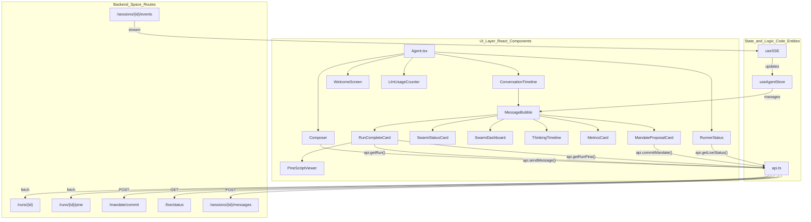
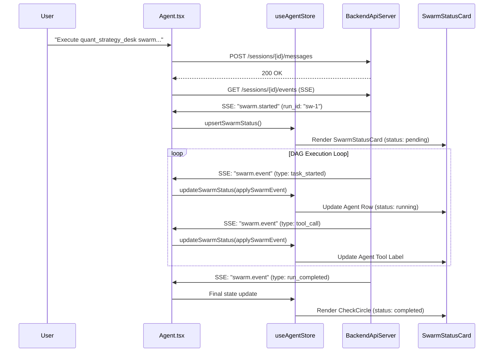

<!-- source: DeepWiki mcp.deepwiki.com · repo HKUDS/Vibe-Trading · page 8.2 Chat Interface Components · fetched 2026-11-09 -->

# Chat Interface Components

Relevant source files

The following files were used as context for generating this wiki page:

- [CONTRIBUTING.md](CONTRIBUTING.md)
- [agent/src/br_data/__main__.py](agent/src/br_data/__main__.py)
- [agent/src/br_data/scheduling.py](agent/src/br_data/scheduling.py)
- [agent/src/scheduling/registry.py](agent/src/scheduling/registry.py)
- [agent/src/scheduling/system_jobs.py](agent/src/scheduling/system_jobs.py)
- [agent/src/tools/swarm_tool.py](agent/src/tools/swarm_tool.py)
- [agent/tests/scheduling/test_br_sync_outcomes.py](agent/tests/scheduling/test_br_sync_outcomes.py)
- [agent/tests/scheduling/test_memory_consolidation_job.py](agent/tests/scheduling/test_memory_consolidation_job.py)
- [agent/tests/scheduling/test_system_jobs.py](agent/tests/scheduling/test_system_jobs.py)
- [agent/tests/test_agent_goal_context.py](agent/tests/test_agent_goal_context.py)
- [agent/tests/test_agent_loop_content_filter.py](agent/tests/test_agent_loop_content_filter.py)
- [agent/tests/test_agent_loop_no_assistant_prefill.py](agent/tests/test_agent_loop_no_assistant_prefill.py)
- [agent/tests/test_agent_loop_stream_retry.py](agent/tests/test_agent_loop_stream_retry.py)
- [agent/tests/test_agent_loop_terminal_state.py](agent/tests/test_agent_loop_terminal_state.py)
- [agent/tests/test_agent_loop_trace.py](agent/tests/test_agent_loop_trace.py)
- [agent/tests/test_br_data.py](agent/tests/test_br_data.py)
- [agent/tests/test_content_filter_e2e.py](agent/tests/test_content_filter_e2e.py)
- [agent/tests/test_grounding_recovery.py](agent/tests/test_grounding_recovery.py)
- [agent/tests/test_reasoning_delta_throttle.py](agent/tests/test_reasoning_delta_throttle.py)
- [agent/tests/test_swarm_tool_preset_matching.py](agent/tests/test_swarm_tool_preset_matching.py)
- [agent/tests/test_swarm_worker_stream_retry.py](agent/tests/test_swarm_worker_stream_retry.py)
- [frontend/src/components/chat/LlmUsageCounter.tsx](frontend/src/components/chat/LlmUsageCounter.tsx)
- [frontend/src/components/chat/MessageBubble.tsx](frontend/src/components/chat/MessageBubble.tsx)
- [frontend/src/components/chat/SwarmDashboard.tsx](frontend/src/components/chat/SwarmDashboard.tsx)
- [frontend/src/components/chat/SwarmStatusCard.tsx](frontend/src/components/chat/SwarmStatusCard.tsx)
- [frontend/src/components/chat/__tests__/LlmUsageCounter.test.tsx](frontend/src/components/chat/__tests__/LlmUsageCounter.test.tsx)
- [frontend/src/components/chat/__tests__/MessageBubble.test.tsx](frontend/src/components/chat/__tests__/MessageBubble.test.tsx)
- [frontend/src/components/chat/__tests__/SwarmStatusCard.usage.test.tsx](frontend/src/components/chat/__tests__/SwarmStatusCard.usage.test.tsx)
- [frontend/src/hooks/__tests__/useLlmUsageCounter.test.ts](frontend/src/hooks/__tests__/useLlmUsageCounter.test.ts)
- [frontend/src/hooks/__tests__/useSSE.test.ts](frontend/src/hooks/__tests__/useSSE.test.ts)
- [frontend/src/hooks/useLlmUsageCounter.ts](frontend/src/hooks/useLlmUsageCounter.ts)
- [frontend/src/hooks/useSSE.ts](frontend/src/hooks/useSSE.ts)
- [frontend/src/lib/__tests__/llmUsage.test.ts](frontend/src/lib/__tests__/llmUsage.test.ts)
- [frontend/src/lib/__tests__/swarmStatus.usage.test.ts](frontend/src/lib/__tests__/swarmStatus.usage.test.ts)
- [frontend/src/lib/swarmStatus.ts](frontend/src/lib/swarmStatus.ts)
- [frontend/src/pages/Agent.tsx](frontend/src/pages/Agent.tsx)
- [frontend/src/pages/__tests__/AgentActivityTimerPersistence.test.tsx](frontend/src/pages/__tests__/AgentActivityTimerPersistence.test.tsx)
- [frontend/src/stores/agent.ts](frontend/src/stores/agent.ts)
- [frontend/src/types/agent.ts](frontend/src/types/agent.ts)
- [zimaos/README.md](zimaos/README.md)
- [zimaos/docker-compose.yml](zimaos/docker-compose.yml)

The Vibe-Trading frontend utilizes a React 19 component library located in `frontend/src/components/chat/` designed specifically to handle the asynchronous, streaming, and progressive nature of AI-driven quantitative trading. The chat interface serves as the primary orchestration hub, rendering agent reasoning streams, tool execution logs, financial metrics, live trading mandates, and interactive multi-agent swarm dashboards.

Sources: [frontend/src/pages/Agent.tsx:1-50]()

---

## Architecture Overview

The chat interface follows a progressive data-loading pattern. While initial message metadata and text streams arrive via Server-Sent Events (SSE), heavy execution assets such as equity curves, Pine Script code, and detailed backtest metrics are fetched lazily by individual components to maintain UI responsiveness.

### Data Flow and SSE Handling

The interface relies on the `useSSE` hook to stream real-time updates from the backend's `EventBus`.

1.  **Message Initiation**: The user dispatches a message via `api.sendMessage` [frontend/src/lib/api.ts:51-51]().
2.  **SSE Stream Connection**: The `Agent.tsx` page hooks into the stream using `api.sseUrl(sid)` [frontend/src/pages/Agent.tsx:164-164]().
3.  **Connection Management**: The `useSSE` hook manages the underlying `EventSource` connection featuring auto-reconnect with exponential backoff, LRU event deduplication, and `Last-Event-ID` resume logic [frontend/src/hooks/useSSE.ts:2-5]().
4.  **Event Routing**: It processes specific event types including `text_delta`, `thinking_done`, `tool_call`, `tool_result`, `swarm.started`, `goal.evidence`, and `mandate.proposal` [frontend/src/hooks/useSSE.ts:86-96]().
5.  **Component Reification**: Specialized components like `RunCompleteCard` detect a `runId` in the message metadata and trigger secondary HTTP fetches for auxiliary metrics and code artifacts [frontend/src/pages/Agent.tsx:9-18]().

### Component Relationship Diagram

The following diagram maps visual components in Natural Language Space to their underlying TypeScript classes, hooks, and backend routes in Code Entity Space.

**Chat Interface Entity Map**

Sources: [frontend/src/pages/Agent.tsx:10-18](), [frontend/src/hooks/useSSE.ts:2-5](), [frontend/src/lib/api.ts:7-7](), [frontend/src/components/chat/RunnerStatus.tsx:17-22](), [frontend/src/components/chat/Composer.tsx:34-34](), [frontend/src/components/chat/PineScriptViewer.tsx:11-11]()

---

## Core Chat Components

### MessageBubble
The `MessageBubble` component acts as the primary container for all conversational turns and structured agent outputs.
*   **Polymorphic Rendering**: Inspects message types to render specialized sub-components such as `RunCompleteCard`, `SwarmStatusCard`, or `MandateProposalCard` [frontend/src/pages/Agent.tsx:13-19]().
*   **Message Grouping**: Aggregates adjacent execution events into `single` or `timeline` groups using `groupMessages` to separate conversational text from dense reasoning and tool logs [frontend/src/pages/Agent.tsx:49-75]().
*   **Markdown Parsing**: Integrates `ReactMarkdown` with `remarkGfm`, `remarkMath`, `rehypeHighlight`, and `rehypeKatex` to render formatted text, code blocks, and mathematical expressions, protected by a `MarkdownErrorBoundary` [frontend/src/components/chat/MessageBubble.tsx:19-68]().
*   **Clipboard Utilities**: Implements a `CopyButton` wrapper for one-click content copying [frontend/src/components/chat/MessageBubble.tsx:134-161]().

Sources: [frontend/src/pages/Agent.tsx:13-19](), [frontend/src/pages/Agent.tsx:49-75](), [frontend/src/components/chat/MessageBubble.tsx:19-68](), [frontend/src/components/chat/MessageBubble.tsx:134-161]()

### Composer
The `Composer` component manages user input and auxiliary interaction modes.
*   **Attachment Parsing**: Extracts uploaded files via `extractUploadedAttachments` and prepends metadata to outgoing payloads [frontend/src/pages/Agent.tsx:133-136]().
*   **Mode Prefixes**: Automatically prefixes messages with identifiers for "Swarm Team Mode" or "Goal Mode" based on context [frontend/src/pages/Agent.tsx:138-155]().
*   **Input Controls**: Handles local text state, keyboard shortcuts, and dispatches messages to the backend session store [frontend/src/components/chat/Composer.tsx:34-34]().

Sources: [frontend/src/pages/Agent.tsx:133-136](), [frontend/src/pages/Agent.tsx:138-155](), [frontend/src/components/chat/Composer.tsx:34-34]()

### ThinkingTimeline
The `ThinkingTimeline` component visualizes the internal ReAct iteration cycles of the agent [frontend/src/pages/Agent.tsx:14-14](), rendering sequential `thinking`, `tool_call`, and `tool_result` events.

Sources: [frontend/src/pages/Agent.tsx:14-14]()

### WelcomeScreen
The entry point for brand-new sessions, rendering categorized prompt examples and system capabilities [frontend/src/components/chat/WelcomeScreen.tsx:203-206]().
*   **Categorized Templates**: Features categories such as `multiMarketBacktest`, `swarmTeams`, `valueInvesting`, and `shadowAccount` [frontend/src/components/chat/WelcomeScreen.tsx:17-179]().
*   **Internationalization**: Leverages `useTranslation` to pull localized strings across locale bundles [frontend/src/components/chat/WelcomeScreen.tsx:2-2]().
*   **Dynamic Time-of-Day Greetings**: Computes morning, afternoon, evening, or night greetings dynamically [frontend/src/components/chat/WelcomeScreen.tsx:174-195]().

Sources: [frontend/src/components/chat/WelcomeScreen.tsx:203-206](), [frontend/src/components/chat/WelcomeScreen.tsx:17-179](), [frontend/src/components/chat/WelcomeScreen.tsx:2-2](), [frontend/src/components/chat/WelcomeScreen.tsx:174-195]()

---

## Specialized UI Surfaces and Cards

### SwarmStatusCard and SwarmDashboard
These components render the real-time execution status of multi-agent DAG workflows.
*   **Topological Layer Tracking**: Displays active execution layers and progress across multi-agent pipelines [frontend/src/components/chat/SwarmStatusCard.tsx:90-91]().
*   **Agent Node Grid**: Visualizes individual agent states (`running`, `done`, `failed`, `blocked`, `retry`), active tool names, and iteration counts [frontend/src/components/chat/SwarmStatusCard.tsx:136-164]().
*   **Event Hydration**: Mutates status state dynamically using `applySwarmEvent` as incoming SSE swarm events arrive from the backend [frontend/src/lib/swarmStatus.ts:131-163]().

Sources: [frontend/src/components/chat/SwarmStatusCard.tsx:90-91](), [frontend/src/components/chat/SwarmStatusCard.tsx:136-164](), [frontend/src/lib/swarmStatus.ts:131-163]()

### RunCompleteCard and MetricsCard
These components summarize completed backtests and research runs.
*   **Run Artifact Parsing**: Inspects run metadata via `runCardFields` to render performance summaries [frontend/src/lib/runCards.ts]().
*   **Metrics Presentation**: Displays key financial ratios (Sharpe, Sortino, Max Drawdown, Annualized Return) within `MetricsCard`.
*   **Code Viewer Bridge**: Connects directly to the `PineScriptViewer` modal to inspect generated strategy translation code.

Sources: [frontend/src/lib/runCards.ts]()

### MandateProposalCard
Renders a Consent Protocol proposal card for live trading authorization [frontend/src/components/chat/MandateProposalCard.tsx:181-187]().
*   **Risk Parameter Enforcement**: Exposes concrete numeric limits for `max_order_usd`, `daily_trade_cap`, `leverage`, and allowed `universe` [frontend/src/components/chat/MandateProposalCard.tsx:100-121]().
*   **Natural Language Adjustment**: Provides an "Adjust" action to feed textual counter-proposals back into the agent loop [frontend/src/components/chat/MandateProposalCard.tsx:185-186]().
*   **Commit Action**: Invokes `api.commitMandate` to securely store user authorization [frontend/src/components/chat/MandateProposalCard.tsx:168-174]().

Sources: [frontend/src/components/chat/MandateProposalCard.tsx:181-187](), [frontend/src/components/chat/MandateProposalCard.tsx:100-121](), [frontend/src/components/chat/MandateProposalCard.tsx:185-186](), [frontend/src/components/chat/MandateProposalCard.tsx:168-174]()

### RunnerStatus and LlmUsageCounter
*   **RunnerStatus**: A persistent status bar monitoring live broker connectivity, global kill-switch flags (`OctagonX`), and OAuth onboarding flows via `api.getLiveStatus()` [frontend/src/components/chat/RunnerStatus.tsx:13-34,121-176]().
*   **LlmUsageCounter**: Connects with `useLlmUsageCounter` to track token consumption, input/output ratios, and provider costs across chat turns [frontend/src/hooks/useLlmUsageCounter.ts]().

Sources: [frontend/src/components/chat/RunnerStatus.tsx:13-34](), [frontend/src/hooks/useLlmUsageCounter.ts]()

### PineScriptViewer
A modal component designed for reviewing strategy translations.
*   **Code Rendering**: Displays Pine Script v6 syntax inside scrollable code containers [frontend/src/components/chat/PineScriptViewer.tsx:95-97]().
*   **Clipboard Integration**: Provides quick-copy mechanisms and direct links to official TradingView documentation [frontend/src/components/chat/PineScriptViewer.tsx:31-79]().

Sources: [frontend/src/components/chat/PineScriptViewer.tsx:31-97]()

---

## Data Interaction Lifecycle

The following sequence diagram illustrates the lifecycle of a multi-agent swarm run triggered via chat and tracked via SSE.

**Swarm Execution Sequence**

Sources: [frontend/src/pages/Agent.tsx:18-23](), [frontend/src/lib/swarmStatus.ts:131-163](), [frontend/src/components/chat/SwarmStatusCard.tsx:86-108](), [frontend/src/hooks/useSSE.ts:85-85]()

---

## Component Metadata Reference

| Component | Purpose | Key Data Source / Hook |
| :--- | :--- | :--- |
| `WelcomeScreen` | Onboarding screen with example prompts and categories. | `CATEGORIES` [frontend/src/components/chat/WelcomeScreen.tsx:17-179]() |
| `Composer` | Input container for user messaging and attachments. | `ComposerAttachment` [frontend/src/pages/Agent.tsx:33-34]() |
| `SwarmStatusCard` | Real-time tracking of multi-agent execution steps. | `SwarmRunStatus` via `applySwarmEvent` [frontend/src/lib/swarmStatus.ts:131-163]() |
| `MandateProposalCard` | Consent protocol interface for risk parameter limits. | `MandateProposal` [frontend/src/pages/Agent.tsx:13-13]() |
| `RunnerStatus` | Live trading runner telemetry and kill-switch indicators. | `api.getLiveStatus()` [frontend/src/components/chat/RunnerStatus.tsx:17-22]() |
| `MessageBubble` | Polymorphic container for user and agent messages. | `AgentMessage` [frontend/src/types/agent.ts]() |
| `LlmUsageCounter` | Token accounting and cost tracking display. | `useLlmUsageCounter` [frontend/src/hooks/useLlmUsageCounter.ts]() |
| `PineScriptViewer` | Modal dialog for displaying generated Pine Script code. | `code` prop [frontend/src/components/chat/PineScriptViewer.tsx:7-7]() |

Sources: [frontend/src/components/chat/WelcomeScreen.tsx:17-179](), [frontend/src/pages/Agent.tsx:33-34](), [frontend/src/lib/swarmStatus.ts:131-163](), [frontend/src/pages/Agent.tsx:13-13](), [frontend/src/components/chat/RunnerStatus.tsx:17-22](), [frontend/src/types/agent.ts:19-19](), [frontend/src/hooks/useLlmUsageCounter.ts](), [frontend/src/components/chat/PineScriptViewer.tsx:7-7]()

---

