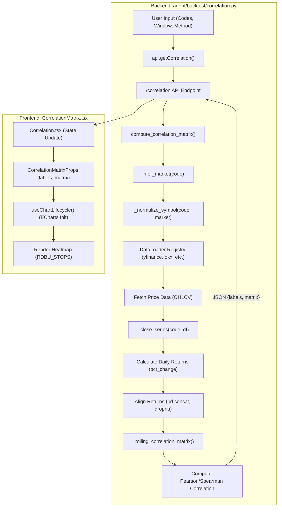
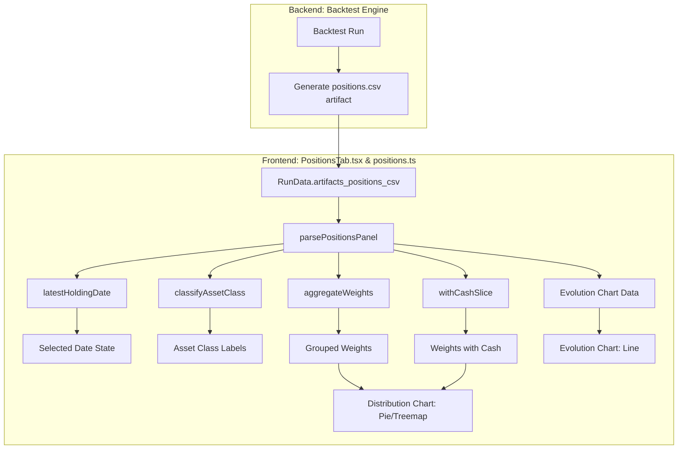
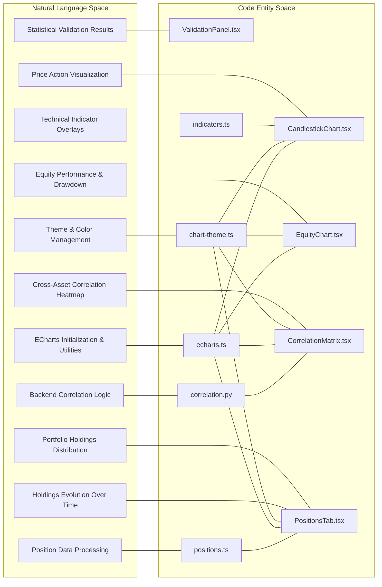

<!-- source: DeepWiki mcp.deepwiki.com · repo HKUDS/Vibe-Trading · page 8.3 Financial Charts and Visualization · fetched 2026-11-09 -->

# Financial Charts and Visualization

Relevant source files

The following files were used as context for generating this wiki page:

- [MANIFEST.in](MANIFEST.in)
- [agent/backtest/correlation.py](agent/backtest/correlation.py)
- [agent/src/tools/background_tools.py](agent/src/tools/background_tools.py)
- [agent/src/tools/paper_trade/accounts.py](agent/src/tools/paper_trade/accounts.py)
- [agent/src/tools/pdf_report.py](agent/src/tools/pdf_report.py)
- [agent/tests/test_background_tools.py](agent/tests/test_background_tools.py)
- [agent/tests/test_correlation.py](agent/tests/test_correlation.py)
- [agent/tests/test_paper_accounts.py](agent/tests/test_paper_accounts.py)
- [agent/tests/test_pdf_report_arabic.py](agent/tests/test_pdf_report_arabic.py)
- [desktop/electron/requirements-windows-lock.txt](desktop/electron/requirements-windows-lock.txt)
- [frontend/src/components/charts/CorrelationMatrix.tsx](frontend/src/components/charts/CorrelationMatrix.tsx)
- [frontend/src/components/charts/StrategyResearchDashboard.tsx](frontend/src/components/charts/StrategyResearchDashboard.tsx)
- [frontend/src/components/charts/__tests__/CorrelationMatrix.test.tsx](frontend/src/components/charts/__tests__/CorrelationMatrix.test.tsx)
- [frontend/src/components/charts/__tests__/StrategyResearchDashboard.test.tsx](frontend/src/components/charts/__tests__/StrategyResearchDashboard.test.tsx)
- [frontend/src/components/chat/RunCompleteCard.tsx](frontend/src/components/chat/RunCompleteCard.tsx)
- [frontend/src/components/chat/__tests__/RunCompleteCard.test.tsx](frontend/src/components/chat/__tests__/RunCompleteCard.test.tsx)
- [frontend/src/lib/__tests__/runCards.test.ts](frontend/src/lib/__tests__/runCards.test.ts)
- [frontend/src/lib/runCards.ts](frontend/src/lib/runCards.ts)
- [frontend/src/lib/runReports.ts](frontend/src/lib/runReports.ts)
- [frontend/src/pages/Home.tsx](frontend/src/pages/Home.tsx)
- [frontend/src/pages/RunDetail.tsx](frontend/src/pages/RunDetail.tsx)
- [frontend/src/pages/__tests__/AgentBackgroundStreamCompletion.test.tsx](frontend/src/pages/__tests__/AgentBackgroundStreamCompletion.test.tsx)
- [frontend/src/pages/__tests__/AgentGroundingStatus.test.tsx](frontend/src/pages/__tests__/AgentGroundingStatus.test.tsx)
- [frontend/src/pages/__tests__/RunDetail.test.tsx](frontend/src/pages/__tests__/RunDetail.test.tsx)

The Vibe-Trading frontend extensively uses **Apache ECharts** for sophisticated, interactive financial data visualization [frontend/src/components/charts/CorrelationMatrix.tsx:1-131](). The charts visualize OHLCV price data, technical indicator overlays, trade execution markers, equity performance curves, cross-asset relationships, and validation analytics. These visualizations are essential for exploring backtest results, portfolio performance, and statistical robustness.

This section documents the main chart components in `frontend/src/components/charts/`, supporting utility modules like `indicators.ts`, `chart-theme.ts`, and `echarts.ts`, and the backend correlation logic in `agent/backtest/correlation.py`.

---

## Core Visualization Components

### CandlestickChart

The `CandlestickChart` component is the primary tool for price action and technical analysis.

- **Implementation**: Built using Apache ECharts. It displays OHLCV bars in the main grid and volume bars in a synchronized sub-grid.
- **Technical Indicators**: Supports overlays including Moving Averages (MA5, MA10, MA20, MA60), Exponential Moving Averages (EMA12, EMA26), and Bollinger Bands (BOLL). These are computed via `frontend/src/lib/indicators.ts`.
- **Trade Markers**: Represents executed trades (e.g., BUY/SELL) as colored markers (`MarkPoint`) with tooltips conveying price, quantity, and reason.
- **Sub-Charts**: Users can toggle between Volume, MACD, RSI, and KDJ views for the secondary grid.
- **Range Selector**: Provides quick filters for 1M, 3M, 6M, 1Y, and ALL timeframes based on trading bar counts.

### EquityChart and MiniEquityChart

- **EquityChart**: Displays the portfolio equity curve with an overlayed maximum drawdown plot [frontend/src/pages/RunDetail.tsx:46](). It visualizes cumulative returns and capital risk.
- **MiniEquityChart**: A compact sparkline version of the equity curve used in chat bubbles or dashboard lists [frontend/src/components/chat/RunCompleteCard.tsx:11-14]().
- **Data Flow**: Both components receive time-series equity data (timestamp and value) derived from the `equity.csv` artifact produced by backtest engines.
- **Visual Features**: Uses a linear gradient for the equity area and a dashed `markLine` to highlight the Maximum Drawdown (Max DD) point.

### CorrelationMatrix

The `CorrelationMatrix` component renders a heatmap of pairwise correlation coefficients between assets [frontend/src/components/charts/CorrelationMatrix.tsx:30-130]().

- **Visualization**: Uses a color-coded heatmap with a diverging scale (`RDBU_STOPS`: blue for negative, red for positive) to indicate correlation strength [frontend/src/components/charts/CorrelationMatrix.tsx:13]().
- **Undefined Handling**: Undefined pairs (null values from zero-variance legs such as halted series) are explicitly rendered as muted placeholder cells (`—`) rather than defaulting to `0.0` [frontend/src/components/charts/CorrelationMatrix.tsx:37-46]().
- **VisualMap**: Includes an interactive legend for filtering correlation ranges [frontend/src/components/charts/CorrelationMatrix.tsx:91-103]().
- **Responsive Design**: Uses a `useChartLifecycle` hook to manage the ECharts instance lifecycle and resizing [frontend/src/components/charts/CorrelationMatrix.tsx:33-33]().
- **Labeling Logic**: Cell labels are displayed only when the number of assets is $\le 8$ to prevent visual clutter [frontend/src/components/charts/CorrelationMatrix.tsx:110-110]().

Sources: [frontend/src/components/charts/CorrelationMatrix.tsx:1-131]()

### ValidationPanel

- **Purpose**: Visualizes statistical validation results from backtest runs [frontend/src/pages/RunDetail.tsx:50]().
- **Components**: Displays Monte Carlo permutation distributions, Bootstrap confidence intervals for Sharpe/Returns, and Walk-Forward consistency metrics.
- **Data Source**: Consumes the `validation` object from the `RunData` contract.

### PositionsTab

The `PositionsTab` component, located in `frontend/src/components/run/PositionsTab.tsx`, visualizes portfolio holdings and their evolution over time [frontend/src/pages/RunDetail.tsx:57]().

- **Data Source**: Processes `positions.csv` artifacts from backtest runs using `parsePositionsPanel()`.
- **Asset Classification**: Uses `classifyAssetClass()` from `frontend/src/lib/positions.ts` to categorize symbols into types like `a_share`, `us_equity`, `crypto`, etc. [frontend/src/pages/RunDetail.tsx:59]().
- **Weight Aggregation**: `aggregateWeights()` groups positions by asset class or sector and merges smaller groups into an "other" category to maintain readability.
- **Cash Slice**: `withCashSlice()` adds a synthetic `__cash__` symbol to represent uncommitted capital, calculated as `1 - sum(|weight|)`.
- **Visualizations**:
    - **Distribution Chart**: Displays current holdings as a pie chart or treemap, showing weights by symbol, asset class, or sector.
    - **Evolution Chart**: Shows the time-series evolution of top holdings, downsampling dates for performance if necessary.

---

## Supporting Modules

### frontend/src/lib/echarts.ts
This module manages selective imports to optimize bundle size [frontend/src/components/charts/StrategyResearchDashboard.tsx:5-5](). It registers chart types, components, and synchronization helpers like `connectCharts()` to link crosshairs and zooming across multiple instances.

### frontend/src/lib/chart-theme.ts
Defines consistent styling for the visualization suite [frontend/src/components/charts/CorrelationMatrix.tsx:3-3]() via `getChartTheme()`, which adapts visualization colors (axes, text, grids, tooltips) to the application's light/dark mode.

### frontend/src/lib/positions.ts
This utility module provides functions for parsing and processing position data from backtest artifacts.

- **`PositionsPanel` Interface**: Defines the structure for parsed position data, including `dates`, `symbols`, and `weightByDate`.
- **`isDateColumn()`**: Identifies date/time columns in raw CSV data [frontend/src/pages/RunDetail.tsx:59]().
- **`parsePositionsPanel()`**: Converts an array of raw CSV rows into the `PositionsPanel` structure.
- **`classifyAssetClass()`**: A heuristic function determining the asset class (`a_share`, `us_equity`, `crypto`, `forex`, etc.) based on suffixes and patterns, mirroring backend logic in `agent/backtest/correlation.py`.

---

## Backend Correlation Computation

The backend logic in `agent/backtest/correlation.py` handles data preparation for the correlation heatmap [agent/backtest/correlation.py:1-5]().

- **Market Inference**: `infer_market()` detects asset types (`crypto`, `a_share`, `hk_equity`, `us_equity`, `forex`, `futures`, `kr_equity`, `ca_equity`, `us_equity`) to select the correct `DataLoader` [agent/backtest/correlation.py:20-92](). It prioritizes explicit suffixes (`.HK`, `.SH`, `.SZ`, `.BJ`, `.TO`, `.V`, `.US`) and digit lengths (e.g., 6 digits for A-shares, $\le 5$ for HK equities) to distinguish Hong Kong tickers from A-shares [agent/backtest/correlation.py:23-34](). Tested thoroughly in `agent/tests/test_correlation.py` [agent/tests/test_correlation.py:1-122]().
- **Symbol Normalization**: `_normalize_symbol()` converts user-supplied raw tickers into canonical loader forms (e.g., `AAPL` $\to$ `AAPL.US`, `0700` $\to$ `0700.HK`) [agent/backtest/correlation.py:95-148]().
- **Returns Calculation**: Extracts closing series and computes daily percentage changes over close prices [agent/backtest/correlation.py:151-173]().
- **Methods**: Supports both **Pearson** (linear) and **Spearman** (rank-based) correlation coefficients.

Sources: [agent/backtest/correlation.py:1-176](), [agent/tests/test_correlation.py:1-142]()

---

## Data Flow and Integration

### Correlation Analysis Pipeline

Sources: [agent/backtest/correlation.py:1-176](), [frontend/src/components/charts/CorrelationMatrix.tsx:30-130]()

### Positions Visualization Pipeline

Sources: [frontend/src/components/run/PositionsTab.tsx:99-180](), [frontend/src/lib/positions.ts:71-204]()

### Code Entity Mapping for Visualization

Sources: [frontend/src/components/charts/CorrelationMatrix.tsx:1-130](), [frontend/src/lib/positions.ts:1-225](), [agent/backtest/correlation.py:1-176]()

---

**Sources:**
- [agent/backtest/correlation.py:1-176]()
- [agent/tests/test_correlation.py:1-142]()
- [frontend/src/components/charts/CorrelationMatrix.tsx:1-131]()
- [frontend/src/components/charts/StrategyResearchDashboard.tsx:1-162]()
- [frontend/src/components/chat/RunCompleteCard.tsx:1-140]()
- [frontend/src/pages/RunDetail.tsx:1-160]()

---

