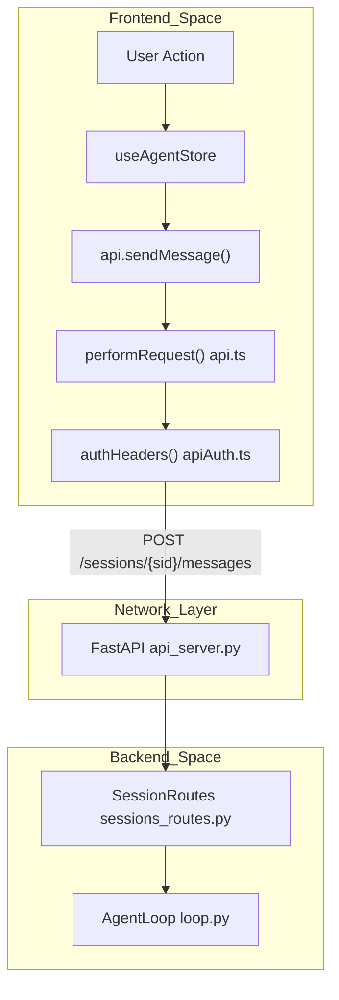
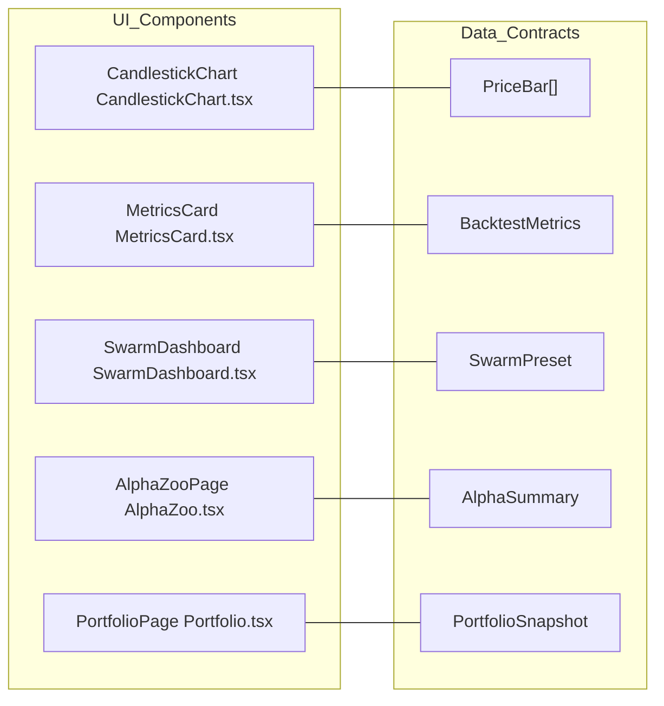

<!-- source: DeepWiki mcp.deepwiki.com · repo HKUDS/Vibe-Trading · page 8.4 API Client and Data Contracts · fetched 2026-11-09 -->

# API Client and Data Contracts

Relevant source files

The following files were used as context for generating this wiki page:

- [frontend/src/i18n/locales/ar.json](frontend/src/i18n/locales/ar.json)
- [frontend/src/i18n/locales/de.json](frontend/src/i18n/locales/de.json)
- [frontend/src/i18n/locales/en.json](frontend/src/i18n/locales/en.json)
- [frontend/src/i18n/locales/es.json](frontend/src/i18n/locales/es.json)
- [frontend/src/i18n/locales/fa.json](frontend/src/i18n/locales/fa.json)
- [frontend/src/i18n/locales/id.json](frontend/src/i18n/locales/id.json)
- [frontend/src/i18n/locales/ja.json](frontend/src/i18n/locales/ja.json)
- [frontend/src/i18n/locales/ko.json](frontend/src/i18n/locales/ko.json)
- [frontend/src/i18n/locales/pt-BR.json](frontend/src/i18n/locales/pt-BR.json)
- [frontend/src/i18n/locales/tr.json](frontend/src/i18n/locales/tr.json)
- [frontend/src/i18n/locales/zh-CN.json](frontend/src/i18n/locales/zh-CN.json)
- [frontend/src/lib/api.ts](frontend/src/lib/api.ts)

This page documents the frontend communication layer and the TypeScript data structures that define the contract between the React application and the FastAPI backend. The primary implementation resides in `frontend/src/lib/api.ts`, which provides a type-safe wrapper around the native `fetch` API and encapsulates all interaction logic for sessions, backtest runs, settings management, Alpha Zoo research, portfolio states, and live trading operations.

## Request Wrapper and Authentication

The frontend uses a centralized request execution pattern via `performRequest` to handle standard HTTP communication, request timeouts, header injection, response parsing, and unified error reporting [frontend/src/lib/api.ts:16-49]().

### Implementation Details
- **Base URL & Proxies**: The `BASE` constant is an empty string [frontend/src/lib/api.ts:9](), relying on Vite's proxy configuration in development to forward requests to the FastAPI backend at `http://127.0.0.1:8899` [frontend/vite.config.ts:5-57]().
- **Timeouts**: Requests enforce `REQUEST_TIMEOUT_MS` (defaulting to 120,000ms or `VITE_API_TIMEOUT_MS`) and a tighter `METADATA_TIMEOUT_MS` (15,000ms) using `AbortController` [frontend/src/lib/api.ts:10-13, 22-27](). Mutations (non-GET/HEAD methods) throw a specialized request timeout error if they time out, ensuring writes are never automatically replayed [frontend/src/lib/api.ts:36-39]().
- **Authentication Headers**: It integrates with `authHeaders()` and `withAuthTicket` to inject authorization credentials into requests [frontend/src/lib/api.ts:2]().
- **Error Handling**: Non-ok responses throw an `ApiError` instance containing status codes and machine-readable error codes [frontend/src/lib/api.ts:33, 61-71](). Network connection issues are caught as `network_error` `ApiError` objects [frontend/src/lib/api.ts:41-43]().
- **Auth Required Logic**: `isAuthRequiredError` detects 401 and 403 status codes [frontend/src/lib/api.ts:86-88](), utilizing `AUTH_REQUIRED_MESSAGE` which dynamically syncs with the active i18n locale [frontend/src/lib/api.ts:73-84]().

**Sources:**
- `frontend/src/lib/api.ts:2-88`()
- `frontend/vite.config.ts:5-57`()

## API Method Registry

The API client exports functions grouped by backend subsystems:

### Session, Chat, and Research Goals
- `listSessions`, `createSession`, `deleteSession`, `renameSession`, `sendMessage`, `cancelSession`, `getSessionMessages`: Manage conversation lifecycles and prompt dispatches.
- `createGoal`, `getGoal`, `updateGoal`, `addGoalEvidence`, `updateGoalStatus`: Manage durable Finance Research Goal ledgers.

### Backtest, Alpha Zoo, and Correlation
- `listRuns`, `getRun`, `getRunCode`, `getRunPine`: Retrieve execution artifacts, raw Python strategy code, and exported Pine Script v6.
- `listAlphas`, `getAlpha`, `benchAlpha`: Interact with the factor research zoo and benchmark execution endpoints.
- `getCorrelation`, `getCorrelationRegime`: Retrieve cross-asset matrix and regime episode evaluations.

### Live Trading, Swarm, and Portfolio
- `listSwarmPresets`, `createSwarmRun`, `listSwarmRuns`: Trigger and track multi-agent DAG swarm workflows.
- `getLiveStatus`, `haltLive`, `commitMandate`: Monitor trading runners, trip kill switches, and commit authorized broker mandates.
- `getPortfolioSnapshot`, `getPortfolioHistory`, `refreshPortfolio`, `getPortfolioSettings`, `getConnectorOnboarding`, `getLocalConnections`: Manage broker connection catalogs, multi-source valuation snapshots, and account reconciliations.

**Sources:**
- `frontend/src/lib/api.ts:90-262`()

## Data Contracts (TypeScript Interfaces)

TypeScript interfaces mirror backend Pydantic models to enforce payload safety:

- **Financial & Portfolio Structures**: `CorrelationResponse`, `CorrelationRegimeResponse`, `RegimeEpisode`, `PortfolioPosition`, `PortfolioAccount`, `PortfolioSnapshot`, `PortfolioConnectorCompatibility`.
- **Agent & Backtest Data**: `RunData`, `BacktestMetrics`, `PriceBar`, `TradeMarker`, `IndicatorPoint`, `ValidationData`, `SwarmPreset`, `SessionItem`.
- **Configuration & Research**: `LLMSettings`, `DataSourceSettings`, `QVerisConfig`, `AlphaSummary`, `AlphaDetailResponse`, `AlphaBenchResult`.

**Sources:**
- `frontend/src/lib/api.ts:40-419`()

## System Data Flow Diagrams

### Request Lifecycle Flow
The following diagram connects frontend user actions through the API client wrapper to backend FastAPI endpoints and the `AgentLoop`.

Title: "Frontend_to_Backend_Request_Flow"

**Sources:**
- `frontend/src/lib/api.ts:16-34`()
- `frontend/src/lib/api.ts:110`()

### Visual Component to Data Contract Mapping
This diagram bridges UI visualization components to their underlying TypeScript data contract definitions.

Title: "UI_Component_to_Data_Contract_Mapping"

**Sources:**
- `frontend/src/lib/api.ts:40-419`()
- `frontend/src/lib/api.ts:282-359`()

---

