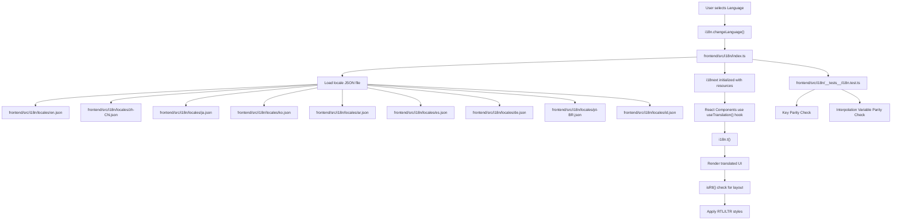
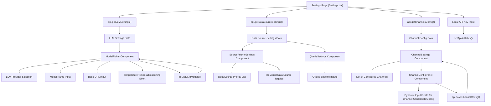

<!-- source: DeepWiki mcp.deepwiki.com · repo HKUDS/Vibe-Trading · page 8.5 Internationalization and Settings UI · fetched 2026-11-09 -->

# 8.5. Internationalization and Settings UI

<details>
<summary>Relevant source files</summary>

The following files were used as context for generating this wiki page:

- [agent/api_server.py](agent/api_server.py)
- [agent/src/api/channels_routes.py](agent/src/api/channels_routes.py)
- [agent/src/api/helpers.py](agent/src/api/helpers.py)
- [agent/src/api/security.py](agent/src/api/security.py)
- [agent/src/api/settings_routes.py](agent/src/api/settings_routes.py)
- [agent/src/api/state.py](agent/src/api/state.py)
- [agent/src/channels/msteams.py](agent/src/channels/msteams.py)
- [agent/src/providers/custom_profiles.py](agent/src/providers/custom_profiles.py)
- [agent/src/session/events.py](agent/src/session/events.py)
- [agent/tests/test_api_infrastructure.py](agent/tests/test_api_infrastructure.py)
- [agent/tests/test_channel_runtime_reset.py](agent/tests/test_channel_runtime_reset.py)
- [agent/tests/test_eventbus_clear_subscribers.py](agent/tests/test_eventbus_clear_subscribers.py)
- [agent/tests/test_msteams_inbound_body_limit.py](agent/tests/test_msteams_inbound_body_limit.py)
- [agent/tests/test_scheduled_delivery_hook.py](agent/tests/test_scheduled_delivery_hook.py)
- [agent/tests/test_security_auth_api.py](agent/tests/test_security_auth_api.py)
- [agent/tests/test_session_events.py](agent/tests/test_session_events.py)
- [agent/tests/test_settings_api.py](agent/tests/test_settings_api.py)
- [agent/tests/test_sse_ticket_and_headers.py](agent/tests/test_sse_ticket_and_headers.py)
- [frontend/src/__tests__/viteProxy.test.ts](frontend/src/__tests__/viteProxy.test.ts)
- [frontend/src/components/layout/__tests__/Navigation.test.tsx](frontend/src/components/layout/__tests__/Navigation.test.tsx)
- [frontend/src/components/layout/navigation.ts](frontend/src/components/layout/navigation.ts)
- [frontend/src/i18n/__tests__/i18n.test.ts](frontend/src/i18n/__tests__/i18n.test.ts)
- [frontend/src/i18n/index.ts](frontend/src/i18n/index.ts)
- [frontend/src/i18n/locales/ar.json](frontend/src/i18n/locales/ar.json)
- [frontend/src/i18n/locales/de.json](frontend/src/i18n/locales/de.json)
- [frontend/src/i18n/locales/en.json](frontend/src/i18n/locales/en.json)
- [frontend/src/i18n/locales/es.json](frontend/src/i18n/locales/es.json)
- [frontend/src/i18n/locales/fa.json](frontend/src/i18n/locales/fa.json)
- [frontend/src/i18n/locales/id.json](frontend/src/i18n/locales/id.json)
- [frontend/src/i18n/locales/ja.json](frontend/src/i18n/locales/ja.json)
- [frontend/src/i18n/locales/ko.json](frontend/src/i18n/locales/ko.json)
- [frontend/src/i18n/locales/pt-BR.json](frontend/src/i18n/locales/pt-BR.json)
- [frontend/src/i18n/locales/tr.json](frontend/src/i18n/locales/tr.json)
- [frontend/src/i18n/locales/zh-CN.json](frontend/src/i18n/locales/zh-CN.json)
- [frontend/src/lib/__tests__/api.test.ts](frontend/src/lib/__tests__/api.test.ts)
- [frontend/src/lib/api.ts](frontend/src/lib/api.ts)
- [frontend/src/pages/Correlation.tsx](frontend/src/pages/Correlation.tsx)
- [frontend/src/pages/Settings.tsx](frontend/src/pages/Settings.tsx)
- [frontend/src/pages/__tests__/Correlation.test.tsx](frontend/src/pages/__tests__/Correlation.test.tsx)
- [frontend/vite.config.ts](frontend/vite.config.ts)

</details>


This page details the frontend's internationalization (i18n) implementation, located in `frontend/src/i18n/`, and the suite of settings components found in `frontend/src/components/settings/`. The i18n system provides multi-language support for the user interface, while the settings components allow users to configure various aspects of the Vibe-Trading application, including LLM providers, data sources, data source priority, and channel integrations.

## Internationalization (i18n) Implementation

The Vibe-Trading frontend supports multiple languages, enabling a broader user base. The internationalization system is built around `i18next` and stores translations in JSON files.

### Locale Bundles

Translation strings are organized into JSON files, one for each supported language, located in `frontend/src/i18n/locales/`. Each file contains key-value pairs where keys represent translation identifiers and values are the translated strings.

For example, the English locale bundle `en.json` [frontend/src/i18n/locales/en.json:1-149]() defines common UI texts:
```json
{
  "app": {
    "version": "v0.1.18"
  },
  "charts": {
    "noPriceData": "No price data for this symbol yet",
    "noCorrelationData": "Pick at least two symbols to compare",
    "noEquityData": "No account-value curve yet — run a backtest first"
  },
  "layout": {
    "home": "Home",
    "agent": "Research assistant",
    "runtime": "Runtime",
    "scheduled": "Scheduled",
    "reports": "Reports",
    "portfolio": "Portfolio",
    "alphaZoo": "Alpha Zoo",
    "settings": "Settings",
    "correlation": "Correlation Matrix",
    "optionsLab": "Options Lab",
    "sessions": "Sessions",
    "newChat": "New Chat",
    "noSessions": "No chats yet — press + to start one",
    "confirm": "Confirm",
    "cancel": "Cancel",
    "rename": "Rename",
    "delete": "Delete",
    "light": "Light",
    "dark": "Dark",
    "language": "Language",
    "collapse": "Collapse",
    "expand": "Expand",
    "skipToMain": "Skip to main content",
    "sidebar": "Vibe-Trading sidebar",
    "mainNavigation": "Main navigation",
    "about": "About"
  },
  // ...
}
```
Other locale files, such as `zh-CN.json` [frontend/src/i18n/locales/zh-CN.json:1-198](), `ar.json` [frontend/src/i18n/locales/ar.json:1-153](), `ko.json` [frontend/src/i18n/locales/ko.json:1-186](), `ja.json` [frontend/src/i18n/locales/ja.json:1-185](), `es.json` [frontend/src/i18n/locales/es.json:1-138](), `de.json` [frontend/src/i18n/locales/de.json:1-139](), and `pt-BR.json` [frontend/src/i18n/locales/pt-BR.json:1-139](), follow the same structure, providing translations for their respective languages.

### Core i18n Configuration

The main i18n configuration is in `frontend/src/i18n/index.ts`. This file initializes `i18next` with the necessary settings, including:
- **Fallback language**: `en` is used if a translation is missing in the active language.
- **Language detection**: Uses `localStorage` to persist the user's language preference.
- **Resource loading**: Dynamically loads locale bundles.
- **Interpolation**: Configures how variables are embedded in translation strings.

The `SUPPORTED_LANGUAGES` array defines the list of available languages and their display names, which is used to populate language selection UIs. The `isRtl` function determines if a language is Right-to-Left, which is crucial for proper UI rendering.

### Parity Tests

To ensure consistency across all language bundles, `frontend/src/i18n/__tests__/i18n.test.ts` contains comprehensive parity tests.
- `collectKeys` and `hasPath` helper functions are used to recursively extract and check for the presence of keys in nested objects.
- Tests verify that every locale has all keys present in `en.json` and no extra keys.
- A sanity check ensures `en.json` has a minimum number of keys.
- The `localeModules` dynamically discovers locale files, ensuring that the test suite covers all available translations.
- Interpolation variable parity is also checked, ensuring that all `{{variables}}` in translated strings match those in `en.json`.
- Utility functions like `isRtl` are tested for correctness.

### i18n Data Flow


Sources:
- [frontend/src/i18n/locales/en.json:1-149]()
- [frontend/src/i18n/locales/zh-CN.json:1-198]()
- [frontend/src/i18n/locales/ar.json:1-153]()
- [frontend/src/i18n/locales/ko.json:1-186]()
- [frontend/src/i18n/locales/ja.json:1-185]()
- [frontend/src/i18n/locales/es.json:1-138]()
- [frontend/src/i18n/locales/de.json:1-139]()
- [frontend/src/i18n/locales/pt-BR.json:1-139]()
- [frontend/src/i18n/index.ts]()
- [frontend/src/i18n/__tests__/i18n.test.ts]()

## Settings UI Components

The settings UI is primarily managed by the `Settings` component (`frontend/src/pages/Settings.tsx`) and its sub-components in `frontend/src/components/settings/`. This section covers the key settings panels.

### Settings Page (`Settings.tsx`)

The `Settings` page is the central hub for all user-configurable options. It fetches and manages the state for LLM settings (`LLMSettings`) and data source settings (`DataSourceSettings`) from the backend API.

Key functionalities include:
- **State Management**: Uses `useState` hooks for `settings`, `dataSettings`, `form` (for LLM configuration), `apiKey`, `tushareToken`, `gildataToken`, and loading/saving states.
- **Data Fetching**: `useEffect` hook fetches initial LLM and data source settings on component mount using `api.getLLMSettings()` and `api.getDataSourceSettings()`.
- **Error Handling**: Displays toast notifications for API errors and sets `settingsLoadError`.
- **LLM Provider Logic**: Manages the selection of LLM providers and applies their default models and base URLs.
- **Model Refresh**: Allows users to refresh the list of available LLM models for a selected provider, handling API calls and displaying hints/errors.
- **API Key Management**: Handles the submission and storage of the local API key using `setApiAuthKey`.

### LLM Settings (`ModelPicker.tsx`)

The `ModelPicker` component is responsible for configuring the Large Language Model (LLM) provider and its associated settings. It allows users to select a provider, model, base URL, temperature, timeout, and reasoning effort.

### Data Source Settings (`SourcePrioritySettings.tsx`)

The `SourcePrioritySettings` component allows users to configure and prioritize various data sources. This is crucial for the agent to know which data providers to query first when multiple options exist for the same data.

### QVeris Settings (`QVerisSettings.tsx`)

The `QVerisSettings` component provides specific configuration options for the QVeris data integration.

### Channel Settings (`ChannelSettings.tsx` and `ChannelConfigPanel.tsx`)

The `ChannelSettings` component provides an interface for managing communication channels. It lists available channels and allows users to configure them.
- It fetches the list of available channels and their configurations from the backend using `api.getChannelsConfig()`.
- It uses `ChannelConfigPanel` to render the configuration UI for each individual channel.
- The `ChannelConfigPanel` dynamically renders input fields based on the `credential_fields` and `config_fields` provided by the backend for each channel. This allows for flexible configuration of various messaging platforms (e.g., Telegram, Slack, Discord).
- It handles saving channel configurations via `api.saveChannelConfig()`.
- Tests for `ChannelSettings` are located in `frontend/src/components/settings/__tests__/ChannelSettings.test.tsx`.

### Settings UI Data Flow


Sources:
- [frontend/src/pages/Settings.tsx]()
- [frontend/src/components/settings/ModelPicker.tsx]()
- [frontend/src/components/settings/SourcePrioritySettings.tsx]()
- [frontend/src/components/settings/QVerisSettings.tsx]()
- [frontend/src/components/settings/ChannelSettings.tsx]()
- [frontend/src/components/settings/ChannelConfigPanel.tsx]()
- [frontend/src/components/settings/__tests__/ChannelSettings.test.tsx]()

---

