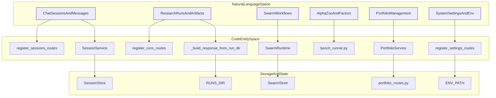
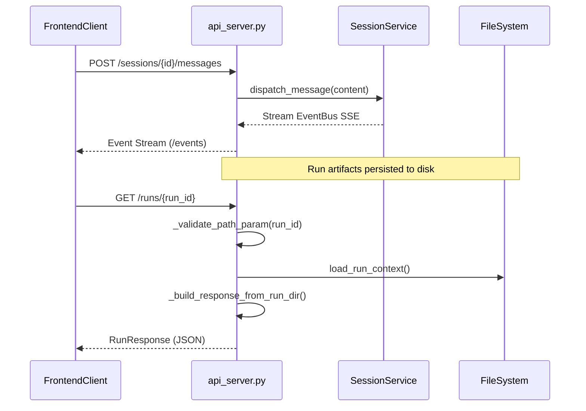

<!-- source: DeepWiki mcp.deepwiki.com · repo HKUDS/Vibe-Trading · page 9 API Server Reference · fetched 2026-11-09 -->

# API Server Reference

Relevant source files

The following files were used as context for generating this wiki page:

- [agent/api_server.py](agent/api_server.py)
- [agent/src/api/helpers.py](agent/src/api/helpers.py)
- [agent/src/api/models.py](agent/src/api/models.py)
- [agent/src/api/runs_routes.py](agent/src/api/runs_routes.py)
- [agent/src/api/security.py](agent/src/api/security.py)
- [agent/src/api/settings_routes.py](agent/src/api/settings_routes.py)
- [agent/src/api/state.py](agent/src/api/state.py)
- [agent/src/channels/msteams.py](agent/src/channels/msteams.py)
- [agent/src/session/events.py](agent/src/session/events.py)
- [agent/tests/api/conftest.py](agent/tests/api/conftest.py)
- [agent/tests/api/test_positions_sectors.py](agent/tests/api/test_positions_sectors.py)
- [agent/tests/api/test_run_detail_offload.py](agent/tests/api/test_run_detail_offload.py)
- [agent/tests/test_api_infrastructure.py](agent/tests/test_api_infrastructure.py)
- [agent/tests/test_channel_runtime_reset.py](agent/tests/test_channel_runtime_reset.py)
- [agent/tests/test_eventbus_clear_subscribers.py](agent/tests/test_eventbus_clear_subscribers.py)
- [agent/tests/test_msteams_inbound_body_limit.py](agent/tests/test_msteams_inbound_body_limit.py)
- [agent/tests/test_scheduled_delivery_hook.py](agent/tests/test_scheduled_delivery_hook.py)
- [agent/tests/test_security_auth_api.py](agent/tests/test_security_auth_api.py)
- [agent/tests/test_session_events.py](agent/tests/test_session_events.py)
- [agent/tests/test_settings_api.py](agent/tests/test_settings_api.py)
- [agent/tests/test_sse_ticket_and_headers.py](agent/tests/test_sse_ticket_and_headers.py)
- [frontend/src/components/run/__tests__/PositionsTab.test.tsx](frontend/src/components/run/__tests__/PositionsTab.test.tsx)
- [frontend/src/pages/Settings.tsx](frontend/src/pages/Settings.tsx)

The Vibe-Trading API Server is a FastAPI-based RESTful service defined in `agent/api_server.py` [agent/api_server.py:1-7]() that acts as the core orchestration layer connecting the frontend React application to the underlying ReAct Agent, backtesting, portfolio, and swarm subsystems.

### Server Architecture and Lifecycle

The server acts as a thin assembler that initializes FastAPI, configures CORS and security middleware, registers route handlers, and manages background loops via a standardized lifespan context manager [agent/api_server.py:4-7, 151-181](). It supports development modes with trusted loopback binding as well as production modes enforcing token authentication and strict CORS boundaries [agent/api_server.py:171-179](), [agent/tests/test_security_auth_api.py:33-38, 160-168]().

#### Natural Language to Code Entity Mapping
The following diagram maps high-level API domains to their underlying Python implementation symbols and modules.

**API Route and Subsystem Mapping**

Sources: [agent/api_server.py:185-212](), [agent/src/api/state.py:29-71](), [agent/src/api/runs_routes.py:1-5](), [agent/src/api/settings_routes.py:1-4]()

---

### Core Endpoint Categories

The API server functionality is categorized into three main child domains, detailing run management, infrastructure integration, and portfolio aggregation.

#### 1. Run and Session Endpoints
Chat sessions and research execution artifacts are managed through dedicated routing modules. Sessions support persistent conversational histories, stateful SQLite storage, and real-time event streaming via Server-Sent Events (SSE) protected by ticket authentication [frontend/src/lib/api.ts:106-141](). Runs expose backtest metrics, equity curves, Pine Script translations, and asset sector mappings.

For details on authentication, artifact parsing, and run cards, see [Run and Session Endpoints](#9.1).
Sources: [agent/api_server.py:185-202](), [agent/src/api/runs_routes.py:1-30]()

#### 2. Swarm, Alpha, Settings, and Infrastructure Endpoints
Multi-agent DAG executions (`/swarm/*`), quantitative factor benchmarking (`/alpha/*`), local settings configuration (`/settings/*`), instant messaging channels, scheduled research executors, and system health checks are consolidated into administrative and analytical routes [frontend/src/lib/api.ts:90-172]().

For details on swarm presets, alpha benchmarking, and UI services, see [Swarm, Alpha, Settings, and Infrastructure Endpoints](#9.2).
Sources: [agent/api_server.py:117-125, 203-212](), [agent/src/api/settings_routes.py:1-15]()

#### 3. Portfolio Service and Aggregation
The portfolio management subsystem normalizes positions across multi-asset classes, handles currency exchange rates, integrates with extraetf and broker APIs (such as Longbridge), and exposes structured endpoints via compatibility shims [agent/src/api/state.py:1-12]().

For details on the `PortfolioService` and related routes, see [Portfolio Service and Aggregation](#9.3).
Sources: [agent/src/api/state.py:29-71]()

---

### Data Contracts and Serialization

Data exchange between the Python backend and TypeScript frontend is strictly validated using Pydantic models.

**Key Data Structures**
| Model | Description | Source |
| :--- | :--- | :--- |
| `RunResponse` | Comprehensive object containing metrics, equity curves, and trade markers. | [agent/src/api/models.py:78-79]() |
| `BacktestMetrics` | Summary statistics (Sharpe, Win Rate, Max Drawdown). | [agent/src/api/models.py:75-76]() |
| `Artifact` | Metadata for files generated during a run (CSV, JSON, TXT). | [agent/src/api/models.py:74]() |
| `LLMSettingsResponse` | Current LLM runtime settings and available providers. | [agent/src/api/settings_routes.py:58-75]() |
| `DataSourceSettingsResponse` | Status of market data tokens (Tushare, Gildata, Baostock). | [agent/src/api/settings_routes.py:137-149]() |

Sources: [agent/src/api/models.py:73-80](), [agent/src/api/settings_routes.py:58-75, 137-149]()

---

### Server Execution Flow

The sequence below illustrates the lifecycle of a message dispatch request and subsequent run analysis loading within the server architecture.

**Request Lifecycle Diagram**

Sources: [agent/api_server.py:185-195](), [frontend/src/lib/api.ts:97-110](), [agent/src/api/state.py:29-70]()

---

### Security and Environment

The API server implements robust defenses against common web vulnerabilities:
*   **Authentication**: Managed via `HTTPBearer` tokens checked against `API_AUTH_KEY` [agent/tests/test_security_auth_api.py:33-38, 160-168]().
*   **Path Traversal Prevention**: Path parameters like `run_id` and `session_id` are validated using strict regex patterns [agent/src/api/helpers.py:98-101]().
*   **DNS Rebinding Protection**: Middleware rejects untrusted local host headers [agent/src/api/security.py:166-173]().
*   **Atomic Dotenv Updates**: Secret keys and configuration values written to environment files utilize atomic temporary file replacement with strict `0600` permissions [agent/src/api/helpers.py:73-125]().

Sources: [agent/src/api/security.py:166-173](), [agent/src/api/helpers.py:73-125](), [agent/tests/test_security_auth_api.py:33-195]()

---

