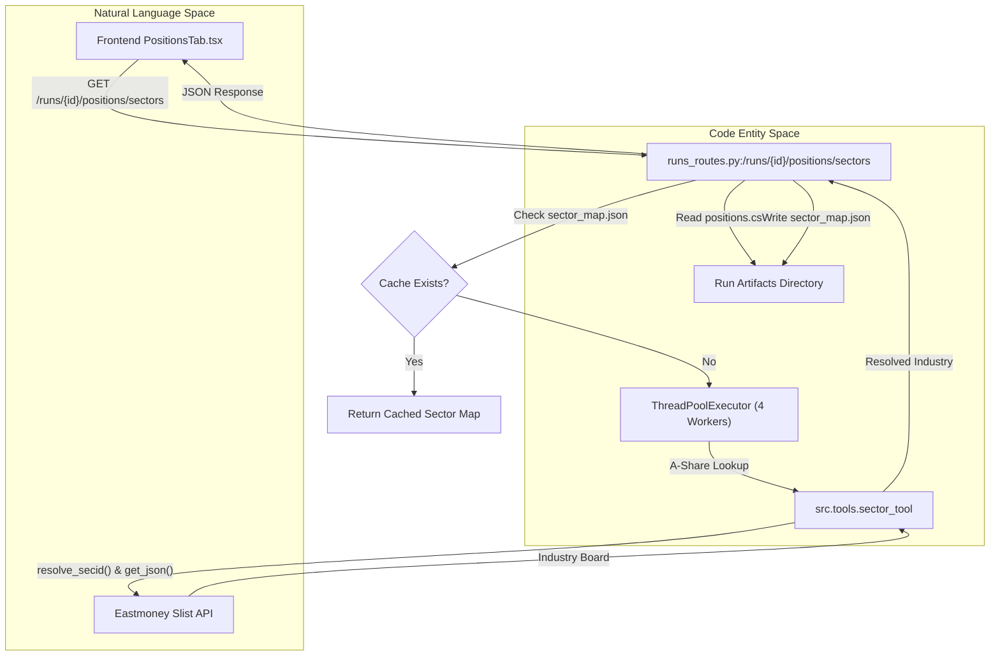
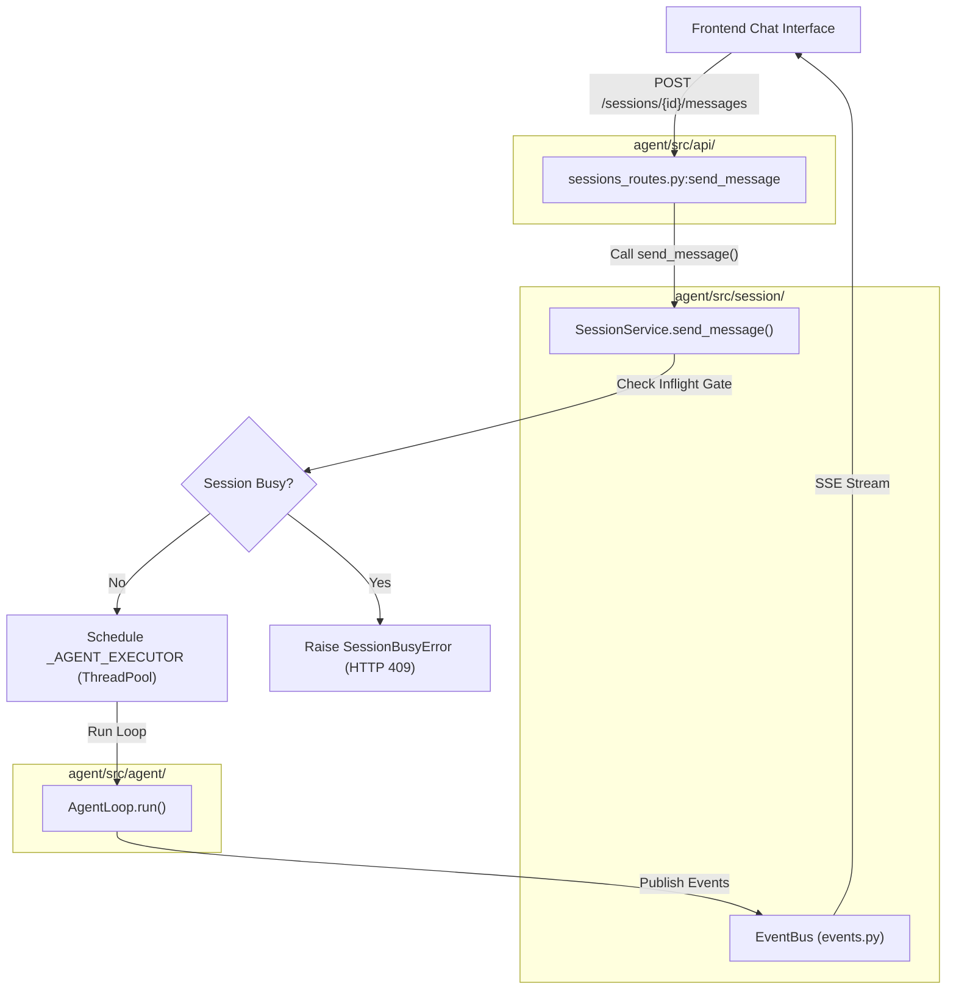

<!-- source: DeepWiki mcp.deepwiki.com · repo HKUDS/Vibe-Trading · page 9.1 Run and Session Endpoints · fetched 2026-11-09 -->

# Run and Session Endpoints

Relevant source files

The following files were used as context for generating this wiki page:

- [agent/src/api/models.py](agent/src/api/models.py)
- [agent/src/api/run_artifacts.py](agent/src/api/run_artifacts.py)
- [agent/src/api/runs_routes.py](agent/src/api/runs_routes.py)
- [agent/src/api/sessions_routes.py](agent/src/api/sessions_routes.py)
- [agent/src/session/models.py](agent/src/session/models.py)
- [agent/src/session/service.py](agent/src/session/service.py)
- [agent/src/tools/image_vision_tool.py](agent/src/tools/image_vision_tool.py)
- [agent/src/ui_services.py](agent/src/ui_services.py)
- [agent/tests/api/conftest.py](agent/tests/api/conftest.py)
- [agent/tests/api/test_positions_sectors.py](agent/tests/api/test_positions_sectors.py)
- [agent/tests/api/test_run_detail_offload.py](agent/tests/api/test_run_detail_offload.py)
- [agent/tests/api/test_run_preview.py](agent/tests/api/test_run_preview.py)
- [agent/tests/test_goal_api.py](agent/tests/test_goal_api.py)
- [agent/tests/test_image_vision_tool.py](agent/tests/test_image_vision_tool.py)
- [agent/tests/test_indicator_period_nonpositive.py](agent/tests/test_indicator_period_nonpositive.py)
- [agent/tests/test_session_events_replay_start.py](agent/tests/test_session_events_replay_start.py)
- [agent/tests/test_session_search_title_updates.py](agent/tests/test_session_search_title_updates.py)
- [agent/tests/test_session_service_lifecycle.py](agent/tests/test_session_service_lifecycle.py)
- [agent/tests/test_ui_services.py](agent/tests/test_ui_services.py)
- [frontend/src/components/run/__tests__/PositionsTab.test.tsx](frontend/src/components/run/__tests__/PositionsTab.test.tsx)
- [frontend/src/pages/__tests__/agentToolTimeline.test.ts](frontend/src/pages/__tests__/agentToolTimeline.test.ts)
- [frontend/src/pages/agentToolTimeline.ts](frontend/src/pages/agentToolTimeline.ts)

This page documents the core RESTful and SSE endpoints in `agent/api_server.py` and its mounted route modules (`src/api/runs_routes.py`, `src/api/sessions_routes.py`) for managing backtest runs, positions, sectors, and interactive ReAct agent chat sessions [agent/src/api/runs_routes.py:1-4](), [agent/src/api/sessions_routes.py:1-4](). These endpoints serve as the primary API bridge between the frontend workbench and the backend trading and reasoning engines.

---

## Authentication and Security

The API uses **HTTP Bearer** authentication and a specialized **SSE Ticket** system to authenticate standard HTTP requests and real-time event streams [agent/src/api/sessions_routes.py:169-204](), [agent/src/session/models.py:17-34]().

- **Token Validation**: The `require_auth` dependency validates the `Authorization: Bearer <token>` header against the global API key configured via environment variables [agent/src/api/sessions_routes.py:42]().
- **Local/Remote Differentiation**: Loopback clients can bypass explicit API keys when running in local dev-trust mode (`_is_local_client`), whereas remote clients require full bearer verification [agent/src/session/models.py:25-28]().
- **SSE Tickets**: Because browsers cannot attach custom HTTP headers to native `EventSource` connections, the API uses short-lived, single-use SSE tickets minted via server helpers and consumed via the `ticket=` query parameter [agent/src/sessions_routes.py:169-204]().
- **Principal and Attributable Identity**: The session subsystem tracks ownership using `Principal` objects where `attributable` is derived strictly from authentication methods like `AuthMethod.FEDERATED_IDENTITY`, preventing shared bearer tokens from falsely manufacturing human attribution [agent/src/session/models.py:17-94]().

**Sources:** [agent/src/api/sessions_routes.py:42-46](), [agent/src/session/models.py:17-94]()

---

## Run Endpoints (`/runs`)

The `/runs` routes enable listing, inspection, source retrieval, Pine Script export, and sector mapping for completed or running execution directories (`RUNS_DIR`) [agent/src/api/runs_routes.py:1-4]().

### Endpoint Summary

| Method | Path | Description | Code Reference |
| :--- | :--- | :--- | :--- |
| `GET` | `/runs` | List historical runs with summary metrics | [agent/src/api/runs_routes.py:216]() |
| `GET` | `/runs/{id}` | Retrieve full run details, equity curves, and trade logs | [agent/src/api/runs_routes.py:248]() |
| `GET` | `/runs/{id}/code` | Get the Python source code (`signal_engine.py`) | [agent/src/api/runs_routes.py:284]() |
| `GET` | `/runs/{id}/pine` | Get exported TradingView Pine Script | [agent/src/api/runs_routes.py:303]() |
| `GET` | `/runs/{id}/positions/sectors` | Resolve industry sectors for symbols in `positions.csv` | [agent/src/api/runs_routes.py:319-320]() |

**Sources:** [agent/src/api/runs_routes.py:1-320]()

### Positions and Sectors (`/runs/{id}/positions/sectors`)

The `/runs/{id}/positions/sectors` route reads actual position weight history from `positions.csv`, groups symbols by asset class, and queries external industry board directories (such as Eastmoney for A-shares) with concurrency protection [agent/tests/api/test_positions_sectors.py:1-16]().

**Sources:** [agent/src/api/runs_routes.py:319-400](), [agent/tests/api/test_positions_sectors.py:1-16](), [frontend/src/components/run/__tests__/PositionsTab.test.tsx:1-50]()

---

## Session Endpoints (`/sessions`)

Interactive multi-turn ReAct agent conversations are managed via `/sessions` endpoints [agent/src/api/sessions_routes.py:1-4](). Sessions encapsulate message histories, execution attempts, configuration parameters, and durable research goal ledgers [agent/src/api/sessions_routes.py:31-172]().

### Session Lifecycle and Message Dispatch

- **Session CRUD**: Endpoints support listing, creation (`CreateSessionRequest`), metadata updates (`UpdateSessionRequest`), and deletion [agent/src/api/sessions_routes.py:31-46](), [agent/src/api/sessions_routes.py:168-172]().
- **Message Input**: `SendMessageRequest` bounds user prompts to `MAX_MESSAGE_CHARS` (100,000 characters) before dispatching to the underlying agent thread pool [agent/src/api/sessions_routes.py:47-56]().
- **Concurrency Guards**: `SessionService` maintains an inflight check ensuring that only one `AgentLoop` executes per session concurrently, rejecting overlapping requests with HTTP `409 Conflict` via `SessionBusyError` [agent/src/session/service.py:46-56]().

**Sources:** [agent/src/api/sessions_routes.py:31-172](), [agent/src/session/service.py:46-56](), [agent/tests/test_session_search_title_updates.py:1-57]()

---

## Event Streaming (`/events` SSE)

Real-time streaming of agent reasoning steps, tool calls, status changes, and stdout logs is provided via Server-Sent Events [agent/src/api/sessions_routes.py:169-204]().

- **Subscription**: Clients connect to `GET /sessions/{id}/events`, which subscribes to the session's `EventBus` [agent/src/api/sessions_routes.py:182]().
- **Recovery and Replay**: Supports `Last-Event-ID` headers or query parameters to replay buffered events via the `EventBus` buffer (default capacity 500 events) [agent/src/session/events.py:77-78]().
- **Thread Safety**: Background threads dispatch events using `asyncio.call_soon_threadsafe`, bridging synchronous execution workers with the asynchronous FastAPI event loop safely [agent/src/session/events.py:123-124]().

**Sources:** [agent/src/api/sessions_routes.py:169-204](), [agent/src/session/events.py:77-124]()

---

## Run Artifact Parsing & Response Building

When individual runs or session summaries are queried, the backend aggregates files from the run directory into structured response models (`RunResponse`, `BacktestMetrics`, `Artifact`) [agent/src/api/models.py:1-104]().

- **Metrics & Equity**: Parses `metrics.csv`, `equity.csv`, and `trades.csv` into typed dictionaries and finite-float representations [agent/src/api/runs_routes.py:1-195]().
- **Factor Analysis Artifacts**: Scans `factor_analysis/` directories (such as `ic_series.csv` and `group_equity.csv`), enforcing strict byte ceilings (`_FACTOR_MAX_FILE_BYTES`, `_FACTOR_MAX_TOTAL_ARTIFACT_BYTES`) and symlink rejection to prevent path traversal or memory exhaustion [agent/src/api/runs_routes.py:37-195]().

**Sources:** [agent/src/api/models.py:1-104](), [agent/src/api/runs_routes.py:1-195]()

---

