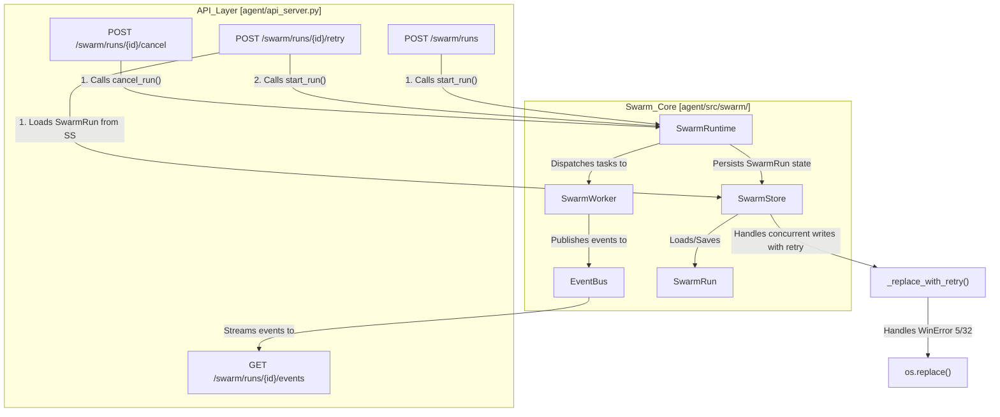
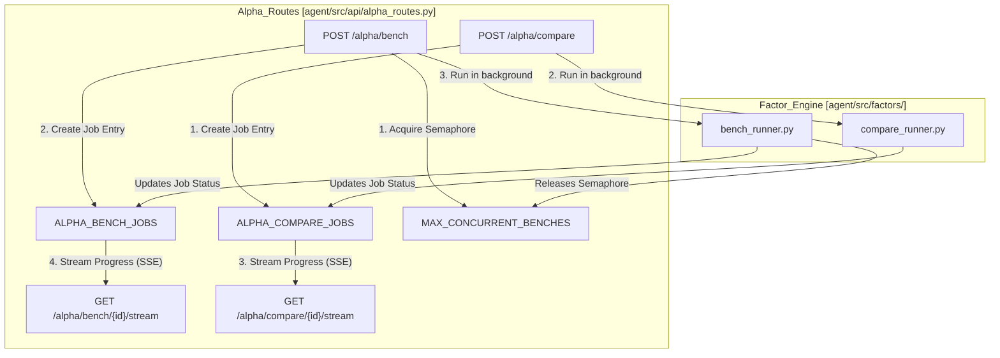
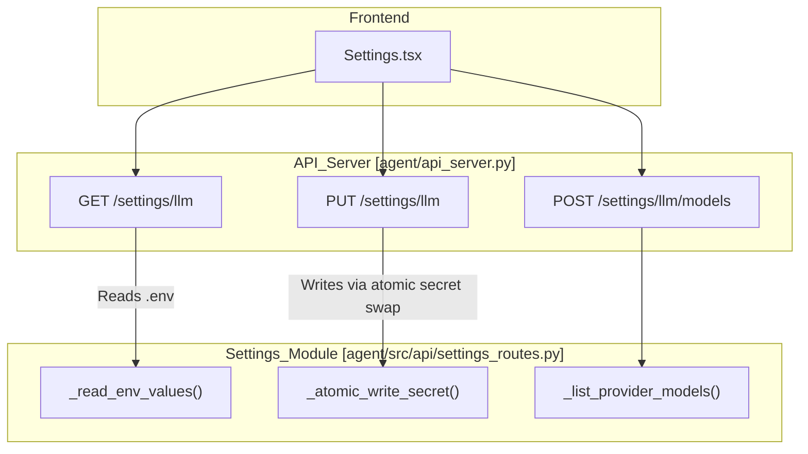
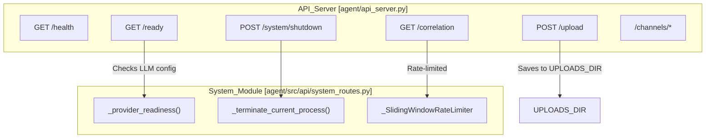
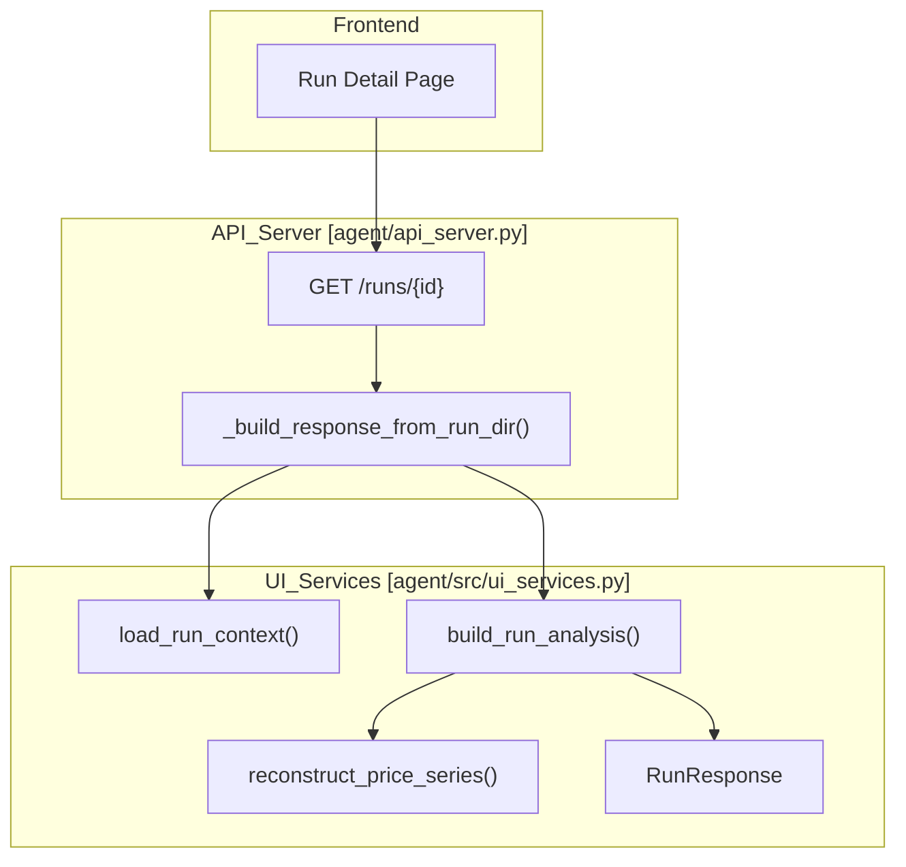

<!-- source: DeepWiki mcp.deepwiki.com · repo HKUDS/Vibe-Trading · page 9.2 Swarm, Alpha, Settings, and Infrastructure Endpoints · fetched 2026-11-09 -->

# Swarm, Alpha, Settings, and Infrastructure Endpoints

Relevant source files

The following files were used as context for generating this wiki page:

- [.github/dependabot.yml](.github/dependabot.yml)
- [.gitignore](.gitignore)
- [agent/api_server.py](agent/api_server.py)
- [agent/backtest/constraints.py](agent/backtest/constraints.py)
- [agent/requirements.txt](agent/requirements.txt)
- [agent/src/api/custom_provider_routes.py](agent/src/api/custom_provider_routes.py)
- [agent/src/api/helpers.py](agent/src/api/helpers.py)
- [agent/src/api/run_artifacts.py](agent/src/api/run_artifacts.py)
- [agent/src/api/security.py](agent/src/api/security.py)
- [agent/src/api/settings_routes.py](agent/src/api/settings_routes.py)
- [agent/src/api/state.py](agent/src/api/state.py)
- [agent/src/api/uploads_routes.py](agent/src/api/uploads_routes.py)
- [agent/src/channels/msteams.py](agent/src/channels/msteams.py)
- [agent/src/providers/endpoint_guard.py](agent/src/providers/endpoint_guard.py)
- [agent/src/session/events.py](agent/src/session/events.py)
- [agent/src/skills/options-strategy/SKILL.md](agent/src/skills/options-strategy/SKILL.md)
- [agent/src/tools/fund_nav_tool.py](agent/src/tools/fund_nav_tool.py)
- [agent/src/ui_services.py](agent/src/ui_services.py)
- [agent/tests/api/test_run_preview.py](agent/tests/api/test_run_preview.py)
- [agent/tests/test_api_infrastructure.py](agent/tests/test_api_infrastructure.py)
- [agent/tests/test_channel_runtime_reset.py](agent/tests/test_channel_runtime_reset.py)
- [agent/tests/test_constraints.py](agent/tests/test_constraints.py)
- [agent/tests/test_custom_provider_routes.py](agent/tests/test_custom_provider_routes.py)
- [agent/tests/test_eventbus_clear_subscribers.py](agent/tests/test_eventbus_clear_subscribers.py)
- [agent/tests/test_fund_nav_tool.py](agent/tests/test_fund_nav_tool.py)
- [agent/tests/test_gitignore_runtime_files.py](agent/tests/test_gitignore_runtime_files.py)
- [agent/tests/test_indicator_period_nonpositive.py](agent/tests/test_indicator_period_nonpositive.py)
- [agent/tests/test_msteams_inbound_body_limit.py](agent/tests/test_msteams_inbound_body_limit.py)
- [agent/tests/test_packaging_dependencies.py](agent/tests/test_packaging_dependencies.py)
- [agent/tests/test_provider_endpoint_guard.py](agent/tests/test_provider_endpoint_guard.py)
- [agent/tests/test_scheduled_delivery_hook.py](agent/tests/test_scheduled_delivery_hook.py)
- [agent/tests/test_security_auth_api.py](agent/tests/test_security_auth_api.py)
- [agent/tests/test_session_events.py](agent/tests/test_session_events.py)
- [agent/tests/test_settings_api.py](agent/tests/test_settings_api.py)
- [agent/tests/test_shadow_report_route_runtime_root.py](agent/tests/test_shadow_report_route_runtime_root.py)
- [agent/tests/test_sse_ticket_and_headers.py](agent/tests/test_sse_ticket_and_headers.py)
- [agent/tests/test_trade_journal_parser_european_decimal.py](agent/tests/test_trade_journal_parser_european_decimal.py)
- [agent/tests/test_ui_services.py](agent/tests/test_ui_services.py)
- [agent/tests/test_upload_cancellation.py](agent/tests/test_upload_cancellation.py)
- [frontend/src/pages/Settings.tsx](frontend/src/pages/Settings.tsx)
- [pyproject.toml](pyproject.toml)
- [requirements-channels-lock.txt](requirements-channels-lock.txt)
- [requirements-lock.txt](requirements-lock.txt)
- [tools/requirements-loader-health.txt](tools/requirements-loader-health.txt)

This page documents the specialized API endpoints in `agent/api_server.py` and its associated route modules that handle multi-agent swarm orchestration, quantitative factor research (Alpha Zoo), runtime configuration for LLMs and data sources (including custom LLM providers), cross-asset correlation analysis, scheduled research, IM channels, and the UI-centric data transformation layer.

---

## Swarm Orchestration Endpoints

The Swarm API allows clients to interact with the `SwarmRuntime`, which executes multi-agent workflows defined in YAML presets. These workflows are directed acyclic graphs (DAGs) where each node is a specialized `SwarmWorker`.

### Swarm Management Lifecycle

| Endpoint | Method | Description |
| :--- | :--- | :--- |
| `/swarm/presets` | `GET` | Lists all available YAML configurations from `agent/src/swarm/presets/`. [agent/src/api/swarm_routes.py:79-90]() |
| `/swarm/runs` | `POST` | Initiates a new swarm execution based on a preset and input variables. [agent/src/api/swarm_routes.py:92-108]() |
| `/swarm/runs` | `GET` | Lists historical swarm execution metadata. [agent/src/api/swarm_routes.py:110-134]() |
| `/swarm/runs/{run_id}` | `GET` | Retrieves the status and final results of a specific swarm run. [agent/src/api/swarm_routes.py:136-167]() |
| `/swarm/runs/{run_id}/events` | `GET` | SSE stream for real-time node execution updates and worker logs. [agent/src/api/swarm_routes.py:170-175]() |
| `/swarm/runs/{run_id}/retry` | `POST` | Relaunches a failed or cancelled run with original parameters. [agent/src/api/swarm_routes.py:200-215]() |
| `/swarm/runs/{run_id}/cancel`| `POST` | Terminates an active swarm execution. [agent/src/api/swarm_routes.py:217-229]() |

### Implementation Details
The Swarm API is integrated into the frontend via the `api` object in `frontend/src/lib/api.ts` [frontend/src/lib/api.ts:143-156](). The `SwarmStore` [agent/src/swarm/store.py:116-125]() handles file-system-based persistence for `SwarmRun` objects using atomic writes (`_atomic_write` [agent/src/swarm/store.py:205-205]()). The `_replace_with_retry` function [agent/src/swarm/store.py:95-114]() addresses Windows-specific `OSError` (WinError 5/32) during `os.replace` operations [agent/src/swarm/store.py:80-82]().

**Swarm Execution Flow**

Sources: [frontend/src/lib/api.ts:143-156](), [agent/api_server.py:180-188](), [agent/src/api/swarm_routes.py:79-229](), [agent/src/swarm/store.py:116-125](), [agent/src/swarm/store.py:205-205](), [agent/src/swarm/store.py:95-114](), [agent/src/swarm/store.py:80-82]()

---

## Alpha Zoo and Factor Benchmarking

The Alpha Zoo endpoints provide access to quantitative factors across multiple factor categories (`qlib158`, `alpha101`, `gtja191`, `academic`, `fundamental`) stored in the factor registry.

### Alpha Registry and Comparison Routes
*   **`GET /alpha/list`**: Returns a filtered list of alphas based on `zoo`, `theme`, or `universe` [agent/src/api/alpha_routes.py:9-9]().
*   **`GET /alpha/{alpha_id}`**: Retrieves detailed metadata and the mathematical formula for a specific factor [agent/src/api/alpha_routes.py:10-10]().
*   **`POST /alpha/compare`**: Initiates a head-to-head comparison of two or more alphas [agent/src/api/alpha_routes.py:13-13]().
*   **`POST /alpha/bench`**: Kicks off a background benchmarking job for a specific zoo and universe [agent/src/api/alpha_routes.py:11-11]().

### Factor Benchmarking Pipeline
The server implements strict execution controls for heavy-duty calculations:
1.  **Concurrency Control**: A `MAX_CONCURRENT_BENCHES` semaphore prevents server exhaustion [agent/src/api/alpha_routes.py:69-71]().
2.  **Job State Management**: In-memory tracking via `ALPHA_BENCH_JOBS` and `ALPHA_COMPARE_JOBS` [agent/src/api/alpha_routes.py:53-54]().
3.  **Real-time Feedback**: `/alpha/bench/{job_id}/stream` and `/alpha/compare/{job_id}/stream` provide SSE progress updates [agent/src/api/alpha_routes.py:12-14]().

**Alpha Comparison and Benchmarking Infrastructure**

Sources: [agent/src/api/alpha_routes.py:9-14](), [agent/src/api/alpha_routes.py:53-71](), [agent/src/factors/cli_handlers.py:138-147]()

---

## Settings and Configuration Endpoints

The system provides endpoints to manage LLM credentials, market data tokens, fallback orders, and custom provider registries.

### LLM Settings (`/settings/llm`)
*   **`GET /settings/llm`**: Aggregates environment variables into an `LLMSettingsResponse` [agent/src/api/settings_routes.py:43-60](). Sensitive keys are masked using `api_key_configured` [agent/src/api/settings_routes.py:50-50]().
*   **`PUT /settings/llm`**: Persists updates to `.env` using atomic writes (`_atomic_write_secret`) [agent/src/api/helpers.py:70-112]().
*   **`POST /settings/llm/models`**: Resolves live model choices dynamically using form values [agent/src/api/settings_routes.py:80-84]().

### Custom LLM Providers (`/settings/custom-providers`)
Custom LLM provider routes [agent/src/api/custom_provider_routes.py:1-40]() allow users to register OpenAI-compatible custom endpoints with custom headers, base URLs, and authentication parameters, persisting them outside standard config files.

### Data Source Settings (`/settings/data-sources`)
Manages market data credentials (e.g., Tushare, Gildata) and provider fallback chains (`SourceOrderEntry`) [agent/src/api/settings_routes.py:119-149]().

**Settings Management Flow**

Sources: [agent/src/api/settings_routes.py:43-91](), [agent/src/api/helpers.py:70-112](), [agent/src/api/custom_provider_routes.py:1-40]()

---

## Research Goal and Scheduled Research Endpoints

### Goal Ledger (`/sessions/{id}/goal`)
Manages the lifecycle of research goals linked to the `AgentLoop`:
*   **`POST /sessions/{id}/goal`**: Initializes a research goal with specific criteria [frontend/src/lib/api.ts:113-117]().
*   **`GET /sessions/{id}/goal`**: Retrieves goal snapshots [frontend/src/lib/api.ts:118-118]().
*   **`POST /sessions/{id}/goal/evidence`**: Appends evidence to validate criteria [frontend/src/lib/api.ts:124-128]().

### Scheduled Research (`/scheduled-research`)
Managed by lifecycle hooks in `agent/api_server.py`:
*   **`_start_scheduled_research_executor()`**: Initializes the polling loop on startup [agent/api_server.py:138-138]().
*   **`_stop_scheduled_research_executor()`**: Terminates background tasks cleanly on shutdown [agent/api_server.py:150-151]().

Sources: [frontend/src/lib/api.ts:113-133](), [agent/api_server.py:138-138](), [agent/api_server.py:150-151]()

---

## Infrastructure, Health, and IM Channel Endpoints

### IM Channel Runtime (`/channels`)
Managed via `agent/src/api/channels_routes.py`:
*   **`GET /channels/status`**: Returns IM adapter health [agent/src/api/channels_routes.py:88-92]().
*   **`POST /channels/start`** & **`POST /channels/stop`**: Control the channel runtime lifecycle [agent/src/api/channels_routes.py:94-105]().

### System Health, Shutdown, and Correlation
*   **`/health` / `/live` / `/ready`**: Split health checks. `/ready` runs a network-free probe of LLM provider configuration readiness [agent/src/api/system_routes.py:141-181]().
*   **`/system/shutdown`**: Authorized process termination via `_terminate_current_process` [agent/src/api/system_routes.py:51-54]().
*   **`/correlation`**: Auth-gated cross-asset correlation analysis throttled by an in-process sliding-window rate limiter `_correlation_rate_limiter` [agent/src/api/system_routes.py:129-129], [agent/src/api/system_routes.py:300-310]().

### Document Ingestion (`/upload`)
Handles file uploads for RAG ingestion:
1.  **Validation**: Validates path params and extensions [agent/api_server.py:221-223]().
2.  **Persistence**: Saves files to `UPLOADS_DIR` [agent/src/api/helpers.py:29-29]().

**Infrastructure Endpoints Overview**

Sources: [agent/src/api/channels_routes.py:88-115](), [agent/src/api/system_routes.py:141-181](), [agent/src/api/system_routes.py:51-54](), [agent/src/api/system_routes.py:300-310](), [agent/src/api/system_routes.py:129-129](), [agent/api_server.py:221-223](), [agent/src/api/helpers.py:29-29]()

---

## UI Services Layer (Data Transformation)

The API server utilizes `src.ui_services` [agent/api_server.py:22-22]() to map raw execution artifacts into optimized data structures for the frontend.

### Run Analysis and Context
*   **`load_run_context(run_dir)`**: Reconstructs strategy parameters, falling back to `planner_output.json` if necessary [agent/src/ui_services.py:100-147]().
*   **`build_run_analysis(run_dir)`**: Transforms CSV trade and equity logs into the `RunResponse` schema [agent/api_server.py:22-22]().

### Charting Data Structures
*   **Price Series**: OHLCV series reconstructed via `reconstruct_price_series` [agent/src/ui_services.py:300-300]() invoking `backtest.runner.fetch_data_map` [agent/src/ui_services.py:300-300]().
*   **Indicator Overlays**: Extracted technical indicators with inferred periods via `infer_indicator_periods` [agent/src/ui_services.py:149-189]().

**UI Services Data Flow**

Sources: [agent/api_server.py:22-22](), [agent/api_server.py:194-194](), [frontend/src/lib/api.ts:97-103](), [agent/src/ui_services.py:100-147](), [agent/src/ui_services.py:300-300]()

---

