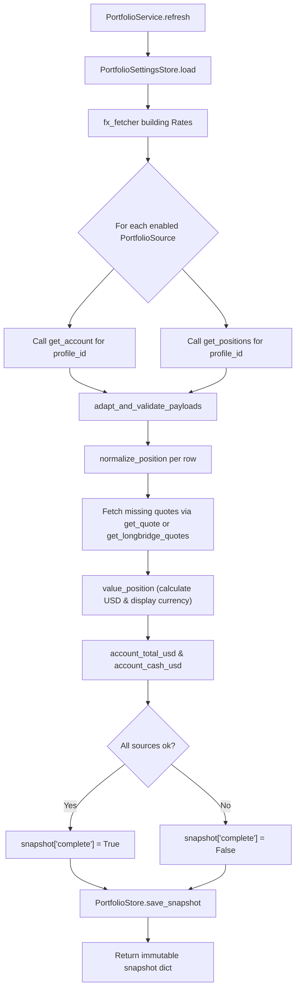

<!-- source: DeepWiki mcp.deepwiki.com · repo HKUDS/Vibe-Trading · page 9.3 Portfolio Service and Aggregation · fetched 2026-11-09 -->

# Portfolio Service and Aggregation

Relevant source files

The following files were used as context for generating this wiki page:

- [agent/backtest/engines/china_a.py](agent/backtest/engines/china_a.py)
- [agent/src/api/portfolio_routes.py](agent/src/api/portfolio_routes.py)
- [agent/src/governance/ledger.py](agent/src/governance/ledger.py)
- [agent/src/portfolio/compatibility.py](agent/src/portfolio/compatibility.py)
- [agent/src/portfolio/config.py](agent/src/portfolio/config.py)
- [agent/src/portfolio/extraetf.py](agent/src/portfolio/extraetf.py)
- [agent/src/portfolio/longbridge_worker.py](agent/src/portfolio/longbridge_worker.py)
- [agent/src/portfolio/normalization.py](agent/src/portfolio/normalization.py)
- [agent/src/portfolio/oauth_worker.py](agent/src/portfolio/oauth_worker.py)
- [agent/src/portfolio/service.py](agent/src/portfolio/service.py)
- [agent/src/portfolio/store.py](agent/src/portfolio/store.py)
- [agent/src/tools/financial_statements_tool.py](agent/src/tools/financial_statements_tool.py)
- [agent/src/tools/portfolio_tool.py](agent/src/tools/portfolio_tool.py)
- [agent/src/tools/technical_indicator_tool.py](agent/src/tools/technical_indicator_tool.py)
- [agent/tests/quantlib/test_eventstudy_post_event_window.py](agent/tests/quantlib/test_eventstudy_post_event_window.py)
- [agent/tests/test_alpha_bench_cache.py](agent/tests/test_alpha_bench_cache.py)
- [agent/tests/test_china_a_engine.py](agent/tests/test_china_a_engine.py)
- [agent/tests/test_extraetf_reader.py](agent/tests/test_extraetf_reader.py)
- [agent/tests/test_feishu_login_persistence.py](agent/tests/test_feishu_login_persistence.py)
- [agent/tests/test_financial_statements_tool.py](agent/tests/test_financial_statements_tool.py)
- [agent/tests/test_forex_engine.py](agent/tests/test_forex_engine.py)
- [agent/tests/test_governance.py](agent/tests/test_governance.py)
- [agent/tests/test_local_connections.py](agent/tests/test_local_connections.py)
- [agent/tests/test_lockup_expiry_integer_code.py](agent/tests/test_lockup_expiry_integer_code.py)
- [agent/tests/test_paper_capped_connectors_refuse_live.py](agent/tests/test_paper_capped_connectors_refuse_live.py)
- [agent/tests/test_portfolio_compatibility.py](agent/tests/test_portfolio_compatibility.py)
- [agent/tests/test_portfolio_config.py](agent/tests/test_portfolio_config.py)
- [agent/tests/test_portfolio_futu_prefixed_codes.py](agent/tests/test_portfolio_futu_prefixed_codes.py)
- [agent/tests/test_portfolio_routes.py](agent/tests/test_portfolio_routes.py)
- [agent/tests/test_portfolio_service.py](agent/tests/test_portfolio_service.py)
- [agent/tests/test_portfolio_summary_tool_snapshot.py](agent/tests/test_portfolio_summary_tool_snapshot.py)
- [agent/tests/test_sec_period_frames.py](agent/tests/test_sec_period_frames.py)
- [agent/tests/test_technical_indicator_small_price_rounding.py](agent/tests/test_technical_indicator_small_price_rounding.py)
- [agent/tests/test_technical_indicator_tool.py](agent/tests/test_technical_indicator_tool.py)
- [frontend/src/components/portfolio/PortfolioSourceEditor.tsx](frontend/src/components/portfolio/PortfolioSourceEditor.tsx)
- [frontend/src/pages/Portfolio.tsx](frontend/src/pages/Portfolio.tsx)
- [frontend/src/pages/__tests__/Portfolio.test.tsx](frontend/src/pages/__tests__/Portfolio.test.tsx)

The Portfolio Service and Aggregation system provides a read-only overview of a user's aggregated financial holdings across multiple brokerage accounts, cryptocurrency exchanges, and file-based portfolio exports. It handles data collection, normalization, foreign exchange conversion, snapshot persistence, and client-side visualization [agent/src/portfolio/service.py:1-152]().

## Architecture Overview

The system operates strictly as a read-only aggregation layer. It never places, modifies, or cancels trading orders [agent/src/portfolio/service.py:147-152](). It reads credentials and connector definitions from local settings, dispatches calls to underlying trading profiles, normalizes heterogeneous position schemas, converts values into a uniform display currency via dated FX rates, and exposes the resulting snapshots through REST API endpoints to the React frontend [agent/src/api/portfolio_routes.py:121-250](), [frontend/src/pages/Portfolio.tsx:135-189]().

Below is a diagram bridging the natural language components of the portfolio system to their exact codebase entities (`file_name.py`, classes, and functions):

```mermaid
graph TD
    subgraph NaturalLanguageSpace ["Natural Language Space"]
        UI["Portfolio Frontend Page"]
        API["Portfolio API Router"]
        SVC["Portfolio Aggregation Service"]
        DB["Portfolio SQLite Store"]
        CFG["Portfolio Settings Configuration"]
        FX["Foreign Exchange Handler"]
        NORM["Position Normalization Engine"]
        COMP["Compatibility & Contract Validator"]
        FILE["ExtraETF File Reader"]
        OAUTH["OAuth Worker Subprocess"]
        LB["Longbridge Quote Worker"]
    end

    subgraph CodeEntitySpace ["Code Entity Space"]
        PortfolioPage["Portfolio.tsx"]
        PortfolioRoutes["portfolio_routes.py"]
        PortfolioService["PortfolioService (service.py)"]
        PortfolioStore["PortfolioStore (store.py)"]
        PortfolioSettingsStore["PortfolioSettingsStore (config.py)"]
        FxModule["build_rates / FxQuote (fx.py)"]
        NormalizationModule["normalize_position / value_position (normalization.py)"]
        CompatibilityModule["adapt_and_validate_payloads (compatibility.py)"]
        ExtraETFReader["parse_export / read_export (extraetf.py)"]
        OAuthWorker["oauth_worker.py"]
        LongbridgeWorker["longbridge_worker.py"]
    end

    UI --> PortfolioPage
    API --> PortfolioRoutes
    SVC --> PortfolioService
    DB --> PortfolioStore
    CFG --> PortfolioSettingsStore
    FX --> FxModule
    NORM --> NormalizationModule
    COMP --> CompatibilityModule
    FILE --> ExtraETFReader
    OAUTH --> OAuthWorker
    LB --> LongbridgeWorker
```

Sources: [agent/src/api/portfolio_routes.py:121-250](), [agent/src/portfolio/service.py:126-152](), [agent/src/portfolio/store.py](), [agent/src/portfolio/config.py:1-200](), [agent/src/portfolio/fx.py:1-45](), [agent/src/portfolio/normalization.py:1-176](), [agent/src/portfolio/compatibility.py:1-171](), [agent/src/portfolio/extraetf.py:1-151](), [agent/src/portfolio/oauth_worker.py](), [agent/src/portfolio/longbridge_worker.py](), [frontend/src/pages/Portfolio.tsx:135-189]()

## Portfolio Service (`PortfolioService`)

The `PortfolioService` class located in `agent/src/portfolio/service.py` is the central orchestrator [agent/src/portfolio/service.py:147-165](). It coordinates data retrieval across enabled sources, applies FX rates, evaluates portfolio completion status, and stores historical snapshots [agent/src/portfolio/service.py:200-360]().

The following diagram details the execution flow within `PortfolioService.refresh()`:

Sources: [agent/src/portfolio/service.py:200-360](), [agent/src/portfolio/config.py:1-200](), [agent/src/portfolio/normalization.py:31-35](), [agent/src/portfolio/compatibility.py:131-135]()

### Key Methods in `PortfolioService`
*   `__init__()`: Accepts optional dependency injections for `PortfolioStore`, `PortfolioSettingsStore`, account/position readers, quote fetchers, and FX fetchers [agent/src/portfolio/service.py:154-165]().
*   `refresh()`: Iterates through active portfolio sources, executes reads, validates payloads, normalizes positions, computes totals, and persists the snapshot [agent/src/portfolio/service.py:200-360](). If any unpriced holding lacks a quote and cannot be valued, `complete` is marked `false` and exclusions are noted [agent/tests/test_portfolio_service.py:111-156]().
*   `latest()`: Retrieves the most recent snapshot from the underlying `PortfolioStore` [agent/src/portfolio/store.py]().
*   `history()`: Returns historical snapshots for trend analysis [agent/tests/test_portfolio_service.py:104-104]().
*   `reconnect_target()`: Spawns an OAuth authorization subprocess (`oauth_worker.py`) for brokers requiring re-authentication [agent/src/portfolio/service.py:400-400]().

Sources: [agent/src/portfolio/service.py:147-400](), [agent/src/portfolio/store.py](), [agent/tests/test_portfolio_service.py:104-156]()

## Normalization and Compatibility

Heterogeneous broker payloads are normalized and validated across `agent/src/portfolio/normalization.py` and `agent/src/portfolio/compatibility.py`.

### Normalization Logic (`normalization.py`)
*   `normalize_position()`: Maps broker-specific fields (e.g., `sec_type`, `avg_cost`, `position_qty`) to standard portfolio attributes [agent/src/portfolio/normalization.py:55-176]().
*   `value_position()`: Computes market value, cost basis, and unrealized profit/loss in both USD and target display currency [agent/src/portfolio/normalization.py:200-237]().
*   `account_total_usd()` and `account_cash_usd()`: Extract net liquidation values and cash balances, converting them into USD using reference rates [agent/src/portfolio/normalization.py:239-310]().

### Compatibility Contracts (`compatibility.py`)
*   `PortfolioCompatibility`: Dataclass holding connector metadata including compatibility levels (`native`, `contract_tested`, `experimental`), contract versions, and asset scopes [agent/src/portfolio/compatibility.py:32-40]().
*   `adapt_and_validate_payloads()`: Validates raw account and position dictionaries, ensuring required symbol and quantity fields exist before normalization occurs [agent/src/portfolio/compatibility.py:131-171](). Raises `PortfolioContractError` if payloads violate expected contracts [agent/src/portfolio/compatibility.py:122-124]().

Sources: [agent/src/portfolio/normalization.py:1-310](), [agent/src/portfolio/compatibility.py:1-171]()

## Portfolio Store (`store.py`)

`PortfolioStore` manages SQLite persistence for portfolio snapshots, history, and cached FX quotes [agent/src/portfolio/store.py](). It provides methods to save and query snapshots, ensuring that incomplete snapshots or unverified history points are filtered out when retrieving historical trends [agent/tests/test_portfolio_service.py:152-156]().

Sources: [agent/src/portfolio/store.py](), [agent/tests/test_portfolio_service.py:152-156]()

## Configuration (`config.py`)

Managed via `PortfolioSettingsStore`, user preferences (such as `display_currency` and enabled `sources`) are loaded and stored in JSON format [agent/src/portfolio/config.py:1-200]().
*   `eligible_profiles()` filters trading profiles to ensure only read-only capable connectors with account and position read capabilities can be selected [agent/src/portfolio/config.py:75-92]().
*   `source_catalog()` aggregates connection metadata and compatibility levels for the UI [agent/src/portfolio/config.py:95-125]().

Sources: [agent/src/portfolio/config.py:1-200]()

## FX Handling (`fx.py`)

Foreign exchange conversion is centralized in `agent/src/portfolio/fx.py` [agent/src/portfolio/fx.py:1-45]().
*   `build_rates()` constructs a `Rates` dictionary anchored to USD (`USD = 1.0`), incorporating CNY and HKD quotes while validating positive finite numeric ranges [agent/src/portfolio/fx.py:11-22]().
*   `to_usd()` and `from_usd()` perform bidirectional conversions using the rates map [agent/src/portfolio/fx.py:34-40]().

Sources: [agent/src/portfolio/fx.py:1-45]()

## ExtraETF Reader (`extraetf.py`)

`agent/src/portfolio/extraetf.py` provides a read-only parser for extraETF German-locale semicolon-delimited CSV exports (`holdings` and `transactions`) [agent/src/portfolio/extraetf.py:1-109]().
*   **Strict Formatting**: Implements German number parsing rules (comma decimal separator, period thousands separator) and rejects US-formatted numbers (`1,234.56`) or ambiguous groupings [agent/src/portfolio/extraetf.py:42-56]().
*   **Fail-Closed Design**: Raises `ExtraEtfFormatError` on ragged rows, duplicate instruments within a single portfolio ID, or unreadable numbers, preventing silent data corruption [agent/src/portfolio/extraetf.py:32-65]().

Sources: [agent/src/portfolio/extraetf.py:1-109]()

## Longbridge and OAuth Workers

Background subprocess modules handle external authentication and quote fetching:
*   `oauth_worker.py`: Runs an embedded local callback server to complete OAuth flows for brokers like Longbridge [agent/src/portfolio/service.py:400-400]().
*   `longbridge_worker.py`: Fetches batch quotes for Longbridge positions that do not include prices in their initial position payloads [agent/src/portfolio/service.py:178-180]().

Sources: [agent/src/portfolio/service.py:178-180,400](), [agent/src/portfolio/oauth_worker.py](), [agent/src/portfolio/longbridge_worker.py]()

## Compatibility Shims and API Routes (`portfolio_routes.py`)

`agent/src/api/portfolio_routes.py` exposes REST endpoints for portfolio operations [agent/src/api/portfolio_routes.py:121-250]().
*   `GET /api/portfolio`: Returns the latest portfolio snapshot [agent/src/api/portfolio_routes.py:133-138]().
*   `POST /api/portfolio/refresh`: Triggers a synchronous or background refresh operation protected by a concurrency lock (`_REFRESH_OPERATION_LOCK`) [agent/src/api/portfolio_routes.py:140-167]().
*   `GET /api/portfolio/refresh-status`: Reports live refresh status per source [agent/src/api/portfolio_routes.py:169-176]().
*   `POST /api/portfolio/sources/{source_id}/reconnect`: Initiates OAuth re-authorization [agent/src/api/portfolio_routes.py:178-191]().
*   `GET /api/portfolio/analysis-context`: Generates a privacy-preserving holdings context tailored for AI agent consumption [agent/src/api/portfolio_routes.py:245-250]().

Sources: [agent/src/api/portfolio_routes.py:121-250]()

## Frontend Web Application Page (`Portfolio.tsx`)

The `Portfolio.tsx` React component (`frontend/src/pages/Portfolio.tsx`) implements the user interface for multi-account portfolio management [frontend/src/pages/Portfolio.tsx:135-189]().
*   **State & Polling**: Manages snapshot loading, history data, and active refresh states with a timeout guard (`PORTFOLIO_RECONNECT_DEADLINE_MS`) [frontend/src/pages/Portfolio.tsx:48-48,135-189]().
*   **Visualization**: Renders equity curves and asset allocation charts via ECharts [frontend/src/pages/Portfolio.tsx:29-30]().
*   **Internationalization**: Leverages `react-i18next` and localized `Intl.NumberFormat` for multi-currency display formatting [frontend/src/pages/Portfolio.tsx:3-68]().
*   **Source Configuration**: Integrates `PortfolioSourceEditor` and `PortfolioCompatibilityBadge` components to configure data sources and inspect broker compatibility tiers [frontend/src/pages/Portfolio.tsx:19-20]().

Sources: [frontend/src/pages/Portfolio.tsx:1-189]()

---

