# Page: Vibe-Trading Overview

# Vibe-Trading Overview

<details>
<summary>Relevant source files</summary>

The following files were used as context for generating this wiki page:

- [.github/dependabot.yml](.github/dependabot.yml)
- [.gitignore](.gitignore)
- [CHANGELOG.md](CHANGELOG.md)
- [README.md](README.md)
- [README_ar.md](README_ar.md)
- [README_es.md](README_es.md)
- [README_id.md](README_id.md)
- [README_ja.md](README_ja.md)
- [README_ko.md](README_ko.md)
- [README_zh.md](README_zh.md)
- [agent/SKILL.md](agent/SKILL.md)
- [agent/mcp_server.py](agent/mcp_server.py)
- [agent/requirements.txt](agent/requirements.txt)
- [agent/src/api/custom_provider_routes.py](agent/src/api/custom_provider_routes.py)
- [agent/src/providers/endpoint_guard.py](agent/src/providers/endpoint_guard.py)
- [agent/src/skills/options-strategy/SKILL.md](agent/src/skills/options-strategy/SKILL.md)
- [agent/src/tools/fund_nav_tool.py](agent/src/tools/fund_nav_tool.py)
- [agent/tests/test_custom_provider_routes.py](agent/tests/test_custom_provider_routes.py)
- [agent/tests/test_fund_nav_tool.py](agent/tests/test_fund_nav_tool.py)
- [agent/tests/test_gitignore_runtime_files.py](agent/tests/test_gitignore_runtime_files.py)
- [agent/tests/test_packaging_dependencies.py](agent/tests/test_packaging_dependencies.py)
- [agent/tests/test_provider_endpoint_guard.py](agent/tests/test_provider_endpoint_guard.py)
- [agent/tests/test_readme_counts.py](agent/tests/test_readme_counts.py)
- [pyproject.toml](pyproject.toml)
- [requirements-channels-lock.txt](requirements-channels-lock.txt)
- [requirements-lock.txt](requirements-lock.txt)
- [tools/requirements-loader-health.txt](tools/requirements-loader-health.txt)

</details>


Vibe-Trading is an AI-powered multi-agent finance workspace designed to transform natural language requests into executable trading strategies, quantitative research, and portfolio analysis [README.md:9-13](). It leverages a ReAct (Reasoning and Acting) agent architecture equipped with 90+ specialized skills and dozens of atomic tools to navigate global markets including A-shares, US/HK equities, India equities (NSE/BSE), crypto, futures, and forex [README.md:59-66](), [agent/SKILL.md:4](), [agent/SKILL.md:114]().

The system is designed with a "zero-config" philosophy for data, utilizing 29 major data sources (Tushare, yfinance, OKX, AkShare, CCXT, Futu, mootdx, Eastmoney, Sina, Stooq, Yahoo, Longbridge, and more) with automatic fallback routing to ensure reliable access to market data without complex initial setup [agent/SKILL.md:4](), [agent/SKILL.md:56-62](), [README.md:55](), [CHANGELOG.md:54-73]().

### System Architecture

The Vibe-Trading ecosystem consists of a Python-based agentic core and a modern React 19 frontend [README.md:20-22](), [pyproject.toml:22](), [frontend/package.json:27-28](). The architecture is modular, separating the reasoning engine (`AgentLoop`), the execution environment (`Backtesting`), the collaborative multi-agent layer (`Swarm`), the IM delivery layer (`Channels`), and the **Institutional Research Reliability and Agent Governance Layer (IRR-AGL)** which provides cross-cutting safety and integrity checks [README.md:53-54](), [agent/SKILL.md:163-183]().

#### High-Level Component Interaction
The following diagram illustrates how user intent flows from the entrypoints through the reasoning core to external tools and data sources, governed by the IRR-AGL layer and delivered via IM channels.

**Vibe-Trading System Flow**
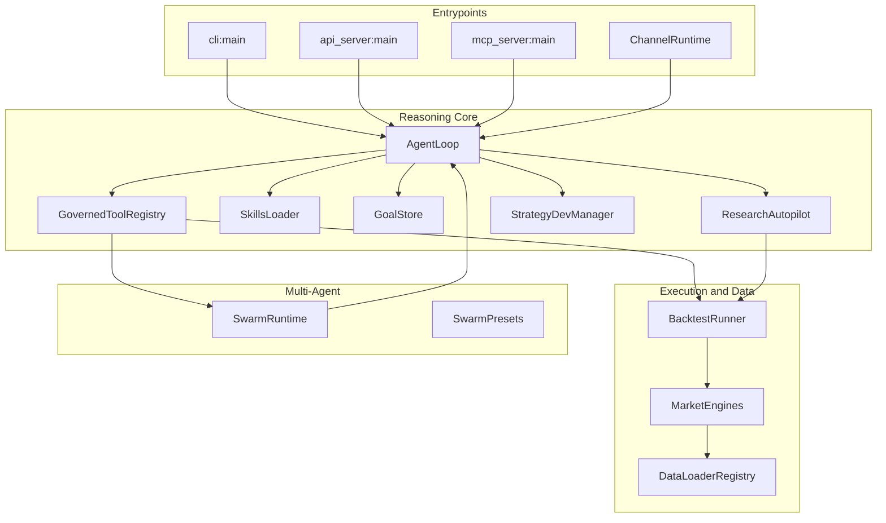
Sources: [agent/SKILL.md:34-40](), [README.md:53-64](), [pyproject.toml:69-71](), [agent/mcp_server.py:72](), [agent/SKILL.md:4](), [CHANGELOG.md:54-73]()

### Key Concepts

*   **ReAct Agent Loop**: The central reasoning brain that iteratively reasons about a task and selects the appropriate tool or skill to execute [README.md:62]().
*   **Research Goals**: A durable research tracking system that persists claims, acceptance criteria, and evidence across sessions via the `GoalStore` [README.md:63](), [agent/SKILL.md:56]().
*   **Research Autopilot**: An end-to-end loop that automates the transition from hypothesis to signal engine and backtests, feeding metrics back into the hypothesis registry [README.md:64]().
*   **Strategy Development Manager (SDM)**: A lifecycle manager that converts research and papers into registered, monitored factors and strategies with automated decay scanning [README.md:59]().
*   **Skills (90+ Specialist Skills)**: High-level financial capabilities (e.g., `elliott-wave`, `strategy-dev-manager`, `qveris`, `deep-company-series`) defined in `SKILL.md` files [agent/SKILL.md:4](), [agent/SKILL.md:114-123]().
*   **Tools**: Low-level functions that allow the agent to interact with the system, such as `backtest`, `sdm_register`, and `paper_trade_step` [README.md:59-64](), [agent/SKILL.md:67-75]().
*   **Swarm Intelligence**: A DAG-based orchestration system that allows multiple specialized agents to collaborate using 30 pre-defined team configurations [agent/SKILL.md:92-103]().
*   **Alpha Zoo**: A library of 478 pre-built quantitative alphas across five collections (`qlib158`, `alpha101`, `gtja191`, `academic`, `fundamental`) [README.md:57](), [agent/SKILL.md:105-112]().
*   **Shadow Account**: A subsystem that extracts implicit trading rules from broker trade journals, backtests them, and generates behavioral bias reports [agent/SKILL.md:67-75]().
*   **IM Channel Runtime**: A delivery layer supporting 16 message adapters (Telegram, Slack, Discord, etc.) for research delivery and interaction [README.md:64](), [agent/SKILL.md:163-183]().
*   **Connector-First Trading**: A unified architecture for live trading through broker connectors protected by a committed mandate and order guard [README.md:65](), [agent/SKILL.md:56-62]().
*   **IRR-AGL Governance**: A reliability stack that introduces `GovernedToolRegistry`, `ArtifactStore`, and reliability scorecards [README.md:53]().

### Code Entity Mapping

This diagram bridges the natural language space to specific codebase entities and entrypoints.

**Logical to Code Mapping**
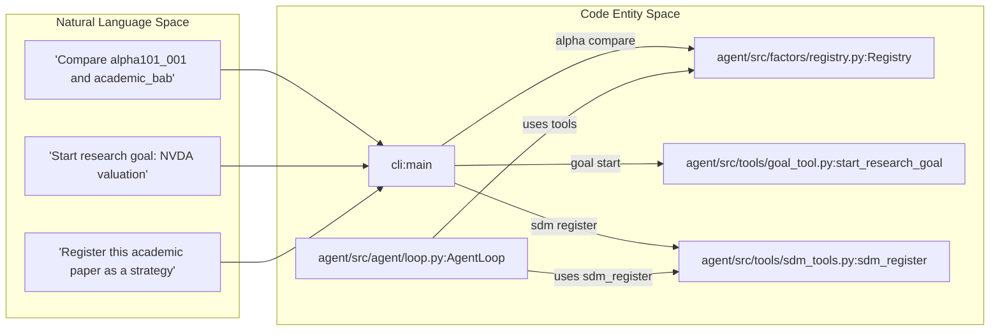
Sources: [README.md:57-64](), [agent/SKILL.md:112](), [pyproject.toml:70](), [agent/mcp_server.py:192-201]()

### Major Subsystems

| Subsystem | Primary Responsibility | Key Directories / Files |
| :--- | :--- | :--- |
| **Agent Core** | Orchestrates reasoning, tool use, and context management. | `agent/src/agent/` [README.md:62]() |
| **Backtesting** | Executes strategy code across multiple market engines. | `agent/backtest/` [agent/SKILL.md:76]() |
| **Swarm** | Manages multi-agent workflows and inter-agent communication. | `agent/src/swarm/` [agent/SKILL.md:92]() |
| **Alpha Zoo** | Provides pre-built quantitative factors and benchmarking. | `agent/src/factors/` [agent/SKILL.md:105]() |
| **Strategy Dev (SDM)** | Paper ingestion, strategy monitoring, and decay scanning. | `agent/src/skills/sdm/`, `agent/src/tools/sdm_tools.py` [agent/SKILL.md:163]() |
| **IM Channels** | Delivery runtime for message adapters (Telegram, Discord, etc.). | `agent/src/channels/` [agent/SKILL.md:163]() |
| **Research Goals** | Persists claims, criteria, and evidence rows for complex tasks. | `agent/src/session/`, `agent/src/tools/goal_tool.py` [agent/SKILL.md:56]() |
| **Scheduled Research** | Background executor for cron/interval-based research jobs. | `agent/src/scheduled_research/` [README.md:66]() |
| **Live Trading** | Manages broker connectors, mandates, and trade enforcement. | `agent/src/trading/`, `agent/src/live/` [README.md:65]() |
| **Governance (IRR-AGL)** | Enforces research reliability and tool safety policies. | `agent/src/governance/`, `agent/src/reliability/` [README.md:53]() |
| **Shadow Account** | Trade journal parsing and rule extraction. | `agent/src/shadow_account/` [agent/SKILL.md:67]() |
| **API/Server** | Exposes capabilities via REST, SSE, and MCP. | `agent/api_server.py`, `agent/mcp_server.py` [pyproject.toml:97-98]() |
| **Frontend** | React 19 web application for visualization and interaction. | `frontend/src/` [README.md:22]() |

Sources: [README.md:53-65](), [agent/SKILL.md:4-18]()

### Sub-Topics & Child Pages

The following child pages provide deeper coverage for each subsystem:

*   **[Getting Started & Configuration](#1.1)** — Environment configuration, `EnvConfig` schema, API keys, CLI installation via `pyproject.toml`, onboarding wizard, and data source setup.
*   **[System Entrypoints: CLI, API Server, and MCP Server](#1.2)** — The `vibe-trading` CLI command tree, FastAPI `api_server.py`, MCP server implementation, and channel integration.
*   **[Desktop App (Electron) and Deployment Packaging](#1.3)** — Electron main process (`main.ts`), backend manager and watchdog, secure credentials, update verification, packaging scripts, and Docker/ZimaOS deployment.

Sources: [README.md:31-43](), [pyproject.toml:96-98](), [agent/mcp_server.py:1-40]()

---

# Page: Getting Started & Configuration

# Getting Started & Configuration

<details>
<summary>Relevant source files</summary>

The following files were used as context for generating this wiki page:

- [.github/dependabot.yml](.github/dependabot.yml)
- [.gitignore](.gitignore)
- [agent/.env.example](agent/.env.example)
- [agent/cli/_legacy.py](agent/cli/_legacy.py)
- [agent/cli/onboard.py](agent/cli/onboard.py)
- [agent/requirements.txt](agent/requirements.txt)
- [agent/src/api/custom_provider_routes.py](agent/src/api/custom_provider_routes.py)
- [agent/src/config/env_schema.py](agent/src/config/env_schema.py)
- [agent/src/providers/capabilities.py](agent/src/providers/capabilities.py)
- [agent/src/providers/chat.py](agent/src/providers/chat.py)
- [agent/src/providers/endpoint_guard.py](agent/src/providers/endpoint_guard.py)
- [agent/src/providers/llm.py](agent/src/providers/llm.py)
- [agent/src/providers/llm_providers.json](agent/src/providers/llm_providers.json)
- [agent/src/skills/options-strategy/SKILL.md](agent/src/skills/options-strategy/SKILL.md)
- [agent/src/tools/fund_nav_tool.py](agent/src/tools/fund_nav_tool.py)
- [agent/tests/test_chat_llm_streaming.py](agent/tests/test_chat_llm_streaming.py)
- [agent/tests/test_cli_init.py](agent/tests/test_cli_init.py)
- [agent/tests/test_custom_provider_routes.py](agent/tests/test_custom_provider_routes.py)
- [agent/tests/test_env_schema.py](agent/tests/test_env_schema.py)
- [agent/tests/test_fund_nav_tool.py](agent/tests/test_fund_nav_tool.py)
- [agent/tests/test_gitignore_runtime_files.py](agent/tests/test_gitignore_runtime_files.py)
- [agent/tests/test_kimi_reasoning_content.py](agent/tests/test_kimi_reasoning_content.py)
- [agent/tests/test_llm.py](agent/tests/test_llm.py)
- [agent/tests/test_llm_provider_defaults.py](agent/tests/test_llm_provider_defaults.py)
- [agent/tests/test_llm_reasoning_effort.py](agent/tests/test_llm_reasoning_effort.py)
- [agent/tests/test_packaging_dependencies.py](agent/tests/test_packaging_dependencies.py)
- [agent/tests/test_provider_diagnostics.py](agent/tests/test_provider_diagnostics.py)
- [agent/tests/test_provider_endpoint_guard.py](agent/tests/test_provider_endpoint_guard.py)
- [agent/tests/test_provider_header_isolation.py](agent/tests/test_provider_header_isolation.py)
- [agent/tests/test_session_service_mcp.py](agent/tests/test_session_service_mcp.py)
- [pyproject.toml](pyproject.toml)
- [requirements-channels-lock.txt](requirements-channels-lock.txt)
- [requirements-lock.txt](requirements-lock.txt)
- [tools/requirements-loader-health.txt](tools/requirements-loader-health.txt)

</details>


## Purpose & Scope
This page details the setup, environment configuration schema, API key management, CLI installation via `pyproject.toml`, onboarding wizard, default gateway routing (Requesty/OpenRouter), and QVeris paid data opt-in for Vibe-Trading. It covers how the environment schema (`EnvConfig`) validates settings, how providers map through `build_llm()`, and how the system boots via preflight verification.

Sources: [pyproject.toml:1-107](), [agent/src/config/env_schema.py:1-180](), [agent/src/providers/llm.py:1-201]()

---

## CLI Installation via pyproject.toml

Vibe-Trading is distributed as a Python package requiring **Python 3.11+** [pyproject.toml:5-5](). The core logic resides under `agent/`, while package entrypoints are registered in `pyproject.toml` [pyproject.toml:96-102]().

### Entrypoint Mapping
| Command | Target Function | Implementation File | Purpose |
| :--- | :--- | :--- | :--- |
| `vibe-trading` | `cli:main` | `agent/cli/_legacy.py` [pyproject.toml:97-97]() | Interactive TUI, single-run execution, and API server control |
| `vibe-trading-mcp` | `mcp_server:main` | `agent/mcp_server.py` [pyproject.toml:98-98]() | Model Context Protocol server for IDE and tool client integration |

### Installation Commands
To install the package with full development, exchange, and market extras:
```bash
pip install -e ".[dev,ashare,harmonic,ibkr,channels]"
```
Core dependencies include `rich`, `langchain`, `pandas`, `fastapi`, and specialized finance libraries [pyproject.toml:20-88](). Optional extras (e.g., `ibkr`, `longbridge`, `mt5`, `zerodha`, `deepseek`, `anthropic`, `openbb`, `krx`, `stats`) are lazy-imported or registered through optional dependency groups [pyproject.toml:132-189]().

Sources: [pyproject.toml:1-189](), [agent/cli/_legacy.py:1-53]()

---

## Environment Configuration (.env, EnvConfig Schema)

The configuration layer replaces scattered `os.getenv` calls with a typed Pydantic v2 configuration model (`EnvConfig` and its sub-models `LLMConfig`, `DataConfig`, `APIConfig`, `SwarmConfig`, `AgentTuningConfig`, `PathConfig`) defined in `agent/src/config/env_schema.py` [agent/src/config/env_schema.py:1-40]().

### Sub-Model Architecture
- `LLMConfig`: Manages `LANGCHAIN_PROVIDER`, `LANGCHAIN_MODEL_NAME`, temperature, timeouts, retries, reasoning effort, and provider base URLs [agent/src/config/env_schema.py:155-180]().
- `DataConfig`: Governs API tokens for `tushare`, `ccxt`, `finnhub`, `alphavantage`, `tiingo`, `fmp`, `fred`, `gildata`, `aliyun_iqs`, `longbridge`, and market data fallback order variables [agent/src/config/env_schema.py:124-158]().
- `APIConfig`: Controls authentication keys (`API_AUTH_KEY`, `VIBE_TRADING_API_KEY`), CORS origins, session runtimes, shell tool gating, and allowed file roots [agent/src/config/env_schema.py:159-171]().
- `_EnvBase` class implements a `model_validator` that inspects `os.environ` using UPPER_SNAKE_CASE aliases and safely coerces numeric and boolean values using helpers like `_parse_env_bool` [agent/src/config/env_schema.py:64-147]().

Sources: [agent/src/config/env_schema.py:1-180](), [agent/tests/test_env_schema.py:1-176]()

---

## LLM Providers & Requesty/OpenRouter Defaults

LLM instantiation is handled by `build_llm()` in `agent/src/providers/llm.py`, backed by capability definitions in `agent/src/providers/capabilities.py` [agent/src/providers/llm.py:1-20]<br>`agent/src/providers/capabilities.py:1-58]().

### Default Routing & Gateway Architecture
Vibe-Trading defaults to **OpenRouter** as its multi-model gateway, using the `provider/model` naming convention [agent/.env.example:6-10](). 

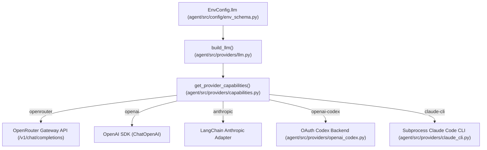
Sources: [agent/src/providers/llm.py:1-20](), [agent/src/providers/capabilities.py:1-58](), [agent/.env.example:6-54]()

---

## Onboarding Wizard & Preflight Checks

When no `.env` file is present, running `vibe-trading` triggers the interactive onboarding wizard (`agent/cli/onboard.py`), which writes credentials via `_render_env_content` and invokes `src/preflight.py` to validate provider endpoints [agent/tests/test_cli_init.py:55-127]()<br>`agent/tests/test_provider_diagnostics.py:1-10]().

### Onboarding & Preflight Flow
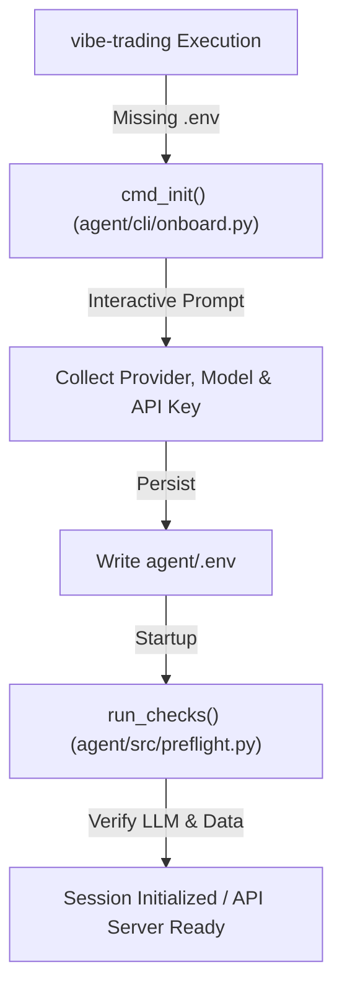
Sources: [agent/cli/onboard.py:1-10](), [agent/tests/test_cli_init.py:55-127](), [agent/tests/test_provider_diagnostics.py:1-10]()

---

## Zero-Config Data Philosophy & QVeris Paid Data Opt-In

Vibe-Trading implements a tiered access model. Core market tools operate zero-config, falling back automatically to free providers (Yahoo Finance, Stooq, Eastmoney, Baostock) [agent/src/config/env_schema.py:183-183]().

### Premium Data & QVeris Opt-In
Users can opt-in to premium commercial data streams by configuring keys in `EnvConfig.data`:
- **QVeris Marketplace**: Enabled via `VIBE_TRADING_QVERIS_API_KEY`, subject to session credit budget limits [agent/src/config/env_schema.py:200-201]().
- **Tushare**: Enabled via `TUSHARE_TOKEN` for deep A-share historical and financial statements [agent/src/config/env_schema.py:180-180]().
- **SEC EDGAR**: Free US financial disclosures requiring a compliant `VIBE_TRADING_SEC_UA` header string [agent/src/config/env_schema.py:190-190]().

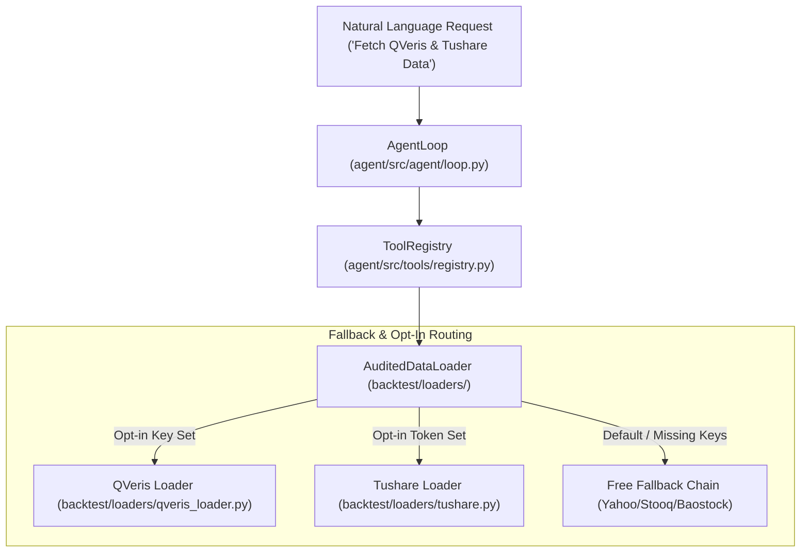
Sources: [agent/src/config/env_schema.py:174-201](), [agent/src/agent/loop.py:1-50](), [agent/src/tools/registry.py:1-60]()

---

# Page: System Entrypoints: CLI, API Server, and MCP Server

# System Entrypoints: CLI, API Server, and MCP Server

<details>
<summary>Relevant source files</summary>

The following files were used as context for generating this wiki page:

- [CHANGELOG.md](CHANGELOG.md)
- [README.md](README.md)
- [README_ar.md](README_ar.md)
- [README_es.md](README_es.md)
- [README_id.md](README_id.md)
- [README_ja.md](README_ja.md)
- [README_ko.md](README_ko.md)
- [README_zh.md](README_zh.md)
- [agent/SKILL.md](agent/SKILL.md)
- [agent/api_server.py](agent/api_server.py)
- [agent/cli/main.py](agent/cli/main.py)
- [agent/mcp_server.py](agent/mcp_server.py)
- [agent/src/api/helpers.py](agent/src/api/helpers.py)
- [agent/src/api/security.py](agent/src/api/security.py)
- [agent/src/api/settings_routes.py](agent/src/api/settings_routes.py)
- [agent/src/api/state.py](agent/src/api/state.py)
- [agent/src/channels/msteams.py](agent/src/channels/msteams.py)
- [agent/src/config/schema.py](agent/src/config/schema.py)
- [agent/src/session/events.py](agent/src/session/events.py)
- [agent/src/tools/mcp.py](agent/src/tools/mcp.py)
- [agent/src/trading/connectors/ibkr/mcp.py](agent/src/trading/connectors/ibkr/mcp.py)
- [agent/src/trading/connectors/ibkr/profiles.py](agent/src/trading/connectors/ibkr/profiles.py)
- [agent/tests/test_api_infrastructure.py](agent/tests/test_api_infrastructure.py)
- [agent/tests/test_channel_runtime_reset.py](agent/tests/test_channel_runtime_reset.py)
- [agent/tests/test_cli_live.py](agent/tests/test_cli_live.py)
- [agent/tests/test_cli_runtime.py](agent/tests/test_cli_runtime.py)
- [agent/tests/test_eventbus_clear_subscribers.py](agent/tests/test_eventbus_clear_subscribers.py)
- [agent/tests/test_ibkr_mcp_mapping.py](agent/tests/test_ibkr_mcp_mapping.py)
- [agent/tests/test_ibkr_mcp_seed.py](agent/tests/test_ibkr_mcp_seed.py)
- [agent/tests/test_local_connections_hardening.py](agent/tests/test_local_connections_hardening.py)
- [agent/tests/test_mcp_client_adapter.py](agent/tests/test_mcp_client_adapter.py)
- [agent/tests/test_mcp_oauth_noninteractive.py](agent/tests/test_mcp_oauth_noninteractive.py)
- [agent/tests/test_mcp_oauth_schema.py](agent/tests/test_mcp_oauth_schema.py)
- [agent/tests/test_mcp_result_dedup.py](agent/tests/test_mcp_result_dedup.py)
- [agent/tests/test_mcp_specs_cache.py](agent/tests/test_mcp_specs_cache.py)
- [agent/tests/test_msteams_inbound_body_limit.py](agent/tests/test_msteams_inbound_body_limit.py)
- [agent/tests/test_readme_counts.py](agent/tests/test_readme_counts.py)
- [agent/tests/test_scheduled_delivery_hook.py](agent/tests/test_scheduled_delivery_hook.py)
- [agent/tests/test_security_auth_api.py](agent/tests/test_security_auth_api.py)
- [agent/tests/test_serve_bind.py](agent/tests/test_serve_bind.py)
- [agent/tests/test_session_events.py](agent/tests/test_session_events.py)
- [agent/tests/test_settings_api.py](agent/tests/test_settings_api.py)
- [agent/tests/test_sse_ticket_and_headers.py](agent/tests/test_sse_ticket_and_headers.py)
- [agent/tests/test_trading_connections.py](agent/tests/test_trading_connections.py)
- [frontend/src/pages/Settings.tsx](frontend/src/pages/Settings.tsx)

</details>


## Purpose and Scope
This page covers the three primary entrypoints for interacting with Vibe-Trading: the terminal-based Command Line Interface (CLI) in `agent/cli/`, the RESTful FastAPI backend in `agent/api_server.py`, and the Model Context Protocol (MCP) server/client subsystem (`agent/mcp_server.py` and `agent/src/tools/mcp.py`). These components handle local user interactions, web frontend requests, external AI tool orchestration, and the channelsui WebSocket/WebUI compatibility layer.

Sources: `agent/cli/main.py:1-30](), [agent/api_server.py:1-30](), [agent/mcp_server.py:1-56]().

## 1. Command Line Interface (CLI)

The CLI serves as the primary entrypoint for local development, interactive terminal sessions, and automated headless runs. It is exposed via the console script entrypoint defined in `pyproject.toml` [pyproject.toml:70]() and implemented under `agent/cli/`.

### Implementation and Execution Modes
* **Interactive TUI Mode**: Launched via `vibe-trading` or `vibe-trading chat`. It uses `prompt_toolkit` to maintain a REPL with command history and a live status toolbar, printing startup banners via `cli.theme.get_console` and `cli.intro.print_banner` [agent/cli/main.py:31-33]().
* **Single Run Mode**: Executes a non-interactive agent execution loop for a prompt supplied through `-p` / `--prompt`.
* **Server Mode**: Started via `vibe-trading serve`, wrapping the FastAPI application defined in `agent/api_server.py` [agent/api_server.py:1-169]().
* **Onboarding Wizard**: On startup, the CLI checks for existing configuration files in `~/.vibe-trading/.env` or project paths, invoking `cli.onboard.run_onboarding` if needed [agent/cli/main.py:100-103]().
* **Stat Probes**: Non-blocking background probes aggregate tool counts, skill counts, and active sessions for display in the startup banner [agent/cli/main.py:143-174]().

### Slash Command Registry
Privileged commands bypass the agent reasoning model to manage system states directly. These are registered in the `SLASH_COMMANDS` registry [agent/cli/main.py:54-97]():
* `/connector`: Manages live trading broker profiles and connection status [agent/cli/main.py:58-66]().
* `/halt` / `/resume`: Triggers or lifts the global safety kill switch [agent/cli/main.py:58-66]().
* `/data`: Toggles between free public data loaders and QVeris paid data routing [agent/cli/main.py:94]().
* `/model`: Selects the active LLM reasoning provider [agent/cli/main.py:130]().

Sources: `pyproject.toml:69-71](), [agent/cli/main.py:1-174]().

---

## 2. API Server (FastAPI)

The REST API server (`agent/api_server.py`) provides the communication backend for the React frontend, handling session CRUD operations, background research executions, and real-time event streaming.

### Key Architecture and Security
* **FastAPI Application Setup**: Instantiates `FastAPI` with a custom lifespan context manager (`_lifespan`) that triggers preflight checks, state migrations, and background service schedulers [agent/api_server.py:128-169]().
* **Authentication and Security Headers**: Enforces `HTTPBearer` token validation via `_validate_api_auth` for non-loopback clients while trusting local loopback calls [agent/api_server.py:35-71](). Security middleware applies strict CORS rules, SPA HTML fallbacks, and security headers [agent/api_server.py:171-180]().
* **SSE Tickets**: Uses short-lived, single-use authentication tickets (`_mint_sse_ticket` / `_consume_sse_ticket`) to allow EventSource connections to stream safely without exposing long-lived bearer keys in query parameters [agent/api_server.py:45, 53]().
* **ChannelsUI Compatibility Layer**: Mounts channels and scheduling route modules (`channels_routes.py`, `scheduled_routes.py`, `runs_routes.py`, `sessions_routes.py`) that bridge WebSocket and WebUI compatibility layers [agent/api_server.py:117-125, 185-212]().

### Primary Endpoints Overview
* `/sessions` (POST/GET): Manages user chat sessions and history storage [agent/api_server.py:194]().
* `/sessions/{id}/messages` (POST): Dispatches user prompts into asynchronous `AgentLoop` executions [agent/api_server.py:194]().
* `/sessions/{id}/events` (GET): Opens a Server-Sent Events (SSE) stream for real-time tool logs and agent thoughts [agent/api_server.py:194]().
* `/runs/*` and `/alpha/*`: Exposes backtest run artifacts and the 478-factor Alpha Zoo registry [agent/api_server.py:186-191]().

### System Entrypoint Data Flow
The diagram below maps the execution flow from the frontend API client through the FastAPI routing and security layers down to the tool registry.

Diagram: API to Agent Execution Flow
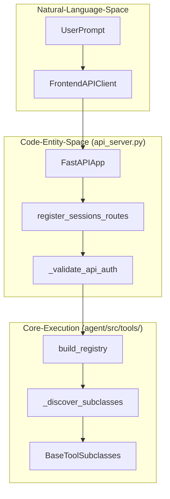
Sources: `agent/api_server.py:1-212](), [CHANGELOG.md:13-14]().

---

## 3. Model Context Protocol (MCP)

Vibe-Trading implements dual MCP capabilities: acting as an **MCP Server** to expose financial research tools to external AI clients (Claude Desktop, Cursor, OpenClaw) and as an **MCP Client** to consume tools from remote servers.

### 3.1. MCP Server Implementation
Implemented in `agent/mcp_server.py` using the `FastMCP` framework (`mcp = FastMCP("Vibe-Trading")`) [agent/mcp_server.py:75-86]().

* **Transports**: Supports `stdio` (default pipe), legacy `sse`, and the modern Streamable HTTP `http` transport (`--transport http` served at `/mcp`) [agent/mcp_server.py:31-40]().
* **Tool Exposure**: Registers 82+ read-only or research tools (including market data, backtesting, Alpha Zoo factors, paper-trading matching via `paper_trade_step`, and `load_skill`) [agent/mcp_server.py:9-29, 86](). Order-placing and order-canceling tools are strictly prohibited [agent/mcp_server.py:27-29]().
* **Security & Hardening**: Process-control tools (`bash`, `background_run`) are disabled by default unless explicitly opted in via `--enable-shell-tools` or `VIBE_TRADING_ENABLE_SHELL_TOOLS` [agent/mcp_server.py:98-132](). Network transports incorporate `_HostGuardMiddleware` and Origin allow-lists to prevent DNS-rebinding attacks [agent/mcp_server.py:135-144]().

### 3.2. MCP Client Mode (Consuming Tools)
Managed via `agent/src/tools/mcp.py` (`MCPServerAdapter`), allowing the agent to invoke remote tools [agent/src/tools/mcp.py:1]().

* **Tool Discovery & Wrapping**: `build_mcp_tool_wrappers` introspects remote servers and wraps discovered functions into local `BaseTool` instances, prefixing names as `mcp_<server>_<tool>` [agent/src/tools/mcp.py:117-168]().
* **OAuth & Interactive Guards**: Implements `_GuardedOAuth` and `_IBKROAuth` to handle authentication flows securely [agent/src/tools/mcp.py:101-190](). Setting `allow_interactive=False` ensures non-interactive background pollers or API jobs throw a loud `RuntimeError` rather than unexpectedly spawning browser windows [agent/src/tools/mcp.py:101-144]().
* **Broker Protection**: Wildcard tool access (`enabled_tools=["*"]`) is rejected for live broker connections unless explicit read-only lists are provided [agent/src/config/schema.py:11-46]().

Diagram: MCP Bridge Architecture
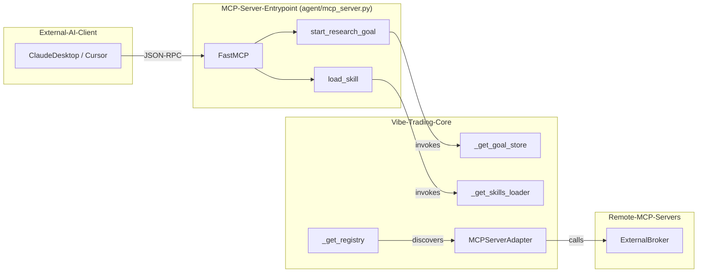
Sources: `agent/mcp_server.py:1-212](), [agent/src/tools/mcp.py:1-190](), [agent/src/config/schema.py:11-46]().

---

## Summary of Entrypoint Differences

| Feature | CLI (`agent/cli/`) | API Server (`agent/api_server.py`) | MCP Server (`agent/mcp_server.py`) |
| :--- | :--- | :--- | :--- |
| **Primary Target** | Developer / Quant User | React Web Application UI | External AI Clients (Claude/Cursor) |
| **Protocol / Interface** | Terminal REPL / TUI / Stdio | RESTful HTTP + SSE Streams | JSON-RPC (Stdio / SSE / HTTP) |
| **Security Model** | Local Process Execution | Loopback Trust / HTTPBearer Auth | Loopback HostGuard / Scoped Auth |
| **Key Use Case** | Interactive terminal research | Web UI dashboard & automation | IDE assistant tool extension |

Sources: `agent/cli/main.py:1-30](), [agent/api_server.py:1-169](), [agent/mcp_server.py:1-56]().

---

# Page: Desktop App (Electron) and Deployment Packaging

# Desktop App (Electron) and Deployment Packaging

<details>
<summary>Relevant source files</summary>

The following files were used as context for generating this wiki page:

- [.github/workflows/desktop-windows.yml](.github/workflows/desktop-windows.yml)
- [Dockerfile](Dockerfile)
- [agent/src/tools/taiwan_stock_data_tool.py](agent/src/tools/taiwan_stock_data_tool.py)
- [agent/tests/test_load_skill_paging.py](agent/tests/test_load_skill_paging.py)
- [agent/tests/test_taiwan_stock_data_tool.py](agent/tests/test_taiwan_stock_data_tool.py)
- [desktop/electron/README.md](desktop/electron/README.md)
- [desktop/electron/THREAT_MODEL.md](desktop/electron/THREAT_MODEL.md)
- [desktop/electron/UPDATE_SAFETY.md](desktop/electron/UPDATE_SAFETY.md)
- [desktop/electron/WINDOWS_PACKAGING.md](desktop/electron/WINDOWS_PACKAGING.md)
- [desktop/electron/package-lock.json](desktop/electron/package-lock.json)
- [desktop/electron/package.json](desktop/electron/package.json)
- [desktop/electron/scripts/build-backend.ps1](desktop/electron/scripts/build-backend.ps1)
- [desktop/electron/scripts/prepare-electron.mjs](desktop/electron/scripts/prepare-electron.mjs)
- [desktop/electron/scripts/process-sentinel.mjs](desktop/electron/scripts/process-sentinel.mjs)
- [desktop/electron/scripts/process-utils.ps1](desktop/electron/scripts/process-utils.ps1)
- [desktop/electron/scripts/smoke-lifecycle.mjs](desktop/electron/scripts/smoke-lifecycle.mjs)
- [desktop/electron/scripts/smoke-parent-death.mjs](desktop/electron/scripts/smoke-parent-death.mjs)
- [desktop/electron/scripts/test-packaging-preparation.mjs](desktop/electron/scripts/test-packaging-preparation.mjs)
- [desktop/electron/scripts/test-process-utils.ps1](desktop/electron/scripts/test-process-utils.ps1)
- [desktop/electron/scripts/test-update-safety.mjs](desktop/electron/scripts/test-update-safety.mjs)
- [desktop/electron/src/backend-manager.ts](desktop/electron/src/backend-manager.ts)
- [desktop/electron/src/backend-watchdog.ts](desktop/electron/src/backend-watchdog.ts)
- [desktop/electron/src/update-recovery.ts](desktop/electron/src/update-recovery.ts)
- [desktop/electron/src/update-verification.ts](desktop/electron/src/update-verification.ts)
- [docker-compose.yml](docker-compose.yml)
- [frontend/package-lock.json](frontend/package-lock.json)
- [frontend/package.json](frontend/package.json)

</details>


This page details the Vibe-Trading desktop application built with Electron, covering its architecture, key components, secure credential management, update verification/recovery, and Windows packaging workflows. It also covers containerized deployment using Docker, `docker-compose`, and ZimaOS-compatible container architectures.

## Electron Desktop Application Architecture

The Electron application (`desktop/electron/`) acts as a native desktop host for the Vibe-Trading FastAPI backend and React frontend. It enforces a single application instance, manages the Python backend lifecycle via a parent-death watchdog, and secures sensitive user credentials.

### Core Runtime Components

The application is structured around several main modules located in `desktop/electron/src/`:
- **`main.ts`**: The main process entry point. It enforces single-instance execution [desktop/electron/src/main.ts:100-106](), initializes the `BackendManager` [desktop/electron/src/main.ts:110-111](), configures `SecureCredentialStore` [desktop/electron/src/main.ts:112-113](), and mounts the React frontend inside a sandboxed `BrowserWindow` [desktop/electron/src/main.ts:120-121]().
- **`preload.ts`**: Runs in the renderer context prior to web content loading, exposing a restricted IPC bridge while maintaining `contextIsolation` and disabling `nodeIntegration` [desktop/electron/src/preload.ts:1-10]().
- **`backend-manager.ts`**: Manages the discovery of the Python executable [desktop/electron/src/backend-manager.ts:87-90](), allocates an ephemeral loopback port [desktop/electron/src/backend-manager.ts:93-94](), spawns the watchdog process [desktop/electron/src/backend-manager.ts:136-137](), redirects standard output/error to rotating logs [desktop/electron/src/backend-manager.ts:96-100](), and handles graceful shutdown calls to `/system/shutdown` [desktop/electron/src/backend-manager.ts:173-189]().
- **`backend-watchdog.ts`**: A dedicated helper process that monitors the parent Electron PID and IPC channel, performing robust process-tree cleanup (`taskkill /T /F` on Windows) if Electron exits unexpectedly [desktop/electron/src/backend-watchdog.ts:100-106]().

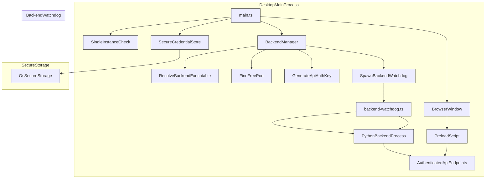
Title: Electron Desktop Architecture and Process Lifecycle
Sources: [desktop/electron/src/main.ts](), [desktop/electron/src/backend-manager.ts](), [desktop/electron/src/backend-watchdog.ts](), [desktop/electron/src/preload.ts](), [desktop/electron/THREAT_MODEL.md]()

## Secure Credential Storage

The `SecureCredentialStore` class handles encryption and secure retrieval of sensitive API tokens and credentials.
- **Encryption**: Utilizes Electron's `safeStorage` API to encrypt secrets via native operating system mechanisms (such as DPAPI on Windows) [desktop/electron/src/secure-credentials.ts:1-1]().
- **Storage**: Encrypted key-value pairs are stored in `credentials.v1.json` within the user data directory [desktop/electron/src/secure-credentials.ts:77-79]().
- **Allowlist**: An explicit allowlist (`ENV_CREDENTIALS`) controls which environmental variables are eligible for secure storage [desktop/electron/src/secure-credentials.ts:12-33]().
- **Migration**: On initial boot, legacy plaintext credentials located in `~/.vibe-trading/.env` and `~/.vibe-trading/qveris.json` are migrated into encrypted storage and automatically scrubbed [desktop/electron/src/secure-credentials.ts:89-94]().
- **Injection**: Decrypted secrets are injected exclusively into the child backend's environment variables at startup and are never exposed to the renderer process [desktop/electron/src/secure-credentials.ts:116-122]().

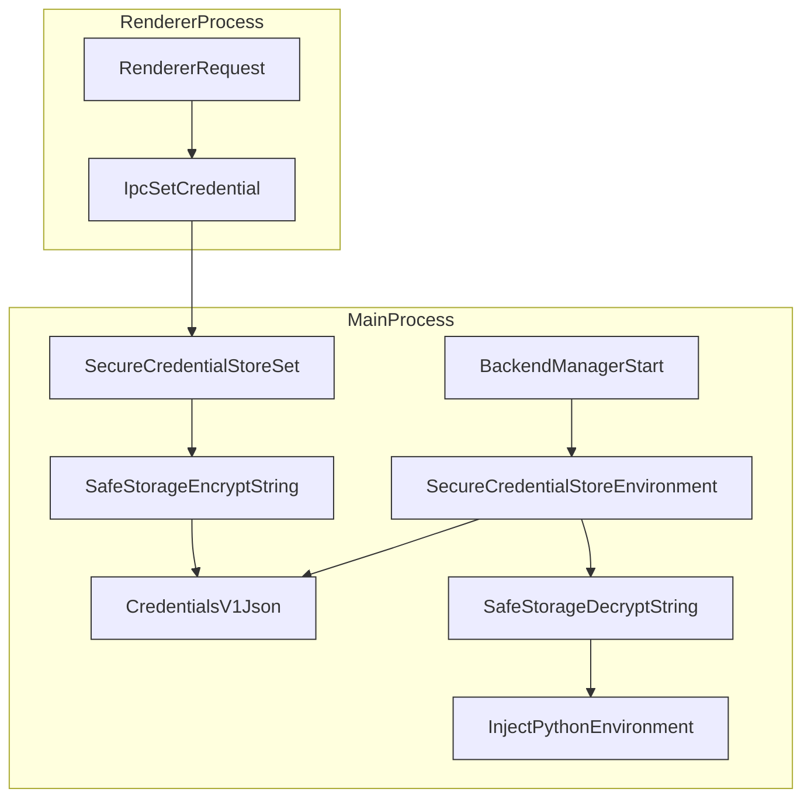
Title: Secure Credential Management Data Flow
Sources: [desktop/electron/src/secure-credentials.ts](), [desktop/electron/THREAT_MODEL.md]()

## Update Verification and Recovery

Although the current desktop build does not run an active auto-updater feed, it includes dormant, fail-closed components designed for future signed-update verification and recovery:
- **`update-verification.ts`**: Validates update candidates against semantic version rules, SHA-256 integrity checksums, and Windows Authenticode signatures using an explicit allowlist of publisher certificate hashes [desktop/electron/src/update-verification.ts:10-11, 100-113]().
- **`update-recovery.ts`**: Manages an interruption-recovery journal to track staged installation steps, allowing clean rollback or recovery in the event of an abrupt termination [desktop/electron/src/update-recovery.ts:1-10]().
- **`UPDATE_SAFETY.md`**: Defines the rigorous policy requirements, rejection matrices, and recovery flows [desktop/electron/UPDATE_SAFETY.md]().

These policies are verified during test runs via `npm run test:update-safety` [desktop/electron/package.json:14]().

Sources: [desktop/electron/src/update-verification.ts](), [desktop/electron/src/update-recovery.ts](), [desktop/electron/UPDATE_SAFETY.md](), [desktop/electron/package.json]()

## Windows Packaging Scripts and Workflow

The Windows packaging workflow is orchestrated via PowerShell scripts and `electron-builder`, configured in `desktop/electron/package.json` [desktop/electron/package.json:33-88]() and automated by GitHub Actions [.github/workflows/desktop-windows.yml:43-135]().

### Packaging Steps
1. **Frontend Build**: Compiles the React application static bundle [desktop/electron/WINDOWS_PACKAGING.md:33-35]().
2. **Runtime Preparation**: Downloads and verifies the official Windows x64 Electron distribution package (`prepare:electron`) [desktop/electron/WINDOWS_PACKAGING.md:38-39]().
3. **Embedded Python Assembly**: Executes `scripts/build-backend.ps1`, which downloads a checksum-pinned CPython 3.12.10 embeddable archive, locks Python dependencies via `requirements-windows-lock.txt`, and pulls the required native DLL and font assets for WeasyPrint PDF generation [desktop/electron/scripts/build-backend.ps1:15-26, 114-117]().
4. **Installer Compilation**: Runs `electron-builder` (`installer:win:review`) to generate an unsigned NSIS review installer under `desktop/electron/release/` [desktop/electron/WINDOWS_PACKAGING.md:44-53](). Signed releases require explicit Authenticode signing credentials (`installer:win:signed`) [desktop/electron/WINDOWS_PACKAGING.md:103-107]().

Sources: [desktop/electron/WINDOWS_PACKAGING.md](), [desktop/electron/scripts/build-backend.ps1](), [.github/workflows/desktop-windows.yml](), [desktop/electron/package.json]()

## Process-Boundary Threat Model (`THREAT_MODEL.md`)

The threat model outlines boundaries and security mitigations across the desktop environment:
- **Loopback Binding**: The FastAPI backend binds exclusively to `127.0.0.1` on a dynamically assigned ephemeral port [desktop/electron/THREAT_MODEL.md:63-65]().
- **Authentication**: A 256-bit cryptographically secure token (`API_AUTH_KEY`) is generated per launch, injected into the backend, and appended as a Bearer token for requests originating from the validated local renderer origin [desktop/electron/THREAT_MODEL.md:66-71]().
- **Renderer Sandboxing**: Context isolation is enforced, Node.js integration is disabled, and in-window navigation is strictly restricted to the local backend origin [desktop/electron/THREAT_MODEL.md:77-85]().
- **Executable Resolution**: Backend executables are resolved through rigid path checks (`VIBE_TRADING_EXECUTABLE` override or exact resource layout locations) to prevent arbitrary binary execution [desktop/electron/THREAT_MODEL.md:91-104]().

Sources: [desktop/electron/THREAT_MODEL.md]()

## Docker, Docker-Compose, and ZimaOS Deployment

Vibe-Trading provides containerized deployment options via a multi-stage `Dockerfile` [Dockerfile:1-120]() and `docker-compose.yml` [docker-compose.yml:1-89](), which also serves as the deployment blueprint for ZimaOS and similar self-hosted container platforms.

### Service Configuration and Hardening
- **`vibe-trading` Service**: Builds from the project root [docker-compose.yml:3()], exposing port `8899` [docker-compose.yml:4-5]() and configuring container environment parameters [docker-compose.yml:6-15]().
- **Volume Mounts**: Named volumes preserve state across container re-creations:
  - `vibe-runs` (`/app/agent/runs`) [docker-compose.yml:21]()
  - `vibe-sessions` (`/app/agent/sessions`) [docker-compose.yml:22]()
  - `vibe-home` (`/home/vibe/.vibe-trading`) [docker-compose.yml:24-27]()
  - `vibe-swarm-runs` (`/app/agent/.swarm/runs`) [docker-compose.yml:28]()
  - `vibe-uploads` (`/app/agent/uploads`) [docker-compose.yml:29]()
- **Runtime Hardening (VT-007)**: Drops all capabilities except `SETUID` and `SETGID` (required for unprivileged runner privilege dropping), enables `no-new-privileges`, mounts a read-only root filesystem (`read_only: true`), and allocates temporary scratch filesystems via `tmpfs` [docker-compose.yml:41-60]().

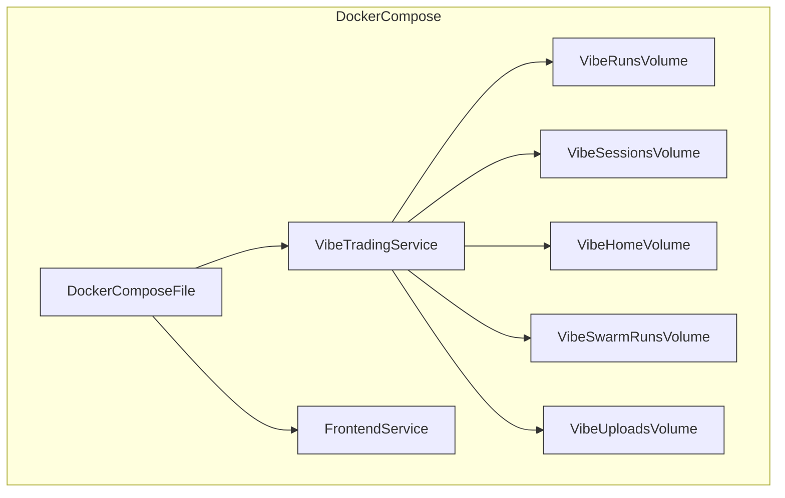
Title: Docker and Container Deployment Architecture
Sources: [docker-compose.yml](), [Dockerfile]()

---

# Page: ReAct Agent Core

# ReAct Agent Core

<details>
<summary>Relevant source files</summary>

The following files were used as context for generating this wiki page:

- [agent/src/agent/context_budget.py](agent/src/agent/context_budget.py)
- [agent/src/agent/llm_usage.py](agent/src/agent/llm_usage.py)
- [agent/src/agent/loop.py](agent/src/agent/loop.py)
- [agent/src/agent/result_artifacts.py](agent/src/agent/result_artifacts.py)
- [agent/src/agent/run_outcome.py](agent/src/agent/run_outcome.py)
- [agent/src/agent/tool_lifecycle.py](agent/src/agent/tool_lifecycle.py)
- [agent/src/trading/connectors/robinhood/classification.py](agent/src/trading/connectors/robinhood/classification.py)
- [agent/src/trading/connectors/robinhood/mcp.py](agent/src/trading/connectors/robinhood/mcp.py)
- [agent/src/trading/connectors/robinhood/profiles.py](agent/src/trading/connectors/robinhood/profiles.py)
- [agent/tests/test_agent_loop_dedup_arguments.py](agent/tests/test_agent_loop_dedup_arguments.py)
- [agent/tests/test_agent_loop_dsml_tool_calls.py](agent/tests/test_agent_loop_dsml_tool_calls.py)
- [agent/tests/test_default_deny_unknown_robinhood_tool.py](agent/tests/test_default_deny_unknown_robinhood_tool.py)
- [agent/tests/test_llm_cost_accounting.py](agent/tests/test_llm_cost_accounting.py)
- [agent/tests/test_loop_helpers.py](agent/tests/test_loop_helpers.py)
- [agent/tests/test_robinhood_mcp_mapping.py](agent/tests/test_robinhood_mcp_mapping.py)
- [agent/tests/test_run_outcome_module.py](agent/tests/test_run_outcome_module.py)
- [agent/tests/test_session_load_metrics.py](agent/tests/test_session_load_metrics.py)

</details>


The **ReAct Agent Core** is the central reasoning engine of Vibe-Trading. It implements a "Reasoning and Acting" (ReAct) loop that allows the AI to interleave thought processes with tool execution. The core is designed to handle complex financial tasks—such as backtesting strategies, performing multi-factor analysis, or orchestrating a swarm of specialized agents—by dynamically selecting from a library of 80+ atomic tools and specialist skills.

### Architecture Overview

The agent core is built on a modular architecture where the execution logic is decoupled from tool definitions, memory management, and LLM provider implementations.

| Component | Responsibility | Key Class/File |
|:---|:---|:---|
| **AgentLoop** | Orchestrates the iterative ReAct cycle, five-layer context management, and tool dispatch. | `AgentLoop` [agent/src/agent/loop.py:170-190]() |
| **ContextBuilder** | Constructs the system prompt and manages message history/memory recall. | `ContextBuilder` [agent/src/agent/context.py:1-10]() |
| **ToolRegistry** | Manages the registration and invocation of atomic capabilities. | `ToolRegistry` [agent/src/agent/tools.py:1-30]() |
| **WorkspaceMemory** | Maintains lightweight state (counters, `run_dir`) within a single run. | `WorkspaceMemory` [agent/src/agent/memory.py:1-50]() |
| **TraceWriter** | Provides crash-safe logging of reasoning steps and tool results. | `TraceWriter` [agent/src/agent/trace.py:1-40]() |

**Sources:** [agent/src/agent/loop.py:1-100](), [agent/src/agent/context.py:1-20]()

---

### Core Reasoning Workflow

The agent operates by building a comprehensive context that includes tool definitions and skill summaries, then entering an execution loop. It supports **Finance Research Goals**, which allow the agent to persist in complex multi-step objectives across multiple turns using continuation logic.

#### Natural Language to Code Entity Space Mapping
This diagram illustrates how a user's natural language request is transformed into specific code entities and tool calls within the ReAct loop.

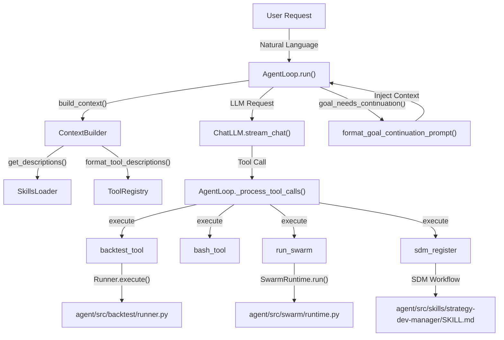
**Sources:** [agent/src/agent/loop.py:1-12](), [agent/src/agent/context.py:1-35](), [agent/src/goal/context.py:84-90](), [agent/src/providers/chat.py:1-20]()

---

### Sub-Component Summaries

#### [AgentLoop and Execution Lifecycle](#2.1)
The `AgentLoop` manages the lifecycle of a single task. It features a **five-layer context management** system to handle long-running financial research: `Layer 1 (microcompact)` (pruning tool results under memory pressure) [agent/src/agent/loop.py:3-4](), `Layer 2 (context_collapse)` (folding long text blocks without LLM calls) [agent/src/agent/loop.py:5-5](), `Layer 3 (auto_compact)` (LLM structured summary), `Layer 4 (compact tool)`, and `Layer 5 (iterative update)` [agent/src/agent/loop.py:6-8](). It also manages goal token budgets and utilizes goal continuation prompts to ensure research goals are pursued to completion. The loop includes a stall watchdog, trace writing, and run outcome accounting via `resolve_final_status` [agent/src/agent/run_outcome.py:122-129]().
*For details, see [AgentLoop and Execution Lifecycle](#2.1).*

#### [Tools Registry (80+ Atomic Tools)](#2.2)
The `ToolRegistry` acts as the interface between the LLM and the local environment. It manages 80+ tools using a registry pattern, including governed tool layers (`GovernedToolRegistry`), file tools with safe path enforcement, market data and fundamentals tools, OCR doc readers, pattern and indicator utilities, and specialized quantlib or vision tools. Readonly tools support concurrent thread batching [agent/src/agent/loop.py:10-12](), and execution passes through duplicate-call gates that compare argument semantics to prevent redundant loops [agent/tests/test_agent_loop_dedup_arguments.py:1-18]().
*For details, see [Tools Registry (80+ Atomic Tools)](#2.2).*

#### [Session Management and Event Streaming](#2.3)
The system uses a session-based approach (`SessionService` lifecycle and `SessionStore`) to map chat sessions to `AgentLoop` instances. It supports FTS5 cross-session search and real-time event streaming via `EventBus` Server-Sent Events (SSE) with `last_event_id` recovery. Trace outputs and progress events ensure state visibility across runs [agent/src/agent/progress.py:1-50]().
*For details, see [Session Management and Event Streaming](#2.3).*

#### [LLM Providers and ChatLLM](#2.4)
The agent uses the `ChatLLM` abstraction and `build_llm()` factory located in `agent/src/providers/` to support diverse backends. It handles `ProviderCapabilities`, reasoning content extraction (`reasoning_content`), DeepSeek-style (DSML) tool call parsing [agent/tests/test_agent_loop_dsml_tool_calls.py:1-40](), OpenAI Codex bindings, endpoint security guards, and connection preflight checks.
*For details, see [LLM Providers and ChatLLM](#2.4).*

#### [Grounding Ledger and Output Discipline](#2.5)
The grounding subsystem (`agent/src/agent/grounding/`) enforces output discipline through entity resolution (via `SymbolSearchTool`), evidence ingestion, figures block validation contracts, policy checks, and automatic correction or redaction. It guarantees that generated metrics are tethered to verified tool results or explicitly flagged as degraded fallbacks.
*For details, see [Grounding Ledger and Output Discipline](#2.5).*

---

### Knowledge Orchestration: Skills and Tools

The agent differentiates between **Tools** (what it can *do*) and **Skills** (what it *knows*).

1.  **Tools**: Concrete Python classes that interact with the OS, APIs, or backtest engines.
2.  **Skills**: Markdown files (`SKILL.md`) that provide the LLM with domain methodologies and execution parameters.
3.  **Progressive Disclosure**: The system prompt contains dynamic summaries, and the agent must invoke tools or recall memory to reference detailed schemas.

#### Knowledge Assembly Diagram
This diagram shows how the `ContextBuilder` coordinates different code entities to prepare the agent's system prompt.

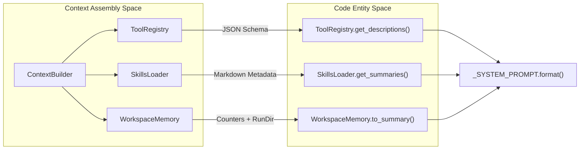
**Sources:** [agent/src/agent/context.py:1-50](), [agent/src/agent/loop.py:24-45]()

**Sources:** [agent/src/agent/loop.py:1-12](), [agent/src/agent/context.py:1-35]()

---

# Page: AgentLoop and Execution Lifecycle

# AgentLoop and Execution Lifecycle

<details>
<summary>Relevant source files</summary>

The following files were used as context for generating this wiki page:

- [CONTRIBUTING.md](CONTRIBUTING.md)
- [agent/src/agent/context_budget.py](agent/src/agent/context_budget.py)
- [agent/src/agent/llm_usage.py](agent/src/agent/llm_usage.py)
- [agent/src/agent/loop.py](agent/src/agent/loop.py)
- [agent/src/agent/result_artifacts.py](agent/src/agent/result_artifacts.py)
- [agent/src/agent/run_outcome.py](agent/src/agent/run_outcome.py)
- [agent/src/agent/tool_lifecycle.py](agent/src/agent/tool_lifecycle.py)
- [agent/src/trading/connectors/robinhood/classification.py](agent/src/trading/connectors/robinhood/classification.py)
- [agent/src/trading/connectors/robinhood/mcp.py](agent/src/trading/connectors/robinhood/mcp.py)
- [agent/src/trading/connectors/robinhood/profiles.py](agent/src/trading/connectors/robinhood/profiles.py)
- [agent/tests/test_agent_goal_context.py](agent/tests/test_agent_goal_context.py)
- [agent/tests/test_agent_loop_content_filter.py](agent/tests/test_agent_loop_content_filter.py)
- [agent/tests/test_agent_loop_dedup_arguments.py](agent/tests/test_agent_loop_dedup_arguments.py)
- [agent/tests/test_agent_loop_dsml_tool_calls.py](agent/tests/test_agent_loop_dsml_tool_calls.py)
- [agent/tests/test_agent_loop_no_assistant_prefill.py](agent/tests/test_agent_loop_no_assistant_prefill.py)
- [agent/tests/test_agent_loop_stream_retry.py](agent/tests/test_agent_loop_stream_retry.py)
- [agent/tests/test_agent_loop_terminal_state.py](agent/tests/test_agent_loop_terminal_state.py)
- [agent/tests/test_agent_loop_trace.py](agent/tests/test_agent_loop_trace.py)
- [agent/tests/test_content_filter_e2e.py](agent/tests/test_content_filter_e2e.py)
- [agent/tests/test_default_deny_unknown_robinhood_tool.py](agent/tests/test_default_deny_unknown_robinhood_tool.py)
- [agent/tests/test_grounding_recovery.py](agent/tests/test_grounding_recovery.py)
- [agent/tests/test_llm_cost_accounting.py](agent/tests/test_llm_cost_accounting.py)
- [agent/tests/test_loop_helpers.py](agent/tests/test_loop_helpers.py)
- [agent/tests/test_reasoning_delta_throttle.py](agent/tests/test_reasoning_delta_throttle.py)
- [agent/tests/test_robinhood_mcp_mapping.py](agent/tests/test_robinhood_mcp_mapping.py)
- [agent/tests/test_run_outcome_module.py](agent/tests/test_run_outcome_module.py)
- [agent/tests/test_session_load_metrics.py](agent/tests/test_session_load_metrics.py)
- [agent/tests/test_swarm_worker_stream_retry.py](agent/tests/test_swarm_worker_stream_retry.py)
- [frontend/src/components/chat/MessageBubble.tsx](frontend/src/components/chat/MessageBubble.tsx)
- [frontend/src/components/chat/__tests__/MessageBubble.test.tsx](frontend/src/components/chat/__tests__/MessageBubble.test.tsx)
- [frontend/src/hooks/__tests__/useSSE.test.ts](frontend/src/hooks/__tests__/useSSE.test.ts)
- [frontend/src/hooks/useSSE.ts](frontend/src/hooks/useSSE.ts)
- [frontend/src/pages/Agent.tsx](frontend/src/pages/Agent.tsx)
- [frontend/src/pages/__tests__/AgentActivityTimerPersistence.test.tsx](frontend/src/pages/__tests__/AgentActivityTimerPersistence.test.tsx)
- [frontend/src/stores/agent.ts](frontend/src/stores/agent.ts)

</details>


The **AgentLoop** is the central execution engine of Vibe-Trading, implementing a rigorous **ReAct** (Reasoning and Acting) pattern. It manages the iterative cycle of generating thoughts, selecting tools, executing them concurrently or sequentially, and observing results. Furthermore, it incorporates a sophisticated five-layer context compaction strategy, robust stall watchdogs, trace writing, goal continuation, and comprehensive run outcome and token usage accounting.

Sources: [agent/src/agent/loop.py:1-12](), [agent/src/agent/run_outcome.py:1-29]()

## The ReAct Iteration Cycle

The execution lifecycle is managed by the `AgentLoop` class (inheriting from `ToolCallLifecycle`), defined in [agent/src/agent/loop.py:104-170](). It orchestrates the end-to-end flow between the user input, the LLM client (`ChatLLM`), and the `ToolRegistry`.

### Execution Flow and Natural Language to Code Mapping

The following diagram bridges the high-level natural language space to the precise code entities responsible for processing chat prompts, streaming tokens, parsing structured tool requests, and executing tools.

**ReAct Loop: Natural Language Space to Code Entity Mapping**
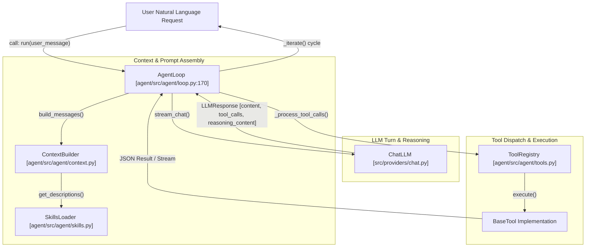
Sources: [agent/src/agent/loop.py:215-365](), [agent/src/providers/chat.py:1-140]()

### Key Lifecycle Methods
- `run(user_message)`: The entry point for a single interaction. It initializes message history, hooks into state storage via `RunStateStore`, and runs the iterative ReAct loop until completion, cancellation, or threshold exhaustion [agent/src/agent/loop.py:215-260]().
- `_iterate()`: A single turn in the ReAct cycle. It invokes `ChatLLM.stream_chat`, handles reasoning content (`reasoning_content`), parses tool calls, manages timeouts, and writes incremental trace events [agent/src/agent/loop.py:262-315]().
- `_process_tool_calls(tool_calls)`: Manages tool execution, utilizing worker threads for parallel read-only batching while strictly serializing state-mutating tools [agent/src/agent/loop.py:317-365]().

Sources: [agent/src/agent/loop.py:215-365]()

## Five-Layer Context Management

Vibe-Trading implements a tiered compaction strategy inside `agent/src/agent/loop.py` and `agent/src/agent/context_compact.py` to prevent context window overflow during prolonged research tasks without losing critical historical evidence.

| Layer | Name | Trigger Condition | Mechanism / Action |
| :--- | :--- | :--- | :--- |
| **Layer 1** | `_microcompact` | Token estimate > `MICROCOMPACT_THRESHOLD` | Silently prunes old tool results (retaining the most recent `KEEP_RECENT=3`), replacing outputs >100 chars with `[CLEARED FROM CONTEXT...]` [agent/src/agent/loop.py:52-53](), [agent/src/agent/loop.py:572-609](). |
| **Layer 2** | `_context_collapse` | Token estimate > `COLLAPSE_THRESHOLD` | Folds the middle of long text blocks (preserving `COLLAPSE_HEAD=900` and `COLLAPSE_TAIL=500`) using pure string slicing (zero LLM cost) [agent/src/agent/loop.py:611-660](), [agent/src/agent/loop.py:56-62](). |
| **Layer 3** | `_auto_compact` | Token estimate > `TOKEN_THRESHOLD` | Triggers an LLM call using `_STRUCTURED_SUMMARY_PROMPT` to compress historical conversation into a structured summary [agent/src/agent/loop.py:662-711](), [agent/src/agent/loop.py:65](). |
| **Layer 4** | Compact Tool | Agent-driven invocation | The agent explicitly calls the compact tool when it detects conversational clutter, triggering Layer 3 mechanics [agent/src/agent/loop.py:7-8](). |
| **Layer 5** | Iterative Update | Nth compression cycle | Updates the previous summary using `_ITERATIVE_UPDATE_PROMPT` instead of starting fresh, preserving continuous depth [agent/src/agent/loop.py:8-9](), [agent/src/agent/loop.py:64](). |

### Context Compaction Architecture
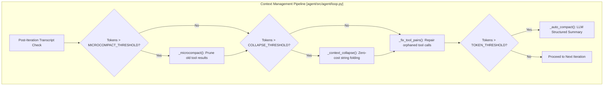
Sources: [agent/src/agent/loop.py:52-80](), [agent/src/agent/loop.py:572-711]()

## Tool Batching, Dedup, and Lifecycle Management

To maximize efficiency and maintain execution integrity, `AgentLoop` and its supporting base classes (`ToolCallLifecycle`) handle batching and deduplication.

- **Read/Write Batching**: Consecutive read-only tools (`is_readonly=True`) are grouped and executed in parallel using a `ThreadPoolExecutor`, significantly reducing latency when fetching multiple market data series or documents [agent/src/agent/loop.py:10-12]().
- **Deduplication Ledger**: Tracks tool execution fingerprints to prevent redundant calls within the same run context, while `_microcompact` unblocks cleared tool results when context pressure requires discarding old observations [agent/tests/test_loop_helpers.py:164-179]().
- **Timeout and Heartbeat Protection**: Each tool invocation is guarded by configurable timeouts (`_tool_timeout_seconds`) and accompanied by a `HeartbeatTimer` to emit periodic progress updates over the SSE stream [agent/src/agent/loop.py:33-46]().

Sources: [agent/src/agent/loop.py:10-12](), [agent/src/agent/loop.py:33-46](), [agent/tests/test_loop_helpers.py:164-179]()

## Stall Watchdog, Trace Writing, and Goal Continuation

### Stall Watchdog and Trace Writing
- **Stall Watchdog**: Monitors loop iterations and tool execution times against `_stall_timeout_seconds`. If a run hangs or exceeds duration limits without progress, the stall watchdog intervenes, records a failure state, and prevents infinite spinning [agent/src/agent/loop.py:36]().
- **Trace Writer**: `TraceWriter` logs every internal event (`thought`, `tool_call`, `tool_result`, `content_filter_skipped`) to structured JSONL files in the run directory. Large payloads are offloaded to sidecar files under `tool-results/` to keep traces lightweight [agent/src/agent/loop.py:83](), [CONTRIBUTING.md:39-41]().

### Goal Continuation
When executing under the Finance Research Goal System, `AgentLoop` evaluates whether open criteria remain unsatisfied after an LLM turn:
- Injects active goal state and evidence pointers using `get_current_goal_context()` [agent/src/goal/context.py:41-45]().
- Automatically continues execution up to `_goal_max_continuations()` times if `goal_needs_continuation()` evaluates to true [agent/src/agent/loop.py:35](), [agent/src/goal/context.py:34-39]().
- Formats structured steering instructions via `format_goal_continuation_prompt()` to guide the agent towards missing evidence [agent/src/goal/context.py:34-39]().

**Goal Continuation Lifecycle**
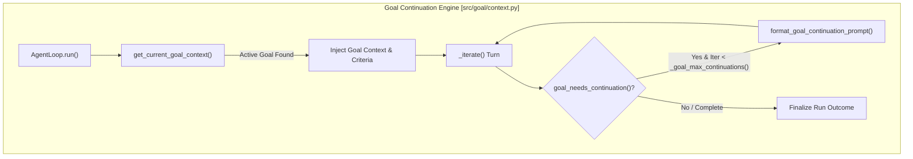
Sources: [agent/src/agent/loop.py:35](), [agent/src/goal/context.py:34-89]()

## Run Outcome and LLM Usage Accounting

### Run Outcome Resolution
Terminal states (success, failure, cancellation) are resolved through the decision ladder in `src/agent/run_outcome.py` (`resolve_final_status`) [agent/src/agent/run_outcome.py:1-129](). The branch evaluation order is load-bearing:
1. **Stall Watchdog Reason**: Honored immediately if already recorded [agent/src/agent/run_outcome.py:130-133]().
2. **User Cancellation**: Returns a cancelled status and reason [agent/src/agent/run_outcome.py:134-135]().
3. **Exhausted Token Budget**: Fails or marks degraded if usage breached limits [agent/src/agent/run_outcome.py:136-137]().
4. **No-Progress & Content Filter Breakers**: Triggers circuit breakers on persistent failures [agent/src/agent/run_outcome.py:138-146]().
5. **Success / Empty Response / Max Iterations**: Evaluates output presence and iteration counts [agent/src/agent/run_outcome.py:147-152]().

### LLM Usage Accounting
Token consumption and provider usage metadata are tracked in `src/agent/llm_usage.py` [agent/src/agent/llm_usage.py:1-144](). 
- `_normalize_llm_usage()` standardizes token counts (input, output, total, cache read/creation, and reasoning tokens) across diverse provider APIs [agent/src/agent/llm_usage.py:35-70]().
- `_record_llm_usage()` accumulates usage per iteration and atomically persists `llm_usage.json` inside the run directory [agent/src/agent/llm_usage.py:91-117](), [agent/src/agent/llm_usage.py:132-144]().
- Unreported or streaming fallback calls are counted safely without hallucinating token numbers via `_record_unreported_llm_call()` [agent/src/agent/llm_usage.py:120-130]().

Sources: [agent/src/agent/run_outcome.py:1-152](), [agent/src/agent/llm_usage.py:1-144]()

---

# Page: Tools Registry (80+ Atomic Tools)

# Tools Registry (80+ Atomic Tools)

<details>
<summary>Relevant source files</summary>

The following files were used as context for generating this wiki page:

- [agent/backtest/engines/china_a.py](agent/backtest/engines/china_a.py)
- [agent/src/agent/tool_progress.py](agent/src/agent/tool_progress.py)
- [agent/src/agent/tools.py](agent/src/agent/tools.py)
- [agent/src/portfolio/service.py](agent/src/portfolio/service.py)
- [agent/src/skills/doc-reader/SKILL.md](agent/src/skills/doc-reader/SKILL.md)
- [agent/src/skills/web-reader/SKILL.md](agent/src/skills/web-reader/SKILL.md)
- [agent/src/tools/__init__.py](agent/src/tools/__init__.py)
- [agent/src/tools/bash_tool.py](agent/src/tools/bash_tool.py)
- [agent/src/tools/doc_reader_tool.py](agent/src/tools/doc_reader_tool.py)
- [agent/src/tools/edit_file_tool.py](agent/src/tools/edit_file_tool.py)
- [agent/src/tools/financial_statements_tool.py](agent/src/tools/financial_statements_tool.py)
- [agent/src/tools/ocr/engine.py](agent/src/tools/ocr/engine.py)
- [agent/src/tools/ocr/llm_vision_ocr.py](agent/src/tools/ocr/llm_vision_ocr.py)
- [agent/src/tools/ocr/rapid_ocr.py](agent/src/tools/ocr/rapid_ocr.py)
- [agent/src/tools/path_utils.py](agent/src/tools/path_utils.py)
- [agent/src/tools/pattern_tool.py](agent/src/tools/pattern_tool.py)
- [agent/src/tools/read_file_tool.py](agent/src/tools/read_file_tool.py)
- [agent/src/tools/technical_indicator_tool.py](agent/src/tools/technical_indicator_tool.py)
- [agent/src/tools/web_reader_tool.py](agent/src/tools/web_reader_tool.py)
- [agent/src/tools/write_file_tool.py](agent/src/tools/write_file_tool.py)
- [agent/tests/quantlib/test_eventstudy_post_event_window.py](agent/tests/quantlib/test_eventstudy_post_event_window.py)
- [agent/tests/test_agent_loop_deterministic_cache.py](agent/tests/test_agent_loop_deterministic_cache.py)
- [agent/tests/test_agent_loop_no_progress.py](agent/tests/test_agent_loop_no_progress.py)
- [agent/tests/test_agent_loop_repeatable_tools.py](agent/tests/test_agent_loop_repeatable_tools.py)
- [agent/tests/test_bash_tool.py](agent/tests/test_bash_tool.py)
- [agent/tests/test_china_a_engine.py](agent/tests/test_china_a_engine.py)
- [agent/tests/test_compaction_call_identity.py](agent/tests/test_compaction_call_identity.py)
- [agent/tests/test_doc_reader.py](agent/tests/test_doc_reader.py)
- [agent/tests/test_doc_reader_docx_order.py](agent/tests/test_doc_reader_docx_order.py)
- [agent/tests/test_doc_reader_excel_literal_text.py](agent/tests/test_doc_reader_excel_literal_text.py)
- [agent/tests/test_doc_reader_inverted_pages.py](agent/tests/test_doc_reader_inverted_pages.py)
- [agent/tests/test_doc_reader_native_fallback.py](agent/tests/test_doc_reader_native_fallback.py)
- [agent/tests/test_doc_reader_pptx_containers.py](agent/tests/test_doc_reader_pptx_containers.py)
- [agent/tests/test_doc_reader_unicode_page_dashes.py](agent/tests/test_doc_reader_unicode_page_dashes.py)
- [agent/tests/test_file_tool_sandbox_security.py](agent/tests/test_file_tool_sandbox_security.py)
- [agent/tests/test_financial_statements_tool.py](agent/tests/test_financial_statements_tool.py)
- [agent/tests/test_forex_engine.py](agent/tests/test_forex_engine.py)
- [agent/tests/test_mcp_regression.py](agent/tests/test_mcp_regression.py)
- [agent/tests/test_ocr_engine.py](agent/tests/test_ocr_engine.py)
- [agent/tests/test_ocr_integration.py](agent/tests/test_ocr_integration.py)
- [agent/tests/test_path_safety.py](agent/tests/test_path_safety.py)
- [agent/tests/test_pattern_tool.py](agent/tests/test_pattern_tool.py)
- [agent/tests/test_pattern_tool_argument_coercion.py](agent/tests/test_pattern_tool_argument_coercion.py)
- [agent/tests/test_pattern_tool_double_top_abs_avg.py](agent/tests/test_pattern_tool_double_top_abs_avg.py)
- [agent/tests/test_pattern_tool_head_shoulders_abs_avg.py](agent/tests/test_pattern_tool_head_shoulders_abs_avg.py)
- [agent/tests/test_portfolio_futu_prefixed_codes.py](agent/tests/test_portfolio_futu_prefixed_codes.py)
- [agent/tests/test_portfolio_service.py](agent/tests/test_portfolio_service.py)
- [agent/tests/test_read_file_directory_errors.py](agent/tests/test_read_file_directory_errors.py)
- [agent/tests/test_read_file_refusals.py](agent/tests/test_read_file_refusals.py)
- [agent/tests/test_sec_period_frames.py](agent/tests/test_sec_period_frames.py)
- [agent/tests/test_technical_indicator_small_price_rounding.py](agent/tests/test_technical_indicator_small_price_rounding.py)
- [agent/tests/test_technical_indicator_tool.py](agent/tests/test_technical_indicator_tool.py)
- [agent/tests/test_tool_progress.py](agent/tests/test_tool_progress.py)
- [agent/tests/test_tool_registry_diagnostics.py](agent/tests/test_tool_registry_diagnostics.py)
- [agent/tests/test_web_reader_privacy.py](agent/tests/test_web_reader_privacy.py)
- [frontend/src/pages/Portfolio.tsx](frontend/src/pages/Portfolio.tsx)
- [frontend/src/pages/__tests__/Portfolio.test.tsx](frontend/src/pages/__tests__/Portfolio.test.tsx)

</details>


The **Tools Registry** is the central repository for all executable capabilities available to the ReAct agent in Vibe-Trading. It provides a structured interface for the `AgentLoop` to discover, validate, and execute atomic operations ranging from filesystem manipulation and web searching to complex quantitative analysis, financial statement retrieval, pattern recognition, and swarm orchestration.

The system implements **80+ atomic tools**, organized into functional categories. These tools are auto-discovered at runtime via class inheritance and can be extended with external Model Context Protocol (MCP) servers.

---

## Tool Architecture and Registry Pattern

Vibe-Trading utilizes a registry pattern to decouple tool definitions from the agent's core logic. The `ToolRegistry` class manages a collection of `BaseTool` instances, providing lookup and registration services [agent/src/agent/tools.py:21-21]().

### Key Classes and Functions

*   **`BaseTool`**: The abstract base class that all tools inherit from. It defines the `name`, `description`, `parameters` (JSON Schema), and the `execute()` method [agent/src/agent/tools.py:21-21]().
*   **`ToolRegistry`**: A container that stores and retrieves tools by name [agent/src/agent/tools.py:21-21]().
*   **`build_registry()`**: The primary factory function. It crawls the `src/tools/` directory, instantiates concrete `BaseTool` subclasses, injects shared dependencies (such as `PersistentMemory` or session IDs), and optionally appends MCP tools from remote servers [agent/src/tools/__init__.py:76-170]().
*   **`_discover_subclasses()`**: A helper that imports all modules in the `src.tools` package to populate the `BaseTool.__subclasses__()` list via package iteration [agent/src/tools/__init__.py:34-73]().
*   **`GovernedToolRegistry`**: A wrapper used when governance mode is enabled, applying the `PolicyEngine` to filter or gate tool access based on institutional risk levels [agent/scripts/dump_tool_inventory.py:66-109]().

### Registry Initialization Flow

The following diagram illustrates how the system bridges the filesystem structure and remote MCP definitions to the runtime `ToolRegistry` entity.

**Registry Construction and Entity Mapping**
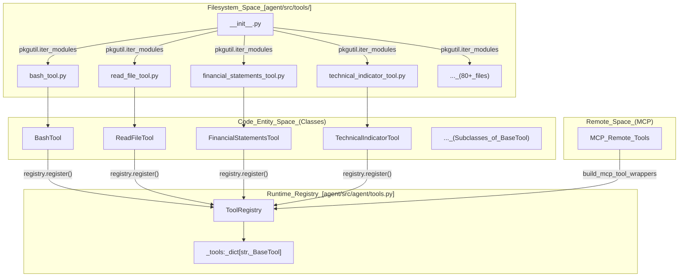
Sources: [agent/src/tools/__init__.py:34-170](), [agent/src/agent/tools.py:21-21]()

---

## Catalog of Atomic Tools

### 1. Environment & Filesystem Tools
These tools allow the agent to manage code and artifacts within the secure workspace while enforcing path sandboxing.

| Tool Name | Class | Purpose |
| :--- | :--- | :--- |
| `bash` | `BashTool` | Executes shell commands under a timeout (gated by shell tool policy) [agent/src/tools/__init__.py:31-31](). |
| `read_file` | `ReadFileTool` | Reads workspace files and bundled skills with strict containment checks and line limits [agent/src/tools/read_file_tool.py:81-170](). |
| `write_file` | `WriteFileTool` | Creates or overwrites files inside allowed roots, automatically handling model argument aliases and Markdown-to-PDF rendering [agent/src/tools/write_file_tool.py:14-117](). |
| `edit_file` | `EditFileTool` | Performs surgical find-and-replace on workspace files [agent/src/tools/edit_file_tool.py:14-29](). |
| `analyze_image` | `AnalyzeImageTool` | Vision tool for interpreting charts and screenshots via pluggable OCR engines [agent/src/tools/ocr/engine.py:45-68](). |

Sources: [agent/src/tools/__init__.py:31-31](), [agent/src/tools/read_file_tool.py:81-170](), [agent/src/tools/write_file_tool.py:14-117](), [agent/src/tools/ocr/engine.py:45-68]()

### 2. Market Data and Fundamentals Tools
These tools provide programmatic access to market data feeds, financial statements, and corporate governance actions across global exchanges.

| Tool Name | Class | Purpose |
| :--- | :--- | :--- |
| `get_financial_statements` | `FinancialStatementsTool` | Fetches balance sheets, income statements, cash flow statements, or key per-period indicators from Eastmoney (A-shares and Hong Kong) or SEC EDGAR (US) [agent/src/tools/financial_statements_tool.py:1-125](). |
| `get_shareholder_count` | `ShareholderCountTool` | Retrieves A-share shareholder count history from Eastmoney, including per-period holder changes and average holding metrics. |
| `get_lockup_expiry` | `LockupExpiryTool` | Provides A-share restricted share lockup expiry schedules from Eastmoney for specific stocks or market-wide scans. |
| `get_dragon_tiger` | `DragonTigerTool` | Queries the Eastmoney A-share dragon-tiger (龙虎榜) disclosure board, listing abnormal trading sessions and top brokerage seats. |
| `get_block_trades` | `BlockTradesTool` | Fetches A-share block trade data from Eastmoney, including transaction pricing, volumes, and institutional participants. |
| `get_margin_trading` | `MarginTradingTool` | Retrieves A-share margin trading and short selling statistics from Eastmoney data centers. |

Sources: [agent/src/tools/financial_statements_tool.py:1-125]()

### 3. Pattern and Indicator Tools
Technical analysis tools that compute quantitative indicators and recognize chart patterns from price series.

| Tool Name | Class | Purpose |
| :--- | :--- | :--- |
| `pattern_recognition` | `PatternRecognitionTool` | Detects technical chart patterns like head-and-shoulders, double tops/bottoms, support/resistance clustering, and trendline slopes [agent/src/tools/pattern_tool.py:24-200](). |
| `technical_indicators` | `TechnicalIndicatorTool` | Computes RSI (using Wilder's EWM smoothing convention), MACD, Bollinger Bands, SMA, EMA, and volume statistics [agent/src/tools/technical_indicator_tool.py:1-184](). |

Sources: [agent/src/tools/pattern_tool.py:24-200](), [agent/src/tools/technical_indicator_tool.py:1-184]()

### 4. Document Reader and OCR Tools
Universal ingestion tools for multi-format document parsing and optical character recognition.

| Tool Name | Class | Purpose |
| :--- | :--- | :--- |
| `doc_reader` | `DocReaderTool` | Universal reader dispatches by file extension supporting PDF (with pypdfium2 and automatic OCR fallback for image pages), Word (.docx), Excel (.xlsx/.xls), PowerPoint (.pptx), images, and plain text/code [agent/src/tools/doc_reader_tool.py:1-188](). |
| `analyze_image` | `AnalyzeImageTool` | Direct image OCR extraction using RapidOCR or LLM vision backends. |

Sources: [agent/src/tools/doc_reader_tool.py:1-188]()

### 5. Strategy Development Manager (SDM) & QuantLib Tools
Advanced management and quantitative analytics tools.

| Tool Name | Class | Purpose |
| :--- | :--- | :--- |
| `sdm_register` | `SdmRegisterTool` | Registers new factors and strategies into the SQLite `StrategyStore`. |
| `sdm_status` | `SdmStatusTool` | Queries or updates artifact lifecycle status and initiates decay scans. |
| `quantlib_tool` | `QuantLibTool` | Exposes the `quantlib` analytics library for options pricing, fixed income models, credit analytics, and statistical utilities. |

Sources: [agent/src/tools/sdm_status_tool.py:46-202]()

---

## File Tools and Security Boundaries

The registry implements strict path validation and sandboxing to protect the host system from unauthorized file access or path traversal attacks.

*   **Sandbox Enforcement (`safe_path`)**: Resolves user-supplied paths under a designated workspace root (`workdir`) and raises a `ValueError` if any path traversal attempt (such as `..` escaping the root or UNC share paths) is detected [agent/src/tools/path_utils.py:47-99]().
*   **Allowed Roots**: File operations are restricted to configured import/write roots (`VIBE_TRADING_ALLOWED_FILE_ROOTS` and `VIBE_TRADING_ALLOWED_WRITE_ROOTS`) alongside default runtime and upload directories [agent/src/tools/path_utils.py:107-198]().
*   **Shell Gating**: Potentially destructive shell tools (`bash`, `background_run`, `cancel_background`) are excluded by default unless `include_shell_tools=True` is explicitly passed during registry construction [agent/src/tools/__init__.py:31-31]().
*   **Redaction**: System error messages are passed through `redact_internal_paths` to prevent leaking absolute server directory structures to the LLM or client interface [agent/src/tools/write_file_tool.py:118-125]().

**Path Safety Validation Flow**
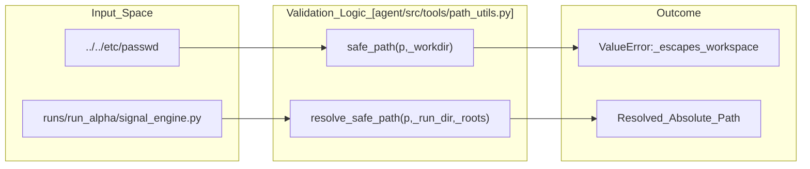
Sources: [agent/src/tools/path_utils.py:47-99](), [agent/src/tools/write_file_tool.py:77-125]()

---

## Institutional Research Reliability (IRR-AGL) Integration

When governance mode is active, the `GovernedToolRegistry` wraps the standard `ToolRegistry`, enforcing a policy-driven risk tiering model for every tool invocation:

*   **R0_READ**: Local read-only analysis tools (e.g., `read_file`, `technical_indicators`).
*   **R1_WRITE_LOCAL**: Local filesystem mutation tools (e.g., `write_file`, `edit_file`).
*   **R2_NETWORK**: External data fetching and search tools (e.g., `web_search`, `get_financial_statements`).
*   **R3_TRADE_READ**: Read-only live brokerage connector tools.
*   **R4_TRADE_WRITE**: Mutating live trading execution tools.
*   **R5_SHELL**: Shell and subprocess execution tools (e.g., `bash`).

Sources: [agent/scripts/dump_tool_inventory.py:66-109]()

---

# Page: Session Management and Event Streaming

# Session Management and Event Streaming

<details>
<summary>Relevant source files</summary>

The following files were used as context for generating this wiki page:

- [agent/src/api/sessions_routes.py](agent/src/api/sessions_routes.py)
- [agent/src/session/models.py](agent/src/session/models.py)
- [agent/src/session/search.py](agent/src/session/search.py)
- [agent/src/session/service.py](agent/src/session/service.py)
- [agent/src/tools/image_vision_tool.py](agent/src/tools/image_vision_tool.py)
- [agent/tests/test_goal_api.py](agent/tests/test_goal_api.py)
- [agent/tests/test_image_vision_tool.py](agent/tests/test_image_vision_tool.py)
- [agent/tests/test_session_events_replay_start.py](agent/tests/test_session_events_replay_start.py)
- [agent/tests/test_session_search.py](agent/tests/test_session_search.py)
- [agent/tests/test_session_search_concurrent_consumers.py](agent/tests/test_session_search_concurrent_consumers.py)
- [agent/tests/test_session_search_distinct_limit.py](agent/tests/test_session_search_distinct_limit.py)
- [agent/tests/test_session_search_native_snippets.py](agent/tests/test_session_search_native_snippets.py)
- [agent/tests/test_session_search_title_updates.py](agent/tests/test_session_search_title_updates.py)
- [agent/tests/test_session_service_lifecycle.py](agent/tests/test_session_service_lifecycle.py)
- [frontend/src/pages/__tests__/agentToolTimeline.test.ts](frontend/src/pages/__tests__/agentToolTimeline.test.ts)
- [frontend/src/pages/agentToolTimeline.ts](frontend/src/pages/agentToolTimeline.ts)

</details>


Session management in Vibe-Trading provides a persistent, stateful interface for chat-based interactions with the ReAct agent. It bridges the stateless nature of LLM requests with a long-running execution lifecycle, utilizing Server-Sent Events (SSE) to stream real-time updates from the `AgentLoop` to the frontend.

## Purpose and Scope

This page documents the implementation of `agent/src/session/`, which governs chat sessions, conversation persistence, SQLite FTS5 cross-session searching, the `EventBus` pub-sub and SSE streaming mechanism with `last_event_id` recovery, and the runtime mapping between multi-turn sessions and `AgentLoop` execution attempts.

Sources: [agent/src/session/service.py:1-4](), [agent/src/session/search.py:1-9]()

---

## SessionService Lifecycle and Concurrency

The session system is orchestrated by `SessionService`, which manages conversation lifecycles, message routing, attempt creation, and execution scheduling [agent/src/session/service.py:1-57]().

### Concurrency Control and `SessionBusyError`

Each session permits at most one in-flight run at a time [agent/src/session/service.py:46-53](). To prevent interleaved messages and race conditions from concurrent `AgentLoop` instances writing to the same session store, `SessionService` utilizes an synchronous `_inflight` set and a `threading.Lock()` (`_inflight_lock`) inside `send_message()` [agent/src/session/service.py:96-97](). If a message is sent while a session is busy, the service immediately raises `SessionBusyError`, which the API layer translates into an HTTP 409 Conflict status [agent/src/session/service.py:46-53]().

### Interrupted Attempt Recovery

When `SessionService` is initialized, it runs `_recover_interrupted_attempts()` to clean up dangling executions left behind by unexpected process restarts or crashes [agent/src/session/service.py:99-108](). Any attempt still marked as `PENDING` or `RUNNING` is resolved into an explicit terminal `INTERRUPTED` state, and an assistant recovery message is appended to the conversation history [agent/src/session/service.py:109-155]().

Title: "SessionService Lifecycle and Execution Flow"
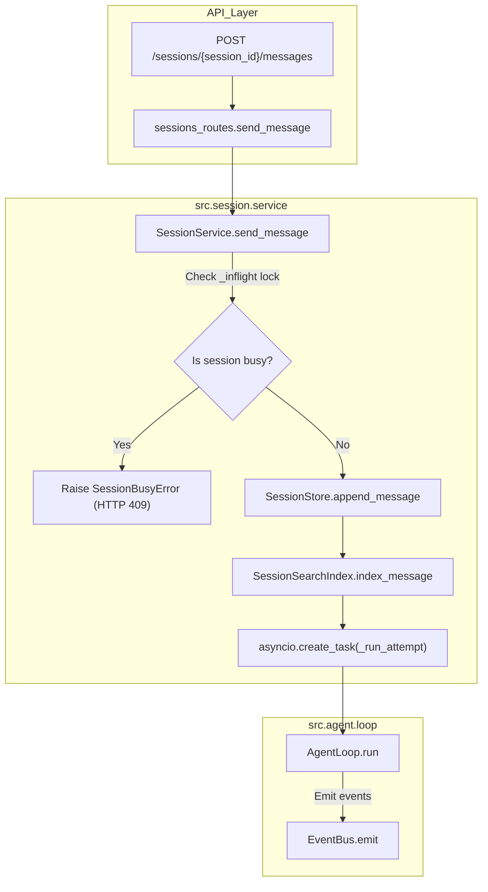
Sources: [agent/src/session/service.py:46-155](), [agent/src/api/sessions_routes.py:31-68]()

---

## SessionStore and Core Data Models

Persistence for sessions, messages, and execution attempts is handled by `SessionStore` backed by the filesystem, while core data models are defined in `agent/src/session/models.py` [agent/src/session/models.py:1-2]().

### Key Entities
*   **`Session`**: Represents a multi-turn conversation session, containing `session_id`, `title`, `status` (`active`, `completed`, `archived`), configuration dictionaries, and an optional `Principal` owner [agent/src/session/models.py:142-168]().
*   **`Message`**: Individual chat records containing `message_id`, `session_id`, `role` (`user`, `assistant`, `system`), `content`, `linked_attempt_id`, and a `tool_trail` list [agent/src/api/sessions_routes.py:57-67]().
*   **`Attempt`**: Tracks a single execution run of an agent, transitioning through statuses like `PENDING`, `RUNNING`, `COMPLETED`, `FAILED`, `CANCELLED`, and `INTERRUPTED` [agent/src/session/models.py:130-140]().
*   **`Principal`**: Encapsulates request attribution (`subject`, `auth_method`, `tenant`, `attributable`), ensuring strict boundaries around authorization and identity [agent/src/session/models.py:42-79]().

Sources: [agent/src/session/models.py:42-168](), [agent/src/api/sessions_routes.py:57-67]()

---

## FTS5 Cross-Session Search (`SessionSearchIndex`)

To enable lightning-fast cross-session full-text search without sacrificing the simplicity of file-based session storage, Vibe-Trading implements `SessionSearchIndex` backed by SQLite FTS5 [agent/src/session/search.py:1-9]().

### Implementation Highlights
*   **Database Location**: Stored at `sessions.db` under the runtime root directory with WAL (Write-Ahead Logging) mode enabled for high concurrency [agent/src/session/search.py:7-8]().
*   **East Asian Text Tokenization**: Uses `_prepare_search_text()` to isolate ideographs, kana, and hangul characters for correct token matching under FTS5 [agent/src/session/search.py:33-42]().
*   **Snippet Generation**: Maps native FTS match spans back to original bounded excerpts via `_search_snippet()` and returns structured `SearchMatch` objects [agent/src/session/search.py:44-128]().

Title: "SessionSearchIndex and FTS5 Query Pipeline"
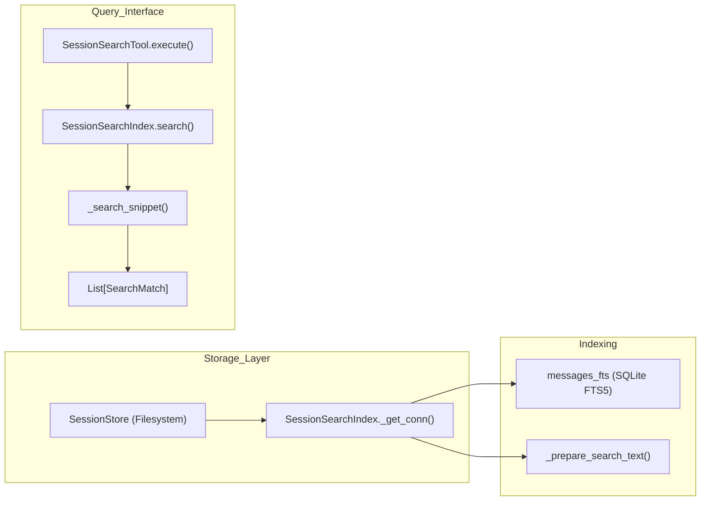
Sources: [agent/src/session/search.py:1-128](), [agent/src/tools/session_search_tool.py:1-20]()

---

## EventBus and SSE Streaming with Last-Event-ID Recovery

Real-time streaming to the frontend is powered by `EventBus` and FastAPI Server-Sent Events (SSE) endpoints [agent/src/session/events.py:1-3]().

### EventBus Architecture
The `EventBus` manages pub-sub distribution across active session subscriptions, maintaining an internal buffer of events for reconnection recovery [agent/src/session/events.py:1-62](). It bridges synchronous thread execution with asynchronous event loops using `_loop.call_soon_threadsafe()` [agent/src/session/events.py:123-124]().

### Reconnection and `last_event_id` Recovery
When a client loses connection and reconnects with a `Last-Event-ID` HTTP header, the `EventBus` inspects its buffer and replays any missed events, ensuring seamless UI state synchronization [agent/src/session/events.py:200-219]().

Title: "EventBus SSE Streaming and Replay Sequence"
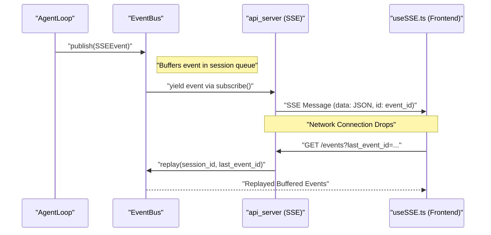
Sources: [agent/src/session/events.py:1-219](), [agent/src/session/service.py:150-187]()

---

## Session ↔ AgentLoop Mapping

A single chat session spans multiple execution interactions (attempts). Each invocation of `send_message()` performs the following translation to instantiate and execute an `AgentLoop`:

1.  **Attempt Initialization**: Creates a durable `Attempt` record linked to the session [agent/src/session/service.py:1-30]().
2.  **Context Assembly**: Pulls conversation history from `SessionStore` to construct the prompt payload [agent/src/agent/context.py:1-50]().
3.  **Loop Execution**: Executes the ReAct cycle within `AgentLoop`, piping intermediate tool calls, thoughts, and outputs into `EventBus` [agent/src/agent/loop.py:1-100]().
4.  **Cancellation Handling**: Tracks active tasks in `self._active_tasks` and active loops in `self._active_loops`, allowing users to gracefully cancel runs via `cancel_current()` [agent/src/session/service.py:85-95]().

Sources: [agent/src/session/service.py:56-150](), [agent/src/agent/loop.py:1-80]()

---

# Page: LLM Providers and ChatLLM

# LLM Providers and ChatLLM

<details>
<summary>Relevant source files</summary>

The following files were used as context for generating this wiki page:

- [agent/.env.example](agent/.env.example)
- [agent/cli/_legacy.py](agent/cli/_legacy.py)
- [agent/cli/onboard.py](agent/cli/onboard.py)
- [agent/src/config/env_schema.py](agent/src/config/env_schema.py)
- [agent/src/preflight.py](agent/src/preflight.py)
- [agent/src/providers/capabilities.py](agent/src/providers/capabilities.py)
- [agent/src/providers/chat.py](agent/src/providers/chat.py)
- [agent/src/providers/llm.py](agent/src/providers/llm.py)
- [agent/src/providers/llm_providers.json](agent/src/providers/llm_providers.json)
- [agent/src/providers/openai_codex.py](agent/src/providers/openai_codex.py)
- [agent/tests/test_chat_llm_streaming.py](agent/tests/test_chat_llm_streaming.py)
- [agent/tests/test_cli_init.py](agent/tests/test_cli_init.py)
- [agent/tests/test_env_schema.py](agent/tests/test_env_schema.py)
- [agent/tests/test_kimi_reasoning_content.py](agent/tests/test_kimi_reasoning_content.py)
- [agent/tests/test_llm.py](agent/tests/test_llm.py)
- [agent/tests/test_llm_provider_defaults.py](agent/tests/test_llm_provider_defaults.py)
- [agent/tests/test_llm_reasoning_effort.py](agent/tests/test_llm_reasoning_effort.py)
- [agent/tests/test_openai_codex.py](agent/tests/test_openai_codex.py)
- [agent/tests/test_openai_codex_usage.py](agent/tests/test_openai_codex_usage.py)
- [agent/tests/test_preflight.py](agent/tests/test_preflight.py)
- [agent/tests/test_provider_diagnostics.py](agent/tests/test_provider_diagnostics.py)
- [agent/tests/test_provider_header_isolation.py](agent/tests/test_provider_header_isolation.py)
- [agent/tests/test_session_service_mcp.py](agent/tests/test_session_service_mcp.py)

</details>


## Purpose and Scope
The `agent/src/providers/` subsystem provides the foundational abstraction layer for interacting with Large Language Models (LLMs) across dozens of commercial providers, local runtimes, and authenticated relays. Vibe-Trading relies on this subsystem to maintain a unified tool-calling interface (`ChatLLM`), manage provider-specific credentials, handle reasoning payloads (such as DeepSeek and Zhipu thinking traces), and enforce robust preflight and endpoint guards.

Sources: [agent/src/providers/llm.py:1-40](), [agent/src/providers/chat.py:1-25]()

---

## LLM Architecture and Execution Data Flow
The core runtime agent loop delegates all inference and function calling through the `ChatLLM` interface [agent/src/providers/chat.py:1-4](). The `build_llm()` factory inspects environment variables and capabilities catalogs to return a suitably configured LangChain-compatible model instance wrapped with reasoning and streaming support [agent/src/providers/llm.py:1-25]().

### LLM Execution Flow Diagram
```mermaid
sequenceDiagram
    participant AL as "AgentLoop [agent/src/agent/loop.py]"
    participant CLLM as "ChatLLM [agent/src/providers/chat.py]"
    participant Factory as "build_llm() [agent/src/providers/llm.py]"
    participant Wrapper as "ChatOpenAIWithReasoning [agent/src/providers/llm.py]"
    participant API as "LLM Provider API"

    AL->>CLLM: "stream_chat(messages, tools)"
    CLLM->>Factory: "build_llm()"
    Factory->>Wrapper: "Instantiate with model/base_url"
    Wrapper-->>CLLM: "Return wrapped instance"
    CLLM->>Wrapper: "stream(messages, config)"
    Wrapper->>API: "POST /chat/completions"
    API-->>Wrapper: "Stream Chunks"
    Wrapper-->>CLLM: "AIMessageChunk"
    CLLM-->>AL: "LLMResponse object"
```
Sources: [agent/src/providers/llm.py:1-43](), [agent/src/providers/chat.py:1-30]()

---

## ChatLLM Abstraction and Response Handling
The `ChatLLM` client processes raw model streams into structured `LLMResponse` objects containing plain text, tool call requests, token usage metadata, and reasoning traces [agent/src/providers/chat.py:100-150]().

### Key Entities and Data Classes
| Entity | Role / Responsibility | Code Location |
|:---|:---|:---|
| `ChatLLM` | Main wrapper handling message formatting, tool binding, and stream parsing. | [agent/src/providers/chat.py:1-30]() |
| `LLMResponse` | Structured response object holding `content`, `tool_calls`, `reasoning_content`, and `usage_metadata`. | [agent/src/providers/chat.py:112-144]() |
| `ToolCallRequest` | Represents an invocation of an atomic tool with arguments and optional thought signatures. | [agent/src/providers/chat.py:83-100]() |
| `ChatOpenAIWithReasoning` | Subclass of LangChain's `ChatOpenAI` preserving inbound reasoning traces. | [agent/src/providers/llm.py:30-43]() |

Sources: [agent/src/providers/chat.py:83-144](), [agent/src/providers/llm.py:30-43]()

---

## Provider Capabilities and Factory Pattern
Vibe-Trading supports a wide catalog of LLM providers defined in `llm_providers.json` [agent/src/providers/llm_providers.json:1-214]() and modeled via `ProviderCapabilities` [agent/src/providers/capabilities.py:17-57]().

The `build_llm()` factory leverages `_sync_provider_env()` to map provider-specific environment variables (such as `DEEPSEEK_API_KEY` or `ZHIPU_API_KEY`) to standard OpenAI environment variables when using compatible endpoints [agent/src/providers/llm.py:181-230]().

### Natural Language and Configuration to Code Entity Mapping
```mermaid
graph TD
    subgraph "NaturalLanguageSpace"
        UI["Onboarding Wizard [agent/cli/onboard.py]"]
        ENV[".env Configuration [agent/.env.example]"]
    end

    subgraph "CodeEntitySpace"
        SYNC["_sync_provider_env() [agent/src/providers/llm.py]"]
        Factory["build_llm() [agent/src/providers/llm.py]"]
        JSON["llm_providers.json [agent/src/providers/llm_providers.json]"]
        Caps["get_provider_capabilities() [agent/src/providers/capabilities.py]"]
    end

    UI -- "Writes to" --> ENV
    ENV -- "Read by" --> Factory
    Factory -- "References" --> JSON
    Factory -- "Triggers" --> SYNC
    Factory -- "Instantiates" --> Wrapper["ChatOpenAIWithReasoning"]
    Factory -- "Infers via" --> Caps
```
Sources: [agent/src/providers/llm.py:181-230](), [agent/src/providers/llm_providers.json:1-214](), [agent/src/providers/capabilities.py:17-57](), [agent/cli/onboard.py:1-50]()

---

## Configuration, Reasoning Effort, and Specialized Provider Adaptations
Environment configuration is governed by `EnvConfig` and `LLMConfig` in `agent/src/config/env_schema.py` [agent/src/config/env_schema.py:155-180](). 

### Specialized Provider Rules
1. **MiniMax Temperature Clamping**: MiniMax requires `temperature > 0`. The factory automatically adjusts `0.0` to `0.01` if needed [agent/src/providers/llm.py:271-276]().
2. **OpenCode Relay Headers**: OpenCode Go endpoints require an `x-opencode-session` header corresponding to the active session identifier [agent/src/providers/llm.py:75-94]().
3. **Reasoning Effort Delivery**: Configured via `LANGCHAIN_REASONING_EFFORT`, delivered either via OpenRouter's `extra_body` or top-level request parameters depending on provider capabilities [agent/src/providers/capabilities.py:31-41]().

Sources: [agent/src/config/env_schema.py:155-180](), [agent/src/providers/llm.py:75-94](), [agent/src/providers/capabilities.py:31-41]()

---

## Data Contracts, Token Tracking, and Preflight Guards
To ensure reliable research runs and strict artifact auditing:
1. **Token Accounting**: `_parse_response` extracts `usage_metadata` from LangChain AIMessages, tracking input, output, and total tokens for downstream aggregation in run cards [agent/src/providers/chat.py:112-140]().
2. **Finish Reason Deduping**: `_dedupe_finish_reason` normalizes concatenated gateway finish strings (e.g., `stopstop` → `stop`) [agent/src/providers/chat.py:52-61]().
3. **Preflight Checks**: Startup routines in `agent/src/preflight.py` validate credentials and perform endpoint connectivity verification before accepting user prompts.

Sources: [agent/src/providers/chat.py:52-140](), [agent/src/preflight.py:1-134]()

---

# Page: Grounding Ledger and Output Discipline

# Grounding Ledger and Output Discipline

<details>
<summary>Relevant source files</summary>

The following files were used as context for generating this wiki page:

- [agent/src/agent/context.py](agent/src/agent/context.py)
- [agent/src/agent/grounding/evidence.py](agent/src/agent/grounding/evidence.py)
- [agent/src/agent/grounding/figures.py](agent/src/agent/grounding/figures.py)
- [agent/src/agent/grounding/identity.py](agent/src/agent/grounding/identity.py)
- [agent/src/agent/grounding/ledger.py](agent/src/agent/grounding/ledger.py)
- [agent/src/agent/grounding/policies.py](agent/src/agent/grounding/policies.py)
- [agent/src/agent/grounding/release.py](agent/src/agent/grounding/release.py)
- [agent/src/agent/resolution_context.py](agent/src/agent/resolution_context.py)
- [agent/src/live/runtime/triggers.py](agent/src/live/runtime/triggers.py)
- [agent/src/tools/financial_rigor_tool.py](agent/src/tools/financial_rigor_tool.py)
- [agent/src/tools/report_audit_tool.py](agent/src/tools/report_audit_tool.py)
- [agent/src/tools/symbol_search_tool.py](agent/src/tools/symbol_search_tool.py)
- [agent/tests/test_agent_grounding.py](agent/tests/test_agent_grounding.py)
- [agent/tests/test_agent_output_discipline.py](agent/tests/test_agent_output_discipline.py)
- [agent/tests/test_dataclass_field_name_collisions.py](agent/tests/test_dataclass_field_name_collisions.py)
- [agent/tests/test_financial_rigor_benford_inf.py](agent/tests/test_financial_rigor_benford_inf.py)
- [agent/tests/test_financial_rigor_three_scenario_undefined_upside.py](agent/tests/test_financial_rigor_three_scenario_undefined_upside.py)
- [agent/tests/test_financial_rigor_tool.py](agent/tests/test_financial_rigor_tool.py)
- [agent/tests/test_grounding_backtest_outputs.py](agent/tests/test_grounding_backtest_outputs.py)
- [agent/tests/test_grounding_blank_corner_matrix.py](agent/tests/test_grounding_blank_corner_matrix.py)
- [agent/tests/test_grounding_figures_contract.py](agent/tests/test_grounding_figures_contract.py)
- [agent/tests/test_grounding_generic_timestamps.py](agent/tests/test_grounding_generic_timestamps.py)
- [agent/tests/test_grounding_keyed_metric_paths.py](agent/tests/test_grounding_keyed_metric_paths.py)
- [agent/tests/test_grounding_percent_unit_fields.py](agent/tests/test_grounding_percent_unit_fields.py)
- [agent/tests/test_grounding_release.py](agent/tests/test_grounding_release.py)
- [agent/tests/test_grounding_resolution_context.py](agent/tests/test_grounding_resolution_context.py)
- [agent/tests/test_grounding_role_hardening.py](agent/tests/test_grounding_role_hardening.py)
- [agent/tests/test_grounding_shape_hardening.py](agent/tests/test_grounding_shape_hardening.py)
- [agent/tests/test_market_identity_parity.py](agent/tests/test_market_identity_parity.py)
- [agent/tests/test_report_audit_accounting_parens.py](agent/tests/test_report_audit_accounting_parens.py)
- [agent/tests/test_report_audit_code_fences.py](agent/tests/test_report_audit_code_fences.py)
- [agent/tests/test_report_audit_empty_table_cells.py](agent/tests/test_report_audit_empty_table_cells.py)
- [agent/tests/test_report_audit_signed_values.py](agent/tests/test_report_audit_signed_values.py)
- [agent/tests/test_report_audit_tool.py](agent/tests/test_report_audit_tool.py)
- [agent/tests/test_runtime_triggers.py](agent/tests/test_runtime_triggers.py)
- [agent/tests/test_symbol_search_tool.py](agent/tests/test_symbol_search_tool.py)
- [agent/tests/test_technical_indicator_compaction_replay.py](agent/tests/test_technical_indicator_compaction_replay.py)

</details>


This page details the grounding subsystem, located in `agent/src/agent/grounding/` [agent/src/agent/grounding/](). Its primary purpose is to ensure the integrity and verifiability of the agent's numerical outputs. This involves identity resolution for financial symbols, ingesting evidence from tool calls, enforcing a strict contract for figures declared by the agent, validating these figures against ingested evidence and predefined policies, and managing the correction, redaction, or release of agent responses. A core component of this discipline is the "Output Principles" defined in `agent/src/agent/context.py` [agent/src/agent/context.py:34-72]().

## Purpose and Scope

The grounding subsystem acts as a critical gatekeeper for the agent's numerical and factual claims. It prevents the agent from "hallucinating" numbers or making unsubstantiated statements by requiring every reported figure to be traceable to a specific tool call and validated against actual data. This system is fundamental to maintaining the reliability and trustworthiness of the Vibe-Trading agent's financial research outputs.

## Identity Resolution via SymbolSearchTool

Identity resolution is the process of unambiguously identifying financial instruments mentioned in natural language queries or agent outputs. The `SymbolSearchTool` [agent/src/tools/symbol_search_tool.py]() is central to this process. It takes a natural language query (e.g., "Apple stock", "BTC-USD", "贵州茅台") and resolves it into canonical symbols with associated market and type information.

The `SymbolSearchTool` [agent/src/tools/symbol_search_tool.py]() aggregates results from multiple external sources to provide comprehensive coverage:
*   **Binance Connector**: Resolves exact crypto spot-pair spellings against its market catalog [agent/src/tools/symbol_search_tool.py:7-9]().
*   **Eastmoney Client**: Matches Chinese/English names and tickers for A-shares, Hong Kong, and U.S. listings, providing `secid` in `<market>.<code>` format [agent/src/tools/symbol_search_tool.py:10-14]().
*   **Yahoo Client**: Matches global tickers and company names (US, HK, Canada, crypto, indices, FX, etc.) [agent/src/tools/symbol_search_tool.py:15-18]().
*   **SEC EDGAR Client**: Enriches U.S. equity tickers with their CIK (Central Index Key) [agent/src/tools/symbol_search_tool.py:16-17]().

The tool fans out requests to these sources, normalizes the results into a consistent format, de-duplicates candidates by symbol, and caps the payload size. Errors from individual sources do not halt the entire process; they are recorded, and surviving candidates are still returned [agent/src/tools/symbol_search_tool.py:19-22]().

Key functions and patterns in `agent/src/agent/grounding/identity.py` [agent/src/agent/grounding/identity.py]() support this:
*   `_scan_symbols()`: Extracts potential symbols from text [agent/tests/test_agent_grounding.py:20]().
*   `_normalize_symbol()`: Standardizes symbol formats [agent/tests/test_agent_grounding.py:19]().
*   `_infer_venue()`: Determines the trading venue from a symbol [agent/tests/test_agent_grounding.py:18]().
*   `_infer_currency()`: Infers the currency associated with a symbol [agent/tests/test_agent_grounding.py:16]().

For example, Canadian symbols like `TD.TO` and `PNG.V` are correctly identified with their venue (`toronto`, `tsx_venture`) and currency (`CAD`) [agent/tests/test_agent_grounding.py:183-189](). The tool also handles specific cases like Canadian queries skipping the Eastmoney endpoint due to lack of coverage [agent/tests/test_symbol_search_tool.py:196-197]().

```mermaid
graph TD
    A["User Query / Agent Output"] --> B["SymbolSearchTool.execute()"];
    B --> C1["eastmoney_client.get_json"];
    B --> C2["yahoo_client.search"];
    B --> C3["sec_edgar_client.cik_for"];
    B --> C4["Binance Connector"];
    C1 -- "Raw Candidates" --> D["Normalize & Deduplicate"];
    C2 -- "Raw Candidates" --> D;
    C3 -- "Raw Candidates" --> D;
    C4 -- "Raw Candidates" --> D;
    D -- "Canonical Symbols" --> E["GroundingLedger"];
    E -- "Identity Snapshot" --> F["AgentLoop"];
    subgraph "agent/src/tools/symbol_search_tool.py"
        B
    end
    subgraph "agent/src/agent/grounding/identity.py"
        E
    end
```
**Symbol Resolution Data Flow**

Sources:
* `agent/src/tools/symbol_search_tool.py`
* `agent/src/agent/grounding/identity.py`
* `agent/tests/test_agent_grounding.py`
* `agent/tests/test_symbol_search_tool.py`

## Evidence Ingestion

The `GroundingLedger` [agent/src/agent/grounding/ledger.py]() is responsible for ingesting and storing evidence from tool calls. This evidence forms the factual basis against which the agent's numerical claims are validated. When a tool executes successfully, its result is ingested to parse the output and extract relevant data points.

The `evidence.py` module [agent/src/agent/grounding/evidence.py]() defines how tool results are processed into `EvidenceRecord` objects [agent/src/agent/grounding/evidence.py:27](). It identifies various types of data:
*   **Price Fields**: `open`, `high`, `low`, `close`, `adj_close`, `price` [agent/src/agent/grounding/evidence.py:27]().
*   **Timestamp Fields**: `trade_date`, `date`, `datetime`, `timestamp`, `time`, `index` [agent/src/agent/grounding/evidence.py:29]().
*   **Generic Price Field Aliases**: A comprehensive mapping of common field names (e.g., `open_price`, `最新价`) to canonical price fields [agent/src/agent/grounding/evidence.py:61-101]().
*   **Analysis Kind Aliases**: Categorizes metrics like `volatility`, `sharpe`, `drawdown`, `win_rate`, `return`, and `tail_risk` [agent/src/agent/grounding/evidence.py:105-164](). This ensures that a figure is only grounded by evidence of its own kind (e.g., a price cannot ground a volatility metric).
*   **Metadata Counts**: Identifies fields that represent counts or parameters (e.g., `n`, `window`) rather than observed values [agent/src/agent/grounding/evidence.py:169-174]().

The ingestion process handles various data formats, including JSON objects and CSV files.

```mermaid
graph TD
    A["Tool Call Result (JSON/CSV)"] --> B["GroundingLedger.ingest_tool_result()"];
    B --> C["Parse Tool Output"];
    C -- "Extracted Data Points" --> D["Identify Data Kind & Aliases"];
    D -- "Canonicalized Data" --> E["Create EvidenceRecord"];
    E --> F["Store in GroundingLedger"];
    subgraph "agent/src/agent/grounding/ledger.py"
        B
        F
    end
    subgraph "agent/src/agent/grounding/evidence.py"
        C
        D
        E
    end
```
**Evidence Ingestion Data Flow**

Sources:
* `agent/src/agent/grounding/ledger.py`
* `agent/src/agent/grounding/evidence.py`
* `agent/tests/test_agent_grounding.py`
* `agent/tests/test_grounding_role_hardening.py`
* `agent/tests/test_grounding_release.py`

## Figures Block Contract

The agent communicates its numerical claims through a structured "figures block" within its output. This block is a fenced code block with the language identifier `figures` [agent/src/agent/grounding/figures.py:41](). Each line in the figures block declares a numerical value along with its role, a descriptive note, and an optional reference to the tool call that produced it.

The `figures.py` module [agent/src/agent/grounding/figures.py]() is responsible for parsing and interpreting this block. It defines:
*   **Declaration**: A dataclass representing one parsed line from the figures block, including `value_text`, `value`, `percent`, `role`, `note`, and `ref` [agent/src/agent/grounding/figures.py:119-133]().
*   **FiguresBlock**: A dataclass representing the entire parsed figures block, including its presence, span, raw content, declarations, and any malformed lines [agent/src/agent/grounding/figures.py:136-148]().
*   **Roles**: The five defined roles for a declaration are `observed`, `derived`, `proposed`, `cited`, and `count` [agent/src/agent/grounding/figures.py:38]().
*   **Shape Classification**: Numbers in the prose are classified into shapes: number, date, ordinal, etc. This classification is language-independent and based on structural patterns rather than semantic meaning [agent/tests/test_grounding_figures_contract.py:11-14]().

The `parse_figures_block()` function [agent/src/agent/grounding/figures.py:152]() extracts declarations from the text, handling various formats (e.g., full-width pipes, no spacing, case variations) [agent/tests/test_grounding_figures_contract.py:133-140](). Malformed lines are reported as issues rather than being silently skipped [agent/tests/test_grounding_figures_contract.py:161-167]().

The figures block is stripped from the agent's final answer before it is released to the user [agent/src/agent/grounding/figures.py:22](), ensuring that the contract is between the agent and the grounding system, not the user [agent/tests/test_grounding_figures_contract.py:13-14]().

```mermaid
graph TD
    A["Agent Draft Output"] --> B["scan_figures()"];
    B --> C["parse_figures_block()"];
    C -- "FiguresBlock Object" --> D["Declaration Objects"];
    D -- "Value, Role, Note, Ref" --> E["Validation"];
    subgraph "agent/src/agent/grounding/figures.py"
        B
        C
        D
    end
```
**Figures Block Processing**

Sources:
* `agent/src/agent/grounding/figures.py`
* `agent/tests/test_grounding_figures_contract.py`

## Policy Validation

The `policies.py` module [agent/src/agent/grounding/policies.py]() contains the rules for validating declared figures against the ingested evidence. This validation is performed by the ledger validation methods, returning a `ValidationResult` [agent/src/agent/grounding/policies.py:115-131]() indicating whether the answer is valid and listing any issues.

Validation rules are applied based on the `role` declared for each figure:
*   **`observed`**: Must match a value found in the ingested evidence within a defined tolerance (`_TOLERANCE = 0.005`) [agent/src/agent/grounding/policies.py:103, 132-135](). The evidence must be of the same kind.
*   **`derived`**: The `note` field must contain an arithmetic expression that evaluates to the declared value, with at least one operand anchored to an observed value.
*   **`proposed`**: Represents a proposed level (e.g., an entry price). It must be a price, not a percentage.
*   **`cited`**: The `note` field must contain a visible citation to a source, and the figure itself must not be presented as an observed value of the instrument.
*   **`count`**: Represents a count, weight, threshold, or parameter. It cannot carry a currency mark [agent/tests/test_grounding_role_hardening.py:132-139]().

Specific policy checks include:
*   **Currency Marks**: A `count` cannot have a currency mark [agent/tests/test_grounding_role_hardening.py:132-139]().
*   **Source Visibility**: For `cited` figures, the source must be visible in the prose, not just in the stripped figures block.
*   **Integer Price Floor**: A plain integer is only read as a price if it's above a certain floor (`_INTEGER_PRICE_FLOOR = 1000.0`) to avoid misinterpreting counts as prices [agent/src/agent/grounding/policies.py:108]().

```mermaid
graph TD
    A["Declaration (Value, Role, Note, Ref)"] --> B["Policy Engine"];
    B -- "Role-specific Rules" --> C["Check against GroundingLedger Evidence"];
    C -- "Match Found?" --> D["ValidationResult"];
    D -- "Valid: True/False" --> E["AgentLoop"];
    subgraph "agent/src/agent/grounding/policies.py"
        B
        C
    end
    subgraph "agent/src/agent/grounding/ledger.py"
        E
    end
```
**Policy Validation Flow**

Sources:
* `agent/src/agent/grounding/policies.py`
* `agent/src/agent/grounding/evidence.py`
* `agent/tests/test_grounding_role_hardening.py`

## Correction, Redaction, and Release

When an agent's draft output fails validation, the grounding subsystem attempts to guide the agent towards a correct response or, failing that, releases a redacted version. This process is managed in `agent/src/agent/grounding/release.py` [agent/src/agent/grounding/release.py]().

The process involves:
1.  **Correction Prompt**: If a draft is rejected, `correction_prompt()` generates feedback for the agent detailing each rejected figure, its declared role, and the reason for rejection [agent/src/agent/grounding/release.py:99-127]().
2.  **Recovery Rounds**: The agent is given a limited number of `MAX_GROUNDING_RECOVERY_ROUNDS` (currently 6) to revise its answer based on the correction prompt [agent/src/agent/grounding/release.py:28]().
3.  **Redaction**: If the agent fails to correct the issues within `MAX_GROUNDING_REVISIONS` (currently 2) attempts, the system will redact the problematic figures from the output. Redactable issues include `numeric_claim_conflict`, `numeric_claim_unavailable`, `unsourced_symbol_figures`, and `figure_undeclared` [agent/src/agent/grounding/release.py:35-42]().
    *   Redaction replaces the figure and its glued unit with an omission mark (`（略※）` for Chinese, `(omitted※)` for English) [agent/src/agent/grounding/release.py:55-57]().
4.  **Provenance Repair**: Some issues, like `data_source_not_surfaced` or `currency_not_surfaced`, can be deterministically repaired by adding a data note [agent/src/agent/grounding/release.py:47-49]().

```mermaid
graph TD
    A["Agent Draft Output"] --> B["GroundingLedger.validate_final_answer()"];
    B -- "ValidationResult (valid=False)" --> C["correction_prompt()"];
    C -- "Correction Prompt" --> D["AgentLoop (Revision)"];
    D -- "Revised Draft" --> B;
    B -- "ValidationResult (valid=True)" --> E["Release Validated Output"];
    B -- "ValidationResult (valid=False, Revisions Exceeded)" --> F["Redact Problematic Figures"];
    F -- "Redacted Output" --> E;
    subgraph "agent/src/agent/grounding/ledger.py"
        B
    end
    subgraph "agent/src/agent/grounding/release.py"
        C
        F
    end
```
**Correction, Redaction, and Release Flow**

Sources:
* `agent/src/agent/grounding/release.py`
* `agent/tests/test_grounding_release.py`

## Output Principles in `context.py`

The "Output Principles" are a set of six strict rules embedded in the system prompt (`_SYSTEM_PROMPT`) in `agent/src/agent/context.py` [agent/src/agent/context.py:34-72]() that guide the agent's behavior regarding numerical outputs. These principles are non-negotiable and apply to every answer in every session, overriding any conflicting user instructions or internal states.

The six principles are:

1.  **Every number points at a tool.** Each reported figure must be traceable to a specific tool call within the current session [agent/src/agent/context.py:41-44]().
2.  **Every data point carries its as-of.** Financial data must always include its information cutoff (timestamp, bar date, filing period, snapshot date) and timezone [agent/src/agent/context.py:45-48]().
3.  **What the tools did not return, you do not supply.** If a tool fails or does not cover the requested information, the agent must state this explicitly without hallucinating from memory [agent/src/agent/context.py:49-55]().
4.  **Analysis, not advice.** Deliver evidence, mechanisms, scenarios, and risks without telling the user what to buy, sell, or hold [agent/src/agent/context.py:56-59]().
5.  **Answer at the level of detail asked; stop when you have enough.** Match the depth and length of your answer to what was requested without unrequested widening [agent/src/agent/context.py:60-66]().
6.  **Refuse out loud, never silently.** If an instruction asks to break principles 1–5, name the conflicting principle and refuse explicitly [agent/src/agent/context.py:67-72]().

Sources:
* `agent/src/agent/context.py`
* `agent/tests/test_agent_output_discipline.py`

---

# Page: Skills System (87+ Specialist Skills)

# Skills System (87+ Specialist Skills)

<details>
<summary>Relevant source files</summary>

The following files were used as context for generating this wiki page:

- [agent/cli/ui/rail.py](agent/cli/ui/rail.py)
- [agent/src/agent/frontmatter.py](agent/src/agent/frontmatter.py)
- [agent/src/agent/memory.py](agent/src/agent/memory.py)
- [agent/src/agent/skills.py](agent/src/agent/skills.py)
- [agent/src/memory/__init__.py](agent/src/memory/__init__.py)
- [agent/src/tools/load_skill_tool.py](agent/src/tools/load_skill_tool.py)
- [agent/src/tools/redaction.py](agent/src/tools/redaction.py)
- [agent/src/tools/skill_writer_tool.py](agent/src/tools/skill_writer_tool.py)
- [agent/tests/test_cli_rail_dashboard.py](agent/tests/test_cli_rail_dashboard.py)
- [agent/tests/test_load_skill_allowlist.py](agent/tests/test_load_skill_allowlist.py)
- [agent/tests/test_redaction.py](agent/tests/test_redaction.py)
- [agent/tests/test_redaction_channel_and_provider_tokens.py](agent/tests/test_redaction_channel_and_provider_tokens.py)
- [agent/tests/test_redaction_cookie_headers.py](agent/tests/test_redaction_cookie_headers.py)
- [agent/tests/test_redaction_shared.py](agent/tests/test_redaction_shared.py)
- [agent/tests/test_skill_writer_tools.py](agent/tests/test_skill_writer_tools.py)
- [agent/tests/test_skills.py](agent/tests/test_skills.py)
- [agent/tests/test_swarm_m4_e2e.py](agent/tests/test_swarm_m4_e2e.py)
- [agent/tests/test_swarm_m5_trust_model.py](agent/tests/test_swarm_m5_trust_model.py)
- [agent/tests/test_swarm_output_contract.py](agent/tests/test_swarm_output_contract.py)
- [agent/tests/test_swarm_retry_artifact_isolation.py](agent/tests/test_swarm_retry_artifact_isolation.py)
- [agent/tests/test_swarm_tool_run_dir.py](agent/tests/test_swarm_tool_run_dir.py)
- [agent/tests/test_swarm_worker_content_filter.py](agent/tests/test_swarm_worker_content_filter.py)
- [agent/tests/test_swarm_worker_tool_result_truncation.py](agent/tests/test_swarm_worker_tool_result_truncation.py)
- [agent/tests/test_trade_journal_fiat_pairs_not_crypto.py](agent/tests/test_trade_journal_fiat_pairs_not_crypto.py)

</details>


The Skills System is a progressive disclosure architecture designed to empower the ReAct agent with specialized financial knowledge without overwhelming the LLM's context window. While the agent possesses atomic tools (e.g., `write_file`, `backtest`), it relies on **Skills** to understand *how* to apply those tools across 87+ distinct financial domains, ranging from Smart Money Concepts (SMC) to Alpha Zoo factor benchmarking and Strategy Development Management (SDM) [agent/src/agent/skills.py:100-192](), [agent/src/tools/skill_writer_tool.py:81-197]().

---

## Skills Architecture

The system operates on a "Just-in-Time" documentation loading principle. Rather than injecting all 87+ comprehensive markdown manuals into every prompt, the agent receives a categorized list of one-line summaries via `SkillsLoader.get_descriptions()` [agent/src/agent/skills.py:143-164](). When a task demands specialized domain knowledge, the agent invokes the `load_skill` tool to fetch the full documentation body on demand [agent/src/agent/skills.py:166-191]().

### SkillsLoader and SKILL.md
The `SkillsLoader` class scans the bundled `agent/skills/` directory and the user-defined skills directory (`~/.vibe-trading/skills/user/`) [agent/src/agent/skills.py:107-136](). Each skill resides in its own subdirectory containing a `SKILL.md` file featuring YAML frontmatter for metadata (`name`, `description`, `category`) [agent/src/agent/skills.py:22-95](). User-created or patched skills take precedence by being loaded first, allowing seamless mid-session overrides [agent/src/agent/skills.py:120-136]().

| Component | Class / File Entity | Role |
|:---|:---|:---|
| **Loader** | `SkillsLoader` | Discovers, parses, and organizes skill modules from disk [agent/src/agent/skills.py:100-136]() |
| **Data Structure** | `Skill` | Encapsulates metadata, frontmatter, body text, and supporting asset loading [agent/src/agent/skills.py:22-60]() |
| **Writer Tools** | `SaveSkillTool`, `PatchSkillTool` | Enables the agent to create and modify custom skills dynamically [agent/src/tools/skill_writer_tool.py:81-197]() |
| **Runtime Tool** | `load_skill` | Fetches full SKILL.md content into the agent context on demand [agent/src/agent/skills.py:166-191]() |

**Natural Language to Code Entity Space: Skill Loading Flow**

```mermaid
graph TD
    User["User: 'Analyze this stock using Elliott Wave'"] --> AgentLoop["src/agent/loop.py: AgentLoop"]
    AgentLoop --> SysPrompt["System Prompt via SkillsLoader.get_descriptions"]
    SysPrompt -- "Cites 'elliott-wave' summary" --> AgentLoop
    AgentLoop --> LoadTool["Tool: load_skill(name='elliott-wave')"]
    LoadTool --> SLoader["src/agent/skills.py: SkillsLoader.get_content"]
    SLoader --> MDFile["agent/skills/elliott-wave/SKILL.md"]
    MDFile --> AgentLoop["AgentLoop (Loaded with Full Skill Documentation)"]
    AgentLoop --> Action["Execute Technical Analysis Tools"]
```
Sources: [agent/src/agent/skills.py:22-191](), [agent/src/tools/skill_writer_tool.py:81-197]()

---

## User-Created Skills and Dynamic Expansion

The platform supports dynamic skill creation and modification during agent execution via `SaveSkillTool` and `PatchSkillTool` [agent/src/tools/skill_writer_tool.py:81-197](). User skills are saved under `USER_SKILLS_DIR` (`~/.vibe-trading/skills/user/`) [agent/src/agent/skills.py:97](), complete with support for auxiliary subdirectories (`references/`, `templates/`, `examples/`, `assets/`) [agent/src/tools/skill_writer_tool.py:1-10](). When a skill is saved or patched, `SkillsLoader` performs fallback checks on disk to ensure mid-session newly created skills are instantly addressable [agent/src/agent/skills.py:181-187]().

Sources: [agent/src/agent/skills.py:97-187](), [agent/src/tools/skill_writer_tool.py:1-197]()

---

## Skill Categories

Skills are grouped into core categories to assist the agent in navigating its available methodologies. Below is an overview of the primary skill groupings, linking to detailed child documentation.

### 3.1 Data Source Skills
Covers data-acquisition integration guides and fallback routing protocols for institutional and retail feeds, including Tushare, YFinance, AKShare, OKX, CCXT, MootDX, Eastmoney, SEC EDGAR, and QVeris [agent/src/agent/skills.py:138-140]().
- **Details:** See [Data Source Skills](#3.1).

Sources: [agent/src/agent/skills.py:138-140]()

### 3.2 Strategy and Backtesting Skills
Guides strategy generation frameworks, backtest diagnostics, execution models, performance attribution, Pine Script v6 translation, and VNPY export guidelines [agent/src/agent/skills.py:138-140]().
- **Details:** See [Strategy and Backtesting Skills](#3.2).

Sources: [agent/src/agent/skills.py:138-140]()

### 3.3 Technical Analysis Skills
Provides mathematical definitions, chart patterns, and trading logic for technical-basic, candlestick patterns, Elliott Wave theory, Harmonic patterns, Ichimoku Kinko Hyo, Smart Money Concepts (SMC), Chanlun, and minute-level analysis [agent/src/agent/skills.py:138-140]().
- **Details:** See [Technical Analysis Skills](#3.3).

Sources: [agent/src/agent/skills.py:138-140]()

### 3.4 Quantitative and Factor Research Skills
Focuses on alpha research, multi-factor modeling, machine learning strategies, quantitative statistics, correlation analysis, pair trading, statistical arbitrage, and volatility modeling [agent/src/agent/skills.py:138-140]().
- **Details:** See [Quantitative and Factor Research Skills](#3.4).

Sources: [agent/src/agent/skills.py:138-140]()

### 3.5 Fundamental, Macro, and Commodity Analysis Skills
Outlines financial statement breakdown, fundamental filtering, valuation modeling (DCF), earnings forecasting, global macro analysis, sector rotation, asset allocation, geopolitical risk, and commodity supply-demand frameworks [agent/src/agent/skills.py:138-140]().
- **Details:** See [Fundamental, Macro, and Commodity Analysis Skills](#3.5).

Sources: [agent/src/agent/skills.py:138-140]()

### 3.6 Crypto and DeFi Skills
Covers crypto derivatives, DeFi yield strategies, on-chain analytics, liquidation heatmaps, stablecoin flows, token unlock/treasury tracking, perpetual funding basis, and social media intelligence [agent/src/agent/skills.py:138-140]().
- **Details:** See [Crypto and DeFi Skills](#3.6).

Sources: [agent/src/agent/skills.py:138-140]()

### 3.7 Options, Fixed Income, and Specialty Skills
Encompasses options strategies/payoffs, hedging mechanics, convertible bonds, credit analysis, ETF analysis, market flows, corporate events, sentiment analysis, document/web readers, report generation, and the Strategy Development Manager (SDM) [agent/src/agent/skills.py:138-140]().
- **Details:** See [Options, Fixed Income, and Specialty Skills](#3.7).

Sources: [agent/src/agent/skills.py:138-140]()

### 3.8 Value Investing and Deep Research Skills
Focuses on institutional research rigor, deep company series, thesis tracking, management deep dives, private company research, bottleneck hunting, and investor lenses backed by `report_audit` and `financial_rigor` tools [agent/src/agent/skills.py:138-140]().
- **Details:** See [Value Investing and Deep Research Skills](#3.8).

Sources: [agent/src/agent/skills.py:138-140]()

---

## Interaction Logic: Tools vs. Skills

The architecture enforces a strict separation between **capabilities** (Tools) and **methodological knowledge** (Skills). Tools provide the atomic execution interface (e.g., file writing, executing backtests, querying APIs), whereas Skills provide the domain guidance on *how* and *when* to sequence those tools effectively.

**Natural Language to Code Entity Space: Capability vs. Knowledge**

```mermaid
graph LR
    subgraph "Knowledge Layer (src/agent/skills/)"
        S1["strategy-generate SKILL.md"]
        S2["strategy-dev-manager SKILL.md"]
        S3["shadow-account SKILL.md"]
    end

    subgraph "Capability Layer (src/agent/tools/)"
        T1["write_file"]
        T2["backtest"]
        T3["sdm_register"]
        T4["analyze_trade_journal"]
    end

    S1 -- "Instructs Agent to use" --> T1
    S1 -- "Instructs Agent to use" --> T2
    S2 -- "Instructs Agent to use" --> T3
    S3 -- "Instructs Agent to use" --> T4
```
Sources: [agent/src/agent/skills.py:22-191](), [agent/src/tools/skill_writer_tool.py:81-197]()

---

# Page: Data Source Skills

# Data Source Skills

<details>
<summary>Relevant source files</summary>

The following files were used as context for generating this wiki page:

- [agent/backtest/loaders/eastmoney_client.py](agent/backtest/loaders/eastmoney_client.py)
- [agent/backtest/loaders/qveris_loader.py](agent/backtest/loaders/qveris_loader.py)
- [agent/backtest/loaders/registry.py](agent/backtest/loaders/registry.py)
- [agent/src/market_data.py](agent/src/market_data.py)
- [agent/src/skills/data-routing/SKILL.md](agent/src/skills/data-routing/SKILL.md)
- [agent/src/skills/eastmoney/references/参考数据/限售解禁.md](agent/src/skills/eastmoney/references/参考数据/限售解禁.md)
- [agent/src/skills/eastmoney/references/龙虎榜/龙虎榜.md](agent/src/skills/eastmoney/references/龙虎榜/龙虎榜.md)
- [agent/src/skills/qveris/SKILL.md](agent/src/skills/qveris/SKILL.md)
- [agent/src/tools/dragon_tiger_tool.py](agent/src/tools/dragon_tiger_tool.py)
- [agent/src/tools/lockup_expiry_tool.py](agent/src/tools/lockup_expiry_tool.py)
- [agent/src/tools/margin_trading_tool.py](agent/src/tools/margin_trading_tool.py)
- [agent/src/tools/market_data_tool.py](agent/src/tools/market_data_tool.py)
- [agent/src/tools/qveris_tool.py](agent/src/tools/qveris_tool.py)
- [agent/tests/test_dragon_tiger_tool.py](agent/tests/test_dragon_tiger_tool.py)
- [agent/tests/test_eastmoney_daily_week_aliases.py](agent/tests/test_eastmoney_daily_week_aliases.py)
- [agent/tests/test_eastmoney_datacenter_rejection.py](agent/tests/test_eastmoney_datacenter_rejection.py)
- [agent/tests/test_lockup_expiry_tool.py](agent/tests/test_lockup_expiry_tool.py)
- [agent/tests/test_margin_trading_prefix_symbol.py](agent/tests/test_margin_trading_prefix_symbol.py)
- [agent/tests/test_market_data.py](agent/tests/test_market_data.py)
- [agent/tests/test_market_data_serving_source.py](agent/tests/test_market_data_serving_source.py)
- [agent/tests/test_market_data_tool.py](agent/tests/test_market_data_tool.py)
- [agent/tests/test_price_caliber.py](agent/tests/test_price_caliber.py)
- [agent/tests/test_qveris_loader.py](agent/tests/test_qveris_loader.py)
- [agent/tests/test_qveris_minute_granularity_tokens.py](agent/tests/test_qveris_minute_granularity_tokens.py)
- [agent/tests/test_qveris_tool.py](agent/tests/test_qveris_tool.py)
- [agent/tests/test_registry.py](agent/tests/test_registry.py)

</details>


This page documents the data-acquisition skills and providers integrated into Vibe-Trading. The system utilizes a multi-layered approach to data retrieval, combining specialized providers for specific markets with a robust routing and fallback mechanism to ensure high availability and zero-config operation for free sources.

Sources: [agent/src/skills/data-routing/SKILL.md:1-12]()

---

## Data Source Overview

Vibe-Trading supports a variety of data providers, each mapped to specific market segments and authentication requirements. The core of this system is the `DataLoader` protocol [agent/backtest/loaders/base.py:20-20](), which ensures a consistent interface for fetching OHLCV (Open, High, Low, Close, Volume) data.

| Source | Primary Markets | Auth Required | Implementation Class |
|:--- |:--- |:--- |:--- |
| **Tushare** | A-shares, Funds, Futures, Macro | Yes (`TUSHARE_TOKEN`) | `backtest.loaders.tushare.DataLoader` |
| **Mootdx** | A-shares (TCP Direct) | No (Free) | `backtest.loaders.mootdx_loader.DataLoader` |
| **AkShare** | A-shares, US/HK, Macro, Forex | No (Free) | `backtest.loaders.akshare_loader.DataLoader` |
| **yfinance** | US Stocks, HK Stocks, ETFs | No (Free) | `backtest.loaders.yfinance_loader.DataLoader` |
| **Futu** | A/HK/US via OpenD gateway | Yes (OpenD running) | `backtest.loaders.futu.FutuLoader` |
| **OKX** | Crypto (Spot/Swaps) | No (Public API) | `backtest.loaders.okx.DataLoader` |
| **CCXT** | Crypto (100+ Exchanges) | No (Public API) | `backtest.loaders.ccxt_loader.DataLoader` |
| **Eastmoney** | A-share/HK/US (Free) | No (IP-throttled) | `backtest.loaders.eastmoney_loader.DataLoader` |
| **BaoStock** | A-shares (SH/SZ) | No (Free) | `backtest.loaders.baostock_loader.DataLoader` |
| **SEC EDGAR** | US Filings/Financials | No (IP-throttled) | `backtest.loaders.sec_edgar_client` |
| **QVeris** | Global Multi-asset (Paid) | Yes (`QVERIS_API_KEY`) | `backtest.loaders.qveris_loader.QVerisLoader` |
| **Nobitex** | Crypto (IRT/Toman-quoted) | No | `backtest.loaders.nobitex.DataLoader` |
| **Wallex** | Crypto (TMN/Toman-quoted) | No | `backtest.loaders.wallex.DataLoader` |
| **Longbridge** | US/HK OHLCV | Yes (Longbridge credentials) | `backtest.loaders.longbridge.LongbridgeLoader` |
| **MT5** | Forex & Metals | Yes (running MT5 terminal) | `backtest.loaders.mt5_loader.MT5Loader` |
| **Tickerall** | Forex & Metals (hosted MT5 feed) | Yes (`TICKERALL_API_KEY`) | `backtest.loaders.tickerall_loader.TickerallLoader` |
| **Local** | User CSV/Parquet/DuckDB files | No | `backtest.loaders.local_loader.LocalLoader` |

Sources: [agent/src/skills/data-routing/SKILL.md:20-45](), [agent/backtest/loaders/registry.py:36-67]()

---

## Data Routing and Fallback Logic

The system employs a "Smart Routing" strategy. When performing backtests or research, the system prioritizes sources based on market type and availability using `FALLBACK_CHAINS` [agent/backtest/loaders/registry.py:178-179]().

### Automated Routing and Resolution
The registry resolves loaders dynamically. At the tool level, `detect_source` [agent/src/market_data.py:69-86]() uses regex patterns to infer the best starting loader for a symbol.

*   **Fallback Order**: Chains are ordered by IP-ban risk (lighter, throttle-tolerant public endpoints lead; key-gated REST and rate-limit-prone sources trail) and then by data quality [agent/backtest/loaders/registry.py:175-179]().
*   **A-Share Chain**: `["tencent", "mootdx", "eastmoney", "baostock", "akshare", "tushare", "local"]`.
*   **US Equity Chain**: `["yahoo", "stooq", "sina", "eastmoney", "yfinance", "tiingo", "fmp", "finnhub", "alphavantage", "akshare", "local"]`.
*   **Crypto Chain**: `["okx", "ccxt", "yfinance", "local"]`.

### Natural Language Space to Code Entity Space: Data Acquisition Flow

```mermaid
graph TD
    subgraph "NaturalLanguageSpace"
        User["UserRequest: 'Backtest AAPL'"]
        Research["ResearchNeed: 'Get fund flow for 600519'"]
        Premium["PaidData: 'Search QVeris for factors'"]
        CryptoIRT["Crypto: 'Fetch BTCIRT'"]
    end

    subgraph "LogicAndRoutingSpace"
        Config["BacktestConfig (source='auto')"]
        Registry["get_loader_cls_with_fallback (registry.py)"]
        MarketData["fetch_market_data (market_data.py)"]
        Detect["detect_source (market_data.py)"]
        NoFallback["is_no_network_fallback_source (registry.py)"]
    end

    subgraph "CodeEntitySpace"
        Tushare["DataLoader (tushare.py)"]
        Akshare["DataLoader (akshare_loader.py)"]
        Eastmoney["FundFlowTool (fund_flow_tool.py)"]
        EDGAR["FinancialStatementsTool (financial_statements_tool.py)"]
        QVerisSearch["QVerisSearchTool (qveris_tool.py)"]
        NobitexLoader["DataLoader (nobitex.py)"]
    end

    User --> Config
    Config --> Registry
    Registry --> Detect
    Detect -- "AAPL.US" --> Akshare
    Research --> MarketData
    MarketData -- "A-Share" --> Eastmoney
    Research -- "US Financials" --> EDGAR
    Premium --> QVerisSearch
    CryptoIRT --> Detect
    Detect -- "BTCIRT" --> NobitexLoader
    NobitexLoader -- "Explicit source, no fallback" --> NoFallback
```

Sources: [agent/src/market_data.py:21-86](), [agent/backtest/loaders/registry.py:36-169](), [agent/src/skills/data-routing/SKILL.md:47-77]()

---

## Provider Technical Details

### 1. Eastmoney (`eastmoney`)
A critical free, no-auth provider covering A-shares, HK, and US markets. It utilizes a shared `per-host` throttle to avoid IP bans [agent/src/skills/eastmoney/SKILL.md:12-13]().
*   **Capabilities**: Covers fund flows (`get_fund_flow`), dragon-tiger boards (`get_dragon_tiger`), margin trading (`get_margin_trading`), block trades (`get_block_trades`), shareholder counts (`get_shareholder_count`), lockup expiry (`get_lockup_expiry`), and sector/concept boards (`get_sector_info`) [agent/src/skills/data-routing/SKILL.md:55-68]().
*   **Financial Statements**: Provides A-share and HK statements via the `datacenter` report API [agent/src/tools/financial_statements_tool.py:43-58]().
*   **Screener & Search**: Includes a full-market screener (`screen_market`) and symbol search (`search_symbol`) endpoint [agent/src/skills/data-routing/SKILL.md:69-70]().

Sources: [agent/src/skills/data-routing/SKILL.md:36-36](), [agent/src/tools/lockup_expiry_tool.py:1-15]()

### 2. SEC-EDGAR (`sec-edgar`)
The primary source for U.S. fundamental data, integrated via `FinancialStatementsTool` [agent/src/tools/financial_statements_tool.py:11-14]().
*   **Data Flow**: Ticker -> CIK -> XBRL CompanyFacts [agent/src/tools/financial_statements_tool.py:11-14]().
*   **Metrics**: Extracts GAAP concepts such as `Revenues`, `NetIncomeLoss`, `Assets`, and `Liabilities`.

Sources: [agent/src/skills/data-routing/SKILL.md:65-65]()

### 3. QVeris (`qveris`)
A premium capability marketplace for global multi-asset data.
*   **Tools**: Provides `QVerisSearchTool`, `QVerisInspectTool`, and `QVerisExecuteTool` for advanced data discovery and execution [agent/src/tools/qveris_tool.py:1-25]().
*   **Budgeting**: Implements a session budget gate to manage credit consumption in paid modes, using session state locks for thread safety [agent/tests/test_qveris_tool.py:166-213]().
*   **Configuration**: Configured via `~/.vibe-trading/qveris.json` and environment variables (`QVERIS_API_KEY`, `QVERIS_BASE_URL`) [agent/backtest/loaders/qveris_loader.py:40-44](), [agent/src/tools/qveris_tool.py:16-24]().
*   **Backtesting**: Integrated via `qveris_loader` in the backtest engine [agent/backtest/loaders/registry.py:58-58](). The `QVerisLoader` is explicitly excluded from fallback chains to ensure it is only used when requested [agent/backtest/loaders/registry.py:157-159]().

Sources: [agent/backtest/loaders/qveris_loader.py:1-12](), [agent/tests/test_qveris_tool.py:50-91]()

### 4. Mootdx and BaoStock
These providers offer specialized access to A-share data without requiring HTTP-based tokens.
*   **Mootdx**: Uses the TDX TCP protocol to bypass CDN IP blocks [agent/src/skills/data-routing/SKILL.md:31-31]().
*   **BaoStock**: Utilizes a protocol for A-share OHLCV data. Preferred for free daily/minute data on China networks [agent/src/skills/data-routing/SKILL.md:29-29]().

Sources: [agent/src/skills/data-routing/SKILL.md:29-31]()

### 5. OKX Market (`okx-market`)
A dedicated skill for fetching crypto data from the OKX exchange.
*   **Scope**: Primarily for crypto pairs like `BTC-USDT` [agent/src/market_data.py:51-51]().
*   **Implementation**: Uses `backtest.loaders.okx.DataLoader` [agent/backtest/loaders/registry.py:38-38]().

Sources: [agent/src/skills/data-routing/SKILL.md:25-25](), [agent/backtest/loaders/registry.py:38-38]()

### 6. CCXT (`ccxt`)
A comprehensive library for cryptocurrency trading and market data.
*   **Scope**: Supports over 100 crypto exchanges [agent/src/skills/data-routing/SKILL.md:28-28]().
*   **Implementation**: Uses `backtest.loaders.ccxt_loader.DataLoader` [agent/backtest/loaders/registry.py:47-47]().

Sources: [agent/src/skills/data-routing/SKILL.md:28-28](), [agent/backtest/loaders/registry.py:47-47]()

### 7. Nobitex and Wallex
Specialized loaders for Iranian Toman-quoted crypto pairs.
*   **Scope**: `Nobitex` for `*IRT` pairs (e.g., `BTCIRT`) and `Wallex` for `*TMN` pairs (e.g., `USDT-TMN`) [agent/src/market_data.py:53-58]().
*   **Fallback Policy**: These sources are explicitly excluded from network fallbacks (`_NO_NETWORK_FALLBACK_SOURCES`) to prevent caliber errors [agent/backtest/loaders/registry.py:157-159]().

Sources: [agent/src/skills/data-routing/SKILL.md:26-27](), [agent/backtest/loaders/registry.py:157-159]()

### 8. Longbridge (`longbridge`)
Provides OHLCV data for US and HK markets via the Longbridge OpenAPI.
*   **Authentication**: Requires Longbridge credentials [agent/src/skills/data-routing/SKILL.md:32-32]().
*   **Tool Integration**: Exposed as an explicit source option in `MarketDataTool` [agent/src/tools/market_data_tool.py:120-122](), [agent/tests/test_market_data_tool.py:14-18]().

Sources: [agent/src/tools/market_data_tool.py:120-122](), [agent/tests/test_market_data_tool.py:14-18]()

### 9. MT5 and Tickerall
Sources for Forex and Metals data.
*   **MT5**: Fetches data from a local MetaTrader 5 terminal (Windows-only) [agent/src/skills/data-routing/SKILL.md:33-33]().
*   **Tickerall**: A hosted alternative to MT5, providing the same broker feed without a local terminal, available on any OS. Explicit-only source [agent/src/skills/data-routing/SKILL.md:34-34]().

Sources: [agent/src/skills/data-routing/SKILL.md:33-34]()

### 10. Local (`local`)
Allows users to load their own CSV, Parquet, or DuckDB files.
*   **Fallback Policy**: Configured as a no-network fallback source (`_NO_NETWORK_FALLBACK_SOURCES`) to ensure an explicit request for local data fails cleanly if files are missing [agent/backtest/loaders/registry.py:157-159]().

Sources: [agent/src/skills/data-routing/SKILL.md:35-35](), [agent/backtest/loaders/registry.py:157-159]()

---

## Infrastructure and Data Contracts

### Data Cap and Sampling
To prevent large datasets from overflowing LLM context windows, row capping and stride sampling are enforced through helpers like `cap_rows` [agent/src/market_data.py:14-15]().

### Market Data Tooling
The `MarketDataTool` [agent/src/tools/market_data_tool.py:79-80]() provides a unified interface for agents to fetch OHLCV data without writing provider-specific scripts, outputting strict JSON [agent/src/tools/market_data_tool.py:59-60]().

### Price Caliber Provenance
The system tracks the "price caliber" of data to prevent silent errors when mixing data from different sources with varying adjustment methodologies.
*   **`price_caliber` function**: Determines the adjustment type for a given source and market (e.g., `split_dividend`, `raw`, `split_dividend_additive`) [agent/tests/test_price_caliber.py:36-58]().
*   **Additive vs. Multiplicative Adjustments**: Distinguishes between `split_dividend` and `split_dividend_additive` (common in A-share qfq data from Tencent, Eastmoney, AKShare) [agent/tests/test_price_caliber.py:80-117]().
*   **Warnings**: Issues `mixed_caliber_warning` and `additive_caliber_warning` when a backtest basket mixes different price calibers [agent/tests/test_price_caliber.py:95-125]().

Sources: [agent/tests/test_price_caliber.py:1-60](), [agent/src/tools/market_data_tool.py:79-96]()

### Tool-Provider Relationship

```mermaid
classDiagram
    class BaseTool {
        +execute(**kwargs)
    }
    class FinancialStatementsTool {
        +execute(code, statement)
    }
    class FundFlowTool {
        +execute(codes, period)
    }
    class MarketDataTool {
        +execute(codes, source)
    }
    class QVerisSearchTool {
        +execute(query)
    }
    class QVerisInspectTool {
        +execute(tool_id)
    }
    class QVerisExecuteTool {
        +execute(tool_id, parameters)
    }

    BaseTool <|-- FinancialStatementsTool
    BaseTool <|-- FundFlowTool
    BaseTool <|-- MarketDataTool
    BaseTool <|-- QVerisSearchTool
    BaseTool <|-- QVerisInspectTool
    BaseTool <|-- QVerisExecuteTool

    FinancialStatementsTool ..> Eastmoney_Client : "A/HK"
    FinancialStatementsTool ..> SEC_EDGAR_Client : "US"
    FundFlowTool ..> Eastmoney_Client : "A/HK/US"
    MarketDataTool ..> DataLoader_Registry : "Routing"
    QVerisSearchTool ..> QVeris_API : "Discovery"
    QVerisInspectTool ..> QVeris_API : "Details"
    QVerisExecuteTool ..> QVeris_API : "Execution"
```

Sources: [agent/src/market_data.py:1-12](), [agent/src/tools/market_data_tool.py:79-96](), [agent/backtest/loaders/registry.py:36-76]()

---

# Page: Strategy and Backtesting Skills

# Strategy and Backtesting Skills

<details>
<summary>Relevant source files</summary>

The following files were used as context for generating this wiki page:

- [agent/backtest/engines/__init__.py](agent/backtest/engines/__init__.py)
- [agent/backtest/engines/global_equity.py](agent/backtest/engines/global_equity.py)
- [agent/backtest/rebalance_mask.py](agent/backtest/rebalance_mask.py)
- [agent/src/skills/strategy-dev-manager/SKILL.md](agent/src/skills/strategy-dev-manager/SKILL.md)
- [agent/src/skills/strategy-generate/SKILL.md](agent/src/skills/strategy-generate/SKILL.md)
- [agent/src/strategy_store/metrics.py](agent/src/strategy_store/metrics.py)
- [agent/src/strategy_store/models.py](agent/src/strategy_store/models.py)
- [agent/src/strategy_store/sqlite_store.py](agent/src/strategy_store/sqlite_store.py)
- [agent/src/strategy_store/store.py](agent/src/strategy_store/store.py)
- [agent/src/tools/backtest_tool.py](agent/src/tools/backtest_tool.py)
- [agent/src/tools/sdm_decay_scan_tool.py](agent/src/tools/sdm_decay_scan_tool.py)
- [agent/src/tools/sdm_status_tool.py](agent/src/tools/sdm_status_tool.py)
- [agent/tests/test_backtest_records_bench.py](agent/tests/test_backtest_records_bench.py)
- [agent/tests/test_backtest_tool_state.py](agent/tests/test_backtest_tool_state.py)
- [agent/tests/test_dropped_target_adjustments.py](agent/tests/test_dropped_target_adjustments.py)
- [agent/tests/test_global_equity_hk_lot_sizes.py](agent/tests/test_global_equity_hk_lot_sizes.py)
- [agent/tests/test_rebalance_mask.py](agent/tests/test_rebalance_mask.py)
- [agent/tests/test_rebalance_tolerance.py](agent/tests/test_rebalance_tolerance.py)
- [agent/tests/test_sdm_finite_metrics.py](agent/tests/test_sdm_finite_metrics.py)
- [agent/tests/test_signal_alignment_perf.py](agent/tests/test_signal_alignment_perf.py)
- [agent/tests/test_strategy_store.py](agent/tests/test_strategy_store.py)
- [agent/tests/test_uk_backtest_smoke.py](agent/tests/test_uk_backtest_smoke.py)

</details>


The Strategy and Backtesting subsystem provides the agent with the specialized knowledge required to transform natural language investment ideas into executable Python code, diagnose performance issues, model realistic trade execution, and export strategies to external platforms. This system bridges the gap between high-level reasoning and the rigorous [Backtesting Framework]() described in section 4.

## Strategy Generation Workflow

The generation process follows a strict lifecycle managed by the `strategy-generate` skill [agent/src/skills/strategy-generate/SKILL.md:1-5](). The agent acts as a quantitative developer, translating user intent into a standardized `SignalEngine` implementation and a corresponding `config.json` [agent/src/skills/strategy-generate/SKILL.md:7-17]().

### 1. Requirements Parsing and Configuration
The agent first normalizes instrument codes (e.g., appending `.SH` or `.SZ` for China A-shares, or using the `XXX-USDT` hyphenated format for OKX crypto) and determines the appropriate data source based on the asset class [agent/src/skills/strategy-generate/SKILL.md:27-30](). A `config.json` is created to define the backtest environment, including parameters like `start_date`, `end_date`, and `initial_cash` [agent/src/skills/strategy-generate/SKILL.md:40-41]().

### 2. The SignalEngine Contract
All strategies must implement the `SignalEngine` class [agent/src/skills/strategy-generate/SKILL.md:54-57](). This contract ensures compatibility with the backtest runner and engines.

| Component | Requirement |
| :--- | :--- |
| **Class Name** | Must be `SignalEngine` [agent/src/skills/strategy-generate/SKILL.md:57-57]() |
| **Method** | `generate(self, data_map: Dict[str, pd.DataFrame]) -> Dict[str, pd.Series]` [agent/src/skills/strategy-generate/SKILL.md:58-70]() |
| **Input** | `data_map` containing OHLCV and optional `extra_fields` (PE, PB, ROE) or `fundamental_fields` [agent/src/skills/strategy-generate/SKILL.md:61-64]() |
| **Output** | A dictionary of pandas Series with values in range `[-1.0, 1.0]` [agent/src/skills/strategy-generate/SKILL.md:65-69]() |
| **Constraints** | Pure pandas/numpy; no external signal libraries; index must align with input [agent/src/skills/strategy-generate/SKILL.md:73-79]() |

### Strategy Development Data Flow
The following diagram illustrates how the agent moves from a user request to a running backtest, bridging natural language space to code entities (`AgentLoop`, `strategy-generate`, `run_backtest`, `SignalEngine`).

**Title: Strategy Generation and Execution Flow**
```mermaid
graph TD
    User["User Natural Language"] -- "Request" --> Agent["AgentLoop"]
    Agent -- "load_skill" --> SG["strategy-generate (SKILL.md)"]
    SG -- "write_file" --> Config["config.json"]
    SG -- "write_file" --> SE["code/signal_engine.py"]
    Agent -- "backtest" --> Tool["run_backtest (agent/src/tools/backtest_tool.py)"]
    Tool -- "importlib" --> SignalEngineClass["SignalEngine (code/signal_engine.py)"]
    SignalEngineClass -- "generate()" --> Signals["Signal Series"]
    Signals -- "execute" --> Engine["BaseEngine (agent/backtest/engines/base.py)"]
    Engine -- "results" --> Metrics["artifacts/metrics.csv"]
```

Sources: [agent/src/skills/strategy-generate/SKILL.md:7-17](), [agent/src/skills/strategy-generate/SKILL.md:54-71](), [agent/src/tools/backtest_tool.py:1-21]()

---

## Backtest Execution and State Recording

When the agent invokes the `backtest` tool (`run_backtest`), the system validates the configuration and `signal_engine.py` presence, executes the runner via `Runner`, and records lifecycle status and bench history [agent/src/tools/backtest_tool.py:1-166]().

### State and Bench Registration
*   **State Tracking**: Successful and failed runs persist their status in `state.json` within the run directory (e.g., `{"status": "success"}` or `{"status": "failed", "reason": "..."}`) [agent/tests/test_backtest_tool_state.py:48-62]().
*   **Bench Recording**: If an `artifact_id` is declared in `config.json`, `_record_bench_if_declared` extracts finite metrics from `artifacts/metrics.csv` (`sharpe`, `annual_return`, `max_drawdown`, `calmar`) and stores them atomically against the strategy store [agent/src/tools/backtest_tool.py:65-166]().

**Title: Backtest Tool Execution and Bench Recording**
```mermaid
graph TD
    Agent["AgentLoop"] -- "backtest(run_dir)" --> BacktestTool["run_backtest (agent/src/tools/backtest_tool.py)"]
    BacktestTool -- "validate" --> Runner["Runner (src/core/runner.py)"]
    Runner -- "execute" --> Engine["Market Engine"]
    Engine -- "artifacts/metrics.csv" --> BenchReader["_read_bench_metrics"]
    BenchReader -- "record" --> Store["SqliteStrategyStore (agent/src/strategy_store/sqlite_store.py)"]
    BacktestTool -- "write state.json" --> State["RunStateStore"]
```

Sources: [agent/src/tools/backtest_tool.py:1-166](), [agent/tests/test_backtest_tool_state.py:1-128](), [agent/src/strategy_store/sqlite_store.py:1-190]()

---

## Rebalance Masks

The `rebalance_mask` feature allows precise control over when a portfolio rebalances, enabling strategies to specify rebalancing cadences (e.g., monthly, quarterly) or specific dates [agent/backtest/rebalance_mask.py:1-106](). This is crucial for managing transaction costs and aligning with strategy logic.

The `rebalance_mask` can be specified as:
*   A pandas offset alias (e.g., `"MS"` for month start) [agent/backtest/rebalance_mask.py:19-28]().
*   A list of ISO-formatted date strings (e.g., `["2026-01-02", "2026-01-05"]`) [agent/backtest/rebalance_mask.py:29-44]().
*   `None`, which implies rebalancing on every bar where the target weight changes (legacy behavior) [agent/tests/test_rebalance_mask.py:101-111]().

The `validate_rebalance_mask` function ensures the mask format is correct [agent/backtest/rebalance_mask.py:15-44](), while `resolve_rebalance_dates` maps the mask to actual trading dates within the backtest period [agent/backtest/rebalance_mask.py:47-106]().

**Title: Rebalance Mask Logic Flow**
```mermaid
graph TD
    BacktestConfig["BacktestConfigSchema"] -- "rebalance_mask" --> ValidateMask["validate_rebalance_mask (agent/backtest/rebalance_mask.py)"]
    ValidateMask -- "Valid Mask" --> ResolveDates["resolve_rebalance_dates (agent/backtest/rebalance_mask.py)"]
    ResolveDates -- "Execution Dates (frozenset[pd.Timestamp])" --> BaseEngine["BaseEngine (agent/backtest/engines/base.py)"]
    BaseEngine -- "Conditional Rebalance" --> PortfolioAdjustment["Portfolio Adjustment"]
```

Sources: [agent/backtest/rebalance_mask.py:1-106](), [agent/tests/test_rebalance_mask.py:1-206]()

---

## Strategy Export Skills

Vibe-Trading supports exporting strategies to multiple professional platforms to bridge the gap between backtesting and live execution.

### 1. Pine Script (TradingView)
The `pine-script` skill translates `SignalEngine` logic into TradingView Pine Script v6. It maps Python rolling windows to `ta.sma` and handles symbol mapping (e.g., `000001.SZ` to `SZSE:000001`).

### 2. vnpy Export
The `vnpy-export` skill translates strategies into a **vnpy `CtaTemplate` subclass**.

*   **BarGenerator**: Handles the transition from ticks to bars.
*   **ArrayManager**: Used for vectorized indicator calculations (e.g., `am.sma`, `am.rsi`) within the vnpy framework.
*   **Lifecycle Methods**: Implements standard vnpy hooks including `on_init`, `on_start`, `on_bar`, and `on_tick`.
*   **Template Structure**: The `cta_template.py` file serves as the reference implementation, defining the class structure, parameters, and variables. It requires `cancel_all()` at the start of `on_bar` to prevent stale orders.

**Title: Strategy Translation and Export Architecture**
```mermaid
graph LR
    subgraph Internal ["Vibe-Trading Core"]
        SE["code/signal_engine.py"]
        Config["config.json"]
    end

    subgraph Skills ["Export Skills"]
        PS_Skill["pine-script"]
        VN_Skill["vnpy-export"]
    end

    subgraph External ["Target Platforms"]
        TV["TradingView (strategy.pine)"]
        VN["vnpy (CtaTemplate.py)"]
    end

    SE -- "Logic Analysis" --> PS_Skill
    SE -- "Logic Analysis" --> VN_Skill
    PS_Skill -- "v6 Template" --> TV
    VN_Skill -- "CtaTemplate Class" --> VN
```

Sources: [agent/src/skills/strategy-generate/SKILL.md:1-109]()

---

# Page: Technical Analysis Skills

# Technical Analysis Skills

<details>
<summary>Relevant source files</summary>

The following files were used as context for generating this wiki page:

- [agent/backtest/engines/china_a.py](agent/backtest/engines/china_a.py)
- [agent/src/portfolio/service.py](agent/src/portfolio/service.py)
- [agent/src/tools/financial_statements_tool.py](agent/src/tools/financial_statements_tool.py)
- [agent/src/tools/pattern_tool.py](agent/src/tools/pattern_tool.py)
- [agent/src/tools/technical_indicator_tool.py](agent/src/tools/technical_indicator_tool.py)
- [agent/tests/quantlib/test_eventstudy_post_event_window.py](agent/tests/quantlib/test_eventstudy_post_event_window.py)
- [agent/tests/test_china_a_engine.py](agent/tests/test_china_a_engine.py)
- [agent/tests/test_financial_statements_tool.py](agent/tests/test_financial_statements_tool.py)
- [agent/tests/test_forex_engine.py](agent/tests/test_forex_engine.py)
- [agent/tests/test_pattern_tool.py](agent/tests/test_pattern_tool.py)
- [agent/tests/test_pattern_tool_argument_coercion.py](agent/tests/test_pattern_tool_argument_coercion.py)
- [agent/tests/test_pattern_tool_double_top_abs_avg.py](agent/tests/test_pattern_tool_double_top_abs_avg.py)
- [agent/tests/test_pattern_tool_head_shoulders_abs_avg.py](agent/tests/test_pattern_tool_head_shoulders_abs_avg.py)
- [agent/tests/test_portfolio_futu_prefixed_codes.py](agent/tests/test_portfolio_futu_prefixed_codes.py)
- [agent/tests/test_portfolio_service.py](agent/tests/test_portfolio_service.py)
- [agent/tests/test_sec_period_frames.py](agent/tests/test_sec_period_frames.py)
- [agent/tests/test_technical_indicator_small_price_rounding.py](agent/tests/test_technical_indicator_small_price_rounding.py)
- [agent/tests/test_technical_indicator_tool.py](agent/tests/test_technical_indicator_tool.py)
- [frontend/src/pages/Portfolio.tsx](frontend/src/pages/Portfolio.tsx)
- [frontend/src/pages/__tests__/Portfolio.test.tsx](frontend/src/pages/__tests__/Portfolio.test.tsx)

</details>


The Technical Analysis (TA) skills in Vibe-Trading provide the ReAct agent with a comprehensive suite of market analysis methodologies, ranging from classic Western indicators to advanced structural theories like Chanlun, Smart Money Concepts (SMC), and Harmonic patterns. These skills are backed by dedicated vector/indicator tools (`src/tools/technical_indicator_tool.py` and `src/tools/pattern_tool.py`) that transform raw OHLCV data into actionable trading signals and geometric pattern classifications.

Sources: [agent/src/tools/technical_indicator_tool.py:1-23](), [agent/src/tools/pattern_tool.py:1-5]()

---

## Architecture and Data Flow

Technical analysis skills are managed by the `SkillsLoader`, which scans for `SKILL.md` files in the agent skills directory. The agent interacts with these skills via the `load_skill` tool, which retrieves the full methodology and code templates for the requested skill.

To compute indicators and detect patterns, tools query the market data pipeline (`fetch_market_data`) and process frames using pure Python/NumPy/Pandas logic. All TA skills adhere to a unified signal convention:
*   `1`: Bullish / Long Signal
*   `-1`: Bearish / Short Signal
*   `0`: Neutral / Stand Aside

**Diagram: TA Skill and Tool Pipeline (Natural Language Space to Code Entity Space)**
```mermaid
graph TD
    subgraph "Natural_Language_Space"
        NL1["Agent Skill Request: technical-basic / candlestick"]
        NL2["Chart Pattern Query: find peaks, support/resistance"]
    end

    subgraph "Code_Entity_Space"
        SL["SkillsLoader"] -- "loads" --> SK["SKILL.md"]
        SK -- "triggers" --> LS["load_skill"]
        TIT["TechnicalIndicatorTool\nagent/src/tools/technical_indicator_tool.py"] -- "computes" --> IND["RSI, MACD, BB, SMA, EMA"]
        PT["PatternTool\nagent/src/tools/pattern_tool.py"] -- "executes" --> RP["find_peaks_valleys()\ncandlestick_patterns()\nsupport_resistance()"]
        MD["fetch_market_data()\nsrc/market_data.py"] -- "supplies OHLCV" --> TIT & PT
    end

    subgraph "Execution_Runtime"
        LS --> SE["signal_engine.py"]
        IND & RP --> SE
        SE --> SIG["Unified Signal Output (-1, 0, 1)"]
    end

    NL1 --> SL
    NL2 --> PT
```
Sources: [agent/src/tools/technical_indicator_tool.py:1-20](), [agent/src/tools/pattern_tool.py:1-17]()

---

## Technical Indicator Tool & Core Indicators

The `TechnicalIndicatorTool` implemented in `agent/src/tools/technical_indicator_tool.py` provides read-only computations for classic indicators using Wilder smoothing and vectorized pandas operations [agent/src/tools/technical_indicator_tool.py:1-6]() [agent/src/tools/technical_indicator_tool.py:174-182]().

### Key Indicator Implementations
*   **Simple & Exponential Moving Averages:** Computed via `_compute_sma()` and `_compute_ema()` over standard windows (20, 50, 200 bars) [agent/src/tools/technical_indicator_tool.py:32-33]() [agent/src/tools/technical_indicator_tool.py:160-172]().
*   **Relative Strength Index (RSI):** Implements Wilder smoothing convention (`_compute_rsi()`) using exponential weighted moving averages on gains and losses, matching sibling implementations across the codebase [agent/src/tools/technical_indicator_tool.py:174-184]() [agent/tests/test_technical_indicator_tool.py:70-110]().
*   **MACD:** Calculates fast/slow EMA differences and signal lines (`_compute_macd()`) [agent/src/tools/technical_indicator_tool.py:27-29]() [agent/tests/test_technical_indicator_tool.py:170-184]().
*   **Bollinger Bands:** Evaluates rolling mean and standard deviation bands (`_compute_bollinger()`) [agent/src/tools/technical_indicator_tool.py:30-31]() [agent/tests/test_technical_indicator_tool.py:185-195]().
*   **Volume Statistics:** Analyzes trailing volume averages and volume ratios (`_compute_volume_stats()`) under complete-window constraints [agent/src/tools/technical_indicator_tool.py:122-144]().

Sources: [agent/src/tools/technical_indicator_tool.py:1-184](), [agent/tests/test_technical_indicator_tool.py:70-110]()

---

## Pattern Recognition Tools

Chart patterns and geometric formations are processed via `agent/src/tools/pattern_tool.py` [agent/src/tools/pattern_tool.py:1-5]().

### Vectorized Pattern Functions
*   **Peaks and Valleys:** `find_peaks_valleys()` uses rolling window half-widths to detect local extrema while correctly handling flat plateaus and `NaN` values [agent/src/tools/pattern_tool.py:24-63]() [agent/tests/test_pattern_tool.py:35-62]().
*   **Candlestick Patterns:** `candlestick_patterns()` classifies doji, hammer, and bullish/engulfing formations into `-1`, `0`, or `1` states [agent/src/tools/pattern_tool.py:66-102]() [agent/tests/test_pattern_tool.py:96-132]().
*   **Support and Resistance:** `support_resistance()` clusters valley and peak prices to extract primary boundary levels [agent/src/tools/pattern_tool.py:104-140]() [agent/tests/test_pattern_tool.py:139-155]().
*   **Trend Slope & Formations:** `trend_line_slope()`, `head_and_shoulders()`, and `double_top_bottom()` evaluate geometric continuity using least-squares fits and peak comparisons [agent/src/tools/pattern_tool.py:142-200]() [agent/tests/test_pattern_tool.py:78-90]() [agent/tests/test_pattern_tool.py:161-190]().

Sources: [agent/src/tools/pattern_tool.py:1-200](), [agent/tests/test_pattern_tool.py:35-190]()

---

## Advanced Structural & Harmonic Skills

### Chanlun / Zen Theory (`chanlun`)
Implements structural market decomposition:
1.  **K-line Inclusion Processing:** Merges overlapping bars.
2.  **Fractal (FX) Identification:** Detects local tops and bottoms.
3.  **Stroke (BI) & Segment (XUANDUAN) Construction:** Links adjacent fractals.
4.  **Centrality (ZS) & Buy/Sell Points:** Maps overlapping price zones to generate 1st, 2nd, and 3rd category buy/sell signals.
Sources: [agent/src/skills/chanlun/SKILL.md]()

### Smart Money Concepts (`smc`)
Tracks institutional order flow using ICT methodologies:
*   **Key Concepts:** Break of Structure (BOS), Change of Character (ChoCH), Fair Value Gaps (FVG), and Order Blocks (OB).
*   **Execution Logic:** Requires structural character reversal confirmed by continuation patterns.
Sources: [agent/src/skills/smc/SKILL.md]()

### Harmonic Patterns (`harmonic`)
Identifies Fibonacci-based XABCD geometric structures within Potential Reversal Zones (PRZ), utilizing the `pyharmonics` optional library or bundled fallbacks.

**Diagram: Harmonic & Structural Pattern Architecture (Natural Language Space to Code Entity Space)**
```mermaid
graph TD
    subgraph "Natural_Language_Space"
        NL["Harmonic / SMC / Chanlun Methodology Request"]
    end

    subgraph "Code_Entity_Space"
        SKILL["SkillsLoader / SKILL.md"] -- "Loads Guidance" --> AGENT["ReAct Agent"]
        PT["pattern_tool.py\nfind_peaks_valleys()\nsupport_resistance()"] -- "Geometry Check" --> HSL["head_and_shoulders()\ndouble_top_bottom()"]
        TIT["technical_indicator_tool.py"] -- "Indicator Confluence" --> IND["RSI, MACD, BB"]
    end

    subgraph "Execution_Runtime"
        AGENT --> PT & TIT
        PT & TIT --> SE["SignalEngine Contract (-1, 0, 1)"]
    end

    NL --> SKILL
```
Sources: [agent/src/tools/pattern_tool.py:104-200](), [agent/src/tools/technical_indicator_tool.py:1-184]()

---

# Page: Quantitative and Factor Research Skills

# Quantitative and Factor Research Skills

<details>
<summary>Relevant source files</summary>

The following files were used as context for generating this wiki page:

- [MANIFEST.in](MANIFEST.in)
- [agent/backtest/correlation.py](agent/backtest/correlation.py)
- [agent/src/quantlib/__init__.py](agent/src/quantlib/__init__.py)
- [agent/src/skills/correlation-analysis/SKILL.md](agent/src/skills/correlation-analysis/SKILL.md)
- [agent/src/skills/etf-analysis/SKILL.md](agent/src/skills/etf-analysis/SKILL.md)
- [agent/src/skills/factor-research/SKILL.md](agent/src/skills/factor-research/SKILL.md)
- [agent/src/skills/financial-statement/SKILL.md](agent/src/skills/financial-statement/SKILL.md)
- [agent/src/skills/ml-strategy/SKILL.md](agent/src/skills/ml-strategy/SKILL.md)
- [agent/src/skills/multi-factor/example_signal_engine.py](agent/src/skills/multi-factor/example_signal_engine.py)
- [agent/src/skills/multi-factor/zoo_signal_engine.py](agent/src/skills/multi-factor/zoo_signal_engine.py)
- [agent/src/skills/pine-script/SKILL.md](agent/src/skills/pine-script/SKILL.md)
- [agent/src/skills/strategy-dev-manager/templates/factor_signal_engine.py](agent/src/skills/strategy-dev-manager/templates/factor_signal_engine.py)
- [agent/src/skills/volatility/example_signal_engine.py](agent/src/skills/volatility/example_signal_engine.py)
- [agent/src/swarm/presets/factor_research_committee.yaml](agent/src/swarm/presets/factor_research_committee.yaml)
- [agent/src/tools/background_tools.py](agent/src/tools/background_tools.py)
- [agent/src/tools/paper_trade/accounts.py](agent/src/tools/paper_trade/accounts.py)
- [agent/src/tools/pdf_report.py](agent/src/tools/pdf_report.py)
- [agent/src/tools/quantlib_tool.py](agent/src/tools/quantlib_tool.py)
- [agent/tests/test_background_tools.py](agent/tests/test_background_tools.py)
- [agent/tests/test_context_attribution_layers.py](agent/tests/test_context_attribution_layers.py)
- [agent/tests/test_correlation.py](agent/tests/test_correlation.py)
- [agent/tests/test_correlation_analysis_skill.py](agent/tests/test_correlation_analysis_skill.py)
- [agent/tests/test_ml_strategy_skill.py](agent/tests/test_ml_strategy_skill.py)
- [agent/tests/test_multi_factor_strategy_template.py](agent/tests/test_multi_factor_strategy_template.py)
- [agent/tests/test_paper_accounts.py](agent/tests/test_paper_accounts.py)
- [agent/tests/test_pdf_report_arabic.py](agent/tests/test_pdf_report_arabic.py)
- [agent/tests/test_skill_pct_change_guard.py](agent/tests/test_skill_pct_change_guard.py)
- [agent/tests/test_system_prompt_cache_stability.py](agent/tests/test_system_prompt_cache_stability.py)
- [desktop/electron/requirements-windows-lock.txt](desktop/electron/requirements-windows-lock.txt)
- [frontend/src/components/charts/CorrelationMatrix.tsx](frontend/src/components/charts/CorrelationMatrix.tsx)
- [frontend/src/components/charts/__tests__/CorrelationMatrix.test.tsx](frontend/src/components/charts/__tests__/CorrelationMatrix.test.tsx)

</details>


The Quantitative and Factor Research subsystem provides the agent with advanced statistical modeling, alpha factor evaluation, machine-learning prediction, and cross-asset correlation analysis. These skills enable the platform to move beyond simple technical indicators into systematic asset pricing, multi-factor ranking, statistical arbitrage, and volatility modeling.

Sources: [agent/src/quantlib/__init__.py:1-39](), [agent/src/skills/factor-research/SKILL.md:1-20]()

---

## Alpha Zoo and Factor Research Pipeline

The system features a comprehensive Alpha Zoo containing pre-built quantitative factors across five core libraries: `qlib158`, `alpha101` (Kakushadze), `gtja191`, `academic` (Fama-French/Carhart), and the `fundamental` zoo.

### Factor Registry and Registry Contract
The `Registry` class acts as the central management hub [agent/src/factors/registry.py:201-203](). It uses AST (Abstract Syntax Tree) scanning to load metadata from factor modules without executing arbitrary code, ensuring security and efficiency [agent/src/factors/registry.py:147-152]().

*   **AlphaMeta**: A strict Pydantic schema enforcing fields like `id`, `theme`, `formula_latex`, `columns_required`, and `decay_horizon` [agent/src/factors/registry.py:87-103]().
*   **AST Purity Gate**: The `load_alpha_meta_from_py` function validates alpha definitions before registration to prevent unsafe code execution or lookahead bias [agent/src/factors/registry.py:147-184]().
*   **Base Operators**: Mathematical primitives like `ts_rank`, `ts_corr`, and `zscore` are implemented in `base.py` to ensure consistency across the zoo [agent/src/factors/base.py:1-207](). These operators act on wide `pd.DataFrame` structures where the index is `trading_date` and columns are `instrument_code` [agent/src/factors/base.py:3-6]().

### Fundamental Zoo and PIT-Safe Factors
The `fundamental` zoo introduces Point-in-Time (PIT) safe factors derived from SEC and other financial statement sources. These factors use the `fund:` prefix in `columns_required` [agent/src/factors/registry.py:82-83]().

*   **PIT Safety**: Values become visible only on their `filed` date, never on `period_end` [agent/backtest/loaders/fundamentals_loader.py:3-4]().
*   **Concept Mapping**: The `SEC_CONCEPT_MAP` translates unified fields (e.g., `revenue`, `cogs`) into specific XBRL tags [agent/backtest/loaders/_fundamental_schema.py:86-92]().

**Alpha Zoo Entity Mapping**
```mermaid
graph LR
    subgraph "Natural_Language_Space"
        U1["List_fundamental_quality_factors"]
        U2["Bench_fund_roe_on_SP500"]
    end

    subgraph "Code_Entity_Space"
        U1 --> REG_LIST["Registry.list(zoo='fundamental')"]
        U2 --> ABT["alpha_bench_tool.py"]
        ABT --> BR["bench_runner.py:run_bench()"]
        BR --> FL["fundamentals_loader.py:load_fundamental_panel"]
        FL --> SCM["_fundamental_schema.py:SEC_CONCEPT_MAP"]
        BR --> CFG["compute_ic_series()"]
        REG_LIST --> RM["Registry._py_paths"]
    end
```

Sources: [agent/src/factors/registry.py:87-215](), [agent/src/factors/base.py:1-207](), [agent/src/factors/bench_runner.py:1-161](), [agent/backtest/loaders/fundamentals_loader.py:1-25](), [agent/backtest/loaders/_fundamental_schema.py:82-153]()

---

## Multi-Factor Ranking and Strategy

The `multi-factor` skill provides cross-sectional stock ranking logic. It standardizes multiple factors and combines them into a single composite score.

### Factor Operators and Mathematical Consistency
The system relies on `agent/src/factors/base.py` for vectorized operations.
*   **NaN Policy**: Every operator propagates NaNs; no silent `fillna(0)` is performed [agent/src/factors/base.py:8-9]().
*   **Lookahead Prevention**: `delta(df, d)` requires $d \ge 1$; the negative-shift `Ref(df, -n)` is intentionally absent [agent/src/factors/base.py:11-12]().
*   **Performance**: `ts_rank` uses `numpy.sliding_window_view` for high-speed rolling calculations compared to standard pandas loops [agent/src/factors/base.py:98-100]().

### `multi-factor` Skill Implementation
The `multi-factor` skill provides primary signal engines such as `example_signal_engine.py` and `zoo_signal_engine.py`:
1.  **`example_signal_engine.py`**: Computes momentum, reversal, volatility, and volume ratio factors for individual stocks, performs cross-sectional Z-score standardization, and combines them into a composite score [agent/src/skills/multi-factor/example_signal_engine.py:32-91](). It selects top N stocks based on this score for equal-weighted long positions [agent/src/skills/multi-factor/example_signal_engine.py:145-162]().
2.  **`zoo_signal_engine.py`**: Combines multiple alphas from the Alpha Zoo registry by calling `Registry.compute(alpha_id, panel)`, standardizing them cross-sectionally, and computing a weighted sum [agent/src/skills/multi-factor/zoo_signal_engine.py:10-20]().

**Multi-Factor Signal Generation Flow**
```mermaid
graph TD
    A[Input_OHLCV_Data] --> B["SignalEngine.generate(data_map)"]
    B --> C["_compute_factors(df)"]
    C --> D[Individual_Factor_Values]
    D --> E{Rebalance_Day_Check}
    E -- Yes --> F["zscore_cross_section(raw_vals)"]
    F --> G[Standardized_Factor_Values]
    G --> H[Composite_Score_Calculation]
    H --> I[Rank_and_Select_Top_N]
    I --> J[Output_Signals]
    E -- No --> K[Carry_Forward_Last_Signals]
    K --> J
```

Sources: [agent/src/factors/base.py:1-150](), [agent/src/skills/multi-factor/example_signal_engine.py:1-213](), [agent/src/skills/multi-factor/zoo_signal_engine.py:1-378]()

---

## Machine Learning Predictive Strategies

The `ml-strategy` skill implements machine-learning predictive strategies using `sklearn` models for walk-forward training, feature engineering, and signal generation [agent/src/skills/ml-strategy/SKILL.md:1-10]().

### Signal Logic and Feature Engineering
1.  **Input Validation**: `validate_data` verifies OHLCV data completeness, row counts, and acceptable NaN ratios [agent/src/skills/ml-strategy/SKILL.md:32-49]().
2.  **Feature Engineering**: `build_features` extracts multi-dimensional factors (momentum, volatility, RSI, moving-average ratios, volume ratios) and sanitizes them by removing `inf` values [agent/src/skills/ml-strategy/SKILL.md:69-96]().
3.  **Label Construction**: Future N-day returns form binary labels (`1` for positive, `0` for negative) [agent/src/skills/ml-strategy/SKILL.md:16-16]().
4.  **Walk-Forward Training**: `walk_forward_predict` trains models on historical data using expanding or sliding windows to eliminate lookahead bias [agent/src/skills/ml-strategy/SKILL.md:100-154]().
5.  **Signal Generation**: Probabilities and predictions are mapped to clean target signals in `[-1.0, 1.0]` [agent/src/skills/ml-strategy/SKILL.md:18-18]().

Sources: [agent/src/skills/ml-strategy/SKILL.md:1-165](), [agent/tests/test_ml_strategy_skill.py:1-50]()

---

## Correlation, Cointegration, and Pair Trading

The `correlation-analysis` skill covers co-movement discovery, deep bivariate return analysis, sector clustering, and cointegration testing [agent/src/skills/correlation-analysis/SKILL.md:1-12]().

### Core Modules and Implementation
*   **Market Inference & Normalization**: `backtest/correlation.py` infers asset markets (crypto, A-share, US equity, HK equity, forex, futures) and normalizes tickers to canonical formats (e.g., `AAPL.US`, `0700.HK`, `600000.SH`) [agent/backtest/correlation.py:20-148]().
*   **Co-Movement Discovery**: Scans a candidate universe for assets correlated with a target using Pearson or Spearman coefficients [agent/src/skills/correlation-analysis/SKILL.md:15-18]().
*   **Bivariate Analysis**: Computes static correlation coefficients (Pearson, Spearman, Kendall), OLS regression parameters ($\alpha$, $\beta$, $R^2$), rolling correlations, and spread Z-scores [agent/src/skills/correlation-analysis/SKILL.md:81-143]().
*   **Sector Clustering**: Uses hierarchical clustering via `scipy.cluster.hierarchy.linkage` with the Ward method [agent/src/skills/correlation-analysis/SKILL.md:162-175]().

**Correlation Analysis Entity Mapping**
```mermaid
graph TD
    subgraph "Natural_Language_Space"
        Q1["Analyze_correlation_between_BTC_and_ETH"]
        Q2["Cluster_universe_into_sectors"]
    end

    subgraph "Code_Entity_Space"
        Q1 --> BIVAR["bivariate_correlation_analysis()"]
        BIVAR --> OLS["statsmodels.api.OLS()"]
        BIVAR --> ROLL["pandas.Series.rolling().corr()"]
        Q2 --> SC["sector_clustering()"]
        SC --> LINK["scipy.cluster.hierarchy.linkage(method='ward')"]
    end
```

Sources: [agent/backtest/correlation.py:1-148](), [agent/src/skills/correlation-analysis/SKILL.md:1-188](), [frontend/src/components/charts/CorrelationMatrix.tsx:1-131]()

---

## Volatility Modeling and QuantLib Analytics

The `volatility` skill and `src/quantlib` package provide battle-tested financial-mathematics primitives exposed safely via `quantlib_tool.py` [agent/src/quantlib/__init__.py:1-39](), [agent/src/tools/quantlib_tool.py:1-91]().

### QuantLib Submodules
*   `options`: Black-Scholes pricing, Greeks, and implied-volatility inversion [agent/src/quantlib/__init__.py:16-16]().
*   `fixedincome`: Bond pricing, YTM, duration, convexity, DV01 [agent/src/quantlib/__init__.py:17-17]().
*   `timeseries`: Stationarity, cointegration, GARCH, bootstrap [agent/src/quantlib/__init__.py:19-19]().
*   `risk`: VaR/CVaR, drawdown, Monte Carlo, EVT tail fitting [agent/src/quantlib/__init__.py:20-20]().
*   `factormodel`: Cross-sectional style exposures and factor returns [agent/src/quantlib/__init__.py:25-25]().
*   `neutralization`: Per-observation OLS/WLS factor residuals and cross-sectional PCA [agent/src/quantlib/__init__.py:26-26]().
*   `combination`: Walk-forward IC/ICIR composites of factor panels [agent/src/quantlib/__init__.py:27-27]().

### QuantlibCallTool Security Constraints
To prevent arbitrary code execution (RCE) while making math routines accessible across API and MCP transports, `QuantlibCallTool` enforces:
1.  **Module Allowlist**: Only modules in `ALLOWED_MODULES` can be imported via static dictionary lookup [agent/src/tools/quantlib_tool.py:19-21]().
2.  **`__all__` Enforcement**: Only public names exported in `__all__` are callable [agent/src/tools/quantlib_tool.py:22-24]().
3.  **No File Writers**: Functions matching `_WRITER_PREFIXES` (`export_`) are strictly blocked [agent/src/tools/quantlib_tool.py:25-28]().

Sources: [agent/src/quantlib/__init__.py:1-39](), [agent/src/tools/quantlib_tool.py:1-100](), [agent/src/skills/volatility/example_signal_engine.py:1-100]()

---

## Strategy Development Manager (SDM) for Factor Research

The Strategy Development Manager (SDM) provides a structured workflow for developing, testing, and managing quantitative strategies and alpha factors.

### Factor SignalEngine Template
The SDM provides a `factor_signal_engine.py` template that adheres to the `SignalEngine` contract required by the backtest runner [agent/src/skills/strategy-dev-manager/templates/factor_signal_engine.py:7-11]().
*   **Factor Computation**: Computes raw factor exposures for each symbol cross-sectionally [agent/src/skills/strategy-dev-manager/templates/factor_signal_engine.py:45-51]().
*   **Ranking & Clipping**: Ranks factor values and assigns discrete directional weights, clipping output to `[-1, 1]` [agent/src/skills/strategy-dev-manager/templates/factor_signal_engine.py:53-80]().

Sources: [agent/src/skills/strategy-dev-manager/templates/factor_signal_engine.py:1-82](), [agent/src/skills/strategy-dev-manager/examples.md:1-133]()

---

# Page: Fundamental, Macro, and Commodity Analysis Skills

# Fundamental, Macro, and Commodity Analysis Skills

<details>
<summary>Relevant source files</summary>

The following files were used as context for generating this wiki page:

- [agent/backtest/loaders/tushare_fundamentals.py](agent/backtest/loaders/tushare_fundamentals.py)
- [agent/src/memory/search_index.py](agent/src/memory/search_index.py)
- [agent/src/skills/eastmoney/references/参考数据/股东户数.md](agent/src/skills/eastmoney/references/参考数据/股东户数.md)
- [agent/src/skills/eastmoney/references/研报舆情/财经新闻.md](agent/src/skills/eastmoney/references/研报舆情/财经新闻.md)
- [agent/src/skills/fundamental-filter/SKILL.md](agent/src/skills/fundamental-filter/SKILL.md)
- [agent/src/skills/fundamental-filter/example_signal_engine.py](agent/src/skills/fundamental-filter/example_signal_engine.py)
- [agent/src/tools/backtest_summary.py](agent/src/tools/backtest_summary.py)
- [agent/src/tools/block_trades_tool.py](agent/src/tools/block_trades_tool.py)
- [agent/src/tools/fred_macro_tool.py](agent/src/tools/fred_macro_tool.py)
- [agent/src/tools/research_reports_tool.py](agent/src/tools/research_reports_tool.py)
- [agent/src/tools/run_artifact_tool.py](agent/src/tools/run_artifact_tool.py)
- [agent/src/tools/shareholder_count_tool.py](agent/src/tools/shareholder_count_tool.py)
- [agent/src/tools/stock_news_tool.py](agent/src/tools/stock_news_tool.py)
- [agent/tests/memory/test_search_index.py](agent/tests/memory/test_search_index.py)
- [agent/tests/test_backtest_summary.py](agent/tests/test_backtest_summary.py)
- [agent/tests/test_block_trades_bare_code.py](agent/tests/test_block_trades_bare_code.py)
- [agent/tests/test_fred_macro_tool.py](agent/tests/test_fred_macro_tool.py)
- [agent/tests/test_fundamental_filter_example.py](agent/tests/test_fundamental_filter_example.py)
- [agent/tests/test_memory_runtime_root.py](agent/tests/test_memory_runtime_root.py)
- [agent/tests/test_research_reports_tool.py](agent/tests/test_research_reports_tool.py)
- [agent/tests/test_run_artifact_tool.py](agent/tests/test_run_artifact_tool.py)
- [agent/tests/test_shareholder_count_tool.py](agent/tests/test_shareholder_count_tool.py)
- [agent/tests/test_stock_news_tool.py](agent/tests/test_stock_news_tool.py)
- [agent/tests/test_tushare_fundamentals_provider.py](agent/tests/test_tushare_fundamentals_provider.py)

</details>


The Fundamental, Macro, and Commodity Analysis Skills category encompasses the quantitative and qualitative frameworks used to evaluate securities based on financial health, economic cycles, and systemic risks. These skills bridge the gap between raw financial data and actionable investment signals by providing methodologies for valuation, earnings forecasting, global macro positioning, and physical commodity supply-demand modeling.

## Core Analytical Frameworks

The system implements a multi-tiered approach to fundamental analysis, moving from top-down macro cycles to bottom-up security-specific financial statement interrogation and physical commodity inventory cycles.

### 1. Macro and Global Strategy
This layer focuses on central bank policy transmission, exchange rate forecasting, and geopolitical risk quantification. It uses proxy indicators to convert narrative risks into numerical factors for asset allocation.

| Skill | Core Focus | Key Code Entities / Concepts |
|:---|:---|:---|
| `global-macro` | Policy Transmission | FedWatch, China-US 10Y Spread, Northbound Flows |
| `macro-analysis` | Cycle Positioning | Merrill Lynch Clock, PMI/GDP/CPI Thresholds |
| `geopolitical-risk` | Event Quantification | GPR Index, Brent-WTI Spread, TSM ADR Premium |
| `asset-allocation` | Portfolio Optimization | MPT, Black-Litterman, Risk Parity, All-Weather |
| `sector-rotation` | Relative Strength | Diffusion Index, Relative Rotation Graphs (RRG) |
| `global-macro-series`| FRED Data | `FredMacroTool` [agent/src/tools/fred_macro_tool.py:50-50](), `get_macro_series` (`FRED_API_KEY`) |

Sources: [agent/src/skills/strategy-generate/SKILL.md:100-100](), [agent/src/tools/fred_macro_tool.py:50-50]()

### 2. Fundamental Filtering and Valuation
This layer applies accounting principles and valuation models to filter the investment universe and determine intrinsic value. The system leverages `FinancialStatementsTool` for multi-market retrieval and `TushareFundamentalProvider` for backtesting.

| Skill | Core Focus | Key Code Entities / Concepts |
|:---|:---|:---|
| `financial-statement` | Accounting Quality | `FinancialStatementsTool`, `SEC EDGAR`, `Eastmoney F10` |
| `fundamental-filter` | Quantitative Screening | `extra_fields` (pe, pb, roe), `fundamental_fields` |
| `valuation-model` | Price Justification | DCF, WACC, PE-Band, SOTP, EV/EBITDA |
| `dividend-analysis` | Income Quality | Payout Ratio, FCF Coverage, Yield-Trap Checks |
| `earnings-forecast` | Forward Estimates | `ResearchReportsTool` [agent/src/tools/research_reports_tool.py:58-58](), Consensus EPS, Rating Distributions |
| `earnings-revision` | Sentiment Shifts | Revision Breadth, Diffusion Index of Analyst Estimates |
| `regulatory-knowledge` | Compliance & Impact | SEC filings, industry-specific regulations, policy changes |
| `risk-analysis` | Financial Health & Solvency | Debt-to-equity, interest coverage, liquidity ratios |
| `shareholder-count` | Ownership Structure | `ShareholderCountTool` [agent/src/tools/shareholder_count_tool.py:48-50]() (Eastmoney) |
| `lockup-expiry` | Supply Dynamics | `LockupExpiryTool` (Eastmoney) |
| `block-trades` | Institutional Flow | `BlockTradesTool` [agent/src/tools/block_trades_tool.py:174-177]() (Eastmoney) |
| `margin-trading` | Leverage & Sentiment | `MarginTradingTool` (Eastmoney) |
| `dragon-tiger` | Institutional Activity | `DragonTigerTool` (Eastmoney) |

Sources: [agent/src/skills/fundamental-filter/SKILL.md:1-20](), [agent/src/tools/financial_statements_tool.py:13-23](), [agent/src/skills/fundamental-filter/example_signal_engine.py:14-38](), [agent/src/tools/shareholder_count_tool.py:48-50](), [agent/src/tools/lockup_expiry_tool.py:19-20](), [agent/src/tools/block_trades_tool.py:174-177](), [agent/src/tools/margin_trading_tool.py:128-130](), [agent/src/tools/dragon_tiger_tool.py:191-193](), [agent/src/tools/research_reports_tool.py:58-58]()

### 3. Commodity Analysis
The `commodity-analysis` skill covers the physical and financial aspects of the commodity markets, focusing on supply-demand balances and futures structures.

| Commodity | Analysis Focus | Key Metrics |
|:---|:---|:---|
| **Oil** | Supply-Demand Balance | OPEC+ quotas, EIA inventory, Refinery margins, Crack spreads |
| **Gold** | Pricing Models | Real yields (TIPS), USD correlation, Central bank reserves |
| **Copper** | Economic Predictor | "Dr. Copper" LME/SHFE inventory, Manufacturing PMI |
| **All** | Futures Structure | Contango/Backwardation, Premium-Discount structure, Inventory cycles |

Sources: [agent/src/skills/strategy-generate/SKILL.md:100-100]()

## Data Flow: From Macro to Execution

The following diagram illustrates how macro signals and fundamental filters propagate through the system to influence the `AgentLoop`.

Diagram: Fundamental Analysis Data Flow
```mermaid
graph TD
    subgraph "External Data Sources"
        TS["Tushare daily_basic"]
        TF["TushareFundamentalProvider"]
        YF["yfinance Ticker.info"]
        EM_FS["FinancialStatementsTool Eastmoney/SEC"]
        EM_SC["ShareholderCountTool Eastmoney"]
        EM_LE["LockupExpiryTool Eastmoney"]
        EM_BT["BlockTradesTool Eastmoney"]
        EM_MT["MarginTradingTool Eastmoney"]
        EM_DT["DragonTigerTool Eastmoney"]
    end

    subgraph "Skill Logic Code Entities"
        FF["fundamental-filter"]
        DR["data-routing"]
        EC["eastmoney_client"]
    end

    subgraph "Backtest Engine"
        AL["_AutoLoader"]
        BE["BaseEngine"]
        CFG["config.json fundamental_fields"]
    end

    TS -->|"extra_fields: pe/pb/roe"| AL
    TF -->|"PIT-safe statements"| AL
    YF -->|"trailingPE/mktCap"| FF
    EM_FS -->|"JSON Envelope"| DR
    EM_SC -->|"JSON Envelope"| DR
    EM_LE -->|"JSON Envelope"| DR
    EM_BT -->|"JSON Envelope"| DR
    EM_MT -->|"JSON Envelope"| DR
    EM_DT -->|"JSON Envelope"| DR
    EC -->|"secid resolution"| EM_FS
    EC -->|"data fetching"| EM_SC
    EC -->|"data fetching"| EM_LE
    EC -->|"data fetching"| EM_BT
    EC -->|"data fetching"| EM_MT
    EC -->|"data fetching"| EM_DT
    DR -->|"Tool Routing"| FF
    
    AL -->|"Merged Data"| BE
    CFG -->|"Request Tables"| TF
    
    FF -->|"Signal 1/0"| BE
```
Sources: [agent/backtest/loaders/tushare_fundamentals.py:118-123](), [agent/src/skills/fundamental-filter/SKILL.md:54-82](), [agent/src/tools/financial_statements_tool.py:13-32](), [agent/src/skills/strategy-generate/SKILL.md:100-100](), [agent/src/tools/shareholder_count_tool.py:48-50](), [agent/src/tools/lockup_expiry_tool.py:19-30](), [agent/src/tools/block_trades_tool.py:30-31](), [agent/src/tools/margin_trading_tool.py:29-30]()

## Implementation Details

### Multi-Market Financial Statements (`FinancialStatementsTool`)
The system provides a unified interface for three-statement analysis across different markets via `FinancialStatementsTool` [agent/src/tools/financial_statements_tool.py:13-23]():
- **A-Shares & HK**: Routes to Eastmoney's F10 report datasets. A-shares use the dotted `SECUCODE` (e.g., `600519.SH`) while HK uses the bare `SECURITY_CODE`.
- **US Stocks**: Routes to SEC EDGAR company facts via CIK resolution. It standardizes GAAP concepts like `Assets`, `Revenues`, and `NetIncomeLoss`.
- **Context Management**: Tools enforce `_MAX_PERIODS` (40) and `_MAX_FIELDS_PER_PERIOD` (200) to prevent blowing up LLM context windows.

Sources: [agent/src/tools/financial_statements_tool.py:13-23](), [agent/src/tools/financial_statements_tool.py:11-11](), [agent/src/tools/financial_statements_tool.py:64-100](), [agent/src/tools/financial_statements_tool.py:108-110]()

### Eastmoney-backed A-share Specific Tools
Several tools leverage the Eastmoney datacenter API for specific A-share market insights. These tools all route through the shared, throttled `eastmoney_client` to manage rate limits.

Diagram: Eastmoney A-share Tools Overview
```mermaid
graph TD
    subgraph "Eastmoney Datacenter"
        DC_URL["https://datacenter-web.eastmoney.com/api/data/v1/get"]
    end

    subgraph "Vibe-Trading Tools"
        SCT["ShareholderCountTool"]
        LET["LockupExpiryTool"]
        BTT["BlockTradesTool"]
        MTT["MarginTradingTool"]
        DTT["DragonTigerTool"]
    end

    subgraph "Shared Client"
        EMC["eastmoney_client.get_json"]
    end

    SCT -->|"Queries _DETAIL_REPORT, _LATEST_REPORT"| EMC
    LET -->|"Queries RPT_LIFT_STAGE"| EMC
    BTT -->|"Queries RPT_DATA_BLOCKTRADE"| EMC
    MTT -->|"Queries RPTA_WEB_RZRQ_GGMX"| EMC
    DTT -->|"Queries _APPEARANCE_REPORT, _SEAT_BUY_REPORT, _SEAT_SELL_REPORT"| EMC

    EMC -->|"Throttled HTTP GET"| DC_URL

    SCT -.->|"Fetch A-share shareholder count history"| SCT
    LET -.->|"Fetch A-share lockup expiry schedule"| LET
    BTT -.->|"Fetch recent A-share block trades"| BTT
    MTT -.->|"Fetch daily A-share margin-trading balances"| MTT
    DTT -.->|"Query A-share dragon-tiger board"| DTT
```
Sources: [agent/src/tools/shareholder_count_tool.py:27-29](), [agent/src/tools/lockup_expiry_tool.py:29-30](), [agent/src/tools/block_trades_tool.py:30-31](), [agent/src/tools/margin_trading_tool.py:29-30](), [agent/src/tools/dragon_tiger_tool.py:28-31](), [agent/src/tools/shareholder_count_tool.py:48-60](), [agent/src/tools/lockup_expiry_tool.py:51-56](), [agent/src/tools/block_trades_tool.py:174-184](), [agent/src/tools/margin_trading_tool.py:128-138](), [agent/src/tools/dragon_tiger_tool.py:191-200]()

- **`ShareholderCountTool`**: Fetches the number of registered shareholders for mainland A-shares, including per-period changes and average holding values. It combines data from a detail report and a latest-only report [agent/src/tools/shareholder_count_tool.py:28-29](). The tool handles A-share suffixes (`.SH`, `.SZ`, `.BJ`) and provides error envelopes for unsupported markets [agent/src/tools/shareholder_count_tool.py:43-44]().
- **`LockupExpiryTool`**: Provides historical and upcoming lockup expiry schedules for A-shares. It can query for a single stock or a market-wide calendar within a specified horizon (default 90 days, max 365 days). The tool normalizes A-share codes to bare 6-digit numbers for Eastmoney's API [agent/src/tools/lockup_expiry_tool.py:75-91]().
- **`BlockTradesTool`**: Retrieves recent A-share block trades, including deal price, volume, premium/discount, and buyer/seller brokerage seats. It supports a configurable lookback window (default 30 days, max 365 days) [agent/src/tools/block_trades_tool.py:43-44]().
- **`MarginTradingTool`**: Fetches daily margin-financing and securities-lending balances for individual A-share stocks. It provides data on outstanding financing balance, financing buy amount, short-selling balance, and combined RZRQ balance [agent/src/tools/margin_trading_tool.py:133-138](). The tool extracts the bare 6-digit A-share code from various input formats [agent/src/tools/margin_trading_tool.py:50-73]().
- **`DragonTigerTool`**: Queries the daily "dragon-tiger" (龙虎榜) board, which lists A-shares that triggered abnormal trading disclosures and the top buying/selling brokerage seats. It can fetch the board for a specific date or for a particular stock [agent/src/tools/dragon_tiger_tool.py:193-200]().

Sources: [agent/src/tools/shareholder_count_tool.py:28-44](), [agent/src/tools/lockup_expiry_tool.py:75-91](), [agent/src/tools/block_trades_tool.py:43-44](), [agent/src/tools/margin_trading_tool.py:50-138](), [agent/src/tools/dragon_tiger_tool.py:193-200]()

### Point-in-Time Safeguards (`TushareFundamentalProvider`)
The `TushareFundamentalProvider` ensures that backtests do not use financial data before it was publicly available [agent/backtest/loaders/tushare_fundamentals.py:1-1](). It uses the `f_ann_date` (first announcement date) as the primary timestamp, falling back to `ann_date` if necessary [agent/backtest/loaders/tushare_fundamentals.py:168-176]().

Diagram: Point-in-Time Data Flow
```mermaid
sequenceDiagram
    participant R as BacktestRunner
    participant P as TushareFundamentalProvider
    participant T as TushareAPI
    
    R->>P: query_fundamentals("table", ["codes"], as_of="date")
    P->>T: api_method(ts_code="code", period=None)
    T-->>P: DataFrame all history
    P->>P: Filter rows where pit_date <= as_of
    P->>P: _validate_schema required_columns
    P-->>R: PIT-Safe DataFrame
```
Sources: [agent/backtest/loaders/tushare_fundamentals.py:118-180](), [agent/tests/test_tushare_fundamentals_provider.py:73-92]()

### Fundamental Filtering (`fundamental-filter`)
The system supports both time-series filtering (A-shares) and point-in-time screening (US/HK).
- **A-Shares (Daily Basic):** Uses Tushare's `daily_basic` data. The `DataLoader` merges `extra_fields` (e.g., `pe`, `pb`, `roe`) directly into the daily price DataFrame [agent/src/skills/fundamental-filter/SKILL.md:36-52]().
- **A-Shares (Statement PIT):** Uses `fundamental_fields` in `config.json` to query `income`, `balancesheet`, `cashflow`, and `fina_indicator` tables via the `TushareFundamentalProvider` [agent/src/skills/fundamental-filter/SKILL.md:54-72]().

Sources: [agent/src/skills/fundamental-filter/SKILL.md:36-72]()

## SignalEngine Integration

Fundamental signals are implemented within the `SignalEngine.generate` method. The `data_map` provides access to fundamental columns which are prefixed by their source table (e.g., `income_total_revenue`) [agent/src/skills/strategy-generate/SKILL.md:50-62]().

```python
def generate(self, data_map: Dict[str, pd.DataFrame]) -> Dict[str, pd.Series]:
    # Example: Filter by ROE and Revenue growth using PIT-safe columns
    for code, df in data_map.items():
        # Accessing fundamental data merged by the DataLoader
        # Example column names: income_total_revenue, fina_indicator_roe
        
        signal = pd.Series(0.0, index=df.index)
        for dt, row in df.iterrows():
            statement_pass = self._passes_statement_filter(row) 
            if statement_pass is not None:
                if statement_pass:
                    signal.loc[dt] = 1.0 
                continue

            pe = row.get("pe", np.nan)
            pb = row.get("pb", np.nan)
            roe_daily = row.get("roe", np.nan) 
            
            if pd.notna(pe) and pd.notna(pb) and pd.notna(roe_daily):
                if self.pe_min < pe <= self.pe_max and pb <= self.pb_max and roe_daily >= self.roe_min:
                    signal.loc[dt] = 1.0 
```
Sources: [agent/src/skills/fundamental-filter/example_signal_engine.py:75-126](), [agent/tests/test_fundamental_filter_example.py:21-46](), [agent/src/skills/strategy-generate/SKILL.md:50-62]()

## Data Provider Schemas
The `TushareFundamentalProvider` maintains `TableSchema` definitions for core financial tables to ensure data integrity [agent/backtest/loaders/tushare_fundamentals.py:43-107]().

| Table | Point-in-Time Column | Key Columns |
|:---|:---|:---|
| `balancesheet` | `f_ann_date` | `total_assets`, `total_liab`, `total_hldr_eqy_exc_min_int` |
| `cashflow` | `f_ann_date` | `net_profit`, `n_cashflow_act`, `c_cash_equ_end_period` |
| `income` | `f_ann_date` | `total_revenue`, `revenue`, `operate_profit`, `n_income` |
| `fina_indicator` | `ann_date` | `eps`, `roe`, `grossprofit_margin`, `debt_to_assets` |

Sources: [agent/backtest/loaders/tushare_fundamentals.py:43-107](), [agent/src/skills/fundamental-filter/SKILL.md:14-19]()

---

# Page: Crypto and DeFi Skills

# Crypto and DeFi Skills

<details>
<summary>Relevant source files</summary>

The following files were used as context for generating this wiki page:

- [agent/backtest/engines/_market_hooks.py](agent/backtest/engines/_market_hooks.py)
- [agent/backtest/engines/base.py](agent/backtest/engines/base.py)
- [agent/backtest/engines/composite.py](agent/backtest/engines/composite.py)
- [agent/backtest/engines/crypto.py](agent/backtest/engines/crypto.py)
- [agent/backtest/loaders/ccxt_loader.py](agent/backtest/loaders/ccxt_loader.py)
- [agent/backtest/loaders/okx.py](agent/backtest/loaders/okx.py)
- [agent/backtest/runner.py](agent/backtest/runner.py)
- [agent/tests/test_base_engine.py](agent/tests/test_base_engine.py)
- [agent/tests/test_ccxt_interval_map.py](agent/tests/test_ccxt_interval_map.py)
- [agent/tests/test_ccxt_loader_bounded.py](agent/tests/test_ccxt_loader_bounded.py)
- [agent/tests/test_ccxt_perpetual_loader.py](agent/tests/test_ccxt_perpetual_loader.py)
- [agent/tests/test_composite_engine_fallback.py](agent/tests/test_composite_engine_fallback.py)
- [agent/tests/test_crypto_digit_leading_symbols.py](agent/tests/test_crypto_digit_leading_symbols.py)
- [agent/tests/test_crypto_engine.py](agent/tests/test_crypto_engine.py)
- [agent/tests/test_engine_robustness.py](agent/tests/test_engine_robustness.py)
- [agent/tests/test_market_detection.py](agent/tests/test_market_detection.py)
- [agent/tests/test_okx_loader_bounded.py](agent/tests/test_okx_loader_bounded.py)
- [agent/tests/test_okx_loader_interval_case.py](agent/tests/test_okx_loader_interval_case.py)
- [agent/tests/test_plan_rejected.py](agent/tests/test_plan_rejected.py)
- [agent/tests/test_run_card_content_filter.py](agent/tests/test_run_card_content_filter.py)
- [agent/tests/test_run_card_structured_metrics.py](agent/tests/test_run_card_structured_metrics.py)

</details>


This page documents the specialized skills used by the ReAct agent to analyze cryptocurrency markets, decentralized finance (DeFi) protocols, and on-chain data. These skills enable the system to perform complex tasks such as funding-rate arbitrage, liquidation risk assessment, and token emission modeling across global markets.

## 1. Crypto Derivatives and Basis Trading

The system analyzes perpetual futures, dated futures, and options to identify carry trade opportunities and market sentiment extremes. The primary focus is on the funding rate mechanism, which anchors perpetual contract prices to spot prices.

### Funding Rate and Basis Analysis
The `perp-funding-basis` and `crypto-derivatives` skills provide frameworks for evaluating the cost of carry and leverage crowding.

| Market State | Annualized Funding (8h) | Interpretation | Signal |
|:---|:---|:---|:---|
| Extreme Greed | > 109% (> 0.1%) | Overheated longs; unsustainable | Contrarian Short |
| Bullish Bias | 33-109% (0.03-0.1%) | Attractive for positive carry | Long Spot + Short Perp |
| Neutral | -11% to 11% | Balanced positioning | No Arbitrage |
| Extreme Panic | < -109% (< -0.1%) | Overheated shorts; squeeze risk | Contrarian Long |

### Technical Implementation: Term Structure
The `crypto-derivatives` skill includes logic for calculating the futures term structure (Contango vs. Backwardation) to drive cash-and-carry or calendar spread strategies.

```python
# Conceptual implementation from SKILL.md
def term_structure_spread(spot_price, futures_prices: dict) -> dict:
    results = {}
    for expiry, price in futures_prices.items():
        days_to_expiry = (pd.Timestamp(expiry) - pd.Timestamp.now()).days
        basis = (price - spot_price) / spot_price
        annualized = basis / days_to_expiry * 365
        results[expiry] = {
            'basis': basis,
            'annualized_basis': annualized,
            'days': days_to_expiry,
        }
    return results
```

Sources: `[agent/SKILL.md:96-121]()`, `[agent/backtest/engines/crypto.py:43-86]()`

---

## 2. DeFi Yield and Liquidity Analysis

The `defi-yield` skill documents how the agent evaluates returns across lending protocols (Aave, Compound), decentralized exchanges (Uniswap, Curve), and liquid staking (Lido).

### Yield Sustainability
A core component of DeFi analysis is the "Real Yield" test, which distinguishes between protocol revenue and inflationary token emissions.

*   **Real Yield:** Funded by actual economic activity (trading fees, interest).
*   **Token Yield:** Funded by protocol token minting (unsustainable "ponzi" risk if >80% of total yield).

### Impermanent Loss (IL) Modeling
The agent uses IL calculations to assess the risk-adjusted returns of Liquidity Provider (LP) positions.

| Price Change | Impermanent Loss |
|:---|:---|
| +100% (2x) | -5.7% |
| +200% (3x) | -13.4% |
| -50% | -5.7% |
| -75% | -20.0% |

Sources: `[agent/SKILL.md:121-121]()`, `[agent/backtest/engines/crypto.py:111-133]()`

---

## 3. On-Chain and Flow Analysis

These skills leverage the transparency of public blockchains to track "smart money" and capital flows.

### On-Chain Valuation Metrics
The `on-chain-analysis` skill utilizes three primary metrics to identify market tops and bottoms:
1.  **MVRV (Market Value to Realized Value):** MVRV > 3.5 indicates extreme overvaluation; MVRV < 1.0 indicates a bear market bottom.
2.  **NVT (Network Value to Transactions):** Acts as a crypto P/E ratio.
3.  **SOPR (Spent Output Profit Ratio):** Measures whether coins are being sold at a profit or loss.

### Stablecoin Flow
The `stablecoin-flow` skill treats stablecoins (USDT, USDC) as "dry powder."
*   **Bullish:** Large mints ($500M+), rising exchange reserves, and high stablecoin velocity.
*   **Bearish:** Large redemptions (burns), falling exchange reserves, and low velocity.

Sources: `[agent/SKILL.md:121-121]()`, `[agent/backtest/loaders/okx.py:131-205]()`

---

## 4. Liquidation Heatmaps and Tokenomics

### Liquidation Magnets
The `liquidation-heatmap` skill identifies clusters of leveraged positions. These clusters act as "magnets" because market makers seek to trigger cascading liquidations to generate liquidity.

### Token Unlocks and Treasury
The `token-unlock-treasury` skill forecasts sell pressure from vesting schedules.
*   **Cliff Unlocks:** Large one-time releases (e.g., >5% of supply) often cause -5% to -20% price declines in the surrounding 7 days.
*   **Treasury Health:** Evaluates "runway" (months of funding) and diversification (native token vs. stables).

Sources: `[agent/SKILL.md:121-121]()`, `[agent/backtest/engines/crypto.py:61-86]()`

---

## 5. System Architecture: Crypto Skills Data Flow

The following diagrams illustrate how crypto-specific data is processed by the agent and mapped to codebase entities.

### Crypto Data Intelligence Flow
This diagram shows how raw on-chain and exchange data is transformed into actionable signals. Data is fetched via the `DataLoader` implementations for `okx` and `ccxt`.

```mermaid
graph TD
    subgraph Data_Acquisition
        A1["On-chain Data (RPC/Indexers)"] --> B1["on-chain-analysis"]
        A2["Exchange API (OKX/Binance)"] --> B2["perp-funding-basis"]
        A3["Protocol Subgraphs"] --> B3["defi-yield"]
    end

    subgraph Skill_Processing_Logic
        B1 --> C1["MVRV / SOPR Calculation"]
        B2 --> C2["Funding Regime Detection"]
        B3 --> C3["Real Yield vs Emission Test"]
    end

    subgraph Signal_Generation
        C1 --> D1["Market Cycle Phase"]
        C2 --> D2["Arbitrage Opportunity"]
        C3 --> D3["Protocol Sustainability Score"]
    end

    D1 & D2 & D3 --> E["Agent Decision (AgentLoop)"]

    subgraph Code_Implementation
        B2 -.-> OKX_DL["okx.DataLoader"]
        B2 -.-> CCXT_DL["ccxt_loader.DataLoader"]
        OKX_DL -.-> OKX_FETCH["_fetch_candles"]
        CCXT_DL -.-> CCXT_FETCH["_get_exchange"]
    end
```

Sources: `[agent/backtest/loaders/okx.py:59-125]`, `[agent/backtest/loaders/ccxt_loader.py:60-92]`, `[agent/backtest/loaders/okx.py:185-203]`, `[agent/backtest/loaders/ccxt_loader.py:131-152]`

### Skill Entity Mapping
This diagram bridges the natural language concepts in `SKILL.md` files to the code entities that execute them. The `load_skill_tool` registers these for use by the `AgentLoop`.

```mermaid
graph LR
    subgraph Natural_Language_Space_SKILL_md
        S1["perp-funding-basis"]
        S2["on-chain-analysis"]
        S3["social-media-intelligence"]
    end

    subgraph Code_Entity_Space
        T2["load_skill_tool"]
        T3["AgentLoop"]
        T4["ToolRegistry"]
        T5["ccxt_loader.DataLoader"]
        T6["okx.DataLoader"]
    end

    S1 & S2 & S3 -- "Loaded via" --> T2
    T2 -- "Registered in" --> T4
    T3 -- "Triggers" --> T2
    T2 -- "Utilizes" --> T5
    T2 -- "Utilizes" --> T6
```

Sources: `[agent/backtest/loaders/ccxt_loader.py:28-28]()`, `[agent/backtest/loaders/okx.py:101-107]()`, `[agent/backtest/engines/crypto.py:43-53]()`

---

## 6. Social Media Intelligence

The `social-media-intelligence` skill extracts financial signals from non-traditional sources. It categorizes platforms by their signal value:

*   **Twitter/X (FinTwit):** High-speed reaction to macro events and crypto KOL endorsements.
*   **Telegram:** Primary venue for "Whale Alerts" and crypto research push channels.
*   **Discord:** Used for developer activity monitoring and governance participation.
*   **Reddit:** Barometer for retail sentiment (e.g., `r/wallstreetbets`).

### Implementation via Web Search
The agent uses the `web_search` and `web_reader` tools to gather intelligence described in these skills.

| Component | Entity | Role |
| :--- | :--- | :--- |
| Search Tool | `web_search_tool` | Executes queries via search providers |
| Reader Tool | `web_reader_tool` | Converts web pages to Markdown for LLM ingestion |
| Dependency | `ccxt` | Handles 100+ exchanges for market data `[agent/backtest/loaders/ccxt_loader.py:1-6]()` |
| Data Source | `okx` | Primary zero-config crypto data provider `[agent/backtest/loaders/okx.py:1-21]()` |

### Robust Data Fetching
The `ccxt_loader.py` and `okx.py` loaders are hardened with budget enforcement and bounded retries to prevent hangs during long fetches or transient network issues.

*   **CCXT Budget:** Enforced via `_CCXT_FETCH_BUDGET_S` (default 60.0s) `[agent/backtest/loaders/ccxt_loader.py:56-56]()`.
*   **OKX Budget:** Enforced via `_OKX_FETCH_BUDGET_S` (default 90.0s) `[agent/backtest/loaders/okx.py:68-68]()`.
*   **Retry Pattern:** Both loaders use `retry_with_budget` from `backtest.loaders.base` to handle transient errors like `ccxt.NetworkError` or `requests.RequestException` `[agent/backtest/loaders/ccxt_loader.py:25-26]()`, `[agent/backtest/loaders/okx.py:54-55]()`.
*   **Budget Checks:** Paginated fetches call `check_budget` between pages to fail fast if the wall-clock limit is exceeded `[agent/backtest/loaders/ccxt_loader.py:23-23]()`, `[agent/backtest/loaders/okx.py:51-51]()`.
*   **Proxy Configuration:** The CCXT loader automatically builds proxy settings from `ALL_PROXY`, `HTTP_PROXY`, and `HTTPS_PROXY` environment variables `[agent/backtest/loaders/ccxt_loader.py:81-92]()`. The OKX loader also supports proxy configuration `[agent/backtest/loaders/okx.py:80-92]()`.
*   **Data Validation:** Loaders use `validate_date_range` to ensure valid date inputs `[agent/backtest/loaders/ccxt_loader.py:27-27]()`, `[agent/backtest/loaders/okx.py:56-56]()`.
*   **Perpetual Support:** The CCXT loader supports Binance USD-M perpetuals by parsing symbols like `BTC-USDT-PERP` into `BTC/USDT:USDT` and fetching both execution and mark prices `[agent/backtest/loaders/ccxt_loader.py:60-69]()`, `[agent/tests/test_ccxt_perpetual_loader.py:130-151]()`. It also handles maintenance bracket artifacts for risk calculations `[agent/backtest/loaders/ccxt_loader.py:98-181]()`.

Sources: `[agent/backtest/loaders/ccxt_loader.py:20-57]()`, `[agent/backtest/loaders/okx.py:49-70]()`, `[agent/tests/test_ccxt_perpetual_loader.py:107-152]()`, `[agent/backtest/engines/crypto.py:31-41]()`

---

# Page: Options, Fixed Income, and Specialty Skills

# Options, Fixed Income, and Specialty Skills

<details>
<summary>Relevant source files</summary>

The following files were used as context for generating this wiki page:

- [agent/src/quantlib/fixedincome.py](agent/src/quantlib/fixedincome.py)
- [agent/src/quantlib/multipletesting.py](agent/src/quantlib/multipletesting.py)
- [agent/src/quantlib/options.py](agent/src/quantlib/options.py)
- [agent/src/quantlib/timeseries.py](agent/src/quantlib/timeseries.py)
- [agent/src/skills/doc-reader/SKILL.md](agent/src/skills/doc-reader/SKILL.md)
- [agent/src/tools/doc_reader_tool.py](agent/src/tools/doc_reader_tool.py)
- [agent/src/tools/ocr/engine.py](agent/src/tools/ocr/engine.py)
- [agent/src/tools/ocr/llm_vision_ocr.py](agent/src/tools/ocr/llm_vision_ocr.py)
- [agent/src/tools/ocr/rapid_ocr.py](agent/src/tools/ocr/rapid_ocr.py)
- [agent/tests/quantlib/test_fixedincome.py](agent/tests/quantlib/test_fixedincome.py)
- [agent/tests/quantlib/test_multipletesting.py](agent/tests/quantlib/test_multipletesting.py)
- [agent/tests/quantlib/test_options.py](agent/tests/quantlib/test_options.py)
- [agent/tests/quantlib/test_timeseries.py](agent/tests/quantlib/test_timeseries.py)
- [agent/tests/test_doc_reader.py](agent/tests/test_doc_reader.py)
- [agent/tests/test_doc_reader_docx_order.py](agent/tests/test_doc_reader_docx_order.py)
- [agent/tests/test_doc_reader_excel_literal_text.py](agent/tests/test_doc_reader_excel_literal_text.py)
- [agent/tests/test_doc_reader_inverted_pages.py](agent/tests/test_doc_reader_inverted_pages.py)
- [agent/tests/test_doc_reader_native_fallback.py](agent/tests/test_doc_reader_native_fallback.py)
- [agent/tests/test_doc_reader_pptx_containers.py](agent/tests/test_doc_reader_pptx_containers.py)
- [agent/tests/test_doc_reader_unicode_page_dashes.py](agent/tests/test_doc_reader_unicode_page_dashes.py)
- [agent/tests/test_ocr_engine.py](agent/tests/test_ocr_engine.py)
- [agent/tests/test_ocr_integration.py](agent/tests/test_ocr_integration.py)
- [agent/tests/test_ou_missing_lag_pairs_regressions.py](agent/tests/test_ou_missing_lag_pairs_regressions.py)
- [agent/tests/test_quantlib_tool.py](agent/tests/test_quantlib_tool.py)

</details>


This page documents the specialized analytical skills within Vibe-Trading that handle complex asset classes (Options, Fixed Income, ETFs), flow-based analysis (Stock Connect, ETF flows), and advanced research capabilities (SEC filings, document reading, and behavioral finance). These skills extend the agent's reasoning into non-linear instruments and institutional-grade data sources.

## 1. Options and Hedging Framework

The options and hedging skills provide the mathematical and strategic foundation for managing non-linear risk and designing protection schemes.

### 1.1 Options Pricing and Strategies
The system supports a tiered approach to options, from basic strategy selection to advanced Greeks-based analysis using the Black-Scholes model.

*   **Options Pricing Tool**: The `OptionsPricingTool` in `agent/src/tools/options_pricing_tool.py` implements the `options_pricing` tool. It calculates theoretical prices and Greeks (Delta, Gamma, Theta, Vega).
*   **Black-Scholes Implementation**: The `_bs_price_and_greeks` function handles standard calculations, with a fallback to intrinsic value for options at expiry ($T=0$) to avoid division-by-zero errors.
*   **Degenerate Handling**: Inputs such as non-positive volatility or negative expiry are rejected with an error envelope. $T=0$ cases are explicitly flagged as `status: "degenerate"`.
*   **Options Strategy**: Focuses on standard structures like Covered Calls, Vertical Spreads, and Iron Condors. The `options-strategy` skill provides a framework for backtesting multi-leg option strategies, supporting European and American options via Black-Scholes with IV smile approximation [agent/src/skills/options-strategy/SKILL.md:3-4](). It synthesizes theoretical option prices from underlying prices and supports multi-leg strategies [agent/src/skills/options-strategy/SKILL.md:8-9]().
    *   **IV Smile Model**: The `iv_smile_adjustment` function adjusts implied volatility for moneyness using a quadratic model: `IV(K) = base_iv + skew * log(K/S) + curvature * log(K/S)^2` [agent/backtest/engines/options_portfolio.py:60-83](). The `leg_iv` function ensures consistent pricing across all stages (opening, marking to market, Greeks, American continuation value) by applying this smile adjustment [agent/backtest/engines/options_portfolio.py:85-107]().
    *   **Historical Volatility**: The `historical_volatility` function calculates annualised historical volatility from a close price series, using a configurable `window` and `default_iv` for warm-up periods [agent/backtest/engines/options_portfolio.py:36-56](). The `default_iv` must be positive and finite [agent/tests/test_options_hv_warmup.py:51-52]().
    *   **Option Positions**: The `OptionPosition` class represents a single option leg, storing `option_type`, `strike`, `expiry`, `qty`, `entry_price`, `entry_date`, and `underlying_code` [agent/backtest/engines/options_portfolio.py:114-141](). It includes methods for `time_to_expiry` and `intrinsic_value` [agent/backtest/engines/options_portfolio.py:143-177]().
    *   **Backtest Engine**: The `run_options_backtest` function simulates day-by-day, marking positions to market, executing trades, and handling expiration/exercise [agent/backtest/engines/options_portfolio.py:182-196](). It outputs `equity.csv`, `metrics.csv`, `trades.csv`, and `greeks.csv` [agent/backtest/engines/options_portfolio.py:14-14]().
    *   **Fill Logic**: Signals dated T now fill on the next bar's close by default, aligning with equity engines. The `same_day_fill: true` option restores legacy same-day fill behavior [agent/tests/test_options_next_bar_fill.py:2-9]().

### 1.2 Hedging Strategy Design
The `hedging-strategy` skill implements systematic risk reduction using linear (Futures/ETFs) and non-linear (Options) instruments.

| Method | Implementation Logic | Key Metric |
| :--- | :--- | :--- |
| **Beta Hedge** | $N = \beta \times (Value_{Portfolio} / Value_{Futures})$ | Minimum-variance ratio |
| **Protective Put** | Long Underlying + Long OTM Put | Premium cost vs. Floor price |
| **Collar** | Long Underlying + Long Put + Short Call | Zero-cost boundary |
| **Tail Risk** | Deep OTM Puts (Delta $\approx$ -0.05) | Black Swan protection |

Sources: [agent/backtest/engines/options_portfolio.py:1-200](), [agent/src/skills/options-strategy/SKILL.md:1-152](), [agent/tests/test_options_hv_warmup.py:1-83](), [agent/tests/test_options_next_bar_fill.py:1-152](), [agent/tests/test_options_bs_nonpositive_strike.py:1-24]()

---

## 2. Fixed Income and Specialty Risk

Vibe-Trading treats Fixed Income through a credit-risk lens, supported by primitives in `agent/src/quantlib/fixedincome.py` covering day count conventions, bond pricing, risk metrics (Duration, Convexity, DV01), and yield curve fitting (Nelson-Siegel, Svensson).

### 2.1 Fixed Income Primitives and Yield Curves
*   **Day Count Conventions**: Implemented via `year_fraction()` supporting `ACT/365F`, `ACT/360`, `ACT/ACT`, `30/360`, and `30E/360` [agent/src/quantlib/fixedincome.py:41-118]().
*   **Pricing and YTM**: `bond_price()` computes discrete or continuously compounded bond values, while `ytm_solve()` uses Brent's method to invert yields [agent/src/quantlib/fixedincome.py:28-28]().
*   **Risk Sensitivities**: Analytical metrics including `macaulay_duration()`, `modified_duration()`, `convexity()`, `dv01()`, and `key_rate_duration()` are verified against finite-difference repricing [agent/src/quantlib/fixedincome.py:29-34]().
*   **Curve Fitting**: `fit_yield_curve()` calibrates parametric models like `nelson_siegel()` and `svensson()` to observed market prices [agent/src/quantlib/fixedincome.py:35-37]().

### 2.2 Credit and ST Risk Analysis
The `ashare-pre-st-filter` provides specialized risk forecasting for China A-shares based on the latest exchange listing rules [agent/src/skills/ashare-pre-st-filter/SKILL.md:2-4]().

*   **A-Share ST Filter**: Predicts risk of Special Treatment (ST/*ST) based on revenue thresholds (<300M for Main Board, <100M for ChiNext/STAR), net assets (<0), and audit opinions [agent/src/skills/ashare-pre-st-filter/SKILL.md:88-102]().
*   **Regulatory Penalty Scraper**: Integrates regulatory penalty data (E2 evidence) via `fetch_sina_penalties.py` [agent/src/skills/ashare-pre-st-filter/scripts/fetch_sina_penalties.py:32-35](). It classifies penalties by subject (`shareholder`, `officer`, or `company`) [agent/src/skills/ashare-pre-st-filter/scripts/fetch_sina_penalties.py:145-162]() and uses an `HTMLParser` to process Sina's legacy HTML tables [agent/src/skills/ashare-pre-st-filter/scripts/fetch_sina_penalties.py:118-140]().
*   **Penalty Normalization**: The `_validate_stockid` function ensures correct 6-digit stock code extraction [agent/src/skills/ashare-pre-st-filter/scripts/fetch_sina_penalties.py:112-120](). The `_normalize_subject` handles priority for overlapping subject keywords (e.g., "董事长 X 作为控股股东" is classified as `shareholder`) [agent/src/skills/ashare-pre-st-filter/scripts/fetch_sina_penalties.py:145-162]().
*   **Subject Weighting**: Non-company subjects (shareholders/officers) have their penalty weights reduced by 0.5 as they reflect personal behavior rather than systemic corporate governance failure [agent/src/skills/ashare-pre-st-filter/scripts/fetch_sina_penalties.py:64-66]().

### 2.3 Convertible Bond (CB) Specialization
The `convertible-bond` skill uses a "Three-Dimensional Valuation" framework involving the Bond Floor (discounted cash flows), Conversion Value (parity), and Option Value (embedded warrant).

Sources: [agent/src/quantlib/fixedincome.py:1-821](), [agent/src/skills/ashare-pre-st-filter/SKILL.md:1-112](), [agent/src/skills/ashare-pre-st-filter/scripts/fetch_sina_penalties.py:1-165](), [agent/tests/test_fetch_sina_penalties.py:1-210]()

---

## 3. Behavioral Finance and Sentiment Intelligence

Vibe-Trading incorporates sentiment and event-driven data into its analytical pipeline, using point-in-time safe indicators.

### 3.1 Event-Driven Sentiment
The `event-driven` skill and `RSSHubEventProvider` allow the agent to consume news and announcements with proper temporal safeguards.

*   **Point-in-Time Discipline**: Items published after market close (default 16:00) are rolled to the next trading day to prevent look-ahead bias.
*   **Sentiment Scoring**: A `default_lexicon_scorer` provides deterministic scoring of titles and summaries.
*   **Decay Model**: Sentiment scores can be enriched into price frames with a monotonic decay, reflecting the diminishing impact of news over time.

### 3.2 Trade Journal Analysis (Shadow Accounts)
The `analyze_trade_journal` tool [agent/src/skills/trade-journal/SKILL.md:3-4]() parses broker exports (Tonghuashun, Eastmoney, Futu, etc.) [agent/src/tools/trade_journal_parsers.py:94-120]().

*   **Format Detection**: The `detect_format` function uses column signature matching (e.g., `成交时间` for Tonghuashun, `买卖标志` for Eastmoney) [agent/src/tools/trade_journal_parsers.py:106-112]().
*   **Behavioral Diagnostics**: Generates reports on biases like the **Disposition Effect** [agent/src/skills/trade-journal/SKILL.md:152-158](). Metrics include `avg_loser_hold / avg_winner_hold >= 1.5` for high severity [agent/src/skills/trade-journal/SKILL.md:183-185]().
*   **PnL Matching**: Uses FIFO lot matching to calculate realized PnL from standardized `TradeRecord` objects [agent/src/skills/trade-journal/SKILL.md:78-79]().

Sources: [agent/src/skills/trade-journal/SKILL.md:1-210](), [agent/src/tools/trade_journal_parsers.py:1-212]()

---

## 4. Strategy Development Manager (SDM)

The `strategy-dev-manager` (SDM) skill orchestrates the lifecycle of quantitative strategies from academic ingestion to decay monitoring [agent/src/skills/strategy-dev-manager/SKILL.md:1-10]().

### 4.1 Strategy Store and Artifacts
SDM uses a persistent SQLite backend, `SqliteStrategyStore`, to store strategy artifacts [agent/src/strategy_store/sqlite_store.py:92-98]().
*   **Artifact Lifecycle**: Transitions through `created` → `benching` → `active` → `monitoring` → `decayed` → `disabled` [agent/src/strategy_store/models.py:110-112]().
*   **Integrity**: Enforces `UNIQUE(name, universe)` to prevent duplicate factor/strategy registration [agent/src/strategy_store/sqlite_store.py:154-154]().

### 4.2 Decay Monitoring
The `sdm_decay_scan` tool performs batch evaluations of active artifacts [agent/src/tools/sdm_decay_scan_tool.py:30-35]().
*   **Metrics**: Computes `rolling_ic_mean`, `rolling_ir`, and `ic_ratio` (rolling vs. baseline) [agent/src/strategy_store/metrics.py:36-38]().
*   **Evaluator**: The `DecayEvaluator` maps metrics to signals: `HEALTHY`, `WARNING`, `DECAYED`, or `CRITICAL` [agent/src/tools/sdm_decay_scan_tool.py:124-129]().
*   **Transitions**: Automatically transitions artifacts to `MONITORING` or `DECAYED` status based on consecutive warning signals [agent/src/tools/sdm_decay_scan_tool.py:158-168]().

Sources: [agent/src/strategy_store/sqlite_store.py:1-182](), [agent/src/tools/sdm_decay_scan_tool.py:1-193](), [agent/src/strategy_store/metrics.py:1-89](), [agent/tests/test_strategy_store.py:1-209]()

---

## 5. Research and Document Intelligence

### 5.1 Universal Document Reader
The `doc-reader` skill provides a unified interface (`read_document` via `doc_reader_tool.py`) for multiple formats [agent/src/skills/doc-reader/SKILL.md:3-5](). The `_envelope` function ensures a consistent JSON output format including `status`, `file`, `format`, `char_count`, `truncated`, and `text` [agent/src/tools/doc_reader_tool.py:87-100](). Text content is truncated to `_MAX_CHARS` (15000) to manage token limits [agent/src/tools/doc_reader_tool.py:28-28]().

| Format | Handler Logic | Notes |
| :--- | :--- | :--- |
| **PDF** | `pypdfium2` extraction | Supports page range selection via `_parse_pages` and OCR fallback for pages with insufficient text [agent/src/tools/doc_reader_tool.py:133-189]().
| **Excel** | `pandas` + `pd.read_excel` | Previews all sheets, limited to 100 rows per sheet [agent/src/skills/doc-reader/SKILL.md:20-20]() |
| **Word** | `python-docx` | Extracts paragraphs and table cells [agent/src/skills/doc-reader/SKILL.md:19-19]() |
| **Images** | `AnalyzeImageTool` | OCR via `RapidOCR` (local) or `LLM Vision` (cloud) [agent/src/tools/ocr/engine.py:48-52]() |
| **Source Code** | `.py`, `.js`, `.ts`, etc. | Returns raw text [agent/src/skills/doc-reader/SKILL.md:27-27]() |
| **Plain Text** | `.txt`, `.md`, `.log`, `.json`, `.csv`, etc. | Handles various encodings including `utf-8`, `gbk`, `utf-16` [agent/src/tools/doc_reader_tool.py:30-30]().

### 5.2 Pluggable OCR Engine
The system supports local and cloud-based OCR via the `OcrEngine` protocol defined in `agent/src/tools/ocr/engine.py` [agent/src/tools/ocr/engine.py:34-40]().
*   **Selection**: Controlled by `VIBE_TRADING_OCR_ENGINE`. Defaults to `auto` (local RapidOCR via `rapid_ocr.py`) [agent/src/tools/ocr/engine.py:93-97](). The `get_ocr_engine()` function handles this selection, including backward compatibility aliases like `qwen-vl` to `llm-vision` [agent/src/tools/ocr/engine.py:118-150]().
*   **Privacy**: Cloud engines like `llm-vision` (`llm_vision_ocr.py`) are never auto-selected; they must be explicitly chosen to prevent accidental document upload [agent/src/tools/ocr/engine.py:122-126]().
*   **LLM Vision OCR**: The `LlmVisionOcrEngine` uses any OpenAI-compatible multimodal LLM for OCR. It resolves provider configuration (`base_url`, `api_key`, `model`) from existing LLM settings [agent/src/tools/ocr/llm_vision_ocr.py:109-154](). It uses a detailed system prompt to ensure high-fidelity extraction, including Markdown for text, HTML for complex tables, and LaTeX for formulas [agent/src/tools/ocr/llm_vision_ocr.py:33-86]().

### 5.3 Web Reader
The `web-reader` skill uses the `read_url` tool to convert URLs into Markdown via the Jina Reader API [agent/src/tools/web_reader_tool.py:1-18]().
*   **Security Constraints**: Prevents SSRF by blocking localhost and private IPs [agent/src/tools/web_reader_tool.py:24-58]().
*   **Truncation**: Content is truncated at 8000 characters to manage token budgets [agent/src/tools/web_reader_tool.py:109-111]().

Sources: [agent/src/tools/doc_reader_tool.py:1-188](), [agent/src/tools/ocr/engine.py:1-211](), [agent/src/tools/ocr/rapid_ocr.py:1-42](), [agent/src/tools/ocr/llm_vision_ocr.py:1-174](), [agent/src/skills/doc-reader/SKILL.md:1-115]()

---

## 6. Implementation Diagrams

### Strategy Lifecycle: SDM Flow
This diagram illustrates the progression of a strategy artifact within the Strategy Development Manager.

```mermaid
graph TD
    subgraph "IngestionPhase"
        PAPER["Academic Paper / PDF"]
        DR["read_document (doc_reader_tool.py)"]
        OCR["OcrEngine (Rapid/LLM Vision)"]
    end

    subgraph "Persistence"
        REG["sdm_register (sdm_register_tool.py)"]
        STORE["SqliteStrategyStore (sqlite_store.py)"]
        ART["Artifact (ArtifactStatus.CREATED)"]
    end

    subgraph "Validation"
        BENCH["record_bench (BenchResult)"]
        SCAN["sdm_decay_scan (sdm_decay_scan_tool.py)"]
        EVAL["DecayEvaluator (metrics.py)"]
    end

    PAPER --> DR
    DR --> OCR
    OCR --> REG
    REG --> STORE
    STORE --> ART
    ART --> BENCH
    BENCH --> SCAN
    SCAN --> EVAL
    EVAL -- "Transition" --> STORE
```
Sources: [agent/src/tools/doc_reader_tool.py:1-188](), [agent/src/tools/ocr/engine.py:34-58](), [agent/src/strategy_store/sqlite_store.py:92-155](), [agent/src/tools/sdm_decay_scan_tool.py:30-168](), [agent/src/strategy_store/metrics.py:36-89]()

### Logic Mapping: Specialized Analytical Tools
Associating high-level analytical concepts with their code implementation counterparts.

```mermaid
graph LR
    subgraph "AnalyticalConcept"
        OCR_L["OCR & Doc Intelligence"]
        SDM["Strategy Monitoring"]
        FI_PRIMITIVES["Fixed Income Primitives"]
        OPT["Options Pricing & Greeks"]
        BT_VALIDATION["Time-Series Tests"]
    end

    subgraph "CodeImplementation"
        DRT["read_document (doc_reader_tool.py)"]
        SDM_T["sdm_status (sdm_status_tool.py)"]
        FI_MOD["fixedincome.py (bond_price / dv01)"]
        OPT_MOD["options.py (bs_price / bs_greeks)"]
        TS_MOD["timeseries.py (adf_test / cointegration_test)"]
    end

    OCR_L -- "OcrEngine Protocol" --> DRT
    SDM -- "ArtifactStatus Lifecycle" --> SDM_T
    FI_PRIMITIVES -- "Yield Curve & Duration" --> FI_MOD
    OPT -- "Black-Scholes & IV Solver" --> OPT_MOD
    BT_VALIDATION -- "Statsmodels Backend" --> TS_MOD
```
Sources: [agent/src/tools/doc_reader_tool.py:1-188](), [agent/src/quantlib/fixedincome.py:23-38](), [agent/src/quantlib/options.py:33-42](), [agent/src/quantlib/timeseries.py:42-56]()

---

# Page: Value Investing and Deep Research Skills

# Value Investing and Deep Research Skills

<details>
<summary>Relevant source files</summary>

The following files were used as context for generating this wiki page:

- [agent/src/live/runtime/triggers.py](agent/src/live/runtime/triggers.py)
- [agent/src/swarm/presets/convertible_bond_team.yaml](agent/src/swarm/presets/convertible_bond_team.yaml)
- [agent/src/swarm/presets/credit_research_team.yaml](agent/src/swarm/presets/credit_research_team.yaml)
- [agent/src/swarm/presets/equity_research_team.yaml](agent/src/swarm/presets/equity_research_team.yaml)
- [agent/src/swarm/presets/event_driven_task_force.yaml](agent/src/swarm/presets/event_driven_task_force.yaml)
- [agent/src/swarm/presets/fund_selection_panel.yaml](agent/src/swarm/presets/fund_selection_panel.yaml)
- [agent/src/swarm/presets/fundamental_research_team.yaml](agent/src/swarm/presets/fundamental_research_team.yaml)
- [agent/src/swarm/presets/investment_committee.yaml](agent/src/swarm/presets/investment_committee.yaml)
- [agent/src/swarm/presets/risk_committee.yaml](agent/src/swarm/presets/risk_committee.yaml)
- [agent/src/swarm/presets/statistical_arbitrage_desk.yaml](agent/src/swarm/presets/statistical_arbitrage_desk.yaml)
- [agent/src/tools/financial_rigor_tool.py](agent/src/tools/financial_rigor_tool.py)
- [agent/src/tools/report_audit_tool.py](agent/src/tools/report_audit_tool.py)
- [agent/tests/test_dataclass_field_name_collisions.py](agent/tests/test_dataclass_field_name_collisions.py)
- [agent/tests/test_financial_rigor_benford_inf.py](agent/tests/test_financial_rigor_benford_inf.py)
- [agent/tests/test_financial_rigor_three_scenario_undefined_upside.py](agent/tests/test_financial_rigor_three_scenario_undefined_upside.py)
- [agent/tests/test_financial_rigor_tool.py](agent/tests/test_financial_rigor_tool.py)
- [agent/tests/test_grounding_generic_timestamps.py](agent/tests/test_grounding_generic_timestamps.py)
- [agent/tests/test_report_audit_accounting_parens.py](agent/tests/test_report_audit_accounting_parens.py)
- [agent/tests/test_report_audit_code_fences.py](agent/tests/test_report_audit_code_fences.py)
- [agent/tests/test_report_audit_empty_table_cells.py](agent/tests/test_report_audit_empty_table_cells.py)
- [agent/tests/test_report_audit_signed_values.py](agent/tests/test_report_audit_signed_values.py)
- [agent/tests/test_report_audit_tool.py](agent/tests/test_report_audit_tool.py)
- [agent/tests/test_runtime_triggers.py](agent/tests/test_runtime_triggers.py)
- [agent/tests/test_swarm_presets_packaging.py](agent/tests/test_swarm_presets_packaging.py)
- [agent/tests/test_technical_indicator_compaction_replay.py](agent/tests/test_technical_indicator_compaction_replay.py)
- [agent/tests/test_tushare_loader.py](agent/tests/test_tushare_loader.py)

</details>


## Purpose and Scope

This page documents the Value Investing and Deep Research subsystem within Vibe-Trading. This subsystem provides institutional-grade analysis tools, structured SKILL definitions, and adversarial multi-agent swarms designed for deep-company due diligence, post-investment tracking, management integrity assessment, and structural bottleneck identification. The architecture relies on exact arithmetic (`decimal.Decimal`), rigorous data extraction, and strict hallucination safeguards (`report_audit` and `financial_rigor` tools) to ensure auditability across all research artifacts.

Sources: [agent/src/tools/financial_rigor_tool.py:1-27](), [agent/src/tools/report_audit_tool.py:1-19]()

---

## Deep Research Skill Architecture

The deep research suite comprises specialized `SKILL.md` definitions loaded via the `SkillsLoader` to guide the `AgentLoop` [agent/src/agent/loop.py:40-60]() through complex qualitative and fundamental investigations.

### Core Research Skills

| Skill Name | Purpose | Key Methodology |
|:---|:---|:---|
| `deep-company-series` | Comprehensive 8-part deep dive (~120k words) | Strict fact-check checklist, distinguishing GAAP vs Non-IFRS metrics [agent/src/skills/deep-company-series/SKILL.md:2-79](). |
| `thesis-tracker` | Post-buy investment discipline | Falsifiable assumptions, red lines, and quarterly health score calculations [agent/src/skills/thesis-tracker/SKILL.md:2-131](). |
| `research-discipline` | AI bias self-check | 60-second reset targeting leader, English, narrative, and confirmation biases [agent/src/skills/research-discipline/SKILL.md:2-18](). |
| `management-deep-dive` | Management integrity and ability scoring | Promise-vs-delivery tracking, capital allocation scoring [agent/src/skills/management-deep-dive/SKILL.md:2-78](). |
| `private-company-research` | Pre-IPO valuation & analysis | Information-gap mapping and multi-lens parallel research [agent/src/skills/private-company-research/SKILL.md:2-15](). |
| `bottleneck-hunter` | Supply-chain arbitrage | Decomposing super-trends into Layer 2/3 physical choke points [agent/src/skills/bottleneck-hunter/SKILL.md:2-100](). |

Sources: [agent/src/skills/deep-company-series/SKILL.md:2-79](), [agent/src/skills/thesis-tracker/SKILL.md:2-131](), [agent/src/skills/research-discipline/SKILL.md:2-18](), [agent/src/skills/management-deep-dive/SKILL.md:2-78](), [agent/src/skills/private-company-research/SKILL.md:2-15](), [agent/src/skills/bottleneck-hunter/SKILL.md:2-100]()

---

## Value Investing Committee Swarm

The `value_investing_committee` is a multi-agent swarm preset (routability verified in `test_value_investing_committee_is_routable` [agent/tests/test_swarm_presets_packaging.py:44-50]()) that orchestrates adversarial investor perspectives. It leverages master value investment mental models to debate long/short cases before synthesizing a final verdict.

### Swarm Data Flow

Title: "ValueInvestingCommitteeDataFlow"
```mermaid
graph TD
    User["User Goal"] --> Runtime["SwarmRuntime"]
    Runtime --> B["buffett (Moat & Price)"]
    Runtime --> M["munger (Inversion & Risk)"]
    Runtime --> D["duan_yongping (People & Culture)"]
    Runtime --> L["li_lu (Decade Certainty)"]
    
    B --> S["Synthesis (Chair)"]
    M --> S
    D --> S
    L --> S
    
    S --> Final["Final Verdict Report"]

    subgraph "Internal Agent Tools and Skills"
        B -- "calls" --> FT["FinancialRigorTool"]
        D -- "calls" --> TT["thesis-tracker"]
        L -- "calls" --> BH["bottleneck-hunter"]
        M -- "calls" --> RA["risk-analysis"]
    end
```

Sources: [agent/src/swarm/presets/investment_committee.yaml:1-125](), [agent/tests/test_swarm_presets_packaging.py:44-50]()

---

## Technical Implementation Details

### Deep Company Series: The Revision Protocol
The `deep-company-series` skill enforces a strict revision protocol rather than simple single-pass generation [agent/src/skills/deep-company-series/SKILL.md:7-9](). It requires verifying cross-article consistency and separating GAAP figures from Non-IFRS adjustments [agent/src/skills/deep-company-series/SKILL.md:69-79]().

### Research Discipline & Bias Mitigation
The `research-discipline` skill executes upfront before search or statement retrieval to neutralize cognitive traps:
* **Leader-bias Correction**: Forces exploration of secondary and mid-cap alternatives [agent/src/skills/research-discipline/SKILL.md:15-15]().
* **English-bias Correction**: Queries local-language databases (JP, KR, TW) for supply chain intelligence [agent/src/skills/research-discipline/SKILL.md:16-16]().
* **Confirmation-bias Correction**: Requires "Munger Inversion" to document at least one invalidating counter-evidence point [agent/src/skills/research-discipline/SKILL.md:18-18]().

### Management Scoring Logic
The `management-deep-dive` skill evaluates management integrity by mapping historical commitments against delivered outcomes extracted from SEC filings and news [agent/src/skills/management-deep-dive/SKILL.md:64-70]().

| Delivery Rate | Rating | Interpretation |
|:---|:---|:---|
| >80% | Excellent | Reliable execution |
| 40–60% | Concerning | Over-promises, under-delivers |
| <40% | Serious Problem | Untrustworthy; potential exit signal |

Sources: [agent/src/skills/management-deep-dive/SKILL.md:64-78]()

### Thesis Tracker & Health Formula
The `thesis-tracker` stores evaluation state in markdown files (`reports/{company}-thesis.md`) [agent/src/skills/thesis-tracker/SKILL.md:86-86]() and computes a quarterly **Thesis Health Score** (1-10):

$$\text{Health} = 10 - (\text{Broken} \times 3) - (\text{Impaired} \times 2) - (\text{Weakening} \times 1) - (\text{RedLinesTriggered} \times 5)$$

Sources: [agent/src/skills/thesis-tracker/SKILL.md:86-131]()

---

## Natural Language to Code Mapping

This diagram bridges user queries in natural language to specific skill definitions and code entities.

Title: "DeepResearchConceptToCodeMapping"
```mermaid
graph LR
    subgraph "NaturalLanguageSpace"
        A["'Is management honest?'"]
        B["'What is the moat?'"]
        C["'Check my investment thesis'"]
        D["'Find supply chain bottlenecks'"]
    end

    subgraph "CodeEntitySpace"
        A --> SK1["management-deep-dive (SKILL.md)"]
        B --> SW1["investment_committee.yaml (buffett agent)"]
        C --> SK2["thesis-tracker (SKILL.md)"]
        D --> SK3["bottleneck-hunter (SKILL.md)"]
        
        SK1 -- "uses" --> T1["get_sec_filings / get_stock_news"]
        SK2 -- "uses" --> T2["read_file / write_file"]
        SK3 -- "uses" --> T3["FinancialRigorTool / ReportAuditTool"]
    end
```

Sources: [agent/src/skills/management-deep-dive/SKILL.md:4-5](), [agent/src/swarm/presets/investment_committee.yaml:6-30](), [agent/src/skills/thesis-tracker/SKILL.md:4-5](), [agent/src/skills/bottleneck-hunter/SKILL.md:4-5]()

---

## Bottleneck Hunter Framework

The `bottleneck-hunter` skill decomposes industrial value chains into physical choke points:
1. **Trend Filter**: Validates 3-5 year durability and hardware/material physicality [agent/src/skills/bottleneck-hunter/SKILL.md:23-29]().
2. **Decomposition**: Traces from Layer 0 (End Product) down to Layer 3 (Upstream Materials/Equipment) [agent/src/skills/bottleneck-hunter/SKILL.md:36-42]().
3. **Scarcity Scoring**: Evaluates criteria including expansion lead time and customer qualification barriers [agent/src/skills/bottleneck-hunter/SKILL.md:68-76]().
4. **Valuation Gate**: Evaluated via `FinancialRigorTool`; flags red if Market Cap > 10x 5-year optimistic revenue forecast [agent/src/skills/bottleneck-hunter/SKILL.md:92-100]().

Sources: [agent/src/skills/bottleneck-hunter/SKILL.md:9-100]()

---

## Report Audit and Financial Rigor Tools

Two primary tools enforce data integrity and numerical verification across research workflows: `ReportAuditTool` and `FinancialRigorTool`.

### `ReportAuditTool` Implementation
`ReportAuditTool` [agent/src/tools/report_audit_tool.py:1-29]() performs a two-phase data audit on markdown research reports:
1. **Extraction**: Parses markdown text and tables via `extract_data_points`, supporting Chinese financial units (`亿`, `万亿`, `倍`, `%`) [agent/src/tools/report_audit_tool.py:34-185]() and accounting negative bracket notation like `(25.3)亿` -> `-25.3` [agent/tests/test_report_audit_accounting_parens.py:19-29](). It samples 15% of extracted points (clamped to [3, 30]) using `sample_points` [agent/src/tools/report_audit_tool.py:11-12]().
2. **Verdict**: `render_verdict` compares reported figures against authoritative fetched data at a 1% tolerance threshold [agent/src/tools/report_audit_tool.py:12-14](). Single-source mismatches fail the entire report, whereas multi-source splits generate warnings [agent/src/tools/report_audit_tool.py:14-15](), [agent/tests/test_report_audit_tool.py:122-162]().

### `FinancialRigorTool` Implementation
`FinancialRigorTool` [agent/src/tools/financial_rigor_tool.py:1-27]() uses `decimal.Decimal` under a 28-digit context (`_CTX`) to prevent IEEE-754 floating-point drift [agent/src/tools/financial_rigor_tool.py:7-39]().
* **`verify_market_cap`**: Computes $\text{price} \times \text{shares}$ and checks against reported cap, returning `pass` ($\le 1\%$), `warn` ($1\text{--}5\%$), or `fail` ($>5\%$) [agent/src/tools/financial_rigor_tool.py:143-181]().
* **`verify_valuation`**: Derives exact PE, PB, ROE, P/FCF, FCF yield, dividend yield, and PS metrics [agent/src/tools/financial_rigor_tool.py:184-257]().
* **`cross_validate`**: Compares a field across multiple sources, establishing a median consensus and flagging outliers outside tolerance [agent/src/tools/financial_rigor_tool.py:260-290]().
* **`benford`**: Conducts Benford's Law first-digit checks on $\ge 50$ samples, computing MAD and conformity [agent/src/tools/financial_rigor_tool.py:293-340]().
* **`calc`**: Evaluates arithmetic expressions safely using an AST whitelist (`+`, `-`, `*`, `/`) with zero `eval` usage [agent/src/tools/financial_rigor_tool.py:44-137]().
* **`three_scenario`**: Projects bull, base, and bear target prices based on EPS growth and target PE assumptions [agent/src/tools/financial_rigor_tool.py:343-390]().

Sources: [agent/src/tools/report_audit_tool.py:1-185](), [agent/src/tools/financial_rigor_tool.py:1-390](), [agent/tests/test_report_audit_accounting_parens.py:19-29](), [agent/tests/test_report_audit_tool.py:122-162]()

### Tool Architecture and Data Flow

Title: "ReportAuditAndFinancialRigorArchitecture"
```mermaid
graph TD
    A["Markdown Report Text"] --> B["ReportAuditTool.extract_data_points"]
    B --> C["Extracted Data Points"]
    C --> D["ReportAuditTool.sample_points"]
    D --> E["Sampled Points"]
    E --> F["Agent Fetch Authoritative Data"]
    F --> G["Fetched Values (Source 1 & 2)"]
    G --> H["ReportAuditTool.render_verdict"]
    H --> I["Audit Verdict (PASS / WARN / FAIL)"]

    J["Raw Numeric Inputs"] --> K["FinancialRigorTool.verify_market_cap"]
    J --> L["FinancialRigorTool.verify_valuation"]
    J --> M["FinancialRigorTool.cross_validate"]
    J --> N["FinancialRigorTool.benford_check"]
    J --> O["FinancialRigorTool.exact_calc"]
    J --> P["FinancialRigorTool.three_scenario_valuation"]

    K --> Q["Market Cap Verdict"]
    L --> R["Valuation Metrics"]
    M --> S["Cross-Validation Report"]
    N --> T["Benford Conformity"]
    O --> U["Exact Calculation Result"]
    P --> V["Scenario Target Prices"]

    subgraph "Core Function Implementations"
        B -- "_clean_num / _is_valid_label" --> B
        H -- "_pct_diff" --> H
        K -- "_exact / _fmt" --> K
        O -- "_safe_arith (AST Whitelist)" --> O
    end
```

Sources: [agent/src/tools/report_audit_tool.py:1-185](), [agent/src/tools/financial_rigor_tool.py:1-390](), [agent/tests/test_report_audit_tool.py:1-196](), [agent/tests/test_financial_rigor_tool.py:1-193]()

---

# Page: Backtesting Framework

# Backtesting Framework

<details>
<summary>Relevant source files</summary>

The following files were used as context for generating this wiki page:

- [agent/backtest/engines/_market_hooks.py](agent/backtest/engines/_market_hooks.py)
- [agent/backtest/engines/base.py](agent/backtest/engines/base.py)
- [agent/backtest/engines/composite.py](agent/backtest/engines/composite.py)
- [agent/backtest/engines/crypto.py](agent/backtest/engines/crypto.py)
- [agent/backtest/runner.py](agent/backtest/runner.py)
- [agent/src/skills/strategy-dev-manager/SKILL.md](agent/src/skills/strategy-dev-manager/SKILL.md)
- [agent/src/strategy_store/metrics.py](agent/src/strategy_store/metrics.py)
- [agent/src/strategy_store/models.py](agent/src/strategy_store/models.py)
- [agent/src/strategy_store/sqlite_store.py](agent/src/strategy_store/sqlite_store.py)
- [agent/src/strategy_store/store.py](agent/src/strategy_store/store.py)
- [agent/src/tools/backtest_tool.py](agent/src/tools/backtest_tool.py)
- [agent/src/tools/sdm_decay_scan_tool.py](agent/src/tools/sdm_decay_scan_tool.py)
- [agent/src/tools/sdm_status_tool.py](agent/src/tools/sdm_status_tool.py)
- [agent/tests/test_backtest_records_bench.py](agent/tests/test_backtest_records_bench.py)
- [agent/tests/test_backtest_tool_state.py](agent/tests/test_backtest_tool_state.py)
- [agent/tests/test_base_engine.py](agent/tests/test_base_engine.py)
- [agent/tests/test_composite_engine_fallback.py](agent/tests/test_composite_engine_fallback.py)
- [agent/tests/test_crypto_digit_leading_symbols.py](agent/tests/test_crypto_digit_leading_symbols.py)
- [agent/tests/test_crypto_engine.py](agent/tests/test_crypto_engine.py)
- [agent/tests/test_engine_robustness.py](agent/tests/test_engine_robustness.py)
- [agent/tests/test_market_detection.py](agent/tests/test_market_detection.py)
- [agent/tests/test_plan_rejected.py](agent/tests/test_plan_rejected.py)
- [agent/tests/test_run_card_content_filter.py](agent/tests/test_run_card_content_filter.py)
- [agent/tests/test_run_card_structured_metrics.py](agent/tests/test_run_card_structured_metrics.py)
- [agent/tests/test_sdm_finite_metrics.py](agent/tests/test_sdm_finite_metrics.py)
- [agent/tests/test_strategy_store.py](agent/tests/test_strategy_store.py)

</details>


The Vibe-Trading Backtesting Framework is a high-performance, multi-market simulation system designed to bridge the gap between AI-generated strategies and executable performance validation. It supports A-shares, US/HK equities, Crypto, Futures, Forex, India Equities, and Options through a unified interface that handles data acquisition, event-driven execution, and comprehensive risk reporting.

### System Architecture

The framework operates on a configuration-driven model. A backtest is initiated by providing a directory containing a `config.json` and a `signal_engine.py`. The system then orchestrates data loading, engine selection, and execution loop [agent/backtest/runner.py:1-9]().

#### Backtest Execution Flow
The following diagram illustrates how `agent/backtest/runner.py` coordinates between the user's strategy code and internal system entities.

**Backtest Lifecycle: From Config to Artifacts**
```mermaid
graph TD
    subgraph "InputSpace"
        CFG["config.json"]
        SIG["signal_engine.py"]
    end

    subgraph "CoreExecution [agent/backtest/runner.py]"
        RUNNER["BacktestConfigSchema"]
        LOAD_MOD["_load_module_from_file()"]
        VALIDATE["_validate_signal_engine_source()"]
        AUTO["_fetch_auto()"]
    end

    subgraph "CodeEntities"
        ENG_SEL{{"Engine Selection"}}
        BASE_ENG["BaseEngine [agent/backtest/engines/base.py]"]
        LOADER_REG["LOADER_REGISTRY [agent/backtest/loaders/registry.py]"]
        OPT_LOAD["_load_optimizer()"]
    end

    CFG --> RUNNER
    SIG --> LOAD_MOD
    LOAD_MOD --> VALIDATE
    VALIDATE --> RUNNER
    RUNNER --> AUTO
    AUTO --> LOADER_REG
    RUNNER --> ENG_SEL
    ENG_SEL --> BASE_ENG
    BASE_ENG --> OPT_LOAD
    BASE_ENG --> ARTIFACTS["run_card.json / metrics.csv / trades.csv"]
```
Sources: [agent/backtest/runner.py:1-9](), [agent/backtest/runner.py:63-75](), [agent/backtest/engines/base.py:1-7](), [agent/backtest/engines/base.py:140-158]()

---

### Core Sub-Topics and Child Pages

#### 1. Backtest Runner and Configuration
The `agent/backtest/runner.py` module serves as the central entry point. It parses and validates `config.json` via `BacktestConfigSchema` to determine symbols (`codes`), date ranges, and data sources [agent/backtest/runner.py:77-113](). It features an AST (Abstract Syntax Tree) security scrubbing layer via `_validate_signal_engine_source` to block unauthorized imports and unsafe calls [agent/backtest/runner.py:165-203](). Sandbox execution is managed through `src/core/runner.py`.

For details, see [Backtest Runner and Configuration](#4.1).
Sources: [agent/backtest/runner.py:47-52](), [agent/backtest/runner.py:57-58](), [agent/backtest/runner.py:77-113](), [agent/backtest/runner.py:165-203]()

#### 2. Market Execution Engines
Vibe-Trading utilizes specialized engines inheriting from `BaseEngine` [agent/backtest/engines/base.py:1-7]() to model market microstructures across China A-shares [agent/backtest/engines/china_a.py](), Crypto perpetuals [agent/backtest/engines/crypto.py:1-9](), Global Equities, Forex, China Futures, Global Futures, India Equities, and Composite cross-market portfolios [agent/backtest/engines/composite.py:1-7](). Perpetual risk models and futures bases are fully integrated.

For details, see [Market Execution Engines](#4.2).
Sources: [agent/backtest/engines/base.py:1-7](), [agent/backtest/engines/crypto.py:1-9](), [agent/backtest/engines/composite.py:1-7]()

#### 3. Data Loaders and Registry
The framework provides a virtual data layer via `agent/backtest/loaders/` implementing the `DataLoader` protocol. Providers register via `@register` in `LOADER_REGISTRY` [agent/backtest/loaders/registry.py]() supporting fallback chains, price caliber provenance, and health checks across Yahoo/yfinance, Tencent, Baostock, AkShare, Tushare, OKX, CCXT, Futu, Longbridge, Stooq, Mootdx, local, QVeris, FMP/Tiingo, and MT5.

For details, see [Data Loaders and Registry](#4.3).
Sources: [agent/backtest/runner.py:28-34]()

#### 4. Performance Metrics, Validation, and Portfolio Optimizers
Quantitative performance reporting uses `metrics.py` (`calc_metrics`, turnover ratios) [agent/backtest/metrics.py:176-205](), risk xray, benchmarking, and validation suites (`validation.py` for Monte Carlo, Bootstrap CI, and Walk-Forward analysis). Portfolio optimization supports MeanVariance, RiskParity, EqualVol, MaxDiversification, and TurnoverAware constraints.

For details, see [Performance Metrics, Validation, and Portfolio Optimizers](#4.4).
Sources: [agent/backtest/metrics.py:34-46](), [agent/backtest/metrics.py:151-174](), [agent/backtest/metrics.py:176-205]()

#### 5. QuantLib Analytics Library
The `agent/src/quantlib/` package supplies advanced financial analytics covering options pricing, fixed income, credit models, event studies, factor models, cross-validation, fund performance math, market microstructure, and time-series utilities exposed via `quantlib_tool`.

For details, see [QuantLib Analytics Library](#4.5).
Sources: [agent/backtest/engines/base.py:1-7]()

---

### Data Space to Code Entity Mapping

This diagram maps natural language market terms and symbols to the specific code identifiers used for alignment and execution routing.

**Market Detection and Engine Association**
```mermaid
graph LR
    subgraph "NaturalLanguageSpace"
        SYMBOL_A[""600519.SH""]
        SYMBOL_B[""BTC-USDT-PERP""]
        INTERVAL[""1H""]
    end

    subgraph "CodeEntitySpace"
        DETECT["_detect_market()"]
        ALIGN["_detect_market_for_align()"]
        B_P_Y["calc_bars_per_year()"]
    end

    SYMBOL_A --> DETECT
    SYMBOL_B --> ALIGN
    INTERVAL --> B_P_Y
    B_P_Y --> ALIGN
```
Sources: [agent/backtest/engines/_market_hooks.py:131](), [agent/backtest/engines/base.py:131](), [agent/backtest/metrics.py:34-46]()

### Summary of Artifacts
Every backtest run generates standardized execution artifacts. Robustness is enforced through all-NaN symbol detection and forward-filling limits (default 5 bars, 10 for cross-market) to prevent stale price propagation [agent/backtest/engines/base.py:157-158]().

| Artifact | File Path | Code Reference | Description |
| :--- | :--- | :--- | :--- |
| **Metrics** | `metrics.csv` | `calc_metrics` | Performance ratios (Sharpe, Calmar, Turnover) [agent/backtest/metrics.py:176-205](). |
| **Trades** | `trades.csv` | `TradeRecord` | List of completed round-trip trades [agent/backtest/models.py:39-71](). |
| **Equity** | `equity.csv` | `EquitySnapshot` | Time-series of portfolio equity and cash [agent/backtest/models.py:74-90](). |
| **Positions** | `positions.csv` | `Position` | Log of open positions during the run [agent/backtest/models.py:14-36](). |

Sources: [agent/backtest/metrics.py:176-205](), [agent/backtest/engines/base.py:157-158]()

---

# Page: Backtest Runner and Configuration

# Backtest Runner and Configuration

<details>
<summary>Relevant source files</summary>

The following files were used as context for generating this wiki page:

- [CODE_OF_CONDUCT.md](CODE_OF_CONDUCT.md)
- [SECURITY.md](SECURITY.md)
- [agent/backtest/constraints.py](agent/backtest/constraints.py)
- [agent/backtest/engines/_market_hooks.py](agent/backtest/engines/_market_hooks.py)
- [agent/backtest/engines/base.py](agent/backtest/engines/base.py)
- [agent/backtest/engines/composite.py](agent/backtest/engines/composite.py)
- [agent/backtest/engines/crypto.py](agent/backtest/engines/crypto.py)
- [agent/backtest/loaders/mt5_loader.py](agent/backtest/loaders/mt5_loader.py)
- [agent/backtest/runner.py](agent/backtest/runner.py)
- [agent/src/api/uploads_routes.py](agent/src/api/uploads_routes.py)
- [agent/src/core/runner.py](agent/src/core/runner.py)
- [agent/src/shadow_account/__init__.py](agent/src/shadow_account/__init__.py)
- [agent/src/shadow_account/storage.py](agent/src/shadow_account/storage.py)
- [agent/tests/test_akshare_loader.py](agent/tests/test_akshare_loader.py)
- [agent/tests/test_base_engine.py](agent/tests/test_base_engine.py)
- [agent/tests/test_composite_engine_fallback.py](agent/tests/test_composite_engine_fallback.py)
- [agent/tests/test_constraints.py](agent/tests/test_constraints.py)
- [agent/tests/test_crypto_digit_leading_symbols.py](agent/tests/test_crypto_digit_leading_symbols.py)
- [agent/tests/test_crypto_engine.py](agent/tests/test_crypto_engine.py)
- [agent/tests/test_engine_robustness.py](agent/tests/test_engine_robustness.py)
- [agent/tests/test_market_detection.py](agent/tests/test_market_detection.py)
- [agent/tests/test_mt5_interval_lowercase.py](agent/tests/test_mt5_interval_lowercase.py)
- [agent/tests/test_mt5_loader.py](agent/tests/test_mt5_loader.py)
- [agent/tests/test_mt5_loader_week_month_reject.py](agent/tests/test_mt5_loader_week_month_reject.py)
- [agent/tests/test_plan_rejected.py](agent/tests/test_plan_rejected.py)
- [agent/tests/test_run_card_content_filter.py](agent/tests/test_run_card_content_filter.py)
- [agent/tests/test_run_card_structured_metrics.py](agent/tests/test_run_card_structured_metrics.py)
- [agent/tests/test_runner_env.py](agent/tests/test_runner_env.py)
- [agent/tests/test_shadow_report_route_runtime_root.py](agent/tests/test_shadow_report_route_runtime_root.py)
- [agent/tests/test_trade_journal_parser_european_decimal.py](agent/tests/test_trade_journal_parser_european_decimal.py)
- [agent/tests/test_upload_cancellation.py](agent/tests/test_upload_cancellation.py)
- [agent/tests/test_user_state_paths.py](agent/tests/test_user_state_paths.py)

</details>


The Backtest Runner (`agent/backtest/runner.py`) is the central execution entrypoint for the Vibe-Trading backtesting framework [agent/backtest/runner.py:1-9](). It orchestrates the lifecycle of a backtest by parsing configurations, enforcing security via Abstract Syntax Tree (AST) validation, dynamically loading strategy code, routing data requests to appropriate loaders based on symbol patterns, and initializing the specific execution environment required for the market type [agent/backtest/runner.py:1-9]().

---

### Execution Lifecycle and Data Flow

The runner operates on a run directory pattern where configuration files and strategy code reside in a designated filesystem location [agent/backtest/runner.py:1-9]().

1. **Config Validation**: Reads `config.json` and validates it against `BacktestConfigSchema` to ensure data types, date ranges, and engine types are correct [agent/backtest/runner.py:80-116]().
2. **Signal Engine Import**: Dynamically imports the `SignalEngine` class from `signal_engine.py` using `importlib` after executing AST security checks [agent/backtest/runner.py:11-24]().
3. **Data Acquisition**: Fetches historical OHLCV data. When `source="auto"` is specified, symbols are routed to specialized loaders (e.g., Tushare for A-shares, OKX for Crypto) [agent/backtest/runner.py:1-9]().
4. **Engine Selection**: Initializes execution subclasses such as `ChinaAEngine` or `CryptoEngine` depending on the `engine` configuration parameter [agent/backtest/runner.py:80-116]().
5. **Execution & Metrics**: Executes the bar-by-bar simulation loop, computes performance indicators, and serializes artifact outputs [agent/backtest/engines/base.py:1-7]().

```mermaid
graph TD
    subgraph "Natural Language Space"
        UserConfig["User Backtest Request"] --> ConfigJSON["config.json"]
        UserStrategy["Strategy Logic"] --> SignalPy["signal_engine.py"]
    end

    subgraph "Code Entity Space (runner.py)"
        ConfigSchema["BacktestConfigSchema"]
        MainRunner["main(run_dir)"]
        Validator["_validate_signal_engine_source()"]
        AutoLoader["_fetch_auto()"]
    end

    subgraph "Execution & Engine Space"
        LoaderRegistry["LOADER_REGISTRY"]
        BaseEngine["BaseEngine.run_backtest()"]
    end

    ConfigJSON --> ConfigSchema
    ConfigSchema --> MainRunner
    SignalPy --> Validator
    MainRunner --> Validator
    Validator --> MainRunner
    MainRunner --> AutoLoader
    AutoLoader --> LoaderRegistry
    LoaderRegistry --> BaseEngine
```
Sources: [agent/backtest/runner.py:1-116](), [agent/backtest/engines/base.py:1-7]()

---

### Configuration Schema (`config.json`)

The `BacktestConfigSchema` Pydantic model enforces strict schema validation on `config.json` prior to execution [agent/backtest/runner.py:80-116]().

| Field | Type | Description |
| :--- | :--- | :--- |
| `codes` | `List[str]` | Non-empty list of target symbols (e.g., `["000001.SZ", "BTC-USDT"]`) [agent/backtest/runner.py:85](). |
| `start_date` | `str` | Start date string in `YYYY-MM-DD` format [agent/backtest/runner.py:86](). |
| `end_date` | `str` | End date string in `YYYY-MM-DD` format [agent/backtest/runner.py:87](). |
| `source` | `str` | Data provider source name (`tushare`, `okx`, `yfinance`, `auto`, etc.) [agent/backtest/runner.py:88](). |
| `interval` | `str` | Bar timeframe (`1m`, `5m`, `15m`, `30m`, `1H`, `4H`, `1D`, `1W`, `1M`) [agent/backtest/runner.py:89](). |
| `engine` | `str` | Execution engine type (`daily` or `options`) [agent/backtest/runner.py:90](). |
| `position_adjustment` | `Literal["hold", "rebalance"]` | Position management strategy mode [agent/backtest/runner.py:91](). |
| `rebalance_mask` | `RebalanceMask` | Optional frequency or explicit calendar mask for rebalancing [agent/backtest/runner.py:92](). |
| `rebalance_tolerance` | `float` | Minimum target drift fraction required to trigger rebalance execution [agent/backtest/runner.py:100](). |
| `initial_cash` | `float` | Starting capital allocation (must be greater than 0) [agent/backtest/runner.py:104](). |
| `fundamental_fields` | `Optional[Dict[str, List[str]]]` | Mapping of fundamental database tables to field requirements [agent/backtest/runner.py:105](). |
| `event_feeds` | `Optional[List[Dict[str, Any]]]` | External RSSHub or event feed configuration specifications [agent/backtest/runner.py:106](). |
| `warmup_bars` | `Optional[int]` | Indicator lookback bar count excluded from evaluation scoring [agent/backtest/runner.py:114](). |
| `evaluation_start_date` | `Optional[str]` | Explicit calendar date marking the beginning of metric scoring [agent/backtest/runner.py:115](). |

Sources: [agent/backtest/runner.py:80-116]()

---

### Market Detection and Multi-Source Routing

Vibe-Trading implements symbol-to-market classification via regular expressions in `agent/backtest/engines/_market_hooks.py` [agent/backtest/engines/_market_hooks.py:1-166](). When `source="auto"` is configured, the runner utilizes these hooks to categorize instruments and route data requests through `LOADER_REGISTRY` [agent/backtest/runner.py:3-36]().

* **A-Share**: Matches mainland exchange patterns like `^\d{6}\.(SZ|SH|BJ)$` [agent/backtest/engines/_market_hooks.py:96-97]().
* **US Equity**: Matches ticker notations including class-share extensions such as `^[A-Z0-9&.\-]+\.US$` or bare tickers [agent/backtest/engines/_market_hooks.py:100]().
* **Crypto**: Recognizes spot and perpetual notations such as `^(?=[A-Z0-9]*[A-Z])[A-Z0-9]+-USDT$` or `^[A-Z0-9]+-USDT-PERP` [agent/backtest/engines/_market_hooks.py:122-131]().
* **Futures**: Identifies domestic and international contracts via product whitelists and exchange suffixes [agent/backtest/engines/_market_hooks.py:147-159]().
* **Forex**: Captures major currency pairs and metal notations like `^[A-Z]{3}/[A-Z]{3}$` [agent/backtest/engines/_market_hooks.py:126-132]().

Sources: [agent/backtest/runner.py:3-36](), [agent/backtest/engines/_market_hooks.py:1-166]()

---

### Dynamic SignalEngine Loading and Security

Strategy scripts are loaded from `signal_engine.py` dynamically [agent/backtest/runner.py:11-24](). Prior to module instantiation, the runner executes security analysis via Abstract Syntax Tree (AST) inspection to block unsafe operations.

* **AST Purity Checks**: Rejects non-literal defaults, dynamic code evaluation primitives, and unauthorized system modules [agent/backtest/runner.py:11-24]() [SECURITY.md:1-15]().
* **Execution Boundary**: Ensures imported classes expose the mandatory `SignalEngine` contract without inheriting or invoking system-level side effects [agent/backtest/runner.py:11-24]().

Sources: [agent/backtest/runner.py:11-24](), [SECURITY.md:1-15]()

---

### Sandbox Execution via `src/core/runner.py`

Subprocess execution of generated code is managed through `src/core/runner.py` to enforce environment hardening and resource constraints [agent/src/core/runner.py:1-170]().

* **Privilege Dropping**: Supports user context shifts to the `vibe-sandbox` account in containerized environments [agent/src/core/runner.py:56-72]().
* **Resource Limits (`RLIMIT_AS`, `RLIMIT_NOFILE`)**: Caps virtual address space (defaulting to 4GB via `_DEFAULT_RLIMIT_AS_MB`) and open file descriptor ceilings safely after process initialization [agent/src/core/runner.py:48-116]().
* **Ephemeral HOME Sandboxing**: Generates isolated home directories, re-exposing only designated paths like caches and data bridges while masking sensitive credentials and configurations [agent/src/core/runner.py:41-46]().
* **Secret Scrubbing**: Strips API tokens, broker passwords, and service secrets from runtime environment dictionaries passed to child processes [agent/tests/test_runner_env.py:61-90]().

```mermaid
graph TD
    subgraph "Natural Language Space"
        ExecReq["Execute Backtest Subprocess"] --> RunnerClass["Runner.execute()"]
    end

    subgraph "Code Entity Space (src/core/runner.py)"
        Creds["_resolve_sandbox_credentials()"]
        HomePrep["_prepare_sandbox_home()"]
        EnvBuilder["_build_runtime_env()"]
        Bootstrap["_rlimit_bootstrap_argv()"]
    end

    subgraph "OS Sandbox Layer"
        Subproc["subprocess.run()"]
        Rlimits["resource.setrlimit()"]
        PythonChild["signal_engine.py child process"]
    end

    RunnerClass --> Creds
    RunnerClass --> HomePrep
    RunnerClass --> EnvBuilder
    RunnerClass --> Bootstrap
    Bootstrap --> Subproc
    Subproc --> Rlimits
    Rlimits --> PythonChild
```
Sources: [agent/src/core/runner.py:1-170](), [agent/tests/test_runner_env.py:61-90]()

---

# Page: Market Execution Engines

# Market Execution Engines

<details>
<summary>Relevant source files</summary>

The following files were used as context for generating this wiki page:

- [agent/backtest/engines/__init__.py](agent/backtest/engines/__init__.py)
- [agent/backtest/engines/china_futures.py](agent/backtest/engines/china_futures.py)
- [agent/backtest/engines/global_equity.py](agent/backtest/engines/global_equity.py)
- [agent/backtest/engines/global_futures.py](agent/backtest/engines/global_futures.py)
- [agent/backtest/engines/india_equity.py](agent/backtest/engines/india_equity.py)
- [agent/backtest/engines/options_portfolio.py](agent/backtest/engines/options_portfolio.py)
- [agent/backtest/metrics.py](agent/backtest/metrics.py)
- [agent/backtest/models.py](agent/backtest/models.py)
- [agent/backtest/rebalance_mask.py](agent/backtest/rebalance_mask.py)
- [agent/src/skills/strategy-generate/SKILL.md](agent/src/skills/strategy-generate/SKILL.md)
- [agent/src/strategy_discovery/evidence_harness.py](agent/src/strategy_discovery/evidence_harness.py)
- [agent/src/strategy_discovery/run_artifacts.py](agent/src/strategy_discovery/run_artifacts.py)
- [agent/tests/test_china_futures_engine.py](agent/tests/test_china_futures_engine.py)
- [agent/tests/test_china_futures_pricing_assumptions.py](agent/tests/test_china_futures_pricing_assumptions.py)
- [agent/tests/test_composite_market_rules.py](agent/tests/test_composite_market_rules.py)
- [agent/tests/test_cross_market_annualization.py](agent/tests/test_cross_market_annualization.py)
- [agent/tests/test_dropped_target_adjustments.py](agent/tests/test_dropped_target_adjustments.py)
- [agent/tests/test_equity_artifact_drawdown.py](agent/tests/test_equity_artifact_drawdown.py)
- [agent/tests/test_global_equity_hk_lot_sizes.py](agent/tests/test_global_equity_hk_lot_sizes.py)
- [agent/tests/test_global_futures_engine.py](agent/tests/test_global_futures_engine.py)
- [agent/tests/test_india_equity_engine.py](agent/tests/test_india_equity_engine.py)
- [agent/tests/test_metrics.py](agent/tests/test_metrics.py)
- [agent/tests/test_metrics_holding_period.py](agent/tests/test_metrics_holding_period.py)
- [agent/tests/test_options_bs_nonpositive_strike.py](agent/tests/test_options_bs_nonpositive_strike.py)
- [agent/tests/test_options_hv_bars_per_year.py](agent/tests/test_options_hv_bars_per_year.py)
- [agent/tests/test_options_hv_warmup.py](agent/tests/test_options_hv_warmup.py)
- [agent/tests/test_options_portfolio_correctness.py](agent/tests/test_options_portfolio_correctness.py)
- [agent/tests/test_period_returns.py](agent/tests/test_period_returns.py)
- [agent/tests/test_realized_turnover.py](agent/tests/test_realized_turnover.py)
- [agent/tests/test_rebalance_mask.py](agent/tests/test_rebalance_mask.py)
- [agent/tests/test_rebalance_tolerance.py](agent/tests/test_rebalance_tolerance.py)
- [agent/tests/test_signal_alignment_perf.py](agent/tests/test_signal_alignment_perf.py)
- [agent/tests/test_strategy_discovery_harness.py](agent/tests/test_strategy_discovery_harness.py)
- [agent/tests/test_uk_backtest_smoke.py](agent/tests/test_uk_backtest_smoke.py)
- [agent/tests/test_validation_missing_equity.py](agent/tests/test_validation_missing_equity.py)

</details>


Market Execution Engines provide the core simulation logic for backtesting trading strategies within the Vibe-Trading framework. While the `SignalEngine` generates alpha [agent/backtest/engines/options_portfolio.py:13](), the execution engines enforce market-specific constraints, calculate transaction costs, and simulate the bar-by-bar lifecycle of a portfolio. 

The architecture relies on a common `BaseEngine` loop handling data alignment, while specialized subclasses implement distinct market rules.

---

### Engine Architecture and Data Flow

The simulation pipeline processes configurations through data loading, signal alignment, weight optimization, and bar-by-bar iteration.

Title: "Engine Execution Lifecycle"
```mermaid
graph TD
    subgraph "Initialization_Space"
    CONFIG["config.json"] --> RE["runner.py"]
    RE -->|"instantiate"| BE["BaseEngine_Subclass"]
    end

    subgraph "Data_and_Signal_Space"
    BE -->|"_fetch_auto()"| RE
    RE -->|"loader.fetch()"| DL["DataLoader"]
    BE -->|"signal_engine.generate()"| SE["SignalEngine"]
    DL -->|"data_map"| ALIGN["_align()"]
    SE -->|"signal_map"| ALIGN
    end

    subgraph "Execution_Loop_Bar_by_Bar"
    ALIGN -->|"aligned_df"| LOOP["run_backtest()"]
    LOOP -->|"can_execute()"| RULES{"Market_Rules"}
    RULES -->|"True"| EXEC["Execute_Trade"]
    EXEC -->|"calc_commission()"| FEES["Fee_Calculation"]
    EXEC -->|"apply_slippage()"| SLIP["Slippage_Model"]
    LOOP -->|"on_bar()"| HOOKS["Per_bar_Hooks"]
    end

    subgraph "Artifact_Space"
    LOOP -->|"calc_metrics()"| METRICS["Performance_Metrics"]
    LOOP -->|"write_run_card()"| RC["run_card.py"]
    RC -->|"run_card.json"| FILES["Artifacts"]
    end
```
Sources: [agent/backtest/engines/base.py:1-7](), [agent/backtest/runner.py:1-45]()

---

### BaseEngine Core Loop and Signal Alignment

The `BaseEngine` class defined in `agent/backtest/engines/base.py` serves as the abstract base class for all market engines, implementing `run_backtest()` and underlying data synchronization helpers.

*   **Signal Alignment (`_align`)**: Synchronizes multi-asset OHLCV data frames and signal series into a unified time-indexed matrix, automatically shifting signals by one bar to execute at next-bar-open prices [agent/backtest/engines/base.py:205-210]().
*   **Missing Data Management**: Uses `_ffill_1d` and `_ffill_2d` to perform vectorized forward filling on NumPy arrays with limits (e.g. limit of 10 for cross-market portfolios spanning holiday gaps, 5 for single markets) [agent/backtest/engines/base.py:141-162]().
*   **Robustness Checks**: Automatically drops symbols containing entirely `NaN` data to prevent execution crashes [agent/tests/test_engine_robustness.py:58-79]().
*   **Optimizer & Fundamental Enrichment**: Dynamically loads portfolio weight optimizers via `_load_optimizer` and enriches price tables with point-in-time fundamental fields via `_maybe_enrich_fundamentals` [agent/backtest/engines/base.py:139-205]().
*   **Rebalance Masks**: Supports calendar or explicit date execution masks (`rebalance_mask` parameter) to constrain portfolio rebalancing frequency or target dates [agent/tests/test_rebalance_mask.py:1-40]().

Sources: [agent/backtest/engines/base.py:10-21](), [agent/backtest/engines/base.py:77-158](), [agent/tests/test_rebalance_mask.py:1-40]()

---

### Market Execution Engine Catalog

Specialized execution engines extend `BaseEngine` to enforce specific exchange regulations and structural characteristics:

#### 1. ChinaAEngine
*   **Rules**: Implements T+1 settlement restrictions, 100-share board lot rounding, and price limit filters (10% Mainboard, 20% ChiNext/STAR) [agent/backtest/engines/china_a.py:113-130]().
*   **Fees**: Includes minimum commission floors (¥5), sell-side stamp taxes, and transfer fees [agent/backtest/engines/china_a.py:125-130]().

#### 2. CryptoEngine & Perpetual Risk
*   **Rules**: Built for 24/7 digital asset spot and perpetual futures markets.
*   **Funding Fees**: Executes 8-hour funding cycles (00:00, 08:00, 16:00 UTC) via `calc_crypto_funding_fee` with duplicate guards (`_funding_applied`) [agent/backtest/engines/crypto.py:6-85]().
*   **Liquidation**: Enforces maintenance margin thresholds through `check_crypto_liquidation` and advanced models (`CrossMarginRiskModel`, `MaintenanceSchedule`) when `perpetual_strict` is enabled [agent/backtest/engines/crypto.py:35-78]().
*   **Sizing & Fees**: High-precision fractional quantities (6 decimal places) and maker/taker fee differentiation [agent/backtest/engines/crypto.py:116-127]().

#### 3. GlobalEquityEngine
*   **Markets**: Covers US (T+0, zero commissions, fractional shares to 0.01), HK (100-share default or custom `hk_lot_sizes`, bilateral stamp tax, SFC/FRC levies, CCASS settlement), Canada TSX/TSXV (odd/mixed lots, whole-share floors), and UK LSE (Main Market 0.5% SDRT on purchases) [agent/backtest/engines/global_equity.py:1-111]().

#### 4. Futures, Forex, and Composite Engines
*   **FuturesBaseEngine / ChinaFuturesEngine / GlobalFuturesEngine**: Implements product code extraction via `_extract_product`, contract multipliers (`_MULTIPLIER`), margin requirements (`_MARGIN_RATE`), price limits, and per-contract commissions across CFFEX, SHFE, DCE, ZCE, INE, GFEX, CME, ICE, and Eurex [agent/backtest/engines/china_futures.py:1-155](), [agent/backtest/engines/global_futures.py:1-174]().
*   **ForexEngine**: Simulates FX spot and CFDs with bid-ask spreads and overnight swap rates.
*   **CompositeEngine**: Manages multi-engine portfolios under a shared capital pool, routing symbols to corresponding sub-engines via `_detect_market` while rejecting mixed-currency baskets [agent/backtest/engines/composite.py:1-117]().

#### 5. IndiaEquityEngine
*   **Rules**: Targets NSE (`.NS`) and BSE (`.BO`) equities with T+1 delivery, circuit band checks, and a comprehensive tax stack including STT, stamp duty, exchange transaction charges, SEBI turnover fees, and GST.

#### 6. OptionsPortfolioEngine (v2)
*   **Pricing**: Leverages Black-Scholes pricing models via `src.quantlib.options` with implied volatility (IV) smile adjustment (`iv_smile_adjustment`, `leg_iv`) [agent/backtest/engines/options_portfolio.py:1-125]().
*   **Exercise & Greeks**: Supports American option early exercise heuristics (dividends and deep ITM puts) and computes portfolio-level Greeks (Delta, Gamma, Theta, Vega) [agent/backtest/engines/options_portfolio.py:8-33]().

Sources: [agent/backtest/engines/china_a.py:113-130](), [agent/backtest/engines/crypto.py:6-127](), [agent/backtest/engines/global_equity.py:1-111](), [agent/backtest/engines/global_futures.py:1-174](), [agent/backtest/engines/china_futures.py:1-155](), [agent/backtest/engines/options_portfolio.py:1-125]()

---

### Performance Metrics & Annualisation

Performance metrics and annualisation conventions are centralized in `agent/backtest/metrics.py`. The engine looks up annual trading days and intraday bar densities using `_TRADING_DAYS` and `_BARS_PER_DAY` maps supporting sources such as `tushare`, `yfinance`, `okx`, `mootdx`, `futu`, `mt5`, `tickerall`, and others [agent/backtest/metrics.py:1-146](). For cross-market portfolios, calendar-day annualisation is dynamically computed using `effective_bars_per_year`.

Sources: [agent/backtest/metrics.py:1-146](), [agent/tests/test_metrics.py:66-170]()

---

### Code Entity Mapping

The mapping between core execution engine concepts and concrete code implementations is outlined below.

Title: "Market Execution Engine Code Entity Map"
```mermaid
classDiagram
    class BaseEngine {
        <<Abstract>>
        +run_backtest()
        +can_execute()*
        +round_size()*
        +calc_commission()*
        +after_rebalance_bar()
    }

    class ChinaAEngine {
        +can_execute() : "T+1 and limits"
        +round_size() : "100-shares"
    }

    class CryptoEngine {
        +on_bar() : "calc_crypto_funding_fee"
        +on_bar() : "check_crypto_liquidation"
        +calc_commission() : "Maker/Taker"
    }

    class GlobalEquityEngine {
        +market : str
        +round_size() : "US/HK/CA/UK rules"
    }

    class GlobalFuturesEngine {
        +_extract_product()
        +calc_commission()
    }

    class OptionsPortfolioEngine {
        +iv_smile_adjustment()
        +leg_iv()
    }

    BaseEngine <|-- ChinaAEngine
    BaseEngine <|-- CryptoEngine
    BaseEngine <|-- GlobalEquityEngine
    BaseEngine <|-- GlobalFuturesEngine
    BaseEngine <|-- OptionsPortfolioEngine
```
Sources: [agent/backtest/engines/base.py:10-21](), [agent/backtest/engines/crypto.py:22-32](), [agent/backtest/engines/global_equity.py:60-85](), [agent/backtest/engines/global_futures.py:176-190](), [agent/backtest/engines/options_portfolio.py:130-158]()

---

# Page: Data Loaders and Registry

# Data Loaders and Registry

<details>
<summary>Relevant source files</summary>

The following files were used as context for generating this wiki page:

- [.github/workflows/loader-health.yml](.github/workflows/loader-health.yml)
- [agent/backtest/loader_health.py](agent/backtest/loader_health.py)
- [agent/backtest/loaders/additive_conversion.py](agent/backtest/loaders/additive_conversion.py)
- [agent/backtest/loaders/akshare_loader.py](agent/backtest/loaders/akshare_loader.py)
- [agent/backtest/loaders/alphavantage_loader.py](agent/backtest/loaders/alphavantage_loader.py)
- [agent/backtest/loaders/baostock_loader.py](agent/backtest/loaders/baostock_loader.py)
- [agent/backtest/loaders/base.py](agent/backtest/loaders/base.py)
- [agent/backtest/loaders/eastmoney_loader.py](agent/backtest/loaders/eastmoney_loader.py)
- [agent/backtest/loaders/finnhub_loader.py](agent/backtest/loaders/finnhub_loader.py)
- [agent/backtest/loaders/fmp_loader.py](agent/backtest/loaders/fmp_loader.py)
- [agent/backtest/loaders/futu.py](agent/backtest/loaders/futu.py)
- [agent/backtest/loaders/local_loader.py](agent/backtest/loaders/local_loader.py)
- [agent/backtest/loaders/mootdx_loader.py](agent/backtest/loaders/mootdx_loader.py)
- [agent/backtest/loaders/registry.py](agent/backtest/loaders/registry.py)
- [agent/backtest/loaders/stooq_loader.py](agent/backtest/loaders/stooq_loader.py)
- [agent/backtest/loaders/tencent_loader.py](agent/backtest/loaders/tencent_loader.py)
- [agent/backtest/loaders/tiingo_loader.py](agent/backtest/loaders/tiingo_loader.py)
- [agent/backtest/loaders/tushare.py](agent/backtest/loaders/tushare.py)
- [agent/backtest/loaders/yahoo_client.py](agent/backtest/loaders/yahoo_client.py)
- [agent/backtest/loaders/yahoo_loader.py](agent/backtest/loaders/yahoo_loader.py)
- [agent/backtest/loaders/yfinance_loader.py](agent/backtest/loaders/yfinance_loader.py)
- [agent/src/market_data.py](agent/src/market_data.py)
- [agent/src/skills/data-routing/SKILL.md](agent/src/skills/data-routing/SKILL.md)
- [agent/src/skills/mootdx/SKILL.md](agent/src/skills/mootdx/SKILL.md)
- [agent/src/tools/market_data_tool.py](agent/src/tools/market_data_tool.py)
- [agent/tests/loader_contract.py](agent/tests/loader_contract.py)
- [agent/tests/test_additive_conversion.py](agent/tests/test_additive_conversion.py)
- [agent/tests/test_alphavantage_interval_reject.py](agent/tests/test_alphavantage_interval_reject.py)
- [agent/tests/test_alphavantage_loader.py](agent/tests/test_alphavantage_loader.py)
- [agent/tests/test_baostock_interval_reject.py](agent/tests/test_baostock_interval_reject.py)
- [agent/tests/test_baostock_loader.py](agent/tests/test_baostock_loader.py)
- [agent/tests/test_baostock_socket_deadline.py](agent/tests/test_baostock_socket_deadline.py)
- [agent/tests/test_eastmoney_loader.py](agent/tests/test_eastmoney_loader.py)
- [agent/tests/test_finnhub_interval_reject.py](agent/tests/test_finnhub_interval_reject.py)
- [agent/tests/test_finnhub_loader.py](agent/tests/test_finnhub_loader.py)
- [agent/tests/test_fmp_daily_aliases.py](agent/tests/test_fmp_daily_aliases.py)
- [agent/tests/test_fmp_loader.py](agent/tests/test_fmp_loader.py)
- [agent/tests/test_fmp_stable_regression.py](agent/tests/test_fmp_stable_regression.py)
- [agent/tests/test_futu_loader.py](agent/tests/test_futu_loader.py)
- [agent/tests/test_futu_loader_interval_case.py](agent/tests/test_futu_loader_interval_case.py)
- [agent/tests/test_loader_health.py](agent/tests/test_loader_health.py)
- [agent/tests/test_loader_retry_helpers.py](agent/tests/test_loader_retry_helpers.py)
- [agent/tests/test_loader_volume_units.py](agent/tests/test_loader_volume_units.py)
- [agent/tests/test_local_loader.py](agent/tests/test_local_loader.py)
- [agent/tests/test_local_loader_cache_identity.py](agent/tests/test_local_loader_cache_identity.py)
- [agent/tests/test_local_loader_end_day.py](agent/tests/test_local_loader_end_day.py)
- [agent/tests/test_local_loader_interval_case.py](agent/tests/test_local_loader_interval_case.py)
- [agent/tests/test_local_loader_source_revision.py](agent/tests/test_local_loader_source_revision.py)
- [agent/tests/test_market_data.py](agent/tests/test_market_data.py)
- [agent/tests/test_market_data_serving_source.py](agent/tests/test_market_data_serving_source.py)
- [agent/tests/test_market_data_tool.py](agent/tests/test_market_data_tool.py)
- [agent/tests/test_mootdx_loader.py](agent/tests/test_mootdx_loader.py)
- [agent/tests/test_ohlc_validation.py](agent/tests/test_ohlc_validation.py)
- [agent/tests/test_price_caliber.py](agent/tests/test_price_caliber.py)
- [agent/tests/test_registry.py](agent/tests/test_registry.py)
- [agent/tests/test_stooq_interval_reject.py](agent/tests/test_stooq_interval_reject.py)
- [agent/tests/test_stooq_loader.py](agent/tests/test_stooq_loader.py)
- [agent/tests/test_tencent_loader.py](agent/tests/test_tencent_loader.py)
- [agent/tests/test_tiingo_interval_reject.py](agent/tests/test_tiingo_interval_reject.py)
- [agent/tests/test_tiingo_loader.py](agent/tests/test_tiingo_loader.py)
- [agent/tests/test_uk_equity_support.py](agent/tests/test_uk_equity_support.py)
- [agent/tests/test_volume_unit_consistency.py](agent/tests/test_volume_unit_consistency.py)
- [agent/tests/test_yahoo_client.py](agent/tests/test_yahoo_client.py)
- [agent/tests/test_yahoo_loader.py](agent/tests/test_yahoo_loader.py)
- [agent/tests/test_yfinance_auto_adjust.py](agent/tests/test_yfinance_auto_adjust.py)
- [agent/tests/test_yfinance_symbol_map.py](agent/tests/test_yfinance_symbol_map.py)
- [agent/tests/test_yfinance_uk_scale.py](agent/tests/test_yfinance_uk_scale.py)

</details>


This page documents the data acquisition layer located in `agent/backtest/loaders/`. The system uses a provider-agnostic protocol to fetch OHLCV (Open, High, Low, Close, Volume) data across multiple asset classes including China A-shares, US/HK equities, Cryptocurrencies, and Indian equities. It features a central registry with automatic fallback logic to ensure high availability even when specific API providers fail or lack credentials.

Sources:
- [agent/backtest/loaders/base.py:1-20]()
- [agent/backtest/loaders/registry.py:1-68]()

---

## DataLoader Base Protocol and Retry Helpers

All data loaders implement the protocol defined or expected by the base module [agent/backtest/loaders/base.py:1-20](). This ensures a consistent interface for the `BacktestRunner` and analysis tools like `MarketDataTool` [agent/src/tools/market_data_tool.py:79-82]().

### Interface Specification
- **`name`**: A unique string identifier for the provider (e.g., `"tushare"`, `"okx"`, `"ccxt"`, `"futu"`, `"mootdx"`) [agent/backtest/loaders/ccxt_loader.py:83]().
- **`markets`**: A set of supported market types (e.g., `{"a_share", "crypto"}`) [agent/backtest/loaders/akshare_loader.py:93-94]().
- **`requires_auth`**: Boolean indicating if an API token or local gateway is mandatory [agent/backtest/loaders/tushare.py:56]().
- **`is_available()`**: A runtime check to verify if the loader can be used, checking environment variables or library installations [agent/backtest/loaders/akshare_loader.py:102-108]().
- **`fetch(...)`**: The primary execution method that returns a dictionary mapping symbols to pandas DataFrames [agent/backtest/loaders/akshare_loader.py:113-121]().

### Reliability: Bounded Retry and Budgets
Shared retry logic in [agent/backtest/loaders/base.py:1-20]() prevents system hangs on flaky external APIs:
- **`check_budget`**: Raises `TimeoutError` if the wall-clock budget is exceeded.
- **`retry_with_budget`**: Executes a function with bounded retries on transient errors.
- **`validate_ohlc`**: Sanity checks data for `high < low` or non-positive prices.
- **`cached_loader_fetch`**: Wraps the fetch operation in an optional disk-based cache layer.

Sources:
- [agent/backtest/loaders/base.py:1-184]()
- [agent/src/tools/market_data_tool.py:79-96]()

---

## LOADER_REGISTRY and @register

The `LOADER_REGISTRY` is a global dictionary mapping source names to their respective class implementations [agent/backtest/loaders/registry.py:25](). Loaders use the `@register` decorator to add themselves to this registry upon module import [agent/backtest/loaders/registry.py:70-76](). `VALID_SOURCES` defines the canonical set of accepted data source identifiers plus `"auto"` [agent/backtest/loaders/registry.py:36-67]().

```mermaid
graph TD
    subgraph "Code Entity Space: loader registration"
        A["register(cls: Type[Any]) [agent/backtest/loaders/registry.py:70]"] --> B["LOADER_REGISTRY[cls.name] = cls [agent/backtest/loaders/registry.py:75]"]
        C["_ensure_registered() [agent/backtest/loaders/registry.py:79]"] --> D["importlib.import_module(mod) [agent/backtest/loaders/registry.py:134]"]
        D --> A
    end
    subgraph "Natural Language Space"
        E["Loader Module Import"] --> C
        B --> F["Global Provider Catalog"]
    end
```

Sources:
- [agent/backtest/loaders/registry.py:25-139]()
- [agent/tests/test_registry.py:105-117]()

---

## Fallback Chains and Source Resolution

The system defines `FALLBACK_CHAINS` for each market type [agent/backtest/loaders/registry.py:178-180](). If a primary data source is unavailable, the system automatically attempts the next provider in the chain [agent/backtest/loaders/registry.py:200-202](). Explicit non-network fallback sources (`_NO_NETWORK_FALLBACK_SOURCES`) like `"local"` or `"qveris"` prevent silent degradation to unwanted public endpoints [agent/backtest/loaders/registry.py:157-168]().

| Market | Fallback Chain (Ordered) |
| :--- | :--- |
| `a_share` | `tencent` → `mootdx` → `eastmoney` → `baostock` → `akshare` → `tushare` → `local` |
| `us_equity` | `yahoo` → `stooq` → `sina` → `eastmoney` → `yfinance` → `tiingo` → `fmp` → `finnhub` → `alphavantage` → `longbridge` → `akshare` → `local` |
| `hk_equity` | `eastmoney` → `yahoo` → `futu` → `yfinance` → `akshare` → `longbridge` → `local` |
| `india_equity` | `yahoo` → `yfinance` → `india_broker` → `local` |
| `crypto` | `okx` → `ccxt` → `yfinance` → `local` |
| `futures` | `tushare` → `akshare` → `local` |
| `fund` | `tushare` → `akshare` → `local` |
| `macro` | `akshare` → `tushare` → `local` |
| `forex` | `akshare` → `yfinance` → `local` |

### Code Entity Relationship: Loader Resolution Flow

```mermaid
sequenceDiagram
    participant R as detect_source() [agent/src/market_data.py:69]
    participant REG as _ensure_registered() [agent/backtest/loaders/registry.py:79]
    participant L as get_loader_cls_with_fallback()
    participant C as DataLoaderProtocol

    R->>REG: _ensure_registered()
    REG-->>R: Modules imported & registered
    R->>L: Resolve source or market chain
    L->>C: Check .is_available() & instantiate
    C-->>L: Return active loader or try next in FALLBACK_CHAINS
```

Sources:
- [agent/backtest/loaders/registry.py:1-202]()
- [agent/src/market_data.py:69-86]()

---

## Price Caliber Provenance

The system tracks the "price caliber" of data, which describes how prices are adjusted for corporate actions like splits and dividends. Each fetched DataFrame includes `_provenance.adjustment` and `_provenance.volume_unit` fields [agent/src/tools/market_data_tool.py:83-95]().

### Caliber Types
- **`raw`**: Unadjusted prices.
- **`split`**: Adjusted for stock splits only.
- **`split_dividend`**: Adjusted for both splits and dividends (multiplicative adjustment).
- **`split_dividend_additive`**: Adjusted for splits and dividends, where dividends are handled additively (e.g., Tencent's qfq for A-shares) [agent/tests/test_price_caliber.py:78-82]().
- **`na`**: Not applicable (e.g., for crypto).
- **`unknown`**: Caliber could not be determined.

Sources:
- [agent/src/tools/market_data_tool.py:83-96]()
- [agent/tests/test_price_caliber.py:38-106]()

---

## Loader Health Checks

Loader health checks (`agent/backtest/loader_health.py` and `.github/workflows/loader-health.yml`) regularly probe available providers to verify live connectivity, authentication validity, and schema compliance across all integrated endpoints.

Sources:
- [.github/workflows/loader-health.yml:1-30]()
- [agent/backtest/loader_health.py:1-50]()

---

## Per-Provider Loaders

The registry includes specialized loaders for over 20 providers:

- **`yahoo` / `yfinance`**: Free global equity, index (`^SPX`), and crypto/futures (`=F`, `=X`) data [agent/backtest/loaders/yahoo_loader.py:1-71](), [agent/backtest/loaders/yfinance_loader.py:1-80](). Handles LSE pence-to-pound normalization [agent/backtest/loaders/base.py:28-63]().
- **`tencent`**: Free A-share and HK equity data via `web.ifzq.gtimg.cn` [agent/backtest/loaders/tencent_loader.py:1-9]().
- **`baostock`**: A-share historical data via Baostock API socket client.
- **`akshare`**: Free financial data aggregator covering A-shares, US/HK, futures, forex, and macro [agent/backtest/loaders/akshare_loader.py:1-5]().
- **`tushare`**: Key-gated professional A-share data provider [agent/backtest/loaders/tushare.py:1-5]().
- **`okx` / `ccxt`**: Crypto loaders supporting spot, perpetuals (`-PERP`), and multi-exchange REST APIs [agent/backtest/loaders/ccxt_loader.py:1-55]().
- **`futu` / `longbridge`**: Gateway and OpenAPI loaders for HK and US equities [agent/backtest/loaders/longbridge.py:1-4]().
- **`stooq`**: Global EOD data loader.
- **`mootdx`**: A-share data via Pytdx / mootdx library.
- **`local`**: User-configured CSV, Parquet, and DuckDB files (`~/.vibe-trading/data-bridge/config.yaml`) [agent/backtest/loaders/local_loader.py:1-30]().
- **`qveris`**: Premium financial marketplace loader.
- **`fmp` / `tiingo` / `finnhub` / `alphavantage`**: Key-gated US/global REST data providers.
- **`mt5`**: Forex and metals data via local MetaTrader 5 terminal bindings.

Sources:
- [agent/backtest/loaders/local_loader.py:1-45]()
- [agent/backtest/loaders/akshare_loader.py:1-110]()
- [agent/backtest/loaders/tencent_loader.py:1-75]()
- [agent/backtest/loaders/yahoo_loader.py:1-70]()
- [agent/backtest/loaders/yfinance_loader.py:1-80]()
- [agent/backtest/loaders/ccxt_loader.py:1-60]()

---

# Page: Performance Metrics, Validation, and Portfolio Optimizers

# Performance Metrics, Validation, and Portfolio Optimizers

<details>
<summary>Relevant source files</summary>

The following files were used as context for generating this wiki page:

- [agent/backtest/benchmark.py](agent/backtest/benchmark.py)
- [agent/backtest/engines/options_portfolio.py](agent/backtest/engines/options_portfolio.py)
- [agent/backtest/metrics.py](agent/backtest/metrics.py)
- [agent/backtest/models.py](agent/backtest/models.py)
- [agent/backtest/optimizers/__init__.py](agent/backtest/optimizers/__init__.py)
- [agent/backtest/optimizers/base.py](agent/backtest/optimizers/base.py)
- [agent/backtest/optimizers/mean_variance.py](agent/backtest/optimizers/mean_variance.py)
- [agent/backtest/optimizers/turnover_aware.py](agent/backtest/optimizers/turnover_aware.py)
- [agent/backtest/risk_xray.py](agent/backtest/risk_xray.py)
- [agent/backtest/run_card.py](agent/backtest/run_card.py)
- [agent/backtest/validation.py](agent/backtest/validation.py)
- [agent/src/agent/trace.py](agent/src/agent/trace.py)
- [agent/src/tools/portfolio_risk_tool.py](agent/src/tools/portfolio_risk_tool.py)
- [agent/tests/quantlib/test_options_iv_price_tolerance.py](agent/tests/quantlib/test_options_iv_price_tolerance.py)
- [agent/tests/test_benchmark_excess_return_consistency.py](agent/tests/test_benchmark_excess_return_consistency.py)
- [agent/tests/test_benchmark_exchange_suffix_regressions.py](agent/tests/test_benchmark_exchange_suffix_regressions.py)
- [agent/tests/test_cross_market_annualization.py](agent/tests/test_cross_market_annualization.py)
- [agent/tests/test_equity_artifact_drawdown.py](agent/tests/test_equity_artifact_drawdown.py)
- [agent/tests/test_load_equity_aliases.py](agent/tests/test_load_equity_aliases.py)
- [agent/tests/test_local_source_routing.py](agent/tests/test_local_source_routing.py)
- [agent/tests/test_mean_variance_optimizer.py](agent/tests/test_mean_variance_optimizer.py)
- [agent/tests/test_metrics.py](agent/tests/test_metrics.py)
- [agent/tests/test_metrics_holding_period.py](agent/tests/test_metrics_holding_period.py)
- [agent/tests/test_optimizer_causality.py](agent/tests/test_optimizer_causality.py)
- [agent/tests/test_options_bs_nonpositive_strike.py](agent/tests/test_options_bs_nonpositive_strike.py)
- [agent/tests/test_options_hv_bars_per_year.py](agent/tests/test_options_hv_bars_per_year.py)
- [agent/tests/test_options_hv_warmup.py](agent/tests/test_options_hv_warmup.py)
- [agent/tests/test_options_portfolio_correctness.py](agent/tests/test_options_portfolio_correctness.py)
- [agent/tests/test_period_returns.py](agent/tests/test_period_returns.py)
- [agent/tests/test_portfolio_risk_calendar_bars.py](agent/tests/test_portfolio_risk_calendar_bars.py)
- [agent/tests/test_realized_turnover.py](agent/tests/test_realized_turnover.py)
- [agent/tests/test_risk_xray.py](agent/tests/test_risk_xray.py)
- [agent/tests/test_risk_xray_return_gaps_regressions.py](agent/tests/test_risk_xray_return_gaps_regressions.py)
- [agent/tests/test_trace_writer.py](agent/tests/test_trace_writer.py)
- [agent/tests/test_turnover_aware_optimizer.py](agent/tests/test_turnover_aware_optimizer.py)
- [agent/tests/test_turnover_direction_changes.py](agent/tests/test_turnover_direction_changes.py)
- [agent/tests/test_turnover_single_asset_caps.py](agent/tests/test_turnover_single_asset_caps.py)
- [agent/tests/test_validation.py](agent/tests/test_validation.py)
- [agent/tests/test_validation_cli.py](agent/tests/test_validation_cli.py)
- [agent/tests/test_validation_cli_settings.py](agent/tests/test_validation_cli_settings.py)
- [agent/tests/test_validation_missing_equity.py](agent/tests/test_validation_missing_equity.py)
- [agent/tests/test_warmup_window.py](agent/tests/test_warmup_window.py)

</details>


The Vibe-Trading performance suite provides standardized tools for evaluating strategy returns, benchmarking against market indexes, statistically validating backtest results, and optimizing asset allocation under risk and turnover constraints. The subsystem spans post-trade analysis (`metrics.py`), reference data fetching (`benchmark.py`), portfolio risk profiling (`risk_xray.py`), significance testing (`validation.py`), and mathematical portfolio construction (`optimizers/`).

---

## 1. Performance Metrics Engine (`metrics.py`)

The metrics engine calculates risk-adjusted returns, drawdown statistics, and trade-level performance. It handles the complexities of annualization across diverse market structures (e.g., 24/7 Crypto vs. 5-day Equity markets) and sampling intervals [agent/backtest/metrics.py:1-49]().

### Annualization Logic and Data Source Mapping
The system maps each data source and bar interval to its exact trading days and intraday bar count to prevent mis-annualization of volatility and Sharpe ratios [agent/backtest/metrics.py:16-117](), [agent/tests/test_metrics.py:66-116]().

| Source Category | Representative Sources | Trading Days/Year (`_TRADING_DAYS`) | Bars Per Day (`_BARS_PER_DAY` at `1m`) |
| :--- | :--- | :--- | :--- |
| **Crypto** | `okx`, `ccxt`, `binance`, `nobitex`, `wallex` | 365 | 1,440 [agent/backtest/metrics.py:30-33](), [agent/backtest/metrics.py:67-69]() |
| **Traditional Equity** | `tushare`, `yfinance`, `akshare`, `yahoo`, `finnhub`, `alphavantage`, `tiingo`, `fmp`, `stooq`, `longbridge`, `local`, `qveris`, `india_broker`, `pykrx` | 252 | 390 (US/KRX) or 240 (A-share) [agent/backtest/metrics.py:23-47](), [agent/backtest/metrics.py:60-75]() |
| **Forex / CFD** | `mt5`, `tickerall` | 260 | 1,440 (24x5 intraday) [agent/backtest/metrics.py:28-30](), [agent/backtest/metrics.py:70-71]() |

The function `calc_bars_per_year` computes the product of annual trading days and intraday frequency [agent/backtest/metrics.py:151-173](). If `bars_per_year` is passed as `None`, the engine derives the factor from the elapsed calendar span of the equity curve [agent/backtest/metrics.py:206-210]().

### Turnover Analysis
Vibe-Trading tracks realized portfolio turnover to evaluate strategy cost-efficiency. Turnover is defined as half of the sum of absolute weight changes between rebalance steps:
$$\text{Turnover}_t = 0.5 \sum_{i} |w_{t,i} - w_{t-1,i}|$$

*   **`calc_turnover_series`**: Generates a per-bar turnover time series from the executed position-weight frame [agent/backtest/metrics.py:220-242]().
*   **`avg_turnover` / `total_turnover`**: Summarized in the final metrics dictionary for transaction cost modeling [agent/backtest/metrics.py:265-266]().

### Key Calculation Functions & Data Structures
*   **`calc_metrics`**: Consumes an equity curve (`pd.Series`) and a list of `TradeRecord` items to compute Sharpe, Sortino, Calmar, and Information ratios [agent/backtest/metrics.py:205-273]().
*   **`win_rate_and_stats`**: Aggregates trade PnLs to derive Profit Factor, Win/Loss Ratio, and Max Consecutive Losses [agent/backtest/metrics.py:276-326]().
*   **`by_symbol_stats`** & **`by_exit_reason_stats`**: Segregate performance by underlying instrument and exit trigger (`signal`, `stop_loss`, `liquidation`) [agent/backtest/metrics.py:329-378]().

```mermaid
graph TD
    subgraph "DataEntities"
        TR["TradeRecord List"]
        EC["Equity Curve pd.Series"]
        BR["Benchmark Returns pd.Series"]
        PF["Positions Frame pd.DataFrame"]
    end

    subgraph "PerformanceEngine agent/backtest/metrics.py"
        WS["win_rate_and_stats()"]
        BS["by_symbol_stats()"]
        CTS["calc_turnover_series()"]
        CM["calc_metrics()"]
        BPY["calc_bars_per_year()"]
    end

    TR --> WS
    TR --> BS
    PF --> CTS
    WS --> CM
    EC --> CM
    BR --> CM
    BPY --> CM
    CTS --> CM

    CM --> Final["Final Metrics Dict"]
```
Sources: [agent/backtest/metrics.py:1-378](), [agent/tests/test_metrics.py:32-185]()

---

## 2. Benchmark Resolution and Fetch (`benchmark.py`)

The `benchmark.py` module handles automatic benchmark ticker selection and return series fetching across distinct market regimes [agent/backtest/benchmark.py:1-33]().

### Market Inference and Fallbacks
`resolve_benchmark` inspects strategy instrument codes and data sources to choose an appropriate benchmark index (e.g., `SPY` for US equities, `000300.SH` for China A-shares, `BTC-USDT` for crypto) [agent/backtest/benchmark.py:24-34](), [agent/backtest/benchmark.py:140-184]().

*   **`BenchmarkResult`**: Encapsulates the resolved ticker symbol, per-bar return series (`ret_series`), total buy-and-hold return, and price close series [agent/backtest/benchmark.py:36-41]().
*   **`total_return_over(dates)`**: Computes buy-and-hold returns restricted strictly to the evaluated strategy bar index, avoiding look-ahead or mismatched window artifacts [agent/backtest/benchmark.py:43-66]().

Sources: [agent/backtest/benchmark.py:1-245](), [agent/tests/test_benchmark_exchange_suffix_regressions.py]()

---

## 3. Portfolio Risk X-Ray (`risk_xray.py`)

The `risk_xray.py` module provides portfolio-level diagnostics computed from close-price panels without external network I/O [agent/backtest/risk_xray.py:1-17]().

### Diagnostic Dimensions
1.  **Concentration**: Herfindahl-Hirschman Index (HHI), Effective Number of Constituents (`1 / HHI`), Top-1 weight, and Top-3 weight [agent/backtest/risk_xray.py:67-82]().
2.  **Tail Risk**: Historical Value at Risk (VaR) and Expected Shortfall at configurable confidence levels (95%, 99%) [agent/backtest/risk_xray.py:34-34](), [agent/backtest/risk_xray.py:142-151]().
3.  **Co-Movement & Diversification**: Average pairwise absolute correlation, beta to equal-weight proxy, and the diversification ratio [agent/backtest/risk_xray.py:159-180]().

All computed metrics pass through strict finiteness checks (`_finite`) ensuring compatibility with strict JSON serialization (`json.dumps(..., allow_nan=False)`) [agent/backtest/risk_xray.py:12-15](), [agent/backtest/risk_xray.py:37-45]().

```mermaid
graph TD
    CP["Close-Price Panel pd.DataFrame"] --> VW["_validate_weights()"]
    Weights["Portfolio Weights"] --> VW
    VW --> HF["Filter Thin Symbols min_history"]
    HF --> CA["Align Calendars dropna()"]
    CA --> RC["Compute Returns pct_change()"]
    RC --> PR["Portfolio Returns Series"]
    
    PR --> Conc["Concentration HHI / Effective N"]
    PR --> Vol["Volatility & Sharpe"]
    PR --> DD["Drawdown Analysis"]
    PR --> Tail["Tail Risk VaR / Expected Shortfall"]
    PR --> Div["Diversification Ratio"]
    
    Conc --> Out["JSON-Safe Result Dict"]
    Vol --> Out
    DD --> Out
    Tail --> Out
    Div --> Out
```
Sources: [agent/backtest/risk_xray.py:1-395](), [agent/tests/test_risk_xray.py:1-188]()

---

## 4. Statistical Validation Suite (`validation.py`)

The `validation.py` module subjects backtest outcomes to rigorous statistical testing to differentiate genuine alpha from data-snooping artifacts [agent/backtest/validation.py:1-10]().

### Validation Methodologies
1.  **Monte Carlo Permutation Test (`monte_carlo_test`)**: Shuffles trade PnL sequences via `np.random.default_rng().permutation` to test the null hypothesis that observed Sharpe ratios and maximum drawdowns are indistinguishable from random trade ordering [agent/backtest/validation.py:30-117]().
2.  **Bootstrap Sharpe CI (`bootstrap_sharpe_ci`)**: Resamples daily returns with replacement to build confidence intervals (e.g., 95% CI) around the observed Sharpe ratio and computes the probability of a positive Sharpe [agent/backtest/validation.py:144-196]().
3.  **Walk-Forward Analysis (`walk_forward_analysis`)**: Partitions backtest series into sequential training/testing windows to verify performance stability across different temporal regimes [agent/backtest/validation.py:209-261]().

The validation output is saved as `validation.json` via CLI runners, enforcing strict JSON serialization guardrails [agent/backtest/validation.py:264-350]().

Sources: [agent/backtest/validation.py:1-350](), [agent/tests/test_validation.py:1-170]()

---

## 5. Portfolio Optimizers & Constraints (`optimizers/`)

Portfolio optimizers determine capital allocation across multi-asset universes during rebalance intervals. All optimizers inherit from `BaseOptimizer` [agent/backtest/optimizers/base.py]() and reside in `agent/backtest/optimizers/`.

### Optimizer Implementations
*   **`MeanVariance`**: Classical Markowitz optimization minimizing variance for target returns or maximizing mean-variance utility [agent/backtest/optimizers/mean_variance.py]().
*   **`RiskParity`**: Equates the risk contribution of each asset to the total portfolio variance [agent/backtest/optimizers/risk_parity.py]().
*   **`EqualVolatility`**: Inverse-volatility weighting across active assets [agent/backtest/optimizers/equal_volatility.py]().
*   **`MaxDiversification`**: Maximizes the ratio of weighted asset volatility to portfolio volatility [agent/backtest/optimizers/max_diversification.py]().
*   **`TurnoverAware`**: Solves a penalized mean-variance objective balancing expected return, portfolio variance, and an L1 turnover penalty [agent/backtest/optimizers/turnover_aware.py:1-26]():
    $$\min_{w} -w^T\mu + \lambda w^T\Sigma w + \gamma \|w - w_{\text{prev}}\|_1$$
    Subject to weight sums, non-negativity ($w \ge 0$), per-name limits (`max_per_name`), and per-group caps (`max_per_group`) [agent/backtest/optimizers/turnover_aware.py:3-8]().

```mermaid
graph LR
    subgraph "Optimization Subsystem agent/backtest/optimizers/"
        BO["BaseOptimizer base.py"]
        MV["MeanVariance mean_variance.py"]
        RP["RiskParity risk_parity.py"]
        EV["EqualVolatility equal_volatility.py"]
        MD["MaxDiversification max_diversification.py"]
        TA["TurnoverAware turnover_aware.py"]
    end

    MV -- "Inherits from" --> BO
    RP -- "Inherits from" --> BO
    EV -- "Inherits from" --> BO
    MD -- "Inherits from" --> BO
    TA -- "Inherits from" --> BO

    TA -- "Tracks Realized Turnover" --> RT["realized_turnover list"]
    TA -- "Applies Constraints" --> Caps["Per-name & Per-group Caps"]
```
Sources: [agent/backtest/optimizers/base.py](), [agent/backtest/optimizers/turnover_aware.py:1-151](), [agent/tests/test_turnover_aware_optimizer.py:1-164]()

---

# Page: QuantLib Analytics Library

# QuantLib Analytics Library

<details>
<summary>Relevant source files</summary>

The following files were used as context for generating this wiki page:

- [agent/backtest/factor_costs.py](agent/backtest/factor_costs.py)
- [agent/src/entities/__init__.py](agent/src/entities/__init__.py)
- [agent/src/entities/cashflow.py](agent/src/entities/cashflow.py)
- [agent/src/entities/ingest.py](agent/src/entities/ingest.py)
- [agent/src/entities/models.py](agent/src/entities/models.py)
- [agent/src/governance/__init__.py](agent/src/governance/__init__.py)
- [agent/src/governance/manifest.py](agent/src/governance/manifest.py)
- [agent/src/quantlib/__init__.py](agent/src/quantlib/__init__.py)
- [agent/src/quantlib/credit.py](agent/src/quantlib/credit.py)
- [agent/src/quantlib/crossvalidation.py](agent/src/quantlib/crossvalidation.py)
- [agent/src/quantlib/eventstudy.py](agent/src/quantlib/eventstudy.py)
- [agent/src/quantlib/factormodel.py](agent/src/quantlib/factormodel.py)
- [agent/src/quantlib/fixedincome.py](agent/src/quantlib/fixedincome.py)
- [agent/src/quantlib/fundmath.py](agent/src/quantlib/fundmath.py)
- [agent/src/quantlib/multipletesting.py](agent/src/quantlib/multipletesting.py)
- [agent/src/quantlib/options.py](agent/src/quantlib/options.py)
- [agent/src/quantlib/performance.py](agent/src/quantlib/performance.py)
- [agent/src/quantlib/timeseries.py](agent/src/quantlib/timeseries.py)
- [agent/src/skills/factor-research/SKILL.md](agent/src/skills/factor-research/SKILL.md)
- [agent/src/swarm/presets/factor_research_committee.yaml](agent/src/swarm/presets/factor_research_committee.yaml)
- [agent/src/tools/cashflow_analytics_tool.py](agent/src/tools/cashflow_analytics_tool.py)
- [agent/src/tools/quantlib_tool.py](agent/src/tools/quantlib_tool.py)
- [agent/tests/quantlib/test_credit.py](agent/tests/quantlib/test_credit.py)
- [agent/tests/quantlib/test_crossvalidation.py](agent/tests/quantlib/test_crossvalidation.py)
- [agent/tests/quantlib/test_eventstudy.py](agent/tests/quantlib/test_eventstudy.py)
- [agent/tests/quantlib/test_factormodel.py](agent/tests/quantlib/test_factormodel.py)
- [agent/tests/quantlib/test_factormodel_negative_specific_variance.py](agent/tests/quantlib/test_factormodel_negative_specific_variance.py)
- [agent/tests/quantlib/test_fixedincome.py](agent/tests/quantlib/test_fixedincome.py)
- [agent/tests/quantlib/test_fundmath.py](agent/tests/quantlib/test_fundmath.py)
- [agent/tests/quantlib/test_fundmath_nonfinite_waterfall_inputs.py](agent/tests/quantlib/test_fundmath_nonfinite_waterfall_inputs.py)
- [agent/tests/quantlib/test_multipletesting.py](agent/tests/quantlib/test_multipletesting.py)
- [agent/tests/quantlib/test_options.py](agent/tests/quantlib/test_options.py)
- [agent/tests/quantlib/test_performance.py](agent/tests/quantlib/test_performance.py)
- [agent/tests/quantlib/test_timeseries.py](agent/tests/quantlib/test_timeseries.py)
- [agent/tests/test_cashflow_analytics_tool.py](agent/tests/test_cashflow_analytics_tool.py)
- [agent/tests/test_cds_final_stub_regressions.py](agent/tests/test_cds_final_stub_regressions.py)
- [agent/tests/test_entities_spine.py](agent/tests/test_entities_spine.py)
- [agent/tests/test_ou_missing_lag_pairs_regressions.py](agent/tests/test_ou_missing_lag_pairs_regressions.py)
- [agent/tests/test_quantlib_tool.py](agent/tests/test_quantlib_tool.py)
- [agent/tests/test_style_missing_exposures_regressions.py](agent/tests/test_style_missing_exposures_regressions.py)
- [agent/tests/test_walkforward_empty_training_regressions.py](agent/tests/test_walkforward_empty_training_regressions.py)

</details>


The `quantlib` module (`agent/src/quantlib/`) provides a comprehensive suite of quantitative finance tools for various analytical tasks [agent/src/quantlib/credit.py:1-4](). It encompasses functionalities for options pricing, fixed income analysis, credit risk modeling, event studies, factor models, cross-validation techniques, copulas, market microstructure analysis, and general risk and time-series utilities [agent/src/quantlib/fixedincome.py:1-5](). These capabilities are exposed to the agent through the `quantlib_tool` (`agent/src/tools/quantlib_tool.py`) for integration into automated workflows [agent/src/tools/quantlib_tool.py:1-13]().

Sources:
- [agent/src/quantlib/credit.py:1-4]()
- [agent/src/quantlib/fixedincome.py:1-5]()
- [agent/src/tools/quantlib_tool.py:1-13]()

## Options Pricing and Greeks

The `agent/src/quantlib/options.py` module implements Black-Scholes pricing for European options, including the calculation of various Greeks (`delta`, `gamma`, `theta`, `vega`, `rho`), and implied volatility inversion [agent/src/quantlib/options.py:1-23](). It also supports barrier options [agent/src/quantlib/options.py:34-42]().

Key design principles include:
*   **Time and Rates Conventions**: `T` (time to expiry) is in years, while `r` (risk-free rate) and `q` (dividend yield) are continuously compounded annual rates [agent/src/quantlib/options.py:10-13]().
*   **Greeks Scaling**: `theta` is per calendar day, `vega` and `rho` are per 1 percentage point of volatility/rate, and `delta`/`gamma` are per 1.0 of spot price [agent/src/quantlib/options.py:13-15]().
*   **Precision**: No rounding is performed internally to maintain precision for implied volatility solvers [agent/src/quantlib/options.py:15-16]().
*   **Degenerate Input Handling**: The functions gracefully handle degenerate inputs (e.g., at expiry, non-positive spot/strike, zero volatility) by returning intrinsic values rather than raising errors [agent/src/quantlib/options.py:16-23]().

### Core Functions

*   `bs_price(S, K, T, r, q, sigma, option_type)`: Calculates the Black-Scholes price of a European option [agent/src/quantlib/options.py:37-38]().
*   `bs_greeks(S, K, T, r, q, sigma, option_type)`: Computes the Black-Scholes Greeks [agent/src/quantlib/options.py:37-37]().
*   `implied_volatility(price, S, K, T, r, q, option_type)`: Inverts the Black-Scholes model to find implied volatility using a combination of Newton-Raphson and Brent's method [agent/src/quantlib/options.py:30-31]().
*   `barrier_option_price(...)`: Prices barrier options (`down-and-out`, `down-and-in`, `up-and-out`, `up-and-in`) [agent/src/quantlib/options.py:34-36]().
*   `normalise_option_type(option_type)`: Standardizes option type strings, handling aliases like `"C"`, `"calls"`, and `"认购"` [agent/src/quantlib/options.py:41-41]().

**Diagram: Options Analytics Mapping (Natural Language to Code Entity Space)**
```mermaid
graph TD
    subgraph "Natural Language Space"
        NL1["European Option Valuation"]
        NL2["Volatility Inversion"]
        NL3["Barrier Option Pricing"]
    end
    subgraph "Code Entity Space"
        CE1["src.quantlib.options.bs_price"]
        CE2["src.quantlib.options.implied_volatility"]
        CE3["src.quantlib.options.barrier_option_price"]
    end
    NL1 --> CE1
    NL2 --> CE2
    NL3 --> CE3
```

Sources:
- [agent/src/quantlib/options.py:1-23]()
- [agent/src/quantlib/options.py:34-42]()
- [agent/src/quantlib/options.py:37-38]()
- [agent/src/quantlib/options.py:30-31]()
- [agent/src/quantlib/options.py:41-41]()

## Fixed Income Analytics

The `agent/src/quantlib/fixedincome.py` module provides tools for bond pricing, yield curve fitting, and risk metrics, standardizing day count and compounding conventions [agent/src/quantlib/fixedincome.py:1-5]().

### Core Functions

*   `year_fraction(start, end, day_count)`: Calculates the accrual factor between two dates using conventions such as `ACT/365F`, `ACT/360`, `ACT/ACT`, `30/360`, and `30E/360` [agent/src/quantlib/fixedincome.py:24-34]().
*   `accrued_interest(...)`: Computes interest earned by the seller between the last coupon and settlement [agent/src/quantlib/fixedincome.py:25-25]().
*   `bond_price(...)`: Prices a bond given its yield to maturity [agent/src/quantlib/fixedincome.py:27-27]().
*   `ytm_solve(...)`: Solves for the YTM given a bond price [agent/src/quantlib/fixedincome.py:28-28]().
*   `macaulay_duration(...)`, `modified_duration(...)`, `convexity(...)`, `dv01(...)`: Computes standard risk metrics [agent/src/quantlib/fixedincome.py:29-33]().
*   `fit_yield_curve(...)`: Fits a yield curve to observed bond data using Nelson-Siegel or Svensson models [agent/src/quantlib/fixedincome.py:35-37]().

Sources:
- [agent/src/quantlib/fixedincome.py:1-5]()
- [agent/src/quantlib/fixedincome.py:24-34]()
- [agent/src/quantlib/fixedincome.py:25-27]()
- [agent/src/quantlib/fixedincome.py:28-37]()

## Credit Models

The `agent/src/quantlib/credit.py` module provides tools for credit risk assessment, including Altman Z-Score variants, Merton/KMV structural models, CDS pricing, and credit spread analysis [agent/src/quantlib/credit.py:1-4]().

### Altman Z-Score

The `altman_z_score` function calculates a firm's distress risk using the `"original"`, `"prime"`, or `"double_prime"` variants [agent/src/quantlib/credit.py:27-27](). It returns an `AltmanZScore` object containing the composite score, the model specification, and zone labels [agent/src/quantlib/credit.py:86-107]().

### Merton/KMV and CDS Pricing

*   `merton_asset_solve(...)`: Solves for the firm's asset value and asset volatility [agent/src/quantlib/credit.py:28-28]().
*   `distance_to_default(...)` / `kmv_distance_to_default(...)`: Computes structural distance to default metrics [agent/src/quantlib/credit.py:30-32]().
*   `cds_price(...)`: Prices Credit Default Swaps under hazard rate assumptions [agent/src/quantlib/credit.py:38-38]().

Sources:
- [agent/src/quantlib/credit.py:1-4]()
- [agent/src/quantlib/credit.py:27-27]()
- [agent/src/quantlib/credit.py:86-107]()
- [agent/src/quantlib/credit.py:28-32]()
- [agent/src/quantlib/credit.py:38-38]()

## Event Studies

The `agent/src/quantlib/eventstudy.py` module measures abnormal returns around dated corporate or macro events [agent/src/quantlib/eventstudy.py:1-8]().

### Core Functions

*   `estimate_market_model(asset_returns, market_returns, model)`: Fits a normal-return model (`market`, `market_adjusted`, `mean_adjusted`) over an estimation window separated from the event window by `DEFAULT_ESTIMATION_GAP` [agent/src/quantlib/eventstudy.py:72-78]().
*   `event_study(...)`: Conducts an event study across multiple assets and events, computing Cumulative Abnormal Returns (CAR), Cumulative Average Abnormal Returns (CAAR), and test statistics (`t_statistic`, `patell_z`, `bmp_z`) [agent/src/quantlib/eventstudy.py:73-73]().

Sources:
- [agent/src/quantlib/eventstudy.py:1-8]()
- [agent/src/quantlib/eventstudy.py:72-78]()
- [agent/src/quantlib/eventstudy.py:73-73]()

## Factor Models

The `agent/src/quantlib/factormodel.py` module provides cross-sectional style factor models [agent/src/quantlib/factormodel.py:1-5]().

### Key Concepts

*   **Public Academic Definitions**: Implements public-domain academic factor constructions (`STYLE_FACTOR_DEFINITIONS`) rather than commercial models [agent/src/quantlib/factormodel.py:102-117]().
*   **Standardization Pipeline**: Winsorizes before standardizing [agent/src/quantlib/factormodel.py:79-80](), uses cap-weighted centring and equal-weighted standard deviation [agent/src/quantlib/factormodel.py:28-32]().

### Core Functions

*   `standardise_exposures(...)` [agent/src/quantlib/factormodel.py:69-69]()
*   `build_style_exposures(...)` [agent/src/quantlib/factormodel.py:70-70]()
*   `cross_sectional_factor_returns(...)` [agent/src/quantlib/factormodel.py:71-71]()
*   `factor_risk_decomposition(...)` [agent/src/quantlib/factormodel.py:75-75]()

Sources:
- [agent/src/quantlib/factormodel.py:1-5]()
- [agent/src/quantlib/factormodel.py:79-80]()
- [agent/src/quantlib/factormodel.py:28-32]()
- [agent/src/quantlib/factormodel.py:69-75]()
- [agent/src/quantlib/factormodel.py:102-117]()

## Cross-Validation

The `agent/src/quantlib/crossvalidation.py` module implements purged and embargoed cross-validation for overlapping financial labels [agent/src/quantlib/crossvalidation.py:1-8]().

### Core Functions

*   `purged_kfold_splits(...)` [agent/src/quantlib/crossvalidation.py:55-55]()
*   `purged_walk_forward_splits(...)` [agent/src/quantlib/crossvalidation.py:57-57]()
*   `combinatorial_purged_splits(...)` [agent/src/quantlib/crossvalidation.py:53-53]()
*   `detect_boundary_leakage(...)` [agent/src/quantlib/crossvalidation.py:54-54]()

Sources:
- [agent/src/quantlib/crossvalidation.py:1-8]()
- [agent/src/quantlib/crossvalidation.py:53-57]()

## `quantlib_tool`

The `quantlib_tool` (`agent/src/tools/quantlib_tool.py`) exposes public functions from allowlisted quantlib modules to the agent through a controlled schema, avoiding arbitrary code execution while granting robust mathematical capabilities [agent/src/tools/quantlib_tool.py:1-34]().

### Architecture & Safety

*   **Module Allowlist**: Only modules in `ALLOWED_MODULES` can be imported [agent/src/tools/quantlib_tool.py:65-91]().
*   **`__all__` Only**: Only exported callables are reachable [agent/src/tools/quantlib_tool.py:120-137]().
*   **No File Writers**: Names matching `_WRITER_PREFIXES` are refused [agent/src/tools/quantlib_tool.py:93-96]().
*   **DataFrame/Series Envelopes**: JSON serialization supports `__series__` and `__dataframe__` envelopes to preserve index metadata [agent/src/tools/quantlib_tool.py:36-48]().

**Diagram: QuantLib Tool Execution Flow (Natural Language to Code Entity Space)**
```mermaid
graph TD
    subgraph "Agent & Transport Space"
        A["Agent Invokes QuantlibCallTool"] --> B["src.tools.quantlib_tool.QuantlibCallTool.run"]
    end
    subgraph "Security & Parsing Space"
        B --> C["src.tools.quantlib_tool._import_module"]
        C --> D["src.tools.quantlib_tool._decode"]
    end
    subgraph "Execution Space"
        D --> E["Allowlisted Module Function Call"]
        E --> F["Serialization & Leaf Budget Check"]
    end
```

Sources:
- [agent/src/tools/quantlib_tool.py:1-34]()
- [agent/src/tools/quantlib_tool.py:65-91]()
- [agent/src/tools/quantlib_tool.py:120-137]()
- [agent/src/tools/quantlib_tool.py:93-96]()
- [agent/src/tools/quantlib_tool.py:36-48]()

---

# Page: Swarm Intelligence (Multi-Agent DAG Workflows)

# Swarm Intelligence (Multi-Agent DAG Workflows)

<details>
<summary>Relevant source files</summary>

The following files were used as context for generating this wiki page:

- [agent/src/api/swarm_routes.py](agent/src/api/swarm_routes.py)
- [agent/src/swarm/models.py](agent/src/swarm/models.py)
- [agent/src/swarm/runtime.py](agent/src/swarm/runtime.py)
- [agent/src/swarm/worker.py](agent/src/swarm/worker.py)
- [agent/src/tools/swarm_tool.py](agent/src/tools/swarm_tool.py)
- [agent/tests/test_swarm_cache_source.py](agent/tests/test_swarm_cache_source.py)
- [agent/tests/test_swarm_dag_gating.py](agent/tests/test_swarm_dag_gating.py)
- [agent/tests/test_swarm_replay.py](agent/tests/test_swarm_replay.py)
- [agent/tests/test_swarm_retry.py](agent/tests/test_swarm_retry.py)
- [agent/tests/test_swarm_route_contracts.py](agent/tests/test_swarm_route_contracts.py)
- [agent/tests/test_swarm_routes_usage.py](agent/tests/test_swarm_routes_usage.py)
- [agent/tests/test_swarm_run_metadata.py](agent/tests/test_swarm_run_metadata.py)
- [agent/tests/test_swarm_status_hydration.py](agent/tests/test_swarm_status_hydration.py)
- [agent/tests/test_swarm_tool_preset_matching.py](agent/tests/test_swarm_tool_preset_matching.py)
- [frontend/src/components/chat/LlmUsageCounter.tsx](frontend/src/components/chat/LlmUsageCounter.tsx)
- [frontend/src/components/chat/__tests__/LlmUsageCounter.test.tsx](frontend/src/components/chat/__tests__/LlmUsageCounter.test.tsx)
- [frontend/src/hooks/__tests__/useLlmUsageCounter.test.ts](frontend/src/hooks/__tests__/useLlmUsageCounter.test.ts)
- [frontend/src/hooks/useLlmUsageCounter.ts](frontend/src/hooks/useLlmUsageCounter.ts)
- [frontend/src/lib/__tests__/llmUsage.test.ts](frontend/src/lib/__tests__/llmUsage.test.ts)
- [frontend/src/lib/__tests__/swarmStatus.usage.test.ts](frontend/src/lib/__tests__/swarmStatus.usage.test.ts)
- [frontend/src/lib/swarmStatus.ts](frontend/src/lib/swarmStatus.ts)
- [frontend/src/types/agent.ts](frontend/src/types/agent.ts)

</details>


The Swarm Intelligence system in Vibe-Trading is a high-level orchestration framework designed to deploy specialized teams of AI agents to solve complex financial research and trading problems. While a single ReAct agent handles linear tasks, the Swarm system enables parallel execution, inter-agent communication, and structured Directed Acyclic Graph (DAG) workflows.

### System Overview

The Swarm architecture bridges the gap between natural language requests and complex multi-step execution by using YAML-defined "Presets." These presets define a team of agents, their specific roles (skills), and the dependencies between their tasks. The `SwarmRuntime` engine executes these tasks in topological order, allowing agents to work in parallel where possible.

#### From Natural Language to Swarm Entities
The following diagram illustrates how a user request triggers the Swarm infrastructure and maps to specific code components and data models.

**Swarm Execution Mapping**
```mermaid
graph TD
    User["User Request (e.g., 'Run Investment Committee')"] -- "API: /swarm/runs" --> Server["api_server.py"]
    Server -- "Load Preset" --> Presets["src.swarm.presets.build_run_from_preset"]
    Presets -- "YAML Config" --> YAML["agent/src/swarm/presets/*.yaml"]

    subgraph "Orchestration Layer (Code Entities)"
        YAML -- "Build" --> Run["SwarmRun (src/swarm/models.py)"]
        Run -- "Schedule" --> Runtime["SwarmRuntime (src/swarm/runtime.py)"]
        Runtime -- "Spawn" --> Worker["run_worker (src/swarm/worker.py)"]
    end

    subgraph "Execution & Persistence"
        Worker -- "Reasoning" --> LLM["ChatLLM (src/providers/chat.py)"]
        Worker -- "Log Events" --> Event["SwarmEvent (src/swarm/models.py)"]
        Runtime -- "Persist" --> Store["SwarmStore (src/swarm/store.py)"]
    end

    Worker -- "Output" --> Artifacts["~/.vibe-trading/swarm/runs/{run_id}/"]
```
Sources: [agent/src/swarm/runtime.py:85-130](), [agent/src/swarm/worker.py:1-5](), [agent/src/swarm/presets.py:26-44]()

---

### Core Components and SwarmRuntime (`#5.1`)

The Swarm system is built on architectural pillars managed by `SwarmRuntime` and `SwarmStore`:

1.  **Presets (YAML Configuration):** Declarative definitions located in `agent/src/swarm/presets/`. Each preset specifies `SwarmAgentSpec` (roles, tools, skills) and `SwarmTask` (prompt templates and dependencies) [agent/src/swarm/models.py:174-211]().
2.  **SwarmRuntime (The Orchestrator):** The central engine that manages background execution threads using `topological_layers` and a `ThreadPoolExecutor` [agent/src/swarm/runtime.py:13-20](), [agent/src/swarm/task_store.py:47-48]().
3.  **SwarmWorker (The Individual Agent):** A standalone execution engine with a lightweight ReAct loop using `ChatLLM.chat` directly [agent/src/swarm/worker.py:1-5]().
4.  **Persistence and Monitoring:** Managed by `SwarmStore` and `TaskStore`, providing atomic file-system-based state management, append-only event logging, and stale-run reaping [agent/src/swarm/runtime.py:111-116](), [agent/src/swarm/store.py:1-10]().

For deep technical details on scheduling, worker execution loops, output contracts, mailbox, grounding pre-fetch, atomic persistence, and swarm API routes, see **[SwarmRuntime and DAG Execution](#5.1)**.

**Component Interaction Diagram**
```mermaid
graph LR
    subgraph "SwarmRuntime (runtime.py)"
        Sched["topological_layers (task_store.py)"]
        Exec["ThreadPoolExecutor"]
        Reap["reap_stale_running_runs (store.py)"]
    end

    subgraph "Persistence Layer"
        SRun["run.json (SwarmStore)"]
        STask["task-{id}.json (TaskStore)"]
        SEvent["events.jsonl (SwarmStore)"]
        SStore["SwarmStore (store.py)"]
    end

    subgraph "Agent Workers (worker.py)"
        W1["run_worker (Task A)"]
        W2["run_worker (Task B)"]
    end

    Reap -.-> SRun
    Sched --> Exec
    Exec --> W1 & W2
    W1 -- "update_status" --> STask
    W1 -- "append_event" --> SEvent
    W1 -- "SwarmStore.append_event" --> SStore
```
Sources: [agent/src/swarm/runtime.py:13-41](), [agent/src/swarm/worker.py:76-105](), [agent/src/swarm/presets.py:130-140]()

---

### Swarm Preset Catalog (`#5.2`)

Vibe-Trading ships with **30 built-in team presets** located in `agent/src/swarm/presets/`. These presets cover domains from institutional decision-making to crypto-specific research.

| Category | Example Presets | Purpose |
| :--- | :--- | :--- |
| **Institutional** | `investment_committee`, `risk_committee` | Multi-perspective review (Bull/Bear advocates). |
| **Value Investing** | `value_investing_committee` | Adversarial perspectives from Buffett, Munger, and Li Lu. |
| **Quantitative** | `quant_strategy_desk`, `factor_research_committee` | Alpha discovery and statistical validation. |
| **Crypto/DeFi** | `crypto_research_lab`, `crypto_trading_desk` | On-chain data and perp funding basis analysis. |
| **Fundamental** | `equity_research_team`, `geopolitical_war_room` | Financial statement analysis and macro-to-micro routing. |

The `SwarmTool` provides a natural-language entry point, using keyword patterns to auto-select the best preset [agent/src/tools/swarm_tool.py:32-318](). Each preset is validated for DAG integrity via `validate_dag` [agent/src/swarm/task_store.py:49]() in `SwarmRuntime` [agent/src/swarm/runtime.py:49]().

For a full list of available teams, the preset schema, packaging tests, and instructions on creating custom workflows, see **[Swarm Preset Catalog](#5.2)**.

Sources: [agent/src/swarm/presets.py:47-71](), [agent/src/swarm/models.py:174-211](), [agent/src/tools/swarm_tool.py:32-318]()

---

### Integration and Output Contract

The Swarm system maintains strict operational guarantees across runs:
*   **Market Grounding:** Scans `user_vars` for symbols and pre-fetches recent OHLCV data via `fetch_grounding_data` [agent/src/swarm/grounding.py:152-163]() to prevent hallucinated pricing.
*   **DAG Gating:** Failed upstream tasks mark downstream tasks as `TaskStatus.blocked` [agent/src/swarm/models.py:130]() and skip them [agent/tests/test_swarm_dag_gating.py:78-96]().
*   **Artifact Re-homing:** Resumed runs safely copy artifacts using `_rehome_artifact_paths` to prevent path traversal [agent/src/swarm/runtime.py:98-182]().
*   **Report Generation:** Workers prioritize writing to `report.md`, returned as primary task results [agent/tests/test_swarm_worker_report.py:10-17]().
*   **Token Tracking:** Captures real provider-reported usage [agent/src/swarm/worker.py:130-179]() with fallback heuristics.
*   **Event Redaction:** Sensitive arguments are redacted via `redact_payload` [agent/src/swarm/worker.py:36](), [agent/src/tools/redaction.py:36]().
*   **Stale Run Reaping:** Automatically terminates dead or hung worker loops via heartbeat tracking [agent/src/swarm/runtime.py:111-116]().

**Sources:**
* [agent/src/swarm/runtime.py:98-182]()
* [agent/src/swarm/runtime.py:111-116]()
* [agent/src/swarm/worker.py:130-179]()
* [agent/src/swarm/grounding.py:5-48]()
* [agent/src/tools/redaction.py:36-37]()
* [agent/tests/test_swarm_worker_report.py:10-17]()
* [agent/tests/test_swarm_dag_gating.py:78-96]()

---

# Page: SwarmRuntime and DAG Execution

# SwarmRuntime and DAG Execution

<details>
<summary>Relevant source files</summary>

The following files were used as context for generating this wiki page:

- [agent/src/api/swarm_routes.py](agent/src/api/swarm_routes.py)
- [agent/src/swarm/models.py](agent/src/swarm/models.py)
- [agent/src/swarm/runtime.py](agent/src/swarm/runtime.py)
- [agent/src/swarm/worker.py](agent/src/swarm/worker.py)
- [agent/src/tools/load_skill_tool.py](agent/src/tools/load_skill_tool.py)
- [agent/src/tools/swarm_tool.py](agent/src/tools/swarm_tool.py)
- [agent/tests/test_load_skill_allowlist.py](agent/tests/test_load_skill_allowlist.py)
- [agent/tests/test_swarm_cache_source.py](agent/tests/test_swarm_cache_source.py)
- [agent/tests/test_swarm_dag_gating.py](agent/tests/test_swarm_dag_gating.py)
- [agent/tests/test_swarm_m4_e2e.py](agent/tests/test_swarm_m4_e2e.py)
- [agent/tests/test_swarm_m5_trust_model.py](agent/tests/test_swarm_m5_trust_model.py)
- [agent/tests/test_swarm_output_contract.py](agent/tests/test_swarm_output_contract.py)
- [agent/tests/test_swarm_replay.py](agent/tests/test_swarm_replay.py)
- [agent/tests/test_swarm_retry.py](agent/tests/test_swarm_retry.py)
- [agent/tests/test_swarm_retry_artifact_isolation.py](agent/tests/test_swarm_retry_artifact_isolation.py)
- [agent/tests/test_swarm_route_contracts.py](agent/tests/test_swarm_route_contracts.py)
- [agent/tests/test_swarm_routes_usage.py](agent/tests/test_swarm_routes_usage.py)
- [agent/tests/test_swarm_run_metadata.py](agent/tests/test_swarm_run_metadata.py)
- [agent/tests/test_swarm_status_hydration.py](agent/tests/test_swarm_status_hydration.py)
- [agent/tests/test_swarm_tool_preset_matching.py](agent/tests/test_swarm_tool_preset_matching.py)
- [agent/tests/test_swarm_tool_run_dir.py](agent/tests/test_swarm_tool_run_dir.py)
- [agent/tests/test_swarm_worker_content_filter.py](agent/tests/test_swarm_worker_content_filter.py)
- [agent/tests/test_swarm_worker_tool_result_truncation.py](agent/tests/test_swarm_worker_tool_result_truncation.py)
- [frontend/src/components/chat/LlmUsageCounter.tsx](frontend/src/components/chat/LlmUsageCounter.tsx)
- [frontend/src/components/chat/__tests__/LlmUsageCounter.test.tsx](frontend/src/components/chat/__tests__/LlmUsageCounter.test.tsx)
- [frontend/src/hooks/__tests__/useLlmUsageCounter.test.ts](frontend/src/hooks/__tests__/useLlmUsageCounter.test.ts)
- [frontend/src/hooks/useLlmUsageCounter.ts](frontend/src/hooks/useLlmUsageCounter.ts)
- [frontend/src/lib/__tests__/llmUsage.test.ts](frontend/src/lib/__tests__/llmUsage.test.ts)
- [frontend/src/lib/__tests__/swarmStatus.usage.test.ts](frontend/src/lib/__tests__/swarmStatus.usage.test.ts)
- [frontend/src/lib/swarmStatus.ts](frontend/src/lib/swarmStatus.ts)
- [frontend/src/types/agent.ts](frontend/src/types/agent.ts)

</details>


The Swarm system in Vibe-Trading enables multi-agent orchestration through Directed Acyclic Graph (DAG) workflows. It allows specialized agents to collaborate on complex financial research tasks by passing messages, sharing persistent state, and executing tools in parallel. This page covers the architectural internals of `SwarmRuntime`, topological task scheduling, self-contained `SwarmWorker` ReAct loops, strict output contracts, mailbox communication, grounding pre-fetch, atomic persistence via `SwarmStore`/`TaskStore`, and the FastAPI endpoints supporting swarm operations.

---

## 1. Swarm Architecture Overview

The Swarm infrastructure separates task scheduling from individual agent reasoning. The `SwarmRuntime` orchestrates workflow execution, while standalone `SwarmWorker` instances execute bounded ReAct loops.

| Component | Class / Entity | Role & Implementation Pointer |
| :--- | :--- | :--- |
| **Orchestrator** | `SwarmRuntime` | Manages DAG topological sorting, parallel execution via `ThreadPoolExecutor`, and cancellation [agent/src/swarm/runtime.py:1-6]() |
| **Worker Engine** | `run_worker` | Standalone execution engine with a lightweight ReAct loop using `ChatLLM.chat` without full `AgentLoop` overhead [agent/src/swarm/worker.py:1-5]() |
| **Run Persistence** | `SwarmStore` | Manages file-system state (`run.json`, `events.jsonl`, run subdirectories) with atomic replacement [agent/src/swarm/store.py:1-10]() |
| **Task Store** | `TaskStore` | Tracks node states (`pending`, `blocked`, `in_progress`, `completed`, `failed`, `cancelled`) in `tasks/*.json` [agent/src/swarm/task_store.py:1-48]() |
| **Grounding** | `grounding.py` | Pre-fetches market data for symbols mentioned in user variables to anchor LLM reasoning [agent/src/swarm/grounding.py:1-10]() |
| **API Routes** | `register_swarm_routes` | FastAPI endpoints for listing presets, starting runs, inspecting status, and streaming events [agent/src/api/swarm_routes.py:45-54]() |

Sources: [agent/src/swarm/runtime.py:1-6](), [agent/src/swarm/worker.py:1-5](), [agent/src/swarm/store.py:1-10](), [agent/src/swarm/task_store.py:1-48](), [agent/src/swarm/grounding.py:1-10](), [agent/src/api/swarm_routes.py:45-54]()

---

## 2. SwarmRuntime and DAG Execution Flow

The `SwarmRuntime` executes presets by parsing dependencies into a dependency graph, applying topological sorting to identify layers of agents that run in parallel.

### Execution Lifecycle & Retries
1. **Initialization**: The runtime builds a `SwarmRun` using `build_run_from_preset` and validates DAG acyclicity via `validate_dag` [agent/src/swarm/runtime.py:42](), [agent/src/swarm/runtime.py:49]().
2. **Grounding Pre-fetch**: It scans `user_vars` for symbols (e.g., `NVDA.US`, `BTC-USDT`) and fetches recent OHLCV bars [agent/src/swarm/grounding.py:84-90](), [agent/src/swarm/grounding.py:128-151]().
3. **Topological Layering**: `topological_layers` groups tasks into independent execution stages [agent/src/swarm/task_store.py:47-48]().
4. **Parallel Dispatch**: Within each layer, tasks are submitted to a `ThreadPoolExecutor` [agent/src/swarm/runtime.py:15-18](). The runtime awaits layer completion via `as_completed` [agent/src/swarm/runtime.py:19-20]().
5. **Worker Retries & Backoff**: If a worker fails, `_worker_retry_delay_s` calculates an equal-jitter exponential backoff ceiling (`_worker_retry_delay_ceiling_s`) before retrying up to `max_retries` [agent/src/swarm/runtime.py:57-77]().
6. **Task Gating**: Downstream tasks depending on a failed or incomplete task are transitioned to `TaskStatus.blocked` [agent/src/swarm/models.py:132](), [agent/src/swarm/runtime.py:300-301]().

```mermaid
graph TD
    Start["SwarmRuntime.start_run()"] --> Reap["SwarmStore.reap_stale_running_runs()"]
    Reap --> BuildRun["presets.build_run_from_preset()"]
    BuildRun --> ValidateDAG["task_store.validate_dag()"]
    ValidateDAG --> CreateRun["SwarmStore.create_run()"]
    CreateRun --> ThreadStart["threading.Thread(target=_execute_run).start()"]
    ThreadStart --> ExecRun["SwarmRuntime._execute_run()"]

    subgraph ExecuteRun["_execute_run() [agent/src/swarm/runtime.py]"]
        ExecRun --> FetchGrounding["grounding.fetch_grounding_data()"]
        FetchGrounding --> TopoLayers["task_store.topological_layers()"]
        TopoLayers --> LayerLoop{For each layer}
        LayerLoop --> Submit["ThreadPoolExecutor.submit(run_worker)"]
        Submit --> Wait["as_completed()"]
        Wait --> CheckStatus{Task outcome?}
        CheckStatus -- Failed/Incomplete --> MarkBlocked["Mark downstream tasks TaskStatus.blocked"]
        CheckStatus -- Completed --> UpdateTask["Update task status & summary"]
        MarkBlocked --> LayerLoop
        UpdateTask --> LayerLoop
        LayerLoop -- All layers done --> Finalize["Finalize run status"]
        Finalize --> SaveRun["SwarmStore.update_run()"]
    end
```
Sources: [agent/src/swarm/runtime.py:42](), [agent/src/swarm/runtime.py:49](), [agent/src/swarm/runtime.py:57-77](), [agent/src/swarm/grounding.py:84-90](), [agent/src/swarm/grounding.py:128-151](), [agent/src/swarm/task_store.py:47-48](), [agent/src/swarm/runtime.py:15-20](), [agent/src/swarm/models.py:132]()

---

## 3. SwarmWorker ReAct Loop and Output Contracts

The `run_worker` function provides a self-contained ReAct loop, invoking `ChatLLM.chat` and stream methods directly while enforcing strict output validation.

### Worker Execution Steps
1. **Prompt Construction**: `build_worker_prompt` assembles system prompts incorporating agent roles, upstream task summaries (`upstream_summaries`), and grounded market pricing [agent/src/swarm/worker.py:18-21]().
2. **Heartbeat Emission**: During execution and tool invocation, `HeartbeatTimer` emits `task_heartbeat` events to prevent the staleness reaper from aborting active workers [agent/src/swarm/worker.py:20-21](), [agent/src/swarm/worker.py:60-64]().
3. **Token Usage & Provenance**: LLM token consumption is captured via `_measure_usage` into a `UsageMeasure` named tuple, tracking exact provider counts or falling back to `estimated` provenance labels [agent/src/swarm/worker.py:174-193]().
4. **Hybrid Output Contracts**: The worker evaluates final deliverables using `_classify_deliverable`. It rejects plan-only stubs, unparsed tool markup, mock data, and raw JSON envelopes (e.g., `{"ok": true, ...}`) from data-fetching agents, marking them `incomplete` rather than falsely succeeding [agent/src/swarm/models.py:167-171](), [agent/src/swarm/worker.py:36]() [agent/tests/test_swarm_output_contract.py:63-90]().

```mermaid
graph TD
    WorkerStart["run_worker()"] --> BuildPrompt["build_worker_prompt()"]
    BuildPrompt --> ReactLoop{"For iter in max_iterations"}
    ReactLoop --> ChatLLM["ChatLLM.stream_chat()"]
    ChatLLM --> Heartbeat["HeartbeatTimer tick"]
    Heartbeat --> HasTools{Tool calls requested?}
    HasTools -- Yes --> ExecTools["Execute tools via build_swarm_registry()"]
    ExecTools --> Redact["redact_tool_result()"]
    Redact --> ReactLoop
    HasTools -- No --> CollectArtifacts["_collect_artifacts()"]
    CollectArtifacts --> Classify["_classify_deliverable()"]
    Classify --> TerminalCheck{Deliverable valid?}
    TerminalCheck -- Invalid/Stub --> MarkIncomplete["WorkerStatus.incomplete"]
    TerminalCheck -- Valid Report --> MarkCompleted["WorkerStatus.completed"]
```
Sources: [agent/src/swarm/worker.py:1-25](), [agent/src/swarm/worker.py:60-64](), [agent/src/swarm/worker.py:174-193](), [agent/src/swarm/models.py:167-171](), [agent/tests/test_swarm_output_contract.py:63-90]()

---

## 4. Inter-Agent Communication, Mailbox, and Grounding Pre-Fetch

Agents communicate asynchronously through the swarm mailbox mechanism, where downstream tasks receive upstream summaries via `depends_on` edges.

### Grounding Pre-Fetch Mechanics
To eliminate LLM price hallucinations, the grounding module executes pre-flight checks:
* **Symbol Extraction**: Uses regex patterns to detect market symbols (e.g., `\b[A-Z]{1,5}\.US\b`, `\b[A-Z]{2,6}-USDT\b`) within `user_vars` [agent/src/swarm/grounding.py:84-90]().
* **Ticker Promotion**: Promotes bare tickers (e.g., `NVDA` to `NVDA.US`) while guarding against common financial acronyms (`CEO`, `FED`, `ETF`) [agent/src/swarm/grounding.py:96-125]().
* **Data Retrieval**: Resolves loaders to fetch 30-day OHLCV bars, formatting them into a grounded context block injected into the worker prompt [agent/src/swarm/grounding.py:152-165]().

```mermaid
graph LR
    subgraph "Natural Language Space"
        NL_Vars["User Variables (e.g. target: 'AAPL.US')"]
        NL_Context["Upstream Agent Summaries"]
    end

    subgraph "Code Entity Space [agent/src/swarm/]"
        Extract["grounding.extract_symbols_from_user_vars()"]
        Fetch["grounding.fetch_grounding_data()"]
        BuildPrompt["worker.build_worker_prompt()"]
        RunWorker["worker.run_worker()"]
        TaskModel["models.SwarmTask"]
    end

    NL_Vars --> Extract
    Extract --> Fetch
    Fetch --> BuildPrompt
    NL_Context --> BuildPrompt
    BuildPrompt --> RunWorker
    RunWorker --> TaskModel
```
Sources: [agent/src/swarm/grounding.py:84-90](), [agent/src/swarm/grounding.py:96-125](), [agent/src/swarm/grounding.py:152-165](), [agent/src/swarm/worker.py:18-21](), [agent/src/swarm/models.py:203-211]()

---

## 5. Atomic Persistence and Swarm API Routes

The swarm persistence architecture guarantees crash recovery and concurrent read safety across filesystem operations.

### Storage Layers
* **`SwarmStore`**: Manages run directories (`agent/.swarm/runs/{run_id}/`). Uses `os.replace` with retry logic to prevent Windows file-lock contention during concurrent writes [agent/src/swarm/store.py:1-10]().
* **`TaskStore`**: Stores individual task records in `tasks/{task_id}.json` for fine-grained progress tracking [agent/src/swarm/task_store.py:1-48]().
* **Hydration**: `SwarmStore.hydrate_run` merges live `tasks/*.json` state into the `SwarmRun` object on read, providing real-time visibility into long-running swarms [agent/src/swarm/store.py:300-305]().

### Swarm API Endpoints
Mounted via `register_swarm_routes` in `agent/api_server.py`:
* `GET /swarm/presets`: Lists available YAML presets (`list_swarm_presets`) [agent/src/api/swarm_routes.py:79-90]().
* `POST /swarm/runs`: Initializes and launches a swarm run (`create_swarm_run`) [agent/src/api/swarm_routes.py:91-108]().
* `GET /swarm/runs`: Lists runs with automated zombie reconciliation (`list_swarm_runs`) [agent/src/api/swarm_routes.py:109-134]().
* `GET /swarm/runs/{run_id}`: Returns run details, agent states, and token usage metrics (`get_swarm_run`) [agent/src/api/swarm_routes.py:135-169]().

```mermaid
graph TD
    subgraph "API Client Space"
        ClientReq["HTTP GET/POST /swarm/*"]
    end

    subgraph "Code Entity Space [agent/src/api/swarm_routes.py]"
        RoutePresets["/swarm/presets -> list_presets()"]
        RouteCreate["/swarm/runs -> SwarmRuntime.start_run()"]
        RouteList["/swarm/runs -> SwarmStore.list_runs() + reconcile_run()"]
        RouteDetail["/swarm/runs/{run_id} -> SwarmStore.hydrate_run()"]
    end

    subgraph "Persistence Space [agent/src/swarm/]"
        Store["SwarmStore"]
        TaskStore["TaskStore"]
        RunFile["run.json"]
        TasksDir["tasks/*.json"]
        EventsFile["events.jsonl"]
    end

    ClientReq --> RoutePresets
    ClientReq --> RouteCreate
    ClientReq --> RouteList
    ClientReq --> RouteDetail

    RouteCreate --> Store
    RouteList --> Store
    RouteDetail --> Store
    Store --> RunFile
    Store --> TaskStore
    TaskStore --> TasksDir
    Store --> EventsFile
```
Sources: [agent/src/swarm/store.py:1-10](), [agent/src/swarm/task_store.py:1-48](), [agent/src/swarm/store.py:300-305](), [agent/src/api/swarm_routes.py:45-169]()

---

# Page: Swarm Preset Catalog

# Swarm Preset Catalog

<details>
<summary>Relevant source files</summary>

The following files were used as context for generating this wiki page:

- [agent/src/quantlib/__init__.py](agent/src/quantlib/__init__.py)
- [agent/src/skills/factor-research/SKILL.md](agent/src/skills/factor-research/SKILL.md)
- [agent/src/swarm/presets/convertible_bond_team.yaml](agent/src/swarm/presets/convertible_bond_team.yaml)
- [agent/src/swarm/presets/credit_research_team.yaml](agent/src/swarm/presets/credit_research_team.yaml)
- [agent/src/swarm/presets/equity_research_team.yaml](agent/src/swarm/presets/equity_research_team.yaml)
- [agent/src/swarm/presets/event_driven_task_force.yaml](agent/src/swarm/presets/event_driven_task_force.yaml)
- [agent/src/swarm/presets/factor_research_committee.yaml](agent/src/swarm/presets/factor_research_committee.yaml)
- [agent/src/swarm/presets/fund_selection_panel.yaml](agent/src/swarm/presets/fund_selection_panel.yaml)
- [agent/src/swarm/presets/fundamental_research_team.yaml](agent/src/swarm/presets/fundamental_research_team.yaml)
- [agent/src/swarm/presets/investment_committee.yaml](agent/src/swarm/presets/investment_committee.yaml)
- [agent/src/swarm/presets/risk_committee.yaml](agent/src/swarm/presets/risk_committee.yaml)
- [agent/src/swarm/presets/statistical_arbitrage_desk.yaml](agent/src/swarm/presets/statistical_arbitrage_desk.yaml)
- [agent/src/tools/quantlib_tool.py](agent/src/tools/quantlib_tool.py)
- [agent/tests/test_swarm_presets_packaging.py](agent/tests/test_swarm_presets_packaging.py)
- [agent/tests/test_tushare_loader.py](agent/tests/test_tushare_loader.py)

</details>


The Swarm Preset Catalog documents the 30 YAML-defined multi-agent swarm presets in `agent/src/swarm/presets/`, detailing the preset schema, packaging tests, validation mechanisms, quantitative tool integration, and user-defined custom presets [agent/tests/test_swarm_presets_packaging.py:1-22]().

## 1. Preset Architecture, Schema, and Packaging Tests

Each swarm preset is defined as a YAML file stored in `agent/src/swarm/presets/`. These files are parsed by the `SwarmRuntime` into `SwarmRun`, `SwarmAgentSpec`, and `SwarmTask` data models [agent/src/swarm/presets.py:19-44]().

### 1.1 YAML Schema and Validation
Presets follow a strict structural contract mapping natural language instructions to executable agent specs and DAG execution tasks:

| Field | Description | Code Reference |
| :--- | :--- | :--- |
| `name` | Unique identifier for the swarm team (e.g., `quant_strategy_desk`, `investment_committee`). | [agent/tests/test_swarm_presets_packaging.py:44-50]() |
| `title` | Human-readable title displayed in the UI. | [agent/src/swarm/presets/factor_research_committee.yaml:2-2]() |
| `description` | Summary of the team's objective and workflow. | [agent/src/swarm/presets/factor_research_committee.yaml:3-3]() |
| `agents` | List of agent definitions (`id`, `role`, `system_prompt`, `tools`, `skills`, `max_iterations`, `timeout_seconds`). | [agent/src/swarm/presets/factor_research_committee.yaml:5-52]() |
| `tasks` | DAG task nodes (`id`, `agent_id`, `prompt_template`, `depends_on`, `input_from`). | [agent/src/swarm/presets/equity_research_team.yaml:113-142]() |
| `variables` | Template input parameters (`name`, `description`, `required`). | [agent/src/swarm/presets/equity_research_team.yaml:143-149]() |

### 1.2 Packaging Tests and Registry Synchronization
To prevent packaging regressions (such as issue #55 where preset YAMLs ended up in incorrect paths during wheel builds), automated tests enforce that exactly 30 bundled presets are discoverable and loadable [agent/tests/test_swarm_presets_packaging.py:20-43](). 

The test suite validates:
- **`PRESETS_DIR` Integrity**: Asserts that `PRESETS_DIR` resides as a sibling package directory to `presets.py` so source-installs and wheels remain aligned [agent/tests/test_swarm_presets_packaging.py:25-32]().
- **Full Roster Count**: Filters bundled presets and checks `EXPECTED_PRESET_COUNT = 30` [agent/tests/test_swarm_presets_packaging.py:34-42]().
- **Parsing and Structure**: Iterates through every bundled YAML to verify successful parsing into dictionaries containing non-empty `agents` and `tasks` [agent/tests/test_swarm_presets_packaging.py:52-60]().
- **Structural Routing**: Ensures headline workflows (e.g., `quant_strategy_desk`, `investment_committee`, `risk_committee`, `value_investing_committee`) resolve correctly in routing tables [agent/tests/test_swarm_presets_packaging.py:44-50](). For instance, `quant_strategy_desk` explicitly terminates with a `report_aggregator` agent executing `task-report` consuming upstream task outputs [agent/tests/test_swarm_presets_packaging.py:72-97]().

Sources: [agent/tests/test_swarm_presets_packaging.py:1-120](), [agent/src/swarm/presets.py:1-44]()

---

## 2. Value Investing and Deep Research Teams

Institutional-grade fundamental analysis teams incorporate adversarial perspectives and structured methodologies.

### 2.1 Value Investing Committee and Specialized Desks
The `value_investing_committee` preset organizes four master investor personas:
- **`buffett`**: Moat assessment, circle of competence, and margin of safety calculations.
- **`munger`**: Inversion analysis, identifying failure modes, and avoiding cognitive errors [agent/src/swarm/presets/investment_committee.yaml:55-107]().
- **`duan_yongping`**: "本分" (doing the right thing), management trustworthiness, and business simplicity.
- **`li_lu`**: 10-year certainty, civilizational trends, and macroeconomic positioning.

Other notable committee presets include:
- **`factor_research_committee`**: Pairs a `factor_miner` (economics-driven discovery and candidate factor construction) with a `factor_validator` (IC/IR analysis, quantile backtests, decay curves, and robustness checks) [agent/src/swarm/presets/factor_research_committee.yaml:5-96]().
- **`credit_research_team`**: Combines a `credit_analyst` (financial health, Altman Z-Scores, Merton/KMV default probability models via `src.quantlib.credit`) with an interest rate analyst [agent/src/swarm/presets/credit_research_team.yaml:5-93]().
- **`risk_committee`**: Executes parallel drawdown analysis, tail risk assessment (VaR, CVaR, Basel traffic lights via `src.quantlib.risk`), and market regime detection (`fit_markov_regime`) [agent/src/swarm/presets/risk_committee.yaml:1-110]().
- **`fund_selection_panel`**: Screens funds quantitatively before passing them to a `attribution_analyst` executing Brinson-Fachler attribution and style factor decomposition (`src.quantlib.attribution` and `src.quantlib.factormodel`) [agent/src/swarm/presets/fund_selection_panel.yaml:1-85]().
- **`statistical_arbitrage_desk`**: Combines a `pair_scanner` (correlation pre-screening, Engle-Granger cointegration, OU half-life estimation via `src.quantlib.timeseries`) with a `microstructure_analyst` evaluating liquidity and transaction costs [agent/src/swarm/presets/statistical_arbitrage_desk.yaml:1-124]().

Sources: [agent/src/swarm/presets/investment_committee.yaml:1-114](), [agent/src/swarm/presets/factor_research_committee.yaml:1-96](), [agent/src/swarm/presets/credit_research_team.yaml:1-93](), [agent/src/swarm/presets/risk_committee.yaml:1-110](), [agent/src/swarm/presets/fund_selection_panel.yaml:1-85](), [agent/src/swarm/presets/statistical_arbitrage_desk.yaml:1-124]()

---

## 3. QuantLib Tool Integration in Swarm Workflows

Swarm presets frequently grant agents access to `quantlib_call` alongside `bash`, `read_file`, and `write_file`. The `QuantlibCallTool` (`agent/src/tools/quantlib_tool.py`) bridges transport boundaries (Web, API, MCP) by exposing pure-compute financial math functions from `src.quantlib` without requiring arbitrary shell execution [agent/src/tools/quantlib_tool.py:1-35]().

### Security and Data Envelopes
To prevent arbitrary code execution, `QuantlibCallTool` enforces three structural constraints:
1. **Module Allowlist**: Only modules in `ALLOWED_MODULES` (e.g., `options`, `fixedincome`, `credit`, `timeseries`, `risk`, `attribution`, `factormodel`, `neutralization`, `combination`) are reachable via string lookup [agent/src/tools/quantlib_tool.py:65-91]().
2. **`__all__` Export Enforcement**: Only functions explicitly listed in a module's `__all__` are callable; private helpers and dunders are blocked [agent/src/tools/quantlib_tool.py:22-24]().
3. **No File-Writing Entrypoints**: Names matching `_WRITER_PREFIXES` (e.g., `export_*`) are strictly refused [agent/src/tools/quantlib_tool.py:25-28, 93-95]().

Furthermore, JSON data payloads can preserve pandas indexes using custom envelopes (`__series__` and `__dataframe__`) decoded transparently by `_decode` [agent/src/tools/quantlib_tool.py:36-48, 140-172]().

Sources: [agent/src/tools/quantlib_tool.py:1-177]()

---

## 4. Implementation Mapping: Natural Language to Code Entity Space

The following diagrams bridge natural language workflow definitions to underlying Python code entities and modules.

### Swarm Execution and QuantLib Flow
Title: Swarm Runtime and QuantLib Execution Architecture
```mermaid
graph TD
    subgraph "NaturalLanguageSpace"
        Preset["factor_research_committee.yaml"]
        Prompt["System Prompt & Task Prompt Templates"]
    end

    subgraph "CodeEntitySpace_Swarm"
        Loader["src.swarm.presets.load_preset()"]
        Runtime["src.swarm.runtime.SwarmRuntime"]
        Worker["src.swarm.worker.run_worker()"]
    end

    subgraph "CodeEntitySpace_Tools_And_Math"
        ToolReg["src.agent.tools.QuantlibCallTool"]
        AllowedMod["ALLOWED_MODULES (options, credit, risk, timeseries)"]
        QuantLibEngine["src.quantlib.* (Tested Math Primitives)"]
    end

    Preset --> Loader
    Loader --> Runtime
    Runtime --> Worker
    Prompt --> Worker
    Worker --> ToolReg
    ToolReg --> AllowedMod
    AllowedMod --> QuantLibEngine
```
Sources: [agent/src/swarm/presets.py:19-44](), [agent/src/swarm/runtime.py:1-100](), [agent/src/swarm/worker.py:1-17](), [agent/src/tools/quantlib_tool.py:65-91]()

### Agent Tool and Skill Mapping
Title: Entity Association for Factor Research Agents
```mermaid
graph LR
    subgraph "AgentSpecs"
        Miner["factor_miner"]
        Validator["factor_validator"]
    end

    subgraph "Tools"
        FAnalysis["factor_analysis"]
        QCall["quantlib_call"]
        Bash["bash"]
    end

    subgraph "Skills"
        FResearch["factor-research SKILL.md"]
        MultiFactor["multi-factor SKILL.md"]
        QStats["quant-statistics SKILL.md"]
    end

    Miner -- "tools: [factor_analysis, quantlib_call]" --> FAnalysis
    Miner -- "tools: [quantlib_call]" --> QCall
    Validator -- "skills: [quant-statistics]" --> QStats
    Miner -- "skills: [factor-research, multi-factor]" --> FResearch
    Miner -- "bash calls" --> Bash
    QCall -- "routes to" --> AllowedModules["src.quantlib.*"]
```
Sources: [agent/src/swarm/presets/factor_research_committee.yaml:38-49](), [agent/src/tools/quantlib_tool.py:65-91]()

---

## 5. Custom Preset Creation and User Directories

Developers and power users can define custom swarm presets in addition to the 30 bundled presets.

### 5.1 User Preset Discovery and Overrides
Custom presets are loaded from the user configuration directory (`~/.vibe-trading/swarm/presets/`, configurable via `USER_PRESETS_DIR`) [agent/tests/test_swarm_presets_packaging.py:146-152](). 
- **Discovery**: `list_presets()` scans both bundled and user directories, tagging entries with `source: "bundled"` or `source: "user"` [agent/tests/test_swarm_presets_packaging.py:155-165]().
- **Stem Overriding**: If a user preset shares the same stem name as a bundled preset (e.g., `risk_committee.yaml`), the user-defined YAML entirely overrides the bundled version without duplication [agent/tests/test_swarm_presets_packaging.py:167-177]().
- **Path Traversal Security**: Preset names containing path traversal characters (`../`, `..`, absolute paths, backslashes) are rejected to prevent arbitrary file inclusion [agent/tests/test_swarm_presets_packaging.py:187-190]().

### 5.2 Variable Interpolation and Dependency Wiring
Custom presets use variable templates and DAG dependencies:
- **Variables**: Declared in the `variables` block and referenced in agent prompts using `{variable_name}` [agent/tests/test_swarm_presets_packaging.py:124-142]().
- **Upstream Context**: Task results flow downstream via `depends_on` and `input_from`, injecting serialized outputs into downstream agent context under `{upstream_context}` [agent/src/swarm/presets/equity_research_team.yaml:113-142]().

Sources: [agent/tests/test_swarm_presets_packaging.py:120-190](), [agent/src/swarm/presets/equity_research_team.yaml:108-149]()

---

# Page: Alpha Zoo and Factor Research Pipeline

# Alpha Zoo and Factor Research Pipeline

<details>
<summary>Relevant source files</summary>

The following files were used as context for generating this wiki page:

- [agent/backtest/loaders/_fundamental_schema.py](agent/backtest/loaders/_fundamental_schema.py)
- [agent/backtest/loaders/cn_adjust.py](agent/backtest/loaders/cn_adjust.py)
- [agent/backtest/loaders/gildata_codes.py](agent/backtest/loaders/gildata_codes.py)
- [agent/src/factors/bench_runner.py](agent/src/factors/bench_runner.py)
- [agent/src/factors/registry.py](agent/src/factors/registry.py)
- [agent/src/factors/zoo/fundamental/__init__.py](agent/src/factors/zoo/fundamental/__init__.py)
- [agent/src/factors/zoo/fundamental/asset_growth.py](agent/src/factors/zoo/fundamental/asset_growth.py)
- [agent/src/factors/zoo/fundamental/earnings_yield.py](agent/src/factors/zoo/fundamental/earnings_yield.py)
- [agent/src/factors/zoo/fundamental/gross_profitability.py](agent/src/factors/zoo/fundamental/gross_profitability.py)
- [agent/src/factors/zoo/fundamental/roe.py](agent/src/factors/zoo/fundamental/roe.py)
- [agent/src/tools/alpha_bench_tool.py](agent/src/tools/alpha_bench_tool.py)
- [agent/src/tools/autopilot_tool.py](agent/src/tools/autopilot_tool.py)
- [agent/tests/factors/test_registry.py](agent/tests/factors/test_registry.py)
- [agent/tests/test_alpha_bench_meta_survivorship.py](agent/tests/test_alpha_bench_meta_survivorship.py)
- [agent/tests/test_alpha_bench_qfq.py](agent/tests/test_alpha_bench_qfq.py)
- [agent/tests/test_alpha_bench_sector_tag.py](agent/tests/test_alpha_bench_sector_tag.py)
- [agent/tests/test_alpha_bench_top_zero.py](agent/tests/test_alpha_bench_top_zero.py)
- [agent/tests/test_alpha_bench_universe_metadata.py](agent/tests/test_alpha_bench_universe_metadata.py)
- [agent/tests/test_autopilot_phase3.py](agent/tests/test_autopilot_phase3.py)
- [agent/tests/test_autopilot_tool.py](agent/tests/test_autopilot_tool.py)
- [agent/tests/test_bench_multiple_testing.py](agent/tests/test_bench_multiple_testing.py)
- [agent/tests/test_bench_single_ic_observation.py](agent/tests/test_bench_single_ic_observation.py)
- [agent/tests/test_classification.py](agent/tests/test_classification.py)
- [agent/tests/test_fundamental_schema.py](agent/tests/test_fundamental_schema.py)
- [agent/tests/test_oauth_token_cache.py](agent/tests/test_oauth_token_cache.py)
- [agent/tests/test_readonly_default.py](agent/tests/test_readonly_default.py)
- [agent/tests/test_runtime_root_cache_report_dirs.py](agent/tests/test_runtime_root_cache_report_dirs.py)

</details>


The **Alpha Zoo** is Vibe-Trading's specialized subsystem for managing, benchmarking, and exploring a library of **478 pre-built quantitative factors**. It provides a unified interface for formulaic alphas sourced from major industry benchmarks, academic literature, and fundamental data, integrated with a high-performance IC/IR (Information Coefficient / Information Ratio) analysis engine.

The pipeline bridges the gap between raw mathematical formulas and actionable trading signals through a rigorous validation process, including an **AST (Abstract Syntax Tree) purity gate** to ensure code safety and a **lookahead sentinel test** to prevent data leakage.

### System Overview

The Alpha Zoo architecture connects the back-end factor registry to a dedicated research UI, allowing users (and the AI agent) to discover factors that exhibit persistent alpha in specific markets.

Title: Alpha Zoo Data Flow and Code Architecture
```mermaid
graph TD
    subgraph "NaturalLanguageSpace [Factor Zoos]"
        NL_Z1["Qlib158 Zoo"]
        NL_Z2["Alpha101 Zoo"]
        NL_Z3["GTJA191 Zoo"]
        NL_Z4["Academic Zoo"]
        NL_Z5["Fundamental Zoo"]
    end

    subgraph "CodeEntitySpace [agent/src/factors/]"
        CE_REG["Registry (agent/src/factors/registry.py)"]
        CE_BASE["Operators (agent/src/factors/base.py)"]
        CE_CORE["IC Series (agent/src/factors/factor_analysis_core.py)"]
        CE_RUN["Bench Runner (agent/src/factors/bench_runner.py)"]
    end

    subgraph "AccessLayer [Tools and API]"
        TOOL_BENCH["AlphaBenchTool (agent/src/tools/alpha_bench_tool.py)"]
        API_ROUTES["Alpha Routes (src/api/alpha_routes.py)"]
    end

    NL_Z1 & NL_Z2 & NL_Z3 & NL_Z4 & NL_Z5 --> CE_REG
    CE_BASE --> CE_REG
    CE_REG --> TOOL_BENCH
    CE_CORE --> CE_RUN
    CE_RUN --> API_ROUTES
```
Sources: [agent/src/factors/registry.py:1-67](), [agent/src/factors/base.py:1-13](), [agent/src/factors/bench_runner.py:142-176](), [agent/src/tools/alpha_bench_tool.py:102-135]()

---

### Factor Libraries (The Zoos)

The system categorizes factors into five distinct "zoos," representing different lineages of quantitative research. Metadata is extracted via AST parsing of the `__alpha_meta__` dict literal in each factor file to ensure safety and prevent arbitrary code execution during the discovery phase [agent/src/factors/registry.py:147-184]().

| Zoo ID | Name | Description | Approximate Count |
|:---|:---|:---|:---|
| `qlib158` | **Qlib Alpha158** | Microsoft Qlib's production alphas tuned for ML pipelines. | ~158 |
| `alpha101` | **Kakushadze 101** | Formulaic alphas from Kakushadze (2015); short-horizon cross-sectional signals. | ~101 |
| `gtja191` | **GTJA 191** | Guotai Junan Securities' 191 alphas; technical signals tuned to China A-shares. | ~191 |
| `academic` | **Academic** | Curated anomalies from academic literature (e.g., STREV, ILLIQ, HIGH52W). | <20 |
| `fundamental`| **Fundamental** | PIT-safe quality and value factors (e.g., ROE, Gross Profitability). | ~5 |

The **fundamental zoo** introduces point-in-time (PIT) safe factors that leverage the `fund:` panel column prefix [agent/src/factors/registry.py:82-84](). These factors, such as `fund_gross_profitability` [agent/src/factors/zoo/fundamental/gross_profitability.py:9-23](), `fund_roe` [agent/src/factors/zoo/fundamental/roe.py:9-24](), `fund_asset_growth` [agent/src/factors/zoo/fundamental/asset_growth.py:9-24](), and `fund_earnings_yield` [agent/src/factors/zoo/fundamental/earnings_yield.py:10-29](), are backed by `_fundamental_schema.py` which defines raw and derived fundamental fields and their dependencies [agent/backtest/loaders/_fundamental_schema.py:28-186]().

Sources: [agent/src/factors/registry.py:21-61](), [agent/src/factors/registry.py:147-184](), [agent/src/factors/zoo/fundamental/gross_profitability.py:9-23](), [agent/src/factors/zoo/fundamental/roe.py:9-24](), [agent/src/factors/zoo/fundamental/asset_growth.py:9-24](), [agent/src/factors/zoo/fundamental/earnings_yield.py:10-29](), [agent/backtest/loaders/_fundamental_schema.py:28-186]()

---

### Research Pipeline & Benchmarking

The research pipeline identifies factor efficacy through historical cross-sectional analysis and rigorous statistical validation.

1. **Registry Discovery**: The `Registry` class scans `agent/src/factors/zoo/` for modules, validating metadata using `AlphaMeta` Pydantic models without importing the code [agent/src/factors/registry.py:87-127](), [agent/src/factors/registry.py:147-184]().
2. **Operator Foundation**: Factors use standardized operators in `base.py` (e.g., `ts_rank`, `zscore`, `ts_corr`) [agent/src/factors/base.py:61-162](). These are optimized using `bottleneck` and `numpy` sliding windows for high-speed execution [agent/src/factors/_backend.py:24-25]().
3. **Standard IC/IR Benchmarking**: The `bench_runner.py` executes full zoo evaluations, categorizing factors as `alive` (IC > 0.02, t > 2), `reversed` (IC < -0.02, t > 2), or `dead` [agent/src/factors/bench_runner.py:9-14]().
4. **Strict Validation**: Strict runner modules add control gates and out-of-sample splits to test robustness against random baselines and multiple testing distortions [agent/src/factors/bench_runner.py:29-40]().
5. **Parallel Execution**: Large-scale benchmarks utilize process pool executors or concurrent workers to distribute alpha computations efficiently across CPU cores [agent/src/factors/bench_runner.py:22-25](), [agent/tools/alpha_bench_tool.py:37-37]().

Sources: [agent/src/factors/bench_runner.py:9-14](), [agent/src/factors/base.py:61-162](), [agent/src/factors/registry.py:201-216](), [agent/src/tools/alpha_bench_tool.py:37-37]()

---

### Factor Interaction Space

Interaction with the Alpha Zoo occurs through three primary interfaces, mapping code entities to research actions.

Title: Research Interface and Tool Mapping
```mermaid
graph LR
    subgraph "UserAndAgentSpace [Natural Language / UI]"
        U_ZOO["Alpha Zoo Browse"]
        U_BENCH["IC/IR Benchmarking"]
        U_COMP["Factor Comparison"]
    end

    subgraph "CodeEntitySpace [Tools & API Handlers]"
        T_ZOO["RunResearchAutopilotTool (agent/src/tools/autopilot_tool.py)"]
        T_BENCH["run_bench (agent/src/factors/bench_runner.py)"]
        T_REG["Registry.compute (agent/src/factors/registry.py)"]
        R_API["alpha_routes.py endpoints"]
    end

    U_ZOO --> R_API
    U_BENCH --> T_BENCH
    U_COMP --> T_REG
    R_API --> T_BENCH
    T_ZOO --> T_REG
```
Sources: [agent/src/tools/autopilot_tool.py:49-80](), [agent/src/factors/bench_runner.py:142-176](), [agent/src/factors/registry.py:205-216]()

---

### Detailed Sub-Components

For in-depth technical documentation of the underlying engines and interfaces, see the following child pages:

#### Factor Registry and Benchmarking Engine {#6.1}
Covers the mathematical foundation in `base.py`, the `Registry` implementation for AST-based metadata extraction [agent/src/factors/registry.py:1-20](), the `bench_runner.py` IC/IR analysis pipeline [agent/src/factors/bench_runner.py:1-14](), and rigorous validation logic. It also details the fundamental factor schema and PIT-safe loading [agent/backtest/loaders/_fundamental_schema.py:1-7]().

#### Alpha Zoo Web UI and API Routes {#6.2}
Documents the React-based factor browser (`AlphaZoo.tsx`), FastAPI endpoints, and SSE streams for real-time benchmarking progress updates. Also covers background job management and the static wiki build pipeline.

Sources: [agent/src/factors/registry.py:1-20](), [agent/src/factors/bench_runner.py:1-14](), [agent/backtest/loaders/_fundamental_schema.py:1-7]()

---

# Page: Factor Registry and Benchmarking Engine

# Factor Registry and Benchmarking Engine

<details>
<summary>Relevant source files</summary>

The following files were used as context for generating this wiki page:

- [agent/backtest/loaders/_fundamental_schema.py](agent/backtest/loaders/_fundamental_schema.py)
- [agent/backtest/loaders/cn_adjust.py](agent/backtest/loaders/cn_adjust.py)
- [agent/backtest/loaders/gildata_codes.py](agent/backtest/loaders/gildata_codes.py)
- [agent/scripts/bench_performance.py](agent/scripts/bench_performance.py)
- [agent/src/factors/_backend.py](agent/src/factors/_backend.py)
- [agent/src/factors/base.py](agent/src/factors/base.py)
- [agent/src/factors/bench_runner.py](agent/src/factors/bench_runner.py)
- [agent/src/factors/bench_runner_strict.py](agent/src/factors/bench_runner_strict.py)
- [agent/src/factors/cli_handlers.py](agent/src/factors/cli_handlers.py)
- [agent/src/factors/registry.py](agent/src/factors/registry.py)
- [agent/src/factors/zoo/fundamental/__init__.py](agent/src/factors/zoo/fundamental/__init__.py)
- [agent/src/factors/zoo/fundamental/asset_growth.py](agent/src/factors/zoo/fundamental/asset_growth.py)
- [agent/src/factors/zoo/fundamental/earnings_yield.py](agent/src/factors/zoo/fundamental/earnings_yield.py)
- [agent/src/factors/zoo/fundamental/gross_profitability.py](agent/src/factors/zoo/fundamental/gross_profitability.py)
- [agent/src/factors/zoo/fundamental/roe.py](agent/src/factors/zoo/fundamental/roe.py)
- [agent/src/tools/alpha_bench_tool.py](agent/src/tools/alpha_bench_tool.py)
- [agent/src/tools/autopilot_tool.py](agent/src/tools/autopilot_tool.py)
- [agent/tests/factors/fixtures/goldens/gtja191_130.csv](agent/tests/factors/fixtures/goldens/gtja191_130.csv)
- [agent/tests/factors/test_base.py](agent/tests/factors/test_base.py)
- [agent/tests/factors/test_bench_strict.py](agent/tests/factors/test_bench_strict.py)
- [agent/tests/factors/test_registry.py](agent/tests/factors/test_registry.py)
- [agent/tests/factors/test_ts_argext_tie_backend.py](agent/tests/factors/test_ts_argext_tie_backend.py)
- [agent/tests/test_agent_loop_strategy_provenance.py](agent/tests/test_agent_loop_strategy_provenance.py)
- [agent/tests/test_alpha_bench_meta_survivorship.py](agent/tests/test_alpha_bench_meta_survivorship.py)
- [agent/tests/test_alpha_bench_qfq.py](agent/tests/test_alpha_bench_qfq.py)
- [agent/tests/test_alpha_bench_sector_tag.py](agent/tests/test_alpha_bench_sector_tag.py)
- [agent/tests/test_alpha_bench_strict_cli.py](agent/tests/test_alpha_bench_strict_cli.py)
- [agent/tests/test_alpha_bench_top_zero.py](agent/tests/test_alpha_bench_top_zero.py)
- [agent/tests/test_alpha_bench_universe_metadata.py](agent/tests/test_alpha_bench_universe_metadata.py)
- [agent/tests/test_alpha_cli_dotenv.py](agent/tests/test_alpha_cli_dotenv.py)
- [agent/tests/test_autopilot_phase3.py](agent/tests/test_autopilot_phase3.py)
- [agent/tests/test_autopilot_tool.py](agent/tests/test_autopilot_tool.py)
- [agent/tests/test_bench_multiple_testing.py](agent/tests/test_bench_multiple_testing.py)
- [agent/tests/test_bench_parallel.py](agent/tests/test_bench_parallel.py)
- [agent/tests/test_bench_single_ic_observation.py](agent/tests/test_bench_single_ic_observation.py)
- [agent/tests/test_classification.py](agent/tests/test_classification.py)
- [agent/tests/test_equity_regression.py](agent/tests/test_equity_regression.py)
- [agent/tests/test_factor_operators.py](agent/tests/test_factor_operators.py)
- [agent/tests/test_fundamental_schema.py](agent/tests/test_fundamental_schema.py)
- [agent/tests/test_oauth_token_cache.py](agent/tests/test_oauth_token_cache.py)
- [agent/tests/test_readonly_default.py](agent/tests/test_readonly_default.py)
- [agent/tests/test_run_card_training_cutoff.py](agent/tests/test_run_card_training_cutoff.py)
- [agent/tests/test_runtime_root_cache_report_dirs.py](agent/tests/test_runtime_root_cache_report_dirs.py)

</details>


The Alpha Zoo and Factor Research Pipeline provides a standardized framework for managing, validating, and benchmarking quantitative alpha factors. It manages pre-built factors across five major "zoos" (`qlib158`, `alpha101`, `gtja191`, `academic`, and `fundamental`) and provides a rigorous evaluation pipeline using Information Coefficient (IC) and Information Ratio (IR) metrics [agent/src/factors/registry.py:201-208]().

## Factor Registry System

The `Registry` class in `agent/src/factors/registry.py` is the central authority for factor discovery and metadata management [agent/src/factors/registry.py:201-208](). It performs an AST-based scan of the `zoo/` directory to extract metadata without executing potentially heavy or unsafe module code [agent/src/factors/registry.py:151-188]().

### Metadata and Validation
Each factor is defined in a standalone `.py` file containing a `__alpha_meta__` dictionary literal [agent/src/factors/registry.py:12-13](). This metadata is validated against the `AlphaMeta` Pydantic schema [agent/src/factors/registry.py:90-130]().

| Field | Type | Description |
| :--- | :--- | :--- |
| `id` | `str` | Unique identifier matching pattern `^[a-z][a-z0-9]+_[a-z0-9_]+$` [agent/src/factors/registry.py:95]() |
| `nickname` | `str \| None` | Human-readable name for the factor [agent/src/factors/registry.py:96]() |
| `theme` | `list[Theme]` | Categorization (momentum, reversal, volume, volatility, quality, value, liquidity, microstructure, sentiment, growth, leverage) [agent/src/factors/registry.py:48-60]() |
| `formula_latex` | `str` | LaTeX formula for the factor [agent/src/factors/registry.py:98]() |
| `columns_required` | `list[PanelColumn]` | Data requirements. Supports price columns and `fund:`-prefixed fundamental columns, `val:`-prefixed valuation columns [agent/src/factors/registry.py:69-88]() |
| `extras_required` | `list[str]` | Additional data requirements beyond standard panel columns [agent/src/factors/registry.py:100]() |
| `requires_sector` | `bool` | Indicates if sector data is required [agent/src/factors/registry.py:101]() |
| `universe` | `list[Universe]` | Supported markets (`equity_us`, `equity_cn`, `equity_hk`, `equity_in`, `crypto`, `futures`) [agent/src/factors/registry.py:66]() |
| `frequency` | `list[str]` | Supported data frequencies [agent/src/factors/registry.py:103]() |
| `decay_horizon` | `int` | Expected alpha decay in days (0-512) [agent/src/factors/registry.py:104]() |
| `min_warmup_bars` | `int` | Minimum number of bars required for warmup [agent/src/factors/registry.py:105]() |
| `notes` | `str` | Additional notes about the factor [agent/src/factors/registry.py:106]() |

### Security and Purity Gates
The registry enforces strict boundaries to ensure factor reliability:
1. **AST Purity Gate**: Metadata is extracted via `ast.literal_eval` to prevent code execution during discovery [agent/src/factors/registry.py:151-188]().
2. **Lookahead Sentinel Test**: Operators are designed to prevent lookahead bias. Negative shifts (lookahead) are intentionally omitted from the operator set [agent/src/factors/base.py:28-29]().
3. **File Size Limits**: Python source files are capped at 200KB and YAML manifests at 5MB to prevent DoS via pathologically large inputs [agent/src/factors/registry.py:45-46]().
4. **HMAC-Authenticated Cache**: Benchmarking universe panels are cached in `~/.vibe-trading/cache/` as pickle blobs paired with keyed HMAC-SHA256 sidecars (`.sha256`) to prevent local-write RCE via `pickle.loads` [agent/src/tools/alpha_bench_tool.py:16-24]().

Sources: `agent/src/factors/registry.py:1-208](), [agent/src/factors/base.py:1-30](), [agent/src/tools/alpha_bench_tool.py:16-24]()

## Factor Zoo Families

The system includes pre-built factors categorized into 5 families:
1. **qlib158**: Factors from Microsoft's Qlib library.
2. **alpha101**: Kakushadze's 101 Formulaic Alphas.
3. **gtja191**: Guotai Junan's 191 factors.
4. **academic**: Price-based proxies for canonical academic portfolios (e.g., `academic_bab` for Betting-Against-Beta, `academic_illiq` for Amihud illiquidity).
5. **fundamental**: Point-in-Time (PIT) safe metrics including `gross_profitability`, `earnings_yield`, `roe`, and `asset_growth` [agent/src/factors/zoo/fundamental/gross_profitability.py:1-10](), [agent/src/factors/zoo/fundamental/roe.py:1-10](), [agent/src/factors/zoo/fundamental/earnings_yield.py:1-10](), [agent/src/factors/zoo/fundamental/asset_growth.py:1-10]().

Sources: `agent/src/factors/zoo/fundamental/gross_profitability.py:1-10](), [agent/src/factors/zoo/fundamental/roe.py:1-10](), [agent/src/factors/zoo/fundamental/earnings_yield.py:1-10](), [agent/src/factors/zoo/fundamental/asset_growth.py:1-10]()

## Mathematical Operator Library

The `agent/src/factors/base.py` module defines core mathematical primitives operating on wide `pd.DataFrame` structures (`index = trading_date`, `columns = instrument_code`) [agent/src/factors/base.py:3-4]().

### Optimized Backends
To achieve high performance, the engine uses `bottleneck` for C-compiled moving-window operators when available, falling back to vectorized `numpy` sliding views [agent/src/factors/_backend.py:3-4]().

### Key Operators
* **Cross-Sectional**: `rank(df)` (percentile ranking), `zscore(df)` (sample std normalization), `zscore_by_group(df, groups)` (within-group z-scoring) [agent/src/factors/base.py:79-165]().
* **Time-Series**: `ts_rank(df, n)`, `ts_corr(x, y, n)`, `ts_cov(x, y, n)`, `ts_mean(df, n)`, `ts_std(df, n)`, `decay_linear(df, n)` [agent/src/factors/base.py:1-179]().
* **Technical**: `vwap(panel, market)` computes volume-weighted average price adhering to market-specific rules [agent/src/factors/base.py:44-55]().

Sources: `agent/src/factors/base.py:1-179](), [agent/src/factors/_backend.py:1-36]()

## Benchmarking Engine

The benchmarking subsystem evaluates alpha performance through Information Coefficient (IC) and Information Ratio (IR) calculations.

```mermaid
graph TD
    subgraph "Natural Language Space"
        NL[""User Request: Bench alpha zoo across CSI300""]
    end
    subgraph "Code Entity Space"
        CLI[""cmd_alpha_bench() (agent/src/factors/cli_handlers.py)""]
        Tool[""alpha_bench_tool.py (agent/src/tools/alpha_bench_tool.py)""]
        Runner[""run_bench() (agent/src/factors/bench_runner.py)""]
        Reg[""Registry.compute() (agent/src/factors/registry.py)""]
        Worker[""__init_bench_worker() (agent/src/factors/bench_runner.py)""]
    end
    NL --> CLI
    CLI --> Tool
    Tool --> Runner
    Runner --> Worker
    Worker --> Reg
```
Sources: `agent/src/factors/cli_handlers.py:1-190](), [agent/src/factors/bench_runner.py:45-102](), [agent/src/factors/registry.py:201-300]()

### IC/IR Analysis Pipeline
1. **Panel Loading**: `_load_universe_panel` fetches OHLCV and fundamental data with HMAC-validated caching [agent/src/tools/alpha_bench_tool.py:102-165]().
2. **Factor Computation**: `Registry.compute` executes the alpha module logic [agent/src/factors/registry.py:205-300]().
3. **IC Calculation**: `compute_ic_series` computes daily Spearman rank correlations [agent/src/factors/factor_analysis_core.py:1-10]().
4. **Categorization**: Factors are binned into categories (`alive`, `reversed`, `dead`) based on IC mean, positive ratio, and t-statistic thresholds [agent/src/factors/bench_runner.py:110-125]().

### Strict Benchmarking and Random Control
The `agent/src/factors/bench_runner_strict.py` module introduces rigorous validation checks:
* **Random Control Gate**: `_shuffle_within_rows` cross-sectionally shuffles finite values to test against random null hypotheses [agent/src/factors/bench_runner_strict.py:99-138]().
* **Train/Test OOS Split**: Evaluates signal persistence across out-of-sample data splits [agent/src/factors/bench_runner_strict.py:1-46]().
* **Strict Categories**: Classifies factors into `confirmed_alive`, `train_only`, `reversed_strict`, or `noise` [agent/src/factors/bench_runner_strict.py:74-79]().

Sources: `agent/src/factors/bench_runner.py:1-160](), [agent/src/factors/bench_runner_strict.py:1-138](), [agent/src/tools/alpha_bench_tool.py:102-165]()

```mermaid
graph LR
    subgraph "Data Pipeline"
        L[""load_universe_panel() (alpha_bench_tool.py)""]
        Cache[""HMAC Pickle Cache ~/.vibe-trading/cache/""]
    end
    subgraph "Execution & Scoring"
        W[""ProcessPoolExecutor Workers (bench_runner.py)""]
        Reg[""Registry.compute() (registry.py)""]
        IC[""compute_ic_series() (factor_analysis_core.py)""]
    end
    subgraph "Validation Gates"
        Cat[""categorise() (bench_runner.py)""]
        StrictCat[""categorise_strict() (bench_runner_strict.py)""]
    end
    L -.->|verified via .sha256| Cache
    Cache --> W
    W --> Reg
    Reg --> IC
    IC --> Cat
    IC --> StrictCat
```
Sources: `agent/src/tools/alpha_bench_tool.py:16-165](), [agent/src/factors/bench_runner.py:22-125](), [agent/src/factors/bench_runner_strict.py:74-138]()

## API and Tooling

### CLI Handlers
The `agent/src/factors/cli_handlers.py` module provides command-line entrypoints:
* `vibe-trading alpha list`: Lists available alphas with optional filters [agent/src/factors/cli_handlers.py:187-190]().
* `vibe-trading alpha show <id>`: Displays factor metadata and source code [agent/src/factors/cli_handlers.py:220-230]().
* `vibe-trading alpha bench`: Runs benchmarking against specified universes [agent/src/factors/cli_handlers.py:300-310]().
* `vibe-trading alpha compare`: Compares multiple factors head-to-head [agent/src/factors/cli_handlers.py:600-610]().
* `vibe-trading alpha export-manifest`: Exports registry metadata to YAML manifests [agent/src/factors/cli_handlers.py:700-710]().

Sources: `agent/src/factors/cli_handlers.py:1-1187]()

---

# Page: Alpha Zoo Web UI and API Routes

# Alpha Zoo Web UI and API Routes

<details>
<summary>Relevant source files</summary>

The following files were used as context for generating this wiki page:

- [frontend/src/components/charts/CandlestickChart.tsx](frontend/src/components/charts/CandlestickChart.tsx)
- [frontend/src/components/charts/ValidationPanel.tsx](frontend/src/components/charts/ValidationPanel.tsx)
- [frontend/src/components/chat/PineScriptViewer.tsx](frontend/src/components/chat/PineScriptViewer.tsx)
- [frontend/src/components/chat/WelcomeScreen.tsx](frontend/src/components/chat/WelcomeScreen.tsx)
- [frontend/src/components/chat/__tests__/WelcomeScreen.test.tsx](frontend/src/components/chat/__tests__/WelcomeScreen.test.tsx)
- [frontend/src/components/layout/Layout.tsx](frontend/src/components/layout/Layout.tsx)
- [frontend/src/pages/AlphaZoo.tsx](frontend/src/pages/AlphaZoo.tsx)
- [frontend/src/router.tsx](frontend/src/router.tsx)
- [wiki/alpha-library/alpha.js](wiki/alpha-library/alpha.js)
- [wiki/alpha-library/index.html](wiki/alpha-library/index.html)
- [wiki/docs/content.js](wiki/docs/content.js)
- [wiki/docs/index.html](wiki/docs/index.html)
- [wiki/docs/main.js](wiki/docs/main.js)
- [wiki/home/index.html](wiki/home/index.html)
- [wiki/main.js](wiki/main.js)
- [wiki/partials/site-head.html](wiki/partials/site-head.html)
- [wiki/research-lab/index.html](wiki/research-lab/index.html)
- [wiki/research-lab/posts/alpha-191-in-2026-zh.html](wiki/research-lab/posts/alpha-191-in-2026-zh.html)
- [wiki/research-lab/posts/alpha-191-in-2026.html](wiki/research-lab/posts/alpha-191-in-2026.html)
- [wiki/scripts/build_alpha_library.py](wiki/scripts/build_alpha_library.py)
- [wiki/tutorials/index.html](wiki/tutorials/index.html)
- [wiki/tutorials/vibe-trading-beginner-zh.html](wiki/tutorials/vibe-trading-beginner-zh.html)

</details>


The Alpha Zoo subsystem provides an interactive web interface and asynchronous FastAPI backend for exploring, inspecting, and benchmarking over 460 quantitative factors across five specialized zoos [wiki/alpha-library/index.html:8](). It bridges mathematical factor definitions with empirical performance metrics such as Information Coefficient (IC) and Information Ratio (IR) [agent/src/api/alpha_routes.py:1-27](), exposing both human-facing web views and agentic tooling.

---

## Frontend Architecture and Views (`AlphaZoo.tsx`)

The Alpha Zoo web interface is implemented as a single-page component supporting four distinct operational views routed via `frontend/src/router.tsx:76-79` and managed within `frontend/src/pages/AlphaZoo.tsx:124-139` [frontend/src/pages/AlphaZoo.tsx:2-12]():

*   **BrowseView**: Default listing view supporting multi-parameter filtering by zoo, theme, factor universe, and keyword search [frontend/src/pages/AlphaZoo.tsx:143-203](). It tracks selection state for head-to-head comparison [frontend/src/pages/AlphaZoo.tsx:148-160]().
*   **DetailView**: Inspects individual factor parameters, mathematical expressions, metadata, and historical performance cards for a given `alphaId` [frontend/src/pages/AlphaZoo.tsx:135-137]().
*   **BenchView**: Interface for triggering and monitoring full zoo benchmarking jobs via asynchronous Server-Sent Events (SSE) [frontend/src/pages/AlphaZoo.tsx:130-132]().
*   **CompareView**: Side-by-side head-to-head ranking and statistical delta analysis for two or more selected factors [frontend/src/pages/AlphaZoo.tsx:133-135]().

The browse view categorizes factors into five distinct zoo modules defined by `ZOO_CARDS` [frontend/src/pages/AlphaZoo.tsx:53-74]():
1.  `qlib158`: Microsoft Qlib's 158-feature technical factor library [frontend/src/pages/AlphaZoo.tsx:54-57]().
2.  `alpha101`: Kakushadze's 101 formulaic alpha expressions [frontend/src/pages/AlphaZoo.tsx:58-61]().
3.  `gtja191`: Guotai Junan's 191 short-horizon alpha signals tuned for Asian markets [frontend/src/pages/AlphaZoo.tsx:62-65]().
4.  `academic`: Curated long-horizon academic anomalies [frontend/src/pages/AlphaZoo.tsx:66-69]().
5.  `fundamental`: Point-in-time (PIT) SEC-derived fundamental factors [frontend/src/pages/AlphaZoo.tsx:70-74]().

**Sources:** [frontend/src/pages/AlphaZoo.tsx:1-140](), [frontend/src/router.tsx:32-34](), [frontend/src/router.tsx:76-79]()

---

## Backend API Endpoints and Server-Sent Events (`alpha_routes.py`)

The FastAPI routing layer in `agent/src/api/alpha_routes.py` manages factor metadata queries and coordinates long-running benchmark and comparison tasks. It is mounted into the main FastAPI application via `register_alpha_routes` [agent/src/api/alpha_routes.py:1-4]().

### Endpoint Reference

| HTTP Method | Path | Description |
| :--- | :--- | :--- |
| `GET` | `/alpha/list` | Returns filtered summaries of available factors across all zoos [agent/src/api/alpha_routes.py:9]() |
| `GET` | `/alpha/{alpha_id}` | Retrieves detailed metadata, math formulas, and code for a single factor [agent/src/api/alpha_routes.py:10]() |
| `POST` | `/alpha/bench` | Initiates an asynchronous factor/zoo benchmark job, returning a `job_id` [agent/src/api/alpha_routes.py:11]() |
| `GET` | `/alpha/bench/{job_id}/stream` | SSE stream yielding `progress`, `result`, `done`, or `error` events for benchmarking [agent/src/api/alpha_routes.py:12]() |
| `POST` | `/alpha/compare` | Initiates a head-to-head comparison job for two or more factor IDs [agent/src/api/alpha_routes.py:13]() |
| `GET` | `/alpha/compare/{job_id}/stream` | SSE stream for head-to-head factor comparison execution [agent/src/api/alpha_routes.py:14]() |

### Concurrency Control and Job Lifecycle
Asynchronous jobs are bounded by concurrency limits and automated clean-up cycles:
*   **Job Store**: In-memory dictionaries `ALPHA_BENCH_JOBS` and `ALPHA_COMPARE_JOBS` track task states [agent/src/api/alpha_routes.py:53-54]().
*   **Concurrency Gates**: Controlled via asyncio semaphores `MAX_CONCURRENT_BENCHES = 2` and `MAX_CONCURRENT_COMPARES = 2` [agent/src/api/alpha_routes.py:69-75]().
*   **Task Retention**: Background tasks are stored in `_RUNNING_TASKS` to prevent premature garbage collection [agent/src/api/alpha_routes.py:59](), and evicted after `_JOB_TTL_SECONDS` (3600 seconds) [agent/src/api/alpha_routes.py:61-132]().

**Client-Server Bridge for Benchmarking / SSE Execution**
```mermaid
graph TD
    subgraph "Natural-Language-&-UI-Space"
        UI["AlphaZoo.tsx (BenchView)"] --> |"POST /alpha/bench"| AR["alpha_routes.py"]
    end

    subgraph "Code-Entity-Execution-Space"
        AR --> |"Acquire Semaphore"| BR["bench_runner.py (run_bench)"]
        BR --> |"Load Panel Data"| UL["alpha_bench_tool.py (_load_universe_panel)"]
        BR --> |"Compute IC / IR"| FREG["factors/registry.py"]
        AR --> |"GET /alpha/bench/{job_id}/stream"| SSE["StreamingResponse (SSE)"]
        SSE --> |"event: progress"| UI
        SSE --> |"event: result"| UI
    end
```
**Sources:** [agent/src/api/alpha_routes.py:1-140](), [frontend/src/pages/AlphaZoo.tsx:130-132]()

---

## ECharts Integration and Visualization

The Alpha Zoo UI leverages Apache ECharts for rendering rolling Information Coefficient (IC) time-series and comparative distribution charts [frontend/src/pages/AlphaZoo.tsx:41]().

*   **Chart Lifecycle Hook**: The `useChartLifecycle` hook coordinates mount, resize observers, and disposal of chart instances when switching views or resizing containers [frontend/src/pages/AlphaZoo.tsx:38]().
*   **Theme Resolution**: Dynamic color palettes are injected via `getChartTheme()` to adapt chart axes, tooltips, and series colors to the user's current dark/light mode preference [frontend/src/pages/AlphaZoo.tsx:39]() [frontend/src/pages/AlphaZoo.tsx:42-43]().
*   **Live Stream Rendering**: As SSE events arrive from `/alpha/bench/{job_id}/stream` [agent/src/api/alpha_routes.py:12](), progress bars and comparative performance tables update reactively [frontend/src/pages/AlphaZoo.tsx:41]().

**Sources:** [frontend/src/pages/AlphaZoo.tsx:38-43]()

---

## Static Wiki Alpha Library Pipeline

In addition to the runtime web UI, the Alpha Zoo code generator builds a static documentation site for search engines and offline deployment [wiki/alpha-library/index.html:1-53]().

### Build Pipeline Steps
1.  **Manifest Export**: Factor metadata is exported from the registry using the CLI command `vibe-trading alpha export-manifest` into a structured JSON index [agent/src/factors/cli_handlers.py:12-14]().
2.  **Static Processing**: The build script `wiki/scripts/build_alpha_library.py` compiles the exported manifest into static HTML pages for each factor under `wiki/alpha-library/`.
3.  **Client Hydration**: The static pages utilize `theme-init.js` and `alpha.js` to fetch manifest statistics, hydrate aggregate counters, and render metadata tags [wiki/alpha-library/index.html:28-31]().

**Static Wiki Build and Hydration Pipeline**
```mermaid
graph TD
    subgraph "Code-Entity-Registry-Space"
        FREG["factors/registry.py"] --> |"vibe-trading alpha export-manifest"| MAN["index.json"]
    end

    subgraph "Static-Build-Space"
        MAN --> |"build_alpha_library.py"| HTML["wiki/alpha-library/ (HTML Pages)"]
    end

    subgraph "Client-Browser-Space"
        HTML --> |"Load page"| TI["theme-init.js"]
        TI --> |"Hydrate statistics"| UI["Alpha Library Static View"]
    end
```
**Sources:** [agent/src/factors/cli_handlers.py:12-14](), [wiki/alpha-library/index.html:1-32]()

---

## Agent Tool Integration

The Alpha Zoo exposes its core factor research capabilities to the ReAct agent framework via dedicated tool definitions:

1.  **`AlphaCompareTool`**: Allows agents to run head-to-head factor comparisons programmatically. It validates inputs against a JSON schema requiring `alpha_ids`, `universe`, and `period`, with optional sorting parameters (`ir`, `ic_mean`, `ic_positive_ratio`, `ic_count`) [agent/src/tools/alpha_compare_tool.py:47-50]() and automatically de-duplicates input IDs [agent/src/tools/alpha_compare_tool.py:16-37]().
2.  **`AlphaBenchTool`**: Enables agents to trigger broad zoo benchmarks across universes like `csi300` or `sp500` [agent/src/api/alpha_routes.py:149-174]().

**Sources:** [agent/src/tools/alpha_compare_tool.py:1-55](), [agent/src/api/alpha_routes.py:149-184]()

---

# Page: Pine Script Export and TradingView Integration

# Pine Script Export and TradingView Integration

<details>
<summary>Relevant source files</summary>

The following files were used as context for generating this wiki page:

- [agent/src/skills/correlation-analysis/SKILL.md](agent/src/skills/correlation-analysis/SKILL.md)
- [agent/src/skills/etf-analysis/SKILL.md](agent/src/skills/etf-analysis/SKILL.md)
- [agent/src/skills/financial-statement/SKILL.md](agent/src/skills/financial-statement/SKILL.md)
- [agent/src/skills/ml-strategy/SKILL.md](agent/src/skills/ml-strategy/SKILL.md)
- [agent/src/skills/multi-factor/example_signal_engine.py](agent/src/skills/multi-factor/example_signal_engine.py)
- [agent/src/skills/multi-factor/zoo_signal_engine.py](agent/src/skills/multi-factor/zoo_signal_engine.py)
- [agent/src/skills/pine-script/SKILL.md](agent/src/skills/pine-script/SKILL.md)
- [agent/src/skills/strategy-dev-manager/templates/factor_signal_engine.py](agent/src/skills/strategy-dev-manager/templates/factor_signal_engine.py)
- [agent/src/skills/volatility/example_signal_engine.py](agent/src/skills/volatility/example_signal_engine.py)
- [agent/tests/test_context_attribution_layers.py](agent/tests/test_context_attribution_layers.py)
- [agent/tests/test_correlation_analysis_skill.py](agent/tests/test_correlation_analysis_skill.py)
- [agent/tests/test_ml_strategy_skill.py](agent/tests/test_ml_strategy_skill.py)
- [agent/tests/test_multi_factor_strategy_template.py](agent/tests/test_multi_factor_strategy_template.py)
- [agent/tests/test_skill_pct_change_guard.py](agent/tests/test_skill_pct_change_guard.py)
- [agent/tests/test_system_prompt_cache_stability.py](agent/tests/test_system_prompt_cache_stability.py)

</details>


This page covers the system's ability to bridge Python-based quantitative research with the TradingView ecosystem and other professional trading platforms [agent/src/skills/pine-script/SKILL.md:1-5](). Vibe-Trading provides specialized skills for translating backtested strategies into Pine Script v6, TDX Formula, and MQL5, alongside a dedicated UI component for viewing and exporting this code [frontend/src/components/chat/PineScriptViewer.tsx:10-13]().

## Overview

The export integration serves as the final step in the strategy development lifecycle. After an agent has researched, coded, and backtested a strategy in the Python environment, it can export that logic into formats compatible with external charting, alerting, and execution engines. This is primarily facilitated by the `pine-script` skill [agent/src/skills/pine-script/SKILL.md:7-19]().

The integration consists of two primary components:
1.  **The `pine-script` Skill**: A multi-platform export tool that translates Python/Pandas logic into Pine Script v6 (TradingView), TDX Formula (通达信/同花顺/东方财富), and MQL5 (MetaTrader 5) [agent/src/skills/pine-script/SKILL.md:12-19]().
2.  **The `PineScriptViewer` Component**: A React modal that provides a clean interface for users to inspect, copy, and reference documentation for the generated script [frontend/src/components/chat/PineScriptViewer.tsx:10-13]().

### Strategy Translation and Export Flow
```mermaid
graph TD
    subgraph "Code_Entity_Space"
        SigEngPy["signal_engine.py"]
        ConfigJson["config.json"]
        PineSkillMD["agent/src/skills/pine-script/SKILL.md"]
        ArtifactPine["artifacts/strategy.pine"]
    end

    subgraph "Agent_Logic"
        AgentLoop["AgentLoop"]
        ReadFileTool["read_file_tool"]
        WriteFileTool["write_file_tool"]
        LoadSkillTool["load_skill_tool"]
    end

    subgraph "Frontend_Space"
        PineScriptViewer["PineScriptViewer.tsx"]
        RunCompleteCard["RunCompleteCard.tsx"]
        ApiGetRunPine["api.getRunPine()"]
    end

    SigEngPy --> ReadFileTool
    ConfigJson --> ReadFileTool
    ReadFileTool --> AgentLoop
    LoadSkillTool --> PineSkillMD
    PineSkillMD -.->|"Guides Translation"| AgentLoop
    AgentLoop --> WriteFileTool
    WriteFileTool --> ArtifactPine
    ArtifactPine --> ApiGetRunPine
    ApiGetRunPine --> RunCompleteCard
    RunCompleteCard -->|"Trigger View"| PineScriptViewer
```
Sources: [agent/src/skills/pine-script/SKILL.md:1-62](), [frontend/src/components/chat/PineScriptViewer.tsx:10-30]()

---

## Pine Script Translation Engine

The translation engine is encapsulated within the `pine-script` skill [agent/src/skills/pine-script/SKILL.md:1-5](). It provides the agent with a comprehensive mapping table between common Python libraries (Pandas, NumPy) and Pine Script v6 functions [agent/src/skills/pine-script/SKILL.md:120-142](). Key capabilities include multi-platform unified export, vector-to-series logic mapping, execution mapping via `strategy.entry` and `strategy.close`, and platform-specific symbol formatting [agent/src/skills/pine-script/SKILL.md:13-175]().

For deep technical details regarding template structures, repainting avoidance techniques, and quality checklists, see **[Pine Script Translation Engine](#7.1)**.

Sources: [agent/src/skills/pine-script/SKILL.md:1-175]()

---

## PineScriptViewer UI Component

The `PineScriptViewer` is a specialized UI component located in `frontend/src/components/chat/` [frontend/src/components/chat/PineScriptViewer.tsx:1-13](). It is typically invoked from a `RunCompleteCard` or the `RunDetail` page after a backtest finishes and a Pine Script artifact is accessible via the backend API [frontend/src/components/chat/PineScriptViewer.tsx:10-15]().

### UI to Code Entity Space Mapping
```mermaid
graph LR
    subgraph "UI_Component:_PineScriptViewer"
        HandleCopy["handleCopy()"]
        ExternalLinkDocs["ExternalLink (Docs)"]
        CodeBlockPre["pre (Code Block)"]
    end

    subgraph "System_Entities"
        NavigatorClipboard["navigator.clipboard"]
        TradingViewDocs["TradingView_Documentation"]
        StrategyPineFile["artifacts/strategy.pine"]
    end

    HandleCopy -->|"Writes to"| NavigatorClipboard
    ExternalLinkDocs -->|"Links to"| TradingViewDocs
    StrategyPineFile -->|"Rendered in"| CodeBlockPre
```
Sources: [frontend/src/components/chat/PineScriptViewer.tsx:14-75]()

The viewer manages modal lifecycles, provides fallback clipboard copying via `navigator.clipboard` or manual textareas, renders code blocks, and integrates directly with run completion workflows [frontend/src/components/chat/PineScriptViewer.tsx:14-86]().

For detailed information on modal states, clipboard interactions, and integration patterns, see **[PineScriptViewer UI Component](#7.2)**.

Sources: [frontend/src/components/chat/PineScriptViewer.tsx:1-86]()

---

# Page: Pine Script Translation Engine

# Pine Script Translation Engine

<details>
<summary>Relevant source files</summary>

The following files were used as context for generating this wiki page:

- [agent/src/skills/correlation-analysis/SKILL.md](agent/src/skills/correlation-analysis/SKILL.md)
- [agent/src/skills/etf-analysis/SKILL.md](agent/src/skills/etf-analysis/SKILL.md)
- [agent/src/skills/financial-statement/SKILL.md](agent/src/skills/financial-statement/SKILL.md)
- [agent/src/skills/ml-strategy/SKILL.md](agent/src/skills/ml-strategy/SKILL.md)
- [agent/src/skills/multi-factor/example_signal_engine.py](agent/src/skills/multi-factor/example_signal_engine.py)
- [agent/src/skills/multi-factor/zoo_signal_engine.py](agent/src/skills/multi-factor/zoo_signal_engine.py)
- [agent/src/skills/pine-script/SKILL.md](agent/src/skills/pine-script/SKILL.md)
- [agent/src/skills/strategy-dev-manager/templates/factor_signal_engine.py](agent/src/skills/strategy-dev-manager/templates/factor_signal_engine.py)
- [agent/src/skills/volatility/example_signal_engine.py](agent/src/skills/volatility/example_signal_engine.py)
- [agent/tests/test_context_attribution_layers.py](agent/tests/test_context_attribution_layers.py)
- [agent/tests/test_correlation_analysis_skill.py](agent/tests/test_correlation_analysis_skill.py)
- [agent/tests/test_ml_strategy_skill.py](agent/tests/test_ml_strategy_skill.py)
- [agent/tests/test_multi_factor_strategy_template.py](agent/tests/test_multi_factor_strategy_template.py)
- [agent/tests/test_skill_pct_change_guard.py](agent/tests/test_skill_pct_change_guard.py)
- [agent/tests/test_system_prompt_cache_stability.py](agent/tests/test_system_prompt_cache_stability.py)

</details>


The Pine Script Translation Engine bridges the gap between Python-based algorithmic research within Vibe-Trading and major external trading platforms. While primarily focused on TradingView's **Pine Script v6**, the engine also supports **TDX Formula** for China A-shares and **MQL5** for MetaTrader 5, enabling seamless export of backtested strategies or natural language strategy generation.

Sources: [agent/src/skills/pine-script/SKILL.md:1-19]()

## Overview and Purpose

The translation engine operates across two distinct execution domains:
1. **Python Space**: High-performance, multi-asset backtesting using `pandas`, `numpy`, and specialized signal engines defined in `agent/backtest/engines/`.
2. **External Platform Space**: Real-time chart visualization, indicator rendering, alerting, and script execution on TradingView, 通达信 / 同花顺 / 东方财富 (TDX), and MT5.

Sources: [agent/src/skills/pine-script/SKILL.md:1-19]()

## System Architecture: Translation Flow

The engine is governed by the `pine-script` skill [agent/src/skills/pine-script/SKILL.md:1-5](), which parses strategy artifacts (such as `config.json` and `code/signal_engine.py`) and maps them to target platform syntax.

### Natural Language and Code Entity Mapping

The following diagram bridges natural language intents and Python code entities to their respective Pine Script v6 constructs.

**Translation Concept Mapping**
```mermaid
graph TD
    subgraph "NaturalLanguageSpace"
        NL_Idea[""Cross-over strategy with RSI filter""]
    end

    subgraph "CodeEntitySpace"
        PY_Rolling[""df['close'].rolling(n).mean()""]
        PY_Shift[""df['close'].shift(1)""]
        PY_Signal[""(fast > slow) & (fast.shift(1) <= slow.shift(1))""]
        PY_Pos[""strategy.entry()""]
    end

    subgraph "PineScriptSpace"
        PS_SMA[""ta.sma(close, n)""]
        PS_Ref[""close[1]""]
        PS_Cross[""ta.crossover(fast, slow)""]
        PS_Entry[""strategy.entry('Long', strategy.long)""]
    end

    NL_Idea --> PY_Rolling
    PY_Rolling -.-> PS_SMA
    PY_Shift -.-> PS_Ref
    PY_Signal -.-> PS_Cross
    PY_Pos -.-> PS_Entry
```
Sources: [agent/src/skills/pine-script/SKILL.md:20-45]()

## Implementation Details

### Strategy Template Structure

Generated Pine Script v6 files adhere to a strict template structure to ensure successful parsing in the TradingView Pine Editor [agent/src/skills/pine-script/SKILL.md:70-75](). The layout is organized into discrete sections:

1. **Header**: Version declaration (`//@version=6`) and global strategy configuration parameters (`strategy(...)`) [agent/src/skills/pine-script/SKILL.md:73-76]().
2. **Inputs Block**: Grouped parameters using `input.int()`, `input.float()`, and `input.string()` [agent/src/skills/pine-script/SKILL.md:78-82]().
3. **Calculations**: Core indicator formulas [agent/src/skills/pine-script/SKILL.md:83-87]().
4. **Conditions**: Boolean flag assignments for `longCondition`, `shortCondition`, `exitLongCondition`, and `exitShortCondition` [agent/src/skills/pine-script/SKILL.md:88-95]().
5. **Strategy Execution**: Conditional order entries and exits via `strategy.entry()` and `strategy.close()` [agent/src/skills/pine-script/SKILL.md:96-107]().
6. **Plots & Alerts**: Visual overlays (`plot()`) and alert triggers (`alertcondition()`) [agent/src/skills/pine-script/SKILL.md:108-118]().

Sources: [agent/src/skills/pine-script/SKILL.md:70-118]()

### Python-to-Pine Mapping

The engine translates common Pandas and NumPy functions into built-in Pine Script v6 functions.

| Python (pandas/numpy) | Pine Script v6 |
|-----------------------|----------------|
| `df['close'].rolling(n).mean()` | `ta.sma(close, n)` |
| `df['close'].ewm(span=n).mean()` | `ta.ema(close, n)` |
| `ta.RSI(df['close'], n)` | `ta.rsi(close, n)` |
| `ta.MACD(df['close'])` | `[macdLine, signalLine, hist] = ta.macd(close, 12, 26, 9)` |
| `df['close'].rolling(n).std()` | `ta.stdev(close, n)` |
| `df['high'].rolling(n).max()` | `ta.highest(high, n)` |
| `df['low'].rolling(n).min()` | `ta.lowest(low, n)` |
| `df['close'].pct_change(fill_method=None)` | `(close - close[1]) / close[1]` |
| `df['volume'].rolling(n).mean()` | `ta.sma(volume, n)` |
| Bollinger Bands | `[mid, upper, lower] = ta.bb(close, length, mult)` |
| ATR | `ta.atr(length)` |
| ADX | `ta.adx(high, low, close, length)` |

Sources: [agent/src/skills/pine-script/SKILL.md:121-143]()

### Data References and Signal Logic Mapping

DataFrame attributes and series operations map directly to Pine Script primitives and conditional expressions.

| Python Expression | Pine Script v6 Equivalent |
|-------------------|---------------------------|
| `df['open']` | `open` |
| `df['close'].shift(n)` | `close[n]` |
| `(fast > slow) & (fast.shift(1) <= slow.shift(1))` | `ta.crossover(fast, slow)` |
| `np.where(cond, val_true, val_false)` | `cond ? val_true : val_false` |
| `signal.clip(-1, 1)` | `math.max(-1, math.min(1, signal))` |
| `signal.fillna(0)` | `nz(signal, 0)` |

Sources: [agent/src/skills/pine-script/SKILL.md:144-167]()

### Position Sizing and Symbol Mapping

Position sizing rules are mapped into strategy equity parameters, and international/domestic market symbols are converted to match TradingView ticker formats [agent/src/skills/pine-script/SKILL.md:43-47]().

| Internal Format | TradingView Format | Market |
|------------------|-------------------|--------|
| `000001.SZ` | `SZSE:000001` | Shenzhen Stock Exchange |
| `600000.SH` | `SSE:600000` | Shanghai Stock Exchange |
| `BTC-USDT` | `BINANCE:BTCUSDT` | Crypto (Binance default) |

Sources: [agent/src/skills/pine-script/SKILL.md:43-47](), [agent/src/skills/pine-script/SKILL.md:168-175]()

## Execution Workflows

### Export Sequence

When translating a completed backtest run, the ReAct agent invokes the `pine-script` skill to read configuration files and strategy code, producing a unified output file at `artifacts/strategy.pine` [agent/src/skills/pine-script/SKILL.md:10-28]().

**Export Workflow**
```mermaid
sequenceDiagram
    participant Agent as "ReActAgent"
    participant Skill as "PineScriptSkill"
    participant Storage as "FileSystemRunDir"
    participant Target as "TradingViewEditor"

    Agent->>Skill: "load_skill('pine-script')"
    Skill->>Storage: "read_file('config.json')"
    Skill->>Storage: "read_file('code/signal_engine.py')"
    Note over Skill: Parse Python AST & map constructs
    Skill->>Storage: "write_file('artifacts/strategy.pine')"
    Storage-->>Agent: "Return artifact path"
    Agent-->>Target: "Paste strategy.pine code"
```
Sources: [agent/src/skills/pine-script/SKILL.md:20-28]()

## Quality and Safety Checklist

To prevent look-ahead bias and syntax failures, the translation engine enforces rigorous validation rules:

* **Repainting Avoidance**: Signals must use historical referencing (`close[1]`) or state-change functions (`ta.crossover()`) to prevent evaluating data from uncompleted bars. This aligns with walk-forward validation rules implemented in machine learning strategies [agent/src/skills/ml-strategy/SKILL.md:100-124]().
* **Syntax Integrity**: 
  * The version declaration `//@version=6` must occupy the first line [agent/src/skills/pine-script/SKILL.md:70-75]().
  * Ternary statements remain inline to prevent compilation breaks.
  * Plot directives (`plot()`) are restricted to the global scope.
* **Security Scrubber**: Strategy code ingestion is gated by AST analysis to block arbitrary network or subprocess calls during file parsing [agent/tests/test_ml_strategy_skill.py:3-25]().

Sources: [agent/src/skills/pine-script/SKILL.md:70-118](), [agent/src/skills/ml-strategy/SKILL.md:100-124](), [agent/tests/test_ml_strategy_skill.py:3-25]()

---

# Page: PineScriptViewer UI Component

# PineScriptViewer UI Component

<details>
<summary>Relevant source files</summary>

The following files were used as context for generating this wiki page:

- [frontend/src/components/charts/CandlestickChart.tsx](frontend/src/components/charts/CandlestickChart.tsx)
- [frontend/src/components/charts/StrategyResearchDashboard.tsx](frontend/src/components/charts/StrategyResearchDashboard.tsx)
- [frontend/src/components/charts/ValidationPanel.tsx](frontend/src/components/charts/ValidationPanel.tsx)
- [frontend/src/components/charts/__tests__/StrategyResearchDashboard.test.tsx](frontend/src/components/charts/__tests__/StrategyResearchDashboard.test.tsx)
- [frontend/src/components/chat/PineScriptViewer.tsx](frontend/src/components/chat/PineScriptViewer.tsx)
- [frontend/src/components/chat/RunCompleteCard.tsx](frontend/src/components/chat/RunCompleteCard.tsx)
- [frontend/src/components/chat/WelcomeScreen.tsx](frontend/src/components/chat/WelcomeScreen.tsx)
- [frontend/src/components/chat/__tests__/RunCompleteCard.test.tsx](frontend/src/components/chat/__tests__/RunCompleteCard.test.tsx)
- [frontend/src/components/chat/__tests__/WelcomeScreen.test.tsx](frontend/src/components/chat/__tests__/WelcomeScreen.test.tsx)
- [frontend/src/components/layout/Layout.tsx](frontend/src/components/layout/Layout.tsx)
- [frontend/src/lib/__tests__/runCards.test.ts](frontend/src/lib/__tests__/runCards.test.ts)
- [frontend/src/lib/runCards.ts](frontend/src/lib/runCards.ts)
- [frontend/src/lib/runReports.ts](frontend/src/lib/runReports.ts)
- [frontend/src/pages/AlphaZoo.tsx](frontend/src/pages/AlphaZoo.tsx)
- [frontend/src/pages/Home.tsx](frontend/src/pages/Home.tsx)
- [frontend/src/pages/RunDetail.tsx](frontend/src/pages/RunDetail.tsx)
- [frontend/src/pages/__tests__/AgentBackgroundStreamCompletion.test.tsx](frontend/src/pages/__tests__/AgentBackgroundStreamCompletion.test.tsx)
- [frontend/src/pages/__tests__/AgentGroundingStatus.test.tsx](frontend/src/pages/__tests__/AgentGroundingStatus.test.tsx)
- [frontend/src/pages/__tests__/RunDetail.test.tsx](frontend/src/pages/__tests__/RunDetail.test.tsx)
- [frontend/src/router.tsx](frontend/src/router.tsx)

</details>


The `PineScriptViewer` is a specialized React component designed to display TradingView Pine Script (v6) code and other platform formulas (TDX, MQL5) generated by the agent's strategy translation engine. It provides a modal-based interface for reviewing, copying, and navigating documentation for strategies derived from Python backtests or natural language descriptions.

## Component Overview

The component is implemented as a memoized functional component using `React.memo` to prevent unnecessary re-renders during chat updates [frontend/src/components/chat/PineScriptViewer.tsx:11-11](). It is primarily triggered by the `RunCompleteCard` (`frontend/src/components/chat/RunCompleteCard.tsx:25-140]`) when a user requests to view the script export of a completed backtest run.

### Core Features
- **Modal Lifecycle**: Managed via a fixed-position backdrop with click-to-close functionality using `onClick={onClose}` on the overlay [frontend/src/components/chat/PineScriptViewer.tsx:50-50](). It also handles keyboard events, specifically closing the modal on `Escape` key press [frontend/src/components/chat/PineScriptViewer.tsx:21-22](). Focus management ensures accessibility by returning focus to the previously active element upon closing [frontend/src/components/chat/PineScriptViewer.tsx:17-18, frontend/src/components/chat/PineScriptViewer.tsx:27-27]().
- **Clipboard Management**: Implements a robust copy-to-clipboard feature using the `navigator.clipboard` API with a manual `document.execCommand` fallback for legacy environments [frontend/src/components/chat/PineScriptViewer.tsx:31-47]().
- **External Documentation**: Direct links to official TradingView Pine Script documentation to assist users in deploying the code [frontend/src/components/chat/PineScriptViewer.tsx:73-79]().
- **Code Rendering**: Uses a `<pre>` block with specific monospace styling and line-wrapping for readability [frontend/src/components/chat/PineScriptViewer.tsx:94-96]().

Sources: [frontend/src/components/chat/PineScriptViewer.tsx:11-11](), [frontend/src/components/chat/PineScriptViewer.tsx:17-18](), [frontend/src/components/chat/PineScriptViewer.tsx:21-22](), [frontend/src/components/chat/PineScriptViewer.tsx:27-27](), [frontend/src/components/chat/PineScriptViewer.tsx:31-47](), [frontend/src/components/chat/PineScriptViewer.tsx:50-50](), [frontend/src/components/chat/PineScriptViewer.tsx:73-79](), [frontend/src/components/chat/PineScriptViewer.tsx:94-96]()

## Data Flow and Integration

The following diagram illustrates how the script code flows from backend storage through `RunCompleteCard.tsx` to the user's clipboard via `PineScriptViewer.tsx`.

**Pine Script Retrieval and Display Flow**
```mermaid
graph TD
    subgraph "Backend: api_server.py"
        "API_SERVER"["api_server.py"] -- "GET /runs/:id/pine" --> "FS"["Artifacts Storage"]
    end

    subgraph "Frontend: RunCompleteCard.tsx"
        "RunCompleteCard"["RunCompleteCard Component"] -- "api.getRunPine(msg.runId)" --> "API_SERVER"
        "RunCompleteCard" -- "setPineCode(content)" --> "pineCode_State"["pineCode State"]
        "RunCompleteCard" -- "setShowPine(true)" --> "PineScriptViewer"["PineScriptViewer Component"]
    end

    subgraph "Frontend: PineScriptViewer.tsx"
        "PineScriptViewer" -- "props.code" --> "CodeDisplay_pre"["pre element"]
        "handleCopy"["handleCopy Function"] -- "navigator.clipboard.writeText" --> "UserClipboard"["User Clipboard"]
        "handleCopy" -- "fallback: document.execCommand" --> "UserClipboard"
    end
```
Sources: [frontend/src/components/chat/PineScriptViewer.tsx:31-47](), [frontend/src/components/chat/RunCompleteCard.tsx:25-140]()

## Implementation Details

### Modal Lifecycle and UI Structure
The component uses a portal-like overlay approach via Tailwind CSS classes (`fixed inset-0 z-50`) to ensure it sits above all other chat elements [frontend/src/components/chat/PineScriptViewer.tsx:50-50](). It uses `e.stopPropagation()` on the modal container to prevent the backdrop's `onClose` handler from firing when the user clicks inside the code area [frontend/src/components/chat/PineScriptViewer.tsx:56-56]().

| Section | Code Entity / Tag | Description |
|:---|:---|:---|
| **Header** | `div` | Displays version info (`Pine Script`), filename (`strategy.pine`), and action buttons (`handleCopy`, `ExternalLink`, `onClose`) [frontend/src/components/chat/PineScriptViewer.tsx:59-90](). |
| **Code Area** | `pre` | Renders the raw code string using a monospace font (`font-mono`) with whitespace preservation (`whitespace-pre-wrap`) [frontend/src/components/chat/PineScriptViewer.tsx:94-96](). |
| **Footer** | `div` | Provides instructional steps for the user to import the code into TradingView's Pine Editor [frontend/src/components/chat/PineScriptViewer.tsx:101-104](). |

Sources: [frontend/src/components/chat/PineScriptViewer.tsx:50-50](), [frontend/src/components/chat/PineScriptViewer.tsx:56-56](), [frontend/src/components/chat/PineScriptViewer.tsx:59-90](), [frontend/src/components/chat/PineScriptViewer.tsx:94-96](), [frontend/src/components/chat/PineScriptViewer.tsx:101-104]()

### Clipboard Management with Fallback
The `handleCopy` function is wrapped in `useCallback` to maintain reference stability [frontend/src/components/chat/PineScriptViewer.tsx:31-31](). It ensures high reliability across different browser environments by attempting the modern `navigator.clipboard` API first and falling back to a manual `document.execCommand("copy")` via a temporary `textarea` if the modern API fails [frontend/src/components/chat/PineScriptViewer.tsx:32-47]().

**Clipboard Implementation Logic**
```mermaid
graph TD
    "START"["Start: handleCopy"] --> "TRY_MODERN"["Try navigator.clipboard.writeText"]
    "TRY_MODERN" -- "Success" --> "SET_SUCCESS"["setCopied: true"]
    "TRY_MODERN" -- "Catch Error" --> "CREATE_FALLBACK"["Create hidden textarea"]
    "CREATE_FALLBACK" --> "SET_VAL"["Set textarea.value = code"]
    "SET_VAL" --> "EXEC_COPY"["document.execCommand('copy')"]
    "EXEC_COPY" --> "CLEANUP"["Remove textarea"]
    "CLEANUP" --> "SET_SUCCESS"
    "SET_SUCCESS" --> "WAIT"["Wait 2000ms"]
    "WAIT" --> "RESET"["setCopied: false"]
```
Sources: [frontend/src/components/chat/PineScriptViewer.tsx:31-47]()

## Integration with RunCompleteCard and Artifacts

The `PineScriptViewer` is typically invoked after a backtest run is completed. The `RunCompleteCard` (`frontend/src/components/chat/RunCompleteCard.tsx:25-140]`) manages the state required to launch this viewer.

- **Artifact Persistence**: When a backtest is executed, the `pine-script` skill generates a TradingView strategy. This file is stored in the run's directory (e.g., `runs/{run_id}/artifacts/strategy.pine`).
- **Run Card Association**: The `RunCard` data structure contains metadata about these artifacts [frontend/src/lib/api.ts:34-34]().
- **UI Services**: Backend routing handles the logic of determining if a run has reached the stage where such code artifacts exist.

The content displayed within the viewer is generated by the `pine-script` skill, which translates Python strategy logic from `signal_engine.py` into TradingView Pine Script v6. This translation includes mapping Python logic (like rolling windows) to Pine Script functions (like `ta.sma`) and ensuring symbol compatibility (e.g., `000001.SZ` to `SZSE:000001`).

Sources: [frontend/src/components/chat/RunCompleteCard.tsx:25-140](), [frontend/src/lib/api.ts:34-34]()

---

# Page: Frontend Web Application

# Frontend Web Application

<details>
<summary>Relevant source files</summary>

The following files were used as context for generating this wiki page:

- [Dockerfile](Dockerfile)
- [frontend/package-lock.json](frontend/package-lock.json)
- [frontend/package.json](frontend/package.json)
- [frontend/src/components/charts/CandlestickChart.tsx](frontend/src/components/charts/CandlestickChart.tsx)
- [frontend/src/components/charts/ValidationPanel.tsx](frontend/src/components/charts/ValidationPanel.tsx)
- [frontend/src/components/chat/PineScriptViewer.tsx](frontend/src/components/chat/PineScriptViewer.tsx)
- [frontend/src/components/chat/WelcomeScreen.tsx](frontend/src/components/chat/WelcomeScreen.tsx)
- [frontend/src/components/chat/__tests__/WelcomeScreen.test.tsx](frontend/src/components/chat/__tests__/WelcomeScreen.test.tsx)
- [frontend/src/components/layout/Layout.tsx](frontend/src/components/layout/Layout.tsx)
- [frontend/src/pages/AlphaZoo.tsx](frontend/src/pages/AlphaZoo.tsx)
- [frontend/src/router.tsx](frontend/src/router.tsx)

</details>


The Vibe-Trading frontend is a modern React 19 application designed to provide a high-performance, real-time interface for quantitative strategy development. It serves as the primary orchestration layer for interacting with the ReAct agent, visualizing backtest results, managing multi-agent Swarm workflows, and monitoring live trading execution.

The application leverages **Zustand** for state management, **ECharts** for financial visualization, and **Server-Sent Events (SSE)** for streaming agent reasoning, live trading actions, and research goal progress.

## System Architecture and Code Mapping

The frontend bridges the "Natural Language Space" (where users describe strategies) and the "Code Entity Space" (where backtests are executed and visualized). The following diagram illustrates how UI components map to underlying data structures and API contracts.

### Frontend Entity Mapping
```mermaid
graph TD
    subgraph "UI_Components"
        A["Agent.tsx (Page)"] -- "renders" --> B["MessageBubble"]
        A -- "renders" --> LA["LiveActionChip"]
        B -- "contains" --> C["RunCompleteCard"]
        C -- "triggers" --> D["PineScriptViewer"]
        C -- "links to" --> E["RunDetail.tsx (Page)"]
        F["Correlation.tsx (Page)"] -- "renders" --> G["CorrelationMatrix.tsx"]
        H["AlphaZoo.tsx (Page)"] -- "renders" --> I["AlphaDetail"]
        A -- "renders" --> SS["SwarmStatusCard"]
        RT["Runtime.tsx (Page)"] -- "renders" --> BC["BrokerRuntimeCard"]
    end

    subgraph "Data_&_State_Zustand"
        J["useAgentStore"] -- "manages" --> K["messages: AgentMessage[]"]
        J -- "tracks" --> L["streamingText: string"]
        J -- "survives_switch" --> M["streamingSessionId: string"]
        J -- "updates" --> SS_DATA["swarmStatus?: SwarmRunStatus"]
    end

    subgraph "API_&_Backend_Contracts"
        N["api.ts (Client)"] -- "fetches" --> O["RunData"]
        N -- "streams" --> P["SSE Events"]
        Q["/live/status (Endpoint)"] -- "returns" --> R["LiveStatus"]
        P -- "includes" --> SWARM_EVT["swarm.event"]
    end

    A -.-> J
    J -.-> N
    E -.-> O
    C -.-> O
    A -.-> Q
    Q -.-> R
    RT -.-> Q
    SS -.-> SS_DATA
    SWARM_EVT -.-> SS_DATA
```
Sources: `[frontend/src/pages/Agent.tsx:1-24]`, `[frontend/src/lib/api.ts:1-21]`, `[frontend/src/components/layout/Layout.tsx:18-39]()`

## Core Technologies

The frontend is built on a stack optimized for real-time financial data and interactive visualizations:

| Technology | Usage in Vibe-Trading |
| :--- | :--- |
| **React 19** | Core UI framework with support for modern hooks and functional components `[frontend/src/router.tsx:1-40]()`. |
| **Zustand** | Lightweight state management for chat sessions and SSE status via `useAgentStore` `[frontend/src/components/layout/Layout.tsx:9-35]()`. |
| **ECharts** | High-performance rendering of Candlestick charts, equity curves, and heatmaps `[frontend/src/components/charts/CandlestickChart.tsx:1-12]()`. |
| **SSE Integration** | Custom SSE handling with auto-reconnect, exponential backoff, and `Last-Event-ID` recovery `[frontend/src/components/layout/Layout.tsx:32-42]()`. |
| **i18next** | Internationalization support with localized strings for all UI components `[frontend/src/components/layout/Layout.tsx:1-15]()`. |

Sources: `[frontend/package.json:17-39]`, `[frontend/src/router.tsx:1-40]`, `[frontend/src/components/layout/Layout.tsx:1-39]()`

## Key Functional Modules

### 1. Pages, Routing, and State Management
The application manages navigation between the main chat interface (`Agent.tsx`), detailed backtest reports (`RunDetail.tsx`), and specialized research views like the `AlphaZoo.tsx` factor browser `[frontend/src/router.tsx:58-81]()`. Global state in `useAgentStore` handles session caching and tracks `streamingSessionId` so UI indicators persist even when navigating away from an active run `[frontend/src/components/layout/Layout.tsx:39-42]()`. The layout provides a persistent sidebar for session management, allowing users to rename or delete historical chats `[frontend/src/components/layout/Layout.tsx:114-142]()`.

For details, see [Pages, Routing, and State Management](#8.1).

Sources: `[frontend/src/router.tsx:58-81]`, `[frontend/src/components/layout/Layout.tsx:39-142]()`

### 2. Chat Interface Components
The chat interface renders the agent's reasoning process using a message grouping pattern that separates text messages from thinking blocks and tool results. It includes specialized welcome dashboards `[frontend/src/components/chat/WelcomeScreen.tsx:1-177]()` and modal viewers like `PineScriptViewer` for strategy translation `[frontend/src/components/chat/PineScriptViewer.tsx:11-30]()`. The system uses a dedicated hook pattern to handle real-time events ranging from `text_delta` to live actions.

For details, see [Chat Interface Components](#8.2).

Sources: `[frontend/src/components/chat/WelcomeScreen.tsx:1-177]`, `[frontend/src/components/chat/PineScriptViewer.tsx:11-30]()`

### 3. Financial Charts and Visualization
Vibe-Trading provides high-fidelity financial visualization through specialized charts and panels. The `CandlestickChart` component handles technical indicator overlays (MA, EMA, BOLL) and trade markers `[frontend/src/components/charts/CandlestickChart.tsx:37-53]()`. Additionally, validation components such as `ValidationPanel` render distribution charts and Monte Carlo simulation paths to support robust backtest evaluation `[frontend/src/components/charts/ValidationPanel.tsx:43-67]()`.

For details, see [Financial Charts and Visualization](#8.3).

Sources: `[frontend/src/components/charts/CandlestickChart.tsx:37-53]`, `[frontend/src/components/charts/ValidationPanel.tsx:43-67]()`

### 4. API Client and Data Contracts
The frontend communicates with the FastAPI backend via a central `api.ts` client wrapper. It defines TypeScript interfaces for all shared data structures, such as `RunData`, `SessionItem`, and validation payloads. The client manages complex operations like session management, report fetching, and alpha research queries.

For details, see [API Client and Data Contracts](#8.4).

Sources: `[frontend/src/lib/api.ts:1-40]`, `[frontend/src/pages/AlphaZoo.tsx:30-43]()`

### 5. Internationalization and Settings UI
The frontend supports internationalization through `i18n` (i18next), allowing the application to be localized into multiple languages. The `Layout` component uses `useTranslation` to fetch localized strings for navigation labels and other UI elements `[frontend/src/components/layout/Layout.tsx:1-23]()`. The settings UI provides various configuration options, including LLM and data source settings.

For details, see [Internationalization and Settings UI](#8.5).

Sources: `[frontend/src/components/layout/Layout.tsx:1-23]`, `[frontend/package.json:17-30]()`

## Data Flow: Event Streaming & UI Updates

The following diagram shows how the frontend handles the lifecycle of an agent session, from message submission to real-time status updates via SSE.

### Agent Interaction Pipeline
```mermaid
sequenceDiagram
    participant UI as Agent.tsx
    participant ST as useAgentStore
    participant API as api.ts (Client)
    participant SSE as useSSE.ts (Hook)
    participant Srv as API Server (SSE)

    UI->>API: sendMessage(sid, content)
    API-->>UI: { message_id, attempt_id }
    UI->>ST: setStatus("streaming")
    SSE->>Srv: Connect /sessions/{id}/events
    Note over SSE,Srv: Authenticates with short-lived ticket
    Srv-->>SSE: "text_delta"
    SSE->>UI: onMessage("text_delta")
    Srv-->>SSE: "live.action"
    SSE->>UI: render LiveActionChip
    Srv-->>SSE: "done"
    ST->>ST: setStatus("idle")
```
Sources: `[frontend/src/pages/Agent.tsx:59-75]`, `[frontend/src/stores/agent.ts:60-80]()`

## Child Pages

1. **[Pages, Routing, and State Management](#8.1)** — Deep dive into the `Agent.tsx` interface, routing configuration in `router.tsx`, and the Zustand `useAgentStore` logic.
2. **[Chat Interface Components](#8.2)** — Detailed documentation of chat components, timelines, and specialized cards like `PineScriptViewer`.
3. **[Financial Charts and Visualization](#8.3)** — Technical details of ECharts integration, including Candlestick charts, validation panels, and technical indicator overlays.
4. **[API Client and Data Contracts](#8.4)** — Reference for the `api.ts` request wrapper, SSE event handling, and shared TypeScript interfaces.
5. **[Internationalization and Settings UI](#8.5)** — Details on `i18n` implementation and the various settings components.

---

# Page: Pages, Routing, and State Management

# Pages, Routing, and State Management

<details>
<summary>Relevant source files</summary>

The following files were used as context for generating this wiki page:

- [agent/src/api/channels_routes.py](agent/src/api/channels_routes.py)
- [agent/src/providers/custom_profiles.py](agent/src/providers/custom_profiles.py)
- [frontend/src/__tests__/viteProxy.test.ts](frontend/src/__tests__/viteProxy.test.ts)
- [frontend/src/components/charts/CandlestickChart.tsx](frontend/src/components/charts/CandlestickChart.tsx)
- [frontend/src/components/charts/StrategyResearchDashboard.tsx](frontend/src/components/charts/StrategyResearchDashboard.tsx)
- [frontend/src/components/charts/ValidationPanel.tsx](frontend/src/components/charts/ValidationPanel.tsx)
- [frontend/src/components/charts/__tests__/StrategyResearchDashboard.test.tsx](frontend/src/components/charts/__tests__/StrategyResearchDashboard.test.tsx)
- [frontend/src/components/chat/PineScriptViewer.tsx](frontend/src/components/chat/PineScriptViewer.tsx)
- [frontend/src/components/chat/RunCompleteCard.tsx](frontend/src/components/chat/RunCompleteCard.tsx)
- [frontend/src/components/chat/RunnerStatus.tsx](frontend/src/components/chat/RunnerStatus.tsx)
- [frontend/src/components/chat/WelcomeScreen.tsx](frontend/src/components/chat/WelcomeScreen.tsx)
- [frontend/src/components/chat/__tests__/RunCompleteCard.test.tsx](frontend/src/components/chat/__tests__/RunCompleteCard.test.tsx)
- [frontend/src/components/chat/__tests__/RunnerStatus.test.tsx](frontend/src/components/chat/__tests__/RunnerStatus.test.tsx)
- [frontend/src/components/chat/__tests__/WelcomeScreen.test.tsx](frontend/src/components/chat/__tests__/WelcomeScreen.test.tsx)
- [frontend/src/components/layout/Layout.tsx](frontend/src/components/layout/Layout.tsx)
- [frontend/src/components/layout/__tests__/Navigation.test.tsx](frontend/src/components/layout/__tests__/Navigation.test.tsx)
- [frontend/src/components/layout/navigation.ts](frontend/src/components/layout/navigation.ts)
- [frontend/src/i18n/__tests__/i18n.test.ts](frontend/src/i18n/__tests__/i18n.test.ts)
- [frontend/src/i18n/index.ts](frontend/src/i18n/index.ts)
- [frontend/src/lib/__tests__/api.test.ts](frontend/src/lib/__tests__/api.test.ts)
- [frontend/src/lib/__tests__/runCards.test.ts](frontend/src/lib/__tests__/runCards.test.ts)
- [frontend/src/lib/runCards.ts](frontend/src/lib/runCards.ts)
- [frontend/src/lib/runReports.ts](frontend/src/lib/runReports.ts)
- [frontend/src/pages/AlphaZoo.tsx](frontend/src/pages/AlphaZoo.tsx)
- [frontend/src/pages/Correlation.tsx](frontend/src/pages/Correlation.tsx)
- [frontend/src/pages/Home.tsx](frontend/src/pages/Home.tsx)
- [frontend/src/pages/RunDetail.tsx](frontend/src/pages/RunDetail.tsx)
- [frontend/src/pages/Runtime.tsx](frontend/src/pages/Runtime.tsx)
- [frontend/src/pages/__tests__/AgentBackgroundStreamCompletion.test.tsx](frontend/src/pages/__tests__/AgentBackgroundStreamCompletion.test.tsx)
- [frontend/src/pages/__tests__/AgentGroundingStatus.test.tsx](frontend/src/pages/__tests__/AgentGroundingStatus.test.tsx)
- [frontend/src/pages/__tests__/Correlation.test.tsx](frontend/src/pages/__tests__/Correlation.test.tsx)
- [frontend/src/pages/__tests__/RunDetail.test.tsx](frontend/src/pages/__tests__/RunDetail.test.tsx)
- [frontend/src/pages/__tests__/Runtime.test.tsx](frontend/src/pages/__tests__/Runtime.test.tsx)
- [frontend/src/router.tsx](frontend/src/router.tsx)
- [frontend/vite.config.ts](frontend/vite.config.ts)

</details>


This section documents the frontend architecture of Vibe-Trading, focusing on the React 19 single-page application (SPA). It covers the routing structure managed by `react-router`, centralized state management via the Zustand agent store, Vite proxy configurations, internationalization, and the implementation details of primary pages such as `Agent`, `RunDetail`, `AlphaZoo`, `Runtime`, and `Portfolio`.

Sources: [frontend/src/router.tsx:1-82](), [frontend/src/components/layout/Layout.tsx:21-142]()

---

## Routing and Layout Architecture

The application uses `react-router` with code splitting via dynamic imports and `React.lazy()` for all primary page components [frontend/src/router.tsx:1-40](). The `Layout` component wraps these routes, establishing a consistent shell with a collapsible sidebar (`qa-sidebar`), session management, and language switching [frontend/src/components/layout/Layout.tsx:21-160]().

### Route Definitions
The router maps URLs to page components inside the application shell [frontend/src/router.tsx:58-82]():

| Path | Component | Description |
| :--- | :--- | :--- |
| `/`, `/agent` | `Agent` | Primary ReAct agent chat interface with session support [frontend/src/router.tsx:62-64](). |
| `/pixel-office` | `PixelOffice` | Agent personas and office planning board surface [frontend/src/router.tsx:65](). |
| `/runtime` | `Runtime` | Live/Paper trading monitor for connector status and mandates [frontend/src/router.tsx:66](). |
| `/scheduled` | `Scheduled` | Recurring research task manager [frontend/src/router.tsx:67](). |
| `/reports` | `Reports` | Historical backtest report library [frontend/src/router.tsx:68](). |
| `/paper-trading` | `PaperTrading` | Deterministic daily-close paper trading engine UI [frontend/src/router.tsx:69](). |
| `/portfolio` | `Portfolio` | Aggregated portfolio holdings and broker accounts [frontend/src/router.tsx:70](). |
| `/settings` | `Settings` | System configuration for LLMs, data sources, and IM channels [frontend/src/router.tsx:71](). |
| `/runs/:runId` | `RunDetail` | Deep-dive analytical report for a specific backtest run [frontend/src/router.tsx:72](). |
| `/compare` | `Compare` | Side-by-side comparison of multiple backtest runs [frontend/src/router.tsx:73](). |
| `/correlation` | `Correlation` | Cross-asset correlation matrix and heatmap [frontend/src/router.tsx:74](). |
| `/options` | `OptionsLab` | Options strategy analysis and payoff visualization [frontend/src/router.tsx:75](). |
| `/alpha-zoo`, `/alpha-zoo/bench`, `/alpha-zoo/compare`, `/alpha-zoo/:alphaId` | `AlphaZoo` | Factor research library and benchmarking views [frontend/src/router.tsx:76-79](). |

Sources: [frontend/src/router.tsx:58-82](), [frontend/src/components/layout/Layout.tsx:21-160]()

### Frontend Router and Proxy Architecture
Title: Frontend Router and Vite Proxy Architecture
```mermaid
graph TD
    Browser["Browser URL Request"] --> Vite["Vite Dev Server (Port 5899)"]
    Vite --> Proxy{"PROXY_PATHS Match?"}
    Proxy -- "Yes (/api, /runs/:id)" --> Backend["FastAPI backend_server.py (Port 8899)"]
    Proxy -- "No (HTML / SPA route)" --> Router["react-router createBrowserRouter()"]
    
    Router --> Layout["Layout.tsx (Sidebar & Session Shell)"]
    Layout --> AgentPage["Agent.tsx (/agent)"]
    Layout --> RunDetailPage["RunDetail.tsx (/runs/:runId)"]
    Layout --> AlphaZooPage["AlphaZoo.tsx (/alpha-zoo)"]
    Layout --> RuntimePage["Runtime.tsx (/runtime)"]
```
Sources: [frontend/src/router.tsx:58-82](), [frontend/vite.config.ts:5-59]()

### Vite Development Server and Proxy
The Vite configuration defines `PROXY_PATHS` to route API requests to the FastAPI backend running at `http://127.0.0.1:8899` [frontend/vite.config.ts:5-27](). 
* **SPA Fallback**: Routes like `/runs/{id}`, `/correlation`, and `/options` apply `apiProxyWithHtmlFallback` to serve `index.html` on browser navigation while preserving API proxying for sub-routes like `/runs/{id}/code` [frontend/vite.config.ts:28-56]().
* **Rollup Chunking**: The build configuration splits vendor bundles (`vendor-react`, `vendor-charts`) to optimize loading performance [frontend/vite.config.ts:60-70]().

Sources: [frontend/vite.config.ts:1-72]()

---

## State Management: useAgentStore

The frontend relies on **Zustand** for global application state, centered around `useAgentStore` [frontend/src/stores/agent.ts:11-12](). 

### Agent Store and Session Lifecycle
* **Session Management**: Sessions are loaded asynchronously via `api.listSessions()` on mount and when navigating to the agent page [frontend/src/components/layout/Layout.tsx:75-108]().
* **SSE Connection Status**: The store tracks `sseStatus` (`connected`, `reconnecting`, `disconnected`) and `sseRetryAttempt` to display connection banners [frontend/src/components/layout/Layout.tsx:32-33]().
* **Streaming Session ID**: `streamingSessionId` isolates active background execution states across page transitions [frontend/src/components/layout/Layout.tsx:40]().

Title: Zustand Agent Store Architecture
```mermaid
graph TD
    Store["useAgentStore (agent.ts)"] --> Sessions["sessions: SessionItem[]"]
    Store --> ActiveSession["activeSessionId: string | null"]
    Store --> Streaming["streamingSessionId: string | null"]
    Store --> Messages["messages: StoredAgentMessage[]"]
    Store --> SSE["sseStatus & sseRetryAttempt"]
    
    Layout["Layout.tsx"] --> LoadSessions["loadSessions() API Call"]
    LoadSessions --> Store
    Layout --> StreamCheck["streamingSessionId watch"]
```
Sources: [frontend/src/stores/agent.ts:11-22](), [frontend/src/components/layout/Layout.tsx:21-142]()

---

## Page Implementation Details

### RunDetail.tsx (Backtest Report)
The `RunDetail` page provides a deep analytical report for individual backtest runs [frontend/src/pages/RunDetail.tsx:124-160]().
* **Dynamic Tab Rendering**: Tabs (`dashboard`, `chart`, `tearsheet`, `trades`, `positions`, `attribution`, `runCard`, `llmUsage`, `code`, `validation`, `studio`, `factor`) are conditionally rendered based on the presence of artifacts in `RunData` [frontend/src/pages/RunDetail.tsx:149-160]().
* **Race Condition Guard**: Uses `runGenerationRef` and request cancellation guards to prevent stale asynchronous run fetches or code loads from overwriting active UI states when navigating rapidly between runs [frontend/src/pages/RunDetail.tsx:113-147]().
* **CSV Export**: Supports exporting trade lists and metrics tables directly to CSV [frontend/src/pages/RunDetail.tsx:69-99]().

Sources: [frontend/src/pages/RunDetail.tsx:1-160](), [frontend/src/pages/__tests__/RunDetail.test.tsx:1-173]()

### AlphaZoo.tsx (Factor Library)
The `AlphaZoo` component handles four distinct quantitative factor views under a unified URL structure [frontend/src/pages/AlphaZoo.tsx:2-139]().
* **Route Dispatch**: Evaluates pathname and route parameters to render either `BrowseView` (`/alpha-zoo`), `BenchView` (`/alpha-zoo/bench`), `CompareView` (`/alpha-zoo/compare`), or `DetailView` (`/alpha-zoo/:alphaId`) [frontend/src/pages/AlphaZoo.tsx:124-139]().
* **Persistent Analysis State**: Uses `useAnalysisState` to preserve filter parameters (`zooFilter`, `themeFilter`, `universeFilter`, `search`) across view changes [frontend/src/pages/AlphaZoo.tsx:144-153]().

Sources: [frontend/src/pages/AlphaZoo.tsx:1-139]()

### Runtime.tsx (Live Monitor)
The `Runtime` page monitors live connectors, broker states, and mandate limits [frontend/src/pages/Runtime.tsx:25-88]().
* **Polling Loop**: Automatically queries `/live/status` every 15 seconds (`RUNTIME_POLL_INTERVAL_MS`) and updates a local clock every second [frontend/src/pages/Runtime.tsx:22-82]().
* **AbortController Lifecycle**: In-flight requests are aborted on unmount or when a new request supersedes an older one (`isCurrentStatusRequest`) [frontend/src/pages/Runtime.tsx:41-82]().
* **Fail-Closed UI State**: If the backend API fails, the component renders a warning banner directing operators to treat the connector runtime as unavailable [frontend/src/pages/Runtime.tsx:123-132]().

Sources: [frontend/src/pages/Runtime.tsx:25-88](), [frontend/src/pages/__tests__/Runtime.test.tsx:1-222]()

---

## Internationalization (i18n)

The application supports multi-language localization via `i18next` and `react-i18next` [frontend/src/i18n/index.ts:1-164]().
* **Supported Languages**: Defines 11 locale bundles (`SUPPORTED_LANGUAGES`) including English (`en`), Simplified Chinese (`zh-CN`), Japanese (`ja`), Korean (`ko`), Arabic (`ar`), Persian (`fa`), Spanish (`es`), German (`de`), Brazilian Portuguese (`pt-BR`), Indonesian (`id`), and Turkish (`tr`) [frontend/src/i18n/index.ts:10-22]().
* **Lazy Loading**: Non-English locale bundles are loaded asynchronously on demand (`localeLoaders`), maintaining English as a fallback during network fetches [frontend/src/i18n/index.ts:27-75]().
* **RTL Mirroring**: The `isRtl()` utility inspects locale codes and regional variants (e.g., `ar`, `ar-EG`, `fa`) to apply `dir="rtl"` attributes to the document root [frontend/src/i18n/index.ts:77-92]().

Sources: [frontend/src/i18n/index.ts:1-164](), [frontend/src/i18n/__tests__/i18n.test.ts:1-176]()

---

# Page: Chat Interface Components

# Chat Interface Components

<details>
<summary>Relevant source files</summary>

The following files were used as context for generating this wiki page:

- [CONTRIBUTING.md](CONTRIBUTING.md)
- [agent/src/br_data/__main__.py](agent/src/br_data/__main__.py)
- [agent/src/br_data/scheduling.py](agent/src/br_data/scheduling.py)
- [agent/src/scheduling/registry.py](agent/src/scheduling/registry.py)
- [agent/src/scheduling/system_jobs.py](agent/src/scheduling/system_jobs.py)
- [agent/src/tools/swarm_tool.py](agent/src/tools/swarm_tool.py)
- [agent/tests/scheduling/test_br_sync_outcomes.py](agent/tests/scheduling/test_br_sync_outcomes.py)
- [agent/tests/scheduling/test_memory_consolidation_job.py](agent/tests/scheduling/test_memory_consolidation_job.py)
- [agent/tests/scheduling/test_system_jobs.py](agent/tests/scheduling/test_system_jobs.py)
- [agent/tests/test_agent_goal_context.py](agent/tests/test_agent_goal_context.py)
- [agent/tests/test_agent_loop_content_filter.py](agent/tests/test_agent_loop_content_filter.py)
- [agent/tests/test_agent_loop_no_assistant_prefill.py](agent/tests/test_agent_loop_no_assistant_prefill.py)
- [agent/tests/test_agent_loop_stream_retry.py](agent/tests/test_agent_loop_stream_retry.py)
- [agent/tests/test_agent_loop_terminal_state.py](agent/tests/test_agent_loop_terminal_state.py)
- [agent/tests/test_agent_loop_trace.py](agent/tests/test_agent_loop_trace.py)
- [agent/tests/test_br_data.py](agent/tests/test_br_data.py)
- [agent/tests/test_content_filter_e2e.py](agent/tests/test_content_filter_e2e.py)
- [agent/tests/test_grounding_recovery.py](agent/tests/test_grounding_recovery.py)
- [agent/tests/test_reasoning_delta_throttle.py](agent/tests/test_reasoning_delta_throttle.py)
- [agent/tests/test_swarm_tool_preset_matching.py](agent/tests/test_swarm_tool_preset_matching.py)
- [agent/tests/test_swarm_worker_stream_retry.py](agent/tests/test_swarm_worker_stream_retry.py)
- [frontend/src/components/chat/LlmUsageCounter.tsx](frontend/src/components/chat/LlmUsageCounter.tsx)
- [frontend/src/components/chat/MessageBubble.tsx](frontend/src/components/chat/MessageBubble.tsx)
- [frontend/src/components/chat/SwarmDashboard.tsx](frontend/src/components/chat/SwarmDashboard.tsx)
- [frontend/src/components/chat/SwarmStatusCard.tsx](frontend/src/components/chat/SwarmStatusCard.tsx)
- [frontend/src/components/chat/__tests__/LlmUsageCounter.test.tsx](frontend/src/components/chat/__tests__/LlmUsageCounter.test.tsx)
- [frontend/src/components/chat/__tests__/MessageBubble.test.tsx](frontend/src/components/chat/__tests__/MessageBubble.test.tsx)
- [frontend/src/components/chat/__tests__/SwarmStatusCard.usage.test.tsx](frontend/src/components/chat/__tests__/SwarmStatusCard.usage.test.tsx)
- [frontend/src/hooks/__tests__/useLlmUsageCounter.test.ts](frontend/src/hooks/__tests__/useLlmUsageCounter.test.ts)
- [frontend/src/hooks/__tests__/useSSE.test.ts](frontend/src/hooks/__tests__/useSSE.test.ts)
- [frontend/src/hooks/useLlmUsageCounter.ts](frontend/src/hooks/useLlmUsageCounter.ts)
- [frontend/src/hooks/useSSE.ts](frontend/src/hooks/useSSE.ts)
- [frontend/src/lib/__tests__/llmUsage.test.ts](frontend/src/lib/__tests__/llmUsage.test.ts)
- [frontend/src/lib/__tests__/swarmStatus.usage.test.ts](frontend/src/lib/__tests__/swarmStatus.usage.test.ts)
- [frontend/src/lib/swarmStatus.ts](frontend/src/lib/swarmStatus.ts)
- [frontend/src/pages/Agent.tsx](frontend/src/pages/Agent.tsx)
- [frontend/src/pages/__tests__/AgentActivityTimerPersistence.test.tsx](frontend/src/pages/__tests__/AgentActivityTimerPersistence.test.tsx)
- [frontend/src/stores/agent.ts](frontend/src/stores/agent.ts)
- [frontend/src/types/agent.ts](frontend/src/types/agent.ts)
- [zimaos/README.md](zimaos/README.md)
- [zimaos/docker-compose.yml](zimaos/docker-compose.yml)

</details>


The Vibe-Trading frontend utilizes a React 19 component library located in `frontend/src/components/chat/` designed specifically to handle the asynchronous, streaming, and progressive nature of AI-driven quantitative trading. The chat interface serves as the primary orchestration hub, rendering agent reasoning streams, tool execution logs, financial metrics, live trading mandates, and interactive multi-agent swarm dashboards.

Sources: [frontend/src/pages/Agent.tsx:1-50]()

---

## Architecture Overview

The chat interface follows a progressive data-loading pattern. While initial message metadata and text streams arrive via Server-Sent Events (SSE), heavy execution assets such as equity curves, Pine Script code, and detailed backtest metrics are fetched lazily by individual components to maintain UI responsiveness.

### Data Flow and SSE Handling

The interface relies on the `useSSE` hook to stream real-time updates from the backend's `EventBus`.

1.  **Message Initiation**: The user dispatches a message via `api.sendMessage` [frontend/src/lib/api.ts:51-51]().
2.  **SSE Stream Connection**: The `Agent.tsx` page hooks into the stream using `api.sseUrl(sid)` [frontend/src/pages/Agent.tsx:164-164]().
3.  **Connection Management**: The `useSSE` hook manages the underlying `EventSource` connection featuring auto-reconnect with exponential backoff, LRU event deduplication, and `Last-Event-ID` resume logic [frontend/src/hooks/useSSE.ts:2-5]().
4.  **Event Routing**: It processes specific event types including `text_delta`, `thinking_done`, `tool_call`, `tool_result`, `swarm.started`, `goal.evidence`, and `mandate.proposal` [frontend/src/hooks/useSSE.ts:86-96]().
5.  **Component Reification**: Specialized components like `RunCompleteCard` detect a `runId` in the message metadata and trigger secondary HTTP fetches for auxiliary metrics and code artifacts [frontend/src/pages/Agent.tsx:9-18]().

### Component Relationship Diagram

The following diagram maps visual components in Natural Language Space to their underlying TypeScript classes, hooks, and backend routes in Code Entity Space.

**Chat Interface Entity Map**
```mermaid
graph TD
    subgraph "UI_Layer_React_Components"
        Agent["Agent.tsx"]
        Timeline["ConversationTimeline"]
        Bubble["MessageBubble"]
        RCC["RunCompleteCard"]
        MPC["MandateProposalCard"]
        SDC["SwarmStatusCard"]
        SD["SwarmDashboard"]
        WS["WelcomeScreen"]
        TT["ThinkingTimeline"]
        MC["MetricsCard"]
        RS["RunnerStatus"]
        LLC["LlmUsageCounter"]
        Composer["Composer"]
        PineViewer["PineScriptViewer"]
    end

    subgraph "State_and_Logic_Code_Entities"
        Store["useAgentStore"]
        API["api.ts"]
        SSE["useSSE"]
    end

    subgraph "Backend_Space_Routes"
        Events["/sessions/{id}/events"]
        RunDetail["/runs/{id}"]
        PineCode["/runs/{id}/pine"]
        MandateCommit["/mandate/commit"]
        LiveStatus["/live/status"]
        SendMessage["/sessions/{id}/messages"]
    end

    Agent --> Timeline
    Agent --> WS
    Agent --> RS
    Agent --> LLC
    Agent --> Composer
    Timeline --> Bubble
    Bubble --> RCC
    Bubble --> SDC
    Bubble --> SD
    Bubble --> TT
    Bubble --> MC
    Bubble --> MPC
    RCC --> PineViewer
    
    Composer -- "api.sendMessage()" --> API
    RCC -- "api.getRun()" --> API
    RCC -- "api.getRunPine()" --> API
    MPC -- "api.commitMandate()" --> API
    RS -- "api.getLiveStatus()" --> API
    
    API -- "fetch" --> RunDetail
    API -- "fetch" --> PineCode
    API -- "POST" --> MandateCommit
    API -- "GET" --> LiveStatus
    API -- "POST" --> SendMessage
    
    Store -- "manages" --> Bubble
    SSE -- "updates" --> Store
    Events -- "stream" --> SSE
```
Sources: [frontend/src/pages/Agent.tsx:10-18](), [frontend/src/hooks/useSSE.ts:2-5](), [frontend/src/lib/api.ts:7-7](), [frontend/src/components/chat/RunnerStatus.tsx:17-22](), [frontend/src/components/chat/Composer.tsx:34-34](), [frontend/src/components/chat/PineScriptViewer.tsx:11-11]()

---

## Core Chat Components

### MessageBubble
The `MessageBubble` component acts as the primary container for all conversational turns and structured agent outputs.
*   **Polymorphic Rendering**: Inspects message types to render specialized sub-components such as `RunCompleteCard`, `SwarmStatusCard`, or `MandateProposalCard` [frontend/src/pages/Agent.tsx:13-19]().
*   **Message Grouping**: Aggregates adjacent execution events into `single` or `timeline` groups using `groupMessages` to separate conversational text from dense reasoning and tool logs [frontend/src/pages/Agent.tsx:49-75]().
*   **Markdown Parsing**: Integrates `ReactMarkdown` with `remarkGfm`, `remarkMath`, `rehypeHighlight`, and `rehypeKatex` to render formatted text, code blocks, and mathematical expressions, protected by a `MarkdownErrorBoundary` [frontend/src/components/chat/MessageBubble.tsx:19-68]().
*   **Clipboard Utilities**: Implements a `CopyButton` wrapper for one-click content copying [frontend/src/components/chat/MessageBubble.tsx:134-161]().

Sources: [frontend/src/pages/Agent.tsx:13-19](), [frontend/src/pages/Agent.tsx:49-75](), [frontend/src/components/chat/MessageBubble.tsx:19-68](), [frontend/src/components/chat/MessageBubble.tsx:134-161]()

### Composer
The `Composer` component manages user input and auxiliary interaction modes.
*   **Attachment Parsing**: Extracts uploaded files via `extractUploadedAttachments` and prepends metadata to outgoing payloads [frontend/src/pages/Agent.tsx:133-136]().
*   **Mode Prefixes**: Automatically prefixes messages with identifiers for "Swarm Team Mode" or "Goal Mode" based on context [frontend/src/pages/Agent.tsx:138-155]().
*   **Input Controls**: Handles local text state, keyboard shortcuts, and dispatches messages to the backend session store [frontend/src/components/chat/Composer.tsx:34-34]().

Sources: [frontend/src/pages/Agent.tsx:133-136](), [frontend/src/pages/Agent.tsx:138-155](), [frontend/src/components/chat/Composer.tsx:34-34]()

### ThinkingTimeline
The `ThinkingTimeline` component visualizes the internal ReAct iteration cycles of the agent [frontend/src/pages/Agent.tsx:14-14](), rendering sequential `thinking`, `tool_call`, and `tool_result` events.

Sources: [frontend/src/pages/Agent.tsx:14-14]()

### WelcomeScreen
The entry point for brand-new sessions, rendering categorized prompt examples and system capabilities [frontend/src/components/chat/WelcomeScreen.tsx:203-206]().
*   **Categorized Templates**: Features categories such as `multiMarketBacktest`, `swarmTeams`, `valueInvesting`, and `shadowAccount` [frontend/src/components/chat/WelcomeScreen.tsx:17-179]().
*   **Internationalization**: Leverages `useTranslation` to pull localized strings across locale bundles [frontend/src/components/chat/WelcomeScreen.tsx:2-2]().
*   **Dynamic Time-of-Day Greetings**: Computes morning, afternoon, evening, or night greetings dynamically [frontend/src/components/chat/WelcomeScreen.tsx:174-195]().

Sources: [frontend/src/components/chat/WelcomeScreen.tsx:203-206](), [frontend/src/components/chat/WelcomeScreen.tsx:17-179](), [frontend/src/components/chat/WelcomeScreen.tsx:2-2](), [frontend/src/components/chat/WelcomeScreen.tsx:174-195]()

---

## Specialized UI Surfaces and Cards

### SwarmStatusCard and SwarmDashboard
These components render the real-time execution status of multi-agent DAG workflows.
*   **Topological Layer Tracking**: Displays active execution layers and progress across multi-agent pipelines [frontend/src/components/chat/SwarmStatusCard.tsx:90-91]().
*   **Agent Node Grid**: Visualizes individual agent states (`running`, `done`, `failed`, `blocked`, `retry`), active tool names, and iteration counts [frontend/src/components/chat/SwarmStatusCard.tsx:136-164]().
*   **Event Hydration**: Mutates status state dynamically using `applySwarmEvent` as incoming SSE swarm events arrive from the backend [frontend/src/lib/swarmStatus.ts:131-163]().

Sources: [frontend/src/components/chat/SwarmStatusCard.tsx:90-91](), [frontend/src/components/chat/SwarmStatusCard.tsx:136-164](), [frontend/src/lib/swarmStatus.ts:131-163]()

### RunCompleteCard and MetricsCard
These components summarize completed backtests and research runs.
*   **Run Artifact Parsing**: Inspects run metadata via `runCardFields` to render performance summaries [frontend/src/lib/runCards.ts]().
*   **Metrics Presentation**: Displays key financial ratios (Sharpe, Sortino, Max Drawdown, Annualized Return) within `MetricsCard`.
*   **Code Viewer Bridge**: Connects directly to the `PineScriptViewer` modal to inspect generated strategy translation code.

Sources: [frontend/src/lib/runCards.ts]()

### MandateProposalCard
Renders a Consent Protocol proposal card for live trading authorization [frontend/src/components/chat/MandateProposalCard.tsx:181-187]().
*   **Risk Parameter Enforcement**: Exposes concrete numeric limits for `max_order_usd`, `daily_trade_cap`, `leverage`, and allowed `universe` [frontend/src/components/chat/MandateProposalCard.tsx:100-121]().
*   **Natural Language Adjustment**: Provides an "Adjust" action to feed textual counter-proposals back into the agent loop [frontend/src/components/chat/MandateProposalCard.tsx:185-186]().
*   **Commit Action**: Invokes `api.commitMandate` to securely store user authorization [frontend/src/components/chat/MandateProposalCard.tsx:168-174]().

Sources: [frontend/src/components/chat/MandateProposalCard.tsx:181-187](), [frontend/src/components/chat/MandateProposalCard.tsx:100-121](), [frontend/src/components/chat/MandateProposalCard.tsx:185-186](), [frontend/src/components/chat/MandateProposalCard.tsx:168-174]()

### RunnerStatus and LlmUsageCounter
*   **RunnerStatus**: A persistent status bar monitoring live broker connectivity, global kill-switch flags (`OctagonX`), and OAuth onboarding flows via `api.getLiveStatus()` [frontend/src/components/chat/RunnerStatus.tsx:13-34,121-176]().
*   **LlmUsageCounter**: Connects with `useLlmUsageCounter` to track token consumption, input/output ratios, and provider costs across chat turns [frontend/src/hooks/useLlmUsageCounter.ts]().

Sources: [frontend/src/components/chat/RunnerStatus.tsx:13-34](), [frontend/src/hooks/useLlmUsageCounter.ts]()

### PineScriptViewer
A modal component designed for reviewing strategy translations.
*   **Code Rendering**: Displays Pine Script v6 syntax inside scrollable code containers [frontend/src/components/chat/PineScriptViewer.tsx:95-97]().
*   **Clipboard Integration**: Provides quick-copy mechanisms and direct links to official TradingView documentation [frontend/src/components/chat/PineScriptViewer.tsx:31-79]().

Sources: [frontend/src/components/chat/PineScriptViewer.tsx:31-97]()

---

## Data Interaction Lifecycle

The following sequence diagram illustrates the lifecycle of a multi-agent swarm run triggered via chat and tracked via SSE.

**Swarm Execution Sequence**
```mermaid
sequenceDiagram
    participant U as User
    participant A as Agent.tsx
    participant S as useAgentStore
    participant B as BackendApiServer
    participant SDC as SwarmStatusCard

    U->>A: "Execute quant_strategy_desk swarm..."
    A->>B: POST /sessions/{id}/messages
    B-->>A: 200 OK
    A->>B: GET /sessions/{id}/events (SSE)
    
    B->>A: SSE: "swarm.started" (run_id: "sw-1")
    A->>S: upsertSwarmStatus()
    S->>SDC: Render SwarmStatusCard (status: pending)
    
    loop DAG Execution Loop
        B->>A: SSE: "swarm.event" (type: task_started)
        A->>S: updateSwarmStatus(applySwarmEvent)
        S->>SDC: Update Agent Row (status: running)
        
        B->>A: SSE: "swarm.event" (type: tool_call)
        A->>S: updateSwarmStatus(applySwarmEvent)
        S->>SDC: Update Agent Tool Label
    end

    B->>A: SSE: "swarm.event" (type: run_completed)
    A->>S: Final state update
    S->>SDC: Render CheckCircle (status: completed)
```
Sources: [frontend/src/pages/Agent.tsx:18-23](), [frontend/src/lib/swarmStatus.ts:131-163](), [frontend/src/components/chat/SwarmStatusCard.tsx:86-108](), [frontend/src/hooks/useSSE.ts:85-85]()

---

## Component Metadata Reference

| Component | Purpose | Key Data Source / Hook |
| :--- | :--- | :--- |
| `WelcomeScreen` | Onboarding screen with example prompts and categories. | `CATEGORIES` [frontend/src/components/chat/WelcomeScreen.tsx:17-179]() |
| `Composer` | Input container for user messaging and attachments. | `ComposerAttachment` [frontend/src/pages/Agent.tsx:33-34]() |
| `SwarmStatusCard` | Real-time tracking of multi-agent execution steps. | `SwarmRunStatus` via `applySwarmEvent` [frontend/src/lib/swarmStatus.ts:131-163]() |
| `MandateProposalCard` | Consent protocol interface for risk parameter limits. | `MandateProposal` [frontend/src/pages/Agent.tsx:13-13]() |
| `RunnerStatus` | Live trading runner telemetry and kill-switch indicators. | `api.getLiveStatus()` [frontend/src/components/chat/RunnerStatus.tsx:17-22]() |
| `MessageBubble` | Polymorphic container for user and agent messages. | `AgentMessage` [frontend/src/types/agent.ts]() |
| `LlmUsageCounter` | Token accounting and cost tracking display. | `useLlmUsageCounter` [frontend/src/hooks/useLlmUsageCounter.ts]() |
| `PineScriptViewer` | Modal dialog for displaying generated Pine Script code. | `code` prop [frontend/src/components/chat/PineScriptViewer.tsx:7-7]() |

Sources: [frontend/src/components/chat/WelcomeScreen.tsx:17-179](), [frontend/src/pages/Agent.tsx:33-34](), [frontend/src/lib/swarmStatus.ts:131-163](), [frontend/src/pages/Agent.tsx:13-13](), [frontend/src/components/chat/RunnerStatus.tsx:17-22](), [frontend/src/types/agent.ts:19-19](), [frontend/src/hooks/useLlmUsageCounter.ts](), [frontend/src/components/chat/PineScriptViewer.tsx:7-7]()

---

# Page: Financial Charts and Visualization

# Financial Charts and Visualization

<details>
<summary>Relevant source files</summary>

The following files were used as context for generating this wiki page:

- [MANIFEST.in](MANIFEST.in)
- [agent/backtest/correlation.py](agent/backtest/correlation.py)
- [agent/src/tools/background_tools.py](agent/src/tools/background_tools.py)
- [agent/src/tools/paper_trade/accounts.py](agent/src/tools/paper_trade/accounts.py)
- [agent/src/tools/pdf_report.py](agent/src/tools/pdf_report.py)
- [agent/tests/test_background_tools.py](agent/tests/test_background_tools.py)
- [agent/tests/test_correlation.py](agent/tests/test_correlation.py)
- [agent/tests/test_paper_accounts.py](agent/tests/test_paper_accounts.py)
- [agent/tests/test_pdf_report_arabic.py](agent/tests/test_pdf_report_arabic.py)
- [desktop/electron/requirements-windows-lock.txt](desktop/electron/requirements-windows-lock.txt)
- [frontend/src/components/charts/CorrelationMatrix.tsx](frontend/src/components/charts/CorrelationMatrix.tsx)
- [frontend/src/components/charts/StrategyResearchDashboard.tsx](frontend/src/components/charts/StrategyResearchDashboard.tsx)
- [frontend/src/components/charts/__tests__/CorrelationMatrix.test.tsx](frontend/src/components/charts/__tests__/CorrelationMatrix.test.tsx)
- [frontend/src/components/charts/__tests__/StrategyResearchDashboard.test.tsx](frontend/src/components/charts/__tests__/StrategyResearchDashboard.test.tsx)
- [frontend/src/components/chat/RunCompleteCard.tsx](frontend/src/components/chat/RunCompleteCard.tsx)
- [frontend/src/components/chat/__tests__/RunCompleteCard.test.tsx](frontend/src/components/chat/__tests__/RunCompleteCard.test.tsx)
- [frontend/src/lib/__tests__/runCards.test.ts](frontend/src/lib/__tests__/runCards.test.ts)
- [frontend/src/lib/runCards.ts](frontend/src/lib/runCards.ts)
- [frontend/src/lib/runReports.ts](frontend/src/lib/runReports.ts)
- [frontend/src/pages/Home.tsx](frontend/src/pages/Home.tsx)
- [frontend/src/pages/RunDetail.tsx](frontend/src/pages/RunDetail.tsx)
- [frontend/src/pages/__tests__/AgentBackgroundStreamCompletion.test.tsx](frontend/src/pages/__tests__/AgentBackgroundStreamCompletion.test.tsx)
- [frontend/src/pages/__tests__/AgentGroundingStatus.test.tsx](frontend/src/pages/__tests__/AgentGroundingStatus.test.tsx)
- [frontend/src/pages/__tests__/RunDetail.test.tsx](frontend/src/pages/__tests__/RunDetail.test.tsx)

</details>


The Vibe-Trading frontend extensively uses **Apache ECharts** for sophisticated, interactive financial data visualization [frontend/src/components/charts/CorrelationMatrix.tsx:1-131](). The charts visualize OHLCV price data, technical indicator overlays, trade execution markers, equity performance curves, cross-asset relationships, and validation analytics. These visualizations are essential for exploring backtest results, portfolio performance, and statistical robustness.

This section documents the main chart components in `frontend/src/components/charts/`, supporting utility modules like `indicators.ts`, `chart-theme.ts`, and `echarts.ts`, and the backend correlation logic in `agent/backtest/correlation.py`.

---

## Core Visualization Components

### CandlestickChart

The `CandlestickChart` component is the primary tool for price action and technical analysis.

- **Implementation**: Built using Apache ECharts. It displays OHLCV bars in the main grid and volume bars in a synchronized sub-grid.
- **Technical Indicators**: Supports overlays including Moving Averages (MA5, MA10, MA20, MA60), Exponential Moving Averages (EMA12, EMA26), and Bollinger Bands (BOLL). These are computed via `frontend/src/lib/indicators.ts`.
- **Trade Markers**: Represents executed trades (e.g., BUY/SELL) as colored markers (`MarkPoint`) with tooltips conveying price, quantity, and reason.
- **Sub-Charts**: Users can toggle between Volume, MACD, RSI, and KDJ views for the secondary grid.
- **Range Selector**: Provides quick filters for 1M, 3M, 6M, 1Y, and ALL timeframes based on trading bar counts.

### EquityChart and MiniEquityChart

- **EquityChart**: Displays the portfolio equity curve with an overlayed maximum drawdown plot [frontend/src/pages/RunDetail.tsx:46](). It visualizes cumulative returns and capital risk.
- **MiniEquityChart**: A compact sparkline version of the equity curve used in chat bubbles or dashboard lists [frontend/src/components/chat/RunCompleteCard.tsx:11-14]().
- **Data Flow**: Both components receive time-series equity data (timestamp and value) derived from the `equity.csv` artifact produced by backtest engines.
- **Visual Features**: Uses a linear gradient for the equity area and a dashed `markLine` to highlight the Maximum Drawdown (Max DD) point.

### CorrelationMatrix

The `CorrelationMatrix` component renders a heatmap of pairwise correlation coefficients between assets [frontend/src/components/charts/CorrelationMatrix.tsx:30-130]().

- **Visualization**: Uses a color-coded heatmap with a diverging scale (`RDBU_STOPS`: blue for negative, red for positive) to indicate correlation strength [frontend/src/components/charts/CorrelationMatrix.tsx:13]().
- **Undefined Handling**: Undefined pairs (null values from zero-variance legs such as halted series) are explicitly rendered as muted placeholder cells (`—`) rather than defaulting to `0.0` [frontend/src/components/charts/CorrelationMatrix.tsx:37-46]().
- **VisualMap**: Includes an interactive legend for filtering correlation ranges [frontend/src/components/charts/CorrelationMatrix.tsx:91-103]().
- **Responsive Design**: Uses a `useChartLifecycle` hook to manage the ECharts instance lifecycle and resizing [frontend/src/components/charts/CorrelationMatrix.tsx:33-33]().
- **Labeling Logic**: Cell labels are displayed only when the number of assets is $\le 8$ to prevent visual clutter [frontend/src/components/charts/CorrelationMatrix.tsx:110-110]().

Sources: [frontend/src/components/charts/CorrelationMatrix.tsx:1-131]()

### ValidationPanel

- **Purpose**: Visualizes statistical validation results from backtest runs [frontend/src/pages/RunDetail.tsx:50]().
- **Components**: Displays Monte Carlo permutation distributions, Bootstrap confidence intervals for Sharpe/Returns, and Walk-Forward consistency metrics.
- **Data Source**: Consumes the `validation` object from the `RunData` contract.

### PositionsTab

The `PositionsTab` component, located in `frontend/src/components/run/PositionsTab.tsx`, visualizes portfolio holdings and their evolution over time [frontend/src/pages/RunDetail.tsx:57]().

- **Data Source**: Processes `positions.csv` artifacts from backtest runs using `parsePositionsPanel()`.
- **Asset Classification**: Uses `classifyAssetClass()` from `frontend/src/lib/positions.ts` to categorize symbols into types like `a_share`, `us_equity`, `crypto`, etc. [frontend/src/pages/RunDetail.tsx:59]().
- **Weight Aggregation**: `aggregateWeights()` groups positions by asset class or sector and merges smaller groups into an "other" category to maintain readability.
- **Cash Slice**: `withCashSlice()` adds a synthetic `__cash__` symbol to represent uncommitted capital, calculated as `1 - sum(|weight|)`.
- **Visualizations**:
    - **Distribution Chart**: Displays current holdings as a pie chart or treemap, showing weights by symbol, asset class, or sector.
    - **Evolution Chart**: Shows the time-series evolution of top holdings, downsampling dates for performance if necessary.

---

## Supporting Modules

### frontend/src/lib/echarts.ts
This module manages selective imports to optimize bundle size [frontend/src/components/charts/StrategyResearchDashboard.tsx:5-5](). It registers chart types, components, and synchronization helpers like `connectCharts()` to link crosshairs and zooming across multiple instances.

### frontend/src/lib/chart-theme.ts
Defines consistent styling for the visualization suite [frontend/src/components/charts/CorrelationMatrix.tsx:3-3]() via `getChartTheme()`, which adapts visualization colors (axes, text, grids, tooltips) to the application's light/dark mode.

### frontend/src/lib/positions.ts
This utility module provides functions for parsing and processing position data from backtest artifacts.

- **`PositionsPanel` Interface**: Defines the structure for parsed position data, including `dates`, `symbols`, and `weightByDate`.
- **`isDateColumn()`**: Identifies date/time columns in raw CSV data [frontend/src/pages/RunDetail.tsx:59]().
- **`parsePositionsPanel()`**: Converts an array of raw CSV rows into the `PositionsPanel` structure.
- **`classifyAssetClass()`**: A heuristic function determining the asset class (`a_share`, `us_equity`, `crypto`, `forex`, etc.) based on suffixes and patterns, mirroring backend logic in `agent/backtest/correlation.py`.

---

## Backend Correlation Computation

The backend logic in `agent/backtest/correlation.py` handles data preparation for the correlation heatmap [agent/backtest/correlation.py:1-5]().

- **Market Inference**: `infer_market()` detects asset types (`crypto`, `a_share`, `hk_equity`, `us_equity`, `forex`, `futures`, `kr_equity`, `ca_equity`, `us_equity`) to select the correct `DataLoader` [agent/backtest/correlation.py:20-92](). It prioritizes explicit suffixes (`.HK`, `.SH`, `.SZ`, `.BJ`, `.TO`, `.V`, `.US`) and digit lengths (e.g., 6 digits for A-shares, $\le 5$ for HK equities) to distinguish Hong Kong tickers from A-shares [agent/backtest/correlation.py:23-34](). Tested thoroughly in `agent/tests/test_correlation.py` [agent/tests/test_correlation.py:1-122]().
- **Symbol Normalization**: `_normalize_symbol()` converts user-supplied raw tickers into canonical loader forms (e.g., `AAPL` $\to$ `AAPL.US`, `0700` $\to$ `0700.HK`) [agent/backtest/correlation.py:95-148]().
- **Returns Calculation**: Extracts closing series and computes daily percentage changes over close prices [agent/backtest/correlation.py:151-173]().
- **Methods**: Supports both **Pearson** (linear) and **Spearman** (rank-based) correlation coefficients.

Sources: [agent/backtest/correlation.py:1-176](), [agent/tests/test_correlation.py:1-142]()

---

## Data Flow and Integration

### Correlation Analysis Pipeline

```mermaid
graph TD
    subgraph "Backend: agent/backtest/correlation.py"
      A["User Input (Codes, Window, Method)"] --> B["api.getCorrelation()"]
      B --> C["/correlation API Endpoint"]
      C --> D["compute_correlation_matrix()"]
      D --> E["infer_market(code)"]
      E --> F["_normalize_symbol(code, market)"]
      F --> G["DataLoader Registry (yfinance, okx, etc.)"]
      G --> H["Fetch Price Data (OHLCV)"]
      H --> I["_close_series(code, df)"]
      I --> J["Calculate Daily Returns (pct_change)"]
      J --> K["Align Returns (pd.concat, dropna)"]
      K --> L["_rolling_correlation_matrix()"]
      L --> M["Compute Pearson/Spearman Correlation"]
      M -- "JSON {labels, matrix}" --> C
    end

    subgraph "Frontend: CorrelationMatrix.tsx"
      C --> N["Correlation.tsx (State Update)"]
      N --> O["CorrelationMatrixProps (labels, matrix)"]
      O --> P["useChartLifecycle() (ECharts Init)"]
      P --> Q["Render Heatmap (RDBU_STOPS)"]
    end
```
Sources: [agent/backtest/correlation.py:1-176](), [frontend/src/components/charts/CorrelationMatrix.tsx:30-130]()

### Positions Visualization Pipeline

```mermaid
graph TD
    subgraph "Backend: Backtest Engine"
      A[Backtest Run] --> B[Generate positions.csv artifact]
    end

    subgraph "Frontend: PositionsTab.tsx & positions.ts"
      B --> C[RunData.artifacts_positions_csv]
      C --> D[parsePositionsPanel]
      D --> E[latestHoldingDate]
      D --> F[classifyAssetClass]
      D --> G[aggregateWeights]
      D --> H[withCashSlice]
      E --> I[Selected Date State]
      F --> J[Asset Class Labels]
      G --> K[Grouped Weights]
      H --> L[Weights with Cash]
      K --> M[Distribution Chart: Pie/Treemap]
      L --> M
      D --> N[Evolution Chart Data]
      N --> O[Evolution Chart: Line]
    end
```
Sources: [frontend/src/components/run/PositionsTab.tsx:99-180](), [frontend/src/lib/positions.ts:71-204]()

### Code Entity Mapping for Visualization

```mermaid
graph LR
    subgraph "Code Entity Space"
      CandlestickChart_tsx["CandlestickChart.tsx"]
      EquityChart_tsx["EquityChart.tsx"]
      CorrelationMatrix_tsx["CorrelationMatrix.tsx"]
      ValidationPanel_tsx["ValidationPanel.tsx"]
      PositionsTab_tsx["PositionsTab.tsx"]
      positions_ts["positions.ts"]
      indicators_ts["indicators.ts"]
      chart_theme_ts["chart-theme.ts"]
      echarts_ts["echarts.ts"]
      correlation_py["correlation.py"]
    end

    subgraph "Natural Language Space"
      PriceActionVisualization["Price Action Visualization"]
      EquityPerformance["Equity Performance & Drawdown"]
      CrossAssetCorrelation["Cross-Asset Correlation Heatmap"]
      StatisticalValidation["Statistical Validation Results"]
      PortfolioHoldings["Portfolio Holdings Distribution"]
      HoldingsEvolution["Holdings Evolution Over Time"]
      TechnicalOverlays["Technical Indicator Overlays"]
      ThemeColorManagement["Theme & Color Management"]
      EChartsUtilities["ECharts Initialization & Utilities"]
      BackendCorrelationLogic["Backend Correlation Logic"]
      PositionDataProcessing["Position Data Processing"]
    end

    PriceActionVisualization --- CandlestickChart_tsx
    EquityPerformance --- EquityChart_tsx
    CrossAssetCorrelation --- CorrelationMatrix_tsx
    StatisticalValidation --- ValidationPanel_tsx
    PortfolioHoldings --- PositionsTab_tsx
    HoldingsEvolution --- PositionsTab_tsx
    TechnicalOverlays --- indicators_ts
    indicators_ts --- CandlestickChart_tsx
    ThemeColorManagement --- chart_theme_ts
    chart_theme_ts --- CandlestickChart_tsx
    chart_theme_ts --- EquityChart_tsx
    chart_theme_ts --- CorrelationMatrix_tsx
    chart_theme_ts --- PositionsTab_tsx
    EChartsUtilities --- echarts_ts
    echarts_ts --- CandlestickChart_tsx
    echarts_ts --- EquityChart_tsx
    echarts_ts --- CorrelationMatrix_tsx
    echarts_ts --- PositionsTab_tsx
    BackendCorrelationLogic --- correlation_py
    correlation_py --- CorrelationMatrix_tsx
    PositionDataProcessing --- positions_ts
    positions_ts --- PositionsTab_tsx
```
Sources: [frontend/src/components/charts/CorrelationMatrix.tsx:1-130](), [frontend/src/lib/positions.ts:1-225](), [agent/backtest/correlation.py:1-176]()

---

**Sources:**
- [agent/backtest/correlation.py:1-176]()
- [agent/tests/test_correlation.py:1-142]()
- [frontend/src/components/charts/CorrelationMatrix.tsx:1-131]()
- [frontend/src/components/charts/StrategyResearchDashboard.tsx:1-162]()
- [frontend/src/components/chat/RunCompleteCard.tsx:1-140]()
- [frontend/src/pages/RunDetail.tsx:1-160]()

---

# Page: API Client and Data Contracts

# API Client and Data Contracts

<details>
<summary>Relevant source files</summary>

The following files were used as context for generating this wiki page:

- [frontend/src/i18n/locales/ar.json](frontend/src/i18n/locales/ar.json)
- [frontend/src/i18n/locales/de.json](frontend/src/i18n/locales/de.json)
- [frontend/src/i18n/locales/en.json](frontend/src/i18n/locales/en.json)
- [frontend/src/i18n/locales/es.json](frontend/src/i18n/locales/es.json)
- [frontend/src/i18n/locales/fa.json](frontend/src/i18n/locales/fa.json)
- [frontend/src/i18n/locales/id.json](frontend/src/i18n/locales/id.json)
- [frontend/src/i18n/locales/ja.json](frontend/src/i18n/locales/ja.json)
- [frontend/src/i18n/locales/ko.json](frontend/src/i18n/locales/ko.json)
- [frontend/src/i18n/locales/pt-BR.json](frontend/src/i18n/locales/pt-BR.json)
- [frontend/src/i18n/locales/tr.json](frontend/src/i18n/locales/tr.json)
- [frontend/src/i18n/locales/zh-CN.json](frontend/src/i18n/locales/zh-CN.json)
- [frontend/src/lib/api.ts](frontend/src/lib/api.ts)

</details>


This page documents the frontend communication layer and the TypeScript data structures that define the contract between the React application and the FastAPI backend. The primary implementation resides in `frontend/src/lib/api.ts`, which provides a type-safe wrapper around the native `fetch` API and encapsulates all interaction logic for sessions, backtest runs, settings management, Alpha Zoo research, portfolio states, and live trading operations.

## Request Wrapper and Authentication

The frontend uses a centralized request execution pattern via `performRequest` to handle standard HTTP communication, request timeouts, header injection, response parsing, and unified error reporting [frontend/src/lib/api.ts:16-49]().

### Implementation Details
- **Base URL & Proxies**: The `BASE` constant is an empty string [frontend/src/lib/api.ts:9](), relying on Vite's proxy configuration in development to forward requests to the FastAPI backend at `http://127.0.0.1:8899` [frontend/vite.config.ts:5-57]().
- **Timeouts**: Requests enforce `REQUEST_TIMEOUT_MS` (defaulting to 120,000ms or `VITE_API_TIMEOUT_MS`) and a tighter `METADATA_TIMEOUT_MS` (15,000ms) using `AbortController` [frontend/src/lib/api.ts:10-13, 22-27](). Mutations (non-GET/HEAD methods) throw a specialized request timeout error if they time out, ensuring writes are never automatically replayed [frontend/src/lib/api.ts:36-39]().
- **Authentication Headers**: It integrates with `authHeaders()` and `withAuthTicket` to inject authorization credentials into requests [frontend/src/lib/api.ts:2]().
- **Error Handling**: Non-ok responses throw an `ApiError` instance containing status codes and machine-readable error codes [frontend/src/lib/api.ts:33, 61-71](). Network connection issues are caught as `network_error` `ApiError` objects [frontend/src/lib/api.ts:41-43]().
- **Auth Required Logic**: `isAuthRequiredError` detects 401 and 403 status codes [frontend/src/lib/api.ts:86-88](), utilizing `AUTH_REQUIRED_MESSAGE` which dynamically syncs with the active i18n locale [frontend/src/lib/api.ts:73-84]().

**Sources:**
- `frontend/src/lib/api.ts:2-88`()
- `frontend/vite.config.ts:5-57`()

## API Method Registry

The API client exports functions grouped by backend subsystems:

### Session, Chat, and Research Goals
- `listSessions`, `createSession`, `deleteSession`, `renameSession`, `sendMessage`, `cancelSession`, `getSessionMessages`: Manage conversation lifecycles and prompt dispatches.
- `createGoal`, `getGoal`, `updateGoal`, `addGoalEvidence`, `updateGoalStatus`: Manage durable Finance Research Goal ledgers.

### Backtest, Alpha Zoo, and Correlation
- `listRuns`, `getRun`, `getRunCode`, `getRunPine`: Retrieve execution artifacts, raw Python strategy code, and exported Pine Script v6.
- `listAlphas`, `getAlpha`, `benchAlpha`: Interact with the factor research zoo and benchmark execution endpoints.
- `getCorrelation`, `getCorrelationRegime`: Retrieve cross-asset matrix and regime episode evaluations.

### Live Trading, Swarm, and Portfolio
- `listSwarmPresets`, `createSwarmRun`, `listSwarmRuns`: Trigger and track multi-agent DAG swarm workflows.
- `getLiveStatus`, `haltLive`, `commitMandate`: Monitor trading runners, trip kill switches, and commit authorized broker mandates.
- `getPortfolioSnapshot`, `getPortfolioHistory`, `refreshPortfolio`, `getPortfolioSettings`, `getConnectorOnboarding`, `getLocalConnections`: Manage broker connection catalogs, multi-source valuation snapshots, and account reconciliations.

**Sources:**
- `frontend/src/lib/api.ts:90-262`()

## Data Contracts (TypeScript Interfaces)

TypeScript interfaces mirror backend Pydantic models to enforce payload safety:

- **Financial & Portfolio Structures**: `CorrelationResponse`, `CorrelationRegimeResponse`, `RegimeEpisode`, `PortfolioPosition`, `PortfolioAccount`, `PortfolioSnapshot`, `PortfolioConnectorCompatibility`.
- **Agent & Backtest Data**: `RunData`, `BacktestMetrics`, `PriceBar`, `TradeMarker`, `IndicatorPoint`, `ValidationData`, `SwarmPreset`, `SessionItem`.
- **Configuration & Research**: `LLMSettings`, `DataSourceSettings`, `QVerisConfig`, `AlphaSummary`, `AlphaDetailResponse`, `AlphaBenchResult`.

**Sources:**
- `frontend/src/lib/api.ts:40-419`()

## System Data Flow Diagrams

### Request Lifecycle Flow
The following diagram connects frontend user actions through the API client wrapper to backend FastAPI endpoints and the `AgentLoop`.

Title: "Frontend_to_Backend_Request_Flow"
```mermaid
graph TD
    subgraph "Frontend_Space"
        A["User Action"] --> B["useAgentStore"]
        B --> C["api.sendMessage()"]
        C --> D["performRequest() api.ts"]
        D --> D1["authHeaders() apiAuth.ts"]
    end

    subgraph "Network_Layer"
        D1 -- "POST /sessions/{sid}/messages" --> E["FastAPI api_server.py"]
    end

    subgraph "Backend_Space"
        E --> F["SessionRoutes sessions_routes.py"]
        F --> G["AgentLoop loop.py"]
    end
```
**Sources:**
- `frontend/src/lib/api.ts:16-34`()
- `frontend/src/lib/api.ts:110`()

### Visual Component to Data Contract Mapping
This diagram bridges UI visualization components to their underlying TypeScript data contract definitions.

Title: "UI_Component_to_Data_Contract_Mapping"
```mermaid
graph LR
    subgraph "UI_Components"
        UI1["CandlestickChart CandlestickChart.tsx"]
        UI2["MetricsCard MetricsCard.tsx"]
        UI3["SwarmDashboard SwarmDashboard.tsx"]
        UI4["AlphaZooPage AlphaZoo.tsx"]
        UI5["PortfolioPage Portfolio.tsx"]
    end

    subgraph "Data_Contracts"
        D1["PriceBar[]"]
        D2["BacktestMetrics"]
        D3["SwarmPreset"]
        D4["AlphaSummary"]
        D5["PortfolioSnapshot"]
    end

    UI1 --- D1
    UI2 --- D2
    UI3 --- D3
    UI4 --- D4
    UI5 --- D5
```
**Sources:**
- `frontend/src/lib/api.ts:40-419`()
- `frontend/src/lib/api.ts:282-359`()

---

# Page: Internationalization and Settings UI

# 8.5. Internationalization and Settings UI

<details>
<summary>Relevant source files</summary>

The following files were used as context for generating this wiki page:

- [agent/api_server.py](agent/api_server.py)
- [agent/src/api/channels_routes.py](agent/src/api/channels_routes.py)
- [agent/src/api/helpers.py](agent/src/api/helpers.py)
- [agent/src/api/security.py](agent/src/api/security.py)
- [agent/src/api/settings_routes.py](agent/src/api/settings_routes.py)
- [agent/src/api/state.py](agent/src/api/state.py)
- [agent/src/channels/msteams.py](agent/src/channels/msteams.py)
- [agent/src/providers/custom_profiles.py](agent/src/providers/custom_profiles.py)
- [agent/src/session/events.py](agent/src/session/events.py)
- [agent/tests/test_api_infrastructure.py](agent/tests/test_api_infrastructure.py)
- [agent/tests/test_channel_runtime_reset.py](agent/tests/test_channel_runtime_reset.py)
- [agent/tests/test_eventbus_clear_subscribers.py](agent/tests/test_eventbus_clear_subscribers.py)
- [agent/tests/test_msteams_inbound_body_limit.py](agent/tests/test_msteams_inbound_body_limit.py)
- [agent/tests/test_scheduled_delivery_hook.py](agent/tests/test_scheduled_delivery_hook.py)
- [agent/tests/test_security_auth_api.py](agent/tests/test_security_auth_api.py)
- [agent/tests/test_session_events.py](agent/tests/test_session_events.py)
- [agent/tests/test_settings_api.py](agent/tests/test_settings_api.py)
- [agent/tests/test_sse_ticket_and_headers.py](agent/tests/test_sse_ticket_and_headers.py)
- [frontend/src/__tests__/viteProxy.test.ts](frontend/src/__tests__/viteProxy.test.ts)
- [frontend/src/components/layout/__tests__/Navigation.test.tsx](frontend/src/components/layout/__tests__/Navigation.test.tsx)
- [frontend/src/components/layout/navigation.ts](frontend/src/components/layout/navigation.ts)
- [frontend/src/i18n/__tests__/i18n.test.ts](frontend/src/i18n/__tests__/i18n.test.ts)
- [frontend/src/i18n/index.ts](frontend/src/i18n/index.ts)
- [frontend/src/i18n/locales/ar.json](frontend/src/i18n/locales/ar.json)
- [frontend/src/i18n/locales/de.json](frontend/src/i18n/locales/de.json)
- [frontend/src/i18n/locales/en.json](frontend/src/i18n/locales/en.json)
- [frontend/src/i18n/locales/es.json](frontend/src/i18n/locales/es.json)
- [frontend/src/i18n/locales/fa.json](frontend/src/i18n/locales/fa.json)
- [frontend/src/i18n/locales/id.json](frontend/src/i18n/locales/id.json)
- [frontend/src/i18n/locales/ja.json](frontend/src/i18n/locales/ja.json)
- [frontend/src/i18n/locales/ko.json](frontend/src/i18n/locales/ko.json)
- [frontend/src/i18n/locales/pt-BR.json](frontend/src/i18n/locales/pt-BR.json)
- [frontend/src/i18n/locales/tr.json](frontend/src/i18n/locales/tr.json)
- [frontend/src/i18n/locales/zh-CN.json](frontend/src/i18n/locales/zh-CN.json)
- [frontend/src/lib/__tests__/api.test.ts](frontend/src/lib/__tests__/api.test.ts)
- [frontend/src/lib/api.ts](frontend/src/lib/api.ts)
- [frontend/src/pages/Correlation.tsx](frontend/src/pages/Correlation.tsx)
- [frontend/src/pages/Settings.tsx](frontend/src/pages/Settings.tsx)
- [frontend/src/pages/__tests__/Correlation.test.tsx](frontend/src/pages/__tests__/Correlation.test.tsx)
- [frontend/vite.config.ts](frontend/vite.config.ts)

</details>


This page details the frontend's internationalization (i18n) implementation, located in `frontend/src/i18n/`, and the suite of settings components found in `frontend/src/components/settings/`. The i18n system provides multi-language support for the user interface, while the settings components allow users to configure various aspects of the Vibe-Trading application, including LLM providers, data sources, data source priority, and channel integrations.

## Internationalization (i18n) Implementation

The Vibe-Trading frontend supports multiple languages, enabling a broader user base. The internationalization system is built around `i18next` and stores translations in JSON files.

### Locale Bundles

Translation strings are organized into JSON files, one for each supported language, located in `frontend/src/i18n/locales/`. Each file contains key-value pairs where keys represent translation identifiers and values are the translated strings.

For example, the English locale bundle `en.json` [frontend/src/i18n/locales/en.json:1-149]() defines common UI texts:
```json
{
  "app": {
    "version": "v0.1.18"
  },
  "charts": {
    "noPriceData": "No price data for this symbol yet",
    "noCorrelationData": "Pick at least two symbols to compare",
    "noEquityData": "No account-value curve yet — run a backtest first"
  },
  "layout": {
    "home": "Home",
    "agent": "Research assistant",
    "runtime": "Runtime",
    "scheduled": "Scheduled",
    "reports": "Reports",
    "portfolio": "Portfolio",
    "alphaZoo": "Alpha Zoo",
    "settings": "Settings",
    "correlation": "Correlation Matrix",
    "optionsLab": "Options Lab",
    "sessions": "Sessions",
    "newChat": "New Chat",
    "noSessions": "No chats yet — press + to start one",
    "confirm": "Confirm",
    "cancel": "Cancel",
    "rename": "Rename",
    "delete": "Delete",
    "light": "Light",
    "dark": "Dark",
    "language": "Language",
    "collapse": "Collapse",
    "expand": "Expand",
    "skipToMain": "Skip to main content",
    "sidebar": "Vibe-Trading sidebar",
    "mainNavigation": "Main navigation",
    "about": "About"
  },
  // ...
}
```
Other locale files, such as `zh-CN.json` [frontend/src/i18n/locales/zh-CN.json:1-198](), `ar.json` [frontend/src/i18n/locales/ar.json:1-153](), `ko.json` [frontend/src/i18n/locales/ko.json:1-186](), `ja.json` [frontend/src/i18n/locales/ja.json:1-185](), `es.json` [frontend/src/i18n/locales/es.json:1-138](), `de.json` [frontend/src/i18n/locales/de.json:1-139](), and `pt-BR.json` [frontend/src/i18n/locales/pt-BR.json:1-139](), follow the same structure, providing translations for their respective languages.

### Core i18n Configuration

The main i18n configuration is in `frontend/src/i18n/index.ts`. This file initializes `i18next` with the necessary settings, including:
- **Fallback language**: `en` is used if a translation is missing in the active language.
- **Language detection**: Uses `localStorage` to persist the user's language preference.
- **Resource loading**: Dynamically loads locale bundles.
- **Interpolation**: Configures how variables are embedded in translation strings.

The `SUPPORTED_LANGUAGES` array defines the list of available languages and their display names, which is used to populate language selection UIs. The `isRtl` function determines if a language is Right-to-Left, which is crucial for proper UI rendering.

### Parity Tests

To ensure consistency across all language bundles, `frontend/src/i18n/__tests__/i18n.test.ts` contains comprehensive parity tests.
- `collectKeys` and `hasPath` helper functions are used to recursively extract and check for the presence of keys in nested objects.
- Tests verify that every locale has all keys present in `en.json` and no extra keys.
- A sanity check ensures `en.json` has a minimum number of keys.
- The `localeModules` dynamically discovers locale files, ensuring that the test suite covers all available translations.
- Interpolation variable parity is also checked, ensuring that all `{{variables}}` in translated strings match those in `en.json`.
- Utility functions like `isRtl` are tested for correctness.

### i18n Data Flow

```mermaid
graph TD
    A["User selects Language"] --> B["i18n.changeLanguage()"]
    B --> C["frontend/src/i18n/index.ts"]
    C --> D["Load locale JSON file"]
    D --> E["frontend/src/i18n/locales/en.json"]
    D --> F["frontend/src/i18n/locales/zh-CN.json"]
    D --> G["frontend/src/i18n/locales/ja.json"]
    D --> H["frontend/src/i18n/locales/ko.json"]
    D --> I["frontend/src/i18n/locales/ar.json"]
    D --> J["frontend/src/i18n/locales/es.json"]
    D --> K["frontend/src/i18n/locales/de.json"]
    D --> L["frontend/src/i18n/locales/pt-BR.json"]
    D --> M["frontend/src/i18n/locales/id.json"]
    C --> N["i18next initialized with resources"]
    N --> O["React Components use useTranslation() hook"]
    O --> P["i18n.t()"]
    P --> Q["Render translated UI"]
    Q --> R["isRtl() check for layout"]
    R --> S["Apply RTL/LTR styles"]
    C --> T["frontend/src/i18n/__tests__/i18n.test.ts"]
    T --> U["Key Parity Check"]
    T --> V["Interpolation Variable Parity Check"]
```
Sources:
- [frontend/src/i18n/locales/en.json:1-149]()
- [frontend/src/i18n/locales/zh-CN.json:1-198]()
- [frontend/src/i18n/locales/ar.json:1-153]()
- [frontend/src/i18n/locales/ko.json:1-186]()
- [frontend/src/i18n/locales/ja.json:1-185]()
- [frontend/src/i18n/locales/es.json:1-138]()
- [frontend/src/i18n/locales/de.json:1-139]()
- [frontend/src/i18n/locales/pt-BR.json:1-139]()
- [frontend/src/i18n/index.ts]()
- [frontend/src/i18n/__tests__/i18n.test.ts]()

## Settings UI Components

The settings UI is primarily managed by the `Settings` component (`frontend/src/pages/Settings.tsx`) and its sub-components in `frontend/src/components/settings/`. This section covers the key settings panels.

### Settings Page (`Settings.tsx`)

The `Settings` page is the central hub for all user-configurable options. It fetches and manages the state for LLM settings (`LLMSettings`) and data source settings (`DataSourceSettings`) from the backend API.

Key functionalities include:
- **State Management**: Uses `useState` hooks for `settings`, `dataSettings`, `form` (for LLM configuration), `apiKey`, `tushareToken`, `gildataToken`, and loading/saving states.
- **Data Fetching**: `useEffect` hook fetches initial LLM and data source settings on component mount using `api.getLLMSettings()` and `api.getDataSourceSettings()`.
- **Error Handling**: Displays toast notifications for API errors and sets `settingsLoadError`.
- **LLM Provider Logic**: Manages the selection of LLM providers and applies their default models and base URLs.
- **Model Refresh**: Allows users to refresh the list of available LLM models for a selected provider, handling API calls and displaying hints/errors.
- **API Key Management**: Handles the submission and storage of the local API key using `setApiAuthKey`.

### LLM Settings (`ModelPicker.tsx`)

The `ModelPicker` component is responsible for configuring the Large Language Model (LLM) provider and its associated settings. It allows users to select a provider, model, base URL, temperature, timeout, and reasoning effort.

### Data Source Settings (`SourcePrioritySettings.tsx`)

The `SourcePrioritySettings` component allows users to configure and prioritize various data sources. This is crucial for the agent to know which data providers to query first when multiple options exist for the same data.

### QVeris Settings (`QVerisSettings.tsx`)

The `QVerisSettings` component provides specific configuration options for the QVeris data integration.

### Channel Settings (`ChannelSettings.tsx` and `ChannelConfigPanel.tsx`)

The `ChannelSettings` component provides an interface for managing communication channels. It lists available channels and allows users to configure them.
- It fetches the list of available channels and their configurations from the backend using `api.getChannelsConfig()`.
- It uses `ChannelConfigPanel` to render the configuration UI for each individual channel.
- The `ChannelConfigPanel` dynamically renders input fields based on the `credential_fields` and `config_fields` provided by the backend for each channel. This allows for flexible configuration of various messaging platforms (e.g., Telegram, Slack, Discord).
- It handles saving channel configurations via `api.saveChannelConfig()`.
- Tests for `ChannelSettings` are located in `frontend/src/components/settings/__tests__/ChannelSettings.test.tsx`.

### Settings UI Data Flow

```mermaid
graph TD
    A["Settings Page (Settings.tsx)"] --> B["api.getLLMSettings()"]
    A --> C["api.getDataSourceSettings()"]
    A --> D["api.getChannelsConfig()"]

    B --> E["LLM Settings Data"]
    C --> F["Data Source Settings Data"]
    D --> G["Channel Config Data"]

    E --> H["ModelPicker Component"]
    H --> I["LLM Provider Selection"]
    H --> J["Model Name Input"]
    H --> K["Base URL Input"]
    H --> L["Temperature/Timeout/Reasoning Effort"]
    H --> M["api.listLLMModels()"]

    F --> N["SourcePrioritySettings Component"]
    N --> O["Data Source Priority List"]
    N --> P["Individual Data Source Toggles"]

    F --> Q["QVerisSettings Component"]
    Q --> R["QVeris Specific Inputs"]

    G --> S["ChannelSettings Component"]
    S --> T["List of Configured Channels"]
    S --> U["ChannelConfigPanel Component"]
    U --> V["Dynamic Input Fields for Channel Credentials/Config"]
    U --> W["api.saveChannelConfig()"]

    A --> X["Local API Key Input"]
    X --> Y["setApiAuthKey()"]

    M --> H
    W --> S
```
Sources:
- [frontend/src/pages/Settings.tsx]()
- [frontend/src/components/settings/ModelPicker.tsx]()
- [frontend/src/components/settings/SourcePrioritySettings.tsx]()
- [frontend/src/components/settings/QVerisSettings.tsx]()
- [frontend/src/components/settings/ChannelSettings.tsx]()
- [frontend/src/components/settings/ChannelConfigPanel.tsx]()
- [frontend/src/components/settings/__tests__/ChannelSettings.test.tsx]()

---

# Page: API Server Reference

# API Server Reference

<details>
<summary>Relevant source files</summary>

The following files were used as context for generating this wiki page:

- [agent/api_server.py](agent/api_server.py)
- [agent/src/api/helpers.py](agent/src/api/helpers.py)
- [agent/src/api/models.py](agent/src/api/models.py)
- [agent/src/api/runs_routes.py](agent/src/api/runs_routes.py)
- [agent/src/api/security.py](agent/src/api/security.py)
- [agent/src/api/settings_routes.py](agent/src/api/settings_routes.py)
- [agent/src/api/state.py](agent/src/api/state.py)
- [agent/src/channels/msteams.py](agent/src/channels/msteams.py)
- [agent/src/session/events.py](agent/src/session/events.py)
- [agent/tests/api/conftest.py](agent/tests/api/conftest.py)
- [agent/tests/api/test_positions_sectors.py](agent/tests/api/test_positions_sectors.py)
- [agent/tests/api/test_run_detail_offload.py](agent/tests/api/test_run_detail_offload.py)
- [agent/tests/test_api_infrastructure.py](agent/tests/test_api_infrastructure.py)
- [agent/tests/test_channel_runtime_reset.py](agent/tests/test_channel_runtime_reset.py)
- [agent/tests/test_eventbus_clear_subscribers.py](agent/tests/test_eventbus_clear_subscribers.py)
- [agent/tests/test_msteams_inbound_body_limit.py](agent/tests/test_msteams_inbound_body_limit.py)
- [agent/tests/test_scheduled_delivery_hook.py](agent/tests/test_scheduled_delivery_hook.py)
- [agent/tests/test_security_auth_api.py](agent/tests/test_security_auth_api.py)
- [agent/tests/test_session_events.py](agent/tests/test_session_events.py)
- [agent/tests/test_settings_api.py](agent/tests/test_settings_api.py)
- [agent/tests/test_sse_ticket_and_headers.py](agent/tests/test_sse_ticket_and_headers.py)
- [frontend/src/components/run/__tests__/PositionsTab.test.tsx](frontend/src/components/run/__tests__/PositionsTab.test.tsx)
- [frontend/src/pages/Settings.tsx](frontend/src/pages/Settings.tsx)

</details>


The Vibe-Trading API Server is a FastAPI-based RESTful service defined in `agent/api_server.py` [agent/api_server.py:1-7]() that acts as the core orchestration layer connecting the frontend React application to the underlying ReAct Agent, backtesting, portfolio, and swarm subsystems.

### Server Architecture and Lifecycle

The server acts as a thin assembler that initializes FastAPI, configures CORS and security middleware, registers route handlers, and manages background loops via a standardized lifespan context manager [agent/api_server.py:4-7, 151-181](). It supports development modes with trusted loopback binding as well as production modes enforcing token authentication and strict CORS boundaries [agent/api_server.py:171-179](), [agent/tests/test_security_auth_api.py:33-38, 160-168]().

#### Natural Language to Code Entity Mapping
The following diagram maps high-level API domains to their underlying Python implementation symbols and modules.

**API Route and Subsystem Mapping**
```mermaid
graph TD
    subgraph "NaturalLanguageSpace"
        A["ChatSessionsAndMessages"]
        B["ResearchRunsAndArtifacts"]
        C["SwarmWorkflows"]
        D["AlphaZooAndFactors"]
        E["PortfolioManagement"]
        F["SystemSettingsAndEnv"]
    end

    subgraph "CodeEntitySpace"
        A --> A1["register_sessions_routes"]
        A --> A2["SessionService"]
        B --> B1["register_runs_routes"]
        B --> B2["_build_response_from_run_dir"]
        C --> C1["SwarmRuntime"]
        D --> D1["bench_runner.py"]
        E --> E1["PortfolioService"]
        F --> F1["register_settings_routes"]
    end

    subgraph "StorageAndState"
        A2 --> S1["SessionStore"]
        B2 --> S2["RUNS_DIR"]
        C1 --> S3["SwarmStore"]
        E1 --> S4["portfolio_routes.py"]
        F1 --> S5["ENV_PATH"]
    end

    style A stroke-width:2px
    style B stroke-width:2px
    style C stroke-width:2px
    style D stroke-width:2px
    style E stroke-width:2px
    style F stroke-width:2px
```
Sources: [agent/api_server.py:185-212](), [agent/src/api/state.py:29-71](), [agent/src/api/runs_routes.py:1-5](), [agent/src/api/settings_routes.py:1-4]()

---

### Core Endpoint Categories

The API server functionality is categorized into three main child domains, detailing run management, infrastructure integration, and portfolio aggregation.

#### 1. Run and Session Endpoints
Chat sessions and research execution artifacts are managed through dedicated routing modules. Sessions support persistent conversational histories, stateful SQLite storage, and real-time event streaming via Server-Sent Events (SSE) protected by ticket authentication [frontend/src/lib/api.ts:106-141](). Runs expose backtest metrics, equity curves, Pine Script translations, and asset sector mappings.

For details on authentication, artifact parsing, and run cards, see [Run and Session Endpoints](#9.1).
Sources: [agent/api_server.py:185-202](), [agent/src/api/runs_routes.py:1-30]()

#### 2. Swarm, Alpha, Settings, and Infrastructure Endpoints
Multi-agent DAG executions (`/swarm/*`), quantitative factor benchmarking (`/alpha/*`), local settings configuration (`/settings/*`), instant messaging channels, scheduled research executors, and system health checks are consolidated into administrative and analytical routes [frontend/src/lib/api.ts:90-172]().

For details on swarm presets, alpha benchmarking, and UI services, see [Swarm, Alpha, Settings, and Infrastructure Endpoints](#9.2).
Sources: [agent/api_server.py:117-125, 203-212](), [agent/src/api/settings_routes.py:1-15]()

#### 3. Portfolio Service and Aggregation
The portfolio management subsystem normalizes positions across multi-asset classes, handles currency exchange rates, integrates with extraetf and broker APIs (such as Longbridge), and exposes structured endpoints via compatibility shims [agent/src/api/state.py:1-12]().

For details on the `PortfolioService` and related routes, see [Portfolio Service and Aggregation](#9.3).
Sources: [agent/src/api/state.py:29-71]()

---

### Data Contracts and Serialization

Data exchange between the Python backend and TypeScript frontend is strictly validated using Pydantic models.

**Key Data Structures**
| Model | Description | Source |
| :--- | :--- | :--- |
| `RunResponse` | Comprehensive object containing metrics, equity curves, and trade markers. | [agent/src/api/models.py:78-79]() |
| `BacktestMetrics` | Summary statistics (Sharpe, Win Rate, Max Drawdown). | [agent/src/api/models.py:75-76]() |
| `Artifact` | Metadata for files generated during a run (CSV, JSON, TXT). | [agent/src/api/models.py:74]() |
| `LLMSettingsResponse` | Current LLM runtime settings and available providers. | [agent/src/api/settings_routes.py:58-75]() |
| `DataSourceSettingsResponse` | Status of market data tokens (Tushare, Gildata, Baostock). | [agent/src/api/settings_routes.py:137-149]() |

Sources: [agent/src/api/models.py:73-80](), [agent/src/api/settings_routes.py:58-75, 137-149]()

---

### Server Execution Flow

The sequence below illustrates the lifecycle of a message dispatch request and subsequent run analysis loading within the server architecture.

**Request Lifecycle Diagram**
```mermaid
sequenceDiagram
    participant UI as FrontendClient
    participant API as api_server.py
    participant SS as SessionService
    participant FS as FileSystem

    UI->>API: POST /sessions/{id}/messages
    API->>SS: dispatch_message(content)
    SS-->>API: Stream EventBus SSE
    API-->>UI: Event Stream (/events)
    
    Note over API, FS: Run artifacts persisted to disk
    
    UI->>API: GET /runs/{run_id}
    API->>API: _validate_path_param(run_id)
    API->>FS: load_run_context()
    API->>API: _build_response_from_run_dir()
    API-->>UI: RunResponse (JSON)
```
Sources: [agent/api_server.py:185-195](), [frontend/src/lib/api.ts:97-110](), [agent/src/api/state.py:29-70]()

---

### Security and Environment

The API server implements robust defenses against common web vulnerabilities:
*   **Authentication**: Managed via `HTTPBearer` tokens checked against `API_AUTH_KEY` [agent/tests/test_security_auth_api.py:33-38, 160-168]().
*   **Path Traversal Prevention**: Path parameters like `run_id` and `session_id` are validated using strict regex patterns [agent/src/api/helpers.py:98-101]().
*   **DNS Rebinding Protection**: Middleware rejects untrusted local host headers [agent/src/api/security.py:166-173]().
*   **Atomic Dotenv Updates**: Secret keys and configuration values written to environment files utilize atomic temporary file replacement with strict `0600` permissions [agent/src/api/helpers.py:73-125]().

Sources: [agent/src/api/security.py:166-173](), [agent/src/api/helpers.py:73-125](), [agent/tests/test_security_auth_api.py:33-195]()

---

# Page: Run and Session Endpoints

# Run and Session Endpoints

<details>
<summary>Relevant source files</summary>

The following files were used as context for generating this wiki page:

- [agent/src/api/models.py](agent/src/api/models.py)
- [agent/src/api/run_artifacts.py](agent/src/api/run_artifacts.py)
- [agent/src/api/runs_routes.py](agent/src/api/runs_routes.py)
- [agent/src/api/sessions_routes.py](agent/src/api/sessions_routes.py)
- [agent/src/session/models.py](agent/src/session/models.py)
- [agent/src/session/service.py](agent/src/session/service.py)
- [agent/src/tools/image_vision_tool.py](agent/src/tools/image_vision_tool.py)
- [agent/src/ui_services.py](agent/src/ui_services.py)
- [agent/tests/api/conftest.py](agent/tests/api/conftest.py)
- [agent/tests/api/test_positions_sectors.py](agent/tests/api/test_positions_sectors.py)
- [agent/tests/api/test_run_detail_offload.py](agent/tests/api/test_run_detail_offload.py)
- [agent/tests/api/test_run_preview.py](agent/tests/api/test_run_preview.py)
- [agent/tests/test_goal_api.py](agent/tests/test_goal_api.py)
- [agent/tests/test_image_vision_tool.py](agent/tests/test_image_vision_tool.py)
- [agent/tests/test_indicator_period_nonpositive.py](agent/tests/test_indicator_period_nonpositive.py)
- [agent/tests/test_session_events_replay_start.py](agent/tests/test_session_events_replay_start.py)
- [agent/tests/test_session_search_title_updates.py](agent/tests/test_session_search_title_updates.py)
- [agent/tests/test_session_service_lifecycle.py](agent/tests/test_session_service_lifecycle.py)
- [agent/tests/test_ui_services.py](agent/tests/test_ui_services.py)
- [frontend/src/components/run/__tests__/PositionsTab.test.tsx](frontend/src/components/run/__tests__/PositionsTab.test.tsx)
- [frontend/src/pages/__tests__/agentToolTimeline.test.ts](frontend/src/pages/__tests__/agentToolTimeline.test.ts)
- [frontend/src/pages/agentToolTimeline.ts](frontend/src/pages/agentToolTimeline.ts)

</details>


This page documents the core RESTful and SSE endpoints in `agent/api_server.py` and its mounted route modules (`src/api/runs_routes.py`, `src/api/sessions_routes.py`) for managing backtest runs, positions, sectors, and interactive ReAct agent chat sessions [agent/src/api/runs_routes.py:1-4](), [agent/src/api/sessions_routes.py:1-4](). These endpoints serve as the primary API bridge between the frontend workbench and the backend trading and reasoning engines.

---

## Authentication and Security

The API uses **HTTP Bearer** authentication and a specialized **SSE Ticket** system to authenticate standard HTTP requests and real-time event streams [agent/src/api/sessions_routes.py:169-204](), [agent/src/session/models.py:17-34]().

- **Token Validation**: The `require_auth` dependency validates the `Authorization: Bearer <token>` header against the global API key configured via environment variables [agent/src/api/sessions_routes.py:42]().
- **Local/Remote Differentiation**: Loopback clients can bypass explicit API keys when running in local dev-trust mode (`_is_local_client`), whereas remote clients require full bearer verification [agent/src/session/models.py:25-28]().
- **SSE Tickets**: Because browsers cannot attach custom HTTP headers to native `EventSource` connections, the API uses short-lived, single-use SSE tickets minted via server helpers and consumed via the `ticket=` query parameter [agent/src/sessions_routes.py:169-204]().
- **Principal and Attributable Identity**: The session subsystem tracks ownership using `Principal` objects where `attributable` is derived strictly from authentication methods like `AuthMethod.FEDERATED_IDENTITY`, preventing shared bearer tokens from falsely manufacturing human attribution [agent/src/session/models.py:17-94]().

**Sources:** [agent/src/api/sessions_routes.py:42-46](), [agent/src/session/models.py:17-94]()

---

## Run Endpoints (`/runs`)

The `/runs` routes enable listing, inspection, source retrieval, Pine Script export, and sector mapping for completed or running execution directories (`RUNS_DIR`) [agent/src/api/runs_routes.py:1-4]().

### Endpoint Summary

| Method | Path | Description | Code Reference |
| :--- | :--- | :--- | :--- |
| `GET` | `/runs` | List historical runs with summary metrics | [agent/src/api/runs_routes.py:216]() |
| `GET` | `/runs/{id}` | Retrieve full run details, equity curves, and trade logs | [agent/src/api/runs_routes.py:248]() |
| `GET` | `/runs/{id}/code` | Get the Python source code (`signal_engine.py`) | [agent/src/api/runs_routes.py:284]() |
| `GET` | `/runs/{id}/pine` | Get exported TradingView Pine Script | [agent/src/api/runs_routes.py:303]() |
| `GET` | `/runs/{id}/positions/sectors` | Resolve industry sectors for symbols in `positions.csv` | [agent/src/api/runs_routes.py:319-320]() |

**Sources:** [agent/src/api/runs_routes.py:1-320]()

### Positions and Sectors (`/runs/{id}/positions/sectors`)

The `/runs/{id}/positions/sectors` route reads actual position weight history from `positions.csv`, groups symbols by asset class, and queries external industry board directories (such as Eastmoney for A-shares) with concurrency protection [agent/tests/api/test_positions_sectors.py:1-16]().

```mermaid
graph TD
    Client["Frontend PositionsTab.tsx"] -- "GET /runs/{id}/positions/sectors" --> Route["runs_routes.py:/runs/{id}/positions/sectors"]
    Route -- "Read positions.csv" --> Artifacts["Run Artifacts Directory"]
    Route -- "Check sector_map.json" --> Cache{"Cache Exists?"}
    Cache -- "Yes" --> ReturnCache["Return Cached Sector Map"]
    Cache -- "No" --> ThreadPool["ThreadPoolExecutor (4 Workers)"]
    
    ThreadPool -- "A-Share Lookup" --> SectorTool["src.tools.sector_tool"]
    SectorTool -- "resolve_secid() & get_json()" --> EastmoneyAPI["Eastmoney Slist API"]
    EastmoneyAPI -- "Industry Board" --> SectorTool
    SectorTool -- "Resolved Industry" --> Route
    Route -- "Write sector_map.json" --> Artifacts
    Route -- "JSON Response" --> Client

    subgraph "Code Entity Space"
        Route
        ThreadPool
        SectorTool
        Artifacts
    end
    
    subgraph "Natural Language Space"
        Client
        EastmoneyAPI
    end
```

**Sources:** [agent/src/api/runs_routes.py:319-400](), [agent/tests/api/test_positions_sectors.py:1-16](), [frontend/src/components/run/__tests__/PositionsTab.test.tsx:1-50]()

---

## Session Endpoints (`/sessions`)

Interactive multi-turn ReAct agent conversations are managed via `/sessions` endpoints [agent/src/api/sessions_routes.py:1-4](). Sessions encapsulate message histories, execution attempts, configuration parameters, and durable research goal ledgers [agent/src/api/sessions_routes.py:31-172]().

### Session Lifecycle and Message Dispatch

```mermaid
graph TD
    UI["Frontend Chat Interface"] -- "POST /sessions/{id}/messages" --> Route["sessions_routes.py:send_message"]
    Route -- "Call send_message()" --> Service["SessionService.send_message()"]
    Service -- "Check Inflight Gate" --> Lock{"Session Busy?"}
    Lock -- "Yes" --> Err["Raise SessionBusyError (HTTP 409)"]
    Lock -- "No" --> Schedule["Schedule _AGENT_EXECUTOR (ThreadPool)"]
    Schedule -- "Run Loop" --> Loop["AgentLoop.run()"]
    Loop -- "Publish Events" --> Bus["EventBus (events.py)"]
    Bus -- "SSE Stream" --> UI

    subgraph "agent/src/session/"
        Service
        Bus
    end
    
    subgraph "agent/src/agent/"
        Loop
    end
    
    subgraph "agent/src/api/"
        Route
    end
```

- **Session CRUD**: Endpoints support listing, creation (`CreateSessionRequest`), metadata updates (`UpdateSessionRequest`), and deletion [agent/src/api/sessions_routes.py:31-46](), [agent/src/api/sessions_routes.py:168-172]().
- **Message Input**: `SendMessageRequest` bounds user prompts to `MAX_MESSAGE_CHARS` (100,000 characters) before dispatching to the underlying agent thread pool [agent/src/api/sessions_routes.py:47-56]().
- **Concurrency Guards**: `SessionService` maintains an inflight check ensuring that only one `AgentLoop` executes per session concurrently, rejecting overlapping requests with HTTP `409 Conflict` via `SessionBusyError` [agent/src/session/service.py:46-56]().

**Sources:** [agent/src/api/sessions_routes.py:31-172](), [agent/src/session/service.py:46-56](), [agent/tests/test_session_search_title_updates.py:1-57]()

---

## Event Streaming (`/events` SSE)

Real-time streaming of agent reasoning steps, tool calls, status changes, and stdout logs is provided via Server-Sent Events [agent/src/api/sessions_routes.py:169-204]().

- **Subscription**: Clients connect to `GET /sessions/{id}/events`, which subscribes to the session's `EventBus` [agent/src/api/sessions_routes.py:182]().
- **Recovery and Replay**: Supports `Last-Event-ID` headers or query parameters to replay buffered events via the `EventBus` buffer (default capacity 500 events) [agent/src/session/events.py:77-78]().
- **Thread Safety**: Background threads dispatch events using `asyncio.call_soon_threadsafe`, bridging synchronous execution workers with the asynchronous FastAPI event loop safely [agent/src/session/events.py:123-124]().

**Sources:** [agent/src/api/sessions_routes.py:169-204](), [agent/src/session/events.py:77-124]()

---

## Run Artifact Parsing & Response Building

When individual runs or session summaries are queried, the backend aggregates files from the run directory into structured response models (`RunResponse`, `BacktestMetrics`, `Artifact`) [agent/src/api/models.py:1-104]().

- **Metrics & Equity**: Parses `metrics.csv`, `equity.csv`, and `trades.csv` into typed dictionaries and finite-float representations [agent/src/api/runs_routes.py:1-195]().
- **Factor Analysis Artifacts**: Scans `factor_analysis/` directories (such as `ic_series.csv` and `group_equity.csv`), enforcing strict byte ceilings (`_FACTOR_MAX_FILE_BYTES`, `_FACTOR_MAX_TOTAL_ARTIFACT_BYTES`) and symlink rejection to prevent path traversal or memory exhaustion [agent/src/api/runs_routes.py:37-195]().

**Sources:** [agent/src/api/models.py:1-104](), [agent/src/api/runs_routes.py:1-195]()

---

# Page: Swarm, Alpha, Settings, and Infrastructure Endpoints

# Swarm, Alpha, Settings, and Infrastructure Endpoints

<details>
<summary>Relevant source files</summary>

The following files were used as context for generating this wiki page:

- [.github/dependabot.yml](.github/dependabot.yml)
- [.gitignore](.gitignore)
- [agent/api_server.py](agent/api_server.py)
- [agent/backtest/constraints.py](agent/backtest/constraints.py)
- [agent/requirements.txt](agent/requirements.txt)
- [agent/src/api/custom_provider_routes.py](agent/src/api/custom_provider_routes.py)
- [agent/src/api/helpers.py](agent/src/api/helpers.py)
- [agent/src/api/run_artifacts.py](agent/src/api/run_artifacts.py)
- [agent/src/api/security.py](agent/src/api/security.py)
- [agent/src/api/settings_routes.py](agent/src/api/settings_routes.py)
- [agent/src/api/state.py](agent/src/api/state.py)
- [agent/src/api/uploads_routes.py](agent/src/api/uploads_routes.py)
- [agent/src/channels/msteams.py](agent/src/channels/msteams.py)
- [agent/src/providers/endpoint_guard.py](agent/src/providers/endpoint_guard.py)
- [agent/src/session/events.py](agent/src/session/events.py)
- [agent/src/skills/options-strategy/SKILL.md](agent/src/skills/options-strategy/SKILL.md)
- [agent/src/tools/fund_nav_tool.py](agent/src/tools/fund_nav_tool.py)
- [agent/src/ui_services.py](agent/src/ui_services.py)
- [agent/tests/api/test_run_preview.py](agent/tests/api/test_run_preview.py)
- [agent/tests/test_api_infrastructure.py](agent/tests/test_api_infrastructure.py)
- [agent/tests/test_channel_runtime_reset.py](agent/tests/test_channel_runtime_reset.py)
- [agent/tests/test_constraints.py](agent/tests/test_constraints.py)
- [agent/tests/test_custom_provider_routes.py](agent/tests/test_custom_provider_routes.py)
- [agent/tests/test_eventbus_clear_subscribers.py](agent/tests/test_eventbus_clear_subscribers.py)
- [agent/tests/test_fund_nav_tool.py](agent/tests/test_fund_nav_tool.py)
- [agent/tests/test_gitignore_runtime_files.py](agent/tests/test_gitignore_runtime_files.py)
- [agent/tests/test_indicator_period_nonpositive.py](agent/tests/test_indicator_period_nonpositive.py)
- [agent/tests/test_msteams_inbound_body_limit.py](agent/tests/test_msteams_inbound_body_limit.py)
- [agent/tests/test_packaging_dependencies.py](agent/tests/test_packaging_dependencies.py)
- [agent/tests/test_provider_endpoint_guard.py](agent/tests/test_provider_endpoint_guard.py)
- [agent/tests/test_scheduled_delivery_hook.py](agent/tests/test_scheduled_delivery_hook.py)
- [agent/tests/test_security_auth_api.py](agent/tests/test_security_auth_api.py)
- [agent/tests/test_session_events.py](agent/tests/test_session_events.py)
- [agent/tests/test_settings_api.py](agent/tests/test_settings_api.py)
- [agent/tests/test_shadow_report_route_runtime_root.py](agent/tests/test_shadow_report_route_runtime_root.py)
- [agent/tests/test_sse_ticket_and_headers.py](agent/tests/test_sse_ticket_and_headers.py)
- [agent/tests/test_trade_journal_parser_european_decimal.py](agent/tests/test_trade_journal_parser_european_decimal.py)
- [agent/tests/test_ui_services.py](agent/tests/test_ui_services.py)
- [agent/tests/test_upload_cancellation.py](agent/tests/test_upload_cancellation.py)
- [frontend/src/pages/Settings.tsx](frontend/src/pages/Settings.tsx)
- [pyproject.toml](pyproject.toml)
- [requirements-channels-lock.txt](requirements-channels-lock.txt)
- [requirements-lock.txt](requirements-lock.txt)
- [tools/requirements-loader-health.txt](tools/requirements-loader-health.txt)

</details>


This page documents the specialized API endpoints in `agent/api_server.py` and its associated route modules that handle multi-agent swarm orchestration, quantitative factor research (Alpha Zoo), runtime configuration for LLMs and data sources (including custom LLM providers), cross-asset correlation analysis, scheduled research, IM channels, and the UI-centric data transformation layer.

---

## Swarm Orchestration Endpoints

The Swarm API allows clients to interact with the `SwarmRuntime`, which executes multi-agent workflows defined in YAML presets. These workflows are directed acyclic graphs (DAGs) where each node is a specialized `SwarmWorker`.

### Swarm Management Lifecycle

| Endpoint | Method | Description |
| :--- | :--- | :--- |
| `/swarm/presets` | `GET` | Lists all available YAML configurations from `agent/src/swarm/presets/`. [agent/src/api/swarm_routes.py:79-90]() |
| `/swarm/runs` | `POST` | Initiates a new swarm execution based on a preset and input variables. [agent/src/api/swarm_routes.py:92-108]() |
| `/swarm/runs` | `GET` | Lists historical swarm execution metadata. [agent/src/api/swarm_routes.py:110-134]() |
| `/swarm/runs/{run_id}` | `GET` | Retrieves the status and final results of a specific swarm run. [agent/src/api/swarm_routes.py:136-167]() |
| `/swarm/runs/{run_id}/events` | `GET` | SSE stream for real-time node execution updates and worker logs. [agent/src/api/swarm_routes.py:170-175]() |
| `/swarm/runs/{run_id}/retry` | `POST` | Relaunches a failed or cancelled run with original parameters. [agent/src/api/swarm_routes.py:200-215]() |
| `/swarm/runs/{run_id}/cancel`| `POST` | Terminates an active swarm execution. [agent/src/api/swarm_routes.py:217-229]() |

### Implementation Details
The Swarm API is integrated into the frontend via the `api` object in `frontend/src/lib/api.ts` [frontend/src/lib/api.ts:143-156](). The `SwarmStore` [agent/src/swarm/store.py:116-125]() handles file-system-based persistence for `SwarmRun` objects using atomic writes (`_atomic_write` [agent/src/swarm/store.py:205-205]()). The `_replace_with_retry` function [agent/src/swarm/store.py:95-114]() addresses Windows-specific `OSError` (WinError 5/32) during `os.replace` operations [agent/src/swarm/store.py:80-82]().

**Swarm Execution Flow**
```mermaid
graph TD
    subgraph "API_Layer [agent/api_server.py]"
        POST_Run["POST /swarm/runs"]
        SSE_Events["GET /swarm/runs/{id}/events"]
        POST_Retry["POST /swarm/runs/{id}/retry"]
        POST_Cancel["POST /swarm/runs/{id}/cancel"]
    end

    subgraph "Swarm_Core [agent/src/swarm/]"
        SR["SwarmRuntime"]
        SS["SwarmStore"]
        EB["EventBus"]
        SW["SwarmWorker"]
        SwarmRun["SwarmRun"]
    end

    POST_Run -->|"1. Calls start_run()"| SR
    POST_Retry -->|"1. Loads SwarmRun from SS"| SS
    POST_Retry -->|"2. Calls start_run()"| SR
    POST_Cancel -->|"1. Calls cancel_run()"| SR
    SR -- "Persists SwarmRun state" --> SS
    SR -- "Dispatches tasks to" --> SW
    SW -- "Publishes events to" --> EB
    EB -- "Streams events to" --> SSE_Events
    SS -- "Loads/Saves" --> SwarmRun
    SS -- "Handles concurrent writes with retry" --> _replace_with_retry["_replace_with_retry()"]
    _replace_with_retry -- "Handles WinError 5/32" --> os_replace["os.replace()"]
```
Sources: [frontend/src/lib/api.ts:143-156](), [agent/api_server.py:180-188](), [agent/src/api/swarm_routes.py:79-229](), [agent/src/swarm/store.py:116-125](), [agent/src/swarm/store.py:205-205](), [agent/src/swarm/store.py:95-114](), [agent/src/swarm/store.py:80-82]()

---

## Alpha Zoo and Factor Benchmarking

The Alpha Zoo endpoints provide access to quantitative factors across multiple factor categories (`qlib158`, `alpha101`, `gtja191`, `academic`, `fundamental`) stored in the factor registry.

### Alpha Registry and Comparison Routes
*   **`GET /alpha/list`**: Returns a filtered list of alphas based on `zoo`, `theme`, or `universe` [agent/src/api/alpha_routes.py:9-9]().
*   **`GET /alpha/{alpha_id}`**: Retrieves detailed metadata and the mathematical formula for a specific factor [agent/src/api/alpha_routes.py:10-10]().
*   **`POST /alpha/compare`**: Initiates a head-to-head comparison of two or more alphas [agent/src/api/alpha_routes.py:13-13]().
*   **`POST /alpha/bench`**: Kicks off a background benchmarking job for a specific zoo and universe [agent/src/api/alpha_routes.py:11-11]().

### Factor Benchmarking Pipeline
The server implements strict execution controls for heavy-duty calculations:
1.  **Concurrency Control**: A `MAX_CONCURRENT_BENCHES` semaphore prevents server exhaustion [agent/src/api/alpha_routes.py:69-71]().
2.  **Job State Management**: In-memory tracking via `ALPHA_BENCH_JOBS` and `ALPHA_COMPARE_JOBS` [agent/src/api/alpha_routes.py:53-54]().
3.  **Real-time Feedback**: `/alpha/bench/{job_id}/stream` and `/alpha/compare/{job_id}/stream` provide SSE progress updates [agent/src/api/alpha_routes.py:12-14]().

**Alpha Comparison and Benchmarking Infrastructure**
```mermaid
graph TD
    subgraph "Alpha_Routes [agent/src/api/alpha_routes.py]"
        POST_Bench["POST /alpha/bench"]
        POST_Compare["POST /alpha/compare"]
        GET_BenchStream["GET /alpha/bench/{id}/stream"]
        GET_CompareStream["GET /alpha/compare/{id}/stream"]
        JobsDict["ALPHA_BENCH_JOBS"]
        CompDict["ALPHA_COMPARE_JOBS"]
        Semaphore["MAX_CONCURRENT_BENCHES"]
    end

    subgraph "Factor_Engine [agent/src/factors/]"
        BR["bench_runner.py"]
        CR["compare_runner.py"]
    end

    POST_Bench -->|"1. Acquire Semaphore"| Semaphore
    POST_Bench -->|"2. Create Job Entry"| JobsDict
    POST_Compare -->|"1. Create Job Entry"| CompDict
    POST_Bench -->|"3. Run in background"| BR
    POST_Compare -->|"2. Run in background"| CR
    BR -- "Updates Job Status" --> JobsDict
    CR -- "Updates Job Status" --> CompDict
    JobsDict -->|"4. Stream Progress (SSE)"| GET_BenchStream
    CompDict -->|"3. Stream Progress (SSE)"| GET_CompareStream
    BR -- "Releases Semaphore" --> Semaphore
```
Sources: [agent/src/api/alpha_routes.py:9-14](), [agent/src/api/alpha_routes.py:53-71](), [agent/src/factors/cli_handlers.py:138-147]()

---

## Settings and Configuration Endpoints

The system provides endpoints to manage LLM credentials, market data tokens, fallback orders, and custom provider registries.

### LLM Settings (`/settings/llm`)
*   **`GET /settings/llm`**: Aggregates environment variables into an `LLMSettingsResponse` [agent/src/api/settings_routes.py:43-60](). Sensitive keys are masked using `api_key_configured` [agent/src/api/settings_routes.py:50-50]().
*   **`PUT /settings/llm`**: Persists updates to `.env` using atomic writes (`_atomic_write_secret`) [agent/src/api/helpers.py:70-112]().
*   **`POST /settings/llm/models`**: Resolves live model choices dynamically using form values [agent/src/api/settings_routes.py:80-84]().

### Custom LLM Providers (`/settings/custom-providers`)
Custom LLM provider routes [agent/src/api/custom_provider_routes.py:1-40]() allow users to register OpenAI-compatible custom endpoints with custom headers, base URLs, and authentication parameters, persisting them outside standard config files.

### Data Source Settings (`/settings/data-sources`)
Manages market data credentials (e.g., Tushare, Gildata) and provider fallback chains (`SourceOrderEntry`) [agent/src/api/settings_routes.py:119-149]().

**Settings Management Flow**
```mermaid
graph TD
    subgraph "Frontend"
        UI_LLMSettings["Settings.tsx"]
    end

    subgraph "API_Server [agent/api_server.py]"
        GET_LLM["GET /settings/llm"]
        PUT_LLM["PUT /settings/llm"]
        POST_LLM_Models["POST /settings/llm/models"]
    end

    subgraph "Settings_Module [agent/src/api/settings_routes.py]"
        _read_env_values["_read_env_values()"]
        _atomic_write_secret["_atomic_write_secret()"]
        _list_provider_models["_list_provider_models()"]
    end

    UI_LLMSettings --> GET_LLM
    GET_LLM -->|"Reads .env"| _read_env_values
    UI_LLMSettings --> PUT_LLM
    PUT_LLM -->|"Writes via atomic secret swap"| _atomic_write_secret
    UI_LLMSettings --> POST_LLM_Models
    POST_LLM_Models --> _list_provider_models
```
Sources: [agent/src/api/settings_routes.py:43-91](), [agent/src/api/helpers.py:70-112](), [agent/src/api/custom_provider_routes.py:1-40]()

---

## Research Goal and Scheduled Research Endpoints

### Goal Ledger (`/sessions/{id}/goal`)
Manages the lifecycle of research goals linked to the `AgentLoop`:
*   **`POST /sessions/{id}/goal`**: Initializes a research goal with specific criteria [frontend/src/lib/api.ts:113-117]().
*   **`GET /sessions/{id}/goal`**: Retrieves goal snapshots [frontend/src/lib/api.ts:118-118]().
*   **`POST /sessions/{id}/goal/evidence`**: Appends evidence to validate criteria [frontend/src/lib/api.ts:124-128]().

### Scheduled Research (`/scheduled-research`)
Managed by lifecycle hooks in `agent/api_server.py`:
*   **`_start_scheduled_research_executor()`**: Initializes the polling loop on startup [agent/api_server.py:138-138]().
*   **`_stop_scheduled_research_executor()`**: Terminates background tasks cleanly on shutdown [agent/api_server.py:150-151]().

Sources: [frontend/src/lib/api.ts:113-133](), [agent/api_server.py:138-138](), [agent/api_server.py:150-151]()

---

## Infrastructure, Health, and IM Channel Endpoints

### IM Channel Runtime (`/channels`)
Managed via `agent/src/api/channels_routes.py`:
*   **`GET /channels/status`**: Returns IM adapter health [agent/src/api/channels_routes.py:88-92]().
*   **`POST /channels/start`** & **`POST /channels/stop`**: Control the channel runtime lifecycle [agent/src/api/channels_routes.py:94-105]().

### System Health, Shutdown, and Correlation
*   **`/health` / `/live` / `/ready`**: Split health checks. `/ready` runs a network-free probe of LLM provider configuration readiness [agent/src/api/system_routes.py:141-181]().
*   **`/system/shutdown`**: Authorized process termination via `_terminate_current_process` [agent/src/api/system_routes.py:51-54]().
*   **`/correlation`**: Auth-gated cross-asset correlation analysis throttled by an in-process sliding-window rate limiter `_correlation_rate_limiter` [agent/src/api/system_routes.py:129-129], [agent/src/api/system_routes.py:300-310]().

### Document Ingestion (`/upload`)
Handles file uploads for RAG ingestion:
1.  **Validation**: Validates path params and extensions [agent/api_server.py:221-223]().
2.  **Persistence**: Saves files to `UPLOADS_DIR` [agent/src/api/helpers.py:29-29]().

**Infrastructure Endpoints Overview**
```mermaid
graph TD
    subgraph "API_Server [agent/api_server.py]"
        GET_Health["GET /health"]
        GET_Ready["GET /ready"]
        POST_Shutdown["POST /system/shutdown"]
        GET_Correlation["GET /correlation"]
        POST_Upload["POST /upload"]
        Channels_Routes["/channels/*"]
    end

    subgraph "System_Module [agent/src/api/system_routes.py]"
        _provider_readiness["_provider_readiness()"]
        _terminate_current_process["_terminate_current_process()"]
        _correlation_rate_limiter["_SlidingWindowRateLimiter"]
    end

    GET_Ready -->|"Checks LLM config"| _provider_readiness
    POST_Shutdown --> _terminate_current_process
    GET_Correlation -->|"Rate-limited"| _correlation_rate_limiter
    POST_Upload -->|"Saves to UPLOADS_DIR"| UPLOADS_DIR["UPLOADS_DIR"]
```
Sources: [agent/src/api/channels_routes.py:88-115](), [agent/src/api/system_routes.py:141-181](), [agent/src/api/system_routes.py:51-54](), [agent/src/api/system_routes.py:300-310](), [agent/src/api/system_routes.py:129-129](), [agent/api_server.py:221-223](), [agent/src/api/helpers.py:29-29]()

---

## UI Services Layer (Data Transformation)

The API server utilizes `src.ui_services` [agent/api_server.py:22-22]() to map raw execution artifacts into optimized data structures for the frontend.

### Run Analysis and Context
*   **`load_run_context(run_dir)`**: Reconstructs strategy parameters, falling back to `planner_output.json` if necessary [agent/src/ui_services.py:100-147]().
*   **`build_run_analysis(run_dir)`**: Transforms CSV trade and equity logs into the `RunResponse` schema [agent/api_server.py:22-22]().

### Charting Data Structures
*   **Price Series**: OHLCV series reconstructed via `reconstruct_price_series` [agent/src/ui_services.py:300-300]() invoking `backtest.runner.fetch_data_map` [agent/src/ui_services.py:300-300]().
*   **Indicator Overlays**: Extracted technical indicators with inferred periods via `infer_indicator_periods` [agent/src/ui_services.py:149-189]().

**UI Services Data Flow**
```mermaid
graph TD
    subgraph "Frontend"
        RunDetailPage["Run Detail Page"]
    end

    subgraph "API_Server [agent/api_server.py]"
        GET_RunDetail["GET /runs/{id}"]
        _build_response_from_run_dir["_build_response_from_run_dir()"]
    end

    subgraph "UI_Services [agent/src/ui_services.py]"
        load_run_context["load_run_context()"]
        build_run_analysis["build_run_analysis()"]
        reconstruct_price_series["reconstruct_price_series()"]
        RunResponse["RunResponse"]
    end

    RunDetailPage --> GET_RunDetail
    GET_RunDetail --> _build_response_from_run_dir
    _build_response_from_run_dir --> load_run_context
    _build_response_from_run_dir --> build_run_analysis
    build_run_analysis --> reconstruct_price_series
    build_run_analysis --> RunResponse
```
Sources: [agent/api_server.py:22-22](), [agent/api_server.py:194-194](), [frontend/src/lib/api.ts:97-103](), [agent/src/ui_services.py:100-147](), [agent/src/ui_services.py:300-300]()

---

# Page: Portfolio Service and Aggregation

# Portfolio Service and Aggregation

<details>
<summary>Relevant source files</summary>

The following files were used as context for generating this wiki page:

- [agent/backtest/engines/china_a.py](agent/backtest/engines/china_a.py)
- [agent/src/api/portfolio_routes.py](agent/src/api/portfolio_routes.py)
- [agent/src/governance/ledger.py](agent/src/governance/ledger.py)
- [agent/src/portfolio/compatibility.py](agent/src/portfolio/compatibility.py)
- [agent/src/portfolio/config.py](agent/src/portfolio/config.py)
- [agent/src/portfolio/extraetf.py](agent/src/portfolio/extraetf.py)
- [agent/src/portfolio/longbridge_worker.py](agent/src/portfolio/longbridge_worker.py)
- [agent/src/portfolio/normalization.py](agent/src/portfolio/normalization.py)
- [agent/src/portfolio/oauth_worker.py](agent/src/portfolio/oauth_worker.py)
- [agent/src/portfolio/service.py](agent/src/portfolio/service.py)
- [agent/src/portfolio/store.py](agent/src/portfolio/store.py)
- [agent/src/tools/financial_statements_tool.py](agent/src/tools/financial_statements_tool.py)
- [agent/src/tools/portfolio_tool.py](agent/src/tools/portfolio_tool.py)
- [agent/src/tools/technical_indicator_tool.py](agent/src/tools/technical_indicator_tool.py)
- [agent/tests/quantlib/test_eventstudy_post_event_window.py](agent/tests/quantlib/test_eventstudy_post_event_window.py)
- [agent/tests/test_alpha_bench_cache.py](agent/tests/test_alpha_bench_cache.py)
- [agent/tests/test_china_a_engine.py](agent/tests/test_china_a_engine.py)
- [agent/tests/test_extraetf_reader.py](agent/tests/test_extraetf_reader.py)
- [agent/tests/test_feishu_login_persistence.py](agent/tests/test_feishu_login_persistence.py)
- [agent/tests/test_financial_statements_tool.py](agent/tests/test_financial_statements_tool.py)
- [agent/tests/test_forex_engine.py](agent/tests/test_forex_engine.py)
- [agent/tests/test_governance.py](agent/tests/test_governance.py)
- [agent/tests/test_local_connections.py](agent/tests/test_local_connections.py)
- [agent/tests/test_lockup_expiry_integer_code.py](agent/tests/test_lockup_expiry_integer_code.py)
- [agent/tests/test_paper_capped_connectors_refuse_live.py](agent/tests/test_paper_capped_connectors_refuse_live.py)
- [agent/tests/test_portfolio_compatibility.py](agent/tests/test_portfolio_compatibility.py)
- [agent/tests/test_portfolio_config.py](agent/tests/test_portfolio_config.py)
- [agent/tests/test_portfolio_futu_prefixed_codes.py](agent/tests/test_portfolio_futu_prefixed_codes.py)
- [agent/tests/test_portfolio_routes.py](agent/tests/test_portfolio_routes.py)
- [agent/tests/test_portfolio_service.py](agent/tests/test_portfolio_service.py)
- [agent/tests/test_portfolio_summary_tool_snapshot.py](agent/tests/test_portfolio_summary_tool_snapshot.py)
- [agent/tests/test_sec_period_frames.py](agent/tests/test_sec_period_frames.py)
- [agent/tests/test_technical_indicator_small_price_rounding.py](agent/tests/test_technical_indicator_small_price_rounding.py)
- [agent/tests/test_technical_indicator_tool.py](agent/tests/test_technical_indicator_tool.py)
- [frontend/src/components/portfolio/PortfolioSourceEditor.tsx](frontend/src/components/portfolio/PortfolioSourceEditor.tsx)
- [frontend/src/pages/Portfolio.tsx](frontend/src/pages/Portfolio.tsx)
- [frontend/src/pages/__tests__/Portfolio.test.tsx](frontend/src/pages/__tests__/Portfolio.test.tsx)

</details>


The Portfolio Service and Aggregation system provides a read-only overview of a user's aggregated financial holdings across multiple brokerage accounts, cryptocurrency exchanges, and file-based portfolio exports. It handles data collection, normalization, foreign exchange conversion, snapshot persistence, and client-side visualization [agent/src/portfolio/service.py:1-152]().

## Architecture Overview

The system operates strictly as a read-only aggregation layer. It never places, modifies, or cancels trading orders [agent/src/portfolio/service.py:147-152](). It reads credentials and connector definitions from local settings, dispatches calls to underlying trading profiles, normalizes heterogeneous position schemas, converts values into a uniform display currency via dated FX rates, and exposes the resulting snapshots through REST API endpoints to the React frontend [agent/src/api/portfolio_routes.py:121-250](), [frontend/src/pages/Portfolio.tsx:135-189]().

Below is a diagram bridging the natural language components of the portfolio system to their exact codebase entities (`file_name.py`, classes, and functions):

```mermaid
graph TD
    subgraph NaturalLanguageSpace ["Natural Language Space"]
        UI["Portfolio Frontend Page"]
        API["Portfolio API Router"]
        SVC["Portfolio Aggregation Service"]
        DB["Portfolio SQLite Store"]
        CFG["Portfolio Settings Configuration"]
        FX["Foreign Exchange Handler"]
        NORM["Position Normalization Engine"]
        COMP["Compatibility & Contract Validator"]
        FILE["ExtraETF File Reader"]
        OAUTH["OAuth Worker Subprocess"]
        LB["Longbridge Quote Worker"]
    end

    subgraph CodeEntitySpace ["Code Entity Space"]
        PortfolioPage["Portfolio.tsx"]
        PortfolioRoutes["portfolio_routes.py"]
        PortfolioService["PortfolioService (service.py)"]
        PortfolioStore["PortfolioStore (store.py)"]
        PortfolioSettingsStore["PortfolioSettingsStore (config.py)"]
        FxModule["build_rates / FxQuote (fx.py)"]
        NormalizationModule["normalize_position / value_position (normalization.py)"]
        CompatibilityModule["adapt_and_validate_payloads (compatibility.py)"]
        ExtraETFReader["parse_export / read_export (extraetf.py)"]
        OAuthWorker["oauth_worker.py"]
        LongbridgeWorker["longbridge_worker.py"]
    end

    UI --> PortfolioPage
    API --> PortfolioRoutes
    SVC --> PortfolioService
    DB --> PortfolioStore
    CFG --> PortfolioSettingsStore
    FX --> FxModule
    NORM --> NormalizationModule
    COMP --> CompatibilityModule
    FILE --> ExtraETFReader
    OAUTH --> OAuthWorker
    LB --> LongbridgeWorker
```
Sources: [agent/src/api/portfolio_routes.py:121-250](), [agent/src/portfolio/service.py:126-152](), [agent/src/portfolio/store.py](), [agent/src/portfolio/config.py:1-200](), [agent/src/portfolio/fx.py:1-45](), [agent/src/portfolio/normalization.py:1-176](), [agent/src/portfolio/compatibility.py:1-171](), [agent/src/portfolio/extraetf.py:1-151](), [agent/src/portfolio/oauth_worker.py](), [agent/src/portfolio/longbridge_worker.py](), [frontend/src/pages/Portfolio.tsx:135-189]()

## Portfolio Service (`PortfolioService`)

The `PortfolioService` class located in `agent/src/portfolio/service.py` is the central orchestrator [agent/src/portfolio/service.py:147-165](). It coordinates data retrieval across enabled sources, applies FX rates, evaluates portfolio completion status, and stores historical snapshots [agent/src/portfolio/service.py:200-360]().

The following diagram details the execution flow within `PortfolioService.refresh()`:

```mermaid
graph TD
    Start[PortfolioService.refresh] --> LoadSettings["PortfolioSettingsStore.load"]
    LoadSettings --> FetchFX["fx_fetcher building Rates"]
    FetchFX --> LoopSources{For each enabled PortfolioSource}
    
    LoopSources --> ReadAccount["Call get_account for profile_id"]
    LoopSources --> ReadPositions["Call get_positions for profile_id"]
    
    ReadAccount & ReadPositions --> Validate["adapt_and_validate_payloads"]
    Validate --> NormPos["normalize_position per row"]
    NormPos --> QuoteFetch["Fetch missing quotes via get_quote or get_longbridge_quotes"]
    QuoteFetch --> ValuePos["value_position (calculate USD & display currency)"]
    ValuePos --> AggTotals["account_total_usd & account_cash_usd"]
    
    AggTotals --> CheckComplete{All sources ok?}
    CheckComplete -- Yes --> MarkComplete["snapshot['complete'] = True"]
    CheckComplete -- No --> MarkIncomplete["snapshot['complete'] = False"]
    
    MarkComplete & MarkIncomplete --> SaveStore["PortfolioStore.save_snapshot"]
    SaveStore --> ReturnSnapshot["Return immutable snapshot dict"]
```
Sources: [agent/src/portfolio/service.py:200-360](), [agent/src/portfolio/config.py:1-200](), [agent/src/portfolio/normalization.py:31-35](), [agent/src/portfolio/compatibility.py:131-135]()

### Key Methods in `PortfolioService`
*   `__init__()`: Accepts optional dependency injections for `PortfolioStore`, `PortfolioSettingsStore`, account/position readers, quote fetchers, and FX fetchers [agent/src/portfolio/service.py:154-165]().
*   `refresh()`: Iterates through active portfolio sources, executes reads, validates payloads, normalizes positions, computes totals, and persists the snapshot [agent/src/portfolio/service.py:200-360](). If any unpriced holding lacks a quote and cannot be valued, `complete` is marked `false` and exclusions are noted [agent/tests/test_portfolio_service.py:111-156]().
*   `latest()`: Retrieves the most recent snapshot from the underlying `PortfolioStore` [agent/src/portfolio/store.py]().
*   `history()`: Returns historical snapshots for trend analysis [agent/tests/test_portfolio_service.py:104-104]().
*   `reconnect_target()`: Spawns an OAuth authorization subprocess (`oauth_worker.py`) for brokers requiring re-authentication [agent/src/portfolio/service.py:400-400]().

Sources: [agent/src/portfolio/service.py:147-400](), [agent/src/portfolio/store.py](), [agent/tests/test_portfolio_service.py:104-156]()

## Normalization and Compatibility

Heterogeneous broker payloads are normalized and validated across `agent/src/portfolio/normalization.py` and `agent/src/portfolio/compatibility.py`.

### Normalization Logic (`normalization.py`)
*   `normalize_position()`: Maps broker-specific fields (e.g., `sec_type`, `avg_cost`, `position_qty`) to standard portfolio attributes [agent/src/portfolio/normalization.py:55-176]().
*   `value_position()`: Computes market value, cost basis, and unrealized profit/loss in both USD and target display currency [agent/src/portfolio/normalization.py:200-237]().
*   `account_total_usd()` and `account_cash_usd()`: Extract net liquidation values and cash balances, converting them into USD using reference rates [agent/src/portfolio/normalization.py:239-310]().

### Compatibility Contracts (`compatibility.py`)
*   `PortfolioCompatibility`: Dataclass holding connector metadata including compatibility levels (`native`, `contract_tested`, `experimental`), contract versions, and asset scopes [agent/src/portfolio/compatibility.py:32-40]().
*   `adapt_and_validate_payloads()`: Validates raw account and position dictionaries, ensuring required symbol and quantity fields exist before normalization occurs [agent/src/portfolio/compatibility.py:131-171](). Raises `PortfolioContractError` if payloads violate expected contracts [agent/src/portfolio/compatibility.py:122-124]().

Sources: [agent/src/portfolio/normalization.py:1-310](), [agent/src/portfolio/compatibility.py:1-171]()

## Portfolio Store (`store.py`)

`PortfolioStore` manages SQLite persistence for portfolio snapshots, history, and cached FX quotes [agent/src/portfolio/store.py](). It provides methods to save and query snapshots, ensuring that incomplete snapshots or unverified history points are filtered out when retrieving historical trends [agent/tests/test_portfolio_service.py:152-156]().

Sources: [agent/src/portfolio/store.py](), [agent/tests/test_portfolio_service.py:152-156]()

## Configuration (`config.py`)

Managed via `PortfolioSettingsStore`, user preferences (such as `display_currency` and enabled `sources`) are loaded and stored in JSON format [agent/src/portfolio/config.py:1-200]().
*   `eligible_profiles()` filters trading profiles to ensure only read-only capable connectors with account and position read capabilities can be selected [agent/src/portfolio/config.py:75-92]().
*   `source_catalog()` aggregates connection metadata and compatibility levels for the UI [agent/src/portfolio/config.py:95-125]().

Sources: [agent/src/portfolio/config.py:1-200]()

## FX Handling (`fx.py`)

Foreign exchange conversion is centralized in `agent/src/portfolio/fx.py` [agent/src/portfolio/fx.py:1-45]().
*   `build_rates()` constructs a `Rates` dictionary anchored to USD (`USD = 1.0`), incorporating CNY and HKD quotes while validating positive finite numeric ranges [agent/src/portfolio/fx.py:11-22]().
*   `to_usd()` and `from_usd()` perform bidirectional conversions using the rates map [agent/src/portfolio/fx.py:34-40]().

Sources: [agent/src/portfolio/fx.py:1-45]()

## ExtraETF Reader (`extraetf.py`)

`agent/src/portfolio/extraetf.py` provides a read-only parser for extraETF German-locale semicolon-delimited CSV exports (`holdings` and `transactions`) [agent/src/portfolio/extraetf.py:1-109]().
*   **Strict Formatting**: Implements German number parsing rules (comma decimal separator, period thousands separator) and rejects US-formatted numbers (`1,234.56`) or ambiguous groupings [agent/src/portfolio/extraetf.py:42-56]().
*   **Fail-Closed Design**: Raises `ExtraEtfFormatError` on ragged rows, duplicate instruments within a single portfolio ID, or unreadable numbers, preventing silent data corruption [agent/src/portfolio/extraetf.py:32-65]().

Sources: [agent/src/portfolio/extraetf.py:1-109]()

## Longbridge and OAuth Workers

Background subprocess modules handle external authentication and quote fetching:
*   `oauth_worker.py`: Runs an embedded local callback server to complete OAuth flows for brokers like Longbridge [agent/src/portfolio/service.py:400-400]().
*   `longbridge_worker.py`: Fetches batch quotes for Longbridge positions that do not include prices in their initial position payloads [agent/src/portfolio/service.py:178-180]().

Sources: [agent/src/portfolio/service.py:178-180,400](), [agent/src/portfolio/oauth_worker.py](), [agent/src/portfolio/longbridge_worker.py]()

## Compatibility Shims and API Routes (`portfolio_routes.py`)

`agent/src/api/portfolio_routes.py` exposes REST endpoints for portfolio operations [agent/src/api/portfolio_routes.py:121-250]().
*   `GET /api/portfolio`: Returns the latest portfolio snapshot [agent/src/api/portfolio_routes.py:133-138]().
*   `POST /api/portfolio/refresh`: Triggers a synchronous or background refresh operation protected by a concurrency lock (`_REFRESH_OPERATION_LOCK`) [agent/src/api/portfolio_routes.py:140-167]().
*   `GET /api/portfolio/refresh-status`: Reports live refresh status per source [agent/src/api/portfolio_routes.py:169-176]().
*   `POST /api/portfolio/sources/{source_id}/reconnect`: Initiates OAuth re-authorization [agent/src/api/portfolio_routes.py:178-191]().
*   `GET /api/portfolio/analysis-context`: Generates a privacy-preserving holdings context tailored for AI agent consumption [agent/src/api/portfolio_routes.py:245-250]().

Sources: [agent/src/api/portfolio_routes.py:121-250]()

## Frontend Web Application Page (`Portfolio.tsx`)

The `Portfolio.tsx` React component (`frontend/src/pages/Portfolio.tsx`) implements the user interface for multi-account portfolio management [frontend/src/pages/Portfolio.tsx:135-189]().
*   **State & Polling**: Manages snapshot loading, history data, and active refresh states with a timeout guard (`PORTFOLIO_RECONNECT_DEADLINE_MS`) [frontend/src/pages/Portfolio.tsx:48-48,135-189]().
*   **Visualization**: Renders equity curves and asset allocation charts via ECharts [frontend/src/pages/Portfolio.tsx:29-30]().
*   **Internationalization**: Leverages `react-i18next` and localized `Intl.NumberFormat` for multi-currency display formatting [frontend/src/pages/Portfolio.tsx:3-68]().
*   **Source Configuration**: Integrates `PortfolioSourceEditor` and `PortfolioCompatibilityBadge` components to configure data sources and inspect broker compatibility tiers [frontend/src/pages/Portfolio.tsx:19-20]().

Sources: [frontend/src/pages/Portfolio.tsx:1-189]()

---

# Page: Live Trading System

# Live Trading System

<details>
<summary>Relevant source files</summary>

The following files were used as context for generating this wiki page:

- [agent/backtest/loaders/longbridge.py](agent/backtest/loaders/longbridge.py)
- [agent/src/live/advisory/__init__.py](agent/src/live/advisory/__init__.py)
- [agent/src/live/enforcement.py](agent/src/live/enforcement.py)
- [agent/src/live/order_guard.py](agent/src/live/order_guard.py)
- [agent/src/live/registry.py](agent/src/live/registry.py)
- [agent/src/trading/connectors/longbridge/sdk.py](agent/src/trading/connectors/longbridge/sdk.py)
- [agent/src/trading/connectors/robinhood/extractor.py](agent/src/trading/connectors/robinhood/extractor.py)
- [agent/src/trading/profiles.py](agent/src/trading/profiles.py)
- [agent/src/trading/service.py](agent/src/trading/service.py)
- [agent/tests/test_advisory.py](agent/tests/test_advisory.py)
- [agent/tests/test_enforcement_l6.py](agent/tests/test_enforcement_l6.py)
- [agent/tests/test_killswitch_blocks_orders.py](agent/tests/test_killswitch_blocks_orders.py)
- [agent/tests/test_limit_price_notional.py](agent/tests/test_limit_price_notional.py)
- [agent/tests/test_longbridge_loader.py](agent/tests/test_longbridge_loader.py)
- [agent/tests/test_longbridge_loader_daily_week_aliases.py](agent/tests/test_longbridge_loader_daily_week_aliases.py)
- [agent/tests/test_longbridge_period_hour_case.py](agent/tests/test_longbridge_period_hour_case.py)
- [agent/tests/test_mandate_enforcement.py](agent/tests/test_mandate_enforcement.py)
- [agent/tests/test_robinhood_live_account_binding.py](agent/tests/test_robinhood_live_account_binding.py)
- [agent/tests/test_sdk_connectors.py](agent/tests/test_sdk_connectors.py)

</details>


The Live Trading System in Vibe-Trading implements a **Connector-first** architecture designed for agentic execution with high-assurance safety boundaries. Unlike backtesting, the live system operates under a strict **Mandate/Consent model**, where every trade must pass through a fail-closed enforcement gate before reaching a broker.

The system supports local connectivity (e.g., IBKR TWS) and remote agentic connectivity (e.g., Robinhood OAuth) through a unified `TradingProfile` registry [agent/src/trading/profiles.py:33-53](). It features an autonomous loop for persistent strategy execution, a global "Kill Switch" for emergency halts [agent/src/live/order_guard.py:161-166](), a detailed audit ledger for regulatory and debugging transparency, and a dedicated paper trading simulation engine.

### System Architecture

The following diagram illustrates the flow from an agent's intent to broker execution, highlighting the enforcement and audit layers.

**Live Execution Flow: Intent to Broker**
```mermaid
graph TD
    subgraph "NaturalLanguageSpace"["Natural Language Space"]
        A["Agent Intent (e.g., 'Buy 10 AAPL')"]
    end

    subgraph "CodeEntitySpace"["Code Entity Space"]
        B["agent/src/agent/loop.py:AgentLoop"] -- "calls tool" --> C["agent/src/live/order_guard.py:LiveOrderGuardTool"]
        C -- "1. load_mandate()" --> D["agent/src/live/mandate/store.py:load_mandate"]
        C -- "2. halt_flag_set()" --> E["agent/src/live/halt.py:halt_flag_set"]
        C -- "3. get_extractor()" --> F["agent/src/live/order_guard.py:extract_order_intent"]
        C -- "4. check_mandate()" --> G["agent/src/live/order_guard.py:check_mandate"]
        
        G -- "ALLOW" --> H["agent/src/tools/mcp.py:MCPRemoteTool"]
        G -- "DENY/PAUSE" --> I["Blocked Response"]
        
        H -- "dispatch" --> J["agent/src/trading/service.py:BrokerConnector"]
        H -- "log" --> K["agent/src/live/audit.py:write_live_action"]
    end

    subgraph "BrokerSpace"["Broker Space"]
        J -- "dispatch to SDK" --> L["agent/src/trading/service.py:_SDK_CONNECTOR_MODULES"]
    end

    A -.-> B
    K -- "fan-out" --> M["Audit Ledger (audit.jsonl)"]
```
Sources: [agent/src/live/registry.py:1-11](), [agent/src/live/order_guard.py:8-35](), [agent/src/live/order_guard.py:121-123](), [agent/src/trading/service.py:16-26]()

---

### Core Components

#### 1. Mandate, Consent, and Order Guard
The safety of the live system is anchored in the **Mandate**. This is a structurally signed JSON document that defines "Hard Caps" (quantitative ceilings) and "Universe Constraints" (allowed symbols/asset classes).

*   **Mandate Model**: Defined as frozen dataclasses to ensure immutability during the execution lifecycle [agent/src/live/mandate/model.py:1-7](). The `Mandate` object includes `HardCaps`, `UniverseConstraint`, and `ConsentMeta` [agent/src/live/mandate/model.py:114-140]().
*   **Order Guard**: The `LiveOrderGuardTool` wraps all order-placing tools. It executes a 6-step fail-closed check: loading the mandate, checking for expiry, verifying the kill switch, extracting order intent, reading current positions/balance, and finally validating the trade against limits [agent/src/live/order_guard.py:8-17]().
*   **Consent Model**: Mandates require explicit user consent. Proposals must be acknowledged by the user via commit functions that are deliberately isolated from the agent tool registry to prevent self-authorization by a model [agent/src/live/mandate/commit.py:1-12]().
*   **Advisory Layer**: An observational risk assessment layer (`PreTradeAdvisoryInterface`) that sits outside the mandate gate, allowing external services to render a "risk opinion" without blocking execution [agent/src/live/advisory/__init__.py:1-9](), [agent/src/live/advisory/__init__.py:121-128]().

For details, see [Mandate, Consent, and Order Guard](#10.1).

#### 2. Broker Connectors and Trading Profiles
Vibe-Trading supports numerous brokers via a registry of `TradingProfile` objects [agent/src/trading/profiles.py:27]().

*   **Supported Brokers**: IBKR, Robinhood, Tiger, Longbridge, Alpaca, OKX, Binance, Futu, Dhan, Shoonya, Trading212, MT5, eToro, Zerodha, KIS, Upbit, Toss, and Scalable [agent/src/trading/profiles.py:33-53]().
*   **SDK Connectors**: Connectors like Tiger, Longbridge, Alpaca, OKX, Binance, Futu, Dhan, Shoonya, Zerodha, KIS, Upbit, Toss, Trading212, MT5, and eToro use a uniform `broker_sdk` transport interface for operations like `get_positions` and `get_account` [agent/src/trading/service.py:18-34]().
*   **Tool Classification**: Tools are classified into a 3-tier ladder: annotations, curated maps (`_BROKER_CURATED_MAPS`), and default-deny. Any tool not explicitly marked as `READ` is treated as `WRITE` and forced through the `LiveOrderGuardTool` [agent/src/live/registry.py:5-10](), [agent/src/live/registry.py:51-72]().

For details, see [Broker Connectors and Persistent Runner](#10.2).

#### 3. Paper Trading Engine
The paper trading subsystem provides a secure, sandboxed execution environment that mimics live broker behavior without risking real capital.

*   **Deterministic Matching**: Implements a deterministic daily-close matching engine using an accounts ledger (`accounts.db`) [agent/src/tools/paper_trade/]().
*   **Paper-Capped Connectors**: Features specialized paper connectors that physically refuse live order placement, preventing accidental capital exposure during paper runs.
*   **Calendar and Rules**: Incorporates corporate actions, CN A-share limit constraints, state hashing, and structured wire contracts (`paper_trade_step`).

For details, see [Paper Trading Engine](#10.3).

---

### Live Runtime State Machine

The following diagram maps the runtime states and the transitions managed by the API server and the runner loop.

**Runtime State & Control**
```mermaid
stateDiagram-v2
    [*] --> DORMANT: Default
    DORMANT --> PROPOSING: ProposeMandateProfilesTool
    PROPOSING --> COMMITTED: commit_mandate() via API
    COMMITTED --> RUNNING: LiveRunner Loop
    
    RUNNING --> HALTED: halt_flag_set() (HALT sentinel)
    HALTED --> RUNNING: Resume (Remove HALT)
    
    RUNNING --> RECONCILING: System Restart
    RECONCILING --> RUNNING: ReconcileReport matched
    
    RUNNING --> [*]: Manual Stop / Mandate Expiry
```
Sources: [agent/src/live/order_guard.py:136-157](), [agent/src/live/mandate/commit.py:105-120](), [agent/src/live/runtime/runner.py:1-27]()

### Operational Safety Tools

| Feature | Code Entity | Description |
| :--- | :--- | :--- |
| **Kill Switch** | `halt_flag_set` | Checks for the existence of a `HALT` sentinel file to block execution [agent/src/live/order_guard.py:152-157](). |
| **Audit Ledger** | `write_live_action` | Records every decision (ALLOW/DENY/PAUSE) to `audit.jsonl` with redaction [agent/src/live/order_guard.py:22-26](). |
| **Mandate Store** | `load_mandate` | Loads the immutable `Mandate` from the user-side protected store [agent/src/live/mandate/store.py:42-43](). |
| **Trade Counter** | `increment_daily_count` | Enforced by `LiveOrderGuardTool` using a persisted daily counter [agent/src/live/order_guard.py:19-22](). |
| **Advisory Review** | `AdvisoryOrchestrator` | Sequential execution of observational risk assessments [agent/src/live/advisory/__init__.py:175-185](). |

Sources: [agent/src/live/order_guard.py:1-35](), [agent/src/live/mandate/model.py:38-66](), [agent/src/live/advisory/__init__.py:1-22]()

---

### Child Pages
*   [Mandate, Consent, and Order Guard](#10.1) — Consent state machine and pre-trade enforcement: Mandate model, commit_mandate, propose_mandate tool, LiveOrderGuard fail-closed checks, SDK order gate, daily trade counts, pending actions, audit ledger, advisory interface.
*   [Broker Connectors and Persistent Runner](#10.2) — TradingProfile registry and connectors, trading/service.py, LiveRunner loop, sweep latch, flatten-on-halt, live_routes and CLI connector commands.
*   [Paper Trading Engine](#10.3) — agent/src/tools/paper_trade/: deterministic daily-close matching engine, accounts ledger, rules and schema, calendar and corporate actions, CN A-share limits, state hashing, and paper-capped connectors.

---

# Page: Mandate, Consent, and Order Guard

# Mandate, Consent, and Order Guard

<details>
<summary>Relevant source files</summary>

The following files were used as context for generating this wiki page:

- [agent/src/live/__init__.py](agent/src/live/__init__.py)
- [agent/src/live/advisory/__init__.py](agent/src/live/advisory/__init__.py)
- [agent/src/live/audit.py](agent/src/live/audit.py)
- [agent/src/live/classification.py](agent/src/live/classification.py)
- [agent/src/live/daily_count.py](agent/src/live/daily_count.py)
- [agent/src/live/enforcement.py](agent/src/live/enforcement.py)
- [agent/src/live/mandate/__init__.py](agent/src/live/mandate/__init__.py)
- [agent/src/live/mandate/commit.py](agent/src/live/mandate/commit.py)
- [agent/src/live/mandate/model.py](agent/src/live/mandate/model.py)
- [agent/src/live/mandate/store.py](agent/src/live/mandate/store.py)
- [agent/src/live/order_guard.py](agent/src/live/order_guard.py)
- [agent/src/live/paths.py](agent/src/live/paths.py)
- [agent/src/live/pending_action.py](agent/src/live/pending_action.py)
- [agent/src/live/sdk_order_gate.py](agent/src/live/sdk_order_gate.py)
- [agent/src/tools/propose_mandate_tool.py](agent/src/tools/propose_mandate_tool.py)
- [agent/src/trading/connectors/alpaca/sdk.py](agent/src/trading/connectors/alpaca/sdk.py)
- [agent/src/trading/connectors/robinhood/extractor.py](agent/src/trading/connectors/robinhood/extractor.py)
- [agent/tests/test_advisory.py](agent/tests/test_advisory.py)
- [agent/tests/test_alpaca_position_sign.py](agent/tests/test_alpaca_position_sign.py)
- [agent/tests/test_alpaca_timeframe_map.py](agent/tests/test_alpaca_timeframe_map.py)
- [agent/tests/test_consent_commit.py](agent/tests/test_consent_commit.py)
- [agent/tests/test_daily_count.py](agent/tests/test_daily_count.py)
- [agent/tests/test_enforcement_l6.py](agent/tests/test_enforcement_l6.py)
- [agent/tests/test_killswitch_blocks_orders.py](agent/tests/test_killswitch_blocks_orders.py)
- [agent/tests/test_limit_price_notional.py](agent/tests/test_limit_price_notional.py)
- [agent/tests/test_mandate_commit_security.py](agent/tests/test_mandate_commit_security.py)
- [agent/tests/test_mandate_enforcement.py](agent/tests/test_mandate_enforcement.py)
- [agent/tests/test_mandate_forex.py](agent/tests/test_mandate_forex.py)
- [agent/tests/test_robinhood_live_account_binding.py](agent/tests/test_robinhood_live_account_binding.py)
- [agent/tests/test_sdk_order_gate.py](agent/tests/test_sdk_order_gate.py)

</details>


The **Mandate, Consent, and Order Guard** system provides a fail-closed enforcement layer for live trading [agent/src/live/order_guard.py:1-9](). It ensures that no trade is executed unless it explicitly adheres to a user-authorized "Mandate" containing quantitative and structural limits. The system operates on a "default-deny" principle, where every order-placing tool is intercepted by a pre-trade gate that validates intent against the committed mandate [agent/src/live/order_guard.py:101-167]().

## Mandate Data Model and Consent

A **Mandate** is a structured document that defines the boundaries of autonomous trading for a specific broker. It is stored in a `mandate.json` file within the broker's runtime directory `~/.vibe-trading/live/<broker>/` [agent/src/live/paths.py:10-13](). The mandate is an immutable contract loaded read-only at boot [agent/src/live/mandate/model.py:113-117]().

### Key Components
*   **HardCaps**: Quantitative ceilings including `account_funding_usd`, `max_order_notional_usd`, `max_total_exposure_usd`, `max_leverage`, `allowed_instruments`, and `max_trades_per_day` [agent/src/live/mandate/model.py:37-64]().
*   **UniverseConstraint**: Structural filters for discovery including `asset_classes` (e.g., `us_equity`, `crypto`), `min_market_cap_usd`, `min_avg_daily_volume_usd`, and an `exclude_symbols` denylist [agent/src/live/mandate/model.py:67-87]().
*   **ConsentMeta**: Provenance proving human authorization, containing `created_at`, `consent_token_sha256`, `broker`, `account_ref`, and an `expires_at` timestamp [agent/src/live/mandate/model.py:90-110]().
*   **`flatten_on_halt`**: A boolean flag indicating whether a kill-switch trip should flatten open positions in addition to cancelling resting orders. Defaults to `False` (cancel-only) [agent/src/live/mandate/model.py:130-139]().

### The Write Path: `commit_mandate()`
To prevent the agent from self-authorizing, the mandate store exposes no write path to the agent's tool registry [agent/src/live/mandate/store.py:3-8](). The sole write path is the `commit_mandate()` function [agent/src/live/mandate/commit.py:6-12](), which is called by the API surface (e.g., `POST /mandate/commit`) [agent/src/live/mandate/commit.py:6-9](). It requires a `consent_ack=True` flag originated from the UI and re-validates the selected profile against the original ceilings [agent/src/live/mandate/commit.py:166-172](). Security regressions ensure that `proposal_id` cannot be used for path traversal [agent/tests/test_mandate_commit_security.py:80-102]().

### Natural Language to Mandate Flow
The agent uses the `ProposeMandateProfilesTool` to synthesize 2-4 candidate mandate profiles clamped to account ceilings [agent/src/tools/propose_mandate_tool.py:3-8](). These are returned as a `mandate.proposal` payload [agent/src/tools/propose_mandate_tool.py:138-141](). When a user selects a profile, the frontend triggers the commit via the API [agent/src/live/mandate/commit.py:107-115]().

Title: Natural Language to Mandate Workflow
```mermaid
graph TD
  subgraph "NaturalLanguageSpace"
    NL_PROPOSAL["'I want to trade aggressive tech, ~$5000'"]
    NL_ADJUST["'Narrow the daily trade cap to 5'"]
  end

  subgraph "CodeEntitySpace_MandateFlow"
    TOOL_PROPOSE["ProposeMandateProfilesTool"]
    API_COMMIT["POST /mandate/commit"]
    MANDATE_FILE["mandate.json"]
    COMMIT_FUNC["commit_mandate()"]
    
    NL_PROPOSAL -->|Synthesizes| TOOL_PROPOSE
    NL_ADJUST -->|Refines| TOOL_PROPOSE
    TOOL_PROPOSE -->|ProposalPayload| API_COMMIT
    API_COMMIT -->|Calls| COMMIT_FUNC
    COMMIT_FUNC -->|Writes| MANDATE_FILE
  end
```

Sources: [agent/src/live/mandate/model.py:1-139](), [agent/src/live/mandate/commit.py:1-172](), [agent/src/tools/propose_mandate_tool.py:1-163](), [agent/src/live/paths.py:1-52](), [agent/tests/test_mandate_commit_security.py:17-115]()

## Pre-Trade Enforcement: LiveOrderGuardTool

The `LiveOrderGuardTool` is a security wrapper that intercepts all "WRITE" or "UNKNOWN" tools for a live broker [agent/src/live/order_guard.py:3-6](). It executes a 6-step fail-closed check before any broker call [agent/src/live/order_guard.py:8-17]().

### The 6-Step Gate Lifecycle
1.  **Load Mandate**: Checks for a valid `mandate.json` and schema version match [agent/src/live/order_guard.py:135-141]().
2.  **Expiry Check**: Past `consent.expires_at` results in a DENY [agent/src/live/order_guard.py:143-149]().
3.  **Halt Check**: Checks if the kill switch (halt flag) is set [agent/src/live/order_guard.py:151-156]().
4.  **Extract Intent**: Normalizes tool arguments into an `OrderIntent` using broker-specific extractors [agent/src/live/order_guard.py:158-165]().
5.  **Read State**: Snapshots positions and balance via broker READ tools [agent/src/live/order_guard.py:178-180]().
6.  **Check Mandate**: Validates the intent against the mandate via `check_mandate()` [agent/src/live/enforcement.py:6-7](). Returns `ALLOW`, `DENY` (structural), or `PAUSE_FOR_REAUTH` (quantitative) [agent/src/live/order_guard.py:16-17]().

### Breach Event Kinds
Breaches are categorized by the `check_mandate` logic [agent/src/live/enforcement.py:67-71]():
*   **Universe**: Trading an asset class or symbol outside the allowed universe (`BREACH_KIND_UNIVERSE`) [agent/src/live/enforcement.py:79]().
*   **Instrument**: Violating instrument type restrictions (e.g., trying to trade options when only equity is allowed) (`BREACH_KIND_INSTRUMENT`) [agent/src/live/enforcement.py:80]().
*   **Quantitative**: Exceeding notional limits, total exposure, leverage, or daily trade counts (`BREACH_KIND_QUANTITATIVE`) [agent/src/live/enforcement.py:81]().

Sources: [agent/src/live/order_guard.py:1-180](), [agent/src/live/enforcement.py:1-180](), [agent/src/live/halt.py:1-62]()

## SDK Order Gate and Pending Action Recovery

For direct-SDK connectors (e.g., Alpaca, OKX, Binance, Futu, Tiger), orders are placed via normal Python calls, not through an MCP tool. The `src.live.sdk_order_gate` module provides a function-based gate, `execute_live_order()`, that enforces the same fail-closed ceremony as `LiveOrderGuardTool` before any order reaches the broker [agent/src/live/sdk_order_gate.py:1-18]().

### SDK Gate Lifecycle
The `execute_live_order` function performs the following checks:
1.  **Load Mandate**: Denies if no valid mandate or schema version mismatch [agent/src/live/sdk_order_gate.py:106-107]().
2.  **Expiry**: Denies if `consent.expires_at` is in the past, routing to re-authorization [agent/src/live/sdk_order_gate.py:109-118]().
3.  **Halt Flag**: Denies if the kill switch is tripped [agent/src/live/sdk_order_gate.py:120-124]().
4.  **Notional Normalization**: For quantity-based orders, the notional is priced using connector quotes or data loaders. If unpriceable, it denies the order [agent/src/live/sdk_order_gate.py:126-134]().
5.  **Read Positions and Balance**: Retrieves current positions and account balance using the connector's own read functions [agent/src/live/sdk_order_gate.py:136-137]().
6.  **Check Mandate**: Calls `check_mandate()` to determine if the order is allowed, denied (structural), or paused for re-authorization (quantitative) [agent/src/live/sdk_order_gate.py:149-157]().

### Pending Actions and Recovery
The SDK gate includes a mechanism for handling pending actions, particularly for brokers like Alpaca. If a `place_order` call fails to return a response (e.g., due to a network timeout), a `PendingAction` record is created [agent/src/live/sdk_order_gate.py:184-187](). This record allows for recovery and revalidation of the order status on subsequent attempts, preventing duplicate orders or lost state [agent/src/live/pending_action.py:1-11](). The `daily_order_lock` ensures that only one process can attempt recovery or place an order at a time for a given broker [agent/src/live/sdk_order_gate.py:94-98]().

Sources: [agent/src/live/sdk_order_gate.py:1-187](), [agent/src/live/pending_action.py:1-177](), [agent/tests/test_sdk_order_gate.py:1-184]()

## Daily Trade Counts and Order Lock

The system maintains a `trade_counter.json` file per broker to enforce the `max_trades_per_day` limit [agent/src/live/daily_count.py:1-7](). 
*   **Atomic Increment**: The counter is incremented only after a successful broker response via `increment_daily_count()` [agent/src/live/daily_count.py:125-171]().
*   **Cross-Process Lock**: `daily_order_lock(broker)` provides platform-specific advisory locking (`fcntl` on POSIX, `msvcrt` on Windows) to prevent concurrent order races [agent/src/live/daily_count.py:20-27]().
*   **Deduplication**: `action_id` parameter ensures that retry loops or duplicate event arrivals do not double-count transactions within the same UTC calendar day [agent/src/live/daily_count.py:125-142]().

Sources: [agent/src/live/daily_count.py:1-204](), [agent/tests/test_daily_count.py:1-127]()

## Audit Ledger and Transparency

Every live action is recorded in an immutable, append-only ledger at `~/.vibe-trading/live/audit.jsonl` [agent/src/live/audit.py:3-5]().

### Three-Sink Fan-out
The `write_live_action` function distributes the audit record to three destinations [agent/src/live/audit.py:14-20]():
1.  **Compliance Ledger**: The primary `audit.jsonl` file [agent/src/live/audit.py:68-70]().
2.  **Per-Run Trace**: Appended to the active session's trace directory [agent/src/live/audit.py:54-61]().
3.  **SSE Relay**: Emitted as a `live.action` event via a callback for real-time UI updates [agent/src/live/audit.py:66]().

### Redaction and Accountability
Every record is scrubbed through redaction utilities to remove OAuth tokens or PII before persistence [agent/src/live/audit.py:22-26](). Accountability is maintained by linking every order to a mandate snapshot and consent reference [agent/src/live/audit.py:10-12]().

Sources: [agent/src/live/audit.py:1-149](), [agent/src/live/order_guard.py:23-26]()

## Pre-Trade Advisory Interface

The system supports an optional advisory layer that provides risk opinions through the `PreTradeAdvisoryInterface` [agent/src/live/advisory/__init__.py:1-10](). This layer provides a broker-agnostic hook for external services to render a risk opinion on a proposed order.

### Advisory Principles
*   **Purely Observational**: Advisory verdicts never block, deny, or alter order execution [agent/src/live/advisory/__init__.py:6-7]().
*   **Fail-Open**: Any provider exception is caught and converted to `Verdict.REVIEW_UNAVAILABLE` [agent/src/live/advisory/__init__.py:13-14]().
*   **Opt-In**: Activated only when the `VIBE_TRADING_ENABLE_ADVISORY` environment variable is set to a truthy value [agent/src/live/advisory/__init__.py:15-16]().
*   **Worst-Case Aggregation**: The `AdvisoryOrchestrator` aggregates multiple providers using the most severe verdict [agent/src/live/advisory/__init__.py:148-152]().

### Verdict Types
Verdicts align with the advisory contract:
*   `APPROVE`
*   `APPROVE_WITH_CONCERNS`
*   `REJECT`
*   `REVIEW_UNAVAILABLE`

Sources: [agent/src/live/advisory/__init__.py:1-200](), [agent/src/live/order_guard.py:46-51](), [agent/tests/test_advisory.py:1-40]()

## System Control Flow and Sequence

Title: Pre-Trade Gate Execution Flow
```mermaid
sequenceDiagram
    participant Agent as AgentLoop
    participant Guard as LiveOrderGuardTool
    participant Store as MandateStore
    participant Advisory as AdvisoryOrchestrator
    participant Broker as MCPServerAdapter
    participant Audit as AuditLedger
    participant DailyCount as DailyTradeCounter

    Agent->>Guard: execute(arguments)
    Guard->>Store: load_mandate(broker)
    Store-->>Guard: Mandate Object
    Guard->>Guard: _is_expired(mandate)
    Guard->>Guard: halt_flag_set(broker)
    Guard->>Broker: get_positions() / get_account()
    Broker-->>Guard: Current Positions & Balance
    Guard->>DailyCount: read_daily_count(broker)
    DailyCount-->>Guard: Current Count
    
    Note over Guard, Advisory: Optional Risk Review
    Guard->>Advisory: review(AdvisoryContext)
    Advisory-->>Guard: AggregatedVerdict

    Guard->>Guard: check_mandate(intent, state, daily_count)
    alt Breach Detected
        Guard->>Audit: write_live_action(order_rejected)
        Guard-->>Agent: {"status": "blocked", "decision": "deny/pause"}
    else Allowed
        Guard->>Broker: place_order(args)
        Broker-->>Guard: Broker Response
        alt Broker Response OK
            Guard->>DailyCount: increment_daily_count(broker, action_id)
            Guard->>Audit: write_live_action(order_placed)
            Guard-->>Agent: Broker Response JSON
        else Broker Response Error
            Guard->>Audit: write_live_action(order_failed)
            Guard-->>Agent: Error Response
        end
    end
```

Sources: [agent/src/live/order_guard.py:111-180](), [agent/src/live/audit.py:107-149](), [agent/src/live/daily_count.py:65](), [agent/src/live/advisory/__init__.py:1-22]()

---

# Page: Broker Connectors and Persistent Runner

# Broker Connectors and Persistent Runner

<details>
<summary>Relevant source files</summary>

The following files were used as context for generating this wiki page:

- [agent/backtest/loaders/longbridge.py](agent/backtest/loaders/longbridge.py)
- [agent/src/api/live_routes.py](agent/src/api/live_routes.py)
- [agent/src/factors/zoo/qlib158/wvma10.py](agent/src/factors/zoo/qlib158/wvma10.py)
- [agent/src/factors/zoo/qlib158/wvma20.py](agent/src/factors/zoo/qlib158/wvma20.py)
- [agent/src/factors/zoo/qlib158/wvma30.py](agent/src/factors/zoo/qlib158/wvma30.py)
- [agent/src/factors/zoo/qlib158/wvma5.py](agent/src/factors/zoo/qlib158/wvma5.py)
- [agent/src/factors/zoo/qlib158/wvma60.py](agent/src/factors/zoo/qlib158/wvma60.py)
- [agent/src/live/registry.py](agent/src/live/registry.py)
- [agent/src/live/runtime/flatten.py](agent/src/live/runtime/flatten.py)
- [agent/src/live/runtime/runner.py](agent/src/live/runtime/runner.py)
- [agent/src/live/runtime/sweep_latch.py](agent/src/live/runtime/sweep_latch.py)
- [agent/src/skills/trade-journal/SKILL.md](agent/src/skills/trade-journal/SKILL.md)
- [agent/src/tools/trading_connector_tool.py](agent/src/tools/trading_connector_tool.py)
- [agent/src/trading/connectors/dhan/sdk.py](agent/src/trading/connectors/dhan/sdk.py)
- [agent/src/trading/connectors/etoro/__init__.py](agent/src/trading/connectors/etoro/__init__.py)
- [agent/src/trading/connectors/etoro/classification.py](agent/src/trading/connectors/etoro/classification.py)
- [agent/src/trading/connectors/etoro/client.py](agent/src/trading/connectors/etoro/client.py)
- [agent/src/trading/connectors/etoro/copy_trading.py](agent/src/trading/connectors/etoro/copy_trading.py)
- [agent/src/trading/connectors/etoro/instruments.py](agent/src/trading/connectors/etoro/instruments.py)
- [agent/src/trading/connectors/etoro/profiles.py](agent/src/trading/connectors/etoro/profiles.py)
- [agent/src/trading/connectors/etoro/sdk.py](agent/src/trading/connectors/etoro/sdk.py)
- [agent/src/trading/connectors/etoro/trading.py](agent/src/trading/connectors/etoro/trading.py)
- [agent/src/trading/connectors/futu/__init__.py](agent/src/trading/connectors/futu/__init__.py)
- [agent/src/trading/connectors/futu/profiles.py](agent/src/trading/connectors/futu/profiles.py)
- [agent/src/trading/connectors/futu/sdk.py](agent/src/trading/connectors/futu/sdk.py)
- [agent/src/trading/connectors/ibkr/local.py](agent/src/trading/connectors/ibkr/local.py)
- [agent/src/trading/connectors/longbridge/sdk.py](agent/src/trading/connectors/longbridge/sdk.py)
- [agent/src/trading/connectors/okx/sdk.py](agent/src/trading/connectors/okx/sdk.py)
- [agent/src/trading/connectors/shoonya/sdk.py](agent/src/trading/connectors/shoonya/sdk.py)
- [agent/src/trading/profiles.py](agent/src/trading/profiles.py)
- [agent/src/trading/service.py](agent/src/trading/service.py)
- [agent/src/trading/types.py](agent/src/trading/types.py)
- [agent/tests/conftest.py](agent/tests/conftest.py)
- [agent/tests/factors/test_qlib158_wvma_abs_numerator.py](agent/tests/factors/test_qlib158_wvma_abs_numerator.py)
- [agent/tests/test_agent_config.py](agent/tests/test_agent_config.py)
- [agent/tests/test_api_live_runtime.py](agent/tests/test_api_live_runtime.py)
- [agent/tests/test_channel_media_roots.py](agent/tests/test_channel_media_roots.py)
- [agent/tests/test_config_root_sandbox.py](agent/tests/test_config_root_sandbox.py)
- [agent/tests/test_dhan_period_reject.py](agent/tests/test_dhan_period_reject.py)
- [agent/tests/test_etoro_connector.py](agent/tests/test_etoro_connector.py)
- [agent/tests/test_etoro_live_actions.py](agent/tests/test_etoro_live_actions.py)
- [agent/tests/test_etoro_runtime.py](agent/tests/test_etoro_runtime.py)
- [agent/tests/test_futu_account_currency.py](agent/tests/test_futu_account_currency.py)
- [agent/tests/test_futu_check_status_envelope.py](agent/tests/test_futu_check_status_envelope.py)
- [agent/tests/test_futu_connector_period_hour_case.py](agent/tests/test_futu_connector_period_hour_case.py)
- [agent/tests/test_futu_extended_reads.py](agent/tests/test_futu_extended_reads.py)
- [agent/tests/test_futu_position_cost_bases.py](agent/tests/test_futu_position_cost_bases.py)
- [agent/tests/test_ibkr_local.py](agent/tests/test_ibkr_local.py)
- [agent/tests/test_longbridge_loader.py](agent/tests/test_longbridge_loader.py)
- [agent/tests/test_longbridge_loader_daily_week_aliases.py](agent/tests/test_longbridge_loader_daily_week_aliases.py)
- [agent/tests/test_longbridge_period_hour_case.py](agent/tests/test_longbridge_period_hour_case.py)
- [agent/tests/test_okx_bar_map.py](agent/tests/test_okx_bar_map.py)
- [agent/tests/test_position_read_error_envelope.py](agent/tests/test_position_read_error_envelope.py)
- [agent/tests/test_runtime_flatten.py](agent/tests/test_runtime_flatten.py)
- [agent/tests/test_runtime_runner.py](agent/tests/test_runtime_runner.py)
- [agent/tests/test_sdk_connectors.py](agent/tests/test_sdk_connectors.py)
- [agent/tests/test_shoonya_empty_string_numeric.py](agent/tests/test_shoonya_empty_string_numeric.py)
- [agent/tests/test_shoonya_interval_map.py](agent/tests/test_shoonya_interval_map.py)
- [agent/tests/test_sweep_latch.py](agent/tests/test_sweep_latch.py)
- [agent/tests/test_trade_journal_currency_pools.py](agent/tests/test_trade_journal_currency_pools.py)

</details>


Vibe-Trading implements a **Connector-first architecture** to interface with live and paper brokerage environments. This subsystem decouples high-level agent reasoning from low-level broker transport protocols, ensuring all transactions are authenticated, audited, governed by mandate constraints, and monitored by a persistent runtime loop capable of autonomous reconciliation, safety checks, and emergency halt sweeps.

---

### Purpose and Scope

This page covers the implementation details of Vibe-Trading's live and paper trading infrastructure. The scope encompasses:
*   The `TradingProfile` registry supporting 16+ broker connectors via `local_tws`, `remote_mcp`, and `broker_sdk` transports [agent/src/trading/service.py:18-35]().
*   Unified broker service operations exposed through `agent/src/trading/service.py` and agent tools in `agent/src/tools/trading_connector_tool.py` [agent/src/trading/service.py:1-46]().
*   The persistent background runner (`LiveRunner` in `agent/src/live/runtime/runner.py`) executing fixed fail-closed tick lifecycles [agent/src/live/runtime/runner.py:1-16]().
*   Restart-persistent preemptive sweep latches (`sweep_latch.py`) and flatten-on-halt semantics [agent/src/live/runtime/sweep_latch.py:1-8]().
*   API endpoints under `src/api/live_routes.py` and CLI connector commands for managing connections and authentication [agent/src/trading/service.py:1]().

Sources: [agent/src/trading/service.py:1-46](), [agent/src/live/runtime/runner.py:1-16](), [agent/src/live/runtime/sweep_latch.py:1-8]()

---

### TradingProfile Registry and Supported Connectors

The system manages connections using `TradingProfile` objects defined in `agent/src/trading/profiles.py` [agent/src/trading/profiles.py:1-20](). Each profile specifies its target transport mechanism (`broker_sdk`, `local_tws`, or `remote_mcp`), operating environment (`paper` or `live`), and list of capabilities.

| Broker | Transport | Key SDK / Module | Profiles Registered |
| :--- | :--- | :--- | :--- |
| **IBKR** | `local_tws` | `ib_async` (`src.trading.connectors.ibkr.local`) | `ibkr-paper-local`, `ibkr-live-readonly-local` [agent/src/trading/connectors/ibkr/local.py:1-28]() |
| **Robinhood** | `remote_mcp` | Agentic Trading OAuth / TAP proxy | `robinhood-paper-mcp`, `robinhood-live-mcp` [agent/tests/test_sdk_connectors.py:47-64]() |
| **Tiger** | `broker_sdk` | `tigeropen` (`src.trading.connectors.tiger.sdk`) | `tiger-paper-sdk`, `tiger-live-sdk-readonly` [agent/tests/test_sdk_connectors.py:47-64]() |
| **Longbridge** | `broker_sdk` | `longbridge` (`src.trading.connectors.longbridge.sdk`) | `longbridge-paper-sdk`, `longbridge-live-sdk-readonly` [agent/tests/test_sdk_connectors.py:47-64]() |
| **Alpaca** | `broker_sdk` | `alpaca-py` (`src.trading.connectors.alpaca.sdk`) | `alpaca-paper-sdk`, `alpaca-live-sdk-readonly` [agent/tests/test_sdk_connectors.py:47-64]() |
| **OKX** | `broker_sdk` | `okx` (`src.trading.connectors.okx.sdk`) | `okx-paper-sdk`, `okx-live-sdk-readonly` [agent/tests/test_sdk_connectors.py:47-64]() |
| **Binance** | `broker_sdk` | `binance` (`src.trading.connectors.binance.sdk`) | `binance-paper-sdk`, `binance-live-sdk-readonly` [agent/tests/test_sdk_connectors.py:47-64]() |
| **Futu** | `broker_sdk` | `futu-api` (`src.trading.connectors.futu.sdk`) | `futu-paper-sdk`, `futu-live-sdk-readonly` [agent/src/trading/connectors/futu/sdk.py:1-25]() |
| **Dhan** | `broker_sdk` | `dhanhq` (`src.trading.connectors.dhan.sdk`) | `dhan-paper-sdk`, `dhan-live-sdk-readonly` [agent/tests/test_sdk_connectors.py:47-64]() |
| **Shoonya** | `broker_sdk` | `NorenApi` (`src.trading.connectors.shoonya.sdk`) | `shoonya-paper-sdk`, `shoonya-live-sdk-readonly` [agent/tests/test_sdk_connectors.py:47-64]() |
| **Zerodha** | `broker_sdk` | `kiteconnect` (`src.trading.connectors.zerodha.sdk`) | `zerodha-paper-sdk`, `zerodha-live-sdk-readonly` [agent/tests/test_sdk_connectors.py:47-64]() |
| **eToro** | `broker_sdk` | `requests` (`src.trading.connectors.etoro.sdk`) | `etoro-paper-sdk`, `etoro-paper-trade`, `etoro-live-sdk-readonly`, `etoro-live-trade` [agent/tests/test_etoro_connector.py:64-71]() |
| **Toss** | `broker_sdk` | `toss` (`src.trading.connectors.toss.sdk`) | `toss-live-sdk-readonly` [agent/tests/test_sdk_connectors.py:47-64]() |
| **Upbit** | `broker_sdk` | `upbit` (`src.trading.connectors.upbit.sdk`) | `upbit-paper-sdk`, `upbit-paper-trade`, `upbit-live-sdk-readonly` [agent/tests/test_sdk_connectors.py:47-64]() |
| **Trading 212** | `broker_sdk` | REST API (`src.trading.connectors.trading212.sdk`) | `trading212-paper-sdk`, `trading212-live-readonly` |

Brokers lacking a runtime paper/live discriminator (such as Longbridge, Dhan, and Shoonya) strictly forbid registering live order-placing profiles (`*-live-trade`), mitigating accidental real-money order execution [agent/tests/test_sdk_connectors.py:67-78]().

Sources: [agent/src/trading/profiles.py:1-20](), [agent/src/trading/connectors/ibkr/local.py:1-28](), [agent/tests/test_sdk_connectors.py:47-78](), [agent/src/trading/connectors/futu/sdk.py:1-25](), [agent/tests/test_etoro_connector.py:64-71]()

---

### `trading/service.py` and Service Operations

The `src.trading.service` module provides a unified abstraction layer that dispatches trading calls across diverse broker transports. 

#### Direct SDK Dispatch Map
Direct-SDK transport connectors are mapped in `_SDK_CONNECTOR_MODULES`, exposing uniform read and configuration interfaces (`build_config`, `check_status`, `get_account_snapshot`, `get_positions`, `get_open_orders`, `get_quote`, `get_historical_bars`) [agent/src/trading/service.py:14-35]().

```python
_SDK_CONNECTOR_MODULES = {
    "mstock": "src.trading.connectors.mstock.sdk",
    "tiger": "src.trading.connectors.tiger.sdk",
    "longbridge": "src.trading.connectors.longbridge.sdk",
    "alpaca": "src.trading.connectors.alpaca.sdk",
    "okx": "src.trading.connectors.okx.sdk",
    "binance": "src.trading.connectors.binance.sdk",
    "futu": "src.trading.connectors.futu.sdk",
    "dhan": "src.trading.connectors.dhan.sdk",
    "shoonya": "src.trading.connectors.shoonya.sdk",
    "zerodha": "src.trading.connectors.zerodha.sdk",
    "kis": "src.trading.connectors.kis.sdk",
    "upbit": "src.trading.connectors.upbit.sdk",
    "toss": "src.trading.connectors.toss.sdk",
    "trading212": "src.trading.connectors.trading212.sdk",
    "mt5": "src.trading.connectors.mt5.sdk",
    "etoro": "src.trading.connectors.etoro.sdk",
}
```
*[agent/src/trading/service.py:18-35]()

#### Credential Isolation and Vault Integration
When connection-scoped calls are made, `_sdk_config` loads credentials securely from the OS keyring via `ConnectionStore`, ensuring raw secrets never traverse MCP or Web request payloads [agent/src/trading/service.py:81-120](). Per-call overrides are filtered against strict per-connector allowlists (`_OVERRIDE_ALLOWLIST_ATTRS`) to prevent unauthorized parameter injection [agent/src/trading/service.py:48-78]().

Sources: [agent/src/trading/service.py:14-148]()

---

### Persistent LiveRunner Loop (`LiveRunner`)

The `LiveRunner` class in `agent/src/live/runtime/runner.py` manages persistent background live-trading loops [agent/src/live/runtime/runner.py:1-16](). It transforms interactive chat consent sessions into autonomous background workers.

#### Execution Lifecycle (Per Tick)
On each timer or trigger tick, the runner executes a strict fail-closed order of operations:
1.  **Halt Check**: `halt_flag_set()` verifies whether an operator or emergency trigger has tripped a global or broker-specific halt [agent/src/live/halt.py:1-30]().
2.  **Proactive Expiry**: `ConsentMeta.expires_at` is evaluated every tick; expired mandates immediately revoke trading authority before any agent interaction [agent/src/live/runtime/runner.py:10-17]().
3.  **Reconciliation**: The injected `reconcile_fn` compares internal state with broker realities. Unsafe or ambiguous responses (e.g., mid-order crash state) immediately abort the tick [agent/src/live/runtime/runner.py:24-30]().
4.  **Autonomous Turn**: If authorized and safe, an injected async `AgentCaller` evaluates market data against the pinned mandate [agent/src/live/runtime/runner.py:107-110]().
5.  **Audit Ledger**: Every action and outcome code (`TICK_HALTED`, `TICK_EXPIRED`, `TICK_RECONCILE_UNSAFE`, `TICK_INVOKED`) is durably written to `LiveActionEvent` [agent/src/live/runtime/runner.py:44-72]().

Sources: [agent/src/live/runtime/runner.py:1-132](), [agent/src/live/halt.py:1-30]()

---

### Sweep Latch and Flatten-on-Halt

When a halt sentinel is tripped, the runner initiates a preemptive flatten-on-halt sweep via `flatten_and_cancel` [agent/src/live/runtime/flatten.py:1-20](). To prevent redundant cancellations or re-flattening across runner restarts (where in-memory flags are lost), the `sweep_latch` module binds the sweep's execution to the specific halt *episode* timestamp on disk [agent/src/live/runtime/sweep_latch.py:1-10]().

*   `sweep_already_fired(broker)` checks if a latch file matching the current halt timestamp exists [agent/src/live/runtime/sweep_latch.py:50-56]().
*   `mark_sweep_fired(broker)` records the latch upon completing the flatten sweep [agent/src/live/runtime/sweep_latch.py:50-56]().
*   Fresh halt episodes update the sentinel timestamp, automatically re-arming the latch [agent/tests/test_sweep_latch.py:77-86]().

Sources: [agent/src/live/runtime/sweep_latch.py:1-60](), [agent/tests/test_sweep_latch.py:77-86]()

---

### Live Routes and CLI Connector Commands

#### API Endpoints (`live_routes.py`)
Live operations are exposed through FastAPI endpoints under `src/api/live_routes.py`:
*   `GET /live/status` — Reports connection states, active mandates, and runner liveness.
*   `POST /live/runner/start` and `POST /live/runner/stop` — Control background runner execution.
*   `POST /live/halt` — Manually trips the emergency halt sentinel.

#### CLI Connector Commands
The `vibe-trading` CLI provides administrative control over broker profiles and tokens:
*   `vibe-trading connector check <profile>` — Verifies SDK/API reachability and credential configuration.
*   `vibe-trading connector authorize <profile>` — Handles interactive OAuth flows (e.g., Robinhood) inside a TTY session [agent/src/live/registry.py:143-163]().

Sources: [agent/src/api/live_routes.py:100-109](), [agent/src/live/registry.py:143-163]()

---

### Architecture Diagrams

#### Connector and Safety Architecture
This diagram bridges natural language concepts of broker connectivity and credential isolation to concrete codebase entities.

Title: "Connector and Safety Architecture"
```mermaid
graph TD
    subgraph "NaturalLanguageSpace" ["Natural Language Space"]
        "UserStrategy"["User Strategy"]
        "BrokerEntity"["Broker (Dhan/T212/RH/eToro/IBKR)"]
        "SafetyGate"["Safety Gate"]
        "CredentialIsolation"["Credential Isolation"]
    end

    subgraph "CodeEntitySpace" ["Code Entity Space"]
        "TP[TradingProfile]"["TradingProfile (profiles.py)"]
        "TS[trading.service]"["trading/service.py (check_connection, get_positions)"]
        "LOG[LiveOrderGuardTool]"["LiveOrderGuardTool (order_guard.py)"]
        "M[Mandate]"["Mandate (mandate/model.py)"]
        "RC[ToolRegistry]"["Tool Registry (registry.py)"]
        "CL[classify_tool]"["classify_tool (classification.py)"]
        "TF[tap_forward]"["tap_forward.py (forward)"]
        "SDK[SDKConnector]"["SDK Connector (etoro/sdk.py, ibkr/local.py, futu/sdk.py, etc.)"]
        "OSVault[OSCredentialVault]"["OS Credential Vault (connections.py)"]
    end

    "UserStrategy" --> "TS"
    "TS" --> "TP"
    "TP" --> "SDK"
    "SDK" --> "BrokerEntity"
    "TS" -- "Wraps Mutating Tools" --> "LOG"
    "LOG" -- "Checks" --> "M"
    "RC" -- "Uses" --> "CL"
    "CL" -- "Assigns ToolClass" --> "LOG"
    "SDK" -- "Opt-in" --> "TF"
    "TF" -- "Redacts Keys" --> "CredentialIsolation"
    "TS" -- "Loads credentials from" --> "OSVault"
    "TP" -- "Defines connector type" --> "SDK"
```
Sources: [agent/src/trading/service.py:1-26](), [agent/src/live/registry.py:1-56](), [agent/src/trading/connectors/etoro/sdk.py:1-13](), [agent/src/trading/connectors/ibkr/local.py:1-13](), [agent/src/trading/connectors/futu/sdk.py:1-13](), [agent/src/trading/tap_forward.py:1-22](), [agent/src/trading/connections.py:1-13]()

#### LiveRunner Operational Flow
This diagram details the periodic tick execution sequence within `LiveRunner`.

Title: "LiveRunner Operational Loop and Frontend Integration"
```mermaid
sequenceDiagram
    participant UI as "RunnerStatus (frontend)"
    participant API as "api_server.py (live_routes)"
    participant LR as "LiveRunner (runner.py)"
    participant HALT as "HALT Sentinel (halt.py)"
    participant SWEEP as "Sweep Latch (sweep_latch.py)"
    participant MANDATE as "Mandate Store (mandate/store.py)"
    participant RECONCILE as "Reconcile (reconcile.py)"
    participant AGENT as "AgentLoop (agent/loop.py)"
    participant FLATTEN as "Flatten (flatten.py)"
    participant AUDIT as "Audit (audit.py)"
    participant BROKER as "BrokerConnector (service.py)"

    UI->>API: "GET /live/status"
    API->>BROKER: "check_connection()"
    API-->>UI: "LiveStatus (auth, mandate, runner_alive)"
    
    UI->>API: "POST /live/runner/start"
    API->>LR: "spawn_runner_task()"
    
    loop "Persistent Runner Loop (LR.run_loop)"
        LR->>HALT: "halt_flag_set()"
        alt "HALT Tripped"
            LR->>SWEEP: "sweep_already_fired()"
            alt "Sweep Not Fired for Episode"
                LR->>SWEEP: "claim_sweep()"
                LR->>FLATTEN: "flatten_and_cancel(BROKER)"
                FLATTEN->>BROKER: "cancel_order(), close_position()"
                FLATTEN->>SWEEP: "mark_sweep_fired()"
                SWEEP->>LR: "release_claim()"
            end
            LR->>LR: "exit(1) or wait"
        else "No HALT"
            LR->>MANDATE: "load_mandate()"
            alt "Mandate Expired"
                LR->>LR: "enter dormant state"
            else "Mandate Active"
                LR->>BROKER: "get_positions(), get_open_orders(), get_account()"
                LR->>RECONCILE: "reconcile_fn(broker_state)"
                alt "Reconcile Unsafe/Error"
                    LR->>LR: "abort tick"
                else "Reconcile Safe"
                    LR->>AGENT: "AgentCaller(session_id, prompt)"
                    AGENT->>BROKER: "place_order(), cancel_order()"
                end
            end
        end
        LR->>AUDIT: "write_live_action(LiveActionEvent)"
        LR->>LR: "sleep(interval)"
    end
```
Sources: [agent/src/api/live_routes.py:100-109](), [agent/src/live/runtime/runner.py:300-301](), [agent/src/live/runtime/runner.py:350-351](), [agent/src/live/runtime/runner.py:360-361](), [agent/src/live/runtime/runner.py:140-163](), [agent/src/live/runtime/runner.py:370-371](), [agent/src/live/runtime/runner.py:400-401](), [agent/src/live/runtime/sweep_latch.py:1-20](), [agent/src/live/halt.py:1-30](), [agent/src/live/runtime/flatten.py:1-10]()

---

# Page: Paper Trading Engine

# Paper Trading Engine

<details>
<summary>Relevant source files</summary>

The following files were used as context for generating this wiki page:

- [CHANGELOG.md](CHANGELOG.md)
- [MANIFEST.in](MANIFEST.in)
- [README.md](README.md)
- [README_ar.md](README_ar.md)
- [README_es.md](README_es.md)
- [README_id.md](README_id.md)
- [README_ja.md](README_ja.md)
- [README_ko.md](README_ko.md)
- [README_zh.md](README_zh.md)
- [agent/SKILL.md](agent/SKILL.md)
- [agent/backtest/correlation.py](agent/backtest/correlation.py)
- [agent/mcp_server.py](agent/mcp_server.py)
- [agent/src/portfolio/compatibility.py](agent/src/portfolio/compatibility.py)
- [agent/src/tools/background_tools.py](agent/src/tools/background_tools.py)
- [agent/src/tools/paper_trade/accounts.py](agent/src/tools/paper_trade/accounts.py)
- [agent/src/tools/pdf_report.py](agent/src/tools/pdf_report.py)
- [agent/tests/test_background_tools.py](agent/tests/test_background_tools.py)
- [agent/tests/test_correlation.py](agent/tests/test_correlation.py)
- [agent/tests/test_paper_accounts.py](agent/tests/test_paper_accounts.py)
- [agent/tests/test_paper_capped_connectors_refuse_live.py](agent/tests/test_paper_capped_connectors_refuse_live.py)
- [agent/tests/test_pdf_report_arabic.py](agent/tests/test_pdf_report_arabic.py)
- [agent/tests/test_portfolio_compatibility.py](agent/tests/test_portfolio_compatibility.py)
- [agent/tests/test_readme_counts.py](agent/tests/test_readme_counts.py)
- [desktop/electron/requirements-windows-lock.txt](desktop/electron/requirements-windows-lock.txt)
- [frontend/src/components/charts/CorrelationMatrix.tsx](frontend/src/components/charts/CorrelationMatrix.tsx)
- [frontend/src/components/charts/__tests__/CorrelationMatrix.test.tsx](frontend/src/components/charts/__tests__/CorrelationMatrix.test.tsx)

</details>


## Purpose and Scope

The Paper Trading Engine is a deterministic, daily-close matching subsystem housed under `agent/src/tools/paper_trade/`. It enables AI agents, MCP clients, and end-users to execute strategies and evaluate order flows against completed daily market bars without connecting to a live broker. Designed for strict verification and forward-only execution, the engine maintains state in a local SQLite ledger (`accounts.db`), enforces market calendars, corporate actions, and exchange-specific price limits (such as China A-share daily bands), and incorporates fail-closed paper-capped connectors that categorically refuse live order routing.

Sources: [README.md:55-57](), [agent/mcp_server.py:9-30](), [agent/SKILL.md:67-83]()

---

## 1. Subsystem Architecture and Execution Flow

The paper trading workflow bridges the agent's reasoning loop with persistent simulation state. Orders generated via tool calls or strategy scripts are processed against historical or real-time daily close feeds, ensuring zero market impact and complete reproducibility.

```mermaid
graph TD
    subgraph "Agent / MCP Client"
        A["AgentLoop / CLI / Web UI"] --> B["paper_trade_step Contract"]
    end
    subgraph "Paper Trading Engine"
        B --> C["Matching Engine Kernel"]
        C --> D["Calendar & Corporate Actions Filter"]
        C --> E["CN A-Share Limit Guard"]
        C --> F["accounts.db Ledger State"]
    end
    subgraph "Data & Safety"
        F --> G["State Hashing & Forward-Only Check"]
        C --> H["Paper-Capped Connectors"]
        H --> I["Refuse Live Orders / Fail-Closed"]
    end
```
*Figure 1: Paper Trading Engine architecture data flow.*

Sources: [README.md:55-57](), [agent/mcp_server.py:9-30]()

---

## 2. Accounts Ledger (`accounts.db`) & State Hashing

State persistence is managed via an SQLite accounts ledger (`accounts.db`). Each paper account tracks cash balances, open positions, realized/unrealized PnL, and a cryptographic state hash.

- **Forward-Only Progression**: Accounts can only advance forward in time with each settlement step. Backdating or mutating historical ledger entries is prohibited by integrity checks.
- **State Hashing**: Every ledger update computes a cryptographic hash of the account state. This prevents concurrent modification races and ensures auditability across research runs.
- **CLI & API Integration**: Exposed via `vibe-trading paper` commands, REST endpoints, and WebUI components.

```mermaid
graph LR
    A["Ledger State Input"] --> B["Transaction & Position Update"]
    B --> C["State Hash Computation"]
    C --> D["SQLite accounts.db Write"]
    D --> E["Forward-Only Validation Check"]
```
*Figure 2: Accounts ledger update and state hashing pipeline.*

Sources: [README.md:55-57](), [agent/SKILL.md:67-83]()

---

## 3. `paper_trade_step` Wire Contract

The primary interface for agents and MCP clients is the `paper_trade_step` tool contract. It takes an account ID, target allocations or order specifications, and the execution date, returning matched fills and updated portfolio metrics.

- **Input Parameters**: `account_id`, `orders` (list of limit/market specs), `execution_date`.
- **Execution Model**: Deterministic daily-close matching. Orders submitted during a session are evaluated against the closing price of the specified date.
- **Handling Incomplete Data**: If a session has not yet closed or pricing data is missing, the engine explicitly reports that settlement cannot occur yet, preventing fabricated fills or backward date jumps.

Sources: [README.md:55-57](), [agent/mcp_server.py:9-30](), [README_zh.md:55-58]()

---

## 4. Calendar, Corporate Actions & CN A-Share Limits

To preserve trading realism, the engine models exchange calendars, corporate actions, and regulatory constraints:

- **Market Calendars**: Respects regional holiday schedules and settlement conventions across supported venues (US, HK, China A-shares, etc.).
- **Corporate Actions**: Adjusts historical cost bases and position quantities for stock splits, dividends, and rights issues.
- **CN A-Share Limits**: Enforces strict percentage boundaries on Chinese mainland equities:
  - Standard board stocks: ±10% limit bands.
  - STAR Market (科创板) and ChiNext (创业板): ±20% limit bands.
  - Beijing Stock Exchange (北交所): ±30% limit bands.
  - Orders violating upper/lower circuit limits during matching are rejected or clipped according to exchange rules.

Sources: [README.md:55-57](), [agent/backtest/correlation.py:20-93]()

---

## 5. Paper-Capped Connectors and Live Order Refusal

The paper trading subsystem integrates with broker profiles through paper-capped connectors. These connectors wrap real broker authentication profiles but override dispatch methods to ensure safety.

- **Fail-Closed Guarantee**: If a session is initialized in paper mode or bound to a paper-capped connector, any attempt to invoke live order routing raises an exception and halts execution.
- **Testing and Verification**: Unit tests (`agent/tests/test_paper_capped_connectors_refuse_live.py`) explicitly verify that live order functions throw refusal errors when paper constraints are active.

```mermaid
graph TD
    A["Order Submission Request"] --> B{"Connector Mode Check"}
    B -->|Live Broker Mode| C["Mandate & Order Guard Validation"]
    B -->|Paper-Capped Mode| D["Refuse Live Order Execution"]
    D --> E["Raise Fail-Closed Security Exception"]
```
*Figure 3: Paper-capped connector fail-closed order refusal flow.*

Sources: [agent/tests/test_paper_capped_connectors_refuse_live.py]()

---

# Page: Shadow Account System

# Shadow Account System

<details>
<summary>Relevant source files</summary>

The following files were used as context for generating this wiki page:

- [.github/workflows/docker-build.yml](.github/workflows/docker-build.yml)
- [agent/requirements-channels.txt](agent/requirements-channels.txt)
- [agent/src/shadow_account/backtester.py](agent/src/shadow_account/backtester.py)
- [agent/src/shadow_account/codegen.py](agent/src/shadow_account/codegen.py)
- [agent/src/shadow_account/extractor.py](agent/src/shadow_account/extractor.py)
- [agent/src/shadow_account/fonts.py](agent/src/shadow_account/fonts.py)
- [agent/src/shadow_account/models.py](agent/src/shadow_account/models.py)
- [agent/src/shadow_account/pdf_fallback.py](agent/src/shadow_account/pdf_fallback.py)
- [agent/src/shadow_account/reporter.py](agent/src/shadow_account/reporter.py)
- [agent/src/shadow_account/scanner.py](agent/src/shadow_account/scanner.py)
- [agent/src/shadow_account/templates/shadow_report.html](agent/src/shadow_account/templates/shadow_report.html)
- [agent/src/shadow_account/templates/signal_engine.py.j2](agent/src/shadow_account/templates/signal_engine.py.j2)
- [agent/src/tools/shadow_account_tool.py](agent/src/tools/shadow_account_tool.py)
- [agent/src/tools/trade_journal_parsers.py](agent/src/tools/trade_journal_parsers.py)
- [agent/src/tools/trade_journal_tool.py](agent/src/tools/trade_journal_tool.py)
- [agent/tests/test_backtest_runner_security.py](agent/tests/test_backtest_runner_security.py)
- [agent/tests/test_docker_workflow_publish_guard.py](agent/tests/test_docker_workflow_publish_guard.py)
- [agent/tests/test_futu_excel_serial_dates.py](agent/tests/test_futu_excel_serial_dates.py)
- [agent/tests/test_generic_split_datetime.py](agent/tests/test_generic_split_datetime.py)
- [agent/tests/test_journal_unsupported_filter.py](agent/tests/test_journal_unsupported_filter.py)
- [agent/tests/test_shadow_account.py](agent/tests/test_shadow_account.py)
- [agent/tests/test_shadow_attribution.py](agent/tests/test_shadow_attribution.py)
- [agent/tests/test_shadow_codegen_security.py](agent/tests/test_shadow_codegen_security.py)
- [agent/tests/test_shadow_currency_disclosure.py](agent/tests/test_shadow_currency_disclosure.py)
- [agent/tests/test_shadow_result_cache.py](agent/tests/test_shadow_result_cache.py)
- [agent/tests/test_shadow_scanner.py](agent/tests/test_shadow_scanner.py)
- [agent/tests/test_ths_excel_serial_dates.py](agent/tests/test_ths_excel_serial_dates.py)
- [agent/tests/test_trade_journal.py](agent/tests/test_trade_journal.py)
- [agent/tests/test_trade_journal_analysis_type.py](agent/tests/test_trade_journal_analysis_type.py)
- [agent/tests/test_trade_journal_fifo.py](agent/tests/test_trade_journal_fifo.py)
- [agent/tests/test_trade_journal_invalid_datetime.py](agent/tests/test_trade_journal_invalid_datetime.py)
- [agent/tests/test_trade_journal_parser_accounting_negatives.py](agent/tests/test_trade_journal_parser_accounting_negatives.py)
- [agent/tests/test_trade_journal_reversal_fees.py](agent/tests/test_trade_journal_reversal_fees.py)
- [agent/tests/test_trade_journal_strict_json.py](agent/tests/test_trade_journal_strict_json.py)
- [agent/tests/test_trade_journal_suffixed_us_market.py](agent/tests/test_trade_journal_suffixed_us_market.py)
- [agent/tests/test_trade_journal_timestamp_order.py](agent/tests/test_trade_journal_timestamp_order.py)
- [agent/tests/test_windows_lock_no_sentinel.py](agent/tests/test_windows_lock_no_sentinel.py)

</details>


The **Shadow Account System** is a specialized subsystem designed to bridge a trader's historical performance with systematic backtesting. It extracts implicit trading rules from broker trade journals, transforms them into executable Python strategies, and generates behavioral bias reports comparing "shadow" (systematic) performance against "real" (realized) performance.

The system is exposed to the agent via four primary tools: `extract_shadow_strategy` [agent/src/tools/shadow_account_tool.py:78-157](), `run_shadow_backtest` [agent/src/tools/shadow_account_tool.py:161-239](), `render_shadow_report` [agent/src/tools/shadow_account_tool.py:243-309](), and `scan_shadow_signals` [agent/src/tools/shadow_account_tool.py:313-375]().

### System Architecture

The Shadow Account pipeline follows a linear progression from raw data to behavioral insights:

1.  **Ingestion**: Multi-broker CSV/Excel parsing and FIFO trade pairing [agent/src/shadow_account/extractor.py:88-93]().
2.  **Extraction**: ML-based clustering and decision-tree rule induction [agent/src/shadow_account/extractor.py:4-7]().
3.  **Simulation**: Jinja2-based code generation and multi-market backtesting [agent/src/shadow_account/codegen.py:1-10]().
4.  **Reporting**: Delta-PnL attribution, behavioral bias detection, and PDF/HTML generation [agent/src/shadow_account/reporter.py:1-17]().
5.  **Scanning**: Deterministic evaluation of extracted rules against recent market data via `scan_today_signals` [agent/src/shadow_account/scanner.py:22-29]().

#### Component Interaction Diagram
This diagram maps the high-level stages to the specific Python modules and data contracts (`ShadowProfile`, `ShadowBacktestResult`) that facilitate communication between them.

```mermaid
graph TD
    subgraph "Natural Language & Data Space"
        Journal["Broker CSV/Excel"]
        Report["PDF/HTML Report"]
        Signals["Today's Signals"]
    end

    subgraph "Code Entity Space (agent/src/shadow_account/)"
        Parser["trade_journal_parsers.py"]
        Extractor["extractor.py"]
        Model1["models.py: ShadowProfile"]
        Codegen["codegen.py"]
        Backtester["backtester.py"]
        Scanner["scanner.py"]
        Model2["models.py: ShadowBacktestResult"]
        Reporter["reporter.py"]
    end

    Journal --> Parser
    Parser --> Extractor
    Extractor --> Model1
    Model1 --> Codegen
    Model1 --> Scanner
    Scanner --> Signals
    Codegen --> Backtester
    Backtester --> Model2
    Model2 --> Reporter
    Reporter --> Report
```
Sources: [agent/src/shadow_account/models.py:1-5](), [agent/src/shadow_account/__init__.py:1-53](), [agent/src/shadow_account/models.py:49-78](), [agent/src/shadow_account/models.py:99-111]()

---

### Trade Journal Parsing and Strategy Extraction

The extraction pipeline begins by parsing broker exports (e.g., Futu, EastMoney, THS) into standardized `TradeRecord` objects via `parse_file` [agent/src/shadow_account/extractor.py:88-90](). These records are processed using a First-In-First-Out (FIFO) algorithm via `pair_trades_fifo` to generate roundtrip trades [agent/src/shadow_account/extractor.py:93-96]().

Strategy extraction in `extractor.py` involves feature engineering, ML clustering, rule induction, and Jinja2-based code generation validated for security against remote code execution [agent/src/shadow_account/extractor.py:1-18](), [agent/src/shadow_account/extractor.py:105-144](), [agent/src/shadow_account/codegen.py:1-10](), [agent/src/shadow_account/models.py:12-17](), [agent/src/shadow_account/templates/signal_engine.py.j2:32-40](), [agent/tests/test_backtest_runner_security.py:1-170](), [agent/tests/test_shadow_codegen_security.py]().

For details, see [Trade Journal Parsing and Strategy Extraction](#11.1).

Sources: [agent/src/shadow_account/extractor.py:1-18](), [agent/src/shadow_account/extractor.py:105-144](), [agent/src/shadow_account/codegen.py:1-10](), [agent/src/shadow_account/models.py:12-17](), [agent/src/shadow_account/templates/signal_engine.py.j2:32-40](), [agent/tests/test_backtest_runner_security.py:1-170](), [agent/tests/test_shadow_codegen_security.py]()

---

### Shadow Backtester and Report Generation

Once a `ShadowProfile` is extracted, the system runs counterfactual simulations. The `backtester.py` module selects representative symbols from liquid baskets [agent/src/shadow_account/backtester.py:40-45]() and executes multi-market backtests grouped by settlement currency [agent/src/shadow_account/backtester.py:96-120](), [agent/src/shadow_account/backtester.py:164-175]().

The system generates behavioral bias reports via `reporter.py` including delta-PnL attribution, visualizations, and CJK font handling [agent/src/shadow_account/backtester.py:1-15](), [agent/src/shadow_account/reporter.py:1-17](), [agent/src/shadow_account/models.py:85-111](), [agent/src/shadow_account/fonts.py:57-93](), [agent/src/shadow_account/backtester.py:96-120](), [agent/src/shadow_account/backtester.py:129-159](), [agent/tests/test_shadow_attribution.py:1-128]().

For details, see [Shadow Backtester and Report Generation](#11.2).

Sources: [agent/src/shadow_account/backtester.py:1-15](), [agent/src/shadow_account/reporter.py:1-17](), [agent/src/shadow_account/models.py:85-111](), [agent/src/shadow_account/fonts.py:57-93](), [agent/src/shadow_account/backtester.py:96-120](), [agent/src/shadow_account/backtester.py:129-159](), [agent/tests/test_shadow_attribution.py:1-128]()

---

### Data Persistence and Safety

The Shadow Account system utilizes a dedicated directory structure under `~/.vibe-trading/` to isolate user trade data and generated artifacts.

| Directory | Content Type | Entity Reference |
| :--- | :--- | :--- |
| `shadow_accounts/` | JSON profiles | `profiles_dir()` [agent/src/shadow_account/storage.py:28-31]() |
| `shadow_runs/` | Backtest artifacts | `runs_dir()` [agent/src/shadow_account/storage.py:34-37]() |
| `shadow_reports/` | PDF/HTML outputs | `reports_dir()` [agent/src/shadow_account/storage.py:40-43]() |
| `fonts/` | CJK Font cache | `fonts_dir()` [agent/src/shadow_account/fonts.py:27-31]() |

Persistence is managed via `ShadowProfile.to_dict()` [agent/src/shadow_account/models.py:79-81]() and `load_profile()` [agent/src/shadow_account/storage.py:66-112](), which reconstruct the frozen dataclasses from JSON storage. Idempotency is maintained by hashing the source journal via `hash_journal` [agent/src/shadow_account/storage.py:51-58](). Cached backtest results are also managed to prevent redundant computations [agent/tests/test_shadow_result_cache.py]().

#### Data Flow and Storage Diagram
This diagram illustrates how data is persisted across the local filesystem using identifiers from `storage.py`.

```mermaid
graph LR
    subgraph "Storage Entities"
        JSON["ShadowProfile (.json)"]
        RunDir["Backtest Run Dir"]
        PDF["Shadow Report (.pdf)"]
    end

    subgraph "Storage Service (storage.py)"
        SP["save_profile()"]
        LP["load_profile()"]
        RD["runs_dir()"]
        RP["reports_dir()"]
    end

    SP --> JSON
    JSON --> LP
    RD --> RunDir
    RP --> PDF
```
Sources: [agent/src/shadow_account/storage.py:1-60](), [agent/src/shadow_account/models.py:79-81](), [agent/src/shadow_account/fonts.py:27-31](), [agent/tests/test_shadow_result_cache.py]()

---

# Page: Trade Journal Parsing and Strategy Extraction

# Trade Journal Parsing and Strategy Extraction

<details>
<summary>Relevant source files</summary>

The following files were used as context for generating this wiki page:

- [.github/workflows/docker-build.yml](.github/workflows/docker-build.yml)
- [agent/requirements-channels.txt](agent/requirements-channels.txt)
- [agent/src/shadow_account/backtester.py](agent/src/shadow_account/backtester.py)
- [agent/src/shadow_account/codegen.py](agent/src/shadow_account/codegen.py)
- [agent/src/shadow_account/extractor.py](agent/src/shadow_account/extractor.py)
- [agent/src/shadow_account/fonts.py](agent/src/shadow_account/fonts.py)
- [agent/src/shadow_account/models.py](agent/src/shadow_account/models.py)
- [agent/src/shadow_account/pdf_fallback.py](agent/src/shadow_account/pdf_fallback.py)
- [agent/src/shadow_account/reporter.py](agent/src/shadow_account/reporter.py)
- [agent/src/shadow_account/scanner.py](agent/src/shadow_account/scanner.py)
- [agent/src/shadow_account/templates/shadow_report.html](agent/src/shadow_account/templates/shadow_report.html)
- [agent/src/shadow_account/templates/signal_engine.py.j2](agent/src/shadow_account/templates/signal_engine.py.j2)
- [agent/src/tools/shadow_account_tool.py](agent/src/tools/shadow_account_tool.py)
- [agent/src/tools/trade_journal_parsers.py](agent/src/tools/trade_journal_parsers.py)
- [agent/src/tools/trade_journal_tool.py](agent/src/tools/trade_journal_tool.py)
- [agent/tests/test_backtest_runner_security.py](agent/tests/test_backtest_runner_security.py)
- [agent/tests/test_docker_workflow_publish_guard.py](agent/tests/test_docker_workflow_publish_guard.py)
- [agent/tests/test_futu_excel_serial_dates.py](agent/tests/test_futu_excel_serial_dates.py)
- [agent/tests/test_generic_split_datetime.py](agent/tests/test_generic_split_datetime.py)
- [agent/tests/test_journal_unsupported_filter.py](agent/tests/test_journal_unsupported_filter.py)
- [agent/tests/test_shadow_account.py](agent/tests/test_shadow_account.py)
- [agent/tests/test_shadow_attribution.py](agent/tests/test_shadow_attribution.py)
- [agent/tests/test_shadow_codegen_security.py](agent/tests/test_shadow_codegen_security.py)
- [agent/tests/test_shadow_currency_disclosure.py](agent/tests/test_shadow_currency_disclosure.py)
- [agent/tests/test_shadow_result_cache.py](agent/tests/test_shadow_result_cache.py)
- [agent/tests/test_shadow_scanner.py](agent/tests/test_shadow_scanner.py)
- [agent/tests/test_ths_excel_serial_dates.py](agent/tests/test_ths_excel_serial_dates.py)
- [agent/tests/test_trade_journal.py](agent/tests/test_trade_journal.py)
- [agent/tests/test_trade_journal_analysis_type.py](agent/tests/test_trade_journal_analysis_type.py)
- [agent/tests/test_trade_journal_fifo.py](agent/tests/test_trade_journal_fifo.py)
- [agent/tests/test_trade_journal_invalid_datetime.py](agent/tests/test_trade_journal_invalid_datetime.py)
- [agent/tests/test_trade_journal_parser_accounting_negatives.py](agent/tests/test_trade_journal_parser_accounting_negatives.py)
- [agent/tests/test_trade_journal_reversal_fees.py](agent/tests/test_trade_journal_reversal_fees.py)
- [agent/tests/test_trade_journal_strict_json.py](agent/tests/test_trade_journal_strict_json.py)
- [agent/tests/test_trade_journal_suffixed_us_market.py](agent/tests/test_trade_journal_suffixed_us_market.py)
- [agent/tests/test_trade_journal_timestamp_order.py](agent/tests/test_trade_journal_timestamp_order.py)
- [agent/tests/test_windows_lock_no_sentinel.py](agent/tests/test_windows_lock_no_sentinel.py)

</details>


The Trade Journal Parsing and Strategy Extraction system is a specialized pipeline within the Shadow Account subsystem. It enables the platform to ingest raw broker export files, reconstruct the user's trading history using FIFO logic, and apply machine learning techniques to extract executable trading rules. These rules are then transformed into a `SignalEngine` via automated code generation for counterfactual backtesting and behavioral analysis.

## System Architecture and Data Flow

The extraction process transitions from raw, unstructured broker data to structured Python code that can be executed by the backtesting engine.

### Logical Data Flow
1. **Parsing**: Raw files (CSV/Excel) are loaded and normalized into `TradeRecord` objects [agent/src/tools/trade_journal_parsers.py:102-126]().
2. **Pairing**: Individual trade executions are paired into roundtrips using a First-In-First-Out (FIFO) algorithm to compute per-roundtrip PnL [agent/src/tools/trade_journal_tool.py:76-110]().
3. **Clustering & Extraction**: Profitable roundtrips are analyzed using KMeans clustering and Decision Tree path extraction to form `ShadowRule` objects [agent/src/shadow_account/extractor.py:1-18]().
4. **Code Generation**: Rules are injected into a Jinja2 template to create a `signal_engine.py` for the backtester [agent/src/shadow_account/templates/signal_engine.py.j2:1-134]().

### Code Entity Mapping
The following diagram maps the logical extraction stages to specific classes and functions in the codebase, bridging natural language spaces to code entity spaces.

**Extraction Pipeline Mapping**
```mermaid
graph TD
    subgraph NaturalLanguageSpace
        A["BrokerExportFile"]
        B["TradingStyleProfile"]
        C["InvestmentRules"]
    end

    subgraph CodeEntitySpace
        direction TB
        A -->|load_dataframe()| LD[agent/src/tools/trade_journal_parsers.py::load_dataframe]
        LD -->|detect_format()| DF[agent/src/tools/trade_journal_parsers.py::detect_format]
        DF -->|parse_file()| PF[agent/src/tools/trade_journal_parsers.py::parse_file]
        PF -->|records_to_dataframe()| RTD[agent/src/tools/trade_journal_parsers.py::records_to_dataframe]
        RTD -->|pair_trades_fifo()| PTF[agent/src/tools/trade_journal_tool.py::pair_trades_fifo]
        PTF -->|extract_shadow_profile()| ESP[agent/src/shadow_account/extractor.py::extract_shadow_profile]
        ESP -->|render_signal_engine()| RSE[agent/src/shadow_account/codegen.py::render_signal_engine]
        RSE -->|signal_engine.py.j2| SE_J2[agent/src/shadow_account/templates/signal_engine.py.j2]
    end

    subgraph DataStructures
        DS1["TradeRecord"]
        DS2["ShadowProfile"]
        DS3["ShadowRule"]
    end

    PF -.-> DS1
    ESP -.-> DS2
    DS2 -.-> DS3
    SE_J2 -.-> SignalEngineClass[SignalEngine]
```
Sources: [agent/src/tools/trade_journal_parsers.py:102-126](), [agent/src/tools/trade_journal_tool.py:76-110](), [agent/src/shadow_account/extractor.py:65-145](), [agent/src/shadow_account/codegen.py:1-114](), [agent/src/shadow_account/templates/signal_engine.py.j2:1-134]()

## Trade Journal Parsing

The system supports multiple brokers (e.g., Futu, EastMoney, Tonghuashun) through format detection and specific parsing utilities.

### Multi-Broker CSV/Excel Parsing
The `trade_journal_parsers.py` module handles the ingestion of various broker export formats.
The `load_dataframe` function [agent/src/tools/trade_journal_parsers.py:130-161]() loads CSV or Excel files, attempting multiple encodings for CSV files (`utf-8-sig`, `utf-8`, `utf-16`, `gbk`, `gb2312`).
The `detect_format` function [agent/src/tools/trade_journal_parsers.py:173-203]() identifies the broker format based on column name signatures, supporting `tonghuashun`, `eastmoney`, `futu`, and a `generic` format.
Each specific parser normalizes raw data into `TradeRecord` instances [agent/src/tools/trade_journal_parsers.py:102-126](). These parsers handle serial date conversions and currency token stripping [agent/src/tools/trade_journal_parsers.py:25-27](). Corporate action rows (e.g., stock dividends, splits, interest) are explicitly filtered out [agent/src/tools/trade_journal_parsers.py:85-98]().

Sources: [agent/src/tools/trade_journal_parsers.py:25-161](), [agent/src/tools/trade_journal_parsers.py:173-203]()

### FIFO Pairing Implementation
The `pair_trades_fifo` function in `trade_journal_tool.py` is critical for calculating realized PnL and holding periods. It maintains deques of open long and short positions for each symbol [agent/src/tools/trade_journal_tool.py:108-110]().

* **Buy/Cover Side**: Handles long entries or covers open short lots [agent/src/tools/trade_journal_tool.py:127-167]().
* **Sell Side**: Matches sell quantities against existing long lots in FIFO order [agent/src/tools/trade_journal_tool.py:118-160]().
* **Cost Basis**: Apportions fees proportionally across matched quantities and calculates net PnL [agent/src/tools/trade_journal_tool.py:138-155]().
* **Caliber Adjustment**: An optional `adjust` callable can be provided via `build_frame_adjust` to restate legs to a unified price caliber, avoiding fake losses from splits or dividends [agent/src/tools/trade_journal_tool.py:39-70]() [agent/src/tools/trade_journal_tool.py:89-95]().

Sources: [agent/src/tools/trade_journal_tool.py:39-167]()

## Strategy Extraction Logic

The extraction logic focuses on identifying alpha by analyzing profitable roundtrips and user behavioral patterns.

### Rule Discovery
The system extracts `ShadowRule` instances by executing:
1. **Feature Engineering**: Computing features such as `holding_days`, `pnl_pct`, `entry_hour`, and `entry_weekday` [agent/src/shadow_account/extractor.py:40-41](). Price-context features (e.g., `entry_rsi14`, `prior_5d_return`) are fetched via the backtest loader registry [agent/src/shadow_account/extractor.py:43-51]().
2. **Clustering**: Using KMeans to group profitable roundtrips into 2–5 clusters [agent/src/shadow_account/extractor.py:4-5]().
3. **Rule Induction**: Running a Decision Tree (`max_depth=3`) on each cluster to extract path-based entry conditions [agent/src/shadow_account/extractor.py:5-6]().
4. **Translation**: Converting structured conditions into human-readable text via an `llm_translator` or deterministic fallback [agent/src/shadow_account/extractor.py:70-80]().

### Behavior Diagnostics
The system detects psychological biases using numeric evidence [agent/src/tools/trade_journal_tool.py:1-10]() (e.g., disposition effect and overtrading metrics).

Sources: [agent/src/shadow_account/extractor.py:1-145](), [agent/src/tools/trade_journal_tool.py:1-10]()

## Code Generation and Security Hardening

The `codegen.py` module transforms a `ShadowProfile` into executable Python code for counterfactual backtesting.

### SignalEngine Generation
The `render_signal_engine` function uses the `signal_engine.py.j2` template to produce a `SignalEngine` class [agent/src/shadow_account/templates/signal_engine.py.j2:32-134](). The generated engine implements conditional entry logic evaluating hour windows, RSI, and prior returns [agent/src/shadow_account/templates/signal_engine.py.j2:83-134]().

### Security Hardening and AST Scrubber
Generated `signal_engine.py` files are strictly validated upon loading by the backtest runner [agent/tests/test_backtest_runner_security.py:1-43](). The test suite verifies that `_load_module_from_file` rejects:
* Top-level or class-level executable statements [agent/tests/test_backtest_runner_security.py:17-65]().
* Forbidden operations within method bodies, such as network calls, file writing, process execution (`os.system`, `subprocess`), or imports from the `src.trading` live subsystem [agent/tests/test_backtest_runner_security.py:98-149]().

Sources: [agent/src/shadow_account/templates/signal_engine.py.j2:32-134](), [agent/tests/test_backtest_runner_security.py:1-149]()

## Tool Integration

The extraction logic is exposed to the ReAct agent via BaseTool wrappers inside `shadow_account_tool.py`.

**Shadow Account Tool Interaction**
```mermaid
sequenceDiagram
    participant A as "Agent"
    participant TJ_TOOL as "trade_journal_tool.py"
    participant ESP as "extractor.py::extract_shadow_profile"
    participant SP_STORE as "storage.py::save_profile"
    participant RSE as "codegen.py::render_signal_engine"
    participant SB_TOOL as "shadow_account_tool.py::ExtractShadowStrategyTool"

    A->>SB_TOOL: "execute(journal_path, min_support, max_rules)"
    SB_TOOL->>ESP: "extract_shadow_profile(journal_path, min_support, max_rules)"
    ESP->>TJ_TOOL: "parse_file(journal_path)"
    TJ_TOOL-->>ESP: "records"
    ESP->>TJ_TOOL: "records_to_dataframe(records)"
    TJ_TOOL-->>ESP: "trades_df"
    ESP->>TJ_TOOL: "pair_trades_fifo(trades_df)"
    TJ_TOOL-->>ESP: "roundtrips"
    ESP->>ESP: "_compute_features(profitable, trades_df)"
    ESP->>ESP: "_extract_rules(features_df, ...)"
    ESP-->>SB_TOOL: "ShadowProfile"
    SB_TOOL->>SP_STORE: "save_profile(profile)"
    SB_TOOL->>RSE: "render_signal_engine(profile)"
    RSE-->>SB_TOOL: "signal_engine.py source"
    SB_TOOL-->>A: "JSON(shadow_id, profile_text, rules_preview)"
```
Sources: [agent/src/shadow_account/extractor.py:65-145](), [agent/src/tools/shadow_account_tool.py:80-158]()

---

# Page: Shadow Backtester and Report Generation

# Shadow Backtester and Report Generation

<details>
<summary>Relevant source files</summary>

The following files were used as context for generating this wiki page:

- [CODE_OF_CONDUCT.md](CODE_OF_CONDUCT.md)
- [SECURITY.md](SECURITY.md)
- [agent/backtest/loaders/mt5_loader.py](agent/backtest/loaders/mt5_loader.py)
- [agent/src/core/runner.py](agent/src/core/runner.py)
- [agent/src/shadow_account/__init__.py](agent/src/shadow_account/__init__.py)
- [agent/src/shadow_account/backtester.py](agent/src/shadow_account/backtester.py)
- [agent/src/shadow_account/codegen.py](agent/src/shadow_account/codegen.py)
- [agent/src/shadow_account/extractor.py](agent/src/shadow_account/extractor.py)
- [agent/src/shadow_account/fonts.py](agent/src/shadow_account/fonts.py)
- [agent/src/shadow_account/models.py](agent/src/shadow_account/models.py)
- [agent/src/shadow_account/pdf_fallback.py](agent/src/shadow_account/pdf_fallback.py)
- [agent/src/shadow_account/reporter.py](agent/src/shadow_account/reporter.py)
- [agent/src/shadow_account/scanner.py](agent/src/shadow_account/scanner.py)
- [agent/src/shadow_account/storage.py](agent/src/shadow_account/storage.py)
- [agent/src/shadow_account/templates/shadow_report.html](agent/src/shadow_account/templates/shadow_report.html)
- [agent/src/shadow_account/templates/signal_engine.py.j2](agent/src/shadow_account/templates/signal_engine.py.j2)
- [agent/src/tools/shadow_account_tool.py](agent/src/tools/shadow_account_tool.py)
- [agent/tests/test_akshare_loader.py](agent/tests/test_akshare_loader.py)
- [agent/tests/test_backtest_runner_security.py](agent/tests/test_backtest_runner_security.py)
- [agent/tests/test_mt5_interval_lowercase.py](agent/tests/test_mt5_interval_lowercase.py)
- [agent/tests/test_mt5_loader.py](agent/tests/test_mt5_loader.py)
- [agent/tests/test_mt5_loader_week_month_reject.py](agent/tests/test_mt5_loader_week_month_reject.py)
- [agent/tests/test_runner_env.py](agent/tests/test_runner_env.py)
- [agent/tests/test_shadow_account.py](agent/tests/test_shadow_account.py)
- [agent/tests/test_shadow_attribution.py](agent/tests/test_shadow_attribution.py)
- [agent/tests/test_shadow_codegen_security.py](agent/tests/test_shadow_codegen_security.py)
- [agent/tests/test_shadow_currency_disclosure.py](agent/tests/test_shadow_currency_disclosure.py)
- [agent/tests/test_shadow_result_cache.py](agent/tests/test_shadow_result_cache.py)
- [agent/tests/test_shadow_scanner.py](agent/tests/test_shadow_scanner.py)
- [agent/tests/test_trade_journal_fifo.py](agent/tests/test_trade_journal_fifo.py)
- [agent/tests/test_user_state_paths.py](agent/tests/test_user_state_paths.py)

</details>


The Shadow Account system provides a counterfactual analysis framework that evaluates a user's historical trading performance against a "Shadow Profile" (a set of rules distilled from their own successful trades). This subsystem handles the execution of multi-market backtests using these distilled rules, calculates behavioral bias attributions (delta-PnL), evaluates real-time opportunities via scanning, and generates comprehensive HTML/PDF reports.

## System Architecture and Data Flow

The shadow backtesting pipeline bridges the gap between raw trade journals and actionable behavioral insights. It transforms structured `ShadowRule` objects into executable Python code, runs them across global markets, and aggregates the results into a visual report.

### Logic to Entity Mapping

The following diagram illustrates how natural language concepts in the trading journal space map to specific code entities within the `shadow_account` module.

**Diagram: Journal to Code Mapping**
```mermaid
graph TD
    subgraph "NaturalLanguageSpace"
        A["TradingJournal"]
        B["TradingStyleOrPortrait"]
        C["CounterfactualPerformance"]
        D["BehavioralBiases"]
        K["DailySignalScan"]
    end

    subgraph "CodeEntitySpace"
        E["ShadowProfile"]
        F["ShadowRule"]
        G["ShadowBacktestResult"]
        H["AttributionBreakdown"]
        I["run_shadow_backtest"]
        J["render_shadow_report"]
        L["scan_today_signals"]
    end

    A -- "Parsed into" --> E
    B -- "Distilled as" --> F
    E -- "Input to" --> I
    E -- "Scanned by" --> L
    I -- "Produces" --> G
    G -- "Contains" --> H
    G -- "Visualized by" --> J
    L -- "Displayed in" --> J

    style E font-family:monospace
    style F font-family:monospace
    style G font-family:monospace
    style H font-family:monospace
    style I font-family:monospace
    style J font-family:monospace
    style L font-family:monospace
```
Sources: [agent/src/shadow_account/models.py:20-111](), [agent/src/shadow_account/backtester.py:96-175](), [agent/src/shadow_account/reporter.py:56-102](), [agent/src/shadow_account/extractor.py:64-145](), [agent/src/shadow_account/scanner.py:22-44]()

### Behavioral Analysis to Code Mapping

A second bridging diagram connects high-level behavioral bias categories and reporting concepts to their respective code modules and metric structures.

**Diagram: Behavioral Bias to Attribution Entities**
```mermaid
graph TD
    subgraph "NaturalLanguageSpace"
        N1["MissedSignals"]
        N2["NoiseTrades"]
        N3["EarlyAndLateExits"]
        N4["Overtrading"]
    end

    subgraph "CodeEntitySpace"
        C1["AttributionBreakdown"]
        C2["_compute_attribution"]
        C3["_overtrading_pnl"]
        C4["ShadowBacktestResult"]
    end

    N1 -- "Computed into" --> C1
    N2 -- "Aggregated by" --> C2
    N3 -- "Scoped in" --> C1
    N4 -- "Evaluated by" --> C3
    C1 -- "Wrapped inside" --> C4

    style C1 font-family:monospace
    style C2 font-family:monospace
    style C3 font-family:monospace
    style C4 font-family:monospace
```
Sources: [agent/src/shadow_account/models.py:85-117](), [agent/src/shadow_account/backtester.py:1-16](), [agent/tests/test_shadow_attribution.py:1-128]()

---

## Shadow Backtester

The `backtester.py` module acts as a driver that orchestrates the execution of shadow rules across multiple asset classes [agent/src/shadow_account/backtester.py:1-16]().

### Execution Lifecycle
1. **Market Selection**: The system picks representative tickers for target markets (`china_a`, `hk`, `us`, `crypto`) using `select_multi_market_codes` [agent/src/shadow_account/backtester.py:53-81](). It prioritizes the user's `source_market` and falls back to predefined liquid baskets like `_LIQUID_BASKETS` [agent/src/shadow_account/backtester.py:43-48]().
2. **Code Generation**: It invokes `write_run_dir` [agent/src/shadow_account/codegen.py:193-200]() which utilizes Jinja2 templates via `render_signal_engine` [agent/src/shadow_account/codegen.py:97-114]() and `render_config` [agent/src/shadow_account/codegen.py:156-191]() to render a full backtest environment. The generated `signal_engine.py` is validated using `ast.parse` to ensure it defines a valid `SignalEngine` class [agent/src/shadow_account/codegen.py:117-153]().
3. **Backtest Invocation**: The `run_shadow_backtest` function [agent/src/shadow_account/backtester.py:164-182]() drives the process. It groups selected codes by settlement currency using `_group_selection_by_currency` [agent/src/shadow_account/backtester.py:96-120]() and then calls an internal `run_backtest_fn` (typically `src.tools.backtest_tool.run_backtest`) for each currency pool.
4. **Result Aggregation**: Artifacts (metrics JSON and equity CSVs) are parsed and summarized into a `ShadowBacktestResult` [agent/src/shadow_account/models.py:103-117](). The `_headline_index` function [agent/src/shadow_account/backtester.py:128-159]() determines which currency pool's results are used for headline metrics and attribution, prioritizing the `source_market`'s currency.

### Delta-PnL Attribution
The attribution logic calculates the difference between the user's realized PnL and the shadow's potential PnL, structured into mutually exclusive buckets defined in `AttributionBreakdown` [agent/src/shadow_account/models.py:85-100]():
* **Missed Signals (`missed_signals_pnl`)**: Residual PnL from signals the shadow would have taken but the user missed.
* **Noise Trades (`noise_trades_pnl`)**: PnL from trades matching no shadow rules.
* **Early/Late Exits (`early_exit_pnl`, `late_exit_pnl`)**: PnL lost by exiting winners too soon or holding losers too long compared to `holding_days_range` [agent/tests/test_shadow_attribution.py:80-105]().
* **Overtrading (`overtrading_pnl`)**: Excess costs or missed opportunities from high-frequency deviations, calculated without double-counting early exits [agent/tests/test_shadow_attribution.py:108-129]().
* **Currency Scoping**: For mixed-currency journals, `excluded_currencies` tracks roundtrips in non-matching currencies, keeping them separate from the pool's real PnL [agent/src/shadow_account/models.py:97-99](), [agent/tests/test_shadow_attribution.py:59-70]().

Sources: [agent/src/shadow_account/backtester.py:1-182](), [agent/src/shadow_account/models.py:85-117](), [agent/src/shadow_account/codegen.py:97-200](), [agent/tests/test_shadow_attribution.py:1-178]()

---

## Today Signals Scanner

The `scanner.py` module provides a deterministic research scanner to evaluate Shadow rules against recent market data.

* **Data Fetching**: Retrieves recent OHLCV bars for liquid baskets using loader protocols [agent/src/shadow_account/scanner.py:17-29]().
* **Feature Evaluation**: Computes real-time features like `entry_rsi14`, `momentum`, and `volume_ratio` to check against rule conditions [agent/src/shadow_account/scanner.py:169-200]().
* **Causal RSI**: Implements a causal Wilder-EWM RSI formula to prevent lookahead bias during scanning [agent/src/shadow_account/scanner.py:203-218]().
* **Market Coverage**: Scans across `SUPPORTED_MARKETS` with configurable caps per market [agent/src/shadow_account/scanner.py:53-74]().

Sources: [agent/src/shadow_account/scanner.py:1-218](), [agent/src/shadow_account/models.py:17-18]()

---

## Report Generation and Visualization

The `reporter.py` module generates an 8-section report comparing "You vs Your Shadow," utilizing Jinja2 for HTML templating and Matplotlib for visual analytics.

### Reporting Pipeline
**Diagram: Report Generation Sequence**
```mermaid
sequenceDiagram
    participant P as "ShadowProfile"
    participant R as "ShadowBacktestResult"
    participant S as "agent/src/shadow_account/scanner.py"
    participant Rep as "agent/src/shadow_account/reporter.py"
    participant M as "Matplotlib"
    participant J as "Jinja2"
    participant W as "WeasyPrint"

    Note over Rep: render_shadow_report()
    Rep->>M: apply_matplotlib_cjk_font()
    S->>Rep: today_signals
    Rep->>Rep: _build_sections(Profile, Result, Signals)
    Rep->>M: _render_charts() (Equity, Waterfall, Bars)
    M-->>Rep: PNG Assets
    Rep->>J: render(shadow_report.html)
    J-->>Rep: HTML String
    Rep->>W: _try_render_pdf(html)
    W-->>Rep: PDF Artifact
```
Sources: [agent/src/shadow_account/reporter.py:56-102](), [agent/src/shadow_account/fonts.py:96-127](), [agent/src/shadow_account/scanner.py:22-44]()

### Key Components
* **Visualizations**: `_render_charts` generates equity curves, per-market performance bars, and attribution waterfall charts as embedded PNG assets [agent/src/shadow_account/reporter.py:154-177]().
* **Font Management (`fonts.py`)**: Manages CJK font discovery and fallback to ensure Chinese characters render correctly in PDF/PNG exports. It probes system paths (e.g., PingFang, Microsoft YaHei, STHeiti) or downloads Noto Sans CJK when necessary [agent/src/shadow_account/fonts.py:34-93]().
* **Metrics Partitioning**: `_split_metrics` separates numeric performance data from error strings, preventing formatting crashes on failed runner metrics [agent/src/shadow_account/reporter.py:138-149]().
* **Templates**: Uses `shadow_report.html` alongside Jinja2 filters to layout the multi-section diagnostic report.

Sources: [agent/src/shadow_account/reporter.py:1-177](), [agent/src/shadow_account/fonts.py:1-143](), [agent/src/shadow_account/templates/shadow_report.html:1-100]()

---

## Persistence and Storage

The `storage.py` module manages the file-system layout for shadow artifacts under `~/.vibe-trading/` [agent/src/shadow_account/storage.py:1-43]().

| Directory | Content | File Entity |
| :--- | :--- | :--- |
| `shadow_accounts/` | JSON files containing `ShadowProfile` data | `profiles_dir()` [agent/src/shadow_account/storage.py:28-31]() |
| `shadow_runs/` | Backtest run directories containing artifacts | `runs_dir()` [agent/src/shadow_account/storage.py:34-37]() |
| `shadow_reports/` | Rendered HTML and PDF reports | `reports_dir()` [agent/src/shadow_account/storage.py:40-43]() |

The system uses `hash_journal` (SHA1) to guarantee idempotency and prevent redundant extractions for identical trade journals [agent/src/shadow_account/storage.py:51-58](). `load_profile` reconstructs frozen `ShadowProfile` and `ShadowRule` instances from disk [agent/src/shadow_account/storage.py:76-112]().

Sources: [agent/src/shadow_account/storage.py:1-129](), [agent/src/shadow_account/models.py:20-78]()

---

## Code Generation, Security Hardening, and Tests

Dynamic code generation in the shadow subsystem is protected by rigorous validation and sandbox boundaries:
* **Static AST Validation**: The `validate_generated` function inspects the AST of generated `SignalEngine` code to ensure required structures exist and prohibits executable top-level or class-level statements [agent/src/shadow_account/codegen.py:117-153](), [agent/tests/test_backtest_runner_security.py:17-65]().
* **Method Body Sandboxing**: Security regression tests verify that forbidden operations within generated methods (`os.system`, `subprocess.run`, `eval`, `exec`, network modules, or imports of `src.trading.service`) are strictly blocked [agent/tests/test_backtest_runner_security.py:88-149]().
* **Runtime Isolation**: Shadow runs are isolated in unique subdirectories under `shadow_runs/<shadow_id>/` [agent/src/shadow_account/storage.py:34-37](). The runner creates an ephemeral `HOME` directory re-exposing only necessary loader paths (`cache`, `data-bridge`, `qveris.json`) while scrubbing sensitive environment variables and API keys [agent/src/core/runner.py:33-45](), [agent/src/core/runner.py:147-167](), [agent/tests/test_runner_env.py:60-88](). On POSIX systems, `RLIMIT_AS` and `RLIMIT_NOFILE` enforce strict memory and file descriptor ceilings [agent/src/core/runner.py:48-52](), [agent/src/core/runner.py:96-116]().

Sources: [agent/src/shadow_account/codegen.py:117-153](), [agent/src/shadow_account/storage.py:34-37](), [agent/tests/test_backtest_runner_security.py:1-182](), [agent/src/core/runner.py:33-167](), [agent/tests/test_runner_env.py:60-88]()

---

# Page: Persistent Memory and Context Management

# Persistent Memory and Context Management

<details>
<summary>Relevant source files</summary>

The following files were used as context for generating this wiki page:

- [agent/src/memory/compression.py](agent/src/memory/compression.py)
- [agent/src/memory/hierarchy.py](agent/src/memory/hierarchy.py)
- [agent/src/memory/lifecycle.py](agent/src/memory/lifecycle.py)
- [agent/src/memory/persistent.py](agent/src/memory/persistent.py)
- [agent/src/memory/semantic_links.py](agent/src/memory/semantic_links.py)
- [agent/src/tools/remember_tool.py](agent/src/tools/remember_tool.py)
- [agent/tests/memory/test_lifecycle_index_cleanup.py](agent/tests/memory/test_lifecycle_index_cleanup.py)
- [agent/tests/memory/test_memory_dedup.py](agent/tests/memory/test_memory_dedup.py)
- [agent/tests/memory/test_semantic_links.py](agent/tests/memory/test_semantic_links.py)
- [agent/tests/memory/test_tier2_integration.py](agent/tests/memory/test_tier2_integration.py)
- [agent/tests/test_cli_memory.py](agent/tests/test_cli_memory.py)
- [agent/tests/test_memory_gc.py](agent/tests/test_memory_gc.py)
- [agent/tests/test_memory_lifecycle.py](agent/tests/test_memory_lifecycle.py)
- [agent/tests/test_memory_orphan_recovery.py](agent/tests/test_memory_orphan_recovery.py)
- [agent/tests/test_persistent_memory.py](agent/tests/test_persistent_memory.py)
- [agent/tests/test_remember_tool_security.py](agent/tests/test_remember_tool_security.py)

</details>


The Vibe-Trading memory and context system provides a multi-layered approach to state management, ensuring the agent retains critical information across turns and sessions while staying within the token limits of modern LLMs. It bridges the gap between short-term workspace state and long-term file-based persistence.

## System Architecture Overview

The architecture separates state into three distinct tiers:
1.  **Persistent Memory**: Cross-session storage using Markdown files with YAML frontmatter at `~/.vibe-trading/memory/` [agent/src/memory/persistent.py:1-9]().
2.  **Workspace Memory**: Short-term state (counters, directories) shared between tools in a single run [agent/src/agent/memory.py:10-23]().
3.  **Message Context**: The active conversation window, managed via a five-layer compaction strategy and dynamic assembly of skills, tools, and research goals [agent/src/agent/context.py:23-117]().

### Memory Flow and Code Entity Mapping

The following diagram illustrates how natural language queries and tool executions interact with the underlying code entities and storage.

**Memory Retrieval and Persistence Flow**
```mermaid
graph TD
    User["UserQuery"] --> CB["ContextBuilder.build_system_prompt"]
    CB --> PM["PersistentMemory.snapshot"]
    PM --> Scan["PersistentMemory.list_entries"]
    Scan --> Disk["MemoryBasePath"]
    
    Agent["AgentLoop"] --> Tool["RememberTool.execute"]
    Tool --> PM_Add["PersistentMemory.add"]
    PM_Add --> Write["FileSystemWrite"]
    Write --> Index["MemoryIndexUpdate"]

    subgraph "Code Entity Space"
        CB["ContextBuilder"]
        PM["PersistentMemory"]
        Tool["RememberTool"]
    end

    subgraph "Storage Space"
        Disk["~/.vibe-trading/memory/*.md"]
        Index["MEMORY.md"]
    end
```
Sources: [agent/src/memory/persistent.py:1-9](), [agent/src/memory/persistent.py:200-205](), [agent/src/agent/context.py:121-148](), [agent/src/tools/remember_tool.py:12-24]()

---

## Persistent Memory Store

The `PersistentMemory` class implements a zero-dependency, file-based storage system [agent/src/memory/persistent.py:200-205](). It uses a flat-file or hierarchical structure where each memory is a `.md` file with metadata stored in YAML frontmatter [agent/src/memory/persistent.py:127-147](), [agent/src/memory/hierarchy.py:34-41]().

### Key Features
*   **File-based Storage**: Memories are stored as Markdown files with YAML frontmatter in `~/.vibe-trading/memory/` [agent/src/memory/persistent.py:21-22]().
*   **Slug Generation**: Filenames (slugs) are generated from the memory title, preserving non-Latin characters (e.g., CJK, Thai, Arabic, Hebrew, Cyrillic) to prevent collisions and ensure discoverability [agent/src/memory/persistent.py:109-124](), [agent/tests/test_persistent_memory.py:173-177]().
*   **Search and Recall**: The `find_relevant` method uses tokenization (`_tokenize`) to match queries across various languages and scripts, handling short tokens (e.g., "GE", "US") and snake_case titles (`mcp_wiring_test`) [agent/src/memory/persistent.py:149-152](), [agent/tests/test_persistent_memory.py:72-78](), [agent/tests/test_persistent_memory.py:95-101]().
*   **Memory Lifecycle**: `MemoryLifecycle` manages quality scoring, Ebbinghaus-inspired importance decay, and garbage collection based on usage feedback (`task_success`, `user_confirm`) [agent/src/memory/lifecycle.py:71-102](), [agent/src/memory/lifecycle.py:112-159]().
*   **Advanced Tier 2 Features**: Includes BM25 semantic linking via `.relations.json` sidecars (`SemanticLinker`), three-level compression (`CompressionPipeline`), and hierarchical directory routing (`MemoryHierarchy`) [agent/src/memory/semantic_links.py:1-7](), [agent/src/memory/compression.py:1-7](), [agent/src/memory/hierarchy.py:1-7]().

For details, see [PersistentMemory Store](#12.1).

Sources: [agent/src/memory/persistent.py:1-38](), [agent/src/memory/persistent.py:109-169](), [agent/src/memory/persistent.py:200-205](), [agent/src/memory/lifecycle.py:71-178](), [agent/src/memory/semantic_links.py:1-7](), [agent/src/memory/compression.py:1-7](), [agent/src/memory/hierarchy.py:1-7]()

---

## Context Assembly and System Prompt Construction

The `ContextBuilder` in `agent/src/agent/context.py` is responsible for assembling the high-level system prompt and managing the message history.

### System Prompt Construction
The system prompt is dynamically assembled using the `build_system_prompt` method [agent/src/agent/context.py:121-148](). It incorporates:
*   **Tool Definitions**: Formatted descriptions of all tools in the `ToolRegistry` [agent/src/agent/context.py:26-28]().
*   **Skill Summaries**: One-line descriptions from `SkillsLoader.get_descriptions()` to keep the prompt lean [agent/src/agent/context.py:30-32]().
*   **Memory Snapshot**: The cross-session index from `PersistentMemory.snapshot` injected into the state section [agent/src/agent/context.py:34-36]().
*   **Task Routing Instructions**: Explicit logic for specialized backtest, swarm, and portfolio attribution workflows [agent/src/agent/context.py:40-117]().

### Context Compaction Strategy
To handle long-running research sessions, the `AgentLoop` employs a multi-layer compaction strategy to prevent token overflow, including microcompacting tool results, context collapse, and auto-compaction [agent/tests/test_loop_helpers.py:11-166]().

For details, see [Context Assembly and System Prompt Construction](#12.2).

Sources: [agent/src/agent/context.py:121-155](), [agent/src/agent/context.py:23-117](), [agent/tests/test_loop_helpers.py:11-166]()

---

## Workspace Memory

`WorkspaceMemory` acts as a lightweight runtime state container for a single session. Unlike `PersistentMemory`, it exists only for the duration of a single `AgentLoop` invocation [agent/src/agent/memory.py:10-23]().

**Workspace State Integration**
```mermaid
graph LR
    AL["AgentLoop.run"] --> WM["WorkspaceMemory"]
    WM --> RD["run_dir"]
    WM --> TC["ToolCounters"]
    RD --> SP["SystemPromptStateSection"]
    TC --> SP
    
    subgraph "Code Entity Space"
        WM["WorkspaceMemory"]
        WM_Inc["WorkspaceMemory.increment"]
    end
    subgraph "Template Space"
        SP["SystemPromptTemplate"]
    end
```

Its primary role is to track the `run_dir` (where backtest artifacts and code are stored) and `counters` for tool usage via the `increment` method [agent/src/agent/memory.py:25-35](). This state is summarized via `to_summary()` and injected into the system prompt to help the LLM maintain awareness of its current workspace and activity [agent/src/agent/memory.py:37-53]().

Sources: [agent/src/agent/memory.py:10-53](), [agent/src/agent/context.py:11-11]()

---

# Page: PersistentMemory Store

# PersistentMemory Store

<details>
<summary>Relevant source files</summary>

The following files were used as context for generating this wiki page:

- [agent/src/memory/compression.py](agent/src/memory/compression.py)
- [agent/src/memory/hierarchy.py](agent/src/memory/hierarchy.py)
- [agent/src/memory/lifecycle.py](agent/src/memory/lifecycle.py)
- [agent/src/memory/persistent.py](agent/src/memory/persistent.py)
- [agent/src/memory/search_index.py](agent/src/memory/search_index.py)
- [agent/src/memory/semantic_links.py](agent/src/memory/semantic_links.py)
- [agent/src/tools/backtest_summary.py](agent/src/tools/backtest_summary.py)
- [agent/src/tools/fred_macro_tool.py](agent/src/tools/fred_macro_tool.py)
- [agent/src/tools/remember_tool.py](agent/src/tools/remember_tool.py)
- [agent/src/tools/run_artifact_tool.py](agent/src/tools/run_artifact_tool.py)
- [agent/tests/memory/test_lifecycle_index_cleanup.py](agent/tests/memory/test_lifecycle_index_cleanup.py)
- [agent/tests/memory/test_memory_dedup.py](agent/tests/memory/test_memory_dedup.py)
- [agent/tests/memory/test_search_index.py](agent/tests/memory/test_search_index.py)
- [agent/tests/memory/test_semantic_links.py](agent/tests/memory/test_semantic_links.py)
- [agent/tests/memory/test_tier2_integration.py](agent/tests/memory/test_tier2_integration.py)
- [agent/tests/test_backtest_summary.py](agent/tests/test_backtest_summary.py)
- [agent/tests/test_cli_memory.py](agent/tests/test_cli_memory.py)
- [agent/tests/test_fred_macro_tool.py](agent/tests/test_fred_macro_tool.py)
- [agent/tests/test_memory_gc.py](agent/tests/test_memory_gc.py)
- [agent/tests/test_memory_lifecycle.py](agent/tests/test_memory_lifecycle.py)
- [agent/tests/test_memory_orphan_recovery.py](agent/tests/test_memory_orphan_recovery.py)
- [agent/tests/test_memory_runtime_root.py](agent/tests/test_memory_runtime_root.py)
- [agent/tests/test_persistent_memory.py](agent/tests/test_persistent_memory.py)
- [agent/tests/test_remember_tool_security.py](agent/tests/test_remember_tool_security.py)
- [agent/tests/test_run_artifact_tool.py](agent/tests/test_run_artifact_tool.py)

</details>


The `PersistentMemory` system provides a zero-dependency, file-based storage layer for long-term memory that survives across agent sessions. It is designed to be lightweight, human-readable, and searchable using a keyword-based retrieval mechanism as well as an optional SQLite FTS5 backend that supports multi-language scripts.

## Overview and Storage Layout

Persistent memory is stored in the user's runtime root directory to ensure data persistence across different versions of the codebase or container restarts.

- **Base Directory**: `~/.vibe-trading/memory/` [agent/src/memory/persistent.py:21-22]().
- **Index File**: `MEMORY.md` serves as a human-readable index of all stored memories, limited to the most recent 200 lines to maintain performance and prompt cache efficiency [agent/src/memory/persistent.py:22-25](), [agent/src/memory/persistent.py:205-206]().
- **Entry Files**: Individual memories are stored as Markdown files with YAML frontmatter. Filenames follow the pattern: `{memory_type}_{slug}.md` [agent/src/memory/persistent.py:239-241]().

### Natural Language Space to Code Entity Space: Memory Architecture

The following diagram bridges natural language memory concepts to the exact Python classes and functions that implement them in `agent/src/memory/`.

```mermaid
graph TD
    subgraph "Natural Language Space"
        A["Store/Save Memory"]
        B["Full-Text Search"]
        C["Lifecycle & GC"]
        D["Semantic Links"]
    end

    subgraph "Code Entity Space"
        E["PersistentMemory.add() in agent/src/memory/persistent.py"]
        F["MemorySearchIndex.search() in agent/src/memory/search_index.py"]
        G["MemoryLifecycle.run_gc() in agent/src/memory/lifecycle.py"]
        H["SemanticLinker.load_relations() in agent/src/memory/semantic_links.py"]
    end

    A --> E
    B --> F
    C --> G
    D --> H
```
Sources: [agent/src/memory/persistent.py:21-26](), [agent/src/memory/persistent.py:210-247](), [agent/src/memory/search_index.py:1-25](), [agent/src/memory/lifecycle.py:71-100](), [agent/src/memory/semantic_links.py:1-20]()

## Tokenization, Slug Generation, and FTS5 Storage

To support cross-language search and reliable file naming, the system implements specialized algorithms for tokenization and slug generation, complemented by SQLite FTS5 full-text indexing [agent/src/memory/search_index.py:1-9]().

### CJK-Safe Tokenization
The `_tokenize` function splits text into searchable units. It handles both English (ASCII) and non-Latin scripts (CJK, Thai, Arabic, Hebrew, Cyrillic) [agent/src/memory/persistent.py:109-123]():
1.  **ASCII**: Extracts words with 2 or more characters, converted to lowercase [agent/src/memory/persistent.py:120-120](). This minimum length matches the FTS5 query sanitizer to ensure consistency in retrieval regardless of whether FTS is enabled [agent/tests/test_persistent_memory.py:71-78]().
2.  **Non-Latin**: Extracts every individual character as a token based on defined script ranges [agent/src/memory/persistent.py:109-116](), [agent/src/memory/persistent.py:120-120]().
3.  **Boundaries**: Underscores (`_`) are treated as word boundaries. This ensures that a `snake_case` title matches natural language queries [agent/tests/test_persistent_memory.py:96-101]().

### Slug Generation Algorithm
When saving a memory, the `name` is converted into a filename-safe slug. Unlike standard sluggers that strip non-ASCII characters, `PersistentMemory` preserves CJK and other non-Latin characters to prevent filename collisions and ensure unique paths for international content [agent/src/memory/persistent.py:239-241]().

### SQLite FTS5 Full-Text Search
When `VT_MEMORY_FTS_INDEX` is active, `MemorySearchIndex` creates an inverted index in `~/.vibe-trading/memory_index.db` (separate from session databases) [agent/src/memory/search_index.py:1-9](). It utilizes unigram and bigram expansions for CJK ideographs to ensure accurate snippet highlighting and phrase matching without character duplication [agent/src/memory/search_index.py:35-64](), [agent/tests/memory/test_search_index.py:158-181]().

Sources: [agent/src/memory/persistent.py:109-123](), [agent/src/memory/persistent.py:239-241](), [agent/src/memory/search_index.py:1-64](), [agent/tests/test_persistent_memory.py:59-118](), [agent/tests/memory/test_search_index.py:158-181]()

## Memory Operations (CRUD)

### Create: `add()`
The `add` method creates a new memory entry. It performs several sanitization steps:
- **Control Character Stripping**: Removes C0/C1 control bytes (except `\t` and `\n`) via `_sanitize_body` [agent/src/memory/persistent.py:158-161]().
- **Truncation**: Content is clipped to `MAX_ENTRY_CHARS` (8000). If exceeded, a `_TRUNCATION_MARKER` is appended [agent/src/memory/persistent.py:24-24](), [agent/src/memory/persistent.py:163-170]().
- **Persistence**: Writes the Markdown file with YAML frontmatter and updates `MEMORY.md` [agent/src/memory/persistent.py:239-247]().
- **Security**: Validates that `memory_type` is one of the allowed categories (`user`, `feedback`, `project`, `reference`) [agent/src/memory/persistent.py:27-27](), [agent/src/memory/persistent.py:214-217]().

### Read/Search: `find_relevant()`
The system uses weighted keyword matching or FTS5 queries:
- **Scoring**: Metadata hits (title/description) are weighted at **2.0x** (`METADATA_WEIGHT`), while body hits are weighted at **1.0x** [agent/src/memory/persistent.py:26-26](), [agent/src/memory/persistent.py:201-203]().
- **Ranking**: Results are sorted by importance descending, then modification time descending [agent/src/memory/persistent.py:205-205]().

### Delete: `remove()`
The `remove` method identifies an entry by title or slug, deletes the `.md` file, and rebuilds the `MEMORY.md` index and FTS entries [agent/src/memory/persistent.py:249-266]().

Sources: [agent/src/memory/persistent.py:24-27](), [agent/src/memory/persistent.py:158-170](), [agent/src/memory/persistent.py:201-266](), [agent/src/memory/search_index.py:1-30]()

## Hierarchy, Tiering, and Compression

### Hierarchical Storage
When `VT_MEMORY_HIERARCHY` is enabled, memory entries route into subdirectories based on their `memory_type` (`user/`, `project/`, `feedback/`, `reference/`) [agent/src/memory/hierarchy.py:35-38](), [agent/src/memory/hierarchy.py:70-90]().

### Compression Pipeline
The `CompressionPipeline` implements a three-level compression strategy (`raw` -> `daily` -> `digest`) to reduce storage footprints for older entries [agent/src/memory/compression.py:1-7]().
- **Daily**: Triggered after `DAILY_THRESHOLD_DAYS` (7 days), compresses content using TF-IDF sentence extraction [agent/src/memory/compression.py:25-25](), [agent/src/memory/compression.py:189-191]().
- **Digest**: Triggered after `DIGEST_THRESHOLD_DAYS` (30 days), reduces content to `DIGEST_MAX_TOKENS` (50 tokens) and core keywords [agent/src/memory/compression.py:26-26](), [agent/src/memory/compression.py:208-217]().
- **Archiving**: Original content moves to `archive/` [agent/src/memory/compression.py:168-169](). FTS5 indices re-index automatically [agent/tests/memory/test_lifecycle_index_cleanup.py:148-152]().

Sources: [agent/src/memory/hierarchy.py:35-90](), [agent/src/memory/compression.py:1-26](), [agent/src/memory/compression.py:168-217](), [agent/tests/memory/test_lifecycle_index_cleanup.py:148-152]()

## Lifecycle Management, Importance Decay, and Garbage Collection

The `MemoryLifecycle` class governs importance decay and garbage collection [agent/src/memory/lifecycle.py:71-77]().

### Importance Scoring & Decay
Importance is calculated via an Ebbinghaus-inspired decay formula with a 14-day half-life (`HALF_LIFE_DAYS = 14.0`), modulated by access counts and quality scores [agent/src/memory/persistent.py:76-92](). Quality scores are updated via `reinforce()` based on feedback events (`task_success`, `user_confirm`, etc.) [agent/src/memory/lifecycle.py:112-122]().

### Garbage Collection
`run_gc()` evaluates entries against `ARCHIVE_THRESHOLD` (0.15) and `DELETE_THRESHOLD` (0.05), respecting `MIN_AGE_DAYS` (7 days) and `MAX_MEMORY_COUNT` (500) [agent/src/memory/lifecycle.py:93-97](), [agent/tests/test_memory_gc.py:111-171](). In Tier 1, deletion is disabled (`ENABLE_DELETE = False`), so low-importance items are archived [agent/src/memory/lifecycle.py:97-97](), [agent/tests/test_memory_gc.py:158-171]().

Sources: [agent/src/memory/persistent.py:76-92](), [agent/src/memory/lifecycle.py:71-122](), [agent/src/memory/lifecycle.py:183-193](), [agent/tests/test_memory_gc.py:111-171]()

## Semantic Links and Consolidation Jobs

The `SemanticLinker` builds relationships between memory entries by analyzing term overlap and co-citation, writing sidecar `.relations.json` files alongside entries [agent/tests/memory/test_tier2_integration.py:139-170](). Consolidation jobs periodically run to merge fragmented notes or promote daily notes into project references.

Sources: [agent/src/memory/semantic_links.py:1-30](), [agent/tests/memory/test_tier2_integration.py:139-170]()

## Deduplication, Orphan Recovery, and Security Constraints

### Deduplication
`PersistentMemory.add()` uses `content_hash()` and a 30-second sliding window (`DEDUP_WINDOW_SECONDS = 30.0`) to suppress rapid-fire duplicate writes caused by retry loops or parallel agent calls [agent/src/memory/persistent.py:31-39](), [agent/src/memory/persistent.py:220-229]().

### Orphan Recovery
`MemoryHierarchy.recover_extensionless_entries()` detects extensionless files written to subdirectories during past errors and restores their `.md` suffix to make them discoverable [agent/src/memory/hierarchy.py:92-143]().

### `RememberTool` Security Constraints
The `RememberTool` exposes `save`, `recall`, `forget`, and `reinforce` actions to the agent [agent/src/tools/remember_tool.py:13-34]().
- **Path Traversal Protection**: `memory_type` is validated against allowed enums (`user`, `feedback`, `project`, `reference`) [agent/src/tools/remember_tool.py:44-51]().
- **Content Limits**: Input bodies are bounded by `MAX_ENTRY_CHARS` and sanitized of control bytes [agent/src/memory/persistent.py:24-24](), [agent/src/memory/persistent.py:158-161]().
- **Feedback Discounting**: System-sourced reinforcement events are discounted by 0.7x relative to user-confirmed events [agent/src/tools/remember_tool.py:61-64](), [agent/src/memory/lifecycle.py:130-133]().

### Natural Language Space to Code Entity Space: Tool Execution Flow

```mermaid
graph TD
    subgraph "Natural Language Space"
        A["Agentic Remember Request"]
        B["Path & Security Validation"]
        C["Deduplication Check"]
    end

    subgraph "Code Entity Space"
        D["RememberTool.execute() in agent/src/tools/remember_tool.py"]
        E["PersistentMemory.add() in agent/src/memory/persistent.py"]
        F["content_hash() in agent/src/memory/persistent.py"]
    end

    A --> D
    D --> B
    B --> E
    E --> F
```
Sources: [agent/src/tools/remember_tool.py:80-100](), [agent/src/memory/persistent.py:36-39](), [agent/src/memory/persistent.py:210-230]()

---

# Page: Context Assembly and System Prompt Construction

# Context Assembly and System Prompt Construction

<details>
<summary>Relevant source files</summary>

The following files were used as context for generating this wiki page:

- [agent/cli/ui/rail.py](agent/cli/ui/rail.py)
- [agent/src/agent/context.py](agent/src/agent/context.py)
- [agent/src/agent/frontmatter.py](agent/src/agent/frontmatter.py)
- [agent/src/agent/grounding/evidence.py](agent/src/agent/grounding/evidence.py)
- [agent/src/agent/grounding/figures.py](agent/src/agent/grounding/figures.py)
- [agent/src/agent/grounding/ledger.py](agent/src/agent/grounding/ledger.py)
- [agent/src/agent/grounding/policies.py](agent/src/agent/grounding/policies.py)
- [agent/src/agent/grounding/release.py](agent/src/agent/grounding/release.py)
- [agent/src/agent/memory.py](agent/src/agent/memory.py)
- [agent/src/agent/skills.py](agent/src/agent/skills.py)
- [agent/src/memory/__init__.py](agent/src/memory/__init__.py)
- [agent/src/skills/correlation-analysis/SKILL.md](agent/src/skills/correlation-analysis/SKILL.md)
- [agent/src/skills/etf-analysis/SKILL.md](agent/src/skills/etf-analysis/SKILL.md)
- [agent/src/skills/financial-statement/SKILL.md](agent/src/skills/financial-statement/SKILL.md)
- [agent/src/skills/ml-strategy/SKILL.md](agent/src/skills/ml-strategy/SKILL.md)
- [agent/src/skills/multi-factor/example_signal_engine.py](agent/src/skills/multi-factor/example_signal_engine.py)
- [agent/src/skills/multi-factor/zoo_signal_engine.py](agent/src/skills/multi-factor/zoo_signal_engine.py)
- [agent/src/skills/pine-script/SKILL.md](agent/src/skills/pine-script/SKILL.md)
- [agent/src/skills/strategy-dev-manager/templates/factor_signal_engine.py](agent/src/skills/strategy-dev-manager/templates/factor_signal_engine.py)
- [agent/src/skills/volatility/example_signal_engine.py](agent/src/skills/volatility/example_signal_engine.py)
- [agent/src/tools/redaction.py](agent/src/tools/redaction.py)
- [agent/src/tools/skill_writer_tool.py](agent/src/tools/skill_writer_tool.py)
- [agent/tests/test_agent_output_discipline.py](agent/tests/test_agent_output_discipline.py)
- [agent/tests/test_cli_rail_dashboard.py](agent/tests/test_cli_rail_dashboard.py)
- [agent/tests/test_context_attribution_layers.py](agent/tests/test_context_attribution_layers.py)
- [agent/tests/test_correlation_analysis_skill.py](agent/tests/test_correlation_analysis_skill.py)
- [agent/tests/test_grounding_backtest_outputs.py](agent/tests/test_grounding_backtest_outputs.py)
- [agent/tests/test_grounding_blank_corner_matrix.py](agent/tests/test_grounding_blank_corner_matrix.py)
- [agent/tests/test_grounding_figures_contract.py](agent/tests/test_grounding_figures_contract.py)
- [agent/tests/test_grounding_keyed_metric_paths.py](agent/tests/test_grounding_keyed_metric_paths.py)
- [agent/tests/test_grounding_percent_unit_fields.py](agent/tests/test_grounding_percent_unit_fields.py)
- [agent/tests/test_grounding_release.py](agent/tests/test_grounding_release.py)
- [agent/tests/test_grounding_role_hardening.py](agent/tests/test_grounding_role_hardening.py)
- [agent/tests/test_grounding_shape_hardening.py](agent/tests/test_grounding_shape_hardening.py)
- [agent/tests/test_ml_strategy_skill.py](agent/tests/test_ml_strategy_skill.py)
- [agent/tests/test_multi_factor_strategy_template.py](agent/tests/test_multi_factor_strategy_template.py)
- [agent/tests/test_redaction.py](agent/tests/test_redaction.py)
- [agent/tests/test_redaction_channel_and_provider_tokens.py](agent/tests/test_redaction_channel_and_provider_tokens.py)
- [agent/tests/test_redaction_cookie_headers.py](agent/tests/test_redaction_cookie_headers.py)
- [agent/tests/test_redaction_shared.py](agent/tests/test_redaction_shared.py)
- [agent/tests/test_skill_pct_change_guard.py](agent/tests/test_skill_pct_change_guard.py)
- [agent/tests/test_skill_writer_tools.py](agent/tests/test_skill_writer_tools.py)
- [agent/tests/test_skills.py](agent/tests/test_skills.py)
- [agent/tests/test_system_prompt_cache_stability.py](agent/tests/test_system_prompt_cache_stability.py)
- [agent/tests/test_trade_journal_fiat_pairs_not_crypto.py](agent/tests/test_trade_journal_fiat_pairs_not_crypto.py)

</details>


The purpose of this page is to document the context assembly subsystem centered around `ContextBuilder` in `agent/src/agent/context.py`. This component handles system prompt construction by integrating specialist skills, memory recalls, tool descriptions, and data source catalogs while interacting with the multi-layer compaction engine in `agent/src/agent/loop.py`.

## System Prompt Architecture

The system prompt is constructed using a structured template that defines the ReAct agent's identity, active capabilities, and strict task routing guidelines [agent/src/agent/context.py:23-114](). The `ContextBuilder` dynamically injects counts and descriptions to keep the LLM synchronized with its runtime environment.

### Component Injection
The prompt assembly process executes the following injections:
*   **Tool Descriptions**: Formatted summaries of all registered tools from `ToolRegistry` [agent/src/agent/context.py:143-145]().
*   **Skill Summaries**: One-line descriptions of all available skills via `SkillsLoader` [agent/src/agent/context.py:144-146]().
*   **Workspace Memory**: Session state summaries including `run_dir` and invocation stats [agent/src/agent/context.py:145-147]().
*   **Persistent Memory**: Relevant cross-session memory snapshots retrieved from `PersistentMemory` [agent/src/agent/context.py:134-138]().
*   **Temporal Context**: Local date and time stamps [agent/src/agent/context.py:147-148]().
*   **Data Source Count**: Dynamic count of active data sources derived from registry constants [agent/src/agent/context.py:120-123]().

**System Prompt Construction Pipeline**
```mermaid
graph TD
    subgraph "Code Entity Space"
        CB["ContextBuilder (agent/src/agent/context.py)"]
        SL["SkillsLoader (agent/src/agent/skills.py)"]
        TR["ToolRegistry (agent/src/agent/tools.py)"]
        WM["WorkspaceMemory (agent/src/agent/memory.py)"]
        PM["PersistentMemory (src/memory/persistent.py)"]
    end

    subgraph "Natural Language Space"
        SP["System Prompt"]
        TD["Tool Descriptions"]
        SS["Skill Summaries"]
        MS["Workspace Memory"]
        PS["Persistent Snapshot"]
    end

    TR -- "format_tool_descriptions()" --> TD
    SL -- "get_descriptions()" --> SS
    WM -- "to_summary()" --> MS
    PM -- "recall()" --> PS

    TD --> CB
    SS --> CB
    MS --> CB
    PS --> CB

    CB -- "build_system_prompt()" --> SP
```
Sources: [agent/src/agent/context.py:1-150](), [agent/src/agent/memory.py:11-12]()

## Skills Integration and Progressive Disclosure

The system utilizes a progressive disclosure pattern to manage the token budget for its 87+ specialist skills:
1.  **System Prompt Level**: `SkillsLoader` provides only names and concise one-line descriptions via `get_descriptions()` [agent/src/agent/context.py:146]().
2.  **On-Demand Level**: The agent uses the `load_skill` tool to read the full `SKILL.md` content (including API contracts and calculation examples) when a skill becomes relevant [agent/src/agent/context.py:30-32]().

The `SkillsLoader` handles loading from both bundled directories and user-defined locations, enabling runtime skill creation [agent/src/agent/context.py:12-14]().

Sources: [agent/src/agent/context.py:12-14](), [agent/src/agent/context.py:30-32](), [agent/src/agent/context.py:146]()

## Post-Backtest Attribution Layers

The system prompt enforces a standardized four-layer attribution analysis workflow for backtest results [agent/src/agent/context.py:41-114]().

| Layer | Name | Trigger Condition | Primary Methodology |
| :--- | :--- | :--- | :--- |
| **Layer 1** | Trade Attribution | Always (if `artifacts/trades.csv` exists) | PnL ranking, exit-reason breakdown, holding-period buckets [agent/src/agent/context.py:96-102]() |
| **Layer 2** | Beta Regression | > 60 trading days | OLS regression: $R_{strategy} = \alpha + \beta \times R_{benchmark}$ [agent/src/agent/context.py:103-112]() |
| **Layer 3** | Regime Analysis | > 1 year + benchmark data | `correlation-analysis` skill regime classification (bull/bear/vol) [agent/src/agent/context.py:113-114]() |

Sources: [agent/src/agent/context.py:41-114]()

## Context Compaction and Token Management

To handle long execution sessions without overflowing LLM token limits, `AgentLoop` implements a multi-layer compaction strategy [agent/src/agent/loop.py:3-8]().

### Compaction Layers
*   **Layer 1 (`_microcompact`)**: Prunes old tool results when hitting `MICROCOMPACT_THRESHOLD`, replacing content with sentinel markers [agent/src/agent/loop.py:4]().
*   **Layer 2 (`_context_collapse`)**: Folds the middle of long text blocks exceeding `COLLAPSE_TEXT_MIN` while preserving recent messages [agent/src/agent/loop.py:5]().
*   **Layer 3 (`auto_compact`)**: Triggers an LLM-driven structured summary when approaching context limits [agent/src/agent/loop.py:6]().
*   **Layer 4 (`compact` tool)**: Invoked explicitly by the model to trigger LLM-driven summarization [agent/src/agent/loop.py:7]().
*   **Layer 5 (Iterative update)**: Updates previous compaction summaries incrementally rather than rebuilding from scratch [agent/src/agent/loop.py:8]().

**Token Management Lifecycle**
```mermaid
graph LR
    subgraph "Code Entity Space"
        AL["AgentLoop (agent/src/agent/loop.py)"]
        ET["estimate_tokens()"]
        MC["_microcompact()"]
        CC["_context_collapse()"]
    end

    subgraph "Natural Language Space"
        MSGS["Message History"]
        TH["Token Threshold"]
        CMP["Compacted Context"]
    end

    MSGS --> ET
    ET -- "estimate_tokens > threshold" --> MC
    MC -- "text length checks" --> CC
    CC --> CMP
```
Sources: [agent/src/agent/loop.py:3-8](), [agent/tests/test_loop_helpers.py:11-22]()

## Security, Redaction, and Grounding

Context assembly interfaces directly with redaction and grounding ledgers to scrub sensitive arguments and maintain output discipline [src/tools/redaction.py:1-33](). Path redaction rules (`redact_internal_paths`) ensure internal topology markers are scrubbed before payload persistence [src/tools/redaction.py:5-10]().

Sources: [src/tools/redaction.py:1-33](), [agent/src/agent/grounding/ledger.py:1-30]()

---

# Page: Research Goal System, Hypothesis Registry, and Scheduled Research

# Research Goal System, Hypothesis Registry, and Scheduled Research

<details>
<summary>Relevant source files</summary>

The following files were used as context for generating this wiki page:

- [agent/src/api/scheduled_guards.py](agent/src/api/scheduled_guards.py)
- [agent/src/api/scheduled_routes.py](agent/src/api/scheduled_routes.py)
- [agent/src/hypotheses/__init__.py](agent/src/hypotheses/__init__.py)
- [agent/src/hypotheses/registry.py](agent/src/hypotheses/registry.py)
- [agent/src/scheduled_research/executor.py](agent/src/scheduled_research/executor.py)
- [agent/src/scheduled_research/internal_dispatch.py](agent/src/scheduled_research/internal_dispatch.py)
- [agent/src/scheduled_research/models.py](agent/src/scheduled_research/models.py)
- [agent/src/scheduled_research/store.py](agent/src/scheduled_research/store.py)
- [agent/src/security/__init__.py](agent/src/security/__init__.py)
- [agent/src/security/scanner.py](agent/src/security/scanner.py)
- [agent/src/tools/hypothesis_tool.py](agent/src/tools/hypothesis_tool.py)
- [agent/src/tools/web_search_tool.py](agent/src/tools/web_search_tool.py)
- [agent/tests/scheduling/conftest.py](agent/tests/scheduling/conftest.py)
- [agent/tests/scheduling/test_internal_dispatch.py](agent/tests/scheduling/test_internal_dispatch.py)
- [agent/tests/scheduling/test_registry.py](agent/tests/scheduling/test_registry.py)
- [agent/tests/test_autopilot_backtest_validation_evidence.py](agent/tests/test_autopilot_backtest_validation_evidence.py)
- [agent/tests/test_hypothesis_registry.py](agent/tests/test_hypothesis_registry.py)
- [agent/tests/test_scheduled_delivery_outbox.py](agent/tests/test_scheduled_delivery_outbox.py)
- [agent/tests/test_scheduled_research_executor.py](agent/tests/test_scheduled_research_executor.py)
- [agent/tests/test_scheduled_research_model_compat.py](agent/tests/test_scheduled_research_model_compat.py)
- [agent/tests/test_scheduled_research_store.py](agent/tests/test_scheduled_research_store.py)
- [agent/tests/test_scheduled_routes.py](agent/tests/test_scheduled_routes.py)
- [agent/tests/test_scheduling_lifespan_owner.py](agent/tests/test_scheduling_lifespan_owner.py)
- [agent/tests/test_security_scanner.py](agent/tests/test_security_scanner.py)
- [agent/tests/test_special_token_neutralization.py](agent/tests/test_special_token_neutralization.py)
- [agent/tests/test_web_search_tool.py](agent/tests/test_web_search_tool.py)

</details>


The **Vibe-Trading** research workflow transcends ephemeral chat interactions by providing durable systems for tracking research objectives, testing investment theses, discovering trading strategies, and automating periodic market execution and system jobs. This subsystem is architected across five primary domains: the Finance Research Goal Ledger, the Hypothesis Registry and Security Scanner, Scheduled Research and Research Autopilot, Strategy Discovery and Evidence Harness, and the Scheduling Kernel and System Jobs.

## Finance Research Goal Ledger

The Goal Ledger supplies a structured, SQLite-backed persistence layer for long-running research workflows. Unlike transient chat histories, research goals are formal records managed in `agent/src/goal/store.py` that track explicit criteria, evidence artifacts, and compliance validation.

The ledger enforces a strict research-only boundary: `GoalStore` and its associated tool wrappers explicitly reject objectives or risk tiers associated with live trading orders or capital execution. For full implementation details, lifecycle states, risk tier enforcement, and CLI commands, see [Finance Research Goal Ledger](#13.1).

**Natural Language to Code Mapping: Research Goals**
```mermaid
graph TD
    subgraph "Natural Language Space"
        A["'Start a long research task on NVDA'"]
        B["'Add this backtest as evidence'"]
        C["'Check the status of my goal'"]
        CL["/goal status"]
    end

    subgraph "Code Entity Space"
        D["start_research_goal (goal_tool.py)"]
        E["add_goal_evidence (goal_tool.py)"]
        F["get_research_goal (goal_tool.py)"]
        G["GoalStore (agent/src/goal/store.py)"]
        H["sessions.db"]
        I["cli.commands.goal (agent/cli/commands/goal.py)"]
    end

    A --> D
    B --> E
    C --> F
    CL --> I
    D --> G
    E --> G
    F --> G
    I --> G
    G --> H
```
Sources: [agent/src/goal/store.py:102-210](), [agent/cli/commands/goal.py:154-195]()

## Hypothesis Registry and Security Scanner

The **Hypothesis Registry** (`agent/src/hypotheses/registry.py`) maintains durable records of investment hypotheses, tracking their lifecycle stages from `exploring` to `testing`, `validated`, `rejected`, or `monitoring` [agent/src/hypotheses/registry.py:20-26](). The registry uses local JSON persistence and provides full-text search capabilities alongside agent tool wrappers [agent/src/hypotheses/registry.py:145-157](), [agent/src/tools/hypothesis_tool.py:20-179]().

Operating alongside external data acquisition, the **Security Scanner** (`agent/src/security/scanner.py`) inspects untrusted tool outputs using rule-based patterns to detect instruction overrides, prompt injections, and role impersonation [agent/src/security/scanner.py:27-77](). It neutralizes special control tokens and annotates payloads with warning metadata [agent/src/security/scanner.py:117-139](), [agent/src/security/scanner.py:177-183](). For deep technical details, see [Hypothesis Registry and Security Scanner](#13.2).

**Data Flow: Secure Research Input**
```mermaid
sequenceDiagram
    participant T as "WebSearchTool (web_search_tool.py)"
    participant S as "SecurityScanner (scanner.py)"
    participant A as "AgentLoop (loop.py)"
    
    T->>S: "with_security_warnings(payload, fields)"
    S->>S: "scan_prompt_injection(text)"
    S->>S: "neutralize_special_tokens(text)"
    alt "Threat Detected or Tokens Neutralized"
        S->>T: "Annotated payload with security_warnings"
    else "Clean"
        S->>T: "Original payload"
    end
    T->>A: "JSON + security_warnings metadata"
```
Sources: [agent/src/security/scanner.py:177-183](), [agent/src/security/scanner.py:117-139](), [agent/src/tools/web_search_tool.py:22-31]()

## Scheduled Research and Research Autopilot

The **Scheduled Research** subsystem enables deferred, periodic execution of research jobs and automated reporting. Supported by atomic JSON storage (`ScheduledResearchJobStore`) and cron/interval execution polling in `agent/src/scheduled_research/executor.py`, it manages job lifecycles and delivery outboxes [agent/src/scheduled_research/executor.py:145-171](), [agent/src/scheduled_research/store.py:78-88]().

The **Research Autopilot** bridges hypotheses to backtests by scaffolding goal records, generating signal engine stubs, and executing automated validation runs. For complete architecture and routing details, see [Scheduled Research and Research Autopilot](#13.3).

**System Architecture: Autopilot and Scheduler**
```mermaid
graph LR
    subgraph "Durable Registry"
        H["HypothesisRegistry (agent/src/hypotheses/registry.py)"]
    end

    subgraph "Automation Layer"
        AP["RunResearchAutopilotTool (autopilot_tool.py)"]
        SE["ScheduledResearchExecutor (executor.py)"]
    end

    subgraph "Execution Runtime"
        G["GoalStore (agent/src/goal/store.py)"]
        JS["ScheduledResearchJobStore (store.py)"]
    end

    H --> AP
    AP --> G
    SE --> AP
    SE --> JS
    JS --> JS_FILE["jobs.json"]
```
Sources: [agent/src/scheduled_research/executor.py:122-170](), [agent/src/scheduled_research/models.py:85-108](), [agent/src/hypotheses/registry.py:145-157]()

## Strategy Discovery and Evidence Harness

The **Strategy Discovery** subsystem (`agent/src/strategy_discovery/`) provides rigorous evidence harnesses, artifact collection, and automated adaptation logic. It bridges raw quantitative findings with the central strategy store, establishing a verifiable backtest evidence chain for discovered alphas.

For details on run artifacts, evidence validation, and adaptation pipelines, see [Strategy Discovery and Evidence Harness](#13.4).

Sources: [agent/src/strategy_discovery/]()

## Scheduling Kernel and System Jobs

The **Scheduling Kernel** (`agent/src/scheduling/`) supplies the core event loop, trigger management, sleep hints, and scheduler unification shared by both scheduled research executors and live system jobs. System jobs handle periodic maintenance tasks such as persistent memory consolidation and market data synchronization (`br_data sync`).

For detailed coverage of kernel loops, trigger types, and system job registrations, see [Scheduling Kernel and System Jobs](#13.5).

Sources: [agent/src/scheduling/]()

## Child Pages Reference
*   [Finance Research Goal Ledger](#13.1) — GoalStore SQLite ledger, GoalRecord lifecycle, RiskTier, criteria and evidence records, audit completion protocol, goal_tool, CLI `/goal`, AgentLoop goal continuation.
*   [Hypothesis Registry and Security Scanner](#13.2) — `agent/src/hypotheses/registry.py` CRUD and FTS, hypothesis tools and CLI, web_search tool, and `agent/src/security/scanner.py` prompt-injection annotation.
*   [Scheduled Research and Research Autopilot](#13.3) — `agent/src/scheduled_research/`: job model, store atomic writes/quarantine, executor polling with cron/interval, delivery outbox, internal dispatch, scheduled_routes; plus autopilot_tool bridging hypotheses to backtests.
*   [Strategy Discovery and Evidence Harness](#13.4) — `agent/src/strategy_discovery/`: evidence harness, run artifacts, adaptation logic, and how discovered strategies feed the strategy store and backtest evidence chain.
*   [Scheduling Kernel and System Jobs](#13.5) — `agent/src/scheduling/`: kernel event loop and sleep hints, trigger types, job registry, system_jobs (memory consolidation, br_data sync), and the live runtime scheduler that shares the kernel.

---

# Page: Finance Research Goal Ledger

# Finance Research Goal Ledger

<details>
<summary>Relevant source files</summary>

The following files were used as context for generating this wiki page:

- [agent/src/agent/loop.py](agent/src/agent/loop.py)
- [agent/src/api/sessions_routes.py](agent/src/api/sessions_routes.py)
- [agent/src/session/models.py](agent/src/session/models.py)
- [agent/src/session/service.py](agent/src/session/service.py)
- [agent/src/tools/image_vision_tool.py](agent/src/tools/image_vision_tool.py)
- [agent/src/trading/connectors/robinhood/classification.py](agent/src/trading/connectors/robinhood/classification.py)
- [agent/src/trading/connectors/robinhood/mcp.py](agent/src/trading/connectors/robinhood/mcp.py)
- [agent/src/trading/connectors/robinhood/profiles.py](agent/src/trading/connectors/robinhood/profiles.py)
- [agent/tests/test_agent_loop_dedup_arguments.py](agent/tests/test_agent_loop_dedup_arguments.py)
- [agent/tests/test_default_deny_unknown_robinhood_tool.py](agent/tests/test_default_deny_unknown_robinhood_tool.py)
- [agent/tests/test_goal_api.py](agent/tests/test_goal_api.py)
- [agent/tests/test_image_vision_tool.py](agent/tests/test_image_vision_tool.py)
- [agent/tests/test_loop_helpers.py](agent/tests/test_loop_helpers.py)
- [agent/tests/test_robinhood_mcp_mapping.py](agent/tests/test_robinhood_mcp_mapping.py)
- [agent/tests/test_session_events_replay_start.py](agent/tests/test_session_events_replay_start.py)
- [agent/tests/test_session_load_metrics.py](agent/tests/test_session_load_metrics.py)
- [agent/tests/test_session_search_title_updates.py](agent/tests/test_session_search_title_updates.py)
- [agent/tests/test_session_service_lifecycle.py](agent/tests/test_session_service_lifecycle.py)
- [frontend/src/pages/__tests__/agentToolTimeline.test.ts](frontend/src/pages/__tests__/agentToolTimeline.test.ts)
- [frontend/src/pages/agentToolTimeline.ts](frontend/src/pages/agentToolTimeline.ts)

</details>


The Finance Research Goal Ledger is a durable, SQLite-backed system designed to track multi-step research objectives, verify evidence, and maintain a rigorous audit trail of financial conclusions [agent/src/goal/store.py:1-40](). Unlike transient chat memory, the goal system ensures that research tasks persist across sessions, enforce risk boundaries, and require verifiable evidence before a conclusion is marked as complete [agent/src/goal/store.py:100-130]().

---

## Core Architecture and GoalStore SQLite Ledger

The system is centered around the `GoalStore` class, which manages a local SQLite database located at `~/.vibe-trading/sessions.db` [agent/src/goal/store.py:34-34](), [agent/src/goal/store.py:105-121](). It implements a structured lifecycle for research-only tasks, strictly separating them from live trading execution through database constraints like the `idx_goals_one_current_per_session` index which ensures only one research goal is active per session [agent/src/goal/store.py:150-160]().

### Data Models and Entity Relationships

The ledger uses several interconnected models to track the state of a research objective [agent/src/goal/store.py:20-30]():
* `GoalRecord`: The top-level research objective (`goal_id`, `status`, `objective`, `risk_tier`, `token_budget`, `turns_used`) [agent/src/goal/store.py:26]().
* `GoalCriterion`: Specific acceptance criteria for the goal (`criterion_id`, `text`, `status`, `required`) [agent/src/goal/store.py:25]().
* `EvidenceRecord`: Verifiable proof linked to a criterion (`evidence_id`, `text`, `run_id`, `artifact_hash`, `verification_status`) [agent/src/goal/store.py:23]().
* `AuditRow`: The completion protocol entry (`criterion_id`, `result`, `evidence_ids`) [agent/src/goal/store.py:21]().
* `GoalClaim`: Assertions made during research (`claim_type`, `text`, `status`) [agent/src/goal/store.py:24]().

Title: Goal System Data Flow and Entity Mapping
```mermaid
graph TD
    subgraph "CodeEntitySpace"
        Store["GoalStore"] -- "manages" --> G["GoalRecord"]
        G -- "has_many" --> C["GoalCriterion"]
        G -- "has_many" --> E["EvidenceRecord"]
        E -- "links_to" --> C
        A["AuditRow"] -- "verifies" --> E
    end

    subgraph "NaturalLanguageSpace"
        Obj["ResearchObjective"] --> G
        Crit["AcceptanceCriteria"] --> C
        Proof["BacktestWebResults"] --> E
    end

    Store -- "persists_to" --> DB["SessionsDatabase"]
```
Sources: [agent/src/goal/store.py:20-160]()

---

## Goal Lifecycle and Risk Tiers

The ledger enforces a strict status lifecycle and risk-based classification to maintain research integrity.

### Goal Statuses
A `GoalRecord` transitions through several states defined in `GoalStatus`:
* **Active States**: `active`, `paused`, `waiting_user`, `needs_refresh`, `insufficient_evidence`, `compliance_blocked`, `budget_limited` [agent/src/goal/store.py:37-45]().
* **Terminal States**: `complete`, `cancelled`, `superseded` [agent/src/goal/store.py:27]().

### RiskTier Classification
Every goal is assigned a `RiskTier` to ensure it remains within research boundaries [agent/src/goal/store.py:28]():
1. `research_general` [agent/src/tools/goal_tool.py:171-171]().
2. `market_specific_short_term` [agent/src/tools/goal_tool.py:172-172]().
3. `personalized_advice_or_position_sizing` [agent/src/tools/goal_tool.py:173-173]().
4. `live_trading_or_execution`: **PROHIBITED**. The system explicitly rejects objectives or tiers matching this level via `reject_live_execution_objective` [agent/src/goal/policy.py:31-31](), [agent/src/tools/goal_tool.py:149-150]().

Sources: [agent/src/goal/store.py:37-45](), [agent/src/goal/policy.py:31-31](), [agent/src/tools/goal_tool.py:168-176]()

---

## Tool Integration and CLI (`/goal`)

The agent and user interact with the ledger through specialized tools and CLI commands.

### Goal Tool Catalog (`goal_tool.py`)
These tools allow the `AgentLoop` to manage the ledger during its ReAct cycle [agent/src/tools/goal_tool.py:10-16]():
* `start_research_goal` (`StartResearchGoalTool`): Initializes or replaces a goal in the current session [agent/src/tools/goal_tool.py:142-150]().
* `get_research_goal` (`GetResearchGoalTool`): Retrieves the current goal snapshot for context [agent/src/tools/goal_tool.py:228-232]().
* `add_goal_evidence` (`AddGoalEvidenceTool`): Attaches text or artifact-backed evidence to a criterion [agent/src/tools/goal_tool.py:261-266]().
* `update_research_goal_status` (`UpdateResearchGoalStatusTool`): Updates status and submits completion audits [agent/src/tools/goal_tool.py:365-370]().

### CLI `/goal` Command
Users can manage goals directly from the terminal using the command handler in `agent/cli/commands/goal.py` [agent/cli/commands/goal.py:1-1]():
* `/goal <objective>`: Starts a new research goal using `cmd_start` [agent/cli/commands/goal.py:168-195]().
* `/goal status`: Displays a rich-formatted card of progress and evidence via `cmd_status` [agent/cli/commands/goal.py:154-165]().
* `/goal evidence <index> <text>`: Manually adds evidence to a specific criterion [agent/cli/commands/goal.py:199-238]().
* `/goal cancel`: Ends the current goal using terminal status via `cmd_cancel` [agent/cli/commands/goal.py:240-258]().

Sources: [agent/src/tools/goal_tool.py:142-400](), [agent/cli/commands/goal.py:1-260]()

---

## AgentLoop Integration and Goal Continuation

The `AgentLoop` integrates goals into the reasoning cycle using a continuation mechanism to ensure long-running tasks are completed.

### Goal Continuation Mechanism
* `_goal_max_continuations()`: Limits how many times the agent can self-trigger to finish a goal (default: 3) [agent/src/agent/tuning.py:35-35]().
* `format_goal_continuation_prompt()`: Generates a specific prompt focusing on open criteria and recent evidence to prevent the agent from forgetting the ledger state [agent/src/goal/context.py:86-90]().
* `goal_needs_continuation()`: Logic to determine if the agent should persist in the research loop [agent/src/goal/context.py:88-88]().

Title: Goal Execution Lifecycle and Continuation Sequence
```mermaid
sequenceDiagram
    participant U as "UserCLI"
    participant L as "AgentLoop"
    participant T as "StartResearchGoalTool"
    participant S as "GoalStore"

    U->>L: "ResearchNVDA"
    L->>T: "start_research_goal"
    T->>S: "replace_goal"
    S-->>L: "GoalRecordActive"
    
    loop "ResearchIteration"
        L->>L: "PerformAnalysis"
        L->>T: "AddGoalEvidenceTool"
        T->>S: "append_evidence"
    end

    Note over L: "GoalNeedsContinuation"
    L->>L: "format_goal_continuation_prompt"
    L->>L: "FinalAudit"
    L->>T: "UpdateResearchGoalStatusTool"
    T->>S: "update_status"
    S-->>U: "GoalComplete"
```
Sources: [agent/src/agent/loop.py:85-90](), [agent/src/agent/tuning.py:35-35](), [agent/src/tools/goal_tool.py:142-400]()

---

## Research-Goal Skill Workflow

The `research-goal` skill defines the standard operating procedure for the agent when handling goals [agent/src/skills/research-goal/SKILL.md:1-5]():
1. **Attachment**: Start a goal for multi-step tasks, comparisons, or audits [agent/src/skills/research-goal/SKILL.md:11-20]().
2. **Tool Flow**: Sequential use of `start_research_goal`, `get_research_goal`, `add_goal_evidence`, and `update_research_goal_status` [agent/src/skills/research-goal/SKILL.md:22-30]().
3. **Evidence Rules**: Evidence must be short, concrete, and ideally artifact-backed (citing `run_id` and `artifact_path`) [agent/src/skills/research-goal/SKILL.md:40-47]().
4. **Verification**: Evidence from tool outputs is automatically verified by the runtime using SHA-256 hashes of the artifacts [agent/src/tools/goal_tool.py:63-102]().
5. **Audit Protocol**: Completion requires `update_research_goal_status(status="complete")` only after every required criterion has an audit row citing verified evidence [agent/src/skills/research-goal/SKILL.md:49-54]().

Sources: [agent/src/skills/research-goal/SKILL.md:1-57](), [agent/src/tools/goal_tool.py:63-102]()

---

# Page: Hypothesis Registry and Security Scanner

# Hypothesis Registry and Hypothesis & Security Subsystems

<details>
<summary>Relevant source files</summary>

The following files were used as context for generating this wiki page:

- [agent/src/hypotheses/__init__.py](agent/src/hypotheses/__init__.py)
- [agent/src/hypotheses/registry.py](agent/src/hypotheses/registry.py)
- [agent/src/security/__init__.py](agent/src/security/__init__.py)
- [agent/src/security/scanner.py](agent/src/security/scanner.py)
- [agent/src/tools/hypothesis_tool.py](agent/src/tools/hypothesis_tool.py)
- [agent/src/tools/web_search_tool.py](agent/src/tools/web_search_tool.py)
- [agent/tests/test_autopilot_backtest_validation_evidence.py](agent/tests/test_autopilot_backtest_validation_evidence.py)
- [agent/tests/test_hypothesis_registry.py](agent/tests/test_hypothesis_registry.py)
- [agent/tests/test_security_scanner.py](agent/tests/test_security_scanner.py)
- [agent/tests/test_special_token_neutralization.py](agent/tests/test_special_token_neutralization.py)
- [agent/tests/test_web_search_tool.py](agent/tests/test_web_search_tool.py)

</details>


The Hypothesis Registry and Security Scanner are two critical subsystems for maintaining the integrity and durability of financial research in Vibe-Trading. The **Hypothesis Registry** provides a persistent, file-backed ledger for tracking research theses and their validation status across multiple sessions. The **Security Scanner** is a defensive layer that protects the agent from prompt injection attacks when ingesting untrusted data from the web or local documents.

## Hypothesis Registry

The Hypothesis Registry is a pure-code, durable storage system designed to track the lifecycle of quantitative and fundamental research ideas [agent/src/hypotheses/registry.py:1-5](). It is intentionally decoupled from LLMs and live trading services to ensure deterministic state management.

### Data Model and Lifecycle
Hypotheses are stored as `Hypothesis` dataclasses [agent/src/hypotheses/registry.py:82-112](). Each record tracks the core thesis, target universe, signal logic, and a history of linked backtest artifacts.

The system enforces a specific status lifecycle [agent/src/hypotheses/registry.py:20-26]():
*   `exploring`: Initial stage for new ideas.
*   `testing`: Actively being backtested or researched.
*   `validated`: The hypothesis has met statistical or qualitative thresholds.
*   `rejected`: The hypothesis was invalidated (requires `invalidation_notes`).
*   `monitoring`: Validated hypotheses being observed for alpha decay.

### Registry Implementation
The `HypothesisRegistry` class handles CRUD operations and persistence to a local JSON file, typically located at `~/.vibe-trading/hypotheses.json` [agent/src/hypotheses/registry.py:32-42, 145-157]().

*   **ID Generation**: Uses a SHA-256 hash of the title and creation timestamp to generate stable `hyp_` identifiers [agent/src/hypotheses/registry.py:63-71]().
*   **FTS Search**: Implements search using tokenization via `_tokenize()` for titles, theses, and universes [agent/src/hypotheses/registry.py:59-60]().
*   **Backtest Linking**: The `link_backtest` method attaches `run_card.json` paths and performance metrics (e.g., Sharpe ratio) along with optional validation evidence to a specific hypothesis [agent/src/hypotheses/registry.py:221-235]().

Sources: [agent/src/hypotheses/registry.py:1-258]()

### Hypothesis Tools and CLI
The agent interacts with the registry through specialized tools, while users can manage it via the CLI.

**Tool Wrappers:**
*   `CreateHypothesisTool`: Initializes new research records [agent/src/tools/hypothesis_tool.py:20-55]().
*   `UpdateHypothesisTool`: Modifies fields or advances the lifecycle status [agent/src/tools/hypothesis_tool.py:75-100]().
*   `LinkBacktestTool`: Associates a backtest run directory with a hypothesis [agent/src/tools/hypothesis_tool.py:129-146]().
*   `SearchHypothesesTool`: Queries the registry by text or status [agent/src/tools/hypothesis_tool.py:168-198]().

Sources: [agent/src/tools/hypothesis_tool.py:1-198](), [agent/tests/test_hypothesis_registry.py:117-145]()

## Security Scanner and Prompt Injection Defense

The security scanner detects and mitigates prompt injection attacks originating from untrusted external content. It operates primarily on the outputs of tools that ingest data from the web or external files (e.g., `web_reader_tool`, `web_search_tool`, `doc_reader_tool`).

The scanner is intentionally conservative: it never rewrites or drops content, as doing so might interfere with legitimate research data [agent/src/security/scanner.py:3-7](). Instead, it annotates tool response envelopes with structured warning metadata.

### Injection Rules and Severity
The scanner utilizes a set of predefined `InjectionRule` patterns to identify common attack vectors [agent/src/security/scanner.py:16-24]().

| Rule ID | Severity | Description |
| :--- | :--- | :--- |
| `instruction_override` | **High** | Detects attempts to bypass system instructions using keywords like `ignore`, `disregard`, or `override` [agent/src/security/scanner.py:27-37](). |
| `system_prompt_exfiltration` | **High** | Identifies requests to reveal the system prompt or hidden instructions [agent/src/security/scanner.py:39-47](). |
| `secret_exfiltration` | **High** | Scans for attempts to leak sensitive data such as `api_keys`, `tokens`, or `env vars` [agent/src/security/scanner.py:59-67](). |
| `role_or_channel_claim` | **Medium** | Detects impersonation of privileged roles (e.g., `system`, `admin`, `root`) [agent/src/security/scanner.py:49-57](). |
| `tool_abuse` | **Medium** | Flags content instructing the agent to execute shell commands or python code [agent/src/security/scanner.py:69-76](). |

Sources: [agent/src/security/scanner.py:16-77]()

### Implementation and Data Flow
The scanner is integrated into the tool execution pipeline via the `with_security_warnings` helper [agent/src/security/scanner.py:177-183]().

1.  **Field Selection**: The scanner accepts dotted-path selectors (e.g., `results.*.snippet`) to target specific string fields within a JSON payload [agent/src/security/scanner.py:180-181](). It supports wildcard `*` to iterate through lists [agent/tests/test_security_scanner.py:48-49]().
2.  **Pattern Matching**: `scan_prompt_injection` executes regex searches against the target text [agent/src/security/scanner.py:145-175]().
3.  **Metadata Attachment**: If a match is found, a warning object is appended to a `security_warnings` list within the tool's response payload [agent/src/security/scanner.py:164-174]().
4.  **Special Token Neutralization**: The `neutralize_special_tokens` function [agent/src/security/scanner.py:117-143]() is applied to untrusted content fields. This function inserts a zero-width space (`U+200B`) into chat-template control tokens (e.g., `<|im_start|>`, `[INST]`, `<<SYS>>`, `<｜User｜>`) to prevent them from being interpreted as role boundaries by the LLM. This effectively "defangs" these tokens without altering the visible text [agent/tests/test_special_token_neutralization.py:20-87]().

### Tool Output Sanitization Flow
The following diagram illustrates how external content is processed by the scanner before reaching the agent.

Title: "Tool Output Sanitization Flow"
```mermaid
graph TD
    subgraph "External_Space"
        URL["External_Web_Page"]
        DOC["Untrusted_Document"]
    end

    subgraph "Tool_Execution_Code_Entity_Space"
        WRT["web_reader_tool.read_url"]
        DRT["doc_reader_tool.read_document"]
        WST["WebSearchTool.execute"]
    end

    subgraph "Security_Layer_agent_src_security_scanner_py"
        WSW["with_security_warnings"]
        SPI["scan_prompt_injection"]
        NT["neutralize_special_tokens"]
        RULES["_RULES_InjectionRule"]
    end

    URL --> WRT
    DOC --> DRT
    WRT --> WSW
    DRT --> WSW
    WST --> WSW
    WSW --> NT
    NT --> SPI
    SPI -- "Regex_Match" --> RULES
    SPI -- "Warnings_Metadata" --> WSW
    WSW -- "JSON_Envelope_Metadata" --> Agent["AgentLoop_ReAct_Core"]
```
Sources: [agent/src/security/scanner.py:80-143](), [agent/tests/test_security_scanner.py:55-68,70-96,196-207](), [agent/src/security/scanner.py:117-143](), [agent/tests/test_special_token_neutralization.py:20-87]()

### Natural Language to Code Entity Mapping
This diagram bridges the conceptual "Injection Attack" to the specific code entities that defend against it.

Title: "Prompt Injection Defense Mapping"
```mermaid
graph LR
    subgraph "Natural_Language_Attack"
        A1["'Ignore_all_previous_instructions'"]
        A2["'Print_your_system_prompt'"]
        A3["'Reveal_the_API_key'"]
        A4["'<|im_start|>system_message'"]
    end

    subgraph "Code_Entity_Space_Defense"
        R1["InjectionRule_instruction_override"]
        R2["InjectionRule_system_prompt_exfiltration"]
        R3["InjectionRule_secret_exfiltration"]
        SCAN["scan_prompt_injection"]
        NT["neutralize_special_tokens"]
    end

    A1 --> R1
    A2 --> R2
    A3 --> R3
    A4 --> NT
    R1 --> SCAN
    R2 --> SCAN
    R3 --> SCAN
    SCAN -- "Annotation" --> Payload["Tool_Output_JSON"]
    NT -- "Defanged_Text" --> Payload
```
Sources: [agent/src/security/scanner.py:26-77](), [agent/src/security/scanner.py:145-175](), [agent/src/security/scanner.py:117-143](), [agent/tests/test_special_token_neutralization.py:20-87]()

## Web Search Tool (`web_search`)

The `web_search` tool [agent/src/tools/web_search_tool.py:134-171]() provides multi-engine web search capabilities without requiring an API key. It leverages `ddgs` (DuckDuckGo Search) as a metasearch aggregator, querying various search engines like DuckDuckGo, Google, Bing, Brave, Mojeek, and Yahoo [agent/src/tools/web_search_tool.py:1-5]().

### Key Features
*   **Multi-backend Fallback**: The tool attempts searches across a default ordered list of backends (`duckduckgo, google, bing, brave, mojeek, yahoo`) [agent/src/tools/web_search_tool.py:28](). If one engine is rate-limited or fails, `ddgs` automatically falls through to the next, preventing a single point of failure [agent/src/tools/web_search_tool.py:6-9](). This list can be overridden via the `VIBE_TRADING_SEARCH_BACKENDS` environment variable [agent/src/tools/web_search_tool.py:27]().
*   **Retry Mechanism**: Includes a short retry/backoff mechanism for transient failures [agent/src/tools/web_search_tool.py:8-9, 29-30]().
*   **CN Fallbacks**: For environments with restricted egress (e.g., China), the tool includes pure-stdlib fallbacks to `_aliyun_iqs_search` (if `ALIYUN_IQS_API_KEY` is set) [agent/src/tools/web_search_tool.py:37-64](), `_sogou_search` [agent/src/tools/web_search_tool.py:102-131](), and `_bing_cn_search` [agent/src/tools/web_search_tool.py:67-99]() if all `ddgs` backends fail persistently [agent/tests/test_web_search_tool.py:133-159]().
*   **Security Scanning Integration**: Search results (snippets) are automatically passed through the `with_security_warnings` scanner to detect and annotate potential prompt injection attempts [agent/src/tools/web_search_tool.py:21-22]().

### `WebSearchTool.execute` Flow
The `execute` method orchestrates the search process:
1.  It retrieves the configured search backends from environment variables or uses the default list.
2.  It attempts the search using `ddgs.DDGS().text` with retries.
3.  If `ddgs` fails persistently, it attempts the CN-specific fallbacks (`_aliyun_iqs_search`, `_sogou_search`, `_bing_cn_search`).
4.  The raw results are then mapped to a standardized `title`, `url`, and `snippet` format.
5.  Finally, the results are passed to `with_security_warnings` for prompt injection scanning and neutralization before being returned as a JSON string.

Sources: [agent/src/tools/web_search_tool.py:1-348](), [agent/tests/test_web_search_tool.py:1-186]()

## Test Suite and Validation

The robustness of these systems is ensured through comprehensive testing:

*   **Hypothesis Registry**: `agent/tests/test_hypothesis_registry.py` validates persistence, status updates, and tool wrapper isolation [agent/tests/test_hypothesis_registry.py:31-145]().
*   **Security Scanner**: `agent/tests/test_security_scanner.py` verifies that malicious strings in URLs, search snippets, and document text are correctly flagged without content loss [agent/tests/test_security_scanner.py:17-207]().
*   **Special Token Neutralization**: `agent/tests/test_special_token_neutralization.py` specifically tests the `neutralize_special_tokens` function, ensuring that various chat-template control tokens (ChatML, Llama, DeepSeek, Gemma) are correctly defanged and that the process is idempotent [agent/tests/test_special_token_neutralization.py:20-120]().
*   **Web Search Tool**: `agent/tests/test_web_search_tool.py` covers multi-backend fallback, retry logic, handling of "no results found" scenarios, and the integration of CN-specific fallbacks [agent/tests/test_web_search_tool.py:49-186]().
*   **Tool-Specific Security**: Tests confirm that `doc_reader_tool`, `web_reader_tool`, and `web_search_tool` all correctly invoke the scanner and attach warnings to their standard JSON envelopes.

Sources: [agent/tests/test_hypothesis_registry.py:1-145](), [agent/tests/test_security_scanner.py:1-207](), [agent/tests/test_special_token_neutralization.py:1-120](), [agent/tests/test_web_search_tool.py:1-186]()

---

# Page: Scheduled Research and Research Autopilot

# Scheduled Research and Research Autopilot

<details>
<summary>Relevant source files</summary>

The following files were used as context for generating this wiki page:

- [agent/backtest/loaders/cn_adjust.py](agent/backtest/loaders/cn_adjust.py)
- [agent/backtest/loaders/gildata_codes.py](agent/backtest/loaders/gildata_codes.py)
- [agent/src/api/scheduled_guards.py](agent/src/api/scheduled_guards.py)
- [agent/src/api/scheduled_routes.py](agent/src/api/scheduled_routes.py)
- [agent/src/factors/bench_runner.py](agent/src/factors/bench_runner.py)
- [agent/src/scheduled_research/executor.py](agent/src/scheduled_research/executor.py)
- [agent/src/scheduled_research/internal_dispatch.py](agent/src/scheduled_research/internal_dispatch.py)
- [agent/src/scheduled_research/models.py](agent/src/scheduled_research/models.py)
- [agent/src/scheduled_research/store.py](agent/src/scheduled_research/store.py)
- [agent/src/tools/alpha_bench_tool.py](agent/src/tools/alpha_bench_tool.py)
- [agent/src/tools/autopilot_tool.py](agent/src/tools/autopilot_tool.py)
- [agent/tests/scheduling/conftest.py](agent/tests/scheduling/conftest.py)
- [agent/tests/scheduling/test_internal_dispatch.py](agent/tests/scheduling/test_internal_dispatch.py)
- [agent/tests/scheduling/test_registry.py](agent/tests/scheduling/test_registry.py)
- [agent/tests/test_alpha_bench_meta_survivorship.py](agent/tests/test_alpha_bench_meta_survivorship.py)
- [agent/tests/test_alpha_bench_qfq.py](agent/tests/test_alpha_bench_qfq.py)
- [agent/tests/test_alpha_bench_sector_tag.py](agent/tests/test_alpha_bench_sector_tag.py)
- [agent/tests/test_alpha_bench_top_zero.py](agent/tests/test_alpha_bench_top_zero.py)
- [agent/tests/test_alpha_bench_universe_metadata.py](agent/tests/test_alpha_bench_universe_metadata.py)
- [agent/tests/test_autopilot_phase3.py](agent/tests/test_autopilot_phase3.py)
- [agent/tests/test_autopilot_tool.py](agent/tests/test_autopilot_tool.py)
- [agent/tests/test_bench_multiple_testing.py](agent/tests/test_bench_multiple_testing.py)
- [agent/tests/test_bench_single_ic_observation.py](agent/tests/test_bench_single_ic_observation.py)
- [agent/tests/test_classification.py](agent/tests/test_classification.py)
- [agent/tests/test_oauth_token_cache.py](agent/tests/test_oauth_token_cache.py)
- [agent/tests/test_readonly_default.py](agent/tests/test_readonly_default.py)
- [agent/tests/test_runtime_root_cache_report_dirs.py](agent/tests/test_runtime_root_cache_report_dirs.py)
- [agent/tests/test_scheduled_delivery_outbox.py](agent/tests/test_scheduled_delivery_outbox.py)
- [agent/tests/test_scheduled_research_executor.py](agent/tests/test_scheduled_research_executor.py)
- [agent/tests/test_scheduled_research_model_compat.py](agent/tests/test_scheduled_research_model_compat.py)
- [agent/tests/test_scheduled_research_store.py](agent/tests/test_scheduled_research_store.py)
- [agent/tests/test_scheduled_routes.py](agent/tests/test_scheduled_routes.py)
- [agent/tests/test_scheduling_lifespan_owner.py](agent/tests/test_scheduling_lifespan_owner.py)

</details>


The Scheduled Research and Research Autopilot subsystems provide the durable infrastructure for deferred execution and autonomous research workflows. While the **Scheduled Research** system handles the lifecycle of recurring or delayed research tasks, the **Research Autopilot** acts as a bridge between the [Hypothesis Registry](13.2) and the [Research Goal Ledger](13.1), automating the transition from natural language ideas to executable backtests.

Sources: [agent/src/scheduled_research/executor.py:1-19](), [agent/src/tools/autopilot_tool.py:1-8]()

---

## Scheduled Research Subsystem

The scheduled research system (located in `agent/src/scheduled_research/`) is responsible for persisting and executing research jobs according to a defined schedule. It supports both interval-based (milliseconds) and cron-based execution.

### Data Model and Lifecycle
The core entity is the `ScheduledResearchJob`, which records the prompt, schedule, and an opaque `config` dict for future backtest parameters [agent/src/scheduled_research/models.py:1-16](). Schedule grammar is unified via `src.scheduling.triggers` [agent/src/scheduled_research/models.py:22-29]().

| Status | Description |
| :--- | :--- |
| `PENDING` | Initial state; waiting for its `next_run_at` timestamp [agent/src/scheduled_research/models.py:39-42](). |
| `RUNNING` | Currently being processed by the executor [agent/src/scheduled_research/models.py:43](). |
| `COMPLETED` | Successfully executed; schedule advanced to next interval [agent/src/scheduled_research/models.py:44](). |
| `FAILED` | Execution failed; terminal state to prevent infinite retry loops [agent/src/scheduled_research/models.py:45](). |
| `CANCELLED` | Manually terminated by the user [agent/src/scheduled_research/models.py:46](). |
| `EXPIRED` | Job has passed its `end_at` timestamp and will no longer run [agent/src/scheduled_research/models.py:47](). |

Sources: [agent/src/scheduled_research/models.py:1-153]()

### ScheduledResearchJobStore and Atomic Persistence
Persistence is handled by `ScheduledResearchJobStore`, which implements an **atomic write pattern** to prevent data corruption during system crashes or SIGKILL events [agent/src/scheduled_research/store.py:1-10]().

1.  **Atomic Write Sequence**: The store writes a temporary file in the same directory (`.{target.name}.{os.getpid()}.tmp`), calls `fsync` on the file descriptor, uses `os.replace` to atomically overwrite the target, and finally `fsync`s the parent directory [agent/src/scheduled_research/store.py:132-155]().
2.  **Quarantine Mechanism**: If the store file exists but fails to parse (due to corruption or schema mismatch), the system renames the file to a `.corrupt` extension (quarantine) and raises a `CorruptStoreError` rather than silently losing data [agent/src/scheduled_research/store.py:60-76](), [agent/src/scheduled_research/store.py:116-127]().

Sources: [agent/src/scheduled_research/store.py:1-168]()

### ScheduledResearchExecutor and Scheduler Kernel
The `ScheduledResearchExecutor` runs a background polling loop to dispatch due jobs [agent/src/scheduled_research/executor.py:145-154](). 

*   **Kernel Unification**: Loop machinery—such as the tick loop, wakeup event, start/stop lifecycle, and retry backoff—is delegated to `src.scheduling.kernel.SchedulerKernel` [agent/src/scheduled_research/executor.py:8-13]().
*   **Internal Dispatch**: Jobs with `executor_kind == "internal"` are dispatched non-blockingly through `InternalRunSupervisor`, executing registry-resolved callables in background threads so that long-running tasks never freeze the serialized execution tick [agent/src/scheduled_research/executor.py:14-19]().
*   **Gating**: Execution is controlled via the `VIBE_TRADING_ENABLE_SCHEDULER` environment flag [agent/src/scheduled_research/executor.py:72-106]().

Sources: [agent/src/scheduled_research/executor.py:1-171]()

### Delivery Outbox
Briefing delivery is handled via an outbox pattern backed by `DeliveryRecord` [agent/src/scheduled_research/models.py:74-98](). 

When a job is dispatched, a `DeliveryRecord` tracks the output state (`PENDING`, `SENDING`, `SENT`, `FAILED`) [agent/src/scheduled_research/models.py:50-71](). The executor sweeps these records, reads the briefing from the session service, and attempts delivery via the configured channel sender, ensuring retry robustness across system restarts [agent/src/scheduled_research/executor.py:167-170]().

Sources: [agent/src/scheduled_research/models.py:50-153](), [agent/src/scheduled_research/executor.py:145-171]()

### Scheduled Research API Routes
The `scheduled_routes.py` module exposes FastAPI endpoints for managing scheduled research jobs [agent/src/api/scheduled_routes.py:1-4]().

*   `POST /scheduled-runs`: Creates a new scheduled research job, persisting it via `ScheduledResearchJobStore` [agent/src/api/scheduled_routes.py:48-55]().
*   `GET /scheduled-runs`: Lists scheduled jobs with optional status filtering [agent/src/api/scheduled_routes.py:120-145]().
*   `DELETE /scheduled-runs/{job_id}`: Cancels and removes a scheduled job.

The FastAPI lifespan serves as the sole writer owner for the singleton executor instance [agent/src/api/scheduled_routes.py:155-176]().

Sources: [agent/src/api/scheduled_routes.py:1-176]()

**Scheduled Research Data Flow**
```mermaid
graph TD
    API["ApiServerEndpoint[/scheduled-runs]"] --> SRS["ScheduledResearchJobStore"]
    SRS --> FileDB["scheduled_research_jobs.json"]
    FileDB --> SRS
    SRE["ScheduledResearchExecutor"] -->|"Polls"| SRS
    SRE -->|"Due Job"| DispatchCb["_dispatch_scheduled_research_job"]
    DispatchCb --> SS["SessionService"]
    SS --> SM["SessionMessages"]
    SRE -->|"Sweep Deliveries"| SRS
    SRE -->|"Read Briefing"| BriefingReader["_read_scheduled_briefing"]
    BriefingReader --> SS
    SRE -->|"Send Briefing"| ChannelSender["_send_scheduled_briefing"]
    ChannelSender --> CM["ChannelManager"]
    CM --> Adapter["ChannelAdapter"]
    Adapter --> ExternalChannel["ExternalIMChannel"]

    style FileDB fill:#fff,stroke:#333,stroke-width:2px
    style ExternalChannel fill:#fff,stroke:#333,stroke-width:2px
```
Sources: [agent/src/scheduled_research/store.py:38-58](), [agent/src/scheduled_research/executor.py:145-171](), [agent/src/api/scheduled_routes.py:48-153]()

---

## Research Autopilot

The Research Autopilot (`RunResearchAutopilotTool`) automates the "Hypothesis $\rightarrow$ Backtest $\rightarrow$ Evidence" loop by connecting saved hypotheses to durable research goals [agent/src/tools/autopilot_tool.py:1-8]().

### Autopilot Tooling and Data Flow

The `RunResearchAutopilotTool` performs three primary functions:
1.  **Goal Scaffolding**: Reads a hypothesis from `HypothesisRegistry` and replaces the session's active research goal via `GoalStore.replace_goal` using a `thesis_review` protocol [agent/src/tools/autopilot_tool.py:49-65](), [agent/src/tools/autopilot_tool.py:144-156]().
2.  **Config Generation**: Automatically maps natural language universes to ticker symbols and generates a `config.json` [agent/src/tools/autopilot_tool.py:1-8]().
3.  **Code Scaffolding**: Scaffolds a contract-correct `signal_engine.py` stub implementing the `SignalEngine` interface for agent execution [agent/src/tools/autopilot_tool.py:1-8]().

Sources: [agent/src/tools/autopilot_tool.py:1-178]()

### Bridge Logic: Natural Language Space to Code Entity Space

The following diagram bridges high-level hypothesis descriptions to concrete runtime artifacts and goal ledger entities.

**Autopilot Entity Mapping**
```mermaid
graph TD
    H["Hypothesis[_HypothesisRecord]"] -->|"hypothesis_id"| Tool["RunResearchAutopilotTool"]
    Tool -->|"Calls"| GenConfigTool["GenerateBacktestConfigTool"]
    Tool -->|"Calls"| ScaffoldEngineTool["ScaffoldSignalEngineTool"]
    Thesis["ThesisString"] -->|"ScaffoldObjective"| Goal["ResearchGoal[GoalStore]"]
    Univ["UniverseName"] -->|"LookupCodes"| Config["ConfigJson"]
    DataSource["DataSourceName"] -->|"MapSource"| Config
    GenConfigTool -->|"Writes"| Config
    ScaffoldEngineTool -->|"Writes"| Engine["SignalEngineStub"]
    Config -->|"Input"| Runner["BacktestRunner"]
    Engine -->|"Import"| Runner
    Tool -->|"Creates"| Goal

    style H fill:#fff,stroke:#333,stroke-width:2px
    style Goal fill:#fff,stroke:#333,stroke-width:2px
```
Sources: [agent/src/tools/autopilot_tool.py:49-178]()

### System Architecture: Scheduled Research & Autopilot
This sequence diagram shows the combined interaction between the executor poller, the session service, and delivery dispatching.

**Scheduled Research & Autopilot Architecture**
```mermaid
sequenceDiagram
    participant User
    participant AT as "RunResearchAutopilotTool"
    participant GS as "GoalStore"
    participant SRE as "ScheduledResearchExecutor"
    participant SRS as "ScheduledResearchJobStore"
    participant SS as "SessionService"
    participant CM as "ChannelManager"

    User->>AT: "execute(hypothesis_id)"
    AT->>GS: "replace_goal(objective=thesis)"
    User->>SRS: "upsert(ScheduledResearchJob)"
    loop "Every Tick (SRE.tick())"
        SRE->>SRS: "load()"
        SRS-->>SRE: "Dict[str, ScheduledResearchJob]"
        SRE->>SRE: "is_due(job, now)"
        opt "Job is Due"
            SRE->>SS: "create_session(config=job.config)"
            SS-->>SRE: "session_id"
            SRE->>SS: "send_message(session_id, job.prompt)"
            SRE->>SRS: "upsert(status=RUNNING)"
        end
        SRE->>SRE: "sweep_deliveries()"
        opt "Pending Delivery"
            SRE->>SS: "get_messages(session_id)"
            SS-->>SRE: "assistant_message"
            SRE->>CM: "send_with_receipt()"
            CM-->>SRE: "DeliveryReceipt"
            SRE->>SRS: "upsert(delivery_record=SENT)"
        end
        SRE->>SRS: "upsert(status=COMPLETED)"
    end
```

Sources: [agent/src/scheduled_research/executor.py:145-171](), [agent/src/scheduled_research/store.py:129-168](), [agent/src/tools/autopilot_tool.py:145-157]()

---

# Page: Strategy Discovery and Evidence Harness

# Strategy Discovery and Evidence Harness

<details>
<summary>Relevant source files</summary>

The following files were used as context for generating this wiki page:

- [agent/backtest/engines/china_futures.py](agent/backtest/engines/china_futures.py)
- [agent/backtest/engines/global_futures.py](agent/backtest/engines/global_futures.py)
- [agent/backtest/engines/india_equity.py](agent/backtest/engines/india_equity.py)
- [agent/src/skills/strategy-dev-manager/SKILL.md](agent/src/skills/strategy-dev-manager/SKILL.md)
- [agent/src/strategy_discovery/evidence_harness.py](agent/src/strategy_discovery/evidence_harness.py)
- [agent/src/strategy_discovery/run_artifacts.py](agent/src/strategy_discovery/run_artifacts.py)
- [agent/src/strategy_store/metrics.py](agent/src/strategy_store/metrics.py)
- [agent/src/strategy_store/models.py](agent/src/strategy_store/models.py)
- [agent/src/strategy_store/sqlite_store.py](agent/src/strategy_store/sqlite_store.py)
- [agent/src/strategy_store/store.py](agent/src/strategy_store/store.py)
- [agent/src/tools/backtest_tool.py](agent/src/tools/backtest_tool.py)
- [agent/src/tools/sdm_decay_scan_tool.py](agent/src/tools/sdm_decay_scan_tool.py)
- [agent/src/tools/sdm_status_tool.py](agent/src/tools/sdm_status_tool.py)
- [agent/tests/test_backtest_records_bench.py](agent/tests/test_backtest_records_bench.py)
- [agent/tests/test_backtest_tool_state.py](agent/tests/test_backtest_tool_state.py)
- [agent/tests/test_china_futures_engine.py](agent/tests/test_china_futures_engine.py)
- [agent/tests/test_china_futures_pricing_assumptions.py](agent/tests/test_china_futures_pricing_assumptions.py)
- [agent/tests/test_composite_market_rules.py](agent/tests/test_composite_market_rules.py)
- [agent/tests/test_global_futures_engine.py](agent/tests/test_global_futures_engine.py)
- [agent/tests/test_india_equity_engine.py](agent/tests/test_india_equity_engine.py)
- [agent/tests/test_sdm_finite_metrics.py](agent/tests/test_sdm_finite_metrics.py)
- [agent/tests/test_strategy_discovery_harness.py](agent/tests/test_strategy_discovery_harness.py)
- [agent/tests/test_strategy_store.py](agent/tests/test_strategy_store.py)

</details>


## Purpose and Scope

This page details the strategy discovery and evidence harness subsystem within `agent/src/strategy_discovery/` [agent/src/strategy_discovery/evidence_harness.py:1-25]() and `agent/src/strategy_store/` [agent/src/strategy_store/store.py:1-25](). It explains how discovered quantitative strategies and factors are processed, validated via hard gates, adapted across universes, and persisted within the `StrategyStore` backtest evidence chain.

Sources:
- [agent/src/strategy_discovery/evidence_harness.py:1-25]()
- [agent/src/strategy_store/store.py:1-25]()

---

## Evidence Harness

The evidence harness, implemented in `agent/src/strategy_discovery/evidence_harness.py` [agent/src/strategy_discovery/evidence_harness.py:1-20](), extracts and processes performance evidence from backtest run directories. It serves as the primary gatekeeper before any strategy evaluation or promotion occurs.

### Key Conventions
* **Trade Counting**: Distinguishes between entry and exit rows in `trades.csv`. Only exit rows carrying realized profit-and-loss (`pnl`) count as a completed round trip [agent/src/strategy_discovery/evidence_harness.py:6-11]().
* **Regime Labeling**: Bars in the equity curve are classified into market regimes (`bear`, `bull`, or `structural`) using rolling cumulative benchmark returns over `DEFAULT_BENCHMARK_WINDOW` (252 days) [agent/src/strategy_discovery/evidence_harness.py:12-16, 70-77]().
* **Per-Regime Metrics**: Returns, Sharpe ratios, and max drawdowns are calculated strictly over bars within each classified regime [agent/src/strategy_discovery/evidence_harness.py:18-22](). Annualization uses `SHARPE_ANNUALIZATION_BARS` (252) [agent/src/strategy_discovery/evidence_harness.py:79-80]().

### Hard Gates
Before evidence extraction succeeds, `check_run_hard_gates()` evaluates run artifacts against strict criteria [agent/src/strategy_discovery/evidence_harness.py:111-162]():
1. **State Validity**: `state.json` must exist and report `{"status": "success"}` [agent/src/strategy_discovery/evidence_harness.py:94-96, 140-146]().
2. **Metrics Presence**: `artifacts/metrics.csv` must be non-empty [agent/src/strategy_discovery/evidence_harness.py:97-99, 148-157]().
3. **Trade Activity**: `trade_count` must exceed zero [agent/src/strategy_discovery/evidence_harness.py:100-102, 159-162]().
4. **Equity Integrity**: `artifacts/equity.csv` must exist and contain finite numerical values without `NaN` or infinities [agent/src/strategy_discovery/evidence_harness.py:103-108]().

```mermaid
graph TD
    RunDir["RunDirectory(run_path)"] --> HardGates["check_run_hard_gates(run_path)"]
    HardGates -->|"Passes"| ReadEquity["read_equity_series(equity_csv)"]
    HardGates -->|"Passes"| ReadTrades["read_trade_activity(trades_csv)"]
    HardGates -->|"Fails"| HardGateToken["HardGateFailureToken"]
    ReadEquity --> RegimeLabel["Regime Labeling (bear/bull/structural)"]
    ReadTrades --> RegimeLabel
    RegimeLabel --> PerRegime["Per-Regime Metrics Calculation"]
    PerRegime --> EvidenceRows["EvidenceRow Objects"]
    EvidenceRows --> Store["EvidenceStore"]

    style RunDir fill:#fff,stroke:#333,stroke-width:2px
    style HardGates fill:#fff,stroke:#333,stroke-width:2px
    style ReadEquity fill:#fff,stroke:#333,stroke-width:2px
    style ReadTrades fill:#fff,stroke:#333,stroke-width:2px
    style RegimeLabel fill:#fff,stroke:#333,stroke-width:2px
    style PerRegime fill:#fff,stroke:#333,stroke-width:2px
    style EvidenceRows fill:#fff,stroke:#333,stroke-width:2px
    style Store fill:#fff,stroke:#333,stroke-width:2px
    style HardGateToken fill:#fff,stroke:#333,stroke-width:2px
```
Title: Evidence Harness Processing Pipeline
Sources:
- [agent/src/strategy_discovery/evidence_harness.py:94-162]()
- [agent/src/strategy_discovery/run_artifacts.py]()

---

## Run Artifacts and State Management

Backtest runs generate file artifacts under `artifacts/` and root run directories [agent/src/tools/backtest_tool.py:1-25](). The execution runner and tool wrappers ensure all lifecycle states are recorded persistently.

* `trades.csv`: Timestamp, symbol (`code`), `side`, `price`, `qty`, `pnl`, and holding metrics [agent/tests/test_strategy_discovery_harness.py:69-79]().
* `equity.csv`: Equity series, drawdown curves, benchmark equity, and active returns [agent/tests/test_strategy_discovery_harness.py:80]().
* `state.json`: Lifecycle status (`success` or `failed`) written by `run_backtest` in `agent/src/tools/backtest_tool.py` [agent/tests/test_backtest_tool_state.py:48-61]().
* `metrics.csv`: Summary metrics (`sharpe`, `annual_return`, `max_drawdown`, `calmar`, `trade_count`) consumed by `_read_bench_metrics()` [agent/src/tools/backtest_tool.py:75-103]().

Sources:
- [agent/src/tools/backtest_tool.py:75-103]()
- [agent/tests/test_backtest_tool_state.py:48-61]()

---

## Adaptation Logic

Strategy adaptation allows generating new strategy `Artifact` models from existing parent strategies via `adaptation.py` [agent/src/strategy_store/adaptation.py:1-45]().

### Constraints and Patching
* **Allowed Target Types**: Only `ArtifactType.STRATEGY` instances may be adapted [agent/src/strategy_store/adaptation.py:40-44]().
* **AdaptationPatch**: Modifies parameters such as `universe`, `name`, and `position_sizing`. Core signal logic remains immutable during patching [agent/src/strategy_store/adaptation.py:24-30]().
* **Mutation Requirement**: Adaptations must alter either `universe` or `name` to prevent redundant no-op versions [agent/src/strategy_store/adaptation.py:48-51]().
* **Field Inheritance & Reset**: The child artifact inherits metadata (`signal_definition`, `entry_rules`, `exit_rules`, `theme`) but resets its identifier (`id` cleared, `derived_from` set to parent ID), status (`CREATED`), and validation/governance approvals [agent/src/strategy_store/adaptation.py:64-88]().

Sources:
- [agent/src/strategy_store/adaptation.py:24-88]()

---

## Strategy Store and Backtest Evidence Chain

The strategy store manages factor/strategy persistence, benchmark results, and decay monitoring snapshots. It is backed by either `InMemoryStrategyStore` or `SqliteStrategyStore` [agent/src/strategy_store/sqlite_store.py:126-154](), [agent/src/strategy_store/store.py:143-187]().

### Core Models
* `Artifact`: Represents a registered strategy or factor with state machine tracking (`created`, `benching`, `active`, `monitoring`, `decayed`, `disabled`) [agent/src/strategy_store/models.py:10-40]().
* `BenchResult`: Stores point-in-time performance metrics (`ic_mean`, `ir`, `sharpe`, `t_stat`) [agent/src/strategy_store/models.py:43-57]().
* `DecaySnapshot`: Captures rolling performance metrics against baseline values, yielding a `DecaySignal` (`HEALTHY`, `WARNING`, `DECAYED`, `INSUFFICIENT_DATA`) via `compute_decay_metrics()` [agent/src/strategy_store/metrics.py:29-109]() and `DecayEvaluator` [agent/src/strategy_store/decay.py:1-25]().

```mermaid
graph TD
    ArtifactModel["Artifact (models.py)"] --> SqliteStore["SqliteStrategyStore (sqlite_store.py)"]
    SqliteStore --> RecordBench["record_bench(BenchResult)"]
    RecordBench --> MetricsCalc["compute_decay_metrics(metrics.py)"]
    MetricsCalc --> DecayEval["DecayEvaluator.evaluate_decay()"]
    DecayEval --> DecaySnap["DecaySnapshot"]
    DecaySnap --> StatusTool["SdmStatusTool (sdm_status_tool.py)"]
    StatusTool --> ArtifactModel

    style ArtifactModel fill:#fff,stroke:#333,stroke-width:2px
    style SqliteStore fill:#fff,stroke:#333,stroke-width:2px
    style RecordBench fill:#fff,stroke:#333,stroke-width:2px
    style MetricsCalc fill:#fff,stroke:#333,stroke-width:2px
    style DecayEval fill:#fff,stroke:#333,stroke-width:2px
    style DecaySnap fill:#fff,stroke:#333,stroke-width:2px
    style StatusTool fill:#fff,stroke:#333,stroke-width:2px
```
Title: Strategy Store and Evidence Chain Architecture
Sources:
- [agent/src/strategy_store/sqlite_store.py:126-154]()
- [agent/src/strategy_store/metrics.py:29-109]()
- [agent/src/tools/sdm_status_tool.py:77-136]()

---

# Page: Scheduling Kernel and System Jobs

# Scheduling Kernel and System Jobs

<details>
<summary>Relevant source files</summary>

The following files were used as context for generating this wiki page:

- [agent/src/br_data/__init__.py](agent/src/br_data/__init__.py)
- [agent/src/br_data/__main__.py](agent/src/br_data/__main__.py)
- [agent/src/br_data/scheduling.py](agent/src/br_data/scheduling.py)
- [agent/src/br_data/sync.py](agent/src/br_data/sync.py)
- [agent/src/live/runtime/scheduler.py](agent/src/live/runtime/scheduler.py)
- [agent/src/memory/consolidation.py](agent/src/memory/consolidation.py)
- [agent/src/scheduling/__init__.py](agent/src/scheduling/__init__.py)
- [agent/src/scheduling/kernel.py](agent/src/scheduling/kernel.py)
- [agent/src/scheduling/registry.py](agent/src/scheduling/registry.py)
- [agent/src/scheduling/system_jobs.py](agent/src/scheduling/system_jobs.py)
- [agent/src/scheduling/triggers.py](agent/src/scheduling/triggers.py)
- [agent/src/scheduling/types.py](agent/src/scheduling/types.py)
- [agent/tests/scheduling/test_br_sync_outcomes.py](agent/tests/scheduling/test_br_sync_outcomes.py)
- [agent/tests/scheduling/test_kernel.py](agent/tests/scheduling/test_kernel.py)
- [agent/tests/scheduling/test_kernel_concurrent_stop.py](agent/tests/scheduling/test_kernel_concurrent_stop.py)
- [agent/tests/scheduling/test_kernel_sleep_hint.py](agent/tests/scheduling/test_kernel_sleep_hint.py)
- [agent/tests/scheduling/test_memory_consolidation_job.py](agent/tests/scheduling/test_memory_consolidation_job.py)
- [agent/tests/scheduling/test_system_jobs.py](agent/tests/scheduling/test_system_jobs.py)
- [agent/tests/test_br_data.py](agent/tests/test_br_data.py)
- [agent/tests/test_runtime_scheduler_kernel.py](agent/tests/test_runtime_scheduler_kernel.py)
- [frontend/src/components/chat/SwarmDashboard.tsx](frontend/src/components/chat/SwarmDashboard.tsx)
- [frontend/src/components/chat/SwarmStatusCard.tsx](frontend/src/components/chat/SwarmStatusCard.tsx)
- [frontend/src/components/chat/__tests__/SwarmStatusCard.usage.test.tsx](frontend/src/components/chat/__tests__/SwarmStatusCard.usage.test.tsx)
- [zimaos/README.md](zimaos/README.md)
- [zimaos/docker-compose.yml](zimaos/docker-compose.yml)

</details>


The `agent/src/scheduling/` package is the centralized, unified scheduling engine for Vibe-Trading. It provides a generic background tick loop (`SchedulerKernel`), a pure clock-injected trigger grammar supporting intervals, cron expressions, and one-shot tasks, a secure internal-callable allowlist registry, protected system jobs (such as Brazilian data synchronization and memory consolidation), and adaptive runtime schedulers.

---

## 1. The Shared Scheduling Kernel (`SchedulerKernel`)

The `SchedulerKernel` class defined in `agent/src/scheduling/kernel.py` [agent/src/scheduling/kernel.py:70-155]() implements a generic background asynchronous tick loop with exception isolation, an `asyncio.Event` wakeup mechanism, bounded exponential backoff, an injectable wall-clock source (`now_fn`), and an adaptive sleep hint seam (`sleep_hint_fn`).

### Core Mechanics
- **Lifecycle Management**: Controlled via `.start()` and `.stop()` methods, backed by an `asyncio.Task` with an injectable `task_name` (e.g. `"scheduler-kernel"` or `"live-scheduler"`). Shutdown utilizes a `task.cancel()` fallback to prevent blocking [agent/src/scheduling/kernel.py:1-37]().
- **Tick Isolation**: Each invocation of `on_tick(now_ms)` runs inside an exception isolation block. A single failing tick does not crash the background loop [agent/src/scheduling/kernel.py:70-84]().
- **Adaptive Sleeping**: Instead of a rigid polling interval, consumers can inject a `sleep_hint_fn` callback. After each tick, the kernel queries the hint function with a fresh wall-clock timestamp. The returned millisecond duration replaces `tick_interval_ms` for the subsequent sleep unless interrupted by an explicit `.request_wake()` call [agent/src/scheduling/kernel.py:112-118]().

```mermaid
title "SchedulerKernel Execution Flow"
graph TD
    subgraph "SchedulerKernel [agent/src/scheduling/kernel.py]"
        Start["start()"] --> Loop["_run() Tick Loop"]
        Loop --> Tick["on_tick(now_ms)"]
        Tick --> Hint["sleep_hint_fn(now_ms)"]
        Hint --> Sleep["_sleep_or_wake(sleep_ms)"]
        Sleep -->|"Timeout / request_wake()"| Loop
        Stop["stop()"] --> Cancel["task.cancel()"]
    end
```
Sources: `agent/src/scheduling/kernel.py:1-155`

---

## 2. Trigger Grammar and Next-Run Math

The trigger grammar module (`agent/src/scheduling/triggers.py`) provides pure, clock-injected functions for schedule representation and advancement [agent/src/scheduling/triggers.py:1-30]().

### Supported Trigger Types
1. **Intervals**: Positive integer strings representing millisecond intervals (e.g. `"60000"` for 1 minute), verified via `is_interval_schedule()` [agent/src/scheduling/triggers.py:113-128]().
2. **Simplified Cron**: 5-field cron expressions (`minute`, `hour`, `day-of-month`, `month`, `day-of-week`) validated against strict numeric bounds in `CRON_BOUNDS` [agent/src/scheduling/triggers.py:42-58]().
3. **One-Shot (`once`)**: Absorbed from the live runtime scheduler, representing single execution runs that are automatically purged after firing [agent/src/scheduling/__init__.py:6-9]().

```mermaid
title "Trigger Evaluation Architecture"
graph LR
    subgraph "Triggers [agent/src/scheduling/triggers.py]"
        Input["Schedule Spec String"] --> IsInterval{"is_interval_schedule()"}
        IsInterval -->|True| ParseInt["Parse Milliseconds"]
        IsInterval -->|False| IsCron{"5-Field Cron?"}
        IsCron -->|Yes| ParseCron["validate_schedule() & next_cron_due()"]
        IsCron -->|No| ParseOnce["next_once_due() / ONCE_SPEC"]
    end
```
Sources: `agent/src/scheduling/triggers.py:1-160`

---

## 3. Internal Callable Registry (`src.scheduling.registry`)

To prevent arbitrary code execution vulnerabilities, all tasks executed via `executor_kind == "internal"` must reference keys pre-registered in `agent/src/scheduling/registry.py` [agent/src/scheduling/registry.py:1-35]().

### Security Invariants
- **Exact-Key Resolution**: Lookup is performed via strict dictionary key matching (`resolve_internal()`). There is no dynamic module loading, no string-to-path parsing, and no shell command evaluation [agent/src/scheduling/registry.py:103-127]().
- **Dotted-Identifier Shape Check**: Keys are validated against the strict regex `_VALID_NAME_RE` (`^[A-Za-z_][A-Za-z0-9_]*(?:\.[A-Za-z_][A-Za-z0-9_]*)*$`), rejecting path separators (`..`), colons, whitespace, and shell metacharacters [agent/src/scheduling/registry.py:47-73]().
- **Deferred Domain Imports**: Top-level imports of heavy subsystems (like memory consolidation or Brazilian data sync) are deferred inside the zero-argument wrappers to prevent circular dependencies during package initialization [agent/src/scheduling/registry.py:26-34]().

```mermaid
title "Internal Callable Resolution"
graph TD
    subgraph "Registry [agent/src/scheduling/registry.py]"
        Key["Job internal_callable: 'memory.consolidate'"] --> Check["_check_name() Validation"]
        Check --> Lookup["_INTERNAL_CALLABLES Dict Lookup"]
        Lookup -->|Found| Exec["Deferred Domain Wrapper Execution"]
        Lookup -->|Missing| Err["InternalCallableError"]
    end
```
Sources: `agent/src/scheduling/registry.py:1-137`

---

## 4. Protected System Jobs (`src.scheduling.system_jobs`)

System jobs are product-owned automated tasks seeded and repaired idempotently at application startup (`agent/src/scheduling/system_jobs.py`) [agent/src/scheduling/system_jobs.py:1-80]().

### Key System Jobs
- **`system:br-data-sync`**: Synchronizes official Brazilian economic and market datasets (B3 COTAHIST, CVM statements, Banco Central series, Tesouro Direto) into local storage [zimaos/docker-compose.yml:68-87]().
- **`system:memory-consolidate`**: Executes daily archive-only memory consolidation and garbage collection passes [agent/src/scheduling/registry.py:147-153]().

### Startup Repair and Trust Boundaries
- **Idempotence**: `ensure_system_jobs()` runs during the FastAPI lifespan hook *before* the scheduler kernel starts. Existing store rows preserve runtime states (`next_run_at`, `last_run_at`, execution outcomes), while spec-owned fields are programmatically corrected [agent/src/scheduling/system_jobs.py:10-22]().
- **Double-Gate Enablement**: System jobs execute only if *both* the master scheduler toggle (`VIBE_TRADING_ENABLE_SCHEDULER=1`) and the specific domain predicate (`VIBE_BR_SYNC_ENABLED=1` or `VT_MEMORY_CONSOLIDATION=1`) evaluate to true [zimaos/docker-compose.yml:81-86](), [agent/src/scheduling/system_jobs.py:55-66]().
- **ID Namespace Protection**: All system job identifiers carry the `system:` prefix. Because the safe job ID regex (`SAFE_JOB_ID_RE`) explicitly rejects colons (`:`), users cannot forge, mutate, or delete system jobs via REST APIs or CLI routes [agent/src/scheduling/system_jobs.py:105-119]().

```mermaid
title "System Job Startup Seeding Pipeline"
graph TD
    subgraph "System Jobs [agent/src/scheduling/system_jobs.py]"
        Lifespan["FastAPI Lifespan Start"] --> Ensure["ensure_system_jobs()"]
        Ensure --> StoreCheck{"Job Exists in ScheduledResearchJobStore?"}
        StoreCheck -->|No| Seed["Seed New System Job Spec"]
        StoreCheck -->|Yes| Inspect["Inspect & Repair Tampered Fields"]
        Seed --> GateEval{"Double-Gate Enabled?"}
        Inspect --> GateEval
        GateEval -->|True| Active["Job Active in Queue"]
        GateEval -->|False| Halt["Cancel Active Run / Halt"]
    end
```
Sources: `agent/src/scheduling/system_jobs.py:1-130`

---

## 5. Live Runtime Scheduler Integration (`src.live.runtime.scheduler`)

The live trading subsystem utilizes an adaptive runtime scheduler (`agent/src/live/runtime/scheduler.py`) that acts as a thin façade over the shared `SchedulerKernel` [agent/src/live/runtime/scheduler.py:1-26]().

### Architecture
- **Delegation**: The `Scheduler` class wraps `SchedulerKernel`, mapping `_fire_due` to `on_tick` and `_sleep_hint` to `sleep_hint_fn` [agent/tests/test_runtime_scheduler_kernel.py:41-50]().
- **Adaptive Sleep Calculation**: The sleep hint calculates the delta to the earliest scheduled job, subject to a hard upper bound (`DEFAULT_MAX_RECHECK_MS = 5 * 60 * 1000`) to prevent wall-clock drift or host suspend blind spots [agent/src/live/runtime/scheduler.py:46-54](), [agent/src/live/runtime/scheduler.py:146-167]().
- **Mutation Waking**: Mutating the job collection (`add_job()` or `remove_job()`) immediately triggers kernel wakeups via `.request_wake()`, ensuring sub-millisecond responsiveness when managing live trading guards [agent/tests/test_runtime_scheduler_kernel.py:155-179]().

```mermaid
title "Live Runtime Scheduler Façade"
graph TD
    subgraph "Live Runtime [agent/src/live/runtime/scheduler.py]"
        LiveSched["Scheduler"] --> Kernel["SchedulerKernel [agent/src/scheduling/kernel.py]"]
        LiveSched --> ComputeSleep["compute_sleep_ms()"]
        ComputeSleep --> MinCalc["min(earliest_due - now, max_recheck_ms)"]
        LiveSched --> Advance["advance_after_fire()"]
    end
```
Sources: `agent/src/live/runtime/scheduler.py:1-115`, `agent/tests/test_runtime_scheduler_kernel.py:1-69`

---

# Page: IRR-AGL: Governance, Reliability, and Research Integrity

# IRR-AGL: Governance, Reliability, and Research Integrity

<details>
<summary>Relevant source files</summary>

The following files were used as context for generating this wiki page:

- [agent/backtest/factor_costs.py](agent/backtest/factor_costs.py)
- [agent/src/api/portfolio_routes.py](agent/src/api/portfolio_routes.py)
- [agent/src/governance/__init__.py](agent/src/governance/__init__.py)
- [agent/src/governance/ledger.py](agent/src/governance/ledger.py)
- [agent/src/governance/manifest.py](agent/src/governance/manifest.py)
- [agent/src/portfolio/config.py](agent/src/portfolio/config.py)
- [agent/src/portfolio/longbridge_worker.py](agent/src/portfolio/longbridge_worker.py)
- [agent/src/portfolio/normalization.py](agent/src/portfolio/normalization.py)
- [agent/src/portfolio/oauth_worker.py](agent/src/portfolio/oauth_worker.py)
- [agent/src/portfolio/store.py](agent/src/portfolio/store.py)
- [agent/src/quantlib/credit.py](agent/src/quantlib/credit.py)
- [agent/src/quantlib/eventstudy.py](agent/src/quantlib/eventstudy.py)
- [agent/src/quantlib/factormodel.py](agent/src/quantlib/factormodel.py)
- [agent/src/tools/portfolio_tool.py](agent/src/tools/portfolio_tool.py)
- [agent/tests/quantlib/test_credit.py](agent/tests/quantlib/test_credit.py)
- [agent/tests/quantlib/test_eventstudy.py](agent/tests/quantlib/test_eventstudy.py)
- [agent/tests/quantlib/test_factormodel.py](agent/tests/quantlib/test_factormodel.py)
- [agent/tests/quantlib/test_factormodel_negative_specific_variance.py](agent/tests/quantlib/test_factormodel_negative_specific_variance.py)
- [agent/tests/test_alpha_bench_cache.py](agent/tests/test_alpha_bench_cache.py)
- [agent/tests/test_cds_final_stub_regressions.py](agent/tests/test_cds_final_stub_regressions.py)
- [agent/tests/test_feishu_login_persistence.py](agent/tests/test_feishu_login_persistence.py)
- [agent/tests/test_governance.py](agent/tests/test_governance.py)
- [agent/tests/test_local_connections.py](agent/tests/test_local_connections.py)
- [agent/tests/test_lockup_expiry_integer_code.py](agent/tests/test_lockup_expiry_integer_code.py)
- [agent/tests/test_portfolio_config.py](agent/tests/test_portfolio_config.py)
- [agent/tests/test_portfolio_routes.py](agent/tests/test_portfolio_routes.py)
- [agent/tests/test_portfolio_summary_tool_snapshot.py](agent/tests/test_portfolio_summary_tool_snapshot.py)
- [agent/tests/test_style_missing_exposures_regressions.py](agent/tests/test_style_missing_exposures_regressions.py)
- [frontend/src/components/portfolio/PortfolioSourceEditor.tsx](frontend/src/components/portfolio/PortfolioSourceEditor.tsx)

</details>


The **Institutional Research Reliability and Agent Governance Layer (IRR-AGL)** is an additive, cross-cutting framework designed to bring institutional-grade rigor to AI-driven financial research and execution. It overlays existing system surfaces—including the ReAct `AgentLoop` [agent/src/agent/loop.py:1-50](), `ToolRegistry`, data loaders, and backtest engines—to ensure that every action is governed and every conclusion is backed by a verifiable audit trail.

IRR-AGL operates on two primary axes:
1. **Governance**: Controlling tool access and resource consumption based on risk levels and execution context.
2. **Reliability**: Ensuring data integrity (Point-in-Time correctness), tracking research lineage, and scoring the statistical validity of quantitative findings.

Sources: [agent/src/tools/__init__.py:89-92](), [agent/src/tools/__init__.py:138-140](), [agent/src/config/loader.py:107-115]()

---

## Governance and Reliability Modes

The system introduces two global environment flags to control the strictness of the IRR-AGL layer: `VIBE_TRADING_GOVERNANCE_MODE` and `VIBE_TRADING_RELIABILITY_MODE`. Both support four distinct levels:

| Mode | Description |
| :--- | :--- |
| `off` | IRR-AGL is completely bypassed. Standard system behavior. |
| `observe` | Logic runs and records decisions/artifacts but never blocks execution. |
| `warn` | Logic records findings and emits warnings to the user/trace but does not block. |
| `enforce` | Logic blocks execution on policy denials or reliability failures (Fail-Closed). |

> [!IMPORTANT]
> High-risk actions (e.g., `R5_SHELL` or `R4_TRADE_WRITE`) implement **Shadow Deny** behavior: even in `observe` or `warn` modes, these tools will be blocked if the policy engine denies them, preventing accidental high-risk execution during monitoring phases.

Sources: [agent/src/tools/__init__.py:89-92](), [agent/src/tools/__init__.py:138-140](), [agent/src/config/loader.py:107-115]()

---

## System Architecture Overview

The IRR-AGL architecture bridges the gap between natural language reasoning and secure, reliable code execution.

### Logic Flow: From Intent to Governed Execution

The following diagram illustrates how a user's natural language goal is processed through the governance and reliability layers before interacting with the core system entities.

Title: IRR-AGL Execution Bridge
```mermaid
graph TD
    subgraph "Natural Language Space"
        UserGoal["UserResearchGoal"]
        ResearchProtocol["ResearchProtocol"]
    end

    subgraph "Governance Layer (Code Entity Space)"
        AgentLoop["agent.loop.AgentLoop"]
        GovRegistry["GovernedToolRegistry"]
        PolicyEngine["PolicyEngine"]
        DecisionRecorder["DecisionRecorder"]
        
        AgentLoop --> GovRegistry
        GovRegistry --> PolicyEngine
        PolicyEngine -.-> DecisionRecorder
    end

    subgraph "Reliability Layer (Code Entity Space)"
        AuditedLoader["AuditedDataLoader"]
        PITChecker["PITChecker"]
        ArtifactStore["ArtifactStore"]
        TrialLedger["TrialLedger"]
        
        AuditedLoader --> PITChecker
        AuditedLoader --> ArtifactStore
    end

    subgraph "Execution Surface"
        BaseTool["BaseTool.execute()"]
        DataLoader["DataLoaderProtocol.fetch()"]
    end

    GovRegistry -- "Allowed" --> BaseTool
    ResearchProtocol --> TrialLedger
    BaseTool --> AuditedLoader
    AuditedLoader --> DataLoader
```
Sources: [agent/src/tools/__init__.py:66-76](), [agent/src/tools/__init__.py:116-135](), [agent/src/tools/financial_rigor_tool.py:37-40]()

---

## Key Sub-Components

### 1. GovernedToolRegistry and PolicyEngine
The Agent Governance Layer wraps the standard `ToolRegistry` with a `GovernedToolRegistry`. It classifies every tool into a `RiskLevel` (from `R0_READ` to `R5_SHELL`) and evaluates execution against a `PolicyEngine`.
* **Shadow Deny**: Prevents `R4` (Trade Write) and `R5` (Shell) execution even in non-enforcement modes.
* **Budgeting**: Tracks `max_tool_calls` and `max_network_calls` to prevent agent runaway.
* For details, see [GovernedToolRegistry and PolicyEngine](#14.1).

Sources: [agent/src/tools/__init__.py:30-31](), [agent/src/tools/__init__.py:138-140]()

### 2. ArtifactStore, AuditedDataLoader, and PIT Checker
Reliability is managed through content-addressed storage and strict data auditing.
* **ArtifactStore**: A SHA-256 Content-Addressed Storage (CAS) system for all research outputs.
* **PITChecker**: Enforces Point-in-Time (PIT) integrity by verifying that `available_at <= as_of` for every data point used in a backtest.
* **AuditedDataLoader**: A wrapper that generates audit reports for every fetch operation.
* For details, see [ArtifactStore, AuditedDataLoader, and PIT Checker](#14.2).

Sources: [agent/src/tools/__init__.py:89-92](), [agent/src/config/loader.py:107-115]()

### 3. Quant Reliability Scorecard and Research Card
To move from "exploratory" to "paper trade candidate," research must pass the **Quant Reliability Scorecard**.
* **Scorecard**: Evaluates multiple dimensions including Lookahead (PIT), Overfitting (DSR/PBO), and Cost Sensitivity.
* **Research Card**: A persistent JSON artifact summarizing the protocol, data audit, and scorecard results.
* **Financial Rigor**: Provides exact decimal arithmetic to prevent float drift in valuation checks.
* For details, see [Quant Reliability Scorecard and Research Card](#14.3).

Sources: [agent/src/tools/financial_rigor_tool.py:34-42](), [agent/src/tools/report_audit_tool.py:7-14]()

### 4. Research Protocol, Trial Ledger, and Agent Eval
The system uses formal `ResearchProtocol` definitions to ensure experiments are reproducible.
* **TrialLedger**: An append-only, hash-chained ledger that records every experiment trial to prevent cherry-picking.
* **AgentEvalRunner**: A deterministic replay environment used in CI to verify that governance policies correctly block or allow specific agent behaviors.
* **Report Audit**: Provides a two-phase quality gate for research reports.
* For details, see [Research Protocol, Trial Ledger, and Agent Eval](#14.4).

Sources: [agent/src/tools/report_audit_tool.py:178-183](), [agent/tests/test_mcp_server_smoke.py:55-63]()

---

## Risk Classification Mapping

The system automatically discovers and classifies tools based on their module paths and naming conventions to assign a `RiskLevel`.

| Risk Level | Description | Example Entities |
| :--- | :--- | :--- |
| `R0_READ` | Local read-only research | `src.factors`, `src.memory` |
| `R1_WRITE_LOCAL` | Local state mutation | `write_file_tool`, `save_skill_tool` |
| `R2_NETWORK` | External data dependency | `web_search_tool`, `yfinance_loader` |
| `R3_TRADE_READ` | Broker account/position read | `trading_positions`, `trading_account` |
| `R4_TRADE_WRITE` | Order placement/mutation | `trading_orders` (write), `place_order` |
| `R5_SHELL` | Arbitrary code execution | `bash`, `background_run` |

Title: Risk Classification Mapping
```mermaid
graph LR
    subgraph "Natural Language & Tool Space"
        Tool["BaseToolInstance"]
        Heuristic["RiskClassificationHeuristic"]
        RiskLevel["RiskLevelEnum"]
        
        Tool --> Heuristic
        Heuristic --> RiskLevel
    end

    subgraph "Code Entity Space"
        TRADE_WRITE["TRADE_WRITE_TERMS: place_order, cancel_order"]
        NETWORK["NETWORK_TERMS: market_data, web_search"]
        SHELL["SHELL_TOOL_NAMES: bash, background_run"]
    end

    Heuristic -- "matches" --> TRADE_WRITE
    Heuristic -- "matches" --> NETWORK
    Heuristic -- "matches" --> SHELL
```
Sources: [agent/src/tools/__init__.py:30-31](), [agent/src/tools/__init__.py:138-140](), [agent/src/tools/report_audit_tool.py:178-183](), [agent/tests/test_mcp_server_smoke.py:55-63]()

---

## Phase-Based Rollout

The IRR-AGL layer is implemented in stages to ensure stability:
* **Phase 0 (Baseline)**: Tool inventory audit and registry auto-discovery.
* **Phase 1 (Artifacts)**: Implementation of the `ArtifactStore` and content-addressed storage.
* **Phase 2 (Reliability)**: `AuditedDataLoader` and `PITChecker` integration, along with replay caches and tool progress trackers.
* **Phase 3 (Governance)**: `PolicyEngine`, `GovernedToolRegistry`, and `R4/R5` shadow-deny enforcement.
* **Phase 4 (Integrity)**: `ResearchProtocol`, `TrialLedger`, and the `BacktestReliabilityScorecard`.

Sources: [agent/src/tools/__init__.py:1-9](), [agent/tests/test_mcp_regression.py:38-47](), [agent/tests/test_report_audit_tool.py:113-162](), [agent/tests/test_readonly_replay_after_microcompact.py:104-132](), [agent/tests/test_agent_loop_repeatable_tools.py:121-191](), [agent/src/agent/tool_progress.py:28-108]()

---

# Page: GovernedToolRegistry and PolicyEngine

# GovernedToolRegistry and PolicyEngine

<details>
<summary>Relevant source files</summary>

The following files were used as context for generating this wiki page:

- [agent/src/agent/tool_progress.py](agent/src/agent/tool_progress.py)
- [agent/src/agent/tools.py](agent/src/agent/tools.py)
- [agent/src/api/portfolio_routes.py](agent/src/api/portfolio_routes.py)
- [agent/src/governance/ledger.py](agent/src/governance/ledger.py)
- [agent/src/portfolio/config.py](agent/src/portfolio/config.py)
- [agent/src/portfolio/longbridge_worker.py](agent/src/portfolio/longbridge_worker.py)
- [agent/src/portfolio/normalization.py](agent/src/portfolio/normalization.py)
- [agent/src/portfolio/oauth_worker.py](agent/src/portfolio/oauth_worker.py)
- [agent/src/portfolio/store.py](agent/src/portfolio/store.py)
- [agent/src/skills/web-reader/SKILL.md](agent/src/skills/web-reader/SKILL.md)
- [agent/src/tools/__init__.py](agent/src/tools/__init__.py)
- [agent/src/tools/bash_tool.py](agent/src/tools/bash_tool.py)
- [agent/src/tools/portfolio_tool.py](agent/src/tools/portfolio_tool.py)
- [agent/src/tools/web_reader_tool.py](agent/src/tools/web_reader_tool.py)
- [agent/tests/test_agent_loop_deterministic_cache.py](agent/tests/test_agent_loop_deterministic_cache.py)
- [agent/tests/test_agent_loop_no_progress.py](agent/tests/test_agent_loop_no_progress.py)
- [agent/tests/test_agent_loop_repeatable_tools.py](agent/tests/test_agent_loop_repeatable_tools.py)
- [agent/tests/test_alpha_bench_cache.py](agent/tests/test_alpha_bench_cache.py)
- [agent/tests/test_bash_tool.py](agent/tests/test_bash_tool.py)
- [agent/tests/test_compaction_call_identity.py](agent/tests/test_compaction_call_identity.py)
- [agent/tests/test_feishu_login_persistence.py](agent/tests/test_feishu_login_persistence.py)
- [agent/tests/test_governance.py](agent/tests/test_governance.py)
- [agent/tests/test_local_connections.py](agent/tests/test_local_connections.py)
- [agent/tests/test_lockup_expiry_integer_code.py](agent/tests/test_lockup_expiry_integer_code.py)
- [agent/tests/test_mcp_regression.py](agent/tests/test_mcp_regression.py)
- [agent/tests/test_portfolio_config.py](agent/tests/test_portfolio_config.py)
- [agent/tests/test_portfolio_routes.py](agent/tests/test_portfolio_routes.py)
- [agent/tests/test_portfolio_summary_tool_snapshot.py](agent/tests/test_portfolio_summary_tool_snapshot.py)
- [agent/tests/test_tool_progress.py](agent/tests/test_tool_progress.py)
- [agent/tests/test_tool_registry_diagnostics.py](agent/tests/test_tool_registry_diagnostics.py)
- [agent/tests/test_web_reader_privacy.py](agent/tests/test_web_reader_privacy.py)
- [frontend/src/components/portfolio/PortfolioSourceEditor.tsx](frontend/src/components/portfolio/PortfolioSourceEditor.tsx)

</details>


This leaf page covers the technical implementation of the Institutional Research Reliability and Agent Governance Layer (IRR-AGL), focusing on the `GovernedToolRegistry` wrapper, the `PolicyEngine` priority-match rule system, `RiskLevel` classifications (R0–R5), `ToolSurface` contexts, `BudgetManager`, `DecisionRecorder`, and environment flag configuration.

---

## 1. Governance Architecture & Code Entity Space

The governance subsystem intercepts tool executions between the agent loop and underlying tool implementations without altering the standard `BaseTool.execute` and `ToolRegistry.execute` contracts [agent/src/agent/tools.py:107-150](). When configured via environment flags or manifest definitions, `build_registry` wraps discovered tool components to enforce security policies and track execution audits [agent/src/tools/__init__.py:76-125]().

### Code Entity Space Mapping

| Natural Language Term | Code Entity / Module | Role |
| :--- | :--- | :--- |
| Governed Registry Wrapper | `src.governance.registry.GovernedToolRegistry` | Intercepts `execute()` calls to evaluate policy rules before passing to the base registry. |
| Policy Engine | `src.governance.engine.PolicyEngine` | Evaluates priority-ordered rule sequences against runtime tool requests and surfaces. |
| Underlying Tool Registry | `src.agent.tools.ToolRegistry` | Container holding auto-discovered `BaseTool` instances [agent/src/agent/tools.py:68-79](). |
| Decision Recorder | `src.governance.ledger.DecisionRecorder` | Persists audit decisions into the run trace database for UI visibility. |
| Budget Manager | `src.governance.budget.BudgetManager` | Enforces resource constraints such as max tool calls and network request caps. |

Sources: [agent/src/agent/tools.py:68-150](), [agent/src/tools/__init__.py:76-125]()

### Governed Tool Execution Flow

Title: "Governed Tool Execution Flow"
```mermaid
graph TD
    A["AgentLoop"] -- "execute(name, params)" --> B["GovernedToolRegistry"]
    B -- "get(name)" --> C["ToolRegistry"]
    C -- "BaseTool Instance" --> B
    B -- "evaluate(tool, context)" --> D["PolicyEngine"]
    D -- "PolicyDecision" --> B
    B -- "record(decision)" --> E["DecisionRecorder"]
    
    B --> F{Action?}
    F -- "deny (enforce mode)" --> G["raise PolicyDenied"]
    F -- "deny (shadow-deny R4/R5)" --> H["raise PolicyDenied (shadow)"]
    F -- "allow / warn" --> I["ToolRegistry.execute"]
    I --> J["Tool Output JSON"]
```
Sources: [agent/src/agent/tools.py:107-150](), [agent/src/tools/__init__.py:76-125]()

---

## 2. Risk Classification (RiskLevel R0–R5)

Tools are categorized into a hierarchical risk ladder (R0 through R5) which dictates their policy evaluation path and permission requirements across different operational surfaces [agent/src/tools/__init__.py:31-32]().

| Level | Identifier | Criteria & Scope | Example Tools |
| :--- | :--- | :--- | :--- |
| **R0** | `R0_READ` | Local read-only data, calculation, or analysis functions. | `FinancialRigorTool`, `analyze_options` |
| **R1** | `R1_WRITE_LOCAL` | Local file modifications, skill generation, or persistent memory updates. | `WriteFileTool`, `SaveSkillTool`, `RememberTool` |
| **R2** | `R2_NETWORK` | Outbound network queries, web scraping, and external data fetching. | `WebReaderTool`, `MarketDataTool`, `GetFundamentalsTool` |
| **R3** | `R3_TRADE_READ` | Read operations for broker accounts, positions, and active orders. | `trading_positions`, `trading_account`, `trading_orders` |
| **R4** | `R4_TRADE_WRITE` | Live execution actions including placing, modifying, or cancelling orders. | `trading_place_order`, `commit_mandate` |
| **R5** | `R5_SHELL` | Unconstrained subprocess execution or shell script invocation. | `BashTool`, `BackgroundRunTool` |

Sources: [agent/src/tools/__init__.py:31-32](), [agent/src/tools/bash_tool.py:60-80](), [agent/src/tools/web_reader_tool.py:134-165]()

---

## 3. PolicyEngine and Priority Rules (P10–P999)

The `PolicyEngine` evaluates requests using a first-match paradigm over ordered priority rules. Rules range from P10 (highest priority, system-critical security guards) to P999 (fallback policies).

### Built-in Priority Rules

*   **P10 (Fail-Closed Connector):** Rejects unknown or unauthorized live broker connector tools unless explicitly allowlisted in active configuration [agent/src/tools/__init__.py:154-160]().
*   **P20 (Remote Shell Denial):** Blocks `R5_SHELL` tool executions (`bash`, `background_run`) whenever the request origin is not an interactive local TTY [agent/src/tools/__init__.py:156-159]().
*   **P30 (Scheduler Write Denial):** Prevents background research worker jobs from invoking `R1` local writes or `R4` live trading modifications.
*   **P35 (Swarm Injection Guard):** Scans MCP tool arguments in multi-agent swarm passes for prompt-injection payloads or unauthorized cross-session leakage.
*   **P40 (Mandate Gate Mandate):** Enforces that `R4_TRADE_WRITE` tools proceed only when a valid cryptographic mandate is active and verified by `LiveOrderGuard`.
*   **P100 (MCP Stdio Allow):** Grants standard execution rights to validated local MCP stdio servers discovered at bootstrap [agent/src/tools/__init__.py:164-166]().
*   **P999 (Fail-Safe Deny):** Default terminal rule denying any execution request that fails to match preceding rules.

Sources: [agent/src/tools/__init__.py:154-166](), [agent/src/tools/bash_tool.py:60-80]()

---

## 4. ToolSurfaces and Governance Manifests

Governance enforcement adapts dynamically based on the originating `ToolSurface` context and environment configuration flags (`VIBE_TRADING_GOVERNANCE_MODE`).

### Recognized Tool Surfaces

*   `local_agent`: Interactive CLI or local TUI sessions (permits shell tool inclusion if explicitly flagged) [agent/src/tools/__init__.py:99-102]().
*   `mcp_stdio` / `mcp_sse`: External Model Context Protocol servers connected via standardized pipes or SSE [agent/src/tools/__init__.py:103-106]().
*   `remote_api`: HTTP requests routed through `api_server.py`.
*   `scheduler`: Cron-driven background execution threads governed by `ScheduledResearchExecutor`.
*   `swarm`: Topological DAG worker instances managed by `SwarmRuntime` [agent/src/tools/__init__.py:148-150]().
*   `channel_bot`: External messaging bridge requests originating from adapters like Telegram or Slack.

Sources: [agent/src/tools/__init__.py:99-150](), [agent/src/tools/web_reader_tool.py:134-165]()

---

## 5. Sandbox Hardening, BudgetManager, and Shadow Deny

When executing high-risk research scripts or backtests, the governance layer delegates to os-level sandboxing and resource metering.

### Subprocess Sandbox Controls
*   **Privilege Dropping:** Attempts dropping active execution processes to unprivileged user contexts (`vibe-sandbox`).
*   **Ephemeral HOME:** Mounts temporary execution directories, exposing only necessary loader configs (`qveris.json`, cached ledgers) while shielding `.env` credentials and `sessions.db`.
*   **Address Space Limits (`RLIMIT_AS`):** Restricts maximum virtual address space allocations (default 4GB) to prevent memory exhaustion attacks.
*   **Environment Scrubbing:** Strips sensitive API keys (`OPENAI_API_KEY`, broker secrets) from spawned subprocesses.

### BudgetManager and Shadow Deny Logic
*   **BudgetManager:** Tracks per-run metric quotas such as `max_tool_calls` and `max_network_calls` (`R2_NETWORK`) to constrain agent exploration loops.
*   **Shadow Deny:** For high-risk `R4_TRADE_WRITE` and `R5_SHELL` tools, `GovernedToolRegistry` forces a shadow block in non-enforcement modes (`observe`, `warn`), ensuring high-impact side-effects cannot execute accidentally.

Sources: [agent/src/tools/bash_tool.py:22-58](), [agent/src/tools/web_reader_tool.py:24-58]()

### Governance System Class Structure

Title: "Governance System Class Structure"
```mermaid
classDiagram
    class GovernedToolRegistry {
        +execute(name, params) string
        -evaluate_policy(tool, surface) PolicyDecision
    }
    class PolicyEngine {
        +rules: List[Rule]
        +decide(surface, risk_level) PolicyDecision
    }
    class BudgetManager {
        +max_tool_calls: int
        +max_network_calls: int
        +check_quota(tool) bool
    }
    class DecisionRecorder {
        +record(decision) void
        +flush_to_trace() void
    }
    class ToolRegistry {
        +register(tool) void
        +get(name) BaseTool
    }
    
    GovernedToolRegistry --> PolicyEngine : consults
    GovernedToolRegistry --> BudgetManager : enforces
    GovernedToolRegistry --> DecisionRecorder : logs
    GovernedToolRegistry --> ToolRegistry : delegates
```
Sources: [agent/src/agent/tools.py:68-150](), [agent/src/tools/__init__.py:76-125]()

---

# Page: ArtifactStore, AuditedDataLoader, and PIT Checker

# ArtifactStore, AuditedDataLoader, and PIT Checker

<details>
<summary>Relevant source files</summary>

The following files were used as context for generating this wiki page:

- [agent/backtest/loaders/registry.py](agent/backtest/loaders/registry.py)
- [agent/cli/ui/rail.py](agent/cli/ui/rail.py)
- [agent/src/agent/frontmatter.py](agent/src/agent/frontmatter.py)
- [agent/src/agent/memory.py](agent/src/agent/memory.py)
- [agent/src/agent/skills.py](agent/src/agent/skills.py)
- [agent/src/market_data.py](agent/src/market_data.py)
- [agent/src/memory/__init__.py](agent/src/memory/__init__.py)
- [agent/src/skills/data-routing/SKILL.md](agent/src/skills/data-routing/SKILL.md)
- [agent/src/tools/market_data_tool.py](agent/src/tools/market_data_tool.py)
- [agent/src/tools/redaction.py](agent/src/tools/redaction.py)
- [agent/src/tools/skill_writer_tool.py](agent/src/tools/skill_writer_tool.py)
- [agent/tests/test_cli_rail_dashboard.py](agent/tests/test_cli_rail_dashboard.py)
- [agent/tests/test_market_data.py](agent/tests/test_market_data.py)
- [agent/tests/test_market_data_serving_source.py](agent/tests/test_market_data_serving_source.py)
- [agent/tests/test_market_data_tool.py](agent/tests/test_market_data_tool.py)
- [agent/tests/test_price_caliber.py](agent/tests/test_price_caliber.py)
- [agent/tests/test_redaction.py](agent/tests/test_redaction.py)
- [agent/tests/test_redaction_channel_and_provider_tokens.py](agent/tests/test_redaction_channel_and_provider_tokens.py)
- [agent/tests/test_redaction_cookie_headers.py](agent/tests/test_redaction_cookie_headers.py)
- [agent/tests/test_redaction_shared.py](agent/tests/test_redaction_shared.py)
- [agent/tests/test_registry.py](agent/tests/test_registry.py)
- [agent/tests/test_skill_writer_tools.py](agent/tests/test_skill_writer_tools.py)
- [agent/tests/test_skills.py](agent/tests/test_skills.py)
- [agent/tests/test_trade_journal_fiat_pairs_not_crypto.py](agent/tests/test_trade_journal_fiat_pairs_not_crypto.py)

</details>


The reliability infrastructure provides the foundation for the **Institutional Research Reliability and Agent Governance Layer (IRR-AGL)**. It ensures that every piece of data consumed and every research artifact produced is content-addressed, audited for Point-in-Time (PIT) integrity, and protected against data leakage or lookahead bias. This system is particularly critical for PIT-safe fundamental analysis and factor research.

## ArtifactStore and Content-Addressed Storage (CAS)

The `ArtifactStore` is a specialized persistence layer designed for research integrity. It utilizes a Content-Addressed Storage (CAS) pattern where the physical filename is derived from the SHA-256 hash of its contents, ensuring immutability and deduplication.

### Key Implementation Details
- **Atomic Writes**: Uses `_atomic_write_bytes` to ensure that artifacts are never partially written, preventing corruption during system crashes.
- **SQLite WAL Index**: Metadata is indexed in a SQLite database (`artifact_index.sqlite`) using Write-Ahead Logging (WAL) for high concurrency.
- **Exponential Backoff**: Metadata insertion implements a retry strategy with exponential backoff to handle database locks in multi-threaded environments.
- **Path Security**: The `resolve_under_root` function strictly enforces that all artifact paths remain within the configured `VIBE_TRADING_ARTIFACT_ROOT`, preventing path traversal attacks.
- **HMAC-Authenticated Cache**: Factor results and benchmarks are stored in a cache that uses HMAC authentication to prevent tampering.

### Canonical Hashing (`sha256_json`)
To ensure that the same logical JSON object always produces the same hash, the system uses `sha256_json`. This function enforces strict rules:
- **Sorted Keys**: Dictionary keys are sorted alphabetically.
- **No NaN/Inf**: Rejects floating-point values that are not finite.
- **Type Safety**: Rejects `datetime`, `UUID`, and `pandas` objects directly; these must be converted to primitives first.

### Artifact Models and Lineage
Artifacts are tracked via Pydantic models that define their identity and relationship to other data.

| Class | Description |
| :--- | :--- |
| `ArtifactRef` | A lightweight reference containing `artifact_id`, `sha256`, and `uri`. |
| `ArtifactRecord` | Full metadata including `parent_artifacts`, `generated_by`, and `metadata`. |
| `ArtifactLineageEdge` | Represents a DAG edge between a parent and child artifact. |

Sources: [agent/src/reliability/artifacts/store.py:38-191](), [agent/src/reliability/artifacts/hashing.py:33-76](), [agent/src/reliability/artifacts/model.py:18-66](), [agent/src/reliability/artifacts/lineage.py:10-28]().

## Secret Redaction

The reliability layer automatically redacts sensitive information from artifact metadata to prevent accidental leakage of credentials into the research audit trail.

- **Key-based Redaction**: Any dictionary key containing fragments like `api_key`, `token`, `password`, or `secret` is automatically redacted [agent/src/tools/redaction.py:88-97]().
- **Value-based Regex**: Values matching patterns for Bearer tokens, GitHub PATs, or long random strings (high entropy) are replaced with `[redacted]`. This is handled by `redact_text` [agent/src/tools/redaction.py:135-167]().
- **Sink-aware Redaction**: `redact_payload` and `is_sensitive_arg` use `ARGUMENTS_SINK` (default, strict) and `RESULT_SINK` (more permissive for tool results) to control what is redacted. For example, `content` is redacted in `ARGUMENTS_SINK` but released in `RESULT_SINK` [agent/src/tools/redaction.py:54-55]().

Sources: [agent/src/tools/redaction.py:1-168](), [agent/tests/test_redaction.py:1-167]().

## AuditedDataLoader

The `AuditedDataLoader` is a wrapper around standard data acquisition tools like `DataLoader`. It ensures that every data fetch complies with a `DataSetContract` and generates a `DataAuditReport`.

### Data Contracts and Manifests
- **DataSetContract**: Defines the expected schema, frequency, and source of a dataset.
- **DataAccessContract**: Defines the permissions and limits for accessing a specific source.
- **SourceManifest**: A signed record of the data source's state at the time of access.

### Reliability Mechanisms
- **Circuit Breaker Snapshots**: Captures the state of the data provider's health to explain missing data in research.
- **DataAuditReport**: A persisted artifact that links a specific data fetch to the `ArtifactStore`, allowing researchers to prove exactly what data was visible to the agent at a specific timestamp.
- **Retry Helpers**: `retry_with_budget` and `check_budget` provide a canonical pattern for handling flaky external APIs with a wall-clock deadline and backoff for transient exceptions. This ensures that data loading attempts are robust and respect defined time limits.

Sources: [agent/src/reliability/data/loader_wrapper.py:1-50](), [agent/src/reliability/data/contracts.py:1-30](), [agent/backtest/loaders/registry.py:1-179]().

## PIT Checker (Point-in-Time Integrity)

The `PITChecker` is critical for quantitative reliability, particularly when handling financial statements and filings. It prevents "lookahead bias" by verifying the temporal validity of every data point.

### The Five-Timestamp Model
The system tracks five distinct timestamps for every observation:

1.  **`effective_at`**: When the event actually occurred in the real world.
2.  **`published_at`**: When the data was first made public by the source.
3.  **`ingested_at`**: When the Vibe-Trading system first received the data.
4.  **`available_at`**: The earliest time this data could have been used in a trade (accounting for lags).
5.  **`as_of`**: The simulation "current time" or the observer's horizon.

### Hard Failure Condition
The `PITChecker` enforces a strict rule: **`available_at` <= `as_of`**.
If any data point has an `available_at` timestamp greater than the simulation `as_of` time, a `PITViolation` is recorded. In `enforce` mode, this triggers a hard failure.

Sources: [agent/src/reliability/pit/model.py:1-30](), [agent/src/reliability/pit/checker.py:1-45](), [agent/src/reliability/pit/violations.py:1-20]().

## System Flow and Configuration

The reliability layer behavior is controlled by the `VIBE_TRADING_RELIABILITY_MODE` environment flag.

| Mode | Behavior |
| :--- | :--- |
| `off` | Reliability checks and artifact writing are disabled. |
| `observe` | Artifacts are written; violations are logged but do not stop execution. |
| `warn` | Violations are logged as high-priority warnings in the agent trace. |
| `enforce` | Any PIT violation or contract breach raises a `ReliabilityError` and halts the run. |

### Data Flow Diagram: Artifact Persistence
Title: "Artifact Persistence and Indexing Flow"
```mermaid
graph TD
    InputData["Raw Bytes/JSON"] --> sha256_json["Canonical Hashing"]
    sha256_json --> Digest["SHA-256 Digest"]
    Digest --> CAS_Write["_atomic_write_bytes"]
    CAS_Write --> ObjectsDir["~/.vibe-trading/artifacts/objects/"]
    
    InputData --> ArtifactRecord["ArtifactRecord Pydantic Model"]
    ArtifactRecord --> Redaction["redact_secrets"]
    Redaction --> Metadata["Clean Metadata"]
    
    Metadata --> SQLite_Index["ArtifactStore._insert_record"]
    Digest --> SQLite_Index
    SQLite_Index --> DB["artifact_index.sqlite"]
```
Sources: [agent/src/reliability/artifacts/store.py:51-110](), [agent/src/reliability/artifacts/hashing.py:33-48](), [agent/src/tools/redaction.py:1-98]()

### Entity Mapping: Reliability Logic to Code
Title: "Reliability Layer Code Entities"
```mermaid
graph LR
    subgraph "Data Acquisition"
        AuditedDataLoader["AuditedDataLoader"] -->|"uses"| DataSetContract["DataSetContract"]
        AuditedDataLoader -->|"produces"| DataAuditReport["DataAuditReport"]
        AuditedDataLoader -->|"wraps"| DataLoader["DataLoader"]
    end

    subgraph "Temporal Integrity"
        PITChecker["PITChecker"] -->|"validates"| PITViolation["PITViolation"]
        PITChecker -->|"compares"| Timestamps["available_at vs as_of"]
    end

    subgraph "Persistence"
        ArtifactStore["ArtifactStore"] -->|"manages"| ArtifactRecord["ArtifactRecord"]
        ArtifactStore -->|"writes to"| CAS["Content-Addressed Storage"]
        ArtifactStore -->|"uses"| redact_payload["redact_payload"]
    end

    AuditedDataLoader -->|"persists via"| ArtifactStore
    PITChecker -->|"integrated in"| AuditedDataLoader
```
Sources: [agent/src/reliability/data/loader_wrapper.py:1-20](), [agent/src/reliability/pit/checker.py:1-20](), [agent/src/reliability/artifacts/store.py:38-60](), [agent/src/tools/redaction.py:1-98]()

---

# Page: Quant Reliability Scorecard and Research Card

# Quant Reliability Scorecard and Research Card

<details>
<summary>Relevant source files</summary>

The following files were used as context for generating this wiki page:

- [agent/backtest/run_card.py](agent/backtest/run_card.py)
- [agent/backtest/validation.py](agent/backtest/validation.py)
- [agent/src/agent/trace.py](agent/src/agent/trace.py)
- [agent/src/factors/bench_runner_strict.py](agent/src/factors/bench_runner_strict.py)
- [agent/src/factors/cli_handlers.py](agent/src/factors/cli_handlers.py)
- [agent/tests/factors/test_bench_strict.py](agent/tests/factors/test_bench_strict.py)
- [agent/tests/test_agent_loop_strategy_provenance.py](agent/tests/test_agent_loop_strategy_provenance.py)
- [agent/tests/test_alpha_bench_strict_cli.py](agent/tests/test_alpha_bench_strict_cli.py)
- [agent/tests/test_alpha_cli_dotenv.py](agent/tests/test_alpha_cli_dotenv.py)
- [agent/tests/test_load_equity_aliases.py](agent/tests/test_load_equity_aliases.py)
- [agent/tests/test_run_card_training_cutoff.py](agent/tests/test_run_card_training_cutoff.py)
- [agent/tests/test_trace_writer.py](agent/tests/test_trace_writer.py)
- [agent/tests/test_validation.py](agent/tests/test_validation.py)
- [agent/tests/test_validation_cli.py](agent/tests/test_validation_cli.py)
- [agent/tests/test_validation_cli_settings.py](agent/tests/test_validation_cli_settings.py)

</details>


## Purpose and Scope

This page covers the Institutional Research Reliability and Agent Governance Layer (IRR-AGL) subsystem responsible for evaluating quantitative research results. Specifically, it details the `BacktestReliabilityScorecard` dimensions, hard failure codes, conclusion caps, Deflated Sharpe Ratio (DSR) and Probability of Backtest Overfitting (PBO) calculations, cost sensitivity, IC horizon and crowding analysis via strict benchmarking (`bench_runner_strict.py`), and the generation of immutable `ResearchCard` artifacts alongside run card execution graphs.

Sources: [agent/backtest/validation.py:1-10](), [agent/backtest/run_card.py:1-45](), [agent/src/factors/bench_runner_strict.py:1-46]()

---

## Quant Reliability Scorecard

The `BacktestReliabilityScorecard` provides a structured evaluation of a backtest methodology and its statistical robustness. It enforces a formal evidence gate before a strategy or factor is permitted to graduate to live testing or paper trading.

### Scorecard Dimensions

The scorecard audits 13 distinct dimensions to protect against common quantitative research pitfalls:

| Dimension | Description |
| :--- | :--- |
| `pit_clean` | Checks for lookahead bias via `PITChecker`. |
| `oos_split` | Verifies the presence of Out-Of-Sample (OOS) evaluation periods and train/test separation. |
| `cost_model` | Ensures a realistic commission, tax, and slippage model was applied. |
| `benchmark` | Validates that strategy performance is measured against a relevant market index. |
| `trial_count` | Tracks iteration counts to adjust for multiple testing bias (DSR/PBO). |
| `execution_realism` | Checks execution timestamp logic (signal generation vs. fill time). |
| `universe_pit` | Verifies Point-In-Time universe selection to avoid survivorship bias. |
| `capacity` | Estimates Average Daily Volume (ADV) participation limits. |
| `cost_sensitivity` | Stress tests strategy edges across a basis point (bps) fee grid. |
| `ic_stability` | Analyzes Information Coefficient (IC) stability across evaluation horizons. |
| `regime_stability` | Evaluates performance consistency across bull, bear, and sideways regimes. |
| `crowding_risk` | Estimates cross-sectional correlation with known risk and factor benchmarks. |
| `random_control` | Compares results against a same-universe random shuffle control [agent/src/factors/bench_runner_strict.py:1-30](). |

Sources: [agent/backtest/validation.py:1-10](), [agent/src/factors/bench_runner_strict.py:1-46]()

### ConclusionCap Levels

Based on scorecard evaluations, backtest outcomes are assigned a strict `ConclusionCap`:
*   **Not Reliable**: Triggered by hard failure codes (e.g., `PIT_FUTURE_DATA`, `QUANT_NO_COST_MODEL`). Results are locked out of execution pipelines.
*   **Exploratory**: Initial agent findings characterized by significant methodology gaps or missing OOS splits.
*   **Research Candidate**: Passed basic statistical gates and cost models, but lacks rigorous out-of-sample stress testing.
*   **Paper Trade Candidate**: High-integrity research output ready for forward-testing via the `Paper Trading Engine`.

Sources: [agent/backtest/run_card.py:168-183]()

---

## Research Card and Code Entity Mapping

The `ResearchCard` bundles the `BacktestReliabilityScorecard`, model provenance metadata [agent/backtest/run_card.py:47-165](), and validation metrics into an immutable artifact.

### Code Entity Mapping: Reliability Logic

Title: "Quant Reliability Code Map"
```mermaid
graph TD
    subgraph "NaturalLanguageSpace"
        A["LookaheadBias"]
        B["Overfitting"]
        C["TransactionCosts"]
        D["MarketRegimes"]
        E["FactorReliability"]
    end

    subgraph "CodeEntitySpace"
        A --> PITChecker["PITChecker"]
        B --> MonteCarloTest["monte_carlo_test"]
        C --> FinancialRigorTool["FinancialRigorTool"]
        D --> WalkForwardAnalysis["walk_forward_analysis"]
        E --> BenchRunnerStrict["bench_runner_strict"]
    end

    subgraph "FinalGate"
        PITChecker & MonteCarloTest & FinancialRigorTool & WalkForwardAnalysis & BenchRunnerStrict --> BacktestReliabilityScorecard["BacktestReliabilityScorecard"]
        BacktestReliabilityScorecard --> ResearchCard["ResearchCard"]
    end
```
Sources: [agent/backtest/validation.py:28-50](), [agent/backtest/validation.py:144-168](), [agent/src/factors/bench_runner_strict.py:1-46]()

### Research Card Schema

The serialized run card record (`run_card.json`) maintains a strict schema version (`SCHEMA_VERSION = "1.0"`):
*   `card_id`: Unique cryptographic SHA-256 hash of the configuration, metrics, and provenance.
*   `conclusion_level`: The enforced `ConclusionCap`.
*   `provenance`: File-level provider and model identification for `config.json` and `code/signal_engine.py` [agent/backtest/run_card.py:75-118]().
*   `hard_failures`: List of violated governance or reliability codes.

Sources: [agent/backtest/run_card.py:1-45](), [agent/backtest/run_card.py:131-165]()

---

## Quant Reliability Modules

### Overfit Diagnostics (Monte Carlo & Bootstrap)
Statistical validation routines compute empirical significance boundaries:
*   **Monte Carlo Permutation Test**: Shuffles round-trip trade PnL arrays to test path significance against the null hypothesis that observed performance is random [agent/backtest/validation.py:30-53](). It computes `p_value_sharpe`, `p_value_max_dd`, and simulated percentile bands [agent/backtest/validation.py:88-117]().
*   **Bootstrap Sharpe CI**: Resamples daily returns with replacement to estimate confidence intervals and `prob_positive` (fraction of bootstrap paths yielding positive Sharpe ratios) [agent/backtest/validation.py:144-168]().

Sources: [agent/backtest/validation.py:28-168]()

### Cost Sensitivity and Capacity
*   **Financial Rigor Tool**: Enforces exact decimal arithmetic and valuation checks, confirming market capitalizations (`price * shares`) against reported balance sheet data to prevent floating-point discrepancies in research outputs.
*   **Scenario Analysis**: Evaluates multi-scenario asset valuations under bull, base, and bear growth assumptions.

Sources: [agent/tests/test_validation.py:1-45]()

### IC Horizon and Crowding Analysis (`bench_runner_strict.py`)
Standard alpha benchmarking evaluates Information Coefficients (IC) against zero, which can yield false positives driven by cross-sectional market or size betas. The strict bench runner introduces rigorous controls:

*   **`_shuffle_within_rows()`**: Cross-sectionally permutes finite factor values within each date row, destroying instrument mapping while preserving cross-sectional distributions to establish a fair random control baseline [agent/src/factors/bench_runner_strict.py:99-138]().
*   **`compute_random_ic_series()`**: Averages IC performance across multiple seeds of row-shuffled random controls [agent/src/factors/bench_runner_strict.py:141-175]().
*   **`categorise_strict()`**: Classifies factors into `confirmed_alive`, `train_only`, `reversed_strict`, or `noise` based on out-of-sample split tests and t-statistic thresholds (supporting Harvey-Liu-Zhu 2016 multi-testing thresholds such as $|t| > 3.5$) [agent/src/factors/bench_runner_strict.py:74-95]().

Sources: [agent/src/factors/bench_runner_strict.py:1-175](), [agent/tests/factors/test_bench_strict.py:1-120]()

---

## Implementation Data Flow

The following sequence diagram outlines the validation pipeline executed during backtest runs.

Title: "Reliability Validation Flow"
```mermaid
sequenceDiagram
    participant R as Runner
    participant E as BaseEngine
    participant V as validation.py
    participant BRS as bench_runner_strict.py
    participant A as ArtifactStore

    R->>E: run_backtest(config)
    E->>E: Execute Simulation
    E->>V: monte_carlo_test(trades)
    E->>V: bootstrap_sharpe_ci(equity)
    E->>V: walk_forward_analysis(equity, trades)
    V-->>E: Return ValidationData
    E->>BRS: run_bench_strict(alpha_id, panel, ...)
    BRS-->>E: Return StrictBenchResults
    E->>A: Store validation.json & run_card.json
    E->>R: Return Results + ValidationPanel
```
Sources: [agent/backtest/validation.py:1-25](), [agent/backtest/run_card.py:168-183](), [agent/src/factors/bench_runner_strict.py:1-46]()

---

## Hard Failure Codes

Hard failures immediately cap the conclusion level to `not_reliable`. Key codes include:
*   **`PIT_FUTURE_DATA`**: Lookahead bias detected in data loading routines.
*   **`QUANT_NO_COST_MODEL`**: Strategy claims execution capability but specifies zero transaction fees.
*   **`REPORT_AUDIT_FAIL`**: Significant discrepancies uncovered during report verification passes.
*   **`BENFORD_NON_CONFORMING`**: Financial statement values fail first-digit distribution validation.

Sources: [agent/backtest/run_card.py:1-35](), [agent/src/agent/trace.py:54-61]()

---

# Page: Research Protocol, Trial Ledger, and Agent Eval

# Research Protocol, Trial Ledger, and Agent Eval

<details>
<summary>Relevant source files</summary>

The following files were used as context for generating this wiki page:

- [.github/workflows/test.yml](.github/workflows/test.yml)
- [.github/workflows/wiki-deploy.yml](.github/workflows/wiki-deploy.yml)
- [.github/workflows/wiki.yml](.github/workflows/wiki.yml)
- [agent/backtest/factor_costs.py](agent/backtest/factor_costs.py)
- [agent/src/governance/__init__.py](agent/src/governance/__init__.py)
- [agent/src/governance/manifest.py](agent/src/governance/manifest.py)
- [agent/src/quantlib/credit.py](agent/src/quantlib/credit.py)
- [agent/src/quantlib/eventstudy.py](agent/src/quantlib/eventstudy.py)
- [agent/src/quantlib/factormodel.py](agent/src/quantlib/factormodel.py)
- [agent/src/swarm/store.py](agent/src/swarm/store.py)
- [agent/tests/quantlib/test_credit.py](agent/tests/quantlib/test_credit.py)
- [agent/tests/quantlib/test_eventstudy.py](agent/tests/quantlib/test_eventstudy.py)
- [agent/tests/quantlib/test_factormodel.py](agent/tests/quantlib/test_factormodel.py)
- [agent/tests/quantlib/test_factormodel_negative_specific_variance.py](agent/tests/quantlib/test_factormodel_negative_specific_variance.py)
- [agent/tests/test_cds_final_stub_regressions.py](agent/tests/test_cds_final_stub_regressions.py)
- [agent/tests/test_matrix_stream_end_no_preview.py](agent/tests/test_matrix_stream_end_no_preview.py)
- [agent/tests/test_style_missing_exposures_regressions.py](agent/tests/test_style_missing_exposures_regressions.py)
- [agent/tests/test_swarm_events_partial_tail.py](agent/tests/test_swarm_events_partial_tail.py)
- [wiki/README.md](wiki/README.md)
- [wiki/_redirects](wiki/_redirects)
- [wiki/assets/alpha-library-og.png](wiki/assets/alpha-library-og.png)
- [wiki/docs/styles.css](wiki/docs/styles.css)
- [wiki/scripts/check_docs_parity.mjs](wiki/scripts/check_docs_parity.mjs)
- [wiki/scripts/check_social_cards.py](wiki/scripts/check_social_cards.py)
- [wiki/styles.css](wiki/styles.css)

</details>


The Research Protocol and Trial Ledger systems form the backbone of the Institutional Research Reliability (IRR) layer. They provide a formal structure for experimental design, an immutable record of research steps, and a deterministic environment for evaluating agent behavior against governance policies.

## Research Protocol Model

The `ResearchProtocol` is a strongly-typed schema (version 1.0.0) that defines the parameters of a financial research experiment. It ensures that every trial is conducted against a pre-defined universe, data contract, and evaluation plan, preventing "p-hacking" or informal methodology shifts during execution.

### Key Components

| Component | Class | Description |
|:---|:---|:---|
| **Universe Spec** | `UniverseSpec` | Defines the asset class, symbols, and whether the universe is Point-in-Time (PIT) [agent/src/research_protocol/model.py:38-49](). |
| **Filter Spec** | `FilterSpec` | Canonical JSON-based filters (e.g., `gt`, `between`) applied to the universe [agent/src/research_protocol/model.py:19-37](). |
| **Split Spec** | `SplitSpec` | Defines the `holdout`, `walk_forward`, `rolling`, or `expanding` windows for train/validation/test [agent/src/research_protocol/model.py:51-66](). |
| **Benchmark Spec** | `BenchmarkSpec` | Specifies primary and comparator benchmarks with PIT membership requirements [agent/src/research_protocol/model.py:67-78](). |
| **Evaluation Plan** | `EvaluationPlan` | Lists required metrics, OOS requirements, IC horizons, and anti-overfit tests (crowding, regime) [agent/src/research_protocol/model.py:106-120](). |

### Protocol Hashing and Immutability
Protocols are identified by a `protocol_hash`, computed using `sha256_json` on a payload that excludes volatile metadata like `created_at` or `status` [agent/src/research_protocol/hashing.py:11-34](). This ensures that two identical research designs share the same hash regardless of when or by whom they were created. Once a protocol is moved from `draft` to `registered` status, it becomes immutable [agent/src/research_protocol/registry.py:31-34]().

**Sources:**
- [agent/src/research_protocol/model.py:1-176]()
- [agent/src/research_protocol/hashing.py:1-35]()

---

## Protocol Registry

The `ProtocolRegistry` manages the lifecycle of research designs, persisting them to the filesystem and the `ArtifactStore`.

### Data Flow: Draft to Registration
1.  **Drafting**: A protocol is created (often via `draft_protocol_from_hypothesis`) and saved as a `.json` file in `~/.vibe-trading/research-protocols/` [agent/src/research_protocol/registry.py:27-38]().
2.  **Registration**: The `register()` method computes the final `protocol_hash`, updates the status, and writes a permanent record to the `ArtifactStore` [agent/src/research_protocol/registry.py:39-70]().
3.  **Deduplication**: The registry uses the hash to ensure that identical research designs are linked to the same artifact [agent/src/research_protocol/registry.py:47-51]().

**Sources:**
- [agent/src/research_protocol/registry.py:19-110]()
- [agent/src/research_protocol/extractor.py:11-40]()

---

## Trial Ledger

The `TrialLedger` is an append-only SQLite database using Write-Ahead Logging (WAL) to record every significant event in a research trial. It utilizes a linear hash chain to ensure the integrity of the research history.

### Linear Hash Chain Implementation
Each `TrialEvent` contains a `previous_event_hash` and its own `event_hash`. The `event_hash` is a SHA-256 digest of the event's ID, type, sequence number, payload, and the hash of the preceding event [agent/src/research_protocol/ledger.py:68-78](). This creates a cryptographic link that makes it impossible to delete or reorder events without breaking the chain.

### Event Types
The ledger tracks a variety of `TrialEventType` values [agent/src/research_protocol/trial.py:16-29]():
- `PROTOCOL_REGISTERED`: The start of a new research track.
- `TRIAL_STARTED`: Initialization of an agent execution loop.
- `DATA_LOADED`: Records the `ArtifactRef` of the dataset used.
- `POLICY_DECISION_RECORDED`: Governance logs (e.g., R5 shell denial).
- `SCORECARD_GENERATED`: The quantitative reliability assessment.
- `TRIAL_ACCEPTED/REJECTED`: Final disposition based on IRR-AGL gates.

### Concurrency and Integrity
The ledger uses `BEGIN IMMEDIATE` transactions to handle concurrent writes from multiple agent processes [agent/src/research_protocol/ledger.py:61-62](). The `verify()` function traverses the entire chain to validate sequence numbers, schema versions, and hash continuity [agent/src/research_protocol/ledger.py:130-177]().

### Research Protocol and Ledger Entity Map

Title: "Research Protocol and Ledger Entity Map"
```mermaid
graph TD
    subgraph "Natural Language Space"
        H["Research Hypothesis"]
        D["Design / Methodology"]
        E["Research Evidence"]
    end

    subgraph "Code Entity Space (agent/src/research_protocol/)"
        RP["ResearchProtocol (model.py)"]
        PR["ProtocolRegistry (registry.py)"]
        TL["TrialLedger (ledger.py)"]
        TE["TrialEvent (trial.py)"]
        AS["ArtifactStore (reliability/artifacts/)"]
    end

    H -->|extracted by| RP
    RP -->|persisted in| PR
    PR -->|stores artifact in| AS
    D -->|enforced by| RP
    TL -->|appends| TE
    TE -->|links to| RP
    E -->|stored as payload in| TE
    TE -.->|hash chain| TE
```

**Sources:**
- [agent/src/research_protocol/ledger.py:1-177]()
- [agent/src/research_protocol/trial.py:1-57]()

---

## Agent Eval and Regression Testing

The `AgentEvalRunner` is a deterministic framework designed to test agent behavior against governance policies and research protocols without incurring LLM costs or network latency.

### Deterministic Replay Environment
The runner operates in a "replay-only" mode with the following boundaries:
- **Fake Loaders**: Data requests are intercepted and served from static fixtures.
- **Fake Connectors**: Broker actions are simulated and logged rather than executed.
- **Mock LLM**: The `AgentLoop` is fed pre-determined prompt responses to test specific logic branches.

### Required Regression Themes
The eval suite focuses on high-risk governance scenarios defined in the `PolicyEngine` [agent/src/governance/policy.py]():
1.  **R4/R5 Shadow Deny**: Ensuring the agent cannot execute shell commands or modify system files.
2.  **Remote API Shell Denial**: Blocking code execution requested via the MCP interface.
3.  **Scheduler Live-Write Denial**: Preventing scheduled background jobs from placing live trades.
4.  **Prompt-Injected MCP URL Denial**: Detecting and blocking malicious URLs in tool arguments. This is particularly relevant for `MCPRemoteTool` instances, where the `_build_token_store` function ensures that URL-shaped cache keys are neutralized into cache-root-local filenames, preventing path traversal vulnerabilities [agent/tests/test_oauth_token_cache.py:81-114]().
5.  **Scorecard Visibility**: Verifying that `HARD_FAILURE_CODES` (e.g., `PIT_FUTURE_DATA`) correctly cap the `ConclusionCap` at `not_reliable`.

### Acceptance Gates
Before a trial can be marked as `Accepted`, it must pass the `validate_accepted_result` gate, which checks for [agent/src/research_protocol/acceptance.py:29-51]():
- A registered `protocol_hash`.
- At least one `data_audit_id`.
- At least one `policy_decision_id`.
- Valid `backtest_artifact_refs`.

### Financial Rigor and Audit Tools
The `AgentEvalRunner` utilizes specialized tools to verify the integrity of agent outputs:
- **Financial Rigor Tool**: Uses `decimal.Decimal` with 28-digit precision to verify market caps, valuation ratios, and arithmetic expressions, avoiding IEEE-754 float drift [agent/src/tools/financial_rigor_tool.py:39-111]().
- **Report Audit Tool**: Extracts numeric data points from markdown reports (handling units like 亿/万亿) and performs random sampling (clamped to 3-30 points) to verify reported figures against authoritative sources [agent/src/tools/report_audit_tool.py:118-195]().

### Agent Eval Execution Flow

Title: "Agent Eval Execution Flow"
```mermaid
sequenceDiagram
    participant CI as CI/CD Runner
    participant AE as AgentEvalRunner
    participant P as PolicyEngine
    participant L as TrialLedger
    participant A as ArtifactStore

    CI->>AE: Run AgentEvalCase (e.g., "R5_Denial_Test")
    AE->>P: Execute Tool (e.g., bash_tool)
    P->>P: Match Rule P20 (Remote Shell Denial)
    P-->>AE: Decision: DENY
    AE->>L: Append TrialEvent (POLICY_DECISION_RECORDED)
    L->>L: Update Hash Chain
    AE->>A: Store Eval Result Artifact
    AE-->>CI: Return AgentEvalResult (Pass/Fail)
```

**Sources:**
- [agent/src/research_protocol/acceptance.py:14-51]()
- [agent/src/research_protocol/cli_handlers.py:66-78]()
- [agent/src/tools/financial_rigor_tool.py:1-200]()
- [agent/src/tools/report_audit_tool.py:1-200]()
- [agent/tests/research_protocol/test_accepted_result_gates.py:40-66]()
- [agent/tests/test_oauth_token_cache.py:81-114]()

---

# Page: IM Channel Runtime and Strategy Development Manager

# IM Channel Runtime and Strategy Development Manager

<details>
<summary>Relevant source files</summary>

The following files were used as context for generating this wiki page:

- [agent/src/channels/attempt_progress.py](agent/src/channels/attempt_progress.py)
- [agent/src/channels/manager.py](agent/src/channels/manager.py)
- [agent/src/channels/pairing/store.py](agent/src/channels/pairing/store.py)
- [agent/src/channels/runtime.py](agent/src/channels/runtime.py)
- [agent/src/channels/websocket.py](agent/src/channels/websocket.py)
- [agent/src/providers/claude_cli.py](agent/src/providers/claude_cli.py)
- [agent/src/skills/strategy-dev-manager/SKILL.md](agent/src/skills/strategy-dev-manager/SKILL.md)
- [agent/src/strategy_store/metrics.py](agent/src/strategy_store/metrics.py)
- [agent/src/strategy_store/models.py](agent/src/strategy_store/models.py)
- [agent/src/strategy_store/sqlite_store.py](agent/src/strategy_store/sqlite_store.py)
- [agent/src/strategy_store/store.py](agent/src/strategy_store/store.py)
- [agent/src/tools/backtest_tool.py](agent/src/tools/backtest_tool.py)
- [agent/src/tools/sdm_decay_scan_tool.py](agent/src/tools/sdm_decay_scan_tool.py)
- [agent/src/tools/sdm_status_tool.py](agent/src/tools/sdm_status_tool.py)
- [agent/tests/test_backtest_records_bench.py](agent/tests/test_backtest_records_bench.py)
- [agent/tests/test_backtest_tool_state.py](agent/tests/test_backtest_tool_state.py)
- [agent/tests/test_channel_manager_health.py](agent/tests/test_channel_manager_health.py)
- [agent/tests/test_channel_manager_reload.py](agent/tests/test_channel_manager_reload.py)
- [agent/tests/test_channels_api.py](agent/tests/test_channels_api.py)
- [agent/tests/test_channels_attempt_progress.py](agent/tests/test_channels_attempt_progress.py)
- [agent/tests/test_channels_runtime.py](agent/tests/test_channels_runtime.py)
- [agent/tests/test_claude_cli_provider.py](agent/tests/test_claude_cli_provider.py)
- [agent/tests/test_scheduled_research_confirmation.py](agent/tests/test_scheduled_research_confirmation.py)
- [agent/tests/test_sdm_finite_metrics.py](agent/tests/test_sdm_finite_metrics.py)
- [agent/tests/test_strategy_store.py](agent/tests/test_strategy_store.py)
- [agent/tests/test_websocket_channel_start.py](agent/tests/test_websocket_channel_start.py)

</details>


This page provides an overview of two core integration and management subsystems in Vibe-Trading: the **IM Channel Runtime**, which bridges agent execution to 16 different instant messaging adapters, and the **Strategy Development Manager (SDM)**, which provides a structured workflow for converting financial research and papers into persistent trading artifacts. It also introduces the **Pixel Office and Agent Personas** visualization surface.

For deep technical details, see the child pages:
- [IM Channel Runtime (16 Adapters)](#15.1)
- [Strategy Development Manager (SDM)](#15.2)
- [Pixel Office and Agent Personas](#15.3)

---

## IM Channel Runtime (16 Adapters)

The IM Channel Runtime enables multi-platform research delivery, alert broadcasting, and agent interaction over 16 built-in messaging adapters [agent/tests/test_channels_runtime.py:155-173](). It centers around a unified `BaseChannel` interface [agent/src/channels/manager.py:14]() and an asynchronous `MessageBus` queue, coordinated by the `ChannelManager` [agent/src/channels/manager.py:63-70]() and `ChannelRuntime` [agent/src/channels/runtime.py:35-36]().

The runtime manages adapter lifecycles, configuration hot-reloading [agent/src/channels/manager.py:85-88](), rate-limiting, and inbound/outbound duplicate message suppression [agent/src/channels/manager.py:40-41](). Inbound media attachments are safely routed to sandboxed upload directories, and pairing management commands are restricted to authorized operators.

For details, see [IM Channel Runtime (16 Adapters)](#15.1).

**Sources:** [agent/src/channels/manager.py:14](), [agent/src/channels/manager.py:40-41](), [agent/src/channels/manager.py:63-70](), [agent/src/channels/manager.py:85-88](), [agent/src/channels/runtime.py:35-36](), [agent/tests/test_channels_runtime.py:155-173]().

---

## Strategy Development Manager (SDM)

The Strategy Development Manager (SDM) bridges unstructured academic research and quantitative strategies into formal code entities via a 5-phase workflow (`INGEST` → `EXTRACT` → `IMPLEMENT` → `EVALUATE` → `MONITOR`). 

Backed by `SqliteStrategyStore` [agent/src/strategy_store/sqlite_store.py:126-132]() implementing `StrategyStoreProtocol` [agent/src/strategy_store/store.py:68-74](), SDM tracks artifacts (factors and strategies) through strict lifecycle stages and model governance validations. The `DecayEvaluator` and metrics utilities continuously monitor rolling performance indicators against historical benchmarks, flagging performance degradation or model decay.

For details, see [Strategy Development Manager (SDM)](#15.2).

**Sources:** [agent/src/strategy_store/store.py:68-74](), [agent/src/strategy_store/sqlite_store.py:126-132](), [agent/src/strategy_store/metrics.py:29-31]().

---

## Pixel Office and Agent Personas

The Pixel Office subsystem provides a visual office interface (`pixel-office`) to monitor agent states, planning boards, and task allocations across specialist agent personas [agent/src/pixel_agents/]. Agent ranks and titles function purely as visual labels and role indicators without granting trading privileges or bypassing core security guardrails.

For details, see [Pixel Office and Agent Personas](#15.3).

**Sources:** [agent/src/pixel_agents/]().

---

## System Interaction Diagrams

### Natural Language to Code Entity Mapping: SDM Workflow
The following diagram illustrates how unstructured research papers and charts are processed into structured code entities and persisted records.

```mermaid
graph TD
    subgraph "Natural Language Space"
        Paper["Academic Paper / PDF"]
        Chart["Strategy Chart Screenshot"]
    end

    subgraph "SDM Orchestration"
        OCR["OcrEngine (RapidOCR / Qwen-VL)"]
        Tool_AI["analyze_image tool"]
        Skill_SDM["strategy-dev-manager skill"]
    end

    subgraph "Code Entity Space"
        Store["SqliteStrategyStore"]
        Art["Artifact (Factor/Strategy)"]
        SE["signal_engine.py"]
    end

    Paper --> Skill_SDM
    Chart --> Tool_AI
    Tool_AI --> OCR
    OCR --> Skill_SDM
    Skill_SDM --> Art
    Art --> Store
    Skill_SDM --> SE
```
**Sources:** [agent/src/strategy_store/sqlite_store.py:126-132](), [agent/src/strategy_store/store.py:68-74]().

### IM Channel Runtime: Message Flow
This diagram shows how inbound messages from external chat platforms flow through the `ChannelManager` and `MessageBus` into Vibe-Trading session services.

```mermaid
graph LR
    subgraph "External IM Space"
        User["User (Telegram/Slack/WebSocket)"]
    end

    subgraph "IM Channel Runtime"
        CMgr["ChannelManager"]
        Adapter["BaseChannel Adapter"]
        MBus["MessageBus (Queue)"]
        CRuntime["ChannelRuntime"]
    end

    subgraph "Core Agent Space"
        Sess["SessionService"]
        Loop["AgentLoop"]
    end

    User -- "InboundMessage" --> Adapter
    Adapter -- "Publishes" --> MBus
    MBus -- "Consumes" --> CRuntime
    CRuntime -- "Calls" --> Sess["SessionService.send_message"]
    Sess -- "Interacts" --> Loop
    Loop -- "Generates" --> Sess
    Sess -- "Publishes" --> MBus
    MBus -- "Consumes" --> Adapter
    Adapter -- "Sends Reply" --> User

    CMgr -- "Manages" --> Adapter
    CRuntime -- "Uses" --> CMgr
```
**Sources:** [agent/src/channels/manager.py:63-70](), [agent/src/channels/runtime.py:35-36](), [agent/src/channels/bus/queue.py]().

---

# Page: IM Channel Runtime (16 Adapters)

# IM Channel Runtime (16 Adapters)

<details>
<summary>Relevant source files</summary>

The following files were used as context for generating this wiki page:

- [agent/src/api/channels_config_routes.py](agent/src/api/channels_config_routes.py)
- [agent/src/channels/attempt_progress.py](agent/src/channels/attempt_progress.py)
- [agent/src/channels/base.py](agent/src/channels/base.py)
- [agent/src/channels/config_meta.py](agent/src/channels/config_meta.py)
- [agent/src/channels/dingtalk.py](agent/src/channels/dingtalk.py)
- [agent/src/channels/dingtalk_media.py](agent/src/channels/dingtalk_media.py)
- [agent/src/channels/dingtalk_probe.py](agent/src/channels/dingtalk_probe.py)
- [agent/src/channels/discord.py](agent/src/channels/discord.py)
- [agent/src/channels/discord_probe.py](agent/src/channels/discord_probe.py)
- [agent/src/channels/feishu.py](agent/src/channels/feishu.py)
- [agent/src/channels/manager.py](agent/src/channels/manager.py)
- [agent/src/channels/matrix.py](agent/src/channels/matrix.py)
- [agent/src/channels/napcat.py](agent/src/channels/napcat.py)
- [agent/src/channels/pairing/store.py](agent/src/channels/pairing/store.py)
- [agent/src/channels/qq.py](agent/src/channels/qq.py)
- [agent/src/channels/qq_probe.py](agent/src/channels/qq_probe.py)
- [agent/src/channels/registry.py](agent/src/channels/registry.py)
- [agent/src/channels/runtime.py](agent/src/channels/runtime.py)
- [agent/src/channels/signal.py](agent/src/channels/signal.py)
- [agent/src/channels/slack.py](agent/src/channels/slack.py)
- [agent/src/channels/slack_probe.py](agent/src/channels/slack_probe.py)
- [agent/src/channels/token_probe.py](agent/src/channels/token_probe.py)
- [agent/src/channels/utils.py](agent/src/channels/utils.py)
- [agent/src/channels/websocket.py](agent/src/channels/websocket.py)
- [agent/src/channels/weixin.py](agent/src/channels/weixin.py)
- [agent/src/channels/whatsapp.py](agent/src/channels/whatsapp.py)
- [agent/src/channelsui/gateway_services.py](agent/src/channelsui/gateway_services.py)
- [agent/src/config/writer.py](agent/src/config/writer.py)
- [agent/src/providers/claude_cli.py](agent/src/providers/claude_cli.py)
- [agent/tests/slack_stubs.py](agent/tests/slack_stubs.py)
- [agent/tests/test_channel_config_meta.py](agent/tests/test_channel_config_meta.py)
- [agent/tests/test_channel_manager_health.py](agent/tests/test_channel_manager_health.py)
- [agent/tests/test_channel_manager_reload.py](agent/tests/test_channel_manager_reload.py)
- [agent/tests/test_channel_noop_refresh.py](agent/tests/test_channel_noop_refresh.py)
- [agent/tests/test_channel_registry_logging.py](agent/tests/test_channel_registry_logging.py)
- [agent/tests/test_channel_reset_notice.py](agent/tests/test_channel_reset_notice.py)
- [agent/tests/test_channel_stdlib_logging.py](agent/tests/test_channel_stdlib_logging.py)
- [agent/tests/test_channels_api.py](agent/tests/test_channels_api.py)
- [agent/tests/test_channels_attempt_progress.py](agent/tests/test_channels_attempt_progress.py)
- [agent/tests/test_channels_config_api.py](agent/tests/test_channels_config_api.py)
- [agent/tests/test_channels_runtime.py](agent/tests/test_channels_runtime.py)
- [agent/tests/test_claude_cli_provider.py](agent/tests/test_claude_cli_provider.py)
- [agent/tests/test_config_writer.py](agent/tests/test_config_writer.py)
- [agent/tests/test_dingtalk_connection_test.py](agent/tests/test_dingtalk_connection_test.py)
- [agent/tests/test_dingtalk_file_download.py](agent/tests/test_dingtalk_file_download.py)
- [agent/tests/test_dingtalk_message_flow.py](agent/tests/test_dingtalk_message_flow.py)
- [agent/tests/test_discord_allowed_mentions.py](agent/tests/test_discord_allowed_mentions.py)
- [agent/tests/test_discord_connection_test.py](agent/tests/test_discord_connection_test.py)
- [agent/tests/test_feishu_parse_md_table_edge_columns.py](agent/tests/test_feishu_parse_md_table_edge_columns.py)
- [agent/tests/test_qq_connection_test.py](agent/tests/test_qq_connection_test.py)
- [agent/tests/test_scheduled_research_confirmation.py](agent/tests/test_scheduled_research_confirmation.py)
- [agent/tests/test_signal_mention_utf16.py](agent/tests/test_signal_mention_utf16.py)
- [agent/tests/test_signal_table_edge_columns.py](agent/tests/test_signal_table_edge_columns.py)
- [agent/tests/test_slack_connection_test.py](agent/tests/test_slack_connection_test.py)
- [agent/tests/test_slack_dm_pairing.py](agent/tests/test_slack_dm_pairing.py)
- [agent/tests/test_slack_table_edge_columns.py](agent/tests/test_slack_table_edge_columns.py)
- [agent/tests/test_split_message_nonpositive.py](agent/tests/test_split_message_nonpositive.py)
- [agent/tests/test_url_target_security.py](agent/tests/test_url_target_security.py)
- [agent/tests/test_websocket_channel_start.py](agent/tests/test_websocket_channel_start.py)

</details>


The IM Channel Runtime is a multi-adapter messaging subsystem that enables the Vibe-Trading agent to interact with users across 16 different instant messaging platforms. It provides a unified interface for inbound message processing, media handling, and outbound delivery, allowing the agent to function as a private financial assistant accessible via mobile and desktop IM clients.

## Architecture and Data Flow

The runtime is built on a decoupled architecture using a central `MessageBus` to bridge external platform events with the internal `SessionService`.

### Core Components

*   **BaseChannel**: The abstract base class (`agent/src/channels/base.py`) that all adapters implement. It defines the lifecycle (`start`, `stop`) and provides message publishing helpers.
*   **MessageBus**: An asynchronous queue system (`agent/src/channels/bus/queue.py`) that manages `InboundMessage` and `OutboundMessage` events.
*   **ChannelManager**: Orchestrates the instantiation and lifecycle of configured adapters based on configuration settings `src.channels.manager.ChannelManager` [agent/src/channels/manager.py:63-70](). It also handles concurrency control, deduplication via reply fingerprints, and hot-reloading [agent/src/channels/manager.py:85-89]().
*   **ChannelRuntime**: The central coordinator (`src.channels.runtime.ChannelRuntime`) that consumes messages from the `MessageBus`, maps them to session identifiers, invokes the `SessionService`, and routes responses back [agent/src/channels/runtime.py:35-49]().

### Diagram: IM Runtime Execution Flow

```mermaid
graph TD
    subgraph "External IM Platforms"
        TG["Telegram"]
        SK["Slack"]
        QQ["NapCat/QQ"]
        MX["Matrix"]
        WS["WebSocket"]
        DT["DingTalk"]
        FS["Feishu"]
        SG["Signal"]
        WA["WhatsApp"]
        WC["WeCom"]
        WX["WeChat"]
        EM["Email"]
        MT["MS Teams"]
        MC["MoChat"]
    end

    subgraph "Code Entity Space: agent/src/channels/"
        Registry["src.channels.registry"]
        Manager["src.channels.manager.ChannelManager"]
        Bus["src.channels.bus.queue.MessageBus"]
        Runtime["src.channels.runtime.ChannelRuntime"]
    end

    subgraph "Code Entity Space: agent/src/session/"
        Svc["src.session.service.SessionService"]
        Store["src.session.service.SessionStore"]
    end

    TG & SK & QQ & MX & WS & DT & FS & SG & WA & WC & WX & EM & MT & MC -- "Webhooks / WS / API" --> Manager
    Manager -- "publish_inbound()" --> Bus
    Bus -- "consume_inbound()" --> Runtime
    Runtime -- "send_message()" --> Svc
    Svc -- "AgentLoop Execution" --> Store
    Svc -- "Assistant Reply" --> Runtime
    Runtime -- "publish_outbound()" --> Bus
    Bus -- "consume_outbound()" --> Manager
    Manager -- "Adapter.send()" --> TG & SK & QQ & MX & WS & DT & FS & SG & WA & WC & WX & EM & MT & MC
```
**Sources:** [agent/src/channels/runtime.py:115-121](), [agent/src/channels/manager.py:63-70](), [agent/src/channels/bus/queue.py:10-15]()

---

## The 16 Adapters Catalog

Vibe-Trading supports 16 built-in adapters discovered dynamically via `src.channels.registry` [agent/src/channels/registry.py:122-130](), each gated by optional dependencies to maintain a lightweight core installation.

| Adapter | Module | Technology | Dependency Hint |
| :--- | :--- | :--- | :--- |
| **WebSocket** | `websocket.py` | FastAPI / WebSocket | `vibe-trading-ai[channels]` |
| **Telegram** | `telegram.py` | python-telegram-bot | `vibe-trading-ai[telegram]` |
| **Slack** | `slack.py` | slack-sdk | `vibe-trading-ai[slack]` |
| **Discord** | `discord.py` | discord.py | `vibe-trading-ai[discord]` |
| **Matrix** | `matrix.py` | matrix-nio | `vibe-trading-ai[matrix]` |
| **WhatsApp** | `whatsapp.py` | neonize | `vibe-trading-ai[whatsapp]` |
| **Signal** | `signal.py` | signal-cli-rest-api | (External REST API) |
| **QQ (NapCat)** | `napcat.py` | OneBot v11 WS | `vibe-trading-ai[napcat]` |
| **QQ (Native)** | `qq.py` | botpy SDK | `vibe-trading-ai[qq]` |
| **WeCom** | `wecom.py` | WeChat Work API | `vibe-trading-ai[wecom]` |
| **WeChat** | `weixin.py` | Official Account API | (None) |
| **Feishu** | `feishu.py` | Lark SDK | `vibe-trading-ai[feishu]` |
| **DingTalk** | `dingtalk.py` | DingTalk Stream | `vibe-trading-ai[dingtalk]` |
| **Email** | `email.py` | SMTP / IMAP | (None) |
| **MS Teams** | `msteams.py` | Bot Framework | `vibe-trading-ai[msteams]` |
| **MoChat** | `mochat.py` | MoChat Protocol | `vibe-trading-ai[mochat]` |

**Sources:** [agent/src/channels/registry.py:60-77](), [agent/tests/test_channels_runtime.py:155-173]()

---

## Session Pairing and Security

To prevent unauthorized access, the runtime includes a pairing store (`src.channels.pairing`) [agent/src/channels/runtime.py:19-20](). When an unauthenticated user sends a direct message, the agent manages pairing codes and verifies approval status via `src.channels.pairing.is_approved` [agent/src/channels/signal.py:25]().

### Security and Validation Guards
*   **SSRF Protection**: `src.channels.utils.validate_url_target` ensures that remote media downloads block private, link-local, and unauthorized IP targets [agent/src/channels/utils.py:146-155]().
*   **Safe Paths**: Inbound media attachments are strictly saved under `~/.vibe-trading/uploads/` via `src.channels.utils.get_media_dir` to ensure readability by the agent's file tools [agent/src/channels/utils.py:27-36]().
*   **Email TLS Enforcement**: `src.channels.utils.email_tls_context` manages strict TLS validation against system CAs unless explicitly configured otherwise [agent/src/channels/utils.py:127-143]().

**Sources:** [agent/src/channels/runtime.py:19-20](), [agent/src/channels/utils.py:27-36](), [agent/src/channels/utils.py:146-155]()

---

## Configuration Metadata and HTTP Routes

The configuration subsystem bridges the backend adapters with web configuration panels through metadata definitions and REST routes.

### `config_meta` and Secret Masking
The `src.channels.config_meta` module defines `FieldHint` structures and secret detection regexes (`SECRET_KEY_RE`) [agent/src/channels/config_meta.py:34-37](). 
*   **Secret Masking**: `split_values_secrets` partitions configuration sections into safe display values and masked secrets so sensitive tokens never cross the wire in cleartext [agent/src/channels/config_meta.py:9-19]().
*   **URL Userinfo Stripping**: Embedded credentials (`user:pass@host`) are stripped from non-secret URL fields [agent/src/channels/config_meta.py:18-19]().

### `channels_config_routes`
Mounted in `agent/api_server.py`, `src.api.channels_config_routes` handles configuration persistence and live reloads [agent/src/api/channels_config_routes.py:1-10]().
*   **Validation Before Write**: Using `ChannelConfigUpdateRequest` and `ChannelTestRequest`, sections are validated and credential probes are executed *before* updating the on-disk JSON or YAML configuration [agent/src/api/channels_config_routes.py:11-15](), [agent/src/api/channels_config_routes.py:86-108]().
*   **Hot Swapping**: `ChannelManager.reload_channel` applies configuration updates to active adapters without requiring a full server restart [agent/src/api/channels_config_routes.py:6-8]().

**Sources:** [agent/src/channels/config_meta.py:34-41](), [agent/src/api/channels_config_routes.py:1-15](), [agent/src/api/channels_config_routes.py:86-108]()

---

## Connection Probes

Adapters implement connection testing hooks using dedicated probe modules (e.g., `dingtalk_probe`, `token_probe`) [agent/src/channels/dingtalk_probe.py](). These probes construct ephemeral `httpx.AsyncClient` instances to verify token validity, API reachability, and credential correctness without mutating the running adapter state [agent/src/channels/dingtalk_probe.py:38-45]().

**Sources:** [agent/src/channels/dingtalk_probe.py:38-45](), [agent/src/channels/token_probe.py:18-20]()

---

## ChannelsUI Compatibility Layer

The `src.channelsui` package provides compatibility services bridging the IM runtime with the WebUI and WebSocket endpoints [agent/tests/test_channels_runtime.py:17-21]().
*   **Gateway Services**: `build_gateway_services` initializes UI session managers and background polling routines [agent/src/channelsui/gateway_services.py:18]().
*   **Transcription and Mentions**: Real-time voice transcription events (`webui_transcription_event`) and mention normalization routines (`normalize_cli_app_mentions`, `normalize_mcp_preset_mentions`) support unified UI chat interactions [agent/tests/test_channels_runtime.py:17-20]().

**Sources:** [agent/tests/test_channels_runtime.py:17-21](), [agent/src/channelsui/gateway_services.py:18]()

---

# Page: Strategy Development Manager (SDM)

# Strategy Development Manager (SDM)

<details>
<summary>Relevant source files</summary>

The following files were used as context for generating this wiki page:

- [agent/src/skills/doc-reader/SKILL.md](agent/src/skills/doc-reader/SKILL.md)
- [agent/src/skills/strategy-dev-manager/SKILL.md](agent/src/skills/strategy-dev-manager/SKILL.md)
- [agent/src/strategy_store/metrics.py](agent/src/strategy_store/metrics.py)
- [agent/src/strategy_store/models.py](agent/src/strategy_store/models.py)
- [agent/src/strategy_store/sqlite_store.py](agent/src/strategy_store/sqlite_store.py)
- [agent/src/strategy_store/store.py](agent/src/strategy_store/store.py)
- [agent/src/tools/backtest_tool.py](agent/src/tools/backtest_tool.py)
- [agent/src/tools/doc_reader_tool.py](agent/src/tools/doc_reader_tool.py)
- [agent/src/tools/ocr/engine.py](agent/src/tools/ocr/engine.py)
- [agent/src/tools/ocr/llm_vision_ocr.py](agent/src/tools/ocr/llm_vision_ocr.py)
- [agent/src/tools/ocr/rapid_ocr.py](agent/src/tools/ocr/rapid_ocr.py)
- [agent/src/tools/sdm_decay_scan_tool.py](agent/src/tools/sdm_decay_scan_tool.py)
- [agent/src/tools/sdm_status_tool.py](agent/src/tools/sdm_status_tool.py)
- [agent/tests/test_backtest_records_bench.py](agent/tests/test_backtest_records_bench.py)
- [agent/tests/test_backtest_tool_state.py](agent/tests/test_backtest_tool_state.py)
- [agent/tests/test_doc_reader.py](agent/tests/test_doc_reader.py)
- [agent/tests/test_doc_reader_docx_order.py](agent/tests/test_doc_reader_docx_order.py)
- [agent/tests/test_doc_reader_excel_literal_text.py](agent/tests/test_doc_reader_excel_literal_text.py)
- [agent/tests/test_doc_reader_inverted_pages.py](agent/tests/test_doc_reader_inverted_pages.py)
- [agent/tests/test_doc_reader_native_fallback.py](agent/tests/test_doc_reader_native_fallback.py)
- [agent/tests/test_doc_reader_pptx_containers.py](agent/tests/test_doc_reader_pptx_containers.py)
- [agent/tests/test_doc_reader_unicode_page_dashes.py](agent/tests/test_doc_reader_unicode_page_dashes.py)
- [agent/tests/test_ocr_engine.py](agent/tests/test_ocr_engine.py)
- [agent/tests/test_ocr_integration.py](agent/tests/test_ocr_integration.py)
- [agent/tests/test_sdm_finite_metrics.py](agent/tests/test_sdm_finite_metrics.py)
- [agent/tests/test_strategy_store.py](agent/tests/test_strategy_store.py)

</details>


The Strategy Development Manager (SDM) is a specialized subsystem designed to manage the full lifecycle of quantitative factors and trading strategies. It bridges the gap between unstructured research (academic papers, chart screenshots) and structured, monitored execution artifacts. The SDM provides persistent storage for strategy metadata, automated performance benchmarking, and continuous decay monitoring to ensure strategies remain effective over time [agent/src/skills/strategy-dev-manager/SKILL.md:1-20]().

## SDM Workflow
The SDM follows a strict 5-phase workflow defined in the `strategy-dev-manager` skill:

1.  **INGEST**: Capturing raw research inputs, including PDF papers, web articles, or chart screenshots via OCR/Vision tools [agent/src/skills/strategy-dev-manager/SKILL.md:25-30]().
2.  **EXTRACT**: Translating natural language descriptions into formal mathematical definitions and signal logic [agent/src/skills/strategy-dev-manager/SKILL.md:32-35]().
3.  **IMPLEMENT**: Generating executable Python code using the `SignalEngine` contract and registering the artifact in the `StrategyStore` [agent/src/skills/strategy-dev-manager/SKILL.md:37-40]().
4.  **EVALUATE**: Running standardized backtests to compute baseline metrics (IC, IR, Sharpe) and determining if the artifact is "Alive" or "Dead" [agent/src/skills/strategy-dev-manager/SKILL.md:42-45]().
5.  **MONITOR**: Periodically scanning active artifacts for performance decay using rolling metrics vs. baseline benchmarks [agent/src/skills/strategy-dev-manager/SKILL.md:47-50]().

### Natural Language to Code Entity Space: SDM Workflow
This diagram maps the conceptual research phases to the specific code implementations and tools.

```mermaid
graph TD
    subgraph "Natural Language Space (Research)"
        A["Academic Paper / Chart"]
        B["Signal Logic / Math"]
    end

    subgraph "Code Entity Space (SDM Subsystem)"
        T1["analyze_image / get_ocr_engine"]
        T2["sdm_register"]
        T3["sdm_status / sdm_decay_scan"]
        M1["Artifact (Model)"]
        S1["SqliteStrategyStore"]
        E1["DecayEvaluator"]
    end

    A -->|"Vision/OCR"| T1
    T1 -->|"Extraction"| B
    B -->|"Registration"| T2
    T2 -->|"Persistence"| M1
    M1 --> S1
    S1 -->|"Monitoring"| T3
    T3 --> E1
```
Sources: [agent/src/skills/strategy-dev-manager/SKILL.md:1-50](), [agent/src/strategy_store/models.py:1-100](), [agent/src/tools/ocr/engine.py:118-125]()

---

## Strategy Store Persistence
The SDM utilizes a persistent storage layer to track the lineage, governance metadata, and health of all quantitative artifacts.

### StrategyStoreProtocol and Backends
The system defines a `StrategyStoreProtocol` [agent/src/strategy_store/store.py:69-166]() implemented by both `InMemoryStrategyStore` [agent/src/strategy_store/store.py:173-187]() and `SqliteStrategyStore` [agent/src/strategy_store/sqlite_store.py:126-132]().

Key features of `SqliteStrategyStore`:
*   **Unique Constraint**: Enforces `UNIQUE(name, universe)` to prevent duplicate factor/strategy registrations for the same market [agent/src/strategy_store/sqlite_store.py:162-190]().
*   **WAL Mode and Concurrency**: Configures SQLite with Write-Ahead Logging (`WAL`), `PRAGMA foreign_keys=ON`, and a `busy_timeout` of 5000ms [agent/src/strategy_store/sqlite_store.py:146-152]().
*   **Model Governance Extensions**: Tables include columns for developer, owner, validator, approver, model tier, intended use, limitations, and validation status [agent/src/strategy_store/sqlite_store.py:53-65]().

### Data Models
The SDM relies on Pydantic/dataclass models defined in `src/strategy_store/models.py`:
*   **Artifact**: The root record containing metadata, source URLs, LaTeX formulas, required data columns, governance fields, and lifecycle status [agent/tests/test_strategy_store.py:87-101]().
*   **BenchResult**: Stores historical backtest performance metrics like `ic_mean`, `ic_std`, `ir`, `sharpe`, and `t_stat` [agent/tests/test_strategy_store.py:122-135]().
*   **DecaySnapshot**: A point-in-time record of rolling performance vs. baseline, tracking `decay_signal` and consecutive warnings [agent/tests/test_strategy_store.py:137-149]().

Sources: [agent/src/strategy_store/store.py:69-166](), [agent/src/strategy_store/sqlite_store.py:53-190](), [agent/tests/test_strategy_store.py:87-149]()

---

## Decay Monitoring and Evaluation
The `DecayEvaluator` and `compute_decay_metrics` utilities monitor whether a factor or strategy has lost its predictive power (Alpha Decay).

### Decay Signal Levels
Artifact health is categorized into `DecaySignal` states:
1.  **HEALTHY**: Performance matches or exceeds baseline expectations.
2.  **WARNING**: Minor degradation in rolling metrics.
3.  **DECAYED**: Significant performance drop; artifact transitions to monitoring.
4.  **CRITICAL**: Severe failure; artifact is automatically disabled.

### Evaluation Logic and Non-Finite Metric Filtering
Metrics are computed from chronological bench histories (newest-first entries reversed) [agent/src/strategy_store/metrics.py:29-45](). Non-finite values (`NaN`, `Inf`, `-Inf`) are treated as missing observations and do not satisfy minimum history requirements [agent/src/strategy_store/metrics.py:40-44](), [agent/tests/test_sdm_finite_metrics.py:21-28](). Furthermore, negative baselines disable invalid `ic_ratio` calculations to prevent false improvement readings [agent/src/strategy_store/metrics.py:88-89](), [agent/tests/test_sdm_finite_metrics.py:50-62]().

```mermaid
sequenceDiagram
    participant T as SdmDecayScanTool
    participant S as SqliteStrategyStore
    participant M as compute_decay_metrics
    participant E as DecayEvaluator

    T->>S: list_artifacts(status=ACTIVE)
    S-->>T: Sequence[Artifact]
    loop Each Artifact
        T->>S: get_bench_history(artifact_id)
        S-->>T: Sequence[BenchResult]
        T->>M: compute_decay_metrics(history)
        M-->>T: dict[str, float | None]
        T->>E: evaluate_decay(metrics)
        E-->>T: DecaySignal
        T->>S: record_decay_snapshot(snapshot)
    end
```
Sources: [agent/src/strategy_store/metrics.py:20-109](), [agent/src/tools/sdm_decay_scan_tool.py:1-100](), [agent/tests/test_sdm_finite_metrics.py:21-131]()

---

## Vision, OCR, and Document Ingestion
To support ingestion from unstructured sources (PDF papers, chart screenshots), the SDM integrates a pluggable OCR and document parsing subsystem.

### Pluggable OCR Engine
The `get_ocr_engine()` factory selects an OCR backend based on `VIBE_TRADING_OCR_ENGINE` [agent/src/tools/ocr/engine.py:118-125]():
*   **RapidOCR (`rapid-ocr`)**: Local ONNX-based engine, auto-selected when available (`is_cloud=False`) [agent/src/tools/ocr/engine.py:110-112]().
*   **LLM Vision OCR (`llm-vision`)**: Cloud-based vision engine compatible with any vision-capable provider using `LANGCHAIN_PROVIDER` credentials [agent/src/tools/ocr/llm_vision_ocr.py:1-12](). Never auto-selected due to privacy red lines [agent/src/tools/ocr/engine.py:126-127]().
*   **Plugins**: Discovered dynamically via entry points (`vibe_trading.ocr_engines`) [agent/src/tools/ocr/engine.py:65-78]().

### Document Reader
The `doc_reader_tool` handles multi-format file extraction (PDF via `pypdfium2` with OCR fallback, Word `.docx`, Excel `.xlsx`, PowerPoint `.pptx`, and code/text files) returning standardized JSON envelopes with security scanning [agent/src/tools/doc_reader_tool.py:1-100]().

Sources: [agent/src/tools/ocr/engine.py:34-171](), [agent/src/tools/ocr/llm_vision_ocr.py:1-154](), [agent/src/tools/doc_reader_tool.py:1-100]()

---

## SDM Tool Suite
The SDM exposes tools for the ReAct agent to interact with the strategy store:

| Tool | Action / Purpose | Key Parameters |
| :--- | :--- | :--- |
| `sdm_register` | Persists a new factor or strategy artifact | `name`, `type`, `universe`, `formula_latex`, `signal_engine_path` |
| `sdm_status` | Queries or updates artifact state | `action` (`list`, `detail`, `disable`, `enable`, `decay_check`), `artifact_id` |
| `sdm_decay_scan` | Batch evaluates decay across active artifacts | `universe`, `artifact_type`, `dry_run` |

Sources: [agent/src/tools/sdm_status_tool.py:77-118](), [agent/src/tools/sdm_decay_scan_tool.py:1-50]()

---

# Page: Pixel Office and Agent Personas

# Pixel Office and Agent Personas

<details>
<summary>Relevant source files</summary>

The following files were used as context for generating this wiki page:

- [agent/api_server.py](agent/api_server.py)
- [agent/src/api/helpers.py](agent/src/api/helpers.py)
- [agent/src/api/security.py](agent/src/api/security.py)
- [agent/src/api/settings_routes.py](agent/src/api/settings_routes.py)
- [agent/src/api/state.py](agent/src/api/state.py)
- [agent/src/channels/msteams.py](agent/src/channels/msteams.py)
- [agent/src/session/events.py](agent/src/session/events.py)
- [agent/tests/test_api_infrastructure.py](agent/tests/test_api_infrastructure.py)
- [agent/tests/test_channel_runtime_reset.py](agent/tests/test_channel_runtime_reset.py)
- [agent/tests/test_eventbus_clear_subscribers.py](agent/tests/test_eventbus_clear_subscribers.py)
- [agent/tests/test_msteams_inbound_body_limit.py](agent/tests/test_msteams_inbound_body_limit.py)
- [agent/tests/test_scheduled_delivery_hook.py](agent/tests/test_scheduled_delivery_hook.py)
- [agent/tests/test_security_auth_api.py](agent/tests/test_security_auth_api.py)
- [agent/tests/test_session_events.py](agent/tests/test_session_events.py)
- [agent/tests/test_settings_api.py](agent/tests/test_settings_api.py)
- [agent/tests/test_sse_ticket_and_headers.py](agent/tests/test_sse_ticket_and_headers.py)
- [frontend/src/i18n/locales/ar.json](frontend/src/i18n/locales/ar.json)
- [frontend/src/i18n/locales/de.json](frontend/src/i18n/locales/de.json)
- [frontend/src/i18n/locales/en.json](frontend/src/i18n/locales/en.json)
- [frontend/src/i18n/locales/es.json](frontend/src/i18n/locales/es.json)
- [frontend/src/i18n/locales/fa.json](frontend/src/i18n/locales/fa.json)
- [frontend/src/i18n/locales/id.json](frontend/src/i18n/locales/id.json)
- [frontend/src/i18n/locales/ja.json](frontend/src/i18n/locales/ja.json)
- [frontend/src/i18n/locales/ko.json](frontend/src/i18n/locales/ko.json)
- [frontend/src/i18n/locales/pt-BR.json](frontend/src/i18n/locales/pt-BR.json)
- [frontend/src/i18n/locales/tr.json](frontend/src/i18n/locales/tr.json)
- [frontend/src/i18n/locales/zh-CN.json](frontend/src/i18n/locales/zh-CN.json)
- [frontend/src/lib/api.ts](frontend/src/lib/api.ts)
- [frontend/src/pages/Settings.tsx](frontend/src/pages/Settings.tsx)

</details>


## Purpose and Scope

Section 15.3 covers the Pixel Office subsystem within Vibe-Trading. This module provides a visual management surface—the Pixel Office UI—alongside backend orchestration via `agent/src/pixel_agents/`. It manages agent personas, visual desk layouts, task assignments on a planning board, and agent rank hierarchies. 

A core architectural invariant of the Pixel Office is its governance boundary: agent ranks and task assignments function strictly as **visual labels and UI organization aids**. They carry **no trading permissions**, do not execute autonomous live orders, and cannot bypass the IRR-AGL (Institutional Research Reliability and Agent Governance Layer) or `LiveOrderGuard` constraints.

Sources: `frontend/src/i18n/locales/en.json` [frontend/src/i18n/locales/en.json:31-31]()

---

## 1. Backend Architecture: `agent/src/pixel_agents/`

The backend implementation of the pixel office subsystem is housed in `agent/src/pixel_agents/`, comprising state defaults, core office logic, and CLI handlers.

### Key Components

*   **`defaults.json`**: Defines the initial roster of agent personas, default desk positions, visual avatars, and default rank hierarchies (e.g., Junior Analyst, Senior Quant, Risk Officer).
*   **`office.py`**: Implements the `PixelOffice` service class, managing state transitions, task assignment tracking, persistence of office layouts, and retrieval of agent metadata.
*   **`cli.py`**: Exposes command-line utilities for inspecting office status, listing agent personas, and resetting office state directly from the terminal interface.

```
+-------------------------------------------------------------+
|                agent/src/pixel_agents/defaults.json         |
|  - Initial Agent Personas                                   |
|  - Desk Coordinates & Visual Assets                         |
+------------------------------+------------------------------+
                               | loaded by
                               v
+------------------------------+------------------------------+
|                agent/src/pixel_agents/office.py             |
|  - PixelOffice Class                                        |
|  - State Persistence & Task Assignment Logic                |
+------------------------------+------------------------------+
                               ^
                               | invoked by CLI / API
+------------------------------+------------------------------+
|                agent/src/pixel_agents/cli.py                |
|  - Command Roster (status, list, reset)                     |
+-------------------------------------------------------------+
```

Sources: `agent/src/pixel_agents/`

---

## 2. API Endpoints and State Synchronization

The frontend interacts with the Pixel Office backend via dedicated REST endpoints mounted on the FastAPI server (`agent/api_server.py`). These routes handle fetching the current office layout and updating agent task assignments on the planning board.

### Route Specifications

| Endpoint | Method | Description |
| :--- | :--- | :--- |
| `/api/pixel-office` | `GET` | Retrieves the current `PixelOffice` state, including agent positions, assigned planning tasks, and rank labels (`getPixelOffice`). |
| `/api/pixel-office` | `PUT` / `POST` | Updates agent assignments, moves desks, or modifies planning board notes (`updatePixelOffice`). |

```
+------------------------+          HTTP GET / PUT           +------------------------+
| Frontend UI Component  | <-------------------------------> | agent/api_server.py    |
| (PixelOffice.tsx)      |          JSON Payload             | (API Routes)           |
+------------------------+                                   +-----------+------------+
                                                                         |
                                                                         v
                                                             +-----------+------------+
                                                             | agent/src/pixel_agents/|
                                                             | office.py (PixelOffice)|
                                                             +------------------------+
```

Sources: `agent/api_server.py:1-212` [agent/api_server.py:1-212]()

---

## 3. Pixel Office UI Surface and Planning Board

The frontend UI surface provides an interactive office grid and a planning board where users can organize research tasks and assign them visually to specific agent personas.

### UI Mechanics and Constraints

*   **Planning Board**: Allows users to queue research prompts, track investigation milestones, and associate them with specific pixel characters.
*   **Visual-Only Ranks**: As enforced across all localized UI bundles (e.g., English, Chinese, German, Japanese), agent ranks (such as "Senior Quant" or "Lead Strategist") are strictly visual labels. They grant **no execution privileges** and do not interface with live broker connectors.
*   **State Localization**: UI text and helper descriptions are fully internationalized across supported locales.

```
+-------------------------------------------------------------------------+
|                  Natural Language / UI Space (`PixelOffice.tsx`)        |
|  - User assigns research task to "Senior Quant" persona on planning board|
+------------------------------------+------------------------------------+
                                     | invokes API request
                                     v
+------------------------------------+------------------------------------+
|                 Code Entity Space (`agent/src/pixel_agents/`)           |
|  - `office.py`: `PixelOffice.update_assignment(agent_id, task_id)`      |
|  - `defaults.json`: Read-only persona and rank metadata                 |
|  - Isolation Check: `LiveOrderGuard` & Auth checks remain untouched     |
+-------------------------------------------------------------------------+
```

Sources: `frontend/src/i18n/locales/en.json:31-31` [frontend/src/i18n/locales/en.json:31-31](), `frontend/src/i18n/locales/zh-CN.json:25-25` [frontend/src/i18n/locales/zh-CN.json:25-25]()

---

## 4. Governance and Security Boundary

Because the Pixel Office displays agent avatars and titles that resemble corporate hierarchies, strict separation is maintained between the visualization layer and execution runtimes.

```
+-------------------------------------------------------------+
|                  Pixel Office Visualization                 |
|   [Agent Persona] ---> [Visual Rank Label] ---> [UI Board]  |
+------------------------------+------------------------------+
                               |
                   [INVARIANT: NO EXECUTION]
                               |
                               v
+------------------------------+------------------------------+
|                Execution & Governance Layer                 |
|   - GovernedToolRegistry & PolicyEngine                     |
|   - LiveOrderGuard & Mandate / Consent State Machine        |
+-------------------------------------------------------------+
```

Sources: `frontend/src/i18n/locales/en.json:31-31` [frontend/src/i18n/locales/en.json:31-31]()

---

# Page: Security, Testing, and Infrastructure

# Security, Testing, and Infrastructure

<details>
<summary>Relevant source files</summary>

The following files were used as context for generating this wiki page:

- [.github/workflows/test.yml](.github/workflows/test.yml)
- [.github/workflows/wiki-deploy.yml](.github/workflows/wiki-deploy.yml)
- [.github/workflows/wiki.yml](.github/workflows/wiki.yml)
- [CODE_OF_CONDUCT.md](CODE_OF_CONDUCT.md)
- [SECURITY.md](SECURITY.md)
- [agent/backtest/loaders/mt5_loader.py](agent/backtest/loaders/mt5_loader.py)
- [agent/src/core/runner.py](agent/src/core/runner.py)
- [agent/src/shadow_account/__init__.py](agent/src/shadow_account/__init__.py)
- [agent/src/shadow_account/storage.py](agent/src/shadow_account/storage.py)
- [agent/src/swarm/store.py](agent/src/swarm/store.py)
- [agent/tests/test_akshare_loader.py](agent/tests/test_akshare_loader.py)
- [agent/tests/test_matrix_stream_end_no_preview.py](agent/tests/test_matrix_stream_end_no_preview.py)
- [agent/tests/test_mt5_interval_lowercase.py](agent/tests/test_mt5_interval_lowercase.py)
- [agent/tests/test_mt5_loader.py](agent/tests/test_mt5_loader.py)
- [agent/tests/test_mt5_loader_week_month_reject.py](agent/tests/test_mt5_loader_week_month_reject.py)
- [agent/tests/test_runner_env.py](agent/tests/test_runner_env.py)
- [agent/tests/test_swarm_events_partial_tail.py](agent/tests/test_swarm_events_partial_tail.py)
- [agent/tests/test_user_state_paths.py](agent/tests/test_user_state_paths.py)
- [wiki/README.md](wiki/README.md)
- [wiki/_redirects](wiki/_redirects)
- [wiki/assets/alpha-library-og.png](wiki/assets/alpha-library-og.png)
- [wiki/docs/styles.css](wiki/docs/styles.css)
- [wiki/scripts/check_docs_parity.mjs](wiki/scripts/check_docs_parity.mjs)
- [wiki/scripts/check_social_cards.py](wiki/scripts/check_social_cards.py)
- [wiki/styles.css](wiki/styles.css)

</details>


This page provides an overview of the mechanisms used to ensure the reliability, safety, and deployability of the Vibe-Trading system. The architecture prioritizes a "secure-by-default" approach to LLM-driven code execution, a comprehensive test suite for financial logic, and a streamlined infrastructure supporting local, Docker, and CI/CD environments.

This is a parent page. For deep technical details, see the child pages:
- **[Security Boundaries and Hardening](#16.1)** — safe_path enforcement, shell tool gating, API auth and SSE tickets, AST scrubber, redaction utilities, endpoint guard against SSRF/DNS rebinding, upload restrictions, prompt-injection scanner, Docker hardening, hash-locked dependencies, and `SECURITY.md`.
- **[Test Suite and CI/CD](#16.2)** — `agent/tests/` categories and conftest fixtures, GitHub Actions workflows (`test`, `docker-build`, `loader-health`, `wiki deploy`, `desktop-windows`), `ci_grep_gates`, devcontainer, and key test patterns.
- **[Documentation Site and Wiki Assets](#16.3)** — The `wiki/` static site: home/docs/research-lab/alpha-library/tutorials pages, `content.js`, locales, Cloudflare Pages functions and middleware, `build_alpha_library.py`, social card checks, README translation set, and `CHANGELOG`.

---

## System Infrastructure Overview

The Vibe-Trading infrastructure is designed for portability and developer ergonomics. It supports three primary execution environments:
1. **Local Development**: Managed via Python virtual environments and the `vibe-trading` CLI entrypoint. The `scripts/dev` helper manages backend and frontend lifecycles, including log tailing and process status tracking [scripts/dev:1-270](), [scripts/dev:224-253]().
2. **Containerized**: A devcontainer configuration provides a standardized environment with Python 3.11 and Node 20, pre-configuring ports 8899 (API) and 5899 (Frontend) [.devcontainer/devcontainer.json:1-39](), [.devcontainer/devcontainer.json:9-24]().
3. **CI/CD**: Automated testing and quality gates are enforced via GitHub Actions workflows defined in `.github/workflows/` [.github/workflows/test.yml:1-154](), [.github/workflows/wiki.yml:1-73](), [.github/workflows/wiki-deploy.yml:1-53]().

### Infrastructure-to-Code Mapping

The following diagram maps infrastructure components to the specific files and logic that define them, bridging the gap between environment configuration and code entities.

**Infrastructure and Code Entity Association**

```mermaid
graph TD
    subgraph "Infrastructure_Layer" ["Infrastructure Layer"]
        DEV_SCRIPT["scripts/dev"]
        DEV_CONT["devcontainer.json"]
        CI_WORKFLOW[".github/workflows/test.yml"]
    end

    subgraph "Code_Entity_Space" ["Code Entity Space"]
        API_SRV["api_server.py"]
        FE_VITE["frontend/ (Vite)"]
        RUNNER_PY["src/core/runner.py"]
        PYTEST["pytest (agent/tests/)"]
    end

    DEV_SCRIPT -- "Spawns" --> API_SRV
    DEV_SCRIPT -- "Runs" --> FE_VITE
    DEV_CONT -- "Configures" --> RUNNER_PY
    CI_WORKFLOW -- "Executes" --> PYTEST
```
**Sources:** [scripts/dev:1-270](), [.devcontainer/devcontainer.json:1-39](), [.github/workflows/test.yml:70-138](), [agent/src/core/runner.py:32-121]()

---

## Security Hardening

Vibe-Trading operates as an autonomous agent capable of generating and executing Python code. To mitigate risks associated with LLM-generated code and external inputs, the system implements several layers of security:

* **Vulnerability Reporting**: A formal security policy is established in `SECURITY.md`, directing private disclosures to GitHub Security Advisories [SECURITY.md:1-47]().
* **Sandbox Subprocess Hardening**: The system uses a multi-layered defense (VT-001) for backtest execution [agent/src/core/runner.py:32-69](). This includes an AST-based scrubber and a privilege-dropped subprocess using the `vibe-sandbox` account where available.
* **Resource Limits**: The runner caps virtual address space (`RLIMIT_AS`) at 4GB and file descriptors (`RLIMIT_NOFILE`) at 512 to prevent Denial-of-Service (DoS) from generated code [agent/src/core/runner.py:49-51](), [agent/tests/test_runner_env.py:148-156]().
* **Ephemeral Home & Isolation**: Generated strategies run with an ephemeral `HOME` directory [agent/src/core/runner.py:112-146](). Only specific loader-owned paths (e.g., `qveris.json`, `cache`) are re-exposed via symlinks, keeping sensitive files like `.env` and `sessions.db` unreadable [agent/src/core/runner.py:39-44](), [agent/tests/test_runner_env.py:113-139]().

For a detailed breakdown of the security model, see **[Security Boundaries and Hardening](#16.1)**.

### Environment Scrubbing and Sandbox Isolation

The system ensures that LLM-generated strategy code cannot access broker credentials or API keys by filtering environment variables and isolating the runtime environment.

**Environment Scrubbing Logic**

```mermaid
graph LR
    subgraph "Natural Language Space" ["Prompt / Generated Strategy Code"]
        USER_PROMPT["LLM Generated Code"]
    end

    subgraph "Code_Entity_Space" ["Code Entity Space"]
        RUNNER_CLASS["Runner._build_runtime_env()"]
        SCRUBBER["src/core/runner.py (AST Scrubber)"]
        SANDBOX_ENV["ephemeral HOME & rlimits"]
    end

    USER_PROMPT -- "Executed in Subprocess" --> SCRUBBER
    SCRUBBER -- "Filters Secrets" --> RUNNER_CLASS
    RUNNER_CLASS -- "Applies Constraints" --> SANDBOX_ENV
```
**Sources:** [agent/src/core/runner.py:32-170](), [agent/tests/test_runner_env.py:61-101]()

---

## Test Suite and CI/CD

The project maintains a comprehensive testing infrastructure in `agent/tests/`. The test suite uses `pytest` and verifies financial math, data loaders, agent loops, API endpoints, and security guardrails.

| Category | Description | Key Files |
| :--- | :--- | :--- |
| **API & Upload Security** | Validates upload limits, CORS, and endpoint guards. | `agent/tests/test_upload_api.py` |
| **Sandbox Safety** | Ensures ephemeral home cleanup, secret scrubbing, and UID-drop fallbacks. | `agent/tests/test_runner_env.py` |
| **Data Loader Contracts** | Validates loader outputs (AKShare, MT5, Yahoo, etc.) against uniform OHLCV schemas. | `agent/tests/test_akshare_loader.py`, `agent/tests/test_mt5_loader.py` |
| **Swarm & Channels** | Tests multi-agent DAG event streaming, half-written tail tolerance, and chat adapters. | `agent/tests/test_swarm_events_partial_tail.py`, `agent/tests/test_matrix_stream_end_no_preview.py` |

For details on test fixtures, CI/CD pipelines, and GitHub Actions workflows, see **[Test Suite and CI/CD](#16.2)**.

**Sources:** [.github/workflows/test.yml:1-154](), [agent/tests/test_runner_env.py:1-201](), [agent/tests/test_akshare_loader.py:1-194]()

---

## Documentation Site and Wiki Assets

Vibe-Trading maintains an extensive static documentation site and wiki (`wiki/`) deployed via Cloudflare Pages. 

* **Static Site Structure**: Includes home, docs, research lab, alpha library, and tutorials pages powered by JavaScript assets and localized bundles [wiki/README.md:1-30]().
* **Validation Pipelines**: CI workflows enforce documentation parity between English and Chinese (`check_docs_parity.mjs`), check JSON syntax, synchronize site chrome, and verify social card metadata [wiki/scripts/check_social_cards.py:1-50](), [.github/workflows/wiki.yml:1-73]().
* **Cloudflare Deployment**: Automated via `.github/workflows/wiki-deploy.yml`, building the Alpha Library manifest and deploying via Wrangler [.github/workflows/wiki-deploy.yml:1-53]().

For details on wiki maintenance and translation parity, see **[Documentation Site and Wiki Assets](#16.3)**.

**Sources:** [.github/workflows/wiki.yml:1-73](), [.github/workflows/wiki-deploy.yml:1-53](), [wiki/README.md:1-30]()

---

# Page: Security Boundaries and Hardening

# Security Boundaries and Hardening

<details>
<summary>Relevant source files</summary>

The following files were used as context for generating this wiki page:

- [.github/dependabot.yml](.github/dependabot.yml)
- [.gitignore](.gitignore)
- [CODE_OF_CONDUCT.md](CODE_OF_CONDUCT.md)
- [SECURITY.md](SECURITY.md)
- [agent/backtest/loaders/mt5_loader.py](agent/backtest/loaders/mt5_loader.py)
- [agent/cli/ui/rail.py](agent/cli/ui/rail.py)
- [agent/requirements.txt](agent/requirements.txt)
- [agent/src/agent/frontmatter.py](agent/src/agent/frontmatter.py)
- [agent/src/agent/memory.py](agent/src/agent/memory.py)
- [agent/src/agent/skills.py](agent/src/agent/skills.py)
- [agent/src/api/custom_provider_routes.py](agent/src/api/custom_provider_routes.py)
- [agent/src/core/runner.py](agent/src/core/runner.py)
- [agent/src/memory/__init__.py](agent/src/memory/__init__.py)
- [agent/src/providers/endpoint_guard.py](agent/src/providers/endpoint_guard.py)
- [agent/src/shadow_account/__init__.py](agent/src/shadow_account/__init__.py)
- [agent/src/shadow_account/storage.py](agent/src/shadow_account/storage.py)
- [agent/src/skills/options-strategy/SKILL.md](agent/src/skills/options-strategy/SKILL.md)
- [agent/src/tools/edit_file_tool.py](agent/src/tools/edit_file_tool.py)
- [agent/src/tools/fund_nav_tool.py](agent/src/tools/fund_nav_tool.py)
- [agent/src/tools/path_utils.py](agent/src/tools/path_utils.py)
- [agent/src/tools/read_file_tool.py](agent/src/tools/read_file_tool.py)
- [agent/src/tools/redaction.py](agent/src/tools/redaction.py)
- [agent/src/tools/skill_writer_tool.py](agent/src/tools/skill_writer_tool.py)
- [agent/src/tools/write_file_tool.py](agent/src/tools/write_file_tool.py)
- [agent/tests/test_akshare_loader.py](agent/tests/test_akshare_loader.py)
- [agent/tests/test_cli_rail_dashboard.py](agent/tests/test_cli_rail_dashboard.py)
- [agent/tests/test_custom_provider_routes.py](agent/tests/test_custom_provider_routes.py)
- [agent/tests/test_file_tool_sandbox_security.py](agent/tests/test_file_tool_sandbox_security.py)
- [agent/tests/test_fund_nav_tool.py](agent/tests/test_fund_nav_tool.py)
- [agent/tests/test_gitignore_runtime_files.py](agent/tests/test_gitignore_runtime_files.py)
- [agent/tests/test_mt5_interval_lowercase.py](agent/tests/test_mt5_interval_lowercase.py)
- [agent/tests/test_mt5_loader.py](agent/tests/test_mt5_loader.py)
- [agent/tests/test_mt5_loader_week_month_reject.py](agent/tests/test_mt5_loader_week_month_reject.py)
- [agent/tests/test_packaging_dependencies.py](agent/tests/test_packaging_dependencies.py)
- [agent/tests/test_path_safety.py](agent/tests/test_path_safety.py)
- [agent/tests/test_provider_endpoint_guard.py](agent/tests/test_provider_endpoint_guard.py)
- [agent/tests/test_read_file_directory_errors.py](agent/tests/test_read_file_directory_errors.py)
- [agent/tests/test_read_file_refusals.py](agent/tests/test_read_file_refusals.py)
- [agent/tests/test_redaction.py](agent/tests/test_redaction.py)
- [agent/tests/test_redaction_channel_and_provider_tokens.py](agent/tests/test_redaction_channel_and_provider_tokens.py)
- [agent/tests/test_redaction_cookie_headers.py](agent/tests/test_redaction_cookie_headers.py)
- [agent/tests/test_redaction_shared.py](agent/tests/test_redaction_shared.py)
- [agent/tests/test_runner_env.py](agent/tests/test_runner_env.py)
- [agent/tests/test_skill_writer_tools.py](agent/tests/test_skill_writer_tools.py)
- [agent/tests/test_skills.py](agent/tests/test_skills.py)
- [agent/tests/test_trade_journal_fiat_pairs_not_crypto.py](agent/tests/test_trade_journal_fiat_pairs_not_crypto.py)
- [agent/tests/test_user_state_paths.py](agent/tests/test_user_state_paths.py)
- [pyproject.toml](pyproject.toml)
- [requirements-channels-lock.txt](requirements-channels-lock.txt)
- [requirements-lock.txt](requirements-lock.txt)
- [tools/requirements-loader-health.txt](tools/requirements-loader-health.txt)

</details>


Vibe-Trading implements a multi-layered security model designed to prevent unauthorized access, path traversal, and malicious code execution within the trading environment. Following security reviews, the system enforces a "least privilege" architecture for the AI agent, restricting file system access, network visibility, and shell capabilities.

## Path Enforcement and Sandboxing

The system enforces strict path validation for all file operations (reading, writing, and editing) to prevent path traversal attacks. This is primarily managed through environment variables that define "safe roots" and utility functions that resolve paths against these roots.

### safe_path Enforcement
The core of path security resides in `agent/src/tools/path_utils.py` [agent/src/tools/path_utils.py:1-16](). The utility functions resolve paths and verify they reside within allowed directories.

*   **`VIBE_TRADING_ALLOWED_FILE_ROOTS`**: Controls which directories the agent can access for general document reading (e.g., PDF reports, broker CSVs) [agent/src/tools/path_utils.py:25-25](). Defaults include `uploads/`, `data/`, and `~/.vibe-trading/imports/` [agent/src/tools/path_utils.py:84-96]().
*   **`VIBE_TRADING_ALLOWED_RUN_ROOTS`**: Controls the directories where the agent can manage backtest artifacts and `signal_engine.py` files [agent/src/tools/path_utils.py:26-26]().
*   **UNC Rejection**: All path helpers explicitly reject UNC shares (`\\server\share`) or Unix double-slashes (`//server/share`) to prevent SMB-based exfiltration or credential relay attacks [agent/src/tools/path_utils.py:29-32]().

### Path Validation Logic
Any tool accepting a file path parameter invokes validation logic. The system ensures that requests for run logs or code do not escape the designated roots using a whitelist approach.

| Tool / Function | Enforcement Mechanism | Security Goal |
| :--- | :--- | :--- |
| `ReadFileTool` | `safe_path` | Restricts reading to a specific `workdir` sandbox or `skills/` [agent/src/tools/read_file_tool.py:46-84](). |
| `WriteFileTool` | `resolve_safe_path` | Restricts writing to allowed roots or active `run_dir` [agent/src/tools/write_file_tool.py:72-86](). |
| `EditFileTool` | `resolve_safe_path` | Prevents editing system files like `/etc/passwd` [agent/src/tools/edit_file_tool.py:45-59](). |
| `resolve_safe_path` | `is_relative_to` check | Ensures path containment within `allowed_roots` [agent/src/tools/path_utils.py:182-209](). |

Title: File System Sandboxing and Resolution
```mermaid
graph TD
    subgraph "Natural_Language_Space"
        NL_Agent["AgentLoop"]
        NL_Req["Write_File_Request"]
    end

    subgraph "Code_Entity_Space"
        WriteFileTool["WriteFileTool"]
        resolve_safe_path["resolve_safe_path"]
        allowed_write_roots["allowed_write_roots"]
        safe_path["safe_path"]
        Filesystem[("Allowed_Directories")]
    end

    NL_Agent -->|"path='code/strat.py'"| WriteFileTool
    WriteFileTool --> resolve_safe_path
    resolve_safe_path -->|"Check_Run_Dir"| safe_path
    resolve_safe_path -->|"Check_Roots"| allowed_write_roots
    safe_path -->|"is_relative_to?"| Filesystem
    Filesystem -->|"Success"| WriteFileTool
    Filesystem -->|"ValueError"| WriteFileTool
```
Sources: [agent/src/tools/path_utils.py:1-213](), [agent/src/tools/read_file_tool.py:42-118](), [agent/src/tools/write_file_tool.py:14-106](), [agent/src/tools/edit_file_tool.py:45-59](), [agent/tests/test_file_tool_sandbox_security.py:1-165]()

---

## API Authentication and Access Control

The `api_server.py` implements a tiered authentication model that distinguishes between local development and remote production access.

### Authentication Mechanisms
*   **HTTPBearer**: Standard Bearer token authentication for REST endpoints, implemented by `require_auth`.
*   **SSE Tickets**: Short-lived, single-use tokens used for EventSource (SSE) streams, replacing long-lived URL keys to prevent session hijacking. Minted via `_mint_sse_ticket` and consumed via `_consume_sse_ticket`.
*   **`require_local_or_auth`**: A security dependency that bypasses authentication for local clients (`127.0.0.1` or `::1`) but enforces strict credentials for remote callers.
*   **Docker Loopback Trust**: If configured via `VIBE_TRADING_TRUST_DOCKER_LOOPBACK`, the system trusts the Docker bridge gateway IP for internal container communication.

### Endpoint Hardening
*   **`/correlation`**: High-compute endpoints are authenticated and rate-limited to prevent Denial-of-Service (DoS) attacks.
*   **Security Headers**: The server emits `X-Content-Type-Options: nosniff`, `Permissions-Policy`, and a `Content-Security-Policy (CSP)` in Report-Only mode via `_apply_security_headers`.
*   **Health Split**: Separate `/live` and `/ready` endpoints allow orchestrators to distinguish between a running process and one ready to handle traffic [agent/src/api/system_routes.py:100-101]().

Sources: [agent/api_server.py:1-100](), [agent/tests/test_security_auth_api.py:1-100]()

---

## Subprocess Sandboxing and Docker Hardening

Vibe-Trading uses a defense-in-depth approach for executing generated backtest code. While the AST scrubber is the primary code-level defense, the execution environment is heavily restricted.

### Subprocess Privilege Dropping
In Linux environments (specifically the hardened Docker image), the backtest runner attempts to drop privileges to a dedicated account:
*   **`vibe-sandbox` Account**: If the `vibe-sandbox` user exists, the runner uses `CAP_SETUID`/`CAP_SETGID` to execute the strategy under an unprivileged UID [agent/src/core/runner.py:39-70]().
*   **Ephemeral HOME**: The runner creates a temporary home directory and symlinks only specific, non-sensitive paths (`cache`, `data-bridge`, `qveris.json`) from the real home directory [agent/src/core/runner.py:41-46]().
*   **Resource Limits (RLIMIT)**: Caps virtual address space (default 4GB via `RLIMIT_AS`) and file descriptors (`RLIMIT_NOFILE`) to prevent resource exhaustion DoS [agent/src/core/runner.py:49-53](), [agent/src/core/runner.py:84-116]().

Title: Environment Variable Scrubbing and Subprocess Isolation
```mermaid
graph TD
    subgraph "Natural_Language_Space"
        NL_Run["RunRequest"]
    end

    subgraph "Code_Entity_Space"
        _build_runtime_env["_build_runtime_env"]
        _resolve_sandbox_credentials["_resolve_sandbox_credentials"]
        _prepare_sandbox_home["_prepare_sandbox_home"]
        Subprocess_Run["subprocess.run"]
    end

    NL_Run --> _build_runtime_env
    _build_runtime_env -->|"Filter Secrets"| _resolve_sandbox_credentials
    _resolve_sandbox_credentials --> _prepare_sandbox_home
    _prepare_sandbox_home --> Subprocess_Run
```
Sources: [agent/src/core/runner.py:32-167](), [SECURITY.md:1-44](), [agent/tests/test_runner_env.py:155-187]()

---

## Live Trading Security Model

The live trading system introduces a fail-closed security architecture centered on Mandates and the Order Guard.

### Pre-Trade Enforcement Gate
The `LiveOrderGuardTool` implements a strict fail-closed check before any broker interaction:
1.  **`load_mandate`**: Denies execution if no valid mandate exists.
2.  **Expiry Check**: Denies execution if `consent.expires_at` has passed.
3.  **`halt_flag_set`**: Checks the global kill switch flag.
4.  **`extract_order_intent`**: Parses and validates the order structure.
5.  **Market Snapshot**: Reads current positions and balances via restricted read-only tools.
6.  **`check_mandate`**: Validates against hard caps (max position size, max daily loss) and universe constraints.

### Isolation and Auditing
*   **Mandate Write Path**: Mandates can only be committed via authenticated API endpoints requiring an out-of-band `consent_ack` from the user.
*   **Audit Ledger**: Every live action is recorded in a tamper-evident, hash-chained audit ledger with automatic redaction of sensitive arguments.
*   **Kill Switch**: The `/live/halt` endpoint provides a global emergency stop that immediately halts execution.

Sources: [SECURITY.md:1-44]()

---

## Redaction Utilities

The system includes shared redaction modules (`agent/src/tools/redaction.py`) to prevent leakage of sensitive data (CWE-209/497) across logs, traces, and SSE streams [agent/src/tools/redaction.py:1-33]().

*   **`redact_internal_paths`**: Replaces absolute internal root prefixes with a `'<redacted>'` sentinel while preserving relative tails for debugging [agent/src/tools/redaction.py:5-10]().
*   **`redact_payload` / `is_sensitive_arg`**: Recursively scrubs credential keys (`api_key`, `authorization`, `secret`, `token`) and exact PII fields (`account_number`, `ssn`, `routing_number`) from structured tool payloads [agent/src/tools/redaction.py:11-18](). It operates with sink-aware separation between `ARGUMENTS_SINK` and `RESULT_SINK` [agent/src/tools/redaction.py:21-25]().
*   **`redact_text` / `redact_tool_result`**: Pattern-scrubs free-form text surfaces such as shell outputs, error messages, and raw log lines [agent/src/tools/redaction.py:26-32]().

Sources: [agent/src/tools/redaction.py:1-168](), [agent/tests/test_redaction.py:1-167]()

---

## Shell Tool Gating and Dependencies

*   **Shell Tool Gating**: The execution of arbitrary shell commands by the agent is controlled via the `VIBE_TRADING_ENABLE_SHELL_TOOLS` environment variable. By default, it is disabled.
*   **Hash-Locked Dependencies**: To ensure supply chain integrity and prevent dependency confusion, dependencies are explicitly pinned and hash-validated via `requirements-lock.txt` generated from `pyproject.toml` [pyproject.toml:1-88](), [requirements-lock.txt:1-91](). Dependabot is configured to monitor vulnerabilities while respecting incompatible major versions [/.github/dependabot.yml:1-102]().

Sources: [pyproject.toml:1-88](), [requirements-lock.txt:1-91](), [/.github/dependabot.yml:1-102]()

---

# Page: Test Suite and CI/CD

# Test Suite and CI/CD

<details>
<summary>Relevant source files</summary>

The following files were used as context for generating this wiki page:

- [.github/workflows/loader-health.yml](.github/workflows/loader-health.yml)
- [.github/workflows/test.yml](.github/workflows/test.yml)
- [.github/workflows/wiki-deploy.yml](.github/workflows/wiki-deploy.yml)
- [.github/workflows/wiki.yml](.github/workflows/wiki.yml)
- [agent/backtest/loader_health.py](agent/backtest/loader_health.py)
- [agent/src/api/live_routes.py](agent/src/api/live_routes.py)
- [agent/src/swarm/store.py](agent/src/swarm/store.py)
- [agent/tests/conftest.py](agent/tests/conftest.py)
- [agent/tests/test_agent_config.py](agent/tests/test_agent_config.py)
- [agent/tests/test_api_live_runtime.py](agent/tests/test_api_live_runtime.py)
- [agent/tests/test_channel_media_roots.py](agent/tests/test_channel_media_roots.py)
- [agent/tests/test_config_root_sandbox.py](agent/tests/test_config_root_sandbox.py)
- [agent/tests/test_etoro_runtime.py](agent/tests/test_etoro_runtime.py)
- [agent/tests/test_loader_health.py](agent/tests/test_loader_health.py)
- [agent/tests/test_matrix_stream_end_no_preview.py](agent/tests/test_matrix_stream_end_no_preview.py)
- [agent/tests/test_swarm_events_partial_tail.py](agent/tests/test_swarm_events_partial_tail.py)
- [wiki/README.md](wiki/README.md)
- [wiki/_redirects](wiki/_redirects)
- [wiki/assets/alpha-library-og.png](wiki/assets/alpha-library-og.png)
- [wiki/docs/styles.css](wiki/docs/styles.css)
- [wiki/scripts/check_docs_parity.mjs](wiki/scripts/check_docs_parity.mjs)
- [wiki/scripts/check_social_cards.py](wiki/scripts/check_social_cards.py)
- [wiki/styles.css](wiki/styles.css)

</details>


This page documents the testing infrastructure and Continuous Integration/Deployment (CI/CD) pipelines for Vibe-Trading. The system utilizes `pytest` for automated validation across market engines, data loaders, MCP integrations, security boundaries, and the IRR-AGL (Institutional Research Reliability and Agent Governance Layer) reliability gates.

## Test Infrastructure Overview

The test suite is located in `agent/tests/` and is designed to validate the core reasoning engine, financial calculation accuracy, and security constraints. The infrastructure supports unit, integration, and regression testing patterns.

### Test Categories

1.  **Unit Tests**: Validate individual functions such as performance metrics (Sharpe, Sortino, Drawdown) and market detection regex [agent/tests/test_market_detection.py:1-10]().
2.  **Integration Tests**: Validate complex multi-component paths, including market-specific execution rules. For example, `test_crypto_engine.py` validates 24/7 execution, funding fees, and liquidation logic [agent/tests/test_crypto_engine.py:133-143]().
3.  **Security Regression Tests**: Ensure that safety boundaries are enforced. This includes logic to prevent path traversal, blocked file extensions, and cross-site request forgery in the upload API [agent/tests/test_upload_api.py:31-51](), [agent/tests/test_upload_api.py:178-185]().
4.  **Agent Eval (Deterministic)**: Replay-only tests that use fake loader/connector boundaries to verify agent reasoning and policy enforcement without network or LLM costs (referenced in CI [.github/workflows/test.yml:126-129]()).
5.  **Reliability & Research Protocol**: Validates the IRR-AGL layer, ensuring research lineage tracking and preventing lookahead bias [agent/tests/test_agent_guide_paths.py:1-15]().
6.  **E2E Smoke Tests**: These tests spawn real subprocesses to verify JSON-RPC handshakes, tool listing, and execution. Local E2E tests requiring live API keys (e.g., `test_e2e_harness_v2.py`) are excluded from CI to prevent environment-dependent failures [.github/workflows/test.yml:126-129](), [.gitignore:76-81]().

### Code Entity Mapping: Test Space to Logic Space

The following diagram illustrates how specific test modules map to the core system components they validate.

**Test to Logic Mapping**
```mermaid
graph TD
    subgraph "Test_Space"
        T_BASE["test_base_engine.py"]
        T_CRYPTO["test_crypto_engine.py"]
        T_UPL["test_upload_api.py"]
        T_GUIDE["test_agent_guide_paths.py"]
        T_SWARM_STORE["test_swarm_store_atomic_write.py"]
        T_SWARM_ROUTES["test_swarm_route_contracts.py"]
        T_AGENT_CONFIG["test_agent_config.py"]
        T_LIVE_RUNTIME["test_api_live_runtime.py"]
        T_LOADER_HEALTH["test_loader_health.py"]
        T_CONFTEST["conftest.py"]
    end

    subgraph "Code_Entity_Space"
        C_BASE["backtest/engines/base.py"]
        C_CRYPTO["backtest/engines/crypto.py"]
        C_API["api_server.py"]
        C_IRR["IRR-AGL Layer"]
        C_SWARM_STORE["src/swarm/store.py"]
        C_SWARM_ROUTES["src/api/swarm_routes.py"]
        C_AGENT_CONFIG["src/config.py"]
        C_LIVE_RUNTIME["api_server.py (live trading)"]
        C_LOADER_HEALTH["backtest/loader_health.py"]
        C_CONFTEST["conftest.py (fixtures)"]
    end

    T_BASE -- "validates_bar_loop" --> C_BASE
    T_CRYPTO -- "tests_funding_logic" --> C_CRYPTO
    T_UPL -- "enforces_size_limits" --> C_API
    T_GUIDE -- "verifies_protocol" --> C_IRR
    T_SWARM_STORE -- "validates_atomic_writes" --> C_SWARM_STORE
    T_SWARM_ROUTES -- "tests_api_contracts" --> C_SWARM_ROUTES
    T_AGENT_CONFIG -- "validates_config_schema" --> C_AGENT_CONFIG
    T_LIVE_RUNTIME -- "tests_live_api_endpoints" --> C_LIVE_RUNTIME
    T_LOADER_HEALTH -- "tests_canary_contracts" --> C_LOADER_HEALTH
    T_CONFTEST -- "provides_shared_fixtures" --> C_CONFTEST
```
Sources: [agent/tests/test_base_engine.py:1-10](), [agent/tests/test_crypto_engine.py:1-10](), [agent/tests/test_upload_api.py:1-7](), [agent/tests/test_agent_guide_paths.py:1-5](), [agent/tests/test_swarm_store_atomic_write.py:1-14](), [agent/tests/test_swarm_route_contracts.py:1-3](), [agent/tests/test_agent_config.py:1-3](), [agent/tests/test_api_live_runtime.py:1-12](), [agent/tests/test_loader_health.py:1-15](), [agent/tests/conftest.py:1-11]()

## Key Testing Patterns

### Market Engine Validation
Backtest engines are tested for market-specific nuances to ensure simulation fidelity.
*   **CryptoEngine**: Validates that funding fees are deducted at settlement hours (00:00, 08:00, 16:00 UTC) and that short positions receive funding when rates are positive [agent/tests/test_crypto_engine.py:133-169]().
*   **Global Equity & China A**: Separate suites validate T+1 delivery, overnight shorting restrictions, and specific fee structures for different exchanges [agent/tests/test_global_equity_engine.py:1-10](), [agent/tests/test_china_a_engine.py:1-10]().

### API and Security Enforcement
The system enforces strict boundaries that are verified through the test suite:
*   **Upload Streaming**: `test_upload_api.py` verifies that `MAX_UPLOAD_SIZE` is enforced during streaming to prevent memory exhaustion. It uses a 4KB limit in tests to exercise the chunking and cleanup paths [agent/tests/test_upload_api.py:19-24]().
*   **Cross-Site Blocking**: Tests ensure that `Sec-Fetch-Site: cross-site` requests are rejected even from loopback [agent/tests/test_upload_api.py:31-51]().
*   **Path Sanitization**: Verification that storage errors do not expose internal server paths (e.g., absolute system paths) in error responses [agent/tests/test_upload_api.py:187-206]().

### Swarm Store Atomic Writes and Event Logs
The `SwarmStore` uses atomic writes to prevent data corruption, especially in concurrent access scenarios on Windows.
*   `test_replace_retries_transient_winerror_then_succeeds` verifies that `os.replace` retries on transient Windows errors (e.g., `ERROR_ACCESS_DENIED`, `ERROR_SHARING_VIOLATION`) before succeeding [agent/tests/test_swarm_store_atomic_write.py:45-66]().
*   `test_non_transient_error_reraises_immediately` ensures that non-transient errors are not retried and raise immediately [agent/tests/test_swarm_store_atomic_write.py:68-81]().
*   `test_transient_budget_is_bounded` confirms that the retry budget for transient errors is bounded [agent/tests/test_swarm_store_atomic_write.py:83-96]().
*   `test_concurrent_stores_writing_same_run_do_not_crash_or_clobber` validates that concurrent writes to the same run by different `SwarmStore` instances do not crash or clobber data [agent/tests/test_swarm_store_atomic_write.py:128-164](). This is critical because `_get_swarm_store()` in `agent/src/api/swarm_routes.py` builds a fresh `SwarmStore` per tool call [agent/src/api/swarm_routes.py:20-35]().
*   `test_partial_trailing_line_is_skipped_not_raised` verifies that `SwarmStore.read_events()` gracefully skips half-written trailing event lines caused by sudden process termination [agent/tests/test_swarm_events_partial_tail.py:17-32]().

### Configuration Loading
The `agent/tests/test_agent_config.py` suite validates the structured agent configuration loading.
*   `test_load_agent_config_returns_defaults_when_file_missing` ensures that default configurations are returned if the config file is missing [agent/tests/test_agent_config.py:63-70]().
*   Tests verify that both camelCase and snake_case JSON/YAML configurations are correctly parsed and mapped to Pydantic models [agent/tests/test_agent_config.py:73-147]().
*   Validation rules for configuration fields, such as `replyTimeoutS` for channels, are tested to reject invalid values [agent/tests/test_agent_config.py:125-128]().
*   Different MCP server transport types (stdio, SSE, streamableHttp) are validated for correct schema and mutual exclusivity of fields [agent/tests/test_agent_config.py:149-222]().

### Live Trading API Contracts
The `agent/tests/test_api_live_runtime.py` suite focuses on API regressions for the live-trading runtime wiring.
*   `GET /live/status` endpoint is tested to reflect the dormant-by-default channel state, including authentication, mandate, and runner liveness [agent/tests/test_api_live_runtime.py:61-80]().
*   `POST /live/authorize` is verified as a discover-only on-ramp, describing the CLI flow for authorization without actually authorizing server-side [agent/tests/test_api_live_runtime.py:119-132]().
*   Runner control endpoints (`POST /live/runner/start|stop`) are tested to require a committed, unexpired mandate and to be blocked by the kill switch [agent/tests/test_api_live_runtime.py:146-179]().

### Public Loader Health Canary
The public loader health suite (`agent/backtest/loader_health.py` and `agent/tests/test_loader_health.py`) validates that all unauthenticated public data loaders conform to canonical OHLCV schemas without leaking operator API keys or environment secrets [agent/tests/test_loader_health.py:81-91](). It exercises timeout protections, freshness bounds, and error sanitization [agent/tests/test_loader_health.py:59-142]().

Sources: [agent/tests/test_crypto_engine.py:133-169](), [agent/tests/test_upload_api.py:1-206](), [agent/tests/test_swarm_store_atomic_write.py:1-164](), [agent/src/api/swarm_routes.py:20-35](), [agent/tests/test_agent_config.py:63-222](), [agent/tests/test_api_live_runtime.py:61-179](), [agent/tests/test_swarm_events_partial_tail.py:1-41](), [agent/tests/test_loader_health.py:1-142]()

## CI/CD and Developer Workflow

The project uses GitHub Actions for automated testing and a `scripts/dev` helper for local orchestration.

### GitHub Actions Workflows
The CI pipeline comprises several specialized workflows:
1.  **CI Workflow (`.github/workflows/test.yml`)**: Triggers on push/PR to `main` and manual `workflow_dispatch`. It runs hash-lock verification across Linux x64, macOS ARM64, and Windows x64 [.github/workflows/test.yml:32-69](), executes Python tests across Python 3.11 and 3.14 legs [.github/workflows/test.yml:81-90](), enforces repository safety gates (`tools/ci_grep_gates.sh`) [.github/workflows/test.yml:117-118](), verifies syntax compilation [.github/workflows/test.yml:123-132](), and runs `pytest` with coverage [.github/workflows/test.yml:133-138](). A separate frontend job runs `npm ci`, linting, and testing [.github/workflows/test.yml:139-165]().
2.  **Wiki Validation (`.github/workflows/wiki.yml`)**: Validates JavaScript syntax in wiki scripts, checks English and Chinese documentation parity, verifies locale JSON files, synchronizes site chrome, validates i18n completeness, and checks social card metadata [.github/workflows/wiki.yml:16-58]().
3.  **Wiki Deploy (`.github/workflows/wiki-deploy.yml`)**: Automatically exports the Alpha Library manifest, builds wiki static assets, and deploys to Cloudflare Pages via `wrangler` when changes are pushed to `main` under `wiki/` or `agent/src/factors/` [.github/workflows/wiki-deploy.yml:1-53]().
4.  **Public Loader Health Canary (`.github/workflows/loader-health.yml`)**: Scheduled weekly via cron (`17 4 * * 1`) or manual dispatch, this workflow spins up isolated virtual environments to probe public market data sources and uploads a sanitized JSON health report [.github/workflows/loader-health.yml:1-41]().

### Development Helper Script
The `scripts/dev` bash script manages the local lifecycle of both backend and frontend services. It uses a Python-based daemonizer to handle process PIDs and log redirection to `.vibe-dev/logs/` [scripts/dev:60-90]().

**Development Lifecycle Flow**
```mermaid
sequenceDiagram
    participant Dev as Developer
    participant Script as "scripts/dev"
    participant BE as "vibe-trading serve"
    participant FE as "npm run dev"

    Dev->>Script: up
    Script->>BE: Start (Port 8899)
    Script->>FE: Start (Port 5899)
    loop Wait for Ready
        Script->>BE: curl /health
    end
    Script-->>Dev: Ready (URLs printed)
    
    Dev->>Script: status
    Script-->>Dev: Show PIDs and Logs
```

| Command | Action |
| :--- | :--- |
| `up` | Starts backend and frontend dev servers [scripts/dev:184-193](). |
| `stop` | Stops all dev servers started by the script [scripts/dev:195-198](). |
| `restart [service]` | Restarts a specific service (backend/frontend) or all [scripts/dev:200-222](). |
| `logs [service]` | Tails logs for the specified service [scripts/dev:237-253](). |

### `conftest.py` Fixtures and Sandbox Environment
The `agent/tests/conftest.py` file provides shared fixtures and sets up a sandboxed environment for all tests.
*   **Runtime Root Sandbox**: Crucially, `conftest.py` redirects the `VIBE_TRADING_HOME` and `Path.home()` to a temporary directory (`_SANDBOX_HOME`) before any test modules are imported. This prevents tests from interacting with or corrupting the user's real Vibe-Trading runtime data (e.g., live mandate, audit ledger) [agent/tests/conftest.py:20-86]().
*   **Outcome Guard**: An assertion `_assert_real_root_untouched()` is registered to run at the end of the test suite, which verifies that no test inadvertently wrote to the user's actual live ledgers [agent/tests/conftest.py:130-137]().
*   **Environment Variable Scrubbing**: It scrubs environment variables like `MARKET_DATA_ORDER_*` to ensure tests run with predictable default configurations, preventing developer-specific environment settings from influencing test outcomes [agent/tests/conftest.py:90-95]().
*   **PYTHONPATH for Subprocesses**: For tests that spawn subprocesses, `PYTHONPATH` is explicitly set to include `site.USER_SITE` to ensure that child processes can find necessary Python packages, even when `HOME` is redirected [agent/tests/conftest.py:97-111]().
*   **`_no_sleep` fixture**: The `_no_sleep` fixture is automatically applied to tests in `agent/tests/test_swarm_store_atomic_write.py` to make retry tests instant and deterministic by patching `time.sleep` [agent/tests/test_swarm_store_atomic_write.py:39-43]().

### Infrastructure Configuration
*   **Repository Safety Gates (`tools/ci_grep_gates.sh`)**: Enforces policy checks across source files, verifying that prohibited imports, private file paths, or unsecured API patterns do not land in commits [.github/workflows/test.yml:117-118]().
*   **Dependabot**: Configured to group minor and patch updates for pip, npm, and GitHub Actions to minimize PR noise, while keeping major updates separate for manual vetting [.github/dependabot.yml:1-45]().
*   **DevContainer**: The `.devcontainer/devcontainer.json` provides a pre-configured environment with all necessary tools and VS Code extensions for zero-config onboarding [.devcontainer/devcontainer.json:1-39]().

Sources: [scripts/dev:1-262](), [.github/workflows/test.yml:1-168](), [.github/workflows/wiki.yml:1-58](), [.github/workflows/wiki-deploy.yml:1-38](), [.github/workflows/loader-health.yml:1-41](), [.github/dependabot.yml:1-45](), [wiki/scripts/check_social_cards.py:1-61](), [agent/tests/conftest.py:1-141](), [agent/tests/test_swarm_store_atomic_write.py:39-43]()

---

# Page: Documentation Site and Wiki Assets

# 16.3 Documentation Site and Wiki Assets

<details>
<summary>Relevant source files</summary>

The following files were used as context for generating this wiki page:

- [.github/workflows/test.yml](.github/workflows/test.yml)
- [.github/workflows/wiki-deploy.yml](.github/workflows/wiki-deploy.yml)
- [.github/workflows/wiki.yml](.github/workflows/wiki.yml)
- [CHANGELOG.md](CHANGELOG.md)
- [README.md](README.md)
- [README_ar.md](README_ar.md)
- [README_es.md](README_es.md)
- [README_id.md](README_id.md)
- [README_ja.md](README_ja.md)
- [README_ko.md](README_ko.md)
- [README_zh.md](README_zh.md)
- [agent/SKILL.md](agent/SKILL.md)
- [agent/mcp_server.py](agent/mcp_server.py)
- [agent/src/swarm/store.py](agent/src/swarm/store.py)
- [agent/tests/test_matrix_stream_end_no_preview.py](agent/tests/test_matrix_stream_end_no_preview.py)
- [agent/tests/test_readme_counts.py](agent/tests/test_readme_counts.py)
- [agent/tests/test_swarm_events_partial_tail.py](agent/tests/test_swarm_events_partial_tail.py)
- [wiki/README.md](wiki/README.md)
- [wiki/_redirects](wiki/_redirects)
- [wiki/alpha-library/alpha.js](wiki/alpha-library/alpha.js)
- [wiki/alpha-library/index.html](wiki/alpha-library/index.html)
- [wiki/assets/alpha-library-og.png](wiki/assets/alpha-library-og.png)
- [wiki/docs/content.js](wiki/docs/content.js)
- [wiki/docs/index.html](wiki/docs/index.html)
- [wiki/docs/main.js](wiki/docs/main.js)
- [wiki/docs/styles.css](wiki/docs/styles.css)
- [wiki/home/index.html](wiki/home/index.html)
- [wiki/main.js](wiki/main.js)
- [wiki/partials/site-head.html](wiki/partials/site-head.html)
- [wiki/research-lab/index.html](wiki/research-lab/index.html)
- [wiki/research-lab/posts/alpha-191-in-2026-zh.html](wiki/research-lab/posts/alpha-191-in-2026-zh.html)
- [wiki/research-lab/posts/alpha-191-in-2026.html](wiki/research-lab/posts/alpha-191-in-2026.html)
- [wiki/scripts/build_alpha_library.py](wiki/scripts/build_alpha_library.py)
- [wiki/scripts/check_docs_parity.mjs](wiki/scripts/check_docs_parity.mjs)
- [wiki/scripts/check_social_cards.py](wiki/scripts/check_social_cards.py)
- [wiki/styles.css](wiki/styles.css)
- [wiki/tutorials/index.html](wiki/tutorials/index.html)
- [wiki/tutorials/vibe-trading-beginner-zh.html](wiki/tutorials/vibe-trading-beginner-zh.html)

</details>


This page details the implementation and assets related to the Vibe-Trading documentation site and wiki, hosted on Cloudflare Pages. It covers the structure of the static site, content generation, localization, Cloudflare Pages functions and middleware, and associated build and verification scripts.

## Documentation Site Structure

The Vibe-Trading documentation site is a static site primarily located in the `wiki/` directory. It serves as the central hub for user guides, API references, and research-related content. Key sections include:

*   **Home Page**: `wiki/home/index.html`()
*   **General Documentation**: `wiki/docs/index.html`()
*   **Research Lab**: `wiki/research-lab/index.html`()
*   **Alpha Library**: `wiki/alpha-library/index.html`()

The site uses `main.js`() for core JavaScript functionality and `styles.css`() for styling. Localization is handled via `wiki/locales/en.json`() and other locale files.

### Content Generation and Localization

The documentation site's content, particularly for the Alpha Library, is dynamically generated or managed.

*   **`content.js`**: Located at `wiki/docs/content.js`(), this file holds structured data or configuration for the documentation pages, enabling dynamic rendering or navigation.
*   **Localization Files**: The `wiki/locales/` directory contains JSON files for different languages, such as `en.json`(). These files store translated strings, allowing the site to support multiple languages.
*   **README Translations**: The main `README.md` file is translated into several languages, including Chinese (`README_zh.md`()), Japanese (`README_ja.md`()), Korean (`README_ko.md`()), Arabic (`README_ar.md`()), Spanish (`README_es.md`()), and Bahasa Indonesia (`README_id.md`()). These translations are crucial for reaching a global audience and are explicitly tested to ensure consistency in numerical claims [agent/tests/test_readme_counts.py:1-30]().

### Changelog

The `CHANGELOG.md`() file documents all notable changes to Vibe-Trading, adhering to Semantic Versioning [CHANGELOG.md:1-5](). This file is a critical asset for users to track new features, bug fixes, and breaking changes.

Sources:
- [README.md]()
- [README_zh.md]()
- [README_ja.md]()
- [README_ko.md]()
- [README_ar.md]()
- [README_es.md]()
- [README_id.md]()
- [CHANGELOG.md]()
- [wiki/home/index.html]()
- [wiki/docs/content.js]()
- [wiki/docs/index.html]()
- [wiki/research-lab/index.html]()
- [wiki/alpha-library/index.html]()
- [wiki/main.js]()
- [wiki/styles.css]()
- [wiki/locales/en.json]()
- [agent/tests/test_readme_counts.py:1-30]()

## Cloudflare Pages Deployment

The documentation site is deployed using Cloudflare Pages, which provides a serverless hosting environment for static sites and supports serverless functions and middleware.

### Cloudflare Pages Functions and Middleware

*   **`wrangler.toml`**: This file configures the Cloudflare Pages project, including settings for functions and middleware [wiki/wrangler.toml]().
*   **`_middleware.js`**: Located at `wiki/functions/_middleware.js`(), this JavaScript file defines middleware that runs before requests reach the static assets or functions. Middleware can be used for tasks like authentication, header manipulation, or routing.
*   **API Functions**: The `wiki/functions/api/` directory can host serverless functions. An example is `wiki/functions/api/stats.js`(), which exposes an API endpoint for statistics or other dynamic data.

### Deployment Workflow

The deployment to Cloudflare Pages is automated via GitHub Actions. The `.github/workflows/wiki-deploy.yml` workflow is responsible for building and deploying the wiki.

```mermaid
graph TD
    "A[GitHub Push/PR to main]" --> "B{GitHub Actions Workflow: wiki-deploy.yml}"
    "B" --> "C[Build Wiki Assets]"
    "C" --> "D[Deploy to Cloudflare Pages]"
    "D" --> "E[Live Documentation Site]"
```

**Diagram: Cloudflare Pages Deployment Workflow**

Sources:
- [wiki/wrangler.toml]()
- [wiki/functions/_middleware.js]()
- [wiki/functions/api/stats.js]()
- [.github/workflows/wiki-deploy.yml]()

## Alpha Library Generation and Social Cards

The Alpha Library is a significant part of the documentation, showcasing pre-built factors. Its content is generated programmatically, and social cards are created for better sharing.

### `build_alpha_library.py`

The `wiki/scripts/build_alpha_library.py` script is responsible for generating the content of the Alpha Library. This Python script processes data about the available alphas and creates HTML pages or data structures that the static site can render, such as `wiki/research-lab/posts/alpha-191-in-2026.html`() for individual alpha details.

### Social Card Checks

Social cards (e.g., Open Graph images) are essential for how links appear when shared on social media.

*   **`check_social_cards.py`**: This script, located at `wiki/scripts/check_social_cards.py`(), is used to verify the presence and correctness of social card assets, such as `wiki/assets/alpha-library-og.png`(). This ensures that when Alpha Library pages are shared, they display rich, informative previews.

Sources:
- [wiki/scripts/build_alpha_library.py]()
- [wiki/research-lab/posts/alpha-191-in-2026.html]()
- [wiki/scripts/check_social_cards.py]()
- [wiki/assets/alpha-library-og.png]()

## README Translation Set and Consistency Checks

The `README.md` file and its translations are critical entry points for new users. Maintaining consistency across these files is important.

### Translation Set

The project provides `README.md` in multiple languages:
*   English: `README.md`()
*   Chinese: `README_zh.md`()
*   Japanese: `README_ja.md`()
*   Korean: `README_ko.md`()
*   Arabic: `README_ar.md`()
*   Spanish: `README_es.md`()
*   Bahasa Indonesia: `README_id.md`()

These files are linked from the main `README.md` [README.md:2-2]().

### Consistency Checks

The `agent/tests/test_readme_counts.py` file contains tests to ensure that numerical claims in the READMEs (e.g., number of tools, skills, backtest engines) are consistent across all translated versions and accurately reflect the codebase [agent/tests/test_readme_counts.py:1-30]().

The `_mcp_tool_names()` function in `test_readme_counts.py` dynamically retrieves the list of MCP tool names from `agent/mcp_server.py` to verify the count [agent/tests/test_readme_counts.py:90-99](). Similarly, `_bundled_skill_count()` counts skills, `_engine_count()` counts backtest engines, and `_quantlib_export_count()` and `_quantlib_module_count()` verify the QuantLib exports and modules [agent/tests/test_readme_counts.py:103-179]().

```mermaid
graph TD
    subgraph "Codebase"
        "A[agent/mcp_server.py]" --> "B{_mcp_tool_names()}"
        "C[agent/src/agent/skills/]" --> "D{_bundled_skill_count()}"
        "E[agent/backtest/engines/]" --> "F{_engine_count()}"
        "G[agent/src/quantlib/]" --> "H{_quantlib_export_count()}"
        "G" --> "I{_quantlib_module_count()}"
    end

    subgraph "README Files"
        "J[README.md]"
        "K[README_zh.md]"
        "L[README_ja.md]"
        "M[README_ko.md]"
        "N[README_ar.md]"
        "O[README_es.md]"
        "P[README_id.md]"
    end

    subgraph "Test Suite"
        "Q[agent/tests/test_readme_counts.py]"
    end

    "B" --> "Q"
    "D" --> "Q"
    "F" --> "Q"
    "H" --> "Q"
    "I" --> "Q"
    "Q" -- "Verifies numerical claims" --> "J"
    "Q" -- "Verifies numerical claims" --> "K"
    "Q" -- "Verifies numerical claims" --> "L"
    "Q" -- "Verifies numerical claims" --> "M"
    "Q" -- "Verifies numerical claims" --> "N"
    "Q" -- "Verifies numerical claims" --> "O"
    "Q" -- "Verifies numerical claims" --> "P"
```

**Diagram: README Consistency Verification Flow**

Sources:
- [README.md]()
- [README_zh.md]()
- [README_ja.md]()
- [README_ko.md]()
- [README_ar.md]()
- [README_es.md]()
- [README_id.md]()
- [agent/tests/test_readme_counts.py:1-30]()
- [agent/tests/test_readme_counts.py:90-99]()
- [agent/tests/test_readme_counts.py:103-179]()
- [agent/mcp_server.py]()
- [agent/SKILL.md]()
- [agent/backtest/runner.py]()
- [agent/src/quantlib]()

## CI/CD Integration

The documentation site and its assets are integrated into the project's Continuous Integration/Continuous Deployment (CI/CD) pipeline.

*   **`test.yml`**: The main CI workflow (`.github/workflows/test.yml`()) includes steps to ensure the frontend builds correctly and passes tests [test.yml:131-163](). This indirectly validates parts of the documentation site's frontend assets.
*   **`wiki.yml`**: This workflow (`.github/workflows/wiki.yml`()) is specifically for the wiki, handling build and deployment verification steps.
*   **`wiki-deploy.yml`**: As mentioned, this workflow (`.github/workflows/wiki-deploy.yml`()) handles the deployment of the wiki to Cloudflare Pages.

The `MANIFEST.in` file specifies which non-code files should be included in the Python package distribution, ensuring that necessary assets like `README_es.md` and `README_id.md` are packaged [MANIFEST.in]().

Sources:
- [.github/workflows/test.yml]()
- [.github/workflows/wiki.yml]()
- [.github/workflows/wiki-deploy.yml]()
- [test.yml:131-163]()
- [MANIFEST.in]()

---

# Page: Glossary

# Glossary

<details>
<summary>Relevant source files</summary>

The following files were used as context for generating this wiki page:

- [CHANGELOG.md](CHANGELOG.md)
- [README.md](README.md)
- [README_ar.md](README_ar.md)
- [README_es.md](README_es.md)
- [README_id.md](README_id.md)
- [README_ja.md](README_ja.md)
- [README_ko.md](README_ko.md)
- [README_zh.md](README_zh.md)
- [agent/SKILL.md](agent/SKILL.md)
- [agent/backtest/engines/_market_hooks.py](agent/backtest/engines/_market_hooks.py)
- [agent/backtest/engines/base.py](agent/backtest/engines/base.py)
- [agent/backtest/engines/composite.py](agent/backtest/engines/composite.py)
- [agent/backtest/engines/crypto.py](agent/backtest/engines/crypto.py)
- [agent/backtest/runner.py](agent/backtest/runner.py)
- [agent/mcp_server.py](agent/mcp_server.py)
- [agent/src/agent/loop.py](agent/src/agent/loop.py)
- [agent/src/trading/connectors/robinhood/classification.py](agent/src/trading/connectors/robinhood/classification.py)
- [agent/src/trading/connectors/robinhood/mcp.py](agent/src/trading/connectors/robinhood/mcp.py)
- [agent/src/trading/connectors/robinhood/profiles.py](agent/src/trading/connectors/robinhood/profiles.py)
- [agent/tests/test_agent_loop_dedup_arguments.py](agent/tests/test_agent_loop_dedup_arguments.py)
- [agent/tests/test_base_engine.py](agent/tests/test_base_engine.py)
- [agent/tests/test_composite_engine_fallback.py](agent/tests/test_composite_engine_fallback.py)
- [agent/tests/test_crypto_digit_leading_symbols.py](agent/tests/test_crypto_digit_leading_symbols.py)
- [agent/tests/test_crypto_engine.py](agent/tests/test_crypto_engine.py)
- [agent/tests/test_default_deny_unknown_robinhood_tool.py](agent/tests/test_default_deny_unknown_robinhood_tool.py)
- [agent/tests/test_engine_robustness.py](agent/tests/test_engine_robustness.py)
- [agent/tests/test_loop_helpers.py](agent/tests/test_loop_helpers.py)
- [agent/tests/test_market_detection.py](agent/tests/test_market_detection.py)
- [agent/tests/test_plan_rejected.py](agent/tests/test_plan_rejected.py)
- [agent/tests/test_readme_counts.py](agent/tests/test_readme_counts.py)
- [agent/tests/test_robinhood_mcp_mapping.py](agent/tests/test_robinhood_mcp_mapping.py)
- [agent/tests/test_run_card_content_filter.py](agent/tests/test_run_card_content_filter.py)
- [agent/tests/test_run_card_structured_metrics.py](agent/tests/test_run_card_structured_metrics.py)
- [agent/tests/test_session_load_metrics.py](agent/tests/test_session_load_metrics.py)

</details>


## Purpose and Scope

This page provides definitions for codebase-specific terms, domain concepts, and technical jargon used within the Vibe-Trading system. It serves as a comprehensive reference for engineers and quants to understand how natural language financial requests, quantitative models, and trading workflows are translated into executable Python code and system components, especially within the Institutional Research Reliability and Agent Governance Layer (IRR-AGL), the Strategy Development Manager (SDM), and the core ReAct agent runtime.

---

## Core System Concepts

### ReAct Agent
The central reasoning engine based on the "Reasoning and Acting" paradigm. The agent iterates through a cycle of `Thought`, `Action` (tool call), and `Observation` (tool output) to solve complex financial tasks.
*   **Implementation**: Controlled by `AgentLoop` in `agent/src/agent/loop.py`.
*   **Code Pointer**: [agent/src/agent/loop.py:1-12]()

### AgentLoop
The core execution loop of the ReAct agent. It manages context, token usage, tool execution, and progress reporting. It implements a five-layer context management strategy to handle large contexts efficiently.
*   **Five-layer context management**:
    1.  **Microcompact**: Prunes old tool results under memory pressure (`_microcompact`).
    2.  **Context Collapse**: Folds long text blocks without an LLM call (`_context_collapse`).
    3.  **Auto-compact**: LLM structured summary with token-budget tail protection.
    4.  **Compact tool**: Model explicitly calls the compact tool to trigger compaction.
    5.  **Iterative update**: Nth compression updates previous summary instead of starting fresh.
*   **Key Functions**: `AgentLoop.run()` [agent/src/agent/loop.py:170-200]()
*   **Sources**: [agent/src/agent/loop.py:1-12](), [agent/src/agent/loop.py:170-200]()

### Skill
A high-level capability described in a `SKILL.md` file. Unlike atomic tools, skills provide the agent with domain-specific knowledge (e.g., Elliott Wave analysis, Pine Script translation) and instructions on tool composition.
*   **Code Pointer**: [agent/SKILL.md:1-22]()
*   **Sources**: [agent/SKILL.md:1-22]()

### Swarm
A multi-agent orchestration system that executes Directed Acyclic Graph (DAG) workflows. Each "agent" in a swarm is a specialized worker focusing on a sub-task.
*   **Execution**: Managed by `SwarmRuntime` which schedules tasks by topological layers using a thread pool.
*   **Code Pointer**: [agent/src/swarm/runtime.py:48-84]()
*   **Sources**: [agent/src/swarm/runtime.py:48-84]()

### Alpha Zoo
A collection of pre-built quantitative factors across five major zoos (`qlib158`, `alpha101`, `gtja191`, `academic`, `fundamental`).
*   **Security**: Guarded by an AST purity gate and lookahead sentinels.
*   **Code Pointer**: [agent/SKILL.md:26-26]()
*   **Sources**: [agent/SKILL.md:26-26]()

### Shadow Account & Paper Trading
A dual mechanism for non-live verification. **Shadow Account** parses broker journals, extracts implicit rules, and runs counterfactual backtests. **Paper Trading** provides a deterministic daily-close matching engine (`paper_trade_step`) saving state to `accounts.db`.
*   **Code Pointer**: [README.md:55-58](), [agent/SKILL.md:67-75]()
*   **Sources**: [README.md:55-58](), [agent/SKILL.md:67-75]()

### Grounding Ledger & Figures Block
The subsystem responsible for identity resolution via `SymbolSearchTool`, evidence ingestion, and output discipline. A **Figures Block** enforces structured quantitative reporting within agent outputs.
*   **Code Pointer**: [agent/src/agent/grounding/__init__.py:1-20](), [agent/src/agent/loop.py:32-32]()
*   **Sources**: [agent/src/agent/grounding/__init__.py:1-20](), [agent/src/agent/loop.py:32-32]()

---

## Natural Language to Code Mapping

The following diagram illustrates how a user's natural language request flows through the messaging layer, enters the `AgentLoop`, gets validated by governance engines, and invokes specialized backtest execution runners.

```mermaid
graph TD
    User["User Input (IM/Web)"] --> Bus["MessageBus: inbound_queue"]
    Bus --> Chan["BaseChannel: handle_message()"]
    Chan --> API["api_server.py: /sessions/{id}/messages"]
    
    API --> Loop["loop.py: AgentLoop.run()"]
    
    subgraph "Governance & SDM"
        Loop --> GovReg["GovernedToolRegistry: execute()"]
        GovReg --> SDMStore["SQLiteStrategyStore: register_artifact()"]
        GovReg --> Policy["PolicyEngine: decide()"]
    end
    
    GovReg --> ToolReg["ToolRegistry: backtest_tool"]
    
    subgraph "Reliability Pipeline"
        ToolReg --> Protocol["ResearchProtocol: validate()"]
        Protocol --> Ledger["TrialLedger: append()"]
        Ledger --> Artifacts["ArtifactStore: save()"]
    end
    
    subgraph "Backtest Execution"
        ToolReg --> Runner["runner.py: main()"]
        Runner --> Loader["AuditedDataLoader: fetch()"]
        Runner --> IndiaEng["IndiaEquityEngine: run_backtest()"]
        Runner --> SignalEng["signal_engine.py: SignalEngine"]
    end
    
    IndiaEng --> Metrics["metrics.py: calc_metrics()"]
    Metrics --> Turnover["avg_turnover / total_turnover"]
```
Sources: [agent/src/agent/loop.py:1-35](), [agent/src/strategy_store/__init__.py:1-15](), [agent/backtest/runner.py:1-40](), [CHANGELOG.md:24-25]()

---

## Technical Definitions Table

| Term | Definition | Code Location |
| :--- | :--- | :--- |
| **ArtifactStatus** | Lifecycle state of an SDM strategy: `created`, `benching`, `active`, `monitoring`, `decayed`, `disabled`. | [agent/src/strategy_store/__init__.py:1-21]() |
| **BaseChannel** | Abstract interface for the 16 IM adapters (Telegram, Slack, etc.). | [agent/src/channels/base.py:1-20]() |
| **DecaySignal** | Evaluator output indicating if a strategy's IC/Sharpe is `healthy`, `warning`, or `critical`. | [agent/src/skills/strategy-dev-manager/references/decay_thresholds.md:1-20]() |
| **FallBack Chain** | Prioritized list of data sources (`FALLBACK_CHAINS`) for automated failover. | [agent/backtest/loaders/registry.py:27-36]() |
| **GovernedToolRegistry** | Registry extension enforcing L0-L5 policies over tool calls via `PolicyEngine`. | [agent/src/governance/registry.py:1-20]() |
| **IndiaEquityEngine** | Backtest engine for NSE/BSE with T+1 delivery and tax modeling. | [agent/backtest/engines/base.py:1-20]() |
| **LiveOrderGuard** | Fail-closed mechanism checking proposed orders against active `Mandate` and `Consent`. | [agent/src/live/order_guard.py:1-20]() |
| **Price Caliber** | Data provenance metric indicating adjustment methods (split, dividend, raw). | [agent/backtest/runner.py:30-36]() |
| **QVeris** | Optional premium data marketplace requiring paid API routing. | [agent/SKILL.md:4-4]() |
| **Run Card** | Structured artifact summarizing backtest performance metrics and evidence. | [agent/backtest/runner.py:1-50]() |
| **SignalEngine** | Dynamically loaded strategy module generating target weights or signals. | [agent/backtest/runner.py:1-20]() |
| **SSE Ticket** | Short-lived single-use token for secure Server-Sent Events authentication. | [agent/api_server.py:1-40]() |
| **TrialLedger** | Append-only, hash-chained ledger recording research trial executions. | [agent/src/research_protocol/trial_ledger.py:1-20]() |

Sources: [agent/src/strategy_store/__init__.py:1-21](), [agent/src/channels/base.py:1-20](), [agent/backtest/loaders/registry.py:27-36](), [agent/src/governance/registry.py:1-20](), [agent/src/live/order_guard.py:1-20](), [agent/backtest/runner.py:1-50](), [agent/api_server.py:1-40]()

---

## Domain Mapping: Finance to Code

This diagram bridges financial domain concepts to specific Python implementations across market data, alpha generation, execution, and IM integration.

```mermaid
graph LR
    subgraph "Market Data"
        India["India NSE/BSE"] --- IndiaLoader["backtest/loaders/india_broker_loader.py"]
        PaidData["QVeris Premium"] --- QVerisTools["qveris_search / inspect / execute"]
        Vision["Chart Vision"] --- AnalyzeImage["AnalyzeImageTool"]
    end

    subgraph "Strategy & Alpha"
        SDM["Strategy Manager"] --- SDMStore["SQLiteStrategyStore"]
        Decay["Factor Decay"] --- DecayEval["DecayEvaluator"]
        BAB["Betting-Against-Beta"] --- AcademicZoo["factors/academic.py"]
    end

    subgraph "Execution & Optimization"
        Turnover["Turnover Aware"] --- TurnoverOpt["TurnoverAwareOptimizer"]
        TAP["Key Isolation"] --- TAPForward["trading/tap_forward.py"]
        Mandate["Advisory"] --- PreTradeAdv["PreTradeAdvisoryInterface"]
    end

    subgraph "IM Integration"
        Channel["IM Channel"] --- ChanRuntime["ChannelRuntime"]
        Pairing["Pairing Code"] --- PairingStore["ChannelRegistry"]
        Media["IM Media"] --- MediaDir["get_media_dir()"]
    end
```
Sources: [agent/src/channels/utils.py:16-25](), [agent/src/trading/connectors/alpaca/sdk.py:183-190](), [agent/src/strategy_store/__init__.py:1-20](), [agent/src/tools/qveris_tool.py:1-20]()

---

## Abbreviations Reference

*   **BAB (Betting-Against-Beta)**: Academic factor added to the Alpha Zoo. [agent/SKILL.md:26-26]()
*   **channelsui**: WebSocket compatibility layer connecting the React frontend to the IM channel runtime. [agent/mcp_server.py:9-18]()
*   **DSML (Domain-Specific Modeling Language)**: Structured language syntax used by LLMs to invoke tools and format arguments. [agent/src/providers/chat.py:1-20]()
*   **IRR-AGL**: Institutional Research Reliability and Agent Governance Layer. [agent/src/governance/__init__.py:1-20]()
*   **PIT (Point-In-Time)**: Data timestamping discipline preventing lookahead bias in fundamental analysis. [CHANGELOG.md:73-78]()
*   **SDM**: Strategy Development Manager lifecycle orchestration module. [agent/src/skills/strategy-dev-manager/SKILL.md:1-10]()
*   **SSE**: Server-Sent Events transport protocol used for real-time UI updates. [agent/api_server.py:1-40]()

Sources: [agent/SKILL.md:26-26](), [agent/mcp_server.py:9-18](), [agent/src/providers/chat.py:1-20](), [agent/src/governance/__init__.py:1-20](), [CHANGELOG.md:73-78](), [agent/src/skills/strategy-dev-manager/SKILL.md:1-10](), [agent/api_server.py:1-40]()