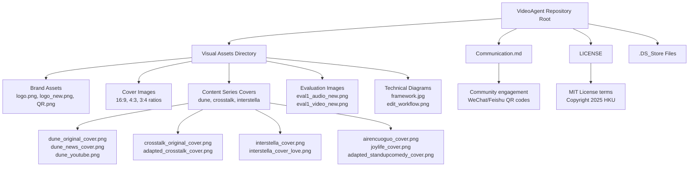
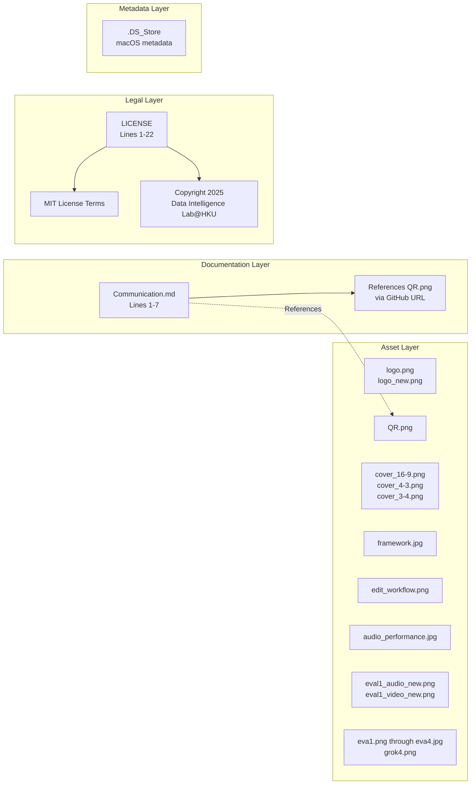
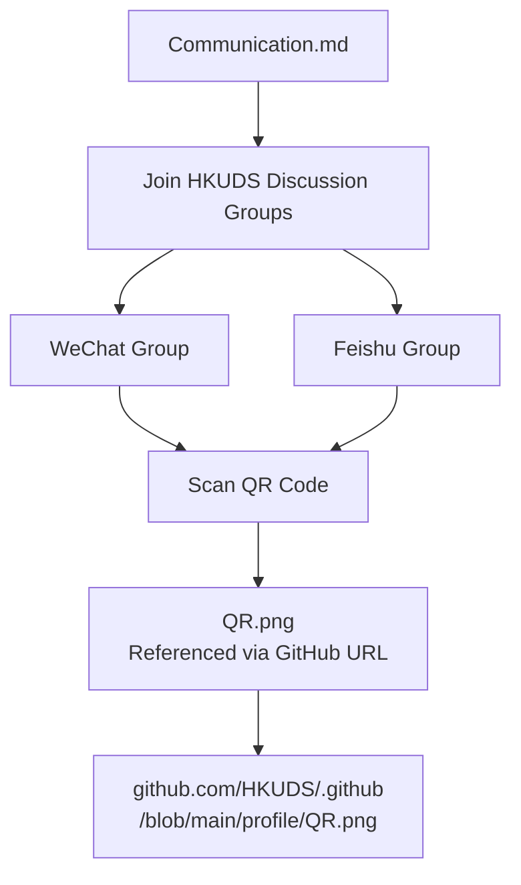

<!-- source: DeepWiki mcp.deepwiki.com · repo HKUDS/VideoAgent · page 1 VideoAgent Overview · fetched 2026-11-09 -->

# VideoAgent Overview

<details>
<summary>Relevant source files</summary>

The following files were used as context for generating this wiki page:

- [Communication.md](Communication.md)
- [LICENSE](LICENSE)
- [assets/framework.jpg](assets/framework.jpg)
- [assets/logo.png](assets/logo.png)

</details>


## Purpose and Scope

This document provides a high-level introduction to the VideoAgent repository maintained by the Data Intelligence Lab at HKU. Based on the available clusters analyzed, this page documents the repository's structure as an asset and documentation repository, explains its licensing terms, and outlines the community engagement mechanisms.

**Important Note**: The clusters provided for analysis contain only static assets, metadata files, and documentation. No executable code files (Python, JavaScript, configuration files, etc.) are present in the analyzed clusters. This limitation means the functional system architecture, component interactions, and implementation details cannot be documented at this time.

For detailed information about specific components:
- For community engagement and licensing details, see [Community and Licensing](#2)
- For asset organization and directory structure, see [Asset Repository Structure](#3)
- For content collections documentation, see [Content Library](#4)
- For evaluation assets, see [Evaluation Assets](#5)
- For technical diagrams, see [Technical Documentation Assets](#6)
- For branding materials, see [Branding and Identity Assets](#7)
- For repository maintenance guidelines, see [Repository Maintenance](#8)

**Sources**: High-level system architecture analysis, all clusters overview

## Repository Nature and Current Analysis Scope

The VideoAgent repository at `https://github.com/HKUDS/VideoAgent` appears to be a comprehensive project from the Data Intelligence Lab at Hong Kong University. However, the current analysis scope is limited to non-code assets due to the clusters provided.

### Analysis Coverage

| Asset Category | Status | Count | Details |
|----------------|--------|-------|---------|
| Documentation Files | ✓ Present | 1 | `Communication.md` |
| Legal Documents | ✓ Present | 1 | `LICENSE` (MIT) |
| Visual Assets | ✓ Present | 30+ | Logos, covers, evaluation images, diagrams |
| System Metadata | Present | Multiple | `.DS_Store` files (should be gitignored) |
| Executable Code | ✗ Not in clusters | 0 | Python, JS, config files absent from analysis |

**Sources**: High-level system architecture analysis, cluster content inventory

## Repository File Organization

The following diagram illustrates the actual file structure present in the analyzed clusters, showing the relationship between different file types and their purposes.

### Repository Structure Diagram



**Sources**: All asset clusters, high-level system architecture analysis

## Core Repository Components

The following diagram maps the natural language concepts to actual file entities present in the repository, enabling readers to locate specific files.

### File Entity Mapping



This diagram shows the actual file paths and line references for all documented components. Each node represents a real file or set of files in the repository.

**Sources**: [Communication.md:1-7](), [LICENSE:1-22](), asset cluster inventory

## License and Copyright

The repository is governed by the MIT License, which provides broad permissions for use, modification, and distribution.

### License Details

| Attribute | Value |
|-----------|-------|
| License Type | MIT License |
| Copyright Holder | ✨Data Intelligence Lab@HKU✨ |
| Copyright Year | 2025 |
| File Location | [LICENSE:1-22]() |

### Key Permissions

The MIT License grants the following permissions without restriction:
- Use the software
- Copy the software
- Modify the software
- Merge with other software
- Publish the software
- Distribute the software
- Sublicense the software
- Sell copies of the software

The only requirements are:
1. Include the copyright notice in all copies ([LICENSE:12-13]())
2. Include the license notice in all copies ([LICENSE:12-13]())

**Sources**: [LICENSE:1-22]()

## Community Engagement

The repository includes community engagement mechanisms through the `Communication.md` file, which facilitates joining discussion groups.

### Communication Channels



The `Communication.md` file serves as the entry point for community members to join discussion groups on two platforms:
- **WeChat**: Popular Chinese messaging platform
- **Feishu**: Collaboration platform (also known as Lark internationally)

Both platforms use the same QR code for access, which is referenced from the HKUDS organization profile ([Communication.md:5]()).

**Sources**: [Communication.md:1-7]()

## Repository Organization Overview

The repository follows a flat structure for most assets, with visual materials organized by purpose rather than directory hierarchy. The main categories include:

1. **Documentation**: Community communication guidelines
2. **Legal**: Licensing terms
3. **Brand Assets**: Logos and QR codes (see [Branding and Identity Assets](#7))
4. **Content Covers**: Multiple series organized by theme (see [Content Library](#4))
5. **Evaluation Assets**: Test results and benchmarks (see [Evaluation Assets](#5))
6. **Technical Diagrams**: Framework and workflow visualizations (see [Technical Documentation Assets](#6))

### Asset Distribution

| Category | File Count | Primary Format | Purpose |
|----------|-----------|----------------|---------|
| Logos | 2 | PNG | Brand identity |
| QR Codes | 1 | PNG | Community access |
| Cover Images (Generic) | 3 | PNG | Multiple aspect ratios |
| Content Series Covers | 10+ | PNG | Specific content themes |
| Evaluation Images | 6+ | PNG/JPG | Test results |
| Technical Diagrams | 3 | PNG/JPG | Documentation |
| Documentation | 1 | MD | Community info |
| Legal | 1 | Plain text | License |

**Sources**: Asset cluster inventory, high-level system architecture analysis

## System Metadata and Best Practices

The repository contains `.DS_Store` files, which are macOS system metadata files that track Finder view preferences. These files should not be tracked in version control.

### Recommended `.gitignore` Entry

```
.DS_Store
**/.DS_Store
```

For detailed maintenance guidelines and best practices, see [Repository Maintenance](#8).

**Sources**: Asset cluster inventory, repository health analysis

## Limitations and Future Documentation

This overview is limited by the clusters provided for analysis. The following components are not documented because they are absent from the analyzed clusters:

- Source code files (Python, JavaScript, etc.)
- Configuration files
- Build scripts
- Test suites
- Package management files (requirements.txt, package.json, etc.)
- Continuous integration configurations
- Database schemas or migrations
- API specifications

To provide complete technical documentation of the VideoAgent system, including functional architecture, component interactions, and implementation details, access to code-containing clusters would be required.

**Sources**: High-level system architecture analysis, cluster limitation analysis

---

