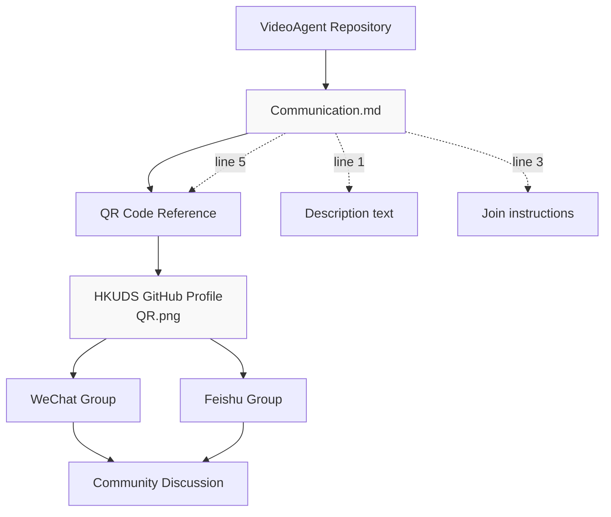
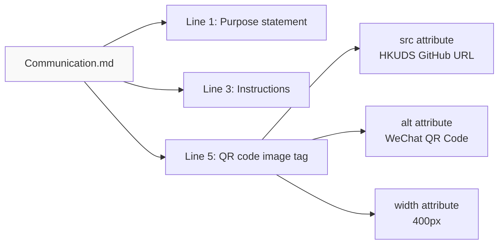
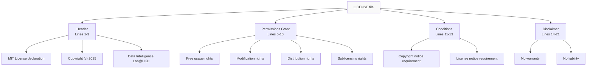
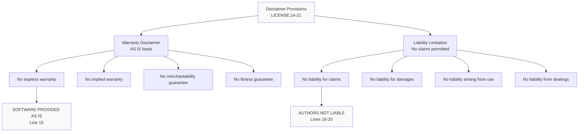
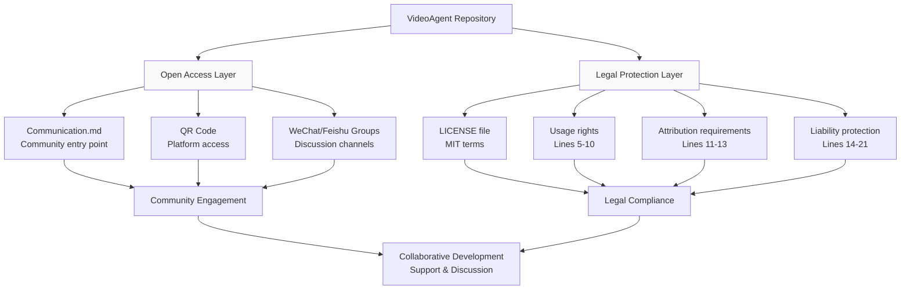

<!-- source: DeepWiki mcp.deepwiki.com · repo HKUDS/VideoAgent · page 2 Community and Licensing · fetched 2026-11-09 -->

# Community and Licensing

Relevant source files

The following files were used as context for generating this wiki page:

- [Communication.md](Communication.md)
- [LICENSE](LICENSE)
- [assets/QR.png](assets/QR.png)

## Purpose and Scope

This document describes the community engagement infrastructure and licensing terms for the VideoAgent repository. It covers the mechanisms for joining discussion groups (WeChat and Feishu) and details the MIT License terms that govern usage of the repository's contents. For information about the repository's asset organization, see [Asset Repository Structure](#3). For branding assets including QR codes, see [Branding and Identity Assets](#7).

---

## Community Engagement

The VideoAgent repository provides structured community engagement through two primary communication platforms: **WeChat** and **Feishu**. These platforms are managed by the HKU Data Intelligence Lab (HKUDS) and facilitate collaboration, support, and discussion among users and contributors.

### Communication Infrastructure

The repository includes a dedicated communication file that serves as the entry point for community participation:

| File | Purpose | Location |
|------|---------|----------|
| `Communication.md` | Community access instructions | Root directory |
| QR code image | Visual access token | Referenced via GitHub URL |

The `Communication.md` file [Communication.md:1-7]() provides explicit instructions for joining discussion groups, directing users to scan QR codes for platform access. The QR code image is hosted in the HKUDS organization's main GitHub profile repository.

### Community Access Flow

**Sources:** [Communication.md:1-7]()

### Messaging Platform Integration

The repository integrates with two distinct messaging platforms to accommodate different user preferences:

**WeChat**: Chinese-language dominant platform, widely used in Asian markets  
**Feishu**: Enterprise collaboration platform (also known as Lark internationally)

Both platforms are accessed through a unified QR code mechanism. The QR code image is referenced via absolute URL pointing to `https://github.com/HKUDS/.github/blob/main/profile/QR.png` [Communication.md:5](), ensuring centralized management of community access credentials.

### Communication.md Structure

**Sources:** [Communication.md:1-7]()

---

## License Terms

The VideoAgent repository is distributed under the **MIT License**, one of the most permissive open-source licenses. The license grants broad usage rights while maintaining minimal restrictions.

### Copyright Information

| Attribute | Value |
|-----------|-------|
| License Type | MIT License |
| Copyright Year | 2025 |
| Copyright Holder | ✨Data Intelligence Lab@HKU✨ |
| License File | `LICENSE` |

**Sources:** [LICENSE:1-3]()

### License Structure and Components

The MIT License in this repository consists of four primary components defined in the `LICENSE` file:

**Sources:** [LICENSE:1-22]()

### Granted Permissions

The MIT License grants comprehensive permissions without charge [LICENSE:5]() to any person obtaining a copy of the software and associated documentation files. These permissions include:

| Permission | Scope | Citation |
|------------|-------|----------|
| Use | Unrestricted usage rights | [LICENSE:7-8]() |
| Modify | Right to alter and adapt | [LICENSE:7]() |
| Publish | Right to make publicly available | [LICENSE:8]() |
| Distribute | Right to share copies | [LICENSE:8]() |
| Sublicense | Right to grant licenses to others | [LICENSE:8]() |
| Sell | Right to commercialize | [LICENSE:8-9]() |

The license explicitly states "to deal in the Software without restriction" [LICENSE:6-7](), establishing a maximally permissive usage framework.

**Sources:** [LICENSE:5-10]()

### License Conditions

The MIT License imposes minimal conditions on usage. Only two requirements must be satisfied:

1. **Copyright Notice Inclusion**: The copyright notice must be included in all copies or substantial portions of the Software [LICENSE:12-13]()
2. **License Text Inclusion**: The license permission text must be included in all copies or substantial portions of the Software [LICENSE:12-13]()

These conditions ensure proper attribution while maintaining the permissive nature of the license.

**Sources:** [LICENSE:11-13]()

### Warranty Disclaimer and Liability Limitation

The license includes standard disclaimer language protecting the copyright holder:

**Sources:** [LICENSE:14-21]()

The software is provided "AS IS" without any warranty [LICENSE:15](). The authors and copyright holders bear no liability for any claims, damages, or other liability, whether in contract, tort, or otherwise [LICENSE:18-20]().

### License Applicability

The license applies to both:
- **The Software**: The actual code and functional components
- **Associated Documentation Files**: All documentation, assets, and supporting materials

This comprehensive scope [LICENSE:6]() ensures all repository contents are governed under the same permissive terms.

**Sources:** [LICENSE:5-6]()

---

## Community and Licensing Integration

The repository's community and licensing mechanisms work together to create an accessible, legally-protected collaboration environment:

**Sources:** [Communication.md:1-7](), [LICENSE:1-22]()

### Practical Implications

| Aspect | Community Impact | License Impact |
|--------|------------------|----------------|
| Access | QR codes provide low-friction entry | No registration or approval required |
| Collaboration | Real-time discussion on WeChat/Feishu | Free to fork, modify, and share |
| Support | Direct communication with maintainers | No support obligations on maintainers |
| Usage Rights | Community members can contribute | All contributions subject to MIT terms |
| Attribution | Community credit through participation | Copyright notice must be preserved |

This dual-layer approach balances open collaboration with legal clarity, enabling broad participation while protecting both users and maintainers.

**Sources:** [Communication.md:1-7](), [LICENSE:1-22]()

---

