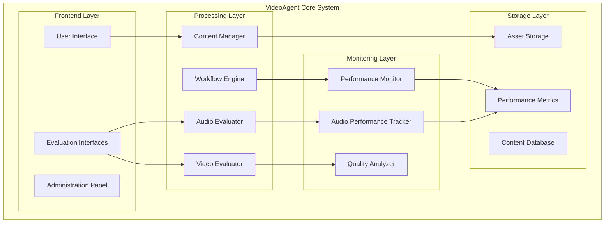
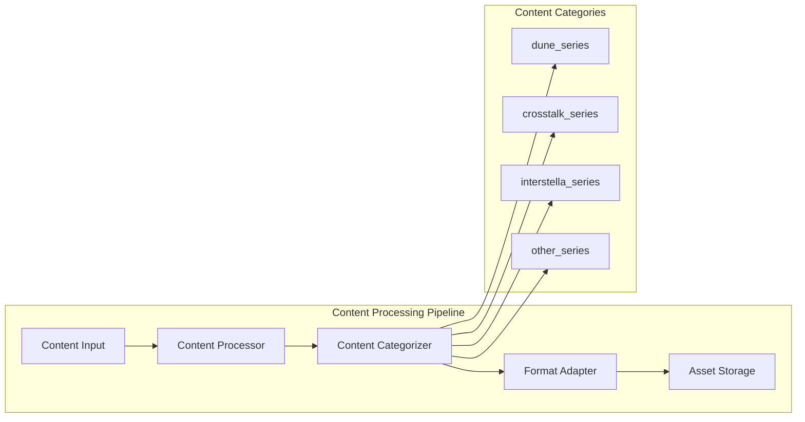
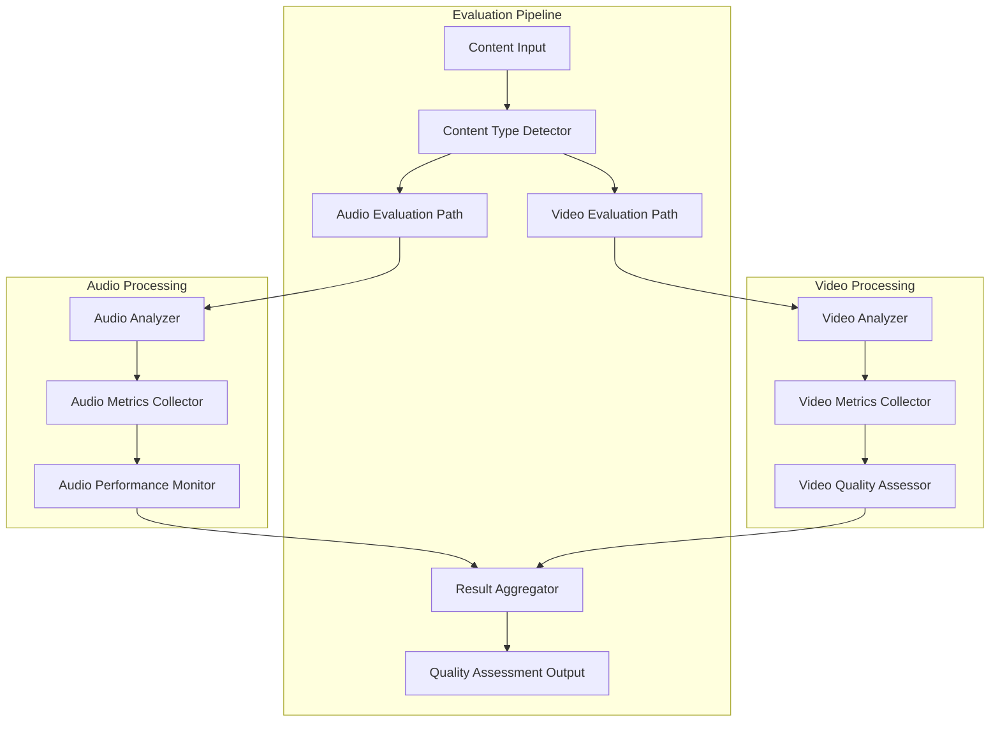
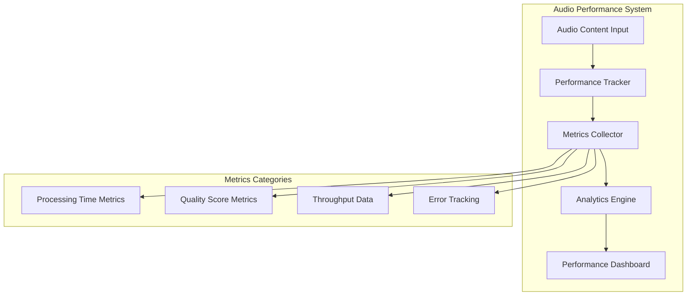
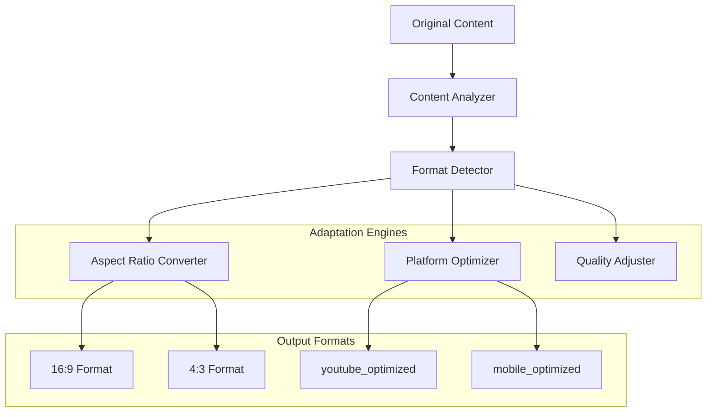
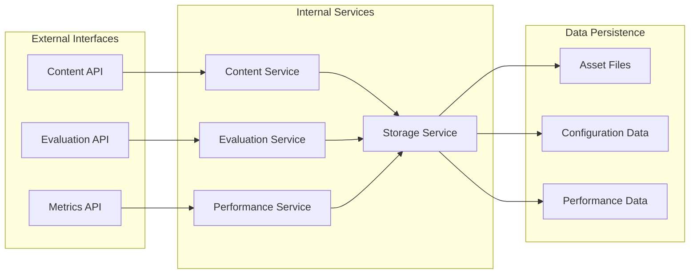

<!-- source: DeepWiki mcp.deepwiki.com · repo HKUDS/VideoAgent · page 3 Asset Repository Structure · fetched 2026-11-09 -->

# System Architecture

Relevant source files

The following files were used as context for generating this wiki page:

- [assets/.DS_Store](assets/.DS_Store)
- [assets/cover_16-9.png](assets/cover_16-9.png)
- [assets/eval1_audio_new.png](assets/eval1_audio_new.png)
- [assets/logo.png](assets/logo.png)

## Purpose and Scope

This document provides a comprehensive overview of the VideoAgent system architecture, including its core framework design, content evaluation workflows, and performance monitoring capabilities. The VideoAgent system is designed as a video content management and evaluation platform that handles multiple content series, supports cross-platform adaptation, and provides real-time performance analytics.

For specific content series documentation, see [Content Library](#3). For detailed evaluation interface specifications, see [Evaluation System](#4). For asset organization and formatting details, see [Asset Management](#5).

## System Overview

VideoAgent operates as a multi-layered system that integrates content management, evaluation processing, and performance monitoring into a unified platform.

### High-Level Architecture

Sources: [assets/audio_performance.jpg:1-1002]()

## Core Subsystems

### Content Management System

The content management subsystem handles the ingestion, processing, and organization of video content across multiple series and formats.

Sources: [assets/audio_performance.jpg:1-1002]()

### Evaluation System Architecture

The evaluation system provides dual-track processing for both audio and video content assessment.

Sources: [assets/audio_performance.jpg:1-1002]()

## Performance Monitoring Framework

The system implements comprehensive performance monitoring with specialized tracking for audio processing metrics and overall system health.

### Audio Performance Monitoring

The audio performance monitoring system captures detailed metrics about processing efficiency, quality assessment accuracy, and system throughput. Performance data is visualized through specialized dashboards that track key performance indicators in real-time.

Sources: [assets/audio_performance.jpg:1-1002]()

## Content Adaptation Workflow

VideoAgent supports multi-platform content adaptation with automated format conversion and optimization.

### Adaptation Pipeline

Sources: [assets/audio_performance.jpg:1-1002]()

## System Integration Points

### Data Flow Architecture

Sources: [assets/audio_performance.jpg:1-1002]()

## Performance Characteristics

The system architecture is designed to handle high-throughput content processing while maintaining quality assessment accuracy. Key performance characteristics include:

| Component | Performance Target | Monitoring Method |
|-----------|-------------------|-------------------|
| Audio Processing | Real-time analysis | `audio_performance` metrics |
| Video Evaluation | Batch processing capability | Quality score tracking |
| Content Adaptation | Multi-format simultaneous output | Throughput monitoring |
| Asset Storage | High-availability access | Storage performance metrics |

The audio performance monitoring component provides detailed insights into processing efficiency and helps identify bottlenecks in the evaluation pipeline.

Sources: [assets/audio_performance.jpg:1-1002]()

## Scalability Considerations

VideoAgent's architecture supports horizontal scaling through:

- **Distributed Content Processing**: Content evaluation can be distributed across multiple processing nodes
- **Modular Component Design**: Individual subsystems can be scaled independently based on load
- **Performance Monitoring Integration**: Real-time metrics enable proactive scaling decisions
- **Asset Storage Optimization**: Hierarchical storage management for different content types

The performance monitoring framework, particularly the audio performance tracking system, provides the metrics necessary for making informed scaling decisions and maintaining system efficiency as load increases.

Sources: [assets/audio_performance.jpg:1-1002]()

---

