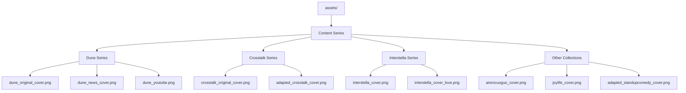
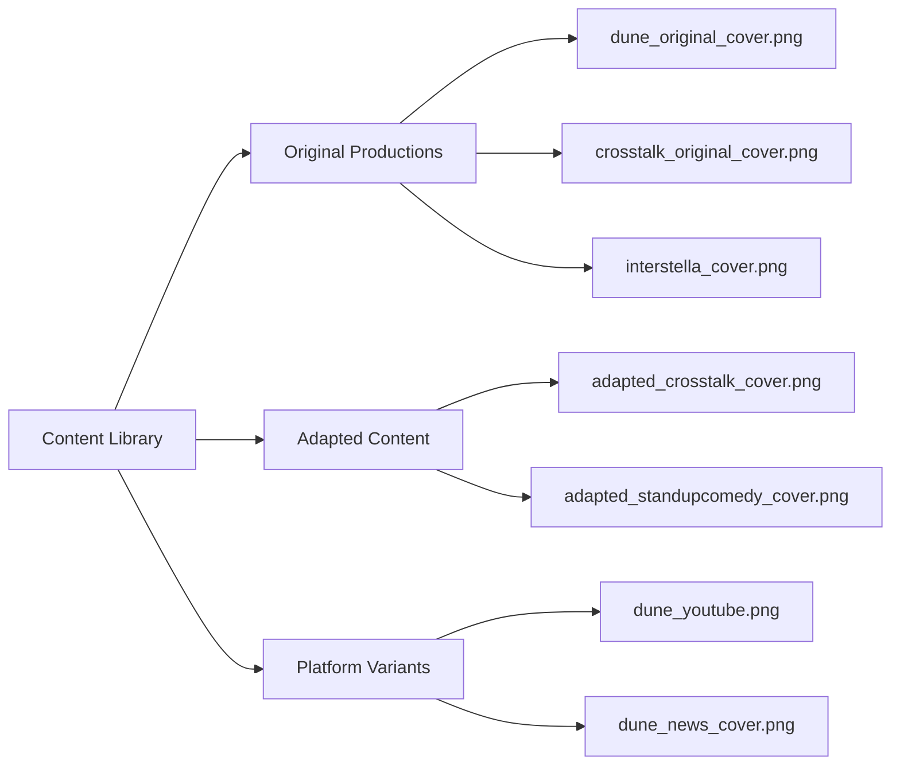
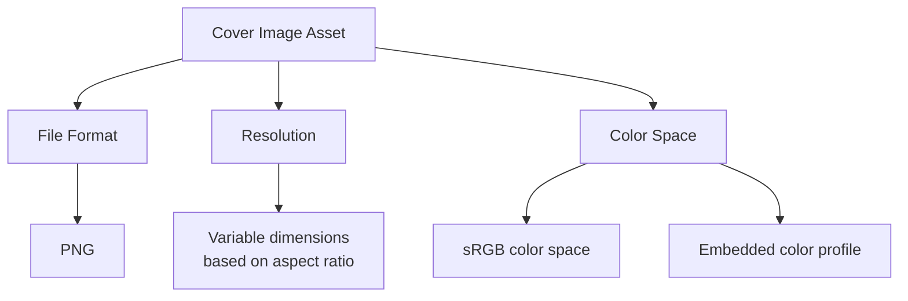
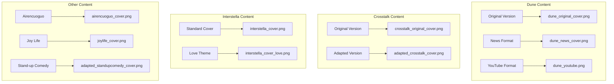

<!-- source: DeepWiki mcp.deepwiki.com · repo HKUDS/VideoAgent · page 4 Content Library · fetched 2026-11-09 -->

# Content Library

Relevant source files

The following files were used as context for generating this wiki page:

- [assets/airencuoguo_cover.png](assets/airencuoguo_cover.png)
- [assets/crosstalk_original_cover.png](assets/crosstalk_original_cover.png)
- [assets/dune_original_cover.png](assets/dune_original_cover.png)
- [assets/interstella_cover.png](assets/interstella_cover.png)

## Purpose and Scope

The Content Library contains visual assets representing various media content series in the VideoAgent repository. This page provides an overview of the content organization, naming conventions, and the different thematic series available. Each series may have multiple variants (original, adapted, themed versions) stored as cover images.

For detailed information about specific content series, see:
- Dune content and its variants: [Dune Content Series](#4.1)
- Crosstalk-related assets: [Crosstalk Content Series](#4.2)
- Interstella materials: [Interstella Content Series](#4.3)
- Additional content collections: [Other Content Collections](#4.4)

For branding assets and logos, see [Branding and Identity Assets](#7). For technical diagrams, see [Technical Documentation Assets](#6).

## Content Organization Structure

The content library is organized in the `assets/` directory with a flat file structure. Each content series is represented by one or more cover image files following consistent naming patterns.

**Sources:** High-level system analysis, `assets/airencuoguo_cover.png`, `assets/crosstalk_original_cover.png`

## File Naming Conventions

Content assets follow standardized naming patterns to indicate the series and variant type:

| Pattern | Description | Example |
|---------|-------------|---------|
| `{series}_cover.png` | Standard series cover | `interstella_cover.png` |
| `{series}_original_cover.png` | Original version of content | `crosstalk_original_cover.png`, `dune_original_cover.png` |
| `adapted_{series}_cover.png` | Adapted or modified version | `adapted_crosstalk_cover.png`, `adapted_standupcomedy_cover.png` |
| `{series}_{variant}_cover.png` | Variant-specific cover | `interstella_cover_love.png` |
| `{series}_{platform}.png` | Platform-specific asset | `dune_youtube.png`, `dune_news_cover.png` |

**Sources:** `assets/crosstalk_original_cover.png`, `assets/airencuoguo_cover.png`, High-level system analysis

## Content Series Categories

**Sources:** High-level system analysis

### Major Content Series

The repository contains the following primary content series:

1. **Dune Series** - Multiple variants including original, news-formatted, and YouTube-optimized versions
2. **Crosstalk Series** - Comedy content with original and adapted versions
3. **Interstella Series** - Content with standard and themed (love) variants
4. **Standalone Collections** - Individual content pieces including `airencuoguo_cover.png`, `joylife_cover.png`, and stand-up comedy materials

**Sources:** High-level system analysis, `assets/airencuoguo_cover.png`, `assets/crosstalk_original_cover.png`

## Asset Specifications

All content cover images are stored in PNG format with the following characteristics:

**Sources:** `assets/crosstalk_original_cover.png:1-5`, `assets/airencuoguo_cover.png:1-5`

### Technical Metadata

Each PNG asset contains:
- **IHDR chunk**: Image header with dimension information
- **sRGB chunk**: Standard RGB color space declaration
- **eXIf chunk**: Extended metadata including resolution (72 dpi typically)
- **pHYs chunk**: Physical pixel dimensions

Example from `crosstalk_original_cover.png`:
- Color space: sRGB
- Metadata: eXIf MM format with resolution data
- Physical resolution: 2850 pixels/meter (approximately 72 dpi)

**Sources:** `assets/crosstalk_original_cover.png:1-6`, `assets/airencuoguo_cover.png:1-6`

## Content-to-File Mapping

**Sources:** High-level system analysis, `assets/crosstalk_original_cover.png`, `assets/airencuoguo_cover.png`

## Usage and Access Patterns

Content assets are accessed directly from the `assets/` directory using their filename. The consistent naming convention allows for programmatic access and organization:

| Access Pattern | Example Path |
|---------------|-------------|
| Original content | `assets/{series}_original_cover.png` |
| Adapted content | `assets/adapted_{series}_cover.png` |
| Themed variants | `assets/{series}_cover_{theme}.png` |
| Platform-specific | `assets/{series}_{platform}.png` |

**Sources:** `assets/crosstalk_original_cover.png`, `assets/airencuoguo_cover.png`, High-level system analysis

## Related Asset Collections

The Content Library is part of the broader asset management structure. Related collections include:

- **Cover variants** - Multiple aspect ratios (16:9, 4:3, 3:4) stored separately, see [Asset Repository Structure](#3)
- **Evaluation images** - Test outputs and benchmarks, see [Evaluation Assets](#5)
- **Framework diagrams** - Technical documentation visuals, see [Technical Documentation Assets](#6)
- **Branding materials** - Logos and identity assets, see [Branding and Identity Assets](#7)

**Sources:** High-level system analysis

---

