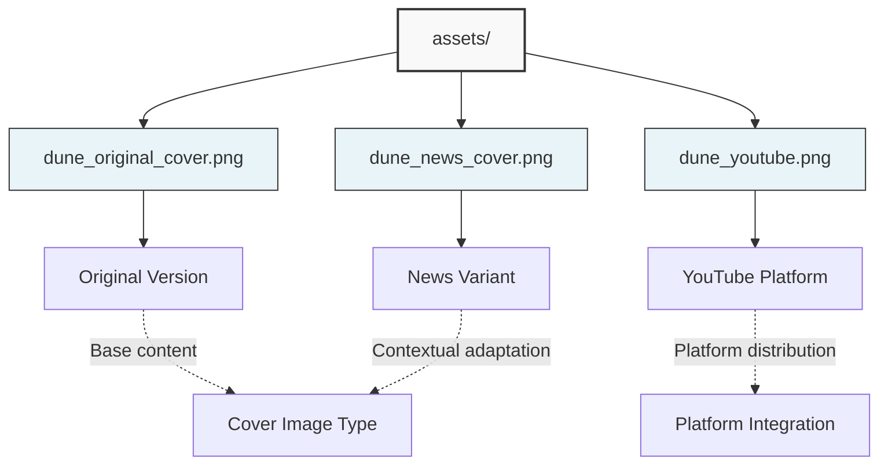
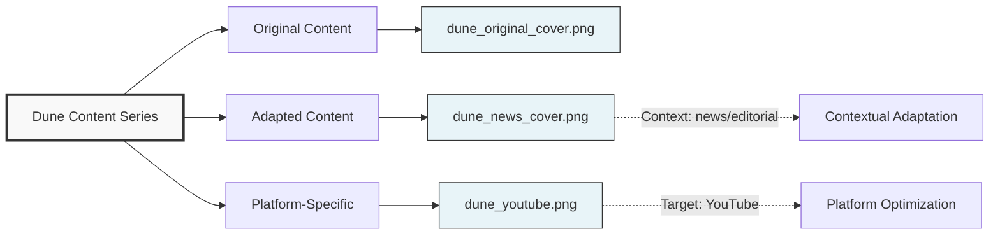
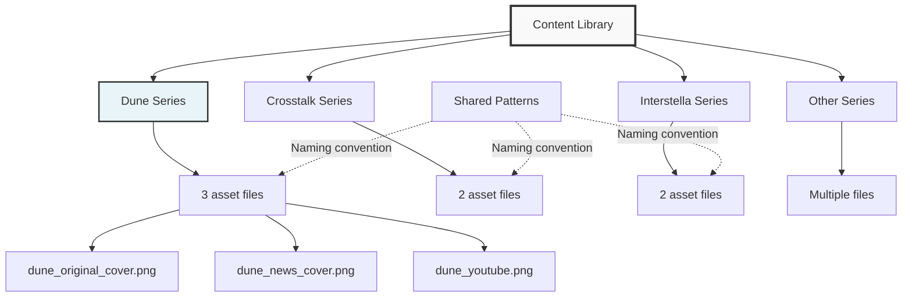
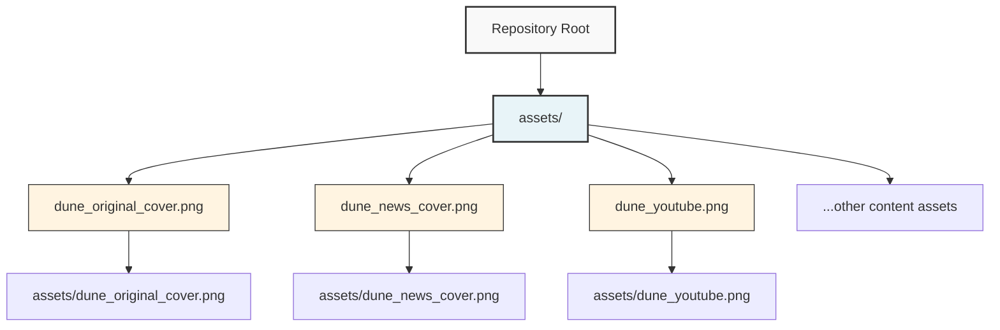
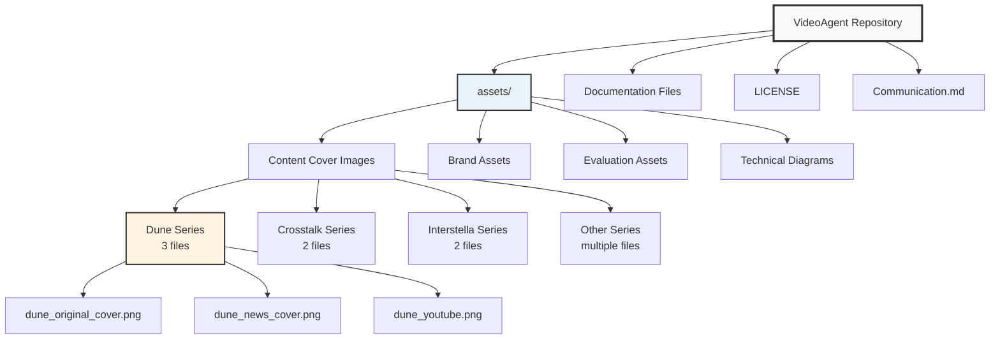
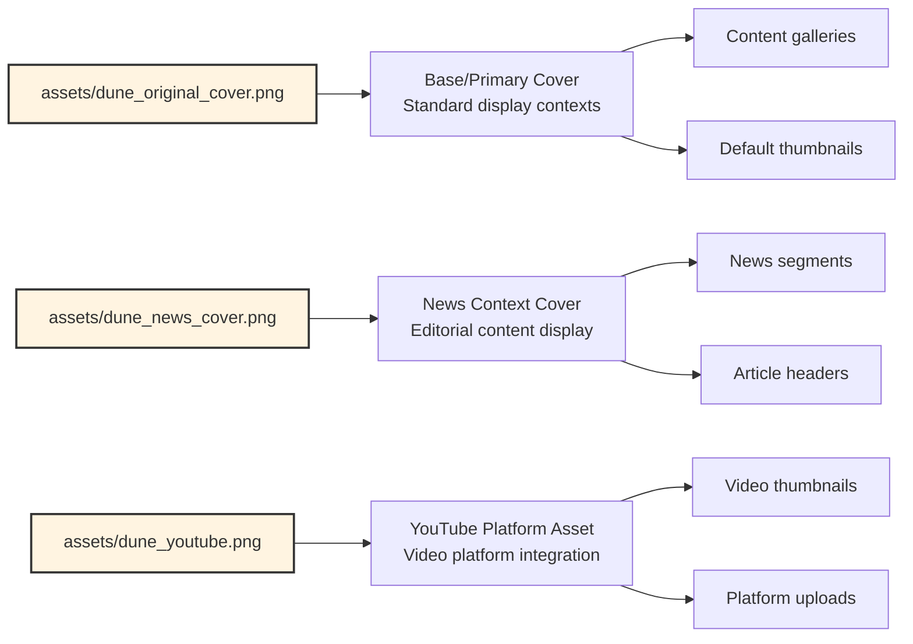

<!-- source: DeepWiki mcp.deepwiki.com · repo HKUDS/VideoAgent · page 4.1 Dune Content Series · fetched 2026-11-09 -->

# Dune Content Series

<details>
<summary>Relevant source files</summary>

The following files were used as context for generating this wiki page:

- [assets/dune_news_cover.png](assets/dune_news_cover.png)
- [assets/dune_original_cover.png](assets/dune_original_cover.png)
- [assets/dune_youtube.png](assets/dune_youtube.png)

</details>


## Purpose and Scope

This document catalogs all Dune-related visual assets within the VideoAgent repository. The Dune Content Series represents one of the major content categories in the asset library, encompassing cover images, news-related visuals, and YouTube integration materials. These assets appear to support video content processing, presentation, or documentation related to the Dune franchise.

For information about other content series, see [Crosstalk Content Series](#3.2), [Interstella Content Series](#3.3), and [Other Content Series](#3.4). For broader asset organization patterns, see [Asset Repository Structure](#2).

## Asset Inventory

The Dune Content Series consists of three distinct asset files stored in the `assets/` directory:

| Asset File | Purpose | Type |
|------------|---------|------|
| `dune_original_cover.png` | Original/primary cover image | Cover Image |
| `dune_news_cover.png` | News-related variant cover | Cover Image |
| `dune_youtube.png` | YouTube platform integration asset | Platform-Specific |

**Sources:** [assets/dune_news_cover.png:1-1](), High-level System Architecture Analysis

## File Organization Structure



**Sources:** [assets/dune_news_cover.png:1-1](), High-level System Architecture Analysis

## Asset Variants and Versioning

The Dune Content Series follows a clear variant naming pattern that indicates functional differentiation:

### Original Cover Asset

**File:** `assets/dune_original_cover.png`

This asset represents the primary, unmodified cover image for Dune content. The "original" designation distinguishes it from adapted or platform-specific variants. This naming pattern is consistent with other content series in the repository (e.g., `crosstalk_original_cover.png`, `masterma_original_cover.png`).

### News Cover Variant

**File:** `assets/dune_news_cover.png`

This variant appears to be specialized for news-related content or context. The `_news_` infix suggests this cover is adapted for news segments, updates, or editorial content related to Dune. This represents a contextual adaptation rather than a technical format change.

### YouTube Integration Asset

**File:** `assets/dune_youtube.png`

The YouTube-specific asset indicates platform-targeted content preparation. This may include:
- Platform-optimized dimensions or aspect ratios
- Thumbnail specifications for YouTube
- Branding elements specific to YouTube distribution
- Metadata visualization for video platform display

**Sources:** [assets/dune_news_cover.png:1-1](), High-level System Architecture Analysis

## Content Type Classification



**Sources:** High-level System Architecture Analysis, Repository File Organization Diagram

## Asset Naming Convention

The Dune assets follow the repository-wide naming convention:

```
[content_name]_[variant_type]_[descriptor].png
```

Breaking down the pattern:
- **content_name**: `dune` - identifies the content series
- **variant_type**: `original`, `news`, or platform name
- **descriptor**: `cover` or platform identifier
- **extension**: `.png` - PNG image format

This pattern enables:
1. Programmatic asset discovery by content series
2. Clear differentiation between variants
3. Consistent file system organization
4. Easy pattern matching for automated processing

**Sources:** [assets/dune_news_cover.png:1-1](), High-level System Architecture Analysis

## Relationship to Other Asset Categories



**Sources:** High-level System Architecture Analysis, Asset Versioning and Variants Diagram

## Technical Specifications

### File Format

All Dune Content Series assets use the **PNG (Portable Network Graphics)** format, as indicated by the `.png` file extension. The files are binary image data containing PNG image signatures and IDAT chunks. PNG provides:
- Lossless compression
- Alpha channel support for transparency
- Wide platform compatibility
- Suitable for cover images and thumbnails

The binary nature of these files means they contain encoded pixel data, color profiles (sRGB), and EXIF metadata rather than textual content. The file headers indicate standard PNG formatting with IHDR chunks defining image dimensions.

### File Location

**Base Directory:** `assets/`

All Dune assets are stored in the root-level assets directory alongside other content series assets. This flat organizational structure simplifies asset discovery and management.

### File System Mapping



**Sources:** [assets/dune_news_cover.png:1-4](), Repository file structure analysis

## Inferred Usage Patterns

Based on the asset naming and structure, the Dune Content Series likely supports:

1. **Multi-Context Content Display**: The original and news variants suggest content is displayed in different contexts (standard viewing vs. news/editorial segments)

2. **Platform Distribution**: The YouTube-specific asset indicates multi-platform content distribution with platform-optimized resources

3. **Version Management**: The explicit "original" designation implies a version control or variant management system

4. **Automated Processing**: Consistent naming patterns enable programmatic asset selection based on context or platform requirements

**Sources:** High-level System Architecture Analysis, Inferred Content Categories Diagram

## Asset Organization in Repository Context

The Dune Content Series assets are part of a larger asset organization system within the VideoAgent repository. While the functional code for VideoAgent is not present in the analyzed clusters, the asset organization suggests these files serve as visual resources for video content processing or presentation.

### Repository Asset Structure



**Note:** The VideoAgent application code is not present in the analyzed repository clusters. This documentation focuses on the asset files themselves and their observable organization patterns.

**Sources:** High-level System Architecture Analysis, Repository Asset Organization Diagram

## Asset File Mapping

### Absolute File Path References

For programmatic access or automated processing, the Dune Content Series assets can be referenced using these exact file paths relative to the repository root:

```
assets/dune_original_cover.png
assets/dune_news_cover.png
assets/dune_youtube.png
```

### File Path to Purpose Mapping



These paths can be used in:
- Asset loading routines
- Build process resource bundling
- Documentation generation
- Testing and validation scripts
- Media processing pipelines

**Sources:** [assets/dune_news_cover.png:1-1](), Repository file structure, High-level System Architecture Analysis

## Comparison with Other Content Series

The Dune series follows similar but not identical patterns to other content series:

| Series | Original Cover | Adapted/Variant | Platform-Specific |
|--------|---------------|-----------------|-------------------|
| Dune | ✓ `dune_original_cover.png` | ✓ `dune_news_cover.png` | ✓ `dune_youtube.png` |
| Crosstalk | ✓ `crosstalk_original_cover.png` | ✓ `adapted_crosstalk_cover.png` | ✗ |
| Interstella | ✓ `interstella_cover.png` | ✓ `interstella_cover_love.png` | ✗ |
| Masterma | ✓ `masterma_original_cover.png` | ✓ `masterma_cover.png` | ✗ |

The Dune series is **unique** in having a dedicated YouTube platform asset, suggesting it may receive special treatment for video platform distribution.

**Sources:** High-level System Architecture Analysis, Inferred Content Categories

## Related Documentation

- [Content Library](#3) - Overview of all content series
- [Crosstalk Content Series](#3.2) - Similar series with adapted variants
- [Interstella Content Series](#3.3) - Series with variant naming patterns
- [Branding and UI Assets](#6) - Platform-specific branding materials
- [Asset Management](#5) - Asset organization and management patterns

**Sources:** Table of Contents JSON

---

