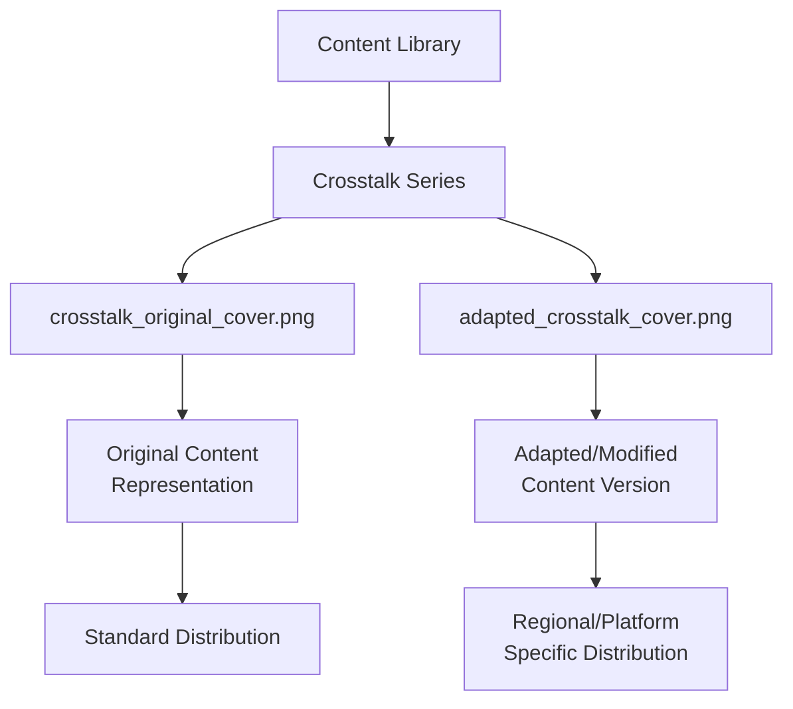
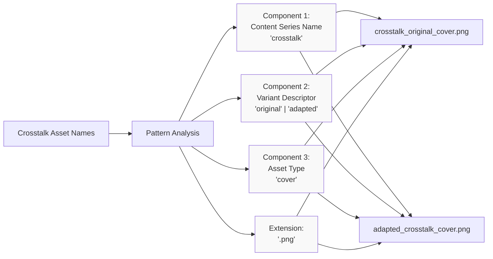

<!-- source: DeepWiki mcp.deepwiki.com · repo HKUDS/VideoAgent · page 4.2 Crosstalk Content Series · fetched 2026-11-09 -->

# Crosstalk Content Series

Relevant source files

The following files were used as context for generating this wiki page:

- [assets/adapted_crosstalk_cover.png](assets/adapted_crosstalk_cover.png)
- [assets/crosstalk_original_cover.png](assets/crosstalk_original_cover.png)

## Purpose and Scope

This document describes the Crosstalk content series assets within the VideoAgent repository. The Crosstalk series consists of cover images that represent crosstalk comedy content, available in both original and adapted variants. 

For information about other content series in the repository, see [Dune Content Series](#4.1), [Interstella Content Series](#4.3), and [Other Content Collections](#4.4). For general content library organization, see [Content Library](#4).

**Sources:** High-level system architecture analysis, Diagram 3

---

## Asset Inventory

The Crosstalk content series contains two primary cover image assets:

| Asset File | Variant Type | Purpose |
|------------|-------------|---------|
| `crosstalk_original_cover.png` | Original | Standard cover image for crosstalk content in its original form |
| `adapted_crosstalk_cover.png` | Adapted | Modified or localized version of the cover image |

**Sources:** High-level system architecture analysis, Diagram 3

---

## Asset Organization Structure

**Diagram: Crosstalk Series Asset Hierarchy**

This diagram illustrates how the crosstalk assets are organized within the content library and their respective distribution contexts. The `crosstalk_original_cover.png` serves as the canonical representation, while `adapted_crosstalk_cover.png` provides a variant for specific distribution needs.

**Sources:** High-level system architecture analysis, Diagram 3

---

## Content Variants

### Original Cover

The `crosstalk_original_cover.png` asset represents the primary cover image for crosstalk content. This asset serves as the canonical visual representation of the content series.

**File Characteristics:**
- Format: PNG
- Type: Cover image
- Variant: Original
- Usage: Primary distribution channel

### Adapted Cover

The `adapted_crosstalk_cover.png` asset provides an alternative version of the cover image. The "adapted" designation suggests modification for specific contexts, which may include:

- Regional localization
- Platform-specific formatting requirements
- Content rating or audience targeting adjustments
- Branding or promotional variations

**File Characteristics:**
- Format: PNG
- Type: Cover image
- Variant: Adapted
- Usage: Secondary or specialized distribution channel

**Sources:** High-level system architecture analysis

---

## File Naming Convention Analysis

**Diagram: Crosstalk Asset Naming Convention**

The naming convention follows a structured pattern: `[prefix_]<series>_<variant>_<type>.<ext>`. The crosstalk series follows this pattern with:
- Series identifier: `crosstalk`
- Variant qualifiers: `original`, `adapted`
- Asset type: `cover`
- File extension: `png`

**Sources:** High-level system architecture analysis, Diagram 3

---

## Integration with Content Library

The Crosstalk series is one of several content series within the broader content library. It shares organizational patterns with other series:

| Content Series | Original Asset Pattern | Variant Asset Pattern |
|----------------|------------------------|----------------------|
| Crosstalk | `crosstalk_original_cover.png` | `adapted_crosstalk_cover.png` |
| Dune | `dune_original_cover.png` | `dune_news_cover.png`, `dune_youtube.png` |
| Interstella | `interstella_cover.png` | `interstella_cover_love.png` |

The crosstalk series follows a simplified two-variant structure compared to multi-platform series like Dune, which has platform-specific variants (news, YouTube).

**Sources:** High-level system architecture analysis, Diagram 3

---

## Asset Management Considerations

### Storage Location

While specific directory paths are not provided in the available cluster data, the crosstalk assets are presumably stored within the repository's asset directory structure alongside other content series covers.

### Version Control

Both `crosstalk_original_cover.png` and `adapted_crosstalk_cover.png` are tracked in version control as binary image assets. For best practices on binary asset management, see [Repository Maintenance](#8).

### Relationship to Evaluation Assets

The crosstalk content series assets are distinct from evaluation-related images documented in [Evaluation Assets](#5). Cover images represent content distribution materials, while evaluation assets represent test outputs and performance metrics.

**Sources:** High-level system architecture analysis

---

## Usage Context

The crosstalk content series assets serve as visual representations for crosstalk comedy content within the VideoAgent system. The dual-variant structure (original and adapted) suggests a distribution strategy that accommodates:

1. **Primary Distribution**: Using the original cover for standard channels
2. **Specialized Distribution**: Using the adapted cover for contexts requiring modification

This pattern indicates that the VideoAgent system supports content adaptation workflows, allowing for variant generation while maintaining the original asset as a reference.

**Sources:** High-level system architecture analysis

---

